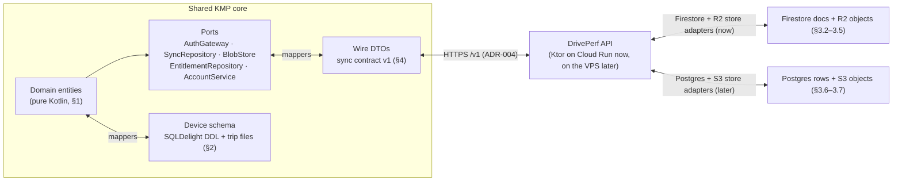
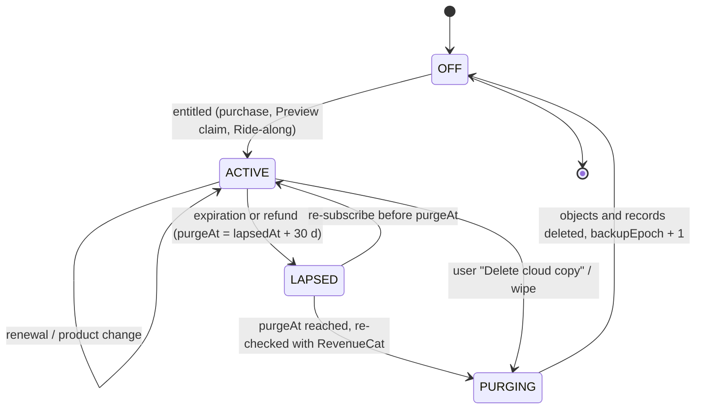

# DrivePerf data model, sync and privacy data flow

| | |
|---|---|
| **Jira** | DRIVE-51 (FND-04) · kickoff prompt A11 |
| **Author** | Agent A11 (backend and data) · 6 Nov 2026 |
| **Status** | Draft for Gate 4; updated with Keval's Gate 4 answers (6 Nov 2026: R0 kept, privacy zones backed up, restore in the 30-day window, trip files on Cloudflare R2). Written in parallel with A10's ADRs and aligned with them afterwards (§0.4): ADR-003 storage and file format, ADR-004 backend and migration seam, ADR-006 payments, ADR-007 analytics, ADR-010 Firebase vs VPS. |
| **Binding inputs** | [decisions.md](../product/decisions.md) (incl. the 6 Nov 2026 retention decision that resolves OQ-09), [PRD v1](../product/PRD-v1.md) (F-ACC, F-PRV, F-SUB, F-RTE, F-RPL, F-ANA, §5, §6, §9), [A3 feasibility](../research/2026-11/A3-platform-feasibility.md), [fixtures](../design/system/fixtures.md) and `prototypes/shared/data.js`, product-owner brief of 6 Nov 2026 (Firebase first, then a self-managed VPS with no client rewrite). |
| **Consumers** | A14 (shared KMP core: schema, sync engine), A15/A16 (platform adapters, file protection), A17 (API, Firestore/Storage rules, indexes, jobs), A12 (trip file channels), A20 (store privacy forms), counsel (PIA, policy). |

**Contents.** [0 Principles and layers](#0-principles-and-layers) · [1 Domain entities](#1-domain-entities) · [2 On-device storage](#2-on-device-storage) · [3 Cloud schema](#3-cloud-schema) · [4 Sync protocol](#4-sync-protocol) · [5 Retention, deletion and the purge job](#5-retention-deletion-and-the-purge-job) · [6 Privacy data-flow map and store forms](#6-privacy-data-flow-map-and-store-forms) · [7 Size and cost](#7-size-and-cost-estimates) · [8 Firebase → VPS migration runbook](#8-firebase--vps-migration-runbook-outline) · [9 Open questions](#9-open-questions) · [Sources](#sources)

---

## Summary

- **Local-first.** The phone's SQLite database (SQLDelight) and per-trip files are the source of truth for every tier. The cloud is a *backup and multi-device mirror* that only Pro (including Pro Preview and the Ride-along pass) writes to.
- **Five representations, one domain model.** Domain entities (pure Kotlin) ↔ device schema (SQLDelight DDL + trip files) ↔ wire DTOs (the sync contract) ↔ cloud storage (Firestore documents now, Postgres rows later) ↔ blob objects (Cloudflare R2, S3-compatible, before and after the VPS move). Mappers live only at the edges; nothing above the data layer sees a Firestore type or a SQL row.
- **Portable identity.** Every record ID is a client-generated **UUIDv7**. The only server-assigned ID is the account ID (the Firebase UID), which is kept as an opaque string forever, including after migration (it is also the RevenueCat app user ID).
- **Every record** carries `schemaVersion`, `createdAt`, `updatedAt`, `deletedAt` (tombstone) and, in the cloud, a per-account change counter `rev` (identical in Firestore and Postgres) plus `serverUpdatedAt`. Times are UTC epoch milliseconds plus the local UTC offset in minutes (and an IANA zone where it matters).
- **What leaves the phone.** For Pro backup: trip summaries, events, scores, a simplified preview track, the analysis-grade trip file ("R1", ≈ 0.6 MB per driving hour), routes, cars, places, privacy zones, settings and consents. **Never:** full-rate raw sensor logs ("R0"), car photos, recaps, glyphs and other recomputable data. Free users who sign in upload **only an account record**.
- **Sync contract** is API-shaped: resources, per-resource cursors, mutations with idempotency keys, per-field last-writer-wins on hybrid logical clocks, tombstones that never resurrect. ADR-004 implements it as **our own `/v1` HTTP API on Cloud Run** in front of Firestore and Cloudflare R2, so the move to a VPS changes only server adapters (§4.9). The contract would also work over Firebase SDKs; that variant is kept only as a documented fallback.
- **Retention** follows the 6 Nov 2026 decision: device data kept until the user deletes it; Pro cloud data kept until the user deletes it or the account; when Pro ends the cloud copy is kept 30 days with reminders at 30/7/1 days, then a daily purge job deletes it (Cloud Scheduler calling the API's job endpoint on Firebase/Cloud Run, a systemd timer calling the same endpoint on the VPS; one codebase behind ports).
- **Cost.** About **US$0.005 per backed-up user per month** after a year; data storage, operations and the API come to roughly **about US$1/mo at 1k DAU, US$4–6/mo at 5k DAU and US$20–32/mo at 20k DAU** with 25 % of DAU backing up (§7; ADR-004's ≈ US$40–50 at 20k adds website hosting). Firestore stays inside the free daily operation quotas up to about 20k DAU; storage volume is the cost driver.

---

## 0. Principles and layers

### 0.1 Rules that every layer follows

| # | Rule | Why |
|---|---|---|
| P1 | The device database is the source of truth. The UI reads only local data. Network failures never block a screen. | Local-first (Gate 1 #7), EC-NET |
| P2 | Domain entities have no storage annotations, no Firestore or SQL types, no serialization framework types. | Clean architecture (AGENTS.md); migration seam (kickoff plan §3) |
| P3 | IDs: UUIDv7 (RFC 9562), generated on the device, lower-case canonical text on the wire, `uuid` in Postgres, `TEXT` in SQLite. The account ID is an opaque string ≤ 128 chars. | Offline creation, idempotent retries, time-ordered keys, no server round-trip |
| P4 | Instants: `Long` UTC epoch milliseconds. Local context: `tzOffsetMin` (signed minutes, e.g. −300 for EST) captured at the moment, plus `tzId` (IANA, e.g. `America/Toronto`) on trips and recaps for week and part-of-day bucketing. Durations in seconds (`Double`) or milliseconds (`Long`), named with a unit suffix. | DST-safe "Thursday evening" labels; portable |
| P5 | Units are SI in storage and on the wire: metres, seconds, m/s, degrees (WGS 84), and **g** for acceleration (1 g = 9.80665 m/s²) because every product surface speaks G. Display units (km/h, mph, km, mi) are presentation only. Field names carry the unit (`distanceM`, `maxSpeedMps`, `peakG`). | No unit bugs across platforms and exports |
| P6 | Every syncable record has `schemaVersion` (Int), `createdAt`, `updatedAt`, `deletedAt?`. Deletion is a **tombstone** with the body scrubbed, never a soft-hidden copy. | Sync convergence and real deletion (F-HIS-02, F-PRV-04) |
| P7 | Every user-visible metric has a **provenance** (`OBSERVED`, `DERIVED`, `ESTIMATED`) defined on the entity (PRD §5). Values that can be partly estimated carry an explicit split (e.g. `estimatedDistanceM`). | F-DQ-05 |
| P8 | Raw sensor data is a **file**, never rows in a document database. | Cost, portability (kickoff plan §3) |
| P9 | Derived data that can be recomputed deterministically from synced inputs is **not synced** (recaps, Wrapped, personal bests, glyphs, event evidence traces). | Fewer writes, no derived-data conflicts |
| P10 | Nothing in this model is used for ads, sold, or shared with insurers. No coordinates, route or car names, speeds or G values in analytics, crash logs or server logs. | PRD §3.0.4–3.0.5, §6.4 |

### 0.2 The five representations



| Layer | Lives in | Knows about | Never knows about |
|---|---|---|---|
| Domain | `shared/domain` | entities, value objects, use cases, port interfaces | SQL, Firestore, HTTP, protobuf |
| Device persistence | `shared/data/local` | SQLDelight `.sq` files, trip-file codec | Firestore, HTTP |
| Wire DTOs | `shared/data/sync` | JSON/protobuf DTOs of §4, mappers to domain | SQL tables, Firestore types |
| Remote adapter (client) | `shared/data/remote` (Ktor, ADR-004) | HTTP client for the §4 contract | Firestore, SQL, domain internals |
| Server | `backend/api` (same image on Cloud Run and the VPS) | contract DTOs, merge, Firestore and Postgres store adapters, the R2 (S3) blob adapter, jobs | client code |

### 0.3 Ports the clients code against

Names follow the PO brief and ADR-002/ADR-004 (which own the final signatures). The data model requires these capabilities:

```kotlin
// shared/domain/ports — illustrative signatures
interface AuthGateway {
    val session: StateFlow<AuthSession?>             // accountId, providers, email (may be relay)
    suspend fun signIn(method: SignInMethod): AuthResult
    suspend fun idToken(forceRefresh: Boolean = false): String   // bearer for HTTP, or SDK-internal
    suspend fun reauthenticate(): AuthResult          // before account deletion (F-PRV-05)
    suspend fun signOut()
}

interface SyncRepository {                            // §4 contract; Ktor HTTP adapter (ADR-004)
    suspend fun changeMarker(): ChangeMarker          // 1 cheap read: which resources changed
    suspend fun push(deviceId: DeviceId, mutations: List<Mutation>): List<MutationResult>
    suspend fun pull(resource: ResourceType, cursor: Cursor?, limit: Int = 500): ChangePage
}

interface BlobStore {                                 // trip files
    suspend fun put(key: BlobKey, file: LocalPath, sha256: String, sizeBytes: Long): BlobRef
    suspend fun get(key: BlobKey, into: LocalPath): BlobRef
    suspend fun delete(key: BlobKey)
}

interface EntitlementRepository {                     // RevenueCat + local Preview + server backup window
    val entitlement: StateFlow<Entitlement>
    suspend fun refresh()
    suspend fun claimPreviewBackup(installAt: Instant): BackupWindow   // §4.7
}

interface AccountService {
    suspend fun requestDeletion(reason: DeletionReason): DeletionReceipt   // §5.5
    suspend fun deletionStatus(): DeletionStatus
}
```

### 0.4 Alignment with A10's ADRs (written in parallel)

| ADR | Says | This document | Action |
|---|---|---|---|
| ADR-002/004 | Own `/v1` HTTP API on Cloud Run; clients use one Ktor adapter; Firestore/Storage rules deny clients; no Functions triggers; Scheduler jobs call `/v1/jobs/*` | Adopted throughout (§3.1, §3.3–3.4, §4.9, §5.4) | — |
| ADR-003 | SQLDelight; chunked protobuf + gzip; R0/R1 tiers; UUIDv7 as BLOB or TEXT ("A11 picks") | **TEXT** (canonical lower-case) everywhere on the device — readable in debugging and identical to the wire and Firestore IDs; 20 extra bytes per key is irrelevant at this scale | — |
| ADR-003 | R0 30-day default needs PO approval | ✅ Not approved at Gate 4: R0 is kept until the user deletes it (§2.6, §5.2) | — |
| ADR-004 rule 3 | `updatedAt` is server-assigned; `rev` incremented per write | `updatedAt` = the device's last-edit time (HLC wall, needed for LWW and offline display); the server stamps are **`rev`** (cursor, ordering) and **`serverUpdatedAt`** (commit time) | A10 to rename in rule 3 |
| ADR-004 rule 6 | Cursor `(updatedAt, id)` | Cursor = per-account **`rev`** assigned under per-account serialisation, because a timestamp cursor can skip a slow Postgres transaction (§4.5). Clients see an opaque string either way | A10 to update rule 6 |
| ADR-004 | Region `us-central1` | Adopted | — |
| ADR-006 | Preview claim via RevenueCat promotional entitlement; lapse reminders as local notifications from `GET /v1/entitlement` | Adopted (§4.7, §5.3), plus optional email for uninstalled users (OQ-A11-05) | — |
| ADR-010 | Stay on Firebase; migration phases M1–M8 with dual-write and Cloud Run traffic splitting | §8 gives the data-level steps inside those phases | — |

---

## 1. Domain entities

### 1.1 Conventions

- **Types:** `Uuid` (UUIDv7), `AccountId` (opaque string), `Instant` (epoch ms, UTC), `TzOffsetMin` (Int), `Int`, `Long`, `Double`, `String`, enums in `UPPER_SNAKE` (wire: `lower_snake`).
- **Prov.** column: **O** observed, **D** derived, **E** estimated, **U** user-entered, **S** system (bookkeeping). A metric marked "D/E" is derived but has an estimated part, which is stored separately.
- **Sync** column: **✓** syncs to Pro backup; **—** device only; **srv** server-authoritative (read-only on the client); **der** derived, recomputed on each device.
- All syncable entities also have the **record envelope** (§1.2), which is not repeated in each table.
- Fixture alignment: entity and field names follow `prototypes/shared/data.js` where sensible. Differences are listed in §1.19.

### 1.2 Record envelope (every syncable entity)

| Field | Type | Prov. | Notes |
|---|---|---|---|
| `id` | Uuid | S | UUIDv7, created on the device that creates the record |
| `schemaVersion` | Int | S | Version of *this entity's* body schema (starts at 1). Readers accept ≤ their max; writers never downgrade |
| `createdAt` | Instant | S | Device clock at creation |
| `updatedAt` | Instant | S | Wall part of the last field clock (§4.4); for display and coarse ordering only |
| `deletedAt` | Instant? | U/S | Tombstone. When set, every body field except the envelope is removed |
| `originDeviceId` | Uuid | S | Device that made the last change (diagnostics, "backed up from") |
| `fieldClock` | Map<String, Hlc> | S | Hybrid logical clock per mutable field group (§4.4). Not shown to users |

### 1.3 User (local profile) and Account

The **User** is the person on this phone and exists without an account. The **Account** exists only after sign-in.

| User field | Type | Unit | Prov. | Sync | Notes |
|---|---|---|---|---|---|
| `id` | Uuid | | S | — | Local profile ID (fixture `u_local_7f3a`). Never leaves the device |
| `accountId` | AccountId? | | S | — | Set after sign-in |
| `displayName` | String? | | U | ✓ settings | Optional first name for copy ("Nice drive, Marcus") |
| `region` | String | ISO 3166-2 | U/S | ✓ | `CA-ON`; from store/locale, editable |
| `storefront` | `CA`/`US`/`OTHER` | | O | — | From the store at runtime |
| `locale` | String | BCP 47 | O | — | `en-CA` |
| `units` | Units | | U | ✓ | `{distance: km|mi, speed: kmh|mph, elevation: m|ft, temperature: c|f}` |
| `installAt` | Instant | | O | — | First open. iOS: mirrored in the Keychain for Preview reinstall protection (F-SUB-02) |
| `ageConfirmedAt` | Instant? | | U | ✓ consent | 18+ attestation (F-ONB-02); the "under 18" path stores only a local flag |
| `termsAcceptance` | `{version, at}` | | U | ✓ consent | |
| `capture` | CapturePrefs | | U | ✓ | `{mode: auto|manual_only, autoDetect: on|paused, pausedUntil?, defaultVehicleId?, batterySaverRecording}` |
| `notifications` | NotificationPrefs | | U | ✓ | Per-category toggles + `quietHours {from, to}` local times |
| `appearance` | `system`/`dark`/`light` | | U | ✓ | |
| `analysisChannels` | Set<Channel> | | U | ✓ | F-RPL-05.4 persisted channel choice |
| `rawRetention` | `days30`/`forever` | | U | — | §2.6, device policy |
| `founding` | Boolean | | srv | srv | From the store offer, mirrored for display |

| Account field (cloud) | Type | Prov. | Sync | Notes |
|---|---|---|---|---|
| `accountId` | AccountId | S | srv | Firebase UID today; kept as the external ID forever |
| `email` | String? | O | srv | Lives in the auth system, not in our documents. Apple private relay supported |
| `providers` | Set<`apple`/`google`/`email_link`> | O | srv | |
| `status` | `active`/`deleting`/`deleted` | S | srv | |
| `backup` | BackupWindow | S | srv | §1.15 |
| `backupEpoch` | Int | S | srv | Incremented each time the cloud copy is purged (§4.8) |
| `createdAt`, `lastSignInAt` | Instant | S | srv | |

### 1.4 Device

| Field | Type | Prov. | Sync | Notes |
|---|---|---|---|---|
| `id` | Uuid | S | ✓ (Pro) | One per install. Not a hardware ID, not the advertising ID |
| `platform` | `ios`/`android` | O | ✓ | |
| `osVersion`, `appVersion` | String | O | ✓ | |
| `modelClass` | String | O | ✓ | Marketing name only ("iPhone 17", "Pixel 9a"); used for "Backed up from …" |
| `lastBackupAt` | Instant? | S | ✓ | |
| `capabilities` | Set<String> | O | — | `imu50hz`, `barometer`, … for diagnostics |

Free signed-in users do **not** get a device record in the cloud (account record only).

### 1.5 Vehicle (fixture `vehicles[]`)

| Field | Type | Unit | Prov. | Sync | Notes |
|---|---|---|---|---|---|
| `nickname` | String (1–40) | | U | ✓ | Required (F-GAR-01) |
| `make`, `model` | String? | | U | ✓ | |
| `year` | Int? | | U | ✓ | 1950–current+1 |
| `powertrain` | `PETROL`/`DIESEL`/`HYBRID`/`PHEV`/`EV`/`OTHER`? | | U | ✓ | Drives efficiency copy (EV vs fuel wording) |
| `transmission` | `MANUAL`/`AUTOMATIC`/`DCT`/`SINGLE_SPEED`/`OTHER`? | | U | ✓ | |
| `colourToken`, `colourName` | String? | | U | ✓ | Design-system car token (`carmine`) + display name ("Kings Red") |
| `silhouette` | `HATCH`/`SEDAN`/`CROSSOVER`/`SUV`/`WAGON`/`COUPE`/`PICKUP`/`VAN`? | | U | ✓ | |
| `isDefault` | Boolean | | U | ✓ | Exactly one default among live vehicles (enforced by the use case, repaired on sync) |
| `isActive` | Boolean | | U/S | ✓ | Free allows one active car (F-GAR-01.2, F-SUB-07.2) |
| `photoPath` | String? | | U | — | Device only (F-GAR-01 platform note) |
| `addedAt` | Instant | | S | ✓ | Fixture `addedOn` |

Deleting a vehicle tombstones it; trips keep `vehicleId` and render as "Unknown car" (F-GAR-01.3). No trip rewrite is needed, so deletion costs one write.

### 1.6 Place and PrivacyZone

| Place field | Type | Unit | Prov. | Sync | Notes |
|---|---|---|---|---|---|
| `name` | String | | U | ✓ | "Home", "Work", "Gym" |
| `kind` | `HOME`/`WORK`/`CUSTOM` | | U | ✓ | |
| `lat`, `lng` | Double | deg | U/O | ✓ | Precise location: covered by the backup consent |
| `radiusM` | Int | m | U | ✓ | Default 150, used for trip labels ("Home → Work") |

| PrivacyZone field | Type | Unit | Prov. | Sync | Notes |
|---|---|---|---|---|---|
| `name` | String | | U | ✓ | |
| `lat`, `lng` | Double | deg | U | ✓ | Precise location: covered by the backup consent |
| `radiusM` | `200`/`400`/`800` | m | U | ✓ | F-PRV-07.2 (changed at Gate 4): kept on the device and in **Pro backup**; never in analytics or on share cards |

### 1.7 Trip (fixture `trips[]`)

Immutable fields are fixed when the trip is finalised. Mutable fields are user corrections or recomputations.

| Field | Type | Unit | Prov. | Sync | Mutable | Notes |
|---|---|---|---|---|---|---|
| `status` | `RECORDING`/`FINALISED`/`INTERRUPTED`/`DISCARDED` | | S | ✓ (finalised/interrupted only) | — | `RECORDING` and `DISCARDED` never sync; discarded candidates are purged within 24 h (§6.5) |
| `kind` | `DRIVER`/`PASSENGER`/`TRANSIT`/`TAXI`/`NOT_DRIVING` | | U/E | ✓ | ✓ | Fixture `type`. Auto-classification is E, a user correction is U (F-HIS-02) |
| `source` | `AUTO`/`MANUAL` | | O | ✓ | — | |
| `sourceDetail` | String? | | O | ✓ | — | `control_center`, `widget`, `qs_tile`, `app`, `live_activity` … |
| `vehicleId` | Uuid? | | U/E | ✓ | ✓ | Null = unknown car |
| `startedAt` / `startTzOffsetMin` | Instant / Int | ms / min | O or E | ✓ | — | E when backfilled (F-CAP-05) |
| `endedAt` / `endTzOffsetMin` | Instant / Int | | O | ✓ | — | |
| `tzId` | String | IANA | O | ✓ | — | For part-of-day and recap week |
| `partOfDay` | `MORNING`/`MIDDAY`/`AFTERNOON`/`EVENING`/`NIGHT` | | D | ✓ | — | Fixture renders "Thursday morning" from this + weekday |
| `fromLabel`, `toLabel` | String? | | D | ✓ | ✓ (`labelOverride`) | From Places, else a coarse locality; never a street address on cards |
| `labelOverride` | String? | | U | ✓ | ✓ | |
| `context` | `CITY`/`HIGHWAY`/`MIXED` | | D | ✓ | — | Baseline context when there is no route |
| `distanceM` | Double | m | D/E | ✓ | — | Includes `estimatedDistanceM` |
| `estimatedDistanceM` | Double | m | E | ✓ | — | Backfilled start + gap fills |
| `durationS`, `movingS`, `stoppedS` | Double | s | D | ✓ | — | |
| `stopCount` | Int | | D | ✓ | — | Stops ≥ 10 s (A12 placeholder) |
| `avgMovingSpeedMps` | Double? | m/s | D | ✓ | — | |
| `maxSpeedMps` | Double? | m/s | D | ✓ | — | Personal Replay/Analysis/detail only (speed-neutral rule) |
| `maxSpeedAtS`, `maxSpeedLat`, `maxSpeedLng` | Double? | s, deg | D | ✓ | — | Offset from `startedAt` |
| `elevGainM`, `elevLossM`, `elevMinM`, `elevMaxM` | Double? | m | D | ✓ | — | |
| `bbox` | `[minLat, minLng, maxLat, maxLng]` | deg | D | ✓ | — | |
| `previewTrack` | PreviewTrack | | D | ✓ | — | ≤ 400 rows, fixture `track` shape (§2.5); powers lists, maps and "Detailed data removed" trips |
| `stops` | List<Stop> | | D | ✓ | — | `{atS, durationS, lat?, lng?, road?}` |
| `cleanest` | Stretch? | | D | ✓ | — | `{distanceM, road?, t0S, t1S}`; copy is rendered, not stored |
| `quality` | TripQuality | | D | ✓ | — | §1.10 |
| `routeMatch` | RouteMatch? | | D/U | ✓ | ✓ | §1.13 (embedded on the wire) |
| `score` | Score? | | D | ✓ | ✓ (recompute) | §1.11; null for passenger and unscorable trips |
| `eventFeedback` | Map<Uuid, EventFeedback> | | U | ✓ | ✓ | §1.9 |
| `interrupted` | `{atS, reason, note?}`? | | O | ✓ | — | F-CAP-06 |
| `pipelineVersion` | String | | S | ✓ | ✓ (reprocess) | A12 algorithm IDs, e.g. `pipe-1.0.0` |
| `files` | List<TripFileRef> | | S | ✓ | ✓ | §1.17; `R0` refs never sync |
| `rawState` | `FULL`/`ANALYSIS_ONLY`/`SUMMARY_ONLY` | | S | ✓ | ✓ | "Detailed data removed" when `SUMMARY_ONLY` (F-HIS-03.4) |
| `captureMeta` | CaptureMeta | | O | — | — | Wake trigger, start latency, IMU delivery %, battery %/h, thermal flags: feeds F-ANA-02 buckets only |

### 1.8 TripSegment (quality spans and capture states)

| Field | Type | Unit | Prov. | Sync | Notes |
|---|---|---|---|---|---|
| `tripId` | Uuid | | S | ✓ (embedded in `quality.spans`) | |
| `kind` | `ESTIMATED`/`GAP`/`EXCLUDED`/`PAUSED`/`INTERRUPTED` | | D/E | ✓ | Fixture `spans.estimated/gap/excluded` |
| `t0S`, `t1S` | Double | s from start | D | ✓ | Half-open `[t0, t1)` |
| `reason` | `ESTIMATED_START`/`NO_GNSS`/`TUNNEL`/`PHONE_MOVED`/`APP_KILLED`/`LOW_BATTERY`/`THERMAL`/`USER_PAUSE` | | D | ✓ | |
| `label` | String? | | D | ✓ | "Phone moved — not scored" (localisation key, not free text) |

### 1.9 DrivingEvent and EventFeedback (fixture `events[]`)

| Field | Type | Unit | Prov. | Sync | Notes |
|---|---|---|---|---|---|
| `id` | Uuid | | S | ✓ | UUIDv7; feedback survives reprocessing by matching (same type, peak within ±1.0 s) |
| `tripId` | Uuid | | S | ✓ | Embedded in the trip on the wire |
| `type` | `BRAKE`/`ACCEL`/`CORNER` | | D | ✓ | |
| `tPeakS`, `tStartS`, `tEndS` | Double | s from start | D | ✓ | Fixture `t`, `tStart`, `tEnd` |
| `durationS` | Double | s | D | ✓ | |
| `peakG` | Double | g | D | ✓ | Magnitude, 2 decimals in UI; sign implied by `type` |
| `direction` | `LEFT`/`RIGHT`? | | D | ✓ | Corners only |
| `lat`, `lng` | Double? | deg | O | ✓ | Null when the position failed the gate (listed, not pinned: F-RPL-03 EC-GPS) |
| `road`, `place` | String? | | D | ✓ | From reverse geocoding (§6.1 note) |
| `speedBeforeMps`, `speedAfterMps` | Double? | m/s | D | ✓ | |
| `confidence` | `HIGH`/`MEDIUM`/`LOW` | | E | ✓ | |
| `algorithmVersion` | String | | S | ✓ | |
| *evidence trace* | — | | D | der | **Not stored.** Computed on demand from the R1 file (−10 s … +10 s, 5 Hz in fixtures). Missing R1 → "Detailed trace not kept" |

| EventFeedback field | Type | Prov. | Sync | Notes |
|---|---|---|---|---|
| `needed` | Boolean | U | ✓ | "Was it needed?" (F-SCO-05); toggling back = "Count it again" |
| `inaccurate` | `PHONE_MOVED`/`POTHOLE`/`NOT_ME`/`OTHER`? | U | ✓ | F-RPL-04.4; the event is excluded |
| `at` | Instant | S | ✓ | |

### 1.10 TripQuality (fixture `quality`)

| Field | Type | Unit | Prov. | Notes |
|---|---|---|---|---|
| `badge` | `GOOD`/`USABLE`/`LIMITED`/`UNSCORABLE` | | D | |
| `reason` | Enum? | | D | `PHONE_IN_BAG`, `LOW_IMU_RATE`, `LOW_GNSS`, … |
| `placement` | `MOUNTED`/`CUPHOLDER`/`POCKET`/`BAG`/`UNKNOWN` | | E | Fixture `phone` |
| `imuHz` | Double | Hz | O | Delivered rate |
| `gnssCoveragePct` | Double | % | D | |
| `alignmentSettledS` | Double? | s | D | Fixture "Settled after 40 s" |
| `estimatedStartM` | Double? | m | E | |
| `scoredS`, `excludedS`, `totalS` | Double | s | D | Fixture uses minutes; store seconds |
| `spans` | List<TripSegment> | | D | §1.8 |

### 1.11 Score (fixture `smoothness`, `efficiency`, `tip`)

One current score per trip (the latest algorithm). Re-scoring replaces it; the previous value is not kept.

| Field | Type | Unit | Prov. | Notes |
|---|---|---|---|---|
| `smoothness` | Int? | 0–100 | D | Null = unscorable |
| `baseline` | Int? | 0–100 | D | Snapshot at computation time |
| `delta` | Int? | points | D | `smoothness − baseline` |
| `basis` | `ROUTE`/`CONTEXT` | | D | |
| `basisRouteId` | Uuid? | | D | |
| `calibrating` | `{k, of}`? | | D | "Calibrating · 2 of 3" |
| `contributors` | List<`{id: BRAKING|ACCELERATION|CORNERING|CONSISTENCY, band: SMOOTHER|USUAL|ROUGHER, reasonKey, eventIds[]}`> | | D | Copy is rendered from `reasonKey` + params, never stored as free text |
| `efficiency` | `{rating: BETTER|USUAL|WORSE, stopsPerKm, abruptAccels, speedConsistencyCv}` | various | E | Never energy (PRD §5) |
| `tip` | `{tipId, category, eventId?, placeKey?}` | | D | Exactly one per scorable trip; text from the tip library |
| `recordState` | `{isNew: Boolean, previousScore?, previousTripId?}` | | D | Snapshot for the Story frame; the live record is PersonalBest |
| `algorithmVersion` | String | | S | e.g. `smooth-1.0.0` |
| `computedAt` | Instant | | S | |

### 1.12 Route (fixture `routes[]`)

| Field | Type | Unit | Prov. | Sync | Notes |
|---|---|---|---|---|---|
| `name` | String? | | U | ✓ | Null = unnamed; displayed as "Route n" (F-RTE-01.3) |
| `namePreset` | `COMMUTE`/`GYM`/`SCHOOL_RUN`/`CUSTOM`? | | U | ✓ | |
| `state` | `CANDIDATE`/`ROUTE` | | D/U | ✓ | |
| `fromLabel`, `toLabel` | String? | | D | ✓ | |
| `startLat`, `startLng`, `endLat`, `endLng` | Double | deg | D | ✓ | Cluster centroids for matching on a restored device |
| `clusterRadiusM` | Double | m | D | ✓ | A12 (placeholder 200 m) |
| `referenceTripId` | Uuid | | D | ✓ | Path for similarity matching comes from this trip's preview track |
| `distanceM` | Double | m | D | ✓ | Typical distance |
| `linkedRouteId` | Uuid? | | U | ✓ | A→B with B→A (F-RTE-06) |
| `isActive` | Boolean | | U/S | ✓ | Free: two active (F-RTE-05) |
| `mergedIntoRouteId` | Uuid? | | U | ✓ | A merged route is tombstoned with this pointer; clients resolve the chain |
| `regularPromptSentAt` | Instant? | | S | — | One "Looks like a regular" per route (F-NTF-06) |
| *runs, runCount, trend, record, recordHistory* | — | | D | der | Recomputed from trips (`routeMatch`) and scores |

### 1.13 RouteMatch (embedded in Trip on the wire, own table on the device)

| Field | Type | Prov. | Notes |
|---|---|---|---|
| `routeId` | Uuid | D/U | |
| `similarity` | Double (0–1) | D | A12 metric |
| `source` | `AUTO`/`USER` | S | `USER` = unlinked or moved by the user; auto-matching never overrides it |
| `eligibleForRecord` | Boolean | D | Driver, Good/Usable, scorable, in pace band, within exclusion cap (F-RTE-03) |
| `ineligibleReason` | Enum? | D | `PACE_BAND`, `QUALITY`, `EXCLUSIONS`, `PASSENGER` |

### 1.14 PersonalBest (route record) — derived

| Field | Type | Prov. | Sync | Notes |
|---|---|---|---|---|
| `routeId` | Uuid | D | der | |
| `tripId` | Uuid | D | der | |
| `smoothness` | Int | D | der | Smoothness only; never duration, speed or time (F-RTE-03.3) |
| `setAt` | Instant | D | der | Trip start |
| `history` | List<`{tripId, smoothness, setAt}`> | D | der | Fixture `recordHistory` |

Recomputed on every device from synced trips. Because the score stored on each trip is the one computed when it was finalised (with its `algorithmVersion`), a restored device reproduces the same records.

### 1.15 Entitlement and BackupWindow

| Entitlement field | Type | Prov. | Sync | Notes |
|---|---|---|---|---|
| `plan` | `FREE`/`PREVIEW`/`RIDEALONG`/`PRO_MONTHLY`/`PRO_ANNUAL`/`PROMO` | O | srv/local | Fixture `entitlement.states.*.plan` |
| `source` | `STORE`/`LOCAL_PREVIEW`/`RIDEALONG`/`PROMOTIONAL` | O | | Preview is local (F-SUB-02) unless claimed for backup (§4.7) |
| `isPro` | Boolean | D | | `store ∨ ridealong ∨ promo ∨ previewActive` |
| `startedAt`, `expiresAt` | Instant? | O | | From RevenueCat or the local Preview clock |
| `willRenew` | Boolean? | O | | |
| `founding` | Boolean | O | | |
| `previewDay` | `{n, of}`? | D | | "Pro Preview · day 9 of 14" |

| BackupWindow field (server) | Type | Notes |
|---|---|---|
| `state` | `OFF`/`ACTIVE`/`LAPSED`/`PURGING` | §5.3 state machine |
| `writeUntil` | Instant? | Writes allowed until (entitlement expiry). The API checks it on every push |
| `readUntil` | Instant? | Reads and restore allowed until (= `purgeAt` when lapsed) |
| `lapsedAt`, `purgeAt` | Instant? | `purgeAt = lapsedAt + 30 days` |
| `remindersSent` | Set<`D30`/`D7`/`D1`> | |
| `cloudBytes`, `cloudTrips` | Long, Int | Shown on S-ACC-04 |

### 1.16 Recap (weekly, monthly Wrapped, annual Wrapped) — derived, device only

| Field | Type | Prov. | Notes |
|---|---|---|---|
| `kind` | `WEEKLY`/`MONTHLY`/`ANNUAL` | S | |
| `periodStart`, `periodEnd` | LocalDate | D | In `tzId` of the user's current zone |
| `complete` | Boolean | D | |
| `content` | JSON (versioned) | D | Totals, averages, trend, drive of the week, focus, archetype (fixture `recaps[]`, `wrapped`) |
| `algorithmVersion` | String | S | |
| `deliveredAt`, `viewedAt` | Instant? | S | Drives "deliver once" notifications |

Not synced: a restored or second device recomputes recaps from synced trips. Delivery state is per device (each device notifies its own user once; OQ-A11-06 covers duplicate recaps on two devices).

### 1.17 TripFile (trip file reference)

| Field | Type | Notes |
|---|---|---|
| `kind` | `R0`/`R1` | R0 = full-rate raw capture log; R1 = analysis-grade file (§2.4) |
| `formatVersion` | Int | Trip-file schema version (§2.4) |
| `sha256` | String (hex) | Of the compressed bytes |
| `sizeBytes` | Long | |
| `localPath` | String? | Device only |
| `blobKey` | String? | Cloud key once uploaded (§3.4) |
| `uploadedAt` | Instant? | |

### 1.18 Consent (append-only)

| Field | Type | Prov. | Sync | Notes |
|---|---|---|---|---|
| `kind` | `TERMS`/`PRIVACY_POLICY`/`AGE_18`/`USAGE_STATS`/`CRASH_REPORTS`/`AUTO_TRIPS`/`CLOUD_BACKUP`/`BACKUP_CELLULAR` | U | ✓ (signed in) | |
| `granted` | Boolean | U | ✓ | Withdrawal is a new record with `granted = false` |
| `textVersion` | String | S | ✓ | Version of the text shown (e.g. `backup-consent-2026-11`) |
| `at`, `tzOffsetMin` | Instant, Int | S | ✓ | |
| `screenId` | String | S | ✓ | `S-ACC-05`, `S-ONB-13` … (proof of meaningful consent) |
| `deviceId` | Uuid | S | ✓ | |

Consents are part of the **account record**: they upload for every signed-in user, including Free, because they prove what the user agreed to (PIPEDA, Law 25). Before sign-in they exist only on the device.

### 1.19 Other server entities

| Entity | Fields | Notes |
|---|---|---|
| **RideAlongPass** | `passId` (Uuid), `senderAppUserId`, `createdAt`, `expiresAt`, `redeemedAt?`, `redeemerAppUserId?`, `activatedAt?`, `rewardGrantedAt?` | F-SHR-05. Sender needs no account (RevenueCat ID). Server-only collection; the sender sees "Your friend is set up", nothing more |
| **DeletionRequest** | `requestId`, `accountId` (hashed after completion), `source: app|web`, `requestedAt`, `completedAt?`, `steps{}` | §5.5; kept 90 days for SLA proof, no other PII |
| **WaitlistEntry** | `email`, `platform`, `country`, `consentMarketing`, `consentTextVersion`, `consentAt`, `sourcePage`, `variant` | Website only (F-WEB-02); not linked to accounts |
| **JobRun** | `job`, `startedAt`, `finishedAt`, `counts{}`, `errors` | Counts only, no IDs (§5.4) |

### 1.20 Fixture alignment notes

| Fixture (`data.js`) | Domain | Why it differs |
|---|---|---|
| `trip.id = "t20261105-0742"` | `id` = UUIDv7 | Fixture IDs are readable labels; the real ID must be collision-free and portable. A UUIDv7 already sorts by start time |
| `type: driver|passenger` | `kind` (+ `TRANSIT`, `TAXI`, `NOT_DRIVING`) | F-HIS-02 corrections; `type` is a reserved word in several layers |
| `start`, `end` ISO strings with offset | `startedAt` + `startTzOffsetMin` | P4 |
| `distanceKm`, `avgMovingKmh`, `maxKmh` | `distanceM`, `avgMovingSpeedMps`, `maxSpeedMps` | P5; display converts |
| `track {fields, q, rows}` | `previewTrack` with the same columns (`t, lat, lng, kmh→speedMps, lonG, latG, elevM, q`) | Same shape, SI units |
| `smoothness {…}`, `efficiency`, `tip` | `score {…}` | One derived block, one algorithm version |
| `story {variant, frames}` | not stored | Rendered from trip + score + route state; copy lives in the app |
| `glyph` | not stored or synced | Derived at share time with privacy zones and random trimming (F-SHR-02) |
| `gg {points, envelope}` | not stored | Derived from R1 |
| `routes[].runs/record/trend` | derived | P9 |
| `user.places`, `user.privacyZones` | `Place`, `PrivacyZone` | Both sync with Pro backup (zones since Gate 4) |
| `quality.excludedMin/scoredMin/totalMin` | `excludedS/scoredS/totalS` | P5 |

---

## 2. On-device storage

### 2.1 What lives where on the phone

| Store | Content | iOS protection | Android location |
|---|---|---|---|
| `driveperf.db` (SQLite via SQLDelight 2.x) | All entities of §1 except samples; outbox; cursors | Default class (`completeUntilFirstUserAuthentication`); DB unavailable before first unlock is a modelled state (A3 §7.3) | Credential-encrypted storage (`Context.getDatabasePath`); never Direct Boot |
| `trips/<tripId>/r0.v1.pb` → `.pb.gz` | R0 capture log: appended every ≤ 5 s while recording, compressed at finalisation | `.completeUnlessOpen` (written while locked, F-CAP-06) | `filesDir/trips/…` |
| `trips/<tripId>/r1.v1.pb.gz` | R1 analysis file | `.completeUnlessOpen` | same |
| `trips/<tripId>/preview.pb` | Preview track (≤ 400 rows) | default | same |
| `wake.log` | Timestamp-only wake log for reboots (EC-RBT) | `none` | `deviceProtectedStorage` (timestamps only) |
| Keychain / EncryptedSharedPreferences | Device ID, Preview first-open timestamp, sync HLC state | Keychain, `afterFirstUnlockThisDeviceOnly` | Keystore-backed prefs |

The preview track is a file, not a database column, so the database stays at ≈ 3–4 KB per trip (important for Android Auto Backup's 25 MB cap, §2.7).

### 2.2 SQLDelight schema (v1)

Conventions: `TEXT` UUIDs; `INTEGER` epoch ms; `REAL` SI values; enums stored as `TEXT` with SQLDelight column adapters; JSON value objects in `TEXT` columns decoded by kotlinx.serialization adapters (they are never queried by field). `field_clock` holds the per-field HLC map (§4.4). Foreign keys are on (`PRAGMA foreign_keys = ON`), WAL journal mode.

```sql
-- shared/src/commonMain/sqldelight/com/driveperf/db/Profile.sq
CREATE TABLE profile (
  id                 TEXT NOT NULL PRIMARY KEY,           -- local profile UUIDv7
  account_id         TEXT,                                -- set after sign-in
  display_name       TEXT,
  region             TEXT NOT NULL,
  units_json         TEXT NOT NULL,                       -- Units
  install_at         INTEGER NOT NULL,
  age_confirmed_at   INTEGER,
  capture_json       TEXT NOT NULL,                       -- CapturePrefs
  notifications_json TEXT NOT NULL,
  appearance         TEXT AS Appearance NOT NULL DEFAULT 'system',
  analysis_channels  TEXT NOT NULL DEFAULT '[]',
  raw_retention      TEXT AS RawRetention NOT NULL DEFAULT 'days30',
  schema_version     INTEGER NOT NULL DEFAULT 1,
  created_at         INTEGER NOT NULL,
  updated_at         INTEGER NOT NULL,
  field_clock        TEXT NOT NULL DEFAULT '{}'
);

CREATE TABLE device (
  id               TEXT NOT NULL PRIMARY KEY,
  platform         TEXT NOT NULL,
  os_version       TEXT NOT NULL,
  app_version      TEXT NOT NULL,
  model_class      TEXT NOT NULL,
  is_this_device   INTEGER AS Boolean NOT NULL DEFAULT 0,
  last_backup_at   INTEGER,
  schema_version   INTEGER NOT NULL DEFAULT 1,
  created_at       INTEGER NOT NULL,
  updated_at       INTEGER NOT NULL,
  deleted_at       INTEGER,
  field_clock      TEXT NOT NULL DEFAULT '{}'
);

CREATE TABLE consent (
  id               TEXT NOT NULL PRIMARY KEY,
  kind             TEXT AS ConsentKind NOT NULL,
  granted          INTEGER AS Boolean NOT NULL,
  text_version     TEXT NOT NULL,
  at               INTEGER NOT NULL,
  tz_offset_min    INTEGER NOT NULL,
  screen_id        TEXT NOT NULL,
  device_id        TEXT NOT NULL,
  schema_version   INTEGER NOT NULL DEFAULT 1
);
CREATE INDEX consent_kind_at ON consent(kind, at DESC);

-- Vehicle.sq
CREATE TABLE vehicle (
  id               TEXT NOT NULL PRIMARY KEY,
  nickname         TEXT,                                 -- null only on tombstones
  make             TEXT,
  model            TEXT,
  year             INTEGER,
  powertrain       TEXT AS Powertrain,
  transmission     TEXT AS Transmission,
  colour_token     TEXT,
  colour_name      TEXT,
  silhouette       TEXT AS Silhouette,
  is_default       INTEGER AS Boolean NOT NULL DEFAULT 0,
  is_active        INTEGER AS Boolean NOT NULL DEFAULT 1,
  photo_path       TEXT,                                 -- device only, never synced
  added_at         INTEGER NOT NULL,
  schema_version   INTEGER NOT NULL DEFAULT 1,
  created_at       INTEGER NOT NULL,
  updated_at       INTEGER NOT NULL,
  deleted_at       INTEGER,
  origin_device_id TEXT NOT NULL,
  field_clock      TEXT NOT NULL DEFAULT '{}'
);

-- Place.sq
CREATE TABLE place (
  id               TEXT NOT NULL PRIMARY KEY,
  name             TEXT,
  kind             TEXT AS PlaceKind,
  lat              REAL,
  lng              REAL,
  radius_m         REAL,
  schema_version   INTEGER NOT NULL DEFAULT 1,
  created_at       INTEGER NOT NULL,
  updated_at       INTEGER NOT NULL,
  deleted_at       INTEGER,
  origin_device_id TEXT NOT NULL,
  field_clock      TEXT NOT NULL DEFAULT '{}'
);

CREATE TABLE privacy_zone (                              -- synced with Pro backup (F-PRV-07.2, Gate 4)
  id               TEXT NOT NULL PRIMARY KEY,
  name             TEXT NOT NULL,
  lat              REAL NOT NULL,
  lng              REAL NOT NULL,
  radius_m         INTEGER NOT NULL CHECK (radius_m IN (200, 400, 800)),
  schema_version   INTEGER NOT NULL DEFAULT 1,
  created_at       INTEGER NOT NULL,
  updated_at       INTEGER NOT NULL,
  deleted_at       INTEGER,
  origin_device_id TEXT NOT NULL,
  field_clock      TEXT NOT NULL DEFAULT '{}'
);

-- Trip.sq
CREATE TABLE trip (
  id                    TEXT NOT NULL PRIMARY KEY,
  status                TEXT AS TripStatus NOT NULL,
  kind                  TEXT AS TripKind,
  source                TEXT AS TripSource,
  source_detail         TEXT,
  vehicle_id            TEXT,                            -- no FK: vehicle may be tombstoned → "Unknown car"
  started_at            INTEGER,
  start_tz_offset_min   INTEGER,
  start_estimated       INTEGER AS Boolean NOT NULL DEFAULT 0,
  ended_at              INTEGER,
  end_tz_offset_min     INTEGER,
  tz_id                 TEXT,
  part_of_day           TEXT AS PartOfDay,
  from_label            TEXT,
  to_label              TEXT,
  label_override        TEXT,
  context               TEXT AS DriveContext,
  distance_m            REAL,
  estimated_distance_m  REAL,
  duration_s            REAL,
  moving_s              REAL,
  stopped_s             REAL,
  stop_count            INTEGER,
  avg_moving_speed_mps  REAL,
  max_speed_mps         REAL,
  max_speed_at_s        REAL,
  max_speed_lat         REAL,
  max_speed_lng         REAL,
  elev_gain_m           REAL,
  elev_loss_m           REAL,
  elev_min_m            REAL,
  elev_max_m            REAL,
  bbox_json             TEXT,                            -- [minLat,minLng,maxLat,maxLng]
  stops_json            TEXT,                            -- List<Stop>
  cleanest_json         TEXT,
  quality_json          TEXT,                            -- TripQuality incl. spans
  interrupted_json      TEXT,
  capture_meta_json     TEXT,                            -- device only
  pipeline_version      TEXT,
  raw_state             TEXT AS RawState NOT NULL DEFAULT 'FULL',
  preview_path          TEXT,
  schema_version        INTEGER NOT NULL DEFAULT 1,
  created_at            INTEGER NOT NULL,
  updated_at            INTEGER NOT NULL,
  deleted_at            INTEGER,
  origin_device_id      TEXT NOT NULL,
  field_clock           TEXT NOT NULL DEFAULT '{}'
);
CREATE INDEX trip_started ON trip(started_at DESC) WHERE deleted_at IS NULL;
CREATE INDEX trip_vehicle ON trip(vehicle_id, started_at DESC) WHERE deleted_at IS NULL;
CREATE INDEX trip_status  ON trip(status);

CREATE TABLE trip_segment (
  trip_id   TEXT NOT NULL REFERENCES trip(id) ON DELETE CASCADE,
  seq       INTEGER NOT NULL,
  kind      TEXT AS SegmentKind NOT NULL,
  t0_s      REAL NOT NULL,
  t1_s      REAL NOT NULL,
  reason    TEXT AS SegmentReason,
  label_key TEXT,
  PRIMARY KEY (trip_id, seq)
);

CREATE TABLE driving_event (
  id                 TEXT NOT NULL PRIMARY KEY,
  trip_id            TEXT NOT NULL REFERENCES trip(id) ON DELETE CASCADE,
  type               TEXT AS EventType NOT NULL,
  t_peak_s           REAL NOT NULL,
  t_start_s          REAL NOT NULL,
  t_end_s            REAL NOT NULL,
  duration_s         REAL NOT NULL,
  peak_g             REAL NOT NULL,
  direction          TEXT AS TurnDirection,
  lat                REAL,
  lng                REAL,
  road               TEXT,
  place              TEXT,
  speed_before_mps   REAL,
  speed_after_mps    REAL,
  confidence         TEXT AS Confidence NOT NULL,
  algorithm_version  TEXT NOT NULL
);
CREATE INDEX event_trip ON driving_event(trip_id, t_peak_s);
CREATE INDEX event_type ON driving_event(type, trip_id);

CREATE TABLE event_feedback (
  event_id   TEXT NOT NULL PRIMARY KEY,                  -- no FK: survives reprocessing (§1.9)
  trip_id    TEXT NOT NULL REFERENCES trip(id) ON DELETE CASCADE,
  needed     INTEGER AS Boolean NOT NULL DEFAULT 0,
  inaccurate TEXT AS InaccurateReason,
  at         INTEGER NOT NULL
);

CREATE TABLE score (
  trip_id              TEXT NOT NULL PRIMARY KEY REFERENCES trip(id) ON DELETE CASCADE,
  smoothness           INTEGER,
  baseline             INTEGER,
  delta                INTEGER,
  basis                TEXT AS ScoreBasis,
  basis_route_id       TEXT,
  calibrating_k        INTEGER,
  calibrating_of       INTEGER,
  contributors_json    TEXT NOT NULL,
  efficiency_json      TEXT,
  tip_json             TEXT,
  record_state_json    TEXT,
  algorithm_version    TEXT NOT NULL,
  computed_at          INTEGER NOT NULL
);
CREATE INDEX score_smoothness ON score(basis_route_id, smoothness DESC);

CREATE TABLE trip_file (
  trip_id        TEXT NOT NULL REFERENCES trip(id) ON DELETE CASCADE,
  kind           TEXT AS TripFileKind NOT NULL,          -- R0 | R1
  format_version INTEGER NOT NULL,
  sha256         TEXT NOT NULL,
  size_bytes     INTEGER NOT NULL,
  local_path     TEXT,
  blob_key       TEXT,
  uploaded_at    INTEGER,
  expires_at     INTEGER,                                -- R0 retention (§2.6)
  PRIMARY KEY (trip_id, kind)
);
CREATE INDEX trip_file_expiry ON trip_file(kind, expires_at) WHERE local_path IS NOT NULL;

-- Route.sq
CREATE TABLE route (
  id                    TEXT NOT NULL PRIMARY KEY,
  name                  TEXT,
  name_preset           TEXT AS RoutePreset,
  state                 TEXT AS RouteState,
  from_label            TEXT,
  to_label              TEXT,
  start_lat             REAL, start_lng REAL,
  end_lat               REAL, end_lng   REAL,
  cluster_radius_m      REAL,
  reference_trip_id     TEXT,
  distance_m            REAL,
  linked_route_id       TEXT,
  is_active             INTEGER AS Boolean NOT NULL DEFAULT 1,
  merged_into_route_id  TEXT,
  regular_prompt_sent_at INTEGER,                        -- device only
  schema_version        INTEGER NOT NULL DEFAULT 1,
  created_at            INTEGER NOT NULL,
  updated_at            INTEGER NOT NULL,
  deleted_at            INTEGER,
  origin_device_id      TEXT NOT NULL,
  field_clock           TEXT NOT NULL DEFAULT '{}'
);

CREATE TABLE route_match (
  trip_id              TEXT NOT NULL PRIMARY KEY REFERENCES trip(id) ON DELETE CASCADE,
  route_id             TEXT NOT NULL,
  similarity           REAL NOT NULL,
  source               TEXT AS MatchSource NOT NULL,
  eligible_for_record  INTEGER AS Boolean NOT NULL,
  ineligible_reason    TEXT AS IneligibleReason
);
CREATE INDEX route_match_route ON route_match(route_id);

CREATE TABLE personal_best (                             -- derived cache
  route_id     TEXT NOT NULL PRIMARY KEY,
  trip_id      TEXT NOT NULL,
  smoothness   INTEGER NOT NULL,
  set_at       INTEGER NOT NULL,
  history_json TEXT NOT NULL,
  computed_at  INTEGER NOT NULL
);

-- Recap.sq (derived, device only)
CREATE TABLE recap (
  id                TEXT NOT NULL PRIMARY KEY,
  kind              TEXT AS RecapKind NOT NULL,
  period_start      TEXT NOT NULL,                       -- ISO local date
  period_end        TEXT NOT NULL,
  complete          INTEGER AS Boolean NOT NULL,
  content_json      TEXT NOT NULL,
  algorithm_version TEXT NOT NULL,
  computed_at       INTEGER NOT NULL,
  delivered_at      INTEGER,
  viewed_at         INTEGER,
  UNIQUE (kind, period_start)
);

-- Entitlement.sq (cache)
CREATE TABLE entitlement_cache (
  id            INTEGER NOT NULL PRIMARY KEY CHECK (id = 1),
  plan          TEXT AS Plan NOT NULL,
  source        TEXT AS EntitlementSource NOT NULL,
  is_pro        INTEGER AS Boolean NOT NULL,
  started_at    INTEGER,
  expires_at    INTEGER,
  will_renew    INTEGER AS Boolean,
  founding      INTEGER AS Boolean NOT NULL DEFAULT 0,
  backup_json   TEXT,                                    -- BackupWindow as last seen
  fetched_at    INTEGER NOT NULL
);

-- Sync.sq
CREATE TABLE sync_outbox (
  mutation_id    TEXT NOT NULL PRIMARY KEY,              -- UUIDv7 = idempotency key
  resource       TEXT AS ResourceType NOT NULL,
  record_id      TEXT NOT NULL,
  op             TEXT AS MutationOp NOT NULL,            -- upsert | patch | delete
  payload_json   TEXT NOT NULL,                          -- wire DTO (fields + fieldClock)
  blob_trip_id   TEXT,                                   -- set when an R1 upload must precede it
  created_at     INTEGER NOT NULL,
  attempts       INTEGER NOT NULL DEFAULT 0,
  next_attempt_at INTEGER NOT NULL,
  last_error     TEXT,
  state          TEXT AS OutboxState NOT NULL DEFAULT 'pending' -- pending | inflight | quarantined
);
CREATE INDEX outbox_due ON sync_outbox(state, next_attempt_at);
CREATE UNIQUE INDEX outbox_coalesce ON sync_outbox(resource, record_id) WHERE state = 'pending';

CREATE TABLE sync_cursor (
  resource     TEXT AS ResourceType NOT NULL PRIMARY KEY,
  cursor       TEXT,                                     -- opaque, from the server
  backup_epoch INTEGER NOT NULL,
  pulled_at    INTEGER
);

CREATE TABLE sync_state (
  id              INTEGER NOT NULL PRIMARY KEY CHECK (id = 1),
  account_id      TEXT,
  backup_enabled  INTEGER AS Boolean NOT NULL DEFAULT 0,
  wifi_only       INTEGER AS Boolean NOT NULL DEFAULT 1,
  last_success_at INTEGER,
  last_error      TEXT,
  hlc_last        TEXT                                   -- last issued HLC (§4.4)
);
```

The `outbox_coalesce` index makes repeated edits of one record collapse into a single pending mutation (the payload is re-merged), so a user who renames a route five times offline sends one write.

**Migrations.** SQLDelight `.sqm` files numbered `1.sqm`, `2.sqm`… with `verifyMigrations = true`. CI runs every migration against fixture databases from every released schema version (F-CAP-06.4). Body `schemaVersion` per entity is independent of the DB version: the DB can migrate without changing the wire format and vice versa.

### 2.3 Device-side lifecycle of a trip

1. **Recording:** a `trip` row (`status = RECORDING`) and an R0 file appended every ≤ 5 s (length-delimited chunks, §2.4) so a kill loses ≤ 5 s.
2. **Finalised:** the pipeline (A12) reads R0, writes R1, the preview file, `trip_segment`, `driving_event`, `score`, `route_match`; R0 is gzip-compressed in place; `trip_file` rows record sha256/size. One SQLite transaction commits all rows.
3. **Outbox:** if backup is on, one `upsert` mutation for the trip (and the route, if a candidate was created) is queued with `blob_trip_id` set, so the R1 upload precedes the document write (§4.6).
4. **R0 expiry:** the daily device maintenance task deletes R0 files whose `expires_at` has passed (§2.6) and sets `raw_state = ANALYSIS_ONLY`.

### 2.4 Trip file format (R0 and R1), versioned protobuf

**Choice:** protobuf (proto3), **length-delimited chunks** appended during recording, **gzip** at finalisation. Rationale: compact columnar integers (delta + zig-zag varints), crash-safe appends, a schema that generates Kotlin and Swift readers, and gzip that every platform and every export reader can open. NDJSON is used only for *exports* (§4.12) where human readability wins. ADR-003 (A10) owns the final choice; zstd is a candidate for `formatVersion 2` (≈ 20–30 % smaller) once a KMP binding is proven on iOS. Columns are stored per chunk (struct-of-arrays), which compresses far better than per-sample messages.

```proto
// shared/src/commonMain/proto/driveperf/tripfile/v1/tripfile.proto
syntax = "proto3";
package driveperf.tripfile.v1;

// A trip file is: magic "DPTF" (4 bytes) + varint header length + Header + repeated (varint length + Chunk).
// The whole stream is gzip-compressed after finalisation (.pb.gz). Readers must ignore unknown fields.

message Header {
  uint32 format_version = 1;        // 1
  Kind kind = 2;                    // R0 or R1
  string trip_id = 3;               // UUIDv7
  int64 started_at_ms = 4;          // UTC epoch ms of t = 0
  sint32 tz_offset_min = 5;
  string tz_id = 6;
  string platform = 7;              // ios | android
  string device_model_class = 8;
  string app_version = 9;
  string pipeline_version = 10;     // R1 only
  float motion_rate_hz = 11;        // nominal (R0: 50, R1: 25)
  Frame motion_frame = 12;          // DEVICE (R0) or VEHICLE (R1)
  Quantisation q = 13;
  enum Kind { KIND_UNSPECIFIED = 0; R0 = 1; R1 = 2; }
  enum Frame { FRAME_UNSPECIFIED = 0; DEVICE = 1; VEHICLE = 2; }
}

// Fixed-point scales so every channel is an integer (delta-encoded per chunk).
message Quantisation {
  double latlng_deg_per_unit = 1;   // 1e-7  (≈ 1.1 cm)
  double alt_m_per_unit = 2;        // 0.1
  double speed_mps_per_unit = 3;    // 0.01
  double accuracy_m_per_unit = 4;   // 0.1
  double course_deg_per_unit = 5;   // 0.1
  double accel_g_per_unit = 6;      // 0.001 (milli-g)
  double gyro_dps_per_unit = 7;     // 0.01 deg/s
  double quat_per_unit = 8;         // 1e-4
}

message Chunk {
  int64 chunk_t0_ms = 1;            // offset from started_at_ms (monotonic clock based)
  Gnss gnss = 2;
  Motion motion = 3;                // device-frame (R0) or vehicle-frame (R1)
  repeated Mark marks = 4;          // state changes inside this chunk
  Pressure pressure = 5;            // optional barometer (A12 decides)
}

// 1 Hz nominal. All repeated fields are packed and delta-encoded from the previous sample in the chunk.
message Gnss {
  repeated sint64 dt_ms = 1;        // first value relative to chunk_t0_ms
  repeated sint64 wall_ms_delta = 2;// UTC wall-clock time of the fix minus the t-derived time (usually 0)
  repeated sint32 lat = 3;
  repeated sint32 lng = 4;
  repeated sint32 alt = 5;
  repeated sint32 h_acc = 6;
  repeated sint32 v_acc = 7;
  repeated sint32 speed = 8;        // Doppler speed; -1 raw = unavailable
  repeated sint32 speed_acc = 9;
  repeated sint32 course = 10;
  repeated sint32 course_acc = 11;
  repeated uint32 quality = 12;     // 0 observed, 1 estimated, 2 gap, 3 excluded (fixture q)
}

message Motion {
  repeated sint64 dt_ms = 1;
  // R0 (DEVICE frame): user acceleration, gravity, rotation rate, attitude quaternion
  repeated sint32 ax = 2;  repeated sint32 ay = 3;  repeated sint32 az = 4;
  repeated sint32 gx = 5;  repeated sint32 gy = 6;  repeated sint32 gz = 7;
  repeated sint32 rx = 8;  repeated sint32 ry = 9;  repeated sint32 rz = 10;
  repeated sint32 qw = 11; repeated sint32 qx = 12; repeated sint32 qy = 13; repeated sint32 qz = 14;
  // R1 (VEHICLE frame): longitudinal (+ accelerating), lateral (+ turning right), vertical, yaw rate
  repeated sint32 lon_g = 20; repeated sint32 lat_g = 21; repeated sint32 vert_g = 22; repeated sint32 yaw_dps = 23;
  repeated uint32 quality = 24;
}

message Pressure { repeated sint64 dt_ms = 1; repeated sint32 hpa_x100 = 2; }

message Mark {
  int64 t_ms = 1;
  Type type = 2;
  string detail = 3;                // enum key, never free text
  enum Type {
    TYPE_UNSPECIFIED = 0; RECORDING_STARTED = 1; PAUSED = 2; RESUMED = 3; APP_KILLED = 4;
    PHONE_MOVED = 5; ALIGNMENT_SETTLED = 6; LOW_BATTERY = 7; THERMAL = 8; GNSS_LOST = 9; GNSS_RESTORED = 10;
  }
}
```

**Compatibility rules.** New channels get new field numbers; fields are never renumbered or re-typed; a change of meaning means a new `format_version`. Readers support every `format_version` ever shipped (fixture files for each live in `shared/src/commonTest/resources/tripfiles/`).

### 2.5 Preview track (`preview.pb`)

The preview track is the fixture `track`: ≤ 400 time-ordered rows (≈ every 5–12 s plus extra rows at event peaks and span edges), columns `t, lat, lng, speedMps, lonG, latG, elevM, q`, encoded as one protobuf message with the same quantisation as R1 (≈ 3–5 KB). It is rendered on lists, maps, the offline canvas, and in the trip detail when R1 is gone (`SUMMARY_ONLY`). It syncs inside the trip document as a bytes field (§3.2).

### 2.6 Raw sensor retention (resolves PRD OQ-23, recommendation)

| Tier | Content | Est. size per driving hour | Kept on device | Backed up |
|---|---|---|---|---|
| **R0 capture log** | Device-frame IMU at 50 Hz (14 channels), every GNSS fix, marks | ≈ 3–5 MB gzip (10–20 MB raw, A3 §2) | **Until the user deletes the trip** or removes detailed data (F-SET-04); no automatic pruning (Gate 4). Settings shows its size | **Never** in v1 |
| **R1 analysis file** | Vehicle-frame lon/lat/vert G + yaw rate at 25 Hz, GNSS 1 Hz, quality, marks | ≈ 0.4–1.0 MB gzip (planning value **0.6 MB/h**) | Until the user deletes the trip, or removes detailed data with F-SET-04 ("older than 6/12/24 months") | Yes (Pro) |
| **Summary + preview** | Trip row, events, score, preview track | ≈ 10 KB per trip (DB ≈ 4–5 KB incl. indexes + preview ≈ 4 KB) | Until the user deletes the trip | Yes (Pro) |

**Decided at Gate 4 (6 Nov 2026):** R0 is **not** pruned automatically. It stays until the user deletes the trip or uses F-SET-04, and Settings → Storage shows its size. Revisit after beta with real storage numbers; any automatic pruning would need a new decision and a clear setting.

**Why this split.** Everything the product shows — Replay, Analysis, event evidence, G-G, range statistics, ghost comparison — runs from R1, so "locked, not lost" (F-HIS-03.3) holds for old trips with ≈ 0.6 MB/h instead of the ≈ 1.5 GB/yr that OQ-23 warned about (1 h/day of R0). R0 exists for **reprocessing** after a pipeline change that touches frame alignment or filtering, and for diagnosing capture bugs. Thirty days covers a release cycle: a new pipeline version reprocesses the last 30 days from R0 and older trips from R1 (or keeps their stored score, labelled with its `algorithmVersion`). A12 confirms that 25 Hz vehicle-frame data is enough for its jerk and event detectors; if not, R1 moves to 50 Hz (≈ 1.2 MB/h, still under the F-SET-04 target of ≤ 5 MB/h).

**Storage per year at 1 h of driving per day:** R1 ≈ 220 MB + summaries ≈ 10 MB + R0 ≈ 1.1–1.8 GB (kept until deleted). EC-STO still applies (below 100 MB free, stop R0 but keep GNSS and summaries).

### 2.7 OS device backups (F-ACC-01 platform note)

| Platform | Included | Excluded | Notes |
|---|---|---|---|
| iOS (iCloud device backup, encrypted by the OS; also encrypted Finder backups) | `driveperf.db`, R1 files, preview files | R0 files (`isExcludedFromBackup = true`), caches | Keychain items use `ThisDeviceOnly`, so the Preview clock and device ID do not migrate to a new phone |
| Android Auto Backup (cloud, **25 MB cap** per app) | `driveperf.db` only | R0, R1, previews (`dataExtractionRules` `cloud-backup` excludes `trips/`) | The DB stays ≈ 4 KB/trip, so ≈ 5,000 trips fit. Above the cap Android skips the app's backup; S-ACC-01 says "Android backup covers your trip list, not detailed data" |
| Android device-to-device transfer | Everything except R0 | R0 | `device-transfer` rules (no size cap) |

S-ACC-01 shows the OS backup status note (F-ACC-01.2). OS backups are controlled by the user's OS account, not by DrivePerf; the privacy policy says so.

---

## 3. Cloud schema

### 3.1 Placement and plan

| Item | v1 choice | Notes |
|---|---|---|
| Firebase projects | `driveperf-prod` (display name "DrivePerf") and `driveperf-dev`, plus the Emulator Suite (ADR-008) | Spark until cloud backup is built, then Blaze with a ≈ US$5 budget alert (decisions log, PRD OQ-16) |
| Firestore | Standard edition, **`us-central1`** (regional) | Cheapest US location. The Firestore location cannot be changed later; ADR-004 confirms. A Canadian location (`northamerica-northeast1`) is possible but costs more; the Law 25 PIA covers the transfer to the US either way (PRD §6.5) |
| Trip files | **Cloudflare R2** buckets `driveperf-trips-prod` / `-dev`, ENAM location hint, Standard class (Gate 4) | 10 GB-month, 1M writes and 10M reads a month free; US$0.015/GB-month after; no egress fees [R2-PRICE]. Deleted objects are removed by the purge job 7 days after the tombstone (§5.6) |
| Auth | Firebase Authentication: Apple, Google, email link | 50K MAU at no cost [FB-PRICE] |
| API | Cloud Run service `api` (Kotlin/Ktor container) behind `api.driveperf.com` (ADR-004): sync, blobs (S3 presigned URLs for R2), entitlement, Preview claim, RevenueCat webhook, account deletion, job endpoints | No Cloud Functions triggers (they do not port to a VPS) |
| Scheduler | Cloud Scheduler: `daily` (03:17 UTC) and `deletion` (hourly) → `POST /v1/jobs/{daily|deletion}` with OIDC | §5.4 |
| App Check | Verified by the API on every request. The waitlist uses a honeypot, a minimum time-to-submit and validating rules, with no reCAPTCHA unless spam appears (ADR-007) | App Attest needs the paid Apple account |

### 3.2 Firestore document tree

```text
users/{accountId}                              account root (client-created, minimal)          ← Free + Pro
users/{accountId}/consents/{consentId}         append-only consent records                      ← Free + Pro
users/{accountId}/settings/profile             synced preferences (singleton)                   ← Pro backup
users/{accountId}/devices/{deviceId}                                                            ← Pro backup
users/{accountId}/vehicles/{vehicleId}                                                          ← Pro backup
users/{accountId}/places/{placeId}                                                              ← Pro backup
users/{accountId}/privacyZones/{zoneId}                                                         ← Pro backup (Gate 4)
users/{accountId}/routes/{routeId}                                                              ← Pro backup
users/{accountId}/trips/{tripId}               summary + events + feedback + score + preview    ← Pro backup
accounts/{accountId}                           server-only: status, backup window, epoch, entitlement mirror (owner may read)
rideAlongPasses/{passId}                       server-only
deletionRequests/{requestId}                   server-only
waitlist/{autoId}                              website, create-only, no client reads
jobRuns/{runId}                                server-only
```

Only the API (service account) reads and writes these documents. Every synced document is the wire record of §4.3 plus two server fields: `rev` (the account's change counter at the write, the pull cursor, §4.5) and `serverUpdatedAt` (commit time, diagnostics only). `users/{a}` and `accounts/{a}` are both server-written; they stay separate so that the Free "account record" (`users/{a}` + consents) is obviously distinct from server bookkeeping.

**Account root** (`users/{accountId}`), the whole "account record" of a Free user:

```json
{ "schemaVersion": 1, "createdAt": 1762460000000, "serverUpdatedAt": "<server timestamp>",
  "changes": { "trips": 4812, "routes": 4790, "vehicles": 12, "places": 9, "settings": 4801, "devices": 4805, "consents": 7 } }
```

`changes` is a change marker: the push transaction sets `changes.<resource>` to the last `rev` written for that resource, so `GET /v1/sync/changes` costs **one document read** instead of seven empty queries (§4.5). The per-account counter itself lives in `accounts/{a}.syncRev`.

**Trip document** (`users/{accountId}/trips/{tripId}`), ≈ 8–10 KB:

```json
{
  "id": "0193f7a2-5b1e-7c3d-9a10-4f2e8b6c1d20", "schemaVersion": 1,
  "createdAt": 1762346400000, "updatedAt": 1762348400000, "deletedAt": null,
  "originDeviceId": "0192a0c4-…", "rev": 4812, "serverUpdatedAt": "<server timestamp>",
  "fieldClock": { "kind": "1762348400000:0:a1b2", "vehicleId": "1762346400000:0:a1b2", "score": "1762348400000:1:a1b2" },
  "status": "finalised", "kind": "driver", "source": "auto", "sourceDetail": null,
  "vehicleId": "0192…", "startedAt": 1762346520000, "startTzOffsetMin": -300, "startEstimated": true,
  "endedAt": 1762348320000, "endTzOffsetMin": -300, "tzId": "America/Toronto",
  "partOfDay": "morning", "fromLabel": "Home", "toLabel": "Work", "labelOverride": null, "context": "mixed",
  "distanceM": 37900, "estimatedDistanceM": 404, "durationS": 1800, "movingS": 1610, "stoppedS": 190,
  "stopCount": 3, "avgMovingSpeedMps": 23.5, "maxSpeedMps": 30.8, "maxSpeedAtS": 912.0,
  "maxSpeedLat": 43.6, "maxSpeedLng": -79.5,
  "elevGainM": 61, "elevLossM": 102, "elevMinM": 76, "elevMaxM": 182,
  "bbox": [43.45, -79.70, 43.65, -79.39],
  "stops": [{ "atS": 76, "durationS": 34, "lat": 43.63898, "lng": -79.39254, "road": "Spadina Ave" }],
  "cleanest": { "distanceM": 13300, "road": "QEW", "t0S": 410, "t1S": 940 },
  "quality": { "badge": "good", "reason": null, "placement": "mounted", "imuHz": 50, "gnssCoveragePct": 98,
               "alignmentSettledS": 40, "estimatedStartM": 404, "scoredS": 1980, "excludedS": 0, "totalS": 1980,
               "spans": [{ "kind": "estimated", "t0S": 0, "t1S": 42, "reason": "estimated_start" }] },
  "events": [{ "id": "0193…", "type": "brake", "tPeakS": 640.8, "tStartS": 640.2, "tEndS": 641.8, "durationS": 1.7,
               "peakG": 0.40, "direction": null, "lat": 43.62277, "lng": -79.50201, "road": "Gardiner",
               "place": "the Gardiner", "speedBeforeMps": 18.6, "speedAfterMps": 7.8,
               "confidence": "high", "algorithmVersion": "events-1.0.0" }],
  "eventFeedback": { "0193…": { "needed": false, "inaccurate": null, "at": 1762350000000 } },
  "routeMatch": { "routeId": "0192…", "similarity": 0.94, "source": "auto", "eligibleForRecord": true, "ineligibleReason": null },
  "score": { "smoothness": 91, "baseline": 86, "delta": 5, "basis": "route", "basisRouteId": "0192…",
             "calibrating": null,
             "contributors": [{ "id": "braking", "band": "smoother", "reasonKey": "no_abrupt_stops", "eventIds": [] }],
             "efficiency": { "rating": "usual", "stopsPerKm": 0.05, "abruptAccels": 0, "speedConsistencyCv": 0.17 },
             "tip": { "tipId": "brake_light", "category": "braking", "eventId": null, "placeKey": "kerr_st" },
             "recordState": { "isNew": true, "previousScore": 89, "previousTripId": "0192…" },
             "algorithmVersion": "smooth-1.0.0", "computedAt": 1762348400000 },
  "interrupted": null, "pipelineVersion": "pipe-1.0.0", "rawState": "analysis_only",
  "previewTrack": "<bytes, ≈ 4 KB protobuf>",
  "files": [{ "kind": "r1", "formatVersion": 1, "sha256": "9f2c…", "sizeBytes": 301230,
              "blobKey": "u/<accountId>/t/0193f7a2-…/r1.v1.9f2c41aa07be3d55.pb.gz" }]
}
```

Events are embedded (bounded: a trip has tens of events, A12 caps the list at 500), so a trip is **one write and one read** whatever its event count.

### 3.3 Security rules draft — Firestore

**Production (ADR-004): clients never touch Firestore directly.** The API uses a service account (rules do not apply to it); the only client access is the website's create-only waitlist.

```js
rules_version = '2';
service cloud.firestore {
  match /databases/{database}/documents {
    function d() { return request.resource.data; }

    // Website waitlist (F-WEB-02): create-only, validated, no reads. App Check enforced on Firestore.
    match /waitlist/{entryId} {
      allow create: if d().keys().hasOnly(['email','platform','country','consentMarketing','consentTextVersion',
                                           'consentAt','sourcePage','variant','createdAt'])
        && d().email is string && d().email.size() <= 254
        && d().email.matches('^[^@\\s]+@[^@\\s]+\\.[^@\\s]+$')
        && d().platform in ['iphone','android']
        && d().country in ['CA','US','OTHER']
        && d().consentMarketing is bool
        && d().consentTextVersion is string && d().consentTextVersion.size() <= 40
        && d().consentAt == request.time && d().createdAt == request.time
        && d().sourcePage is string && d().sourcePage.size() <= 100
        && d().variant in ['a','b'];
      allow read, update, delete: if false;
    }

    // Everything else: deny. All app data flows through https://api.driveperf.com/v1.
    match /{document=**} { allow read, write: if false; }
  }
}
```

**Authorisation the API enforces** (the same checks, in Kotlin, with contract tests that any store adapter must pass): the caller's verified account ID owns the path; Free accounts may write only the account root and consents; pushes need `now < backup.writeUntil`; reads and restore need `now < backup.readUntil`; tombstones are always allowed (deletion is a right, even after a lapse) but a tombstone is never resurrected; immutable trip fields (`startedAt`, `endedAt`, `source`, timezone, `createdAt`) never change; body shapes and sizes match §1 (≤ 500 events, preview ≤ 64 KB, ≤ 2 file refs); `status = deleting` blocks every write; App Check is verified on every request.

<details>
<summary>Variant for SDK-direct clients — not deployed under ADR-004; kept as a precise statement of the same authorisation model and as a fallback if ADR-004 is ever reversed</summary>

In this variant backup authorisation would use **custom claims** set by the entitlement code: `bkw` (writes allowed until, epoch ms), `bkr` (reads allowed until) and `del` (deletion in progress). Claims cost no document reads in rules and refresh within one hour; `serverUpdatedAt` would be the cursor.

```js
rules_version = '2';
service cloud.firestore {
  match /databases/{database}/documents {

    // ---------- helpers ----------
    function signedIn()        { return request.auth != null; }
    function isOwner(uid)      { return signedIn() && request.auth.uid == uid; }
    function nowMs()           { return request.time.toMillis(); }
    function canBackupWrite()  { return request.auth.token.get('bkw', 0) > nowMs(); }
    function canBackupRead()   { return request.auth.token.get('bkr', 0) > nowMs(); }
    function notDeleting()     { return request.auth.token.get('del', false) == false; }
    function d()               { return request.resource.data; }
    function isUuid7(s) {
      return s is string
        && s.matches('^[0-9a-f]{8}-[0-9a-f]{4}-7[0-9a-f]{3}-[89ab][0-9a-f]{3}-[0-9a-f]{12}$');
    }
    function isMs(v)           { return v is int && v > 1735689600000 && v < 4102444800000; } // 2025..2100
    function envelopeOk(id) {
      return d().id == id && isUuid7(id)
        && d().schemaVersion is int && d().schemaVersion >= 1 && d().schemaVersion <= 100
        && isMs(d().createdAt) && isMs(d().updatedAt)
        && isUuid7(d().originDeviceId)
        && d().fieldClock is map
        && d().serverUpdatedAt == request.time;
    }
    function envelopeKeys() {
      return ['id','schemaVersion','createdAt','updatedAt','deletedAt','originDeviceId','fieldClock','serverUpdatedAt'];
    }
    function isTombstone(id) {
      return envelopeOk(id) && isMs(d().deletedAt) && d().keys().hasOnly(envelopeKeys());
    }
    function wasTombstone()    { return resource != null && resource.data.get('deletedAt', null) != null; }
    function unchanged(keys)   { return !d().diff(resource.data).affectedKeys().hasAny(keys); }
    function liveRecord(id, allowed) {
      return envelopeOk(id) && d().get('deletedAt', null) == null
        && d().keys().hasOnly(envelopeKeys().concat(allowed));
    }

    // ---------- per-resource body checks (shape only; semantics live in the shared core) ----------
    function vehicleOk(id) {
      return liveRecord(id, ['nickname','make','model','year','powertrain','transmission','colourToken',
                             'colourName','silhouette','isDefault','isActive','addedAt'])
        && d().nickname is string && d().nickname.size() >= 1 && d().nickname.size() <= 40;
    }
    function placeOk(id) {
      return liveRecord(id, ['name','kind','lat','lng','radiusM'])
        && d().lat is number && d().lat >= -90 && d().lat <= 90
        && d().lng is number && d().lng >= -180 && d().lng <= 180;
    }
    function routeOk(id) {
      return liveRecord(id, ['name','namePreset','state','fromLabel','toLabel','startLat','startLng','endLat',
                             'endLng','clusterRadiusM','referenceTripId','distanceM','linkedRouteId','isActive',
                             'mergedIntoRouteId'])
        && (d().get('name', null) == null || (d().name is string && d().name.size() <= 60));
    }
    function tripOk(id) {
      return liveRecord(id, ['status','kind','source','sourceDetail','vehicleId','startedAt','startTzOffsetMin',
                             'startEstimated','endedAt','endTzOffsetMin','tzId','partOfDay','fromLabel','toLabel',
                             'labelOverride','context','distanceM','estimatedDistanceM','durationS','movingS',
                             'stoppedS','stopCount','avgMovingSpeedMps','maxSpeedMps','maxSpeedAtS','maxSpeedLat',
                             'maxSpeedLng','elevGainM','elevLossM','elevMinM','elevMaxM','bbox','stops','cleanest',
                             'quality','events','eventFeedback','routeMatch','score','interrupted',
                             'pipelineVersion','rawState','previewTrack','files'])
        && d().status in ['finalised', 'interrupted']
        && isMs(d().startedAt) && isMs(d().endedAt) && d().endedAt >= d().startedAt
        && d().events is list && d().events.size() <= 500
        && (d().get('previewTrack', null) == null
            || (d().previewTrack is bytes && d().previewTrack.size() <= 65536))
        && d().files is list && d().files.size() <= 2;
    }
    function deviceOk(id) {
      return liveRecord(id, ['platform','osVersion','appVersion','modelClass','lastBackupAt'])
        && d().platform in ['ios', 'android'];
    }
    function settingsOk() {
      return d().keys().hasOnly(['id','schemaVersion','createdAt','updatedAt','originDeviceId','fieldClock',
                                 'serverUpdatedAt','displayName','region','units','capture','notifications',
                                 'appearance','analysisChannels'])
        && d().id == 'profile' && d().serverUpdatedAt == request.time && d().fieldClock is map;
    }
    function bodyOk(coll, id) {
      return (coll == 'vehicles' && vehicleOk(id)) || (coll == 'places' && placeOk(id))
          || (coll == 'routes' && routeOk(id))     || (coll == 'trips' && tripOk(id))
          || (coll == 'devices' && deviceOk(id));
    }
    function immutableFor(coll) {
      return coll == 'trips'
        ? ['id','createdAt','startedAt','endedAt','source','startTzOffsetMin','tzId']
        : ['id','createdAt'];
    }

    // ---------- account root: the only thing a Free user writes besides consents ----------
    match /users/{uid} {
      allow get: if isOwner(uid);
      allow list: if false;
      allow create: if isOwner(uid) && notDeleting()
        && d().keys().hasOnly(['schemaVersion','createdAt','serverUpdatedAt'])
        && d().schemaVersion is int && isMs(d().createdAt) && d().serverUpdatedAt == request.time;
      allow update: if isOwner(uid) && notDeleting() && canBackupWrite()
        && d().diff(resource.data).affectedKeys().hasOnly(['changes','serverUpdatedAt'])
        && d().serverUpdatedAt == request.time;
      allow delete: if false;                                  // server cascade only (§5.5)

      match /consents/{consentId} {
        allow read: if isOwner(uid);
        allow create: if isOwner(uid) && notDeleting() && isUuid7(consentId)
          && d().keys().hasOnly(['id','schemaVersion','kind','granted','textVersion','at','tzOffsetMin',
                                 'screenId','deviceId','serverUpdatedAt'])
          && d().id == consentId && d().granted is bool && isMs(d().at)
          && d().kind in ['terms','privacy_policy','age_18','usage_stats','crash_reports','auto_trips',
                          'cloud_backup','backup_cellular']
          && d().serverUpdatedAt == request.time;
        allow update, delete: if false;                        // append-only
      }

      match /settings/{settingsId} {
        allow read: if isOwner(uid) && canBackupRead();
        allow write: if isOwner(uid) && notDeleting() && canBackupWrite()
          && settingsId == 'profile' && settingsOk();
      }

      // vehicles, places, routes, trips, devices
      match /{coll}/{recordId} {
        allow read: if isOwner(uid) && canBackupRead()
          && coll in ['vehicles','places','routes','trips','devices'];

        allow create: if isOwner(uid) && notDeleting() && canBackupWrite()
          && coll in ['vehicles','places','routes','trips','devices']
          && bodyOk(coll, recordId);

        // Live edit: backup must be active, immutable keys unchanged, no resurrection of tombstones.
        allow update: if isOwner(uid) && notDeleting()
          && coll in ['vehicles','places','routes','trips','devices']
          && !wasTombstone()
          && (
               isTombstone(recordId)                           // deletion is always allowed (lapsed too)
            || (canBackupWrite() && bodyOk(coll, recordId) && unchanged(immutableFor(coll)))
          );

        allow delete: if false;                                // clients tombstone; the server purges
      }
    }

    // ---------- server-only collections ----------
    match /accounts/{uid}            { allow get: if isOwner(uid); allow list, write: if false; }
    match /rideAlongPasses/{passId}  { allow read, write: if false; }
    match /deletionRequests/{reqId}  { allow read, write: if false; }
    match /jobRuns/{runId}           { allow read, write: if false; }

    // ---------- website waitlist (F-WEB-02): create-only, validated, no reads ----------
    match /waitlist/{entryId} {
      allow create: if d().keys().hasOnly(['email','platform','country','consentMarketing','consentTextVersion',
                                           'consentAt','sourcePage','variant','createdAt'])
        && d().email is string && d().email.size() <= 254
        && d().email.matches('^[^@\\s]+@[^@\\s]+\\.[^@\\s]+$')
        && d().platform in ['iphone','android']
        && d().country in ['CA','US','OTHER']
        && d().consentMarketing is bool
        && d().consentTextVersion is string && d().consentTextVersion.size() <= 40
        && d().consentAt == request.time && d().createdAt == request.time
        && d().sourcePage is string && d().sourcePage.size() <= 100
        && d().variant in ['a','b'];
      allow read, update, delete: if false;
    }
  }
}
```

</details>

**Notes for A17.** (1) Rules unit tests (Emulator): every path except `waitlist` create is denied; the waitlist rejects extra fields, wrong types and client-supplied timestamps. (2) The API's authorisation checks above get their own contract tests, run against both the Firestore and the Postgres store adapters. (3) The waitlist uses auto IDs; duplicates are removed at export, so the page can say "You're on the list" without revealing whether an email was already present.

### 3.4 Trip-file object storage (Cloudflare R2): layout and access

```text
r2://driveperf-trips-prod/
  u/{accountId}/t/{tripId}/r1.v{formatVersion}.{sha256[0:16]}.pb.gz   R1 analysis file (content-addressed, immutable)
  u/{accountId}/t/{tripId}/r0.v{formatVersion}.{sha256[0:16]}.pb.gz   reserved, not uploaded in v1
  x/{accountId}/{exportId}.zip                                         reserved for server-built exports (lifecycle: delete after 7 days)
```

Object metadata: `contentType: application/x-protobuf`, custom metadata `sha256` (hex, full), `tripId`, `formatVersion`. No `Content-Encoding: gzip` (avoids decompressive transcoding; the client decompresses). Reprocessing writes a new key and deletes the old one. The same keys stay unchanged after the VPS migration, because the bucket does not move (§8).

**Production (ADR-004, Gate 4):** the bucket is private (no public access, no `r2.dev` URL). Devices upload and download only through **S3 SigV4 presigned URLs** minted by the API after its ownership, entitlement and size checks (`POST /v1/blobs:prepare`, `GET /v1/blobs/{key}`, 15-minute expiry; `Content-Type`, `Content-Length` and the `x-amz-meta-sha256` header are bound into the signature). The API's R2 token is scoped to this bucket (Object Read & Write) and kept in Secret Manager. There are no Firebase Storage rules, because R2 is not a Firebase product.

### 3.5 Firestore indexes

Pull queries run by the API (`users/{a}/{resource} where rev > c order by rev limit 500`) use the automatic single-field index on `rev` of each subcollection. Server jobs need composite indexes; bulky fields are exempted from indexing to cut index storage and write cost.

```json
{
  "indexes": [
    { "collectionGroup": "accounts", "queryScope": "COLLECTION",
      "fields": [{ "fieldPath": "backup.state", "order": "ASCENDING" }, { "fieldPath": "backup.purgeAt", "order": "ASCENDING" }] },
    { "collectionGroup": "accounts", "queryScope": "COLLECTION",
      "fields": [{ "fieldPath": "backup.state", "order": "ASCENDING" }, { "fieldPath": "backup.nextReminderAt", "order": "ASCENDING" }] },
    { "collectionGroup": "accounts", "queryScope": "COLLECTION",
      "fields": [{ "fieldPath": "backup.state", "order": "ASCENDING" }, { "fieldPath": "backup.writeUntil", "order": "ASCENDING" }] },
    { "collectionGroup": "accounts", "queryScope": "COLLECTION",
      "fields": [{ "fieldPath": "status", "order": "ASCENDING" }, { "fieldPath": "deletionRequestedAt", "order": "ASCENDING" }] }
  ],
  "fieldOverrides": [
    { "collectionGroup": "trips", "fieldPath": "previewTrack", "indexes": [] },
    { "collectionGroup": "trips", "fieldPath": "events", "indexes": [] },
    { "collectionGroup": "trips", "fieldPath": "eventFeedback", "indexes": [] },
    { "collectionGroup": "trips", "fieldPath": "score", "indexes": [] },
    { "collectionGroup": "trips", "fieldPath": "quality", "indexes": [] },
    { "collectionGroup": "trips", "fieldPath": "stops", "indexes": [] },
    { "collectionGroup": "trips", "fieldPath": "files", "indexes": [] },
    { "collectionGroup": "trips", "fieldPath": "bbox", "indexes": [] },
    { "collectionGroup": "trips", "fieldPath": "fieldClock", "indexes": [] },
    { "collectionGroup": "trips", "fieldPath": "deletedAt",
      "indexes": [{ "order": "ASCENDING", "queryScope": "COLLECTION" },
                  { "order": "ASCENDING", "queryScope": "COLLECTION_GROUP" }] },
    { "collectionGroup": "routes", "fieldPath": "deletedAt",
      "indexes": [{ "order": "ASCENDING", "queryScope": "COLLECTION" },
                  { "order": "ASCENDING", "queryScope": "COLLECTION_GROUP" }] },
    { "collectionGroup": "vehicles", "fieldPath": "deletedAt",
      "indexes": [{ "order": "ASCENDING", "queryScope": "COLLECTION" },
                  { "order": "ASCENDING", "queryScope": "COLLECTION_GROUP" }] },
    { "collectionGroup": "places", "fieldPath": "deletedAt",
      "indexes": [{ "order": "ASCENDING", "queryScope": "COLLECTION" },
                  { "order": "ASCENDING", "queryScope": "COLLECTION_GROUP" }] }
  ]
}
```

The `deletedAt` collection-group indexes serve the tombstone compaction step (§5.4). The `accounts` indexes serve purge, reminders, entitlement reconciliation and deletion SLA checks.

### 3.6 Postgres DDL (VPS target; proves the migration path)

Postgres 17+ (18 adds a native `uuidv7()`, useful only for server-generated IDs). Conventions: one schema `dp`; every synced table has the envelope columns and a per-account `rev` assigned in the push transaction (§4.5); `timestamptz` for instants (the API maps to and from epoch ms); JSONB only for value objects that are never filtered on; row-level security keyed on a transaction-local setting, mirroring the Firestore ownership rules.

```sql
CREATE SCHEMA IF NOT EXISTS dp;

-- ---------- accounts and identity ----------
CREATE TABLE dp.accounts (
  id                      text PRIMARY KEY,                       -- Firebase UID, kept forever
  status                  text NOT NULL DEFAULT 'active' CHECK (status IN ('active','deleting','deleted')),
  sync_rev                bigint NOT NULL DEFAULT 0,              -- last rev issued for this account
  backup_state            text NOT NULL DEFAULT 'off' CHECK (backup_state IN ('off','active','lapsed','purging')),
  backup_write_until      timestamptz,
  backup_read_until       timestamptz,
  lapsed_at               timestamptz,
  purge_at                timestamptz,
  next_reminder_at        timestamptz,
  reminders_sent          text[] NOT NULL DEFAULT '{}',
  backup_epoch            integer NOT NULL DEFAULT 0,
  cloud_bytes             bigint NOT NULL DEFAULT 0,
  cloud_trips             integer NOT NULL DEFAULT 0,
  entitlement             jsonb,                                  -- RevenueCat mirror
  preview_claimed_at      timestamptz,
  deletion_requested_at   timestamptz,
  maintenance_lease_until timestamptz,
  changes                 jsonb NOT NULL DEFAULT '{}',            -- per-resource last rev (change marker)
  schema_version          integer NOT NULL DEFAULT 1,
  created_at              timestamptz NOT NULL DEFAULT now(),
  last_sign_in_at         timestamptz,
  updated_at              timestamptz NOT NULL DEFAULT now()
);
CREATE INDEX accounts_purge_due    ON dp.accounts (purge_at)               WHERE backup_state = 'lapsed';
CREATE INDEX accounts_reminder_due ON dp.accounts (next_reminder_at)       WHERE backup_state = 'lapsed';
CREATE INDEX accounts_expiry_due   ON dp.accounts (backup_write_until)     WHERE backup_state = 'active';
CREATE INDEX accounts_deleting     ON dp.accounts (deletion_requested_at)  WHERE status = 'deleting';

-- Only used if auth moves off Firebase (§8, step 9).
CREATE TABLE dp.auth_identities (
  provider      text NOT NULL CHECK (provider IN ('apple','google','email_link')),
  subject       text NOT NULL,                                    -- Apple `sub` (team-scoped), Google `sub`, email
  account_id    text NOT NULL REFERENCES dp.accounts(id) ON DELETE CASCADE,
  email         text,
  created_at    timestamptz NOT NULL DEFAULT now(),
  PRIMARY KEY (provider, subject)
);

CREATE TABLE dp.consents (                                         -- append-only
  id             uuid PRIMARY KEY,
  account_id     text NOT NULL REFERENCES dp.accounts(id) ON DELETE CASCADE,
  kind           text NOT NULL,
  granted        boolean NOT NULL,
  text_version   text NOT NULL,
  at             timestamptz NOT NULL,
  tz_offset_min  smallint NOT NULL,
  screen_id      text NOT NULL,
  device_id      uuid NOT NULL,
  schema_version integer NOT NULL DEFAULT 1,
  rev            bigint NOT NULL,
  received_at    timestamptz NOT NULL DEFAULT now()
);
CREATE INDEX consents_account_rev ON dp.consents (account_id, rev);

-- ---------- synced resources: shared envelope ----------
-- id uuid, account_id, schema_version, created_at, updated_at, deleted_at, origin_device_id, field_clock, rev
CREATE TABLE dp.settings (
  account_id        text PRIMARY KEY REFERENCES dp.accounts(id) ON DELETE CASCADE,
  display_name      text,
  region            text,
  units             jsonb,
  capture           jsonb,
  notifications     jsonb,
  appearance        text,
  analysis_channels jsonb,
  schema_version    integer NOT NULL,
  created_at        timestamptz NOT NULL,
  updated_at        timestamptz NOT NULL,
  origin_device_id  uuid NOT NULL,
  field_clock       jsonb NOT NULL,
  rev               bigint NOT NULL
);

CREATE TABLE dp.devices (
  id               uuid PRIMARY KEY,
  account_id       text NOT NULL REFERENCES dp.accounts(id) ON DELETE CASCADE,
  platform         text CHECK (platform IN ('ios','android')),
  os_version       text,
  app_version      text,
  model_class      text,
  last_backup_at   timestamptz,
  schema_version   integer NOT NULL,
  created_at       timestamptz NOT NULL,
  updated_at       timestamptz NOT NULL,
  deleted_at       timestamptz,
  origin_device_id uuid NOT NULL,
  field_clock      jsonb NOT NULL,
  rev              bigint NOT NULL
);
CREATE INDEX devices_account_rev ON dp.devices (account_id, rev);

CREATE TABLE dp.vehicles (
  id               uuid PRIMARY KEY,
  account_id       text NOT NULL REFERENCES dp.accounts(id) ON DELETE CASCADE,
  nickname         text CHECK (char_length(nickname) BETWEEN 1 AND 40),
  make             text,
  model            text,
  year             smallint,
  powertrain       text,
  transmission     text,
  colour_token     text,
  colour_name      text,
  silhouette       text,
  is_default       boolean,
  is_active        boolean,
  added_at         timestamptz,
  schema_version   integer NOT NULL,
  created_at       timestamptz NOT NULL,
  updated_at       timestamptz NOT NULL,
  deleted_at       timestamptz,
  origin_device_id uuid NOT NULL,
  field_clock      jsonb NOT NULL,
  rev              bigint NOT NULL
);
CREATE INDEX vehicles_account_rev ON dp.vehicles (account_id, rev);

CREATE TABLE dp.places (
  id               uuid PRIMARY KEY,
  account_id       text NOT NULL REFERENCES dp.accounts(id) ON DELETE CASCADE,
  name             text,
  kind             text,
  lat              double precision CHECK (lat BETWEEN -90 AND 90),
  lng              double precision CHECK (lng BETWEEN -180 AND 180),
  radius_m         real,
  schema_version   integer NOT NULL,
  created_at       timestamptz NOT NULL,
  updated_at       timestamptz NOT NULL,
  deleted_at       timestamptz,
  origin_device_id uuid NOT NULL,
  field_clock      jsonb NOT NULL,
  rev              bigint NOT NULL
);
CREATE INDEX places_account_rev ON dp.places (account_id, rev);

CREATE TABLE dp.privacy_zones (                         -- Pro backup since Gate 4 (F-PRV-07.2)
  id               uuid PRIMARY KEY,
  account_id       text NOT NULL REFERENCES dp.accounts(id) ON DELETE CASCADE,
  name             text,
  lat              double precision CHECK (lat BETWEEN -90 AND 90),
  lng              double precision CHECK (lng BETWEEN -180 AND 180),
  radius_m         integer CHECK (radius_m IN (200, 400, 800)),
  schema_version   integer NOT NULL,
  created_at       timestamptz NOT NULL,
  updated_at       timestamptz NOT NULL,
  deleted_at       timestamptz,
  origin_device_id uuid NOT NULL,
  field_clock      jsonb NOT NULL,
  rev              bigint NOT NULL
);
CREATE INDEX privacy_zones_account_rev ON dp.privacy_zones (account_id, rev);

CREATE TABLE dp.routes (
  id                   uuid PRIMARY KEY,
  account_id           text NOT NULL REFERENCES dp.accounts(id) ON DELETE CASCADE,
  name                 text CHECK (char_length(name) <= 60),
  name_preset          text,
  state                text,
  from_label           text,
  to_label             text,
  start_lat            double precision, start_lng double precision,
  end_lat              double precision, end_lng   double precision,
  cluster_radius_m     real,
  reference_trip_id    uuid,
  distance_m           real,
  linked_route_id      uuid,
  is_active            boolean,
  merged_into_route_id uuid,
  schema_version       integer NOT NULL,
  created_at           timestamptz NOT NULL,
  updated_at           timestamptz NOT NULL,
  deleted_at           timestamptz,
  origin_device_id     uuid NOT NULL,
  field_clock          jsonb NOT NULL,
  rev                  bigint NOT NULL
);
CREATE INDEX routes_account_rev ON dp.routes (account_id, rev);

CREATE TABLE dp.trips (
  id                    uuid PRIMARY KEY,
  account_id            text NOT NULL REFERENCES dp.accounts(id) ON DELETE CASCADE,
  status                text CHECK (status IN ('finalised','interrupted')),
  kind                  text,
  source                text,
  source_detail         text,
  vehicle_id            uuid,                                       -- no FK: tombstoned car = "Unknown car"
  started_at            timestamptz,
  start_tz_offset_min   smallint,
  start_estimated       boolean,
  ended_at              timestamptz,
  end_tz_offset_min     smallint,
  tz_id                 text,
  part_of_day           text,
  from_label            text,
  to_label              text,
  label_override        text,
  context               text,
  distance_m            double precision,
  estimated_distance_m  double precision,
  duration_s            double precision,
  moving_s              double precision,
  stopped_s             double precision,
  stop_count            integer,
  avg_moving_speed_mps  real,
  max_speed_mps         real,
  max_speed_at_s        real,
  max_speed_lat         double precision,
  max_speed_lng         double precision,
  elev_gain_m           real, elev_loss_m real, elev_min_m real, elev_max_m real,
  bbox                  double precision[4],
  stops                 jsonb,
  cleanest              jsonb,
  quality               jsonb,
  event_feedback        jsonb,
  route_id              uuid,                                       -- routeMatch flattened
  route_similarity      real,
  route_match_source    text,
  route_eligible        boolean,
  route_ineligible_reason text,
  score                 jsonb,
  smoothness            smallint GENERATED ALWAYS AS ((score->>'smoothness')::smallint) STORED,
  interrupted           jsonb,
  pipeline_version      text,
  raw_state             text,
  preview_track         bytea CHECK (octet_length(preview_track) <= 65536),
  schema_version        integer NOT NULL,
  created_at            timestamptz NOT NULL,
  updated_at            timestamptz NOT NULL,
  deleted_at            timestamptz,
  origin_device_id      uuid NOT NULL,
  field_clock           jsonb NOT NULL,
  rev                   bigint NOT NULL,
  CHECK (deleted_at IS NOT NULL OR ended_at >= started_at)
);
CREATE INDEX trips_account_rev     ON dp.trips (account_id, rev);
CREATE INDEX trips_account_started ON dp.trips (account_id, started_at DESC) WHERE deleted_at IS NULL;
CREATE INDEX trips_tombstones      ON dp.trips (deleted_at) WHERE deleted_at IS NOT NULL;

CREATE TABLE dp.trip_events (                                       -- embedded "events[]" on the wire
  id                uuid PRIMARY KEY,
  trip_id           uuid NOT NULL REFERENCES dp.trips(id) ON DELETE CASCADE,
  account_id        text NOT NULL,
  type              text NOT NULL CHECK (type IN ('brake','accel','corner')),
  t_peak_s          real NOT NULL,
  t_start_s         real NOT NULL,
  t_end_s           real NOT NULL,
  duration_s        real NOT NULL,
  peak_g            real NOT NULL,
  direction         text,
  lat               double precision,
  lng               double precision,
  road              text,
  place             text,
  speed_before_mps  real,
  speed_after_mps   real,
  confidence        text NOT NULL,
  algorithm_version text NOT NULL
);
CREATE INDEX trip_events_trip ON dp.trip_events (trip_id, t_peak_s);

CREATE TABLE dp.blobs (                                              -- registry of objects in S3
  key            text PRIMARY KEY,                                   -- u/{accountId}/t/{tripId}/r1.v1.{sha16}.pb.gz
  account_id     text NOT NULL REFERENCES dp.accounts(id) ON DELETE CASCADE,
  trip_id        uuid NOT NULL,
  kind           text NOT NULL CHECK (kind IN ('r0','r1')),
  format_version smallint NOT NULL,
  sha256         text NOT NULL,
  size_bytes     bigint NOT NULL,
  state          text NOT NULL DEFAULT 'pending' CHECK (state IN ('pending','committed','deleting')),
  created_at     timestamptz NOT NULL DEFAULT now()
);
CREATE INDEX blobs_account ON dp.blobs (account_id);
CREATE INDEX blobs_pending ON dp.blobs (created_at) WHERE state = 'pending';

-- ---------- sync bookkeeping ----------
CREATE TABLE dp.sync_mutations (                                     -- idempotency keys, kept 14 days
  account_id   text NOT NULL REFERENCES dp.accounts(id) ON DELETE CASCADE,
  mutation_id  uuid NOT NULL,
  result       jsonb NOT NULL,
  received_at  timestamptz NOT NULL DEFAULT now(),
  PRIMARY KEY (account_id, mutation_id)
);
CREATE INDEX sync_mutations_age ON dp.sync_mutations (received_at);

-- ---------- server-only ----------
CREATE TABLE dp.entitlement_events (                                 -- RevenueCat webhook log, kept 90 days
  event_id     text PRIMARY KEY,                                     -- RevenueCat event id (dedupe)
  account_id   text,
  type         text NOT NULL,
  payload      jsonb NOT NULL,                                       -- no location, no trip data
  received_at  timestamptz NOT NULL DEFAULT now()
);

CREATE TABLE dp.ride_along_passes (
  id                   uuid PRIMARY KEY,
  sender_app_user_id   text NOT NULL,
  created_at           timestamptz NOT NULL,
  expires_at           timestamptz NOT NULL,
  redeemed_at          timestamptz,
  redeemer_app_user_id text,
  activated_at         timestamptz,
  reward_granted_at    timestamptz
);
CREATE INDEX ride_along_sender ON dp.ride_along_passes (sender_app_user_id, created_at);

CREATE TABLE dp.deletion_requests (
  id             uuid PRIMARY KEY,
  account_ref    text NOT NULL,              -- account id while running; salted SHA-256 after completion
  source         text NOT NULL CHECK (source IN ('app','web','age','support')),
  requested_at   timestamptz NOT NULL,
  completed_at   timestamptz,
  steps          jsonb NOT NULL DEFAULT '{}' -- {storage: done, records: done, revenuecat: done, auth: done}
);

CREATE TABLE dp.job_runs (
  id           uuid PRIMARY KEY,
  job          text NOT NULL,
  started_at   timestamptz NOT NULL,
  finished_at  timestamptz,
  counts       jsonb NOT NULL DEFAULT '{}',  -- counts only, never IDs
  error        text
);

CREATE TABLE dp.waitlist_entries (
  id                   uuid PRIMARY KEY,
  email                text NOT NULL,
  platform             text NOT NULL,
  country              text NOT NULL,
  consent_marketing    boolean NOT NULL,
  consent_text_version text NOT NULL,
  consent_at           timestamptz NOT NULL,
  source_page          text NOT NULL,
  variant              text NOT NULL,
  created_at           timestamptz NOT NULL
);
CREATE UNIQUE INDEX waitlist_email ON dp.waitlist_entries (lower(email));

-- ---------- row-level security (mirrors Firestore ownership rules) ----------
-- The API runs each request in a transaction with: SET LOCAL dp.account_id = '<verified uid>';
-- Maintenance jobs use a separate role with BYPASSRLS.
DO $$
DECLARE t text;
BEGIN
  FOREACH t IN ARRAY ARRAY['consents','settings','devices','vehicles','places','privacy_zones','routes','trips','trip_events','blobs']
  LOOP
    EXECUTE format('ALTER TABLE dp.%I ENABLE ROW LEVEL SECURITY', t);
    EXECUTE format('ALTER TABLE dp.%I FORCE ROW LEVEL SECURITY', t);
    EXECUTE format($p$CREATE POLICY owner_only ON dp.%I
                     USING (account_id = current_setting('dp.account_id', true))
                     WITH CHECK (account_id = current_setting('dp.account_id', true))$p$, t);
  END LOOP;
END $$;
```

### 3.7 S3-compatible object layout (VPS)

| Item | Value |
|---|---|
| Bucket | `driveperf-backup` (private; server-side encryption on; versioning off; public access blocked) |
| Keys | **Identical to Firebase:** `u/{accountId}/t/{tripId}/r1.v{n}.{sha16}.pb.gz`, `x/{accountId}/{exportId}.zip` (lifecycle: expire after 7 days) |
| Upload | `POST /v1/blobs:prepare` → presigned `PUT` (15 min) with `Content-Type` and the `sha256` metadata header bound into the signature; then `POST /v1/blobs:commit` (server `HEAD` checks size and metadata, marks `dp.blobs.state = committed`) |
| Download | presigned `GET` (15 min) after an ownership check |
| Orphans | `pending` blobs older than 24 h and committed blobs not referenced by any live trip are deleted by the daily job |
| Engine | Any S3 API implementation: the design needs only presigned PUT/GET, HEAD, ListObjectsV2 by prefix and DeleteObjects. **MinIO's community edition went into maintenance mode in Dec 2025 and stopped publishing binaries** [MINIO]; prefer Garage or SeaweedFS on the VPS, or a managed S3-compatible bucket (§8). |

### 3.8 One table to map them all

| Domain entity | Device (SQLDelight) | Wire resource (§4) | Firestore | Postgres | Objects |
|---|---|---|---|---|---|
| User (prefs) | `profile` | `settings` | `users/{a}/settings/profile` | `dp.settings` | — |
| Account | `sync_state.account_id` | — (auth) | `users/{a}` + `accounts/{a}` | `dp.accounts` (+ `dp.auth_identities`) | — |
| Device | `device` | `devices` | `users/{a}/devices/{id}` | `dp.devices` | — |
| Consent | `consent` | `consents` (append) | `users/{a}/consents/{id}` | `dp.consents` | — |
| Vehicle | `vehicle` | `vehicles` | `users/{a}/vehicles/{id}` | `dp.vehicles` | — |
| Place | `place` | `places` | `users/{a}/places/{id}` | `dp.places` | — |
| PrivacyZone | `privacy_zone` | `privacyZones` | `users/{a}/privacyZones/{id}` | `dp.privacy_zones` | Gate 4 |
| Trip (+ TripSegment, Score, RouteMatch, EventFeedback) | `trip`, `trip_segment`, `score`, `route_match`, `event_feedback` | `trips` | `users/{a}/trips/{id}` | `dp.trips` | — |
| DrivingEvent | `driving_event` | `trips[].events[]` | embedded | `dp.trip_events` | — |
| LocationSample, MotionSample | trip files | blobs | — | `dp.blobs` (registry) | `u/{a}/t/{trip}/r1…` |
| Route | `route` | `routes` | `users/{a}/routes/{id}` | `dp.routes` | — |
| PersonalBest, Recap | `personal_best`, `recap` | — (derived) | — | — | — |
| Entitlement / BackupWindow | `entitlement_cache` | `GET /v1/entitlement` | `accounts/{a}` | `dp.accounts.entitlement`, `backup_*` | — |

---

## 4. Sync protocol

### 4.1 What syncs

| Data | Local only (every tier) | Free + signed in | Pro backup on |
|---|---|---|---|
| Account root, consents | — | ✓ (account record) | ✓ |
| Settings (units, capture and notification prefs, appearance, channels, display name) | ✓ | — | ✓ |
| Devices | ✓ | — | ✓ |
| Vehicles (no photo) | ✓ | — | ✓ |
| Places (Home, Work, custom) | ✓ | — | ✓ |
| Privacy zones (Gate 4) | ✓ | — | ✓ |
| Routes (name, link, active, merge pointer, cluster centroids) | ✓ | — | ✓ |
| Trip summary + segments + events + feedback + score + route match + preview track | ✓ | — | ✓ (one document per trip) |
| R1 analysis file | ✓ | — | ✓ (one object per trip) |
| R0 capture log | ✓ (30 days default) | — | **never** in v1 |
| Privacy zones, car photos | ✓ | — | — (PRD F-PRV-07.2, F-GAR-01) |
| Recaps, Wrapped, personal bests, glyphs, evidence traces, G-G | ✓ (derived) | — | — (recomputed on each device) |
| Capture diagnostics (`captureMeta`) | ✓ | — | — (only bucketed analytics, if allowed) |

"Summaries vs raw": summaries and the analysis-grade file sync; full-rate raw does not. A Free user who signs in uploads the account root and consents only; the sync engine refuses to enqueue anything else unless the entitlement allows backup, and the rules refuse it server-side (§3.3).

### 4.2 Resources and operations (contract v1)

ADR-004 implements this contract as our own versioned HTTP API (`https://api.driveperf.com/v1`, OpenAPI in `backend/openapi/v1.yaml`). Clients have one Ktor adapter in `shared/data/remote`; the server has two store adapters (Firestore now, Postgres later) and one R2 blob adapter behind a `SyncStore` port, so the contract never changes when the backend moves.

| Operation | HTTP form | Purpose |
|---|---|---|
| Change marker | `GET /v1/sync/changes` → `{backupEpoch, resources: {trips: "<cursor>", …}}` | One cheap call: which resources changed since the device's cursors |
| Pull | `GET /v1/sync/{resource}?after=<cursor>&limit=500` → `{records: [Record], next: "<cursor>", hasMore}` | Changes (including tombstones) in server order |
| Push | `POST /v1/sync/push` `{deviceId, backupEpoch, mutations: [Mutation]}` → `{results: [MutationResult]}` | Upserts, patches and tombstones; ≤ 100 mutations or 2 MB per call |
| Blob prepare | `POST /v1/blobs:prepare` `{key, sha256, sizeBytes, contentType}` → `{uploadUrl, headers, expiresAt}` or `{exists: true}` | Upload a trip file |
| Blob commit | `POST /v1/blobs:commit` `{key}` | Server verifies size and hash metadata |
| Blob get | `GET /v1/blobs/{key}` → `302` presigned URL | Download |
| Blob delete | `DELETE /v1/blobs/{key}` | Always allowed for the owner |
| Entitlement | `GET /v1/entitlement` → `{entitlement, backup: BackupWindow}` | Server view of Pro and the backup window |
| Preview claim | `POST /v1/entitlement/preview:claim` `{installAt, deviceId}` | §4.7 |
| Wipe cloud copy | `POST /v1/backup:wipe` | "Delete cloud copy" and "Delete all trips" (§4.11) |
| Delete account | `POST /v1/account:delete` (recent auth required) | §5.5 |

Resources: `settings`, `devices`, `consents` (append-only), `vehicles`, `places`, `privacyZones`, `routes`, `trips`. All requests carry `Authorization: Bearer <ID token>` and an App Check token, plus `DP-Contract: 1` and `DP-App: ios/1.0.0`. Unknown fields are ignored by every reader (forward compatibility); a resource body change that is not additive bumps that entity's `schemaVersion`.

### 4.3 Wire records and mutations

```json
// Record (pull response item; also the Firestore document body)
{
  "id": "0193f7a2-5b1e-7c3d-9a10-4f2e8b6c1d20",
  "schemaVersion": 1,
  "createdAt": 1762346400000,
  "updatedAt": 1762348400000,
  "deletedAt": null,
  "originDeviceId": "0192a0c4-0c1d-7aa0-8f00-3b9d1c2e4f50",
  "fieldClock": { "kind": "1762348400000:0:3b9d1c2e", "vehicleId": "1762346400000:0:3b9d1c2e" },
  "cursor": "v1:4812",                  // opaque; encodes the record's rev in both stores
  "body": { "...": "resource fields of §1, camelCase, SI units" }
}

// Mutation (push request item)
{
  "mutationId": "0193f7b0-…",           // UUIDv7: the idempotency key
  "resource": "trips",
  "id": "0193f7a2-…",
  "op": "upsert",                       // upsert | patch | delete
  "schemaVersion": 1,
  "createdAt": 1762346400000,
  "fields": { "kind": "passenger" },    // patch: changed fields only; upsert: full body
  "fieldClock": { "kind": "1762349000000:0:3b9d1c2e" },
  "deletedAt": null,                    // delete: set, fields empty
  "blobs": [{ "key": "u/<a>/t/0193f7a2-…/r1.v1.9f2c41aa07be3d55.pb.gz", "sha256": "9f2c41aa07be3d55…" }]
}

// MutationResult
{ "mutationId": "0193f7b0-…", "status": "applied | merged | noop | rejected",
  "cursor": "v1:4813", "record": { "...": "present when merged, so the device adopts the merged state" },
  "error": { "code": "validation | backup_not_allowed | blob_missing | too_large", "retryable": false } }
```

The Firestore document stores `body` fields flattened at the top level (as in §3.2); the server's store adapter maps between the two shapes.

### 4.4 Clocks and conflict rules

**Hybrid logical clock (HLC).** Each device issues HLC stamps `wallMs:counter:deviceTag` (`deviceTag` = first 8 hex digits of the device ID). Issue: `wall = max(now, last.wall)`; counter increments when `wall` does not advance. Receive: on merging a remote stamp the device advances its HLC past it. Comparison is the tuple `(wallMs, counter, deviceTag)`. This gives last-writer-wins that tolerates moderate clock skew and never goes backwards on one device. A device clock more than 24 h ahead of server time (from the `Date` response header) is not trusted: the device stops issuing edits until it resyncs time, to stop a wrong clock from winning every conflict.

**Merge function** (identical in the shared core and in the API, which applies it inside a store transaction):

```text
merge(a, b):                                  # a, b: two versions of the same record id
  if a.deletedAt or b.deletedAt:              # tombstones absorb everything: no resurrection
      return tombstone(id, deletedAt = max(a.deletedAt, b.deletedAt))
  out = a
  for field in mutableFields(resource):
      if clock(b, field) > clock(a, field):   # per-field LWW
          out[field] = b[field]; out.fieldClock[field] = b.fieldClock[field]
  # immutable fields are written once at creation and never differ for one id
  out.updatedAt = max wall time over out.fieldClock
  return out
```

`merge` is commutative, associative and idempotent, so retries, duplicates and any delivery order converge (a last-writer-wins map with absorbing tombstones). This is what PRD F-ACC-04.2 asks for: "trips are immutable; edits last-writer-wins with a per-field timestamp".

| Resource | Immutable after creation | Mutable (LWW per field) | Special rule |
|---|---|---|---|
| Trip | id, startedAt/endedAt, source, timezone, samples (R1), measured metrics | kind, vehicleId, labelOverride, eventFeedback (per event key), routeMatch, score, rawState, files, pipelineVersion | **score:** higher `algorithmVersion` wins, then later HLC. A device that receives new `eventFeedback` or `kind` recomputes the score locally and pushes it only if its algorithm is ≥ the stored one. **Reprocessing** replaces derived metrics and `files` as one field group |
| Vehicle | id | all user fields | Two defaults after a race: the vehicle with the latest `isDefault` clock stays default; the first device to notice pushes the repair (idempotent). A tombstoned car shows as "Unknown car" on its trips with no trip rewrite |
| Route | id, createdAt | name, namePreset, linkedRouteId, isActive, state, centroids, referenceTripId | **Merge:** the merged route is tombstoned with `mergedIntoRouteId`; trips are resolved through the pointer chain at read time and rewritten only when next edited (no fan-out writes) |
| Place | id | all | — |
| PrivacyZone | id | all | — |
| Settings | — | each top-level field | — |
| Device | id, platform | osVersion, appVersion, lastBackupAt | Each device writes only its own record |
| Consent | everything | — | Append-only; never conflicts |
| Entitlement / backup window | — | — | Server-authoritative; clients never write it |

**Deletes always win.** Deletion is a user decision about real data (F-HIS-02.3); a stale edit from another device must never bring a deleted trip back. A tombstone keeps only the envelope; the body and blobs are removed at the time of deletion, not at compaction.

### 4.5 Pull, cursors and the change marker

1. **Check:** read the change marker (`users/{a}.changes` in Firestore; `GET /v1/sync/changes` over HTTP). For each resource whose marker is newer than the device's cursor, pull.
2. **Pull a page** in server order, merge each record into SQLite inside one transaction per page, store the new cursor in `sync_cursor` in the same transaction. A page that fails half-way is re-pulled; merge idempotency makes this safe.
3. **Cursor = per-account `rev`, in both stores.** Every push is one transaction that first increments the account's counter (Firestore: read-modify-write of `accounts/{a}.syncRev` in the transaction; Postgres: `UPDATE dp.accounts SET sync_rev = sync_rev + n … RETURNING`, which takes the row lock) and stamps each written record with the next value. Writes for one account are therefore serialised and revs follow commit order, so `rev > cursor` can never skip a late commit. A timestamp cursor such as `(updatedAt, id)` (ADR-004 rule 6) can: in Postgres `now()` is the transaction *start* time, so a slow transaction commits "in the past". The cursor string is opaque (`v1:<rev>`) so this choice is invisible to clients (§0.4).
4. **Contention** is per account only (one person's devices), a few writes per minute at most — far below Firestore's per-document write rate.
5. **Tombstone compaction and cursor expiry.** Tombstones are hard-deleted 90 days after `deletedAt` (§5.4). A cursor older than 90 days gets `410 cursor_expired` and the device runs a **full reconcile**: list all remote IDs per resource; a local record that is absent remotely, was pushed in the current backup epoch (`sync_record.pushed_epoch`) and has no pending mutation is deleted locally (it was deleted elsewhere); anything else is kept and re-pushed.

```sql
-- Sync.sq addition: which records this device has pushed, per backup epoch
CREATE TABLE sync_record (
  resource      TEXT AS ResourceType NOT NULL,
  record_id     TEXT NOT NULL,
  pushed_epoch  INTEGER NOT NULL,
  pushed_at     INTEGER NOT NULL,
  PRIMARY KEY (resource, record_id)
);
```

### 4.6 Push, idempotency and blobs

- **Outbox.** Every local change that must sync writes a row in `sync_outbox` in the *same SQLite transaction* as the change. Pending mutations for one record coalesce (§2.2). Push drains the outbox oldest-first in batches of ≤ 100.
- **Blobs first.** A trip mutation with `blob_trip_id` waits until its R1 upload succeeds. The trip document therefore never references a missing object. If the app dies between the two steps, the retry finds the object already present (same content-addressed key) and continues; an object never referenced is removed by the orphan sweep after 24 h.
- **Idempotency.** `mutationId` (UUIDv7) is the idempotency key. The API records it for 14 days (`dp.sync_mutations`; in Firestore `accounts/{a}/mutations/{mutationId}` with a TTL field) and replays the stored result on a duplicate. Even without the table, `merge` is idempotent and object keys are content hashes, so a re-sent mutation yields `noop`.
- **Server write pattern in Firestore** (cost-aware): each push is one transaction: read `accounts/{a}` (counter) and the existing documents being changed, merge, write records + counter + `users/{a}.changes`. A **new trip** costs ≈ 1 read (the existence check) + 1 write; an **edit** 1 read + 1 write; a **tombstone** 1 write (deletes win, no merge needed); the counter adds 1 read + 2 writes per push of up to 100 mutations.
- **Responses** drive the outbox: `applied`/`noop`/`merged` → delete the row (adopt the merged record if returned); retryable errors → back off; `rejected` + `retryable: false` → quarantine.

### 4.7 Entitlement gating and the Pro Preview

| Step | Detail |
|---|---|
| Identity | On sign-in, the RevenueCat app user ID becomes the account ID (F-ACC-02.3); anonymous RevenueCat purchases are aliased to it |
| Store subscriptions | RevenueCat webhook → `POST /v1/webhooks/revenuecat` (shared-secret `Authorization` header; events deduplicated by event ID in `entitlement_events`). Purchase, renewal, un-cancellation and product change → `ACTIVE` with `writeUntil = expiresAt`. Cancellation and billing issues change nothing (the store grace period keeps Pro). **Expiration** (including refunds) → `LAPSED` (§5.3) |
| Pro Preview | The Preview is a local entitlement (F-SUB-02). For backup, the client calls `preview:claim` once; the server grants a RevenueCat promotional entitlement ending at `min(installAt + 14 d, now + 14 d)` (30 d for a Ride-along pass), at most once per account and once per device ID, so Preview backups have a real server-side window that follows the account. Low abuse value: an abuser gains ≤ 14 + 30 days of storage |
| Ride-along | Already a RevenueCat promotional entitlement (F-SHR-05) → same webhook path |
| Enforcement | The API reads the backup window and `status` from `accounts/{a}` (cached ≤ 60 s per instance) on every sync and blob request, so a lapse or deletion takes effect within a minute without token claims |
| Reconciliation | A daily job re-checks every `ACTIVE` account whose `writeUntil` has passed against RevenueCat, so a lost webhook cannot keep backup open or close it wrongly (§5.4) |

### 4.8 Backup lifecycle on the device

| Situation | Behaviour |
|---|---|
| **Turn backup on** (S-ACC-05, consent recorded first) | Enqueue every local record, **newest trips first** (recent drives protected soonest), then older ones. Progress on S-ACC-04 |
| **Restore / new device** (F-ACC-04) | Sign in → entitlement → pull settings, vehicles, places, privacy zones, routes, then trip documents (≈ 9 MB for 1,000 trips; target ≤ 60 s on Wi-Fi) → the list and summaries appear → R1 files download in the background newest-first, or on demand when Replay opens. Local-only trips already on the device are merged in (IDs never collide) and uploaded |
| **Two devices** | Both push and pull; conflicts resolve by §4.4. Each device computes its own recaps; notifications are local per device |
| **Sign out** (F-ACC-05) | Pending uploads are warned about first. "Keep my drives on this phone" keeps local data and pauses the outbox; "Remove" deletes local data. Cloud data is untouched. If a *different* account signs in later, the app asks before adding this phone's drives to it |
| **Pro ends** | Pushes get `backup_not_allowed`; the outbox pauses; S-ACC-04 shows the lapsed state with the purge date; reads, restore and download still work until `readUntil` (decided at Gate 4) |
| **Pro returns within 30 days** | The window reopens; the paused outbox drains; nothing is re-uploaded |
| **Cloud copy purged** | The server increments `backupEpoch`. On the next check the device sees the epoch change, resets cursors and `sync_record`, and — if Pro and backup are on — re-uploads everything. Local data is never deleted because of an epoch change |

**Scheduling and backoff.** Sync runs only when: backup is on, signed in, entitlement allows, **no trip is recording**, network policy holds (unmetered by default; "also on cellular" opt-in), battery is charging or > 50 % (EC-BAT), and free storage is not critical. Android: unique periodic `WorkManager` work (≈ every 6 h, network + battery constraints) plus a one-off job after each finalised trip. iOS: `BGProcessingTask` (network required) plus opportunistic sync on foreground. New trips upload within 24 h (F-ACC-03.2). Retries use exponential backoff with full jitter: `delay = random(0, min(6 h, 30 s × 2^attempt))`, honouring `Retry-After`. Auth errors refresh the token once. Non-retryable rejections quarantine after 8 attempts and show "1 item couldn't back up · Retry · Report" on S-ACC-04.

### 4.9 Transport (decided in ADR-004) and what it simplifies

ADR-004 chose **our own versioned HTTP API from day one**, on Cloud Run in front of Firestore and Cloudflare R2. Consequences for this data model:

| Concern | With the HTTP API (chosen) | What it would have been with Firebase SDKs on devices |
|---|---|---|
| Client code | One Ktor adapter in `commonMain` for `SyncRepository`, `BlobStore`, `AccountService` | Two native adapters (Swift + Kotlin) per port |
| Merge, validation, idempotency | Server code (Kotlin), unit- and contract-tested against both store adapters | Client-side merge in transactions + security rules (§3.3 variant) |
| Cursor | Per-account `rev`, identical in Firestore and Postgres (§4.5) | `serverUpdatedAt` + document name |
| Authorisation | API checks + deny-all rules; Postgres RLS later | Rules with custom claims |
| Offline cache | None besides SQLite (no Firestore SDK on devices) | Firestore persistence would have to be disabled |
| Blobs | S3 presigned URLs (R2): same client code before and after the VPS move | Storage SDK uploads |
| Migration | Server-only: new store adapters, data copy, traffic switch (§8, ADR-010) | App release, forced upgrade and a long Firestore↔Postgres bridge for old versions |
| Cost | Cloud Run within its free tier at these volumes (ADR-004 cost model); 1 counter read + 2 writes per push | ≈ same Firestore operations, no Cloud Run |

The SDK-direct variants of the rules (§3.3, §3.4) are kept only as documentation of the same authorisation model.

### 4.10 Offline-first guarantees

- Every screen reads SQLite only; sync never blocks UI. Recording, scoring, recaps, export and deletion work with no network (EC-NET).
- Writes are durable locally first; the outbox survives app kills and updates (it is in the same database and migrated like any table).
- A trip that is recording never syncs; `RECORDING` and `DISCARDED` trips are not syncable states.
- Conflicts never prompt the user; §4.4 resolves them deterministically.

### 4.11 Deleting trips, ranges and everything

| User action | Device (always) | Cloud (if a cloud copy exists) |
|---|---|---|
| Delete one trip (S-TRP-03) | Rows and files removed in one transaction + file unlink, ≤ 5 s (F-HIS-02.3) | Tombstone mutation (body scrubbed) + R1 object delete, at the next sync, ≤ 24 h |
| Delete trips older than 3/6/12 months (F-PRV-04.2) | Same, batched; baselines recompute | Tombstones in batches of 100 |
| Delete all trips (typed "DELETE") | All trips, files, routes and derived data, ≤ 30 s (F-PRV-04.1) | `backup:wipe` (server-side purge of trips, routes and objects; keeps account, consents, settings, vehicles, places, privacy zones) instead of thousands of tombstones; epoch increments |
| Remove detailed sensor data older than N months (F-SET-04) | R0/R1 files deleted; `rawState = SUMMARY_ONLY` | Trip `files` emptied + R1 objects deleted (the cloud mirrors the device; a later restore must not bring back data the user removed) |
| Turn backup off (S-ACC-04) | Nothing deleted locally | Choice: "Keep cloud copy" (default; kept while Pro, §5.1) or "Delete cloud copy now" (`backup:wipe` + delete settings, vehicles, places, privacy zones, devices) |
| Delete account (S-PRV-06) | Keep or remove local data, user's choice | Full cascade, §5.5 |

Pending uploads for deleted items are cancelled first (F-PRV-04 edge case).

### 4.12 Export formats

All exports are generated **on the device** (F-PRV-02, F-PRV-03); nothing is sent to a server. Files contain precise location and the export sheet says so. Times are ISO 8601 UTC with a separate offset where local time matters.

**GPX 1.1 (per trip, Pro).** Valid against the GPX 1.1 XSD; speed and course use Garmin's TrackPointExtension v2 (widely read by tools); DrivePerf extras use a documented namespace. A new `<trkseg>` starts after every GNSS gap. Events are waypoints (GPX requires `wpt` before `trk`). Estimated points are included with `q="estimated"` so tools can filter them.

```xml
<?xml version="1.0" encoding="UTF-8"?>
<gpx version="1.1" creator="DrivePerf 1.0 (export v1)"
     xmlns="http://www.topografix.com/GPX/1/1"
     xmlns:gpxtpx="http://www.garmin.com/xmlschemas/TrackPointExtension/v2"
     xmlns:dp="https://driveperf.com/xmlschemas/gpx/v1"
     xmlns:xsi="http://www.w3.org/2001/XMLSchema-instance"
     xsi:schemaLocation="http://www.topografix.com/GPX/1/1 http://www.topografix.com/GPX/1/1/gpx.xsd">
  <metadata>
    <name>Home → Work · Thursday morning</name>
    <time>2026-11-05T12:42:00Z</time>
    <extensions><dp:trip id="0193f7a2-…" tzOffsetMin="-300" vehicle="GTI" smoothness="91"
                         pipeline="pipe-1.0.0" units="SI"/></extensions>
  </metadata>
  <wpt lat="43.6227700" lon="-79.5020100">
    <time>2026-11-05T12:52:40.8Z</time><name>Hard braking</name><type>event_brake</type>
    <extensions><dp:event id="0193…" peakG="0.40" confidence="high" needed="false" prov="derived"/></extensions>
  </wpt>
  <trk>
    <name>Home → Work</name><type>driving</type>
    <trkseg>
      <trkpt lat="43.4512800" lon="-79.6799240">
        <ele>96.4</ele><time>2026-11-05T12:42:43Z</time>
        <extensions>
          <gpxtpx:TrackPointExtension><gpxtpx:speed>12.40</gpxtpx:speed><gpxtpx:course>71.0</gpxtpx:course></gpxtpx:TrackPointExtension>
          <dp:pt q="observed" hAccM="4.2" lonG="-0.05" latG="0.02"/>
        </extensions>
      </trkpt>
    </trkseg>
  </trk>
</gpx>
```

**CSV (per trip, Pro).** UTF-8, comma-separated, RFC 4180 quoting, one header row, units in column names, empty cells for missing values. Default rate 1 Hz (one row per GNSS fix, G averaged over the second); option "full rate" adds 25 Hz motion rows with empty position columns.

```text
timestamp_utc,t_s,lat_deg,lon_deg,gnss_h_acc_m,speed_mps,speed_kmh,course_deg,elev_m,lon_g,lat_g,quality,provenance,event_id,event_type
2026-11-05T12:42:43.000Z,43.0,43.4512800,-79.6799240,4.2,12.40,44.6,71.0,96.4,-0.05,0.02,observed,observed,,
2026-11-05T12:52:40.800Z,640.8,43.6227700,-79.5020100,3.9,14.10,50.8,88.5,88.1,-0.40,0.01,observed,observed,0193…,brake
```

**JSON — "Download all my data" (Free, F-PRV-02).** One ZIP:

```text
driveperf-export-2026-11-06/
  README.md                       every file, field, unit and enum explained (generated from this document's §1)
  manifest.json                   {exportFormat: 1, generatedAt, appVersion, counts, files: [{path, sha256, bytes}]}
  account.json                    signed-in only: accountId, providers, createdAt, entitlement history (F-PRV-02.3)
  profile.json  settings.json  consents.json  devices.json
  vehicles.json  places.json  privacy_zones.json  routes.json
  recaps.json                     derived, included for portability
  trips/<tripId>.json             summary + segments + events + feedback + score + route match (domain shape, §1)
  trips/<tripId>.track.ndjson.gz  R1 converted: one JSON object per line
  raw/<tripId>.r0.ndjson.gz       only with "Include raw sensor data" and only while R0 exists
```

```text
{"type":"header","tripId":"0193f7a2-…","startedAt":"2026-11-05T12:42:00.000Z","tzOffsetMin":-300,"frame":"vehicle","motionHz":25,"format":1}
{"type":"gnss","t":43.000,"lat":43.45128,"lng":-79.679924,"altM":96.4,"hAccM":4.2,"speedMps":12.4,"courseDeg":71.0,"q":"observed"}
{"type":"motion","t":43.040,"lonG":-0.051,"latG":0.018,"vertG":0.004,"yawDps":1.2,"q":"observed"}
{"type":"mark","t":640.2,"mark":"phone_moved"}
```

The trip-file decoder used by the app is also published (later, F-WEB-05) so tinkerers can read `.pb.gz` directly.

---

## 5. Retention, deletion and the purge job

Decided by the product owner on 6 Nov 2026 (resolves PRD OQ-09); this section implements it.

### 5.1 Retention by tier

| Tier | On the device | Cloud trip data (summaries, routes, cars, places, privacy zones, settings, R1 files) | Account record (account root, consents, entitlement mirror) |
|---|---|---|---|
| **No account** (any plan) | Kept until the user deletes it | None | None |
| **Free, signed in** | Kept until the user deletes it | **None — no trip data is uploaded** | Kept until the user deletes the account |
| **Pro, Pro Preview or Ride-along pass, backup on** | Kept until the user deletes it | Kept until the user deletes it (per item, range, "delete cloud copy") or deletes the account | Kept until account deletion |
| **Pro ended** (expiry, refund, Preview or pass ends without purchase) | **Untouched** | Backup stops at once. Cloud copy kept **30 days** (readable for restore and download, Gate 4) with reminders at **30, 7 and 1 days left**, then deleted by the purge job. Pro again within the 30 days → backup resumes, nothing lost | Kept |
| **Backup turned off while still Pro** | Untouched | Kept (user may choose "Delete cloud copy now"); if Pro later ends, the 30-day rule applies | Kept |

### 5.2 Retention by data class

| Data | Retention | Mechanism |
|---|---|---|
| R0 full-rate capture log (device) | Until the user deletes the trip or removes detailed data (Gate 4: no automatic pruning) | User action only (EC-STO stops new R0 capture when space is low) |
| Rejected trip candidates (walking, transit, too short) | ≤ 24 h | Device maintenance task (PRD §6.5) |
| Trip summaries, R1, routes, cars, places, privacy zones (device) | Until the user deletes them | User action only |
| Cloud trip data | §5.1 | Purge job, wipe, tombstones |
| Tombstones (cloud) | 90 days after deletion (envelope only, no body) | Purge job, step 6 |
| Account record | Until account deletion | Deletion cascade |
| RevenueCat subscriber record | Until account deletion (we call RevenueCat's delete) | Deletion cascade |
| RevenueCat webhook log (`entitlement_events`) | 90 days | Purge job |
| Idempotency keys (HTTP API) | 14 days | Purge job |
| Deletion requests | Account ID kept 15 days (so a backup restore can re-apply deletions, §5.6), then salted hash; record deleted after 90 days | Purge job |
| Job runs | 180 days (counts only) | Purge job |
| Firebase Analytics (opt-in) | Data retention set to **2 months** (the minimum) for user-level data | Console setting (ADR-007) |
| Crashlytics (opt-in) | Crashlytics' own retention (≈ 90 days); no user ID set | Vendor |
| Server request logs | GCP Cloud Logging default bucket 30 days; VPS 14 days; never request bodies | Logging config |
| Waitlist | Until unsubscribe, or 12 months after launch (proposal, OQ-A11-10); a hashed suppression entry after unsubscribe | Manual export + job |
| Ride-along passes | 12 months after creation, or the sender's account deletion | Purge job |

### 5.3 Backup state machine (server, per account)



Reminder schedule while `LAPSED`: `D30` at lapse (or immediately if the lapse is noticed late, with the true days left), `D7` at `purgeAt − 7 d`, `D1` at `purgeAt − 1 d`. Channels:

1. **In-app:** S-ACC-04 and Profile show "Cloud copy kept until 13 Dec" from the moment the device sees `LAPSED`.
2. **Local notifications** scheduled by the device for the three dates (v1 notifications are local, PRD A-3), respecting quiet hours and never during a trip (SAF-03). Copy names the date and that drives on the phone are unaffected; per F-SUB-08.4 it contains no price or upgrade pitch — the tap opens S-ACC-04, which offers "Keep backup with Pro", "Download a copy" and "Let it go".
3. **Email** to the account email, sent by the purge job once the sending provider is chosen (PRD OQ-14; Zoho ZeptoMail, Amazon SES or Resend, decisions log 6 Nov 2026), tracked in `remindersSent` so each is sent once. Users who uninstalled the app are only reachable this way (OQ-A11-05).

### 5.4 The daily maintenance job

One job, run daily at 03:17 UTC, made of idempotent steps. Each step selects due accounts through the indexes of §3.5/§3.6, takes a **per-account lease** (`maintenanceLeaseUntil = now + 15 min`, set in a transaction only if empty or expired) and records counts in `jobRuns`. A crash mid-step is safe: the next run (or a retry) resumes, because every step re-checks state before acting.

| # | Step | Selects | Action |
|---|---|---|---|
| 1 | Reconcile entitlements | `backup.state = ACTIVE ∧ writeUntil < now − 1 h` | Ask RevenueCat; renewal → extend; otherwise → `LAPSED` (catches lost webhooks and promotional expiries) |
| 2 | Reminders | `backup.state = LAPSED ∧ nextReminderAt ≤ now` | Send the due email (if configured), add to `remindersSent`, set the next `nextReminderAt` |
| 3 | **Purge lapsed cloud copies** | `backup.state = LAPSED ∧ purgeAt ≤ now` | Lease → re-check RevenueCat (renewed → `ACTIVE`, stop) → `PURGING` (the API now refuses reads and writes) → delete objects under `u/{a}/` and `x/{a}/` → delete `trips`, `routes`, `vehicles`, `places`, `settings`, `devices` → keep account root and consents → `backupEpoch += 1`, `OFF`, `cloudBytes = 0` |
| 4 | Account deletions | `status = deleting` with unfinished steps | Runs in the separate **hourly** `deletion` job (§5.5); the daily job only raises an alarm if any request is older than 20 h |
| 5 | Orphan objects | Objects with no referencing trip, older than 24 h | Delete. VPS: `dp.blobs` query. Firebase: weekly sweep of prefixes of accounts that pushed in the last 7 days, compared with their trips' `files` |
| 6 | Tombstone compaction | `deletedAt < now − 90 d` (collection-group indexes) | Hard-delete |
| 7 | Housekeeping | Old idempotency keys, webhook logs, deletion requests, job runs, expired passes | Delete per §5.2 |
| 8 | Report | — | Write the `jobRuns` summary; alert on any failed step |

**On Firebase/GCP (Blaze, ADR-004).** Cloud Scheduler calls `POST https://api…/v1/jobs/daily` at 03:17 UTC and `POST …/v1/jobs/deletion` every hour, authenticated with an OIDC token for a dedicated service account (two jobs, inside the three free Scheduler jobs). There are no Cloud Functions or Firestore triggers, because they would not port to a VPS. The API's request timeout is 60 s, so each job call works in **time-boxed batches** (≈ 45 s), records progress in `jobRuns`, and returns `{more: true}` when work remains; Scheduler's retry policy re-invokes it (or A17 deploys the job routes as a second Cloud Run service from the same image with a longer timeout). Firestore deletes use `BulkWriter`; objects are deleted by prefix through the GCS JSON API. Alerting: a log-based metric on failed steps plus an absence alert when `jobRuns` has no fresh daily entry.

**On the VPS.** A systemd timer (`OnCalendar=*-*-* 03:17:00 UTC`, `Persistent=true`, so a missed run catches up after a reboot) calls the **same** `/v1/jobs/daily` endpoint of the same API image (looping while `more = true`), and an hourly timer calls `/v1/jobs/deletion`. A Postgres advisory lock (`pg_try_advisory_lock`) guarantees a single runner; per-account work is claimed with `SELECT … FOR UPDATE SKIP LOCKED`. Objects are deleted with S3 `ListObjectsV2` + `DeleteObjects` (1,000 keys per call). A dead-man ping (e.g. a self-hosted uptime monitor) alerts when the job does not report.

**One codebase.** The job logic is written once against ports (`AccountStore`, `RecordStore`, `BlobStore`, `EntitlementProvider` for RevenueCat, `Mailer`, `Clock`), with Firebase and Postgres/S3 adapters. Because the jobs are endpoints of the one API image (ADR-004), they move to the VPS unchanged. During the migration overlap, each account's `backend` field decides which system's job acts on it (§8).

### 5.5 Account deletion cascade (F-PRV-05)

| Step | When | Action |
|---|---|---|
| 0 | Client | Re-authenticate (recent sign-in), show what will be deleted (account, cloud trips and files, backup settings, referral records), explain store subscriptions must be cancelled in the store (with a link), ask whether to keep drives on this phone, confirm |
| 1 | Request (synchronous, `POST /v1/account:delete`) | Create `deletionRequests/{id}`; `accounts.status = deleting` (from this moment the API refuses every write and read for the account); revoke refresh tokens; return a receipt. Web requests (S-WEB-07) sign in on the website and call the same endpoint; requests from people who cannot sign in go to privacy@driveperf.com for manual verification |
| 2 | Next hourly `deletion` job | Delete objects `u/{a}/`, `x/{a}/`; recursively delete `users/{a}` (all subcollections, consents included) |
| 3 | Same run | RevenueCat: delete the subscriber (purchase identity link). Ride-along: delete passes the user sent; replace their app user ID in other people's redemption records with `deleted` |
| 4 | Same run | Analytics and Crashlytics: nothing is linked to the account (no user ID is ever set); the app calls `resetAnalyticsData` locally |
| 5 | Same run | Verification sweep: list the account's prefixes and collections again and confirm they are empty (a push that was mid-flight when step 1 ran is rejected by the `status` check, so this should find nothing) |
| 6 | Same run | Delete the Firebase Auth user and `accounts/{a}` |
| 7 | Close | Mark the request complete; count `account_deleted` (anonymous). Optional confirmation email to the address captured at request time (held only in the task payload) |
| SLA | | Done within 24 h (F-PRV-05.2); alarm at 20 h; EC-NET on the client = request queued and retried, user told |

The same cascade runs for under-18 discoveries (PRD §6.7, `source = age`). Free signed-in accounts go through the same steps; most are no-ops.

### 5.6 Backend backups and deletion latency (what the privacy policy must say)

| System | Protection | Deleted data persists up to |
|---|---|---|
| Firestore | Point-in-time recovery, 7 days | 7 days |
| Cloudflare R2 (trip files) | Delayed delete: the purge job removes objects 7 days after the tombstone | 7 days |
| Postgres (VPS) | pgBackRest full weekly + WAL archive, 14-day retention, off-site encrypted bucket | 14 days |
| Object store (VPS) | Daily replication to an off-site bucket with a 14-day delayed delete | 14 days |

Policy wording: "Deleted data is removed from our live systems within 24 hours and from encrypted backups within 14 days." Any restore from backup re-applies the deletion ledger (account IDs are kept 15 days for this reason, §5.2) before the restored system serves traffic.

---

## 6. Privacy data-flow map and store forms

### 6.1 Every datum → where it goes → retention → user control

| Datum | Created by | Where it goes | Retention | User control |
|---|---|---|---|---|
| GNSS track (R0, R1, preview), stops, max-speed location, event locations | Phone sensors during trips | Device. **Pro backup:** Firestore (preview track, summary) + Cloudflare R2 (R1), North America. Exports: wherever the user sends them | Device: until deleted. Cloud: §5.1 | Delete trip/range/all; remove detailed data; backup toggle; export; auto trips are opt-in (S-ONB-08) |
| Full-rate motion data (R0) | IMU | Device only | Until the user deletes it (Gate 4) | Delete trip; remove detailed data |
| Vehicle-frame motion (R1), G values, events, scores, tips, efficiency, quality | Shared core on device | Device; Pro backup | As above | Delete; "Was it needed?" / "Not accurate?" feedback |
| Trip labels, road and place names | Places (device) and the platform reverse geocoder | **Coordinates of trip ends, stops and events are sent to Apple's or Google's geocoding service** (not to DrivePerf); results stored on device / backup | As trips | OQ-A11-07 (on-device alternative) |
| Map tiles | Platform map SDK | Apple MapKit / Google Maps or MapLibre tile host receive tile requests (area viewed) and IP; no trip data | Provider policy | ADR-005 |
| Routes (names, centroids) | Device | Device; Pro backup | As trips | Rename, merge, remove (F-RTE-06) |
| Places (Home, Work, custom) | User | Device; Pro backup | Until deleted | Edit/delete |
| Privacy zones | User | **Device only**, never analytics or backup | Until deleted | Edit/delete |
| Cars (no photo); car photo | User | Car: device + Pro backup. Photo: device only | Until deleted | Edit/delete |
| Settings, notification prefs | User | Device; Pro backup | Until deleted | Settings |
| Age attestation, terms acceptance, consents | User | Device; uploaded as the account record when signed in (any tier) | Until account deletion | Withdraw consents any time (new record) |
| Account identity: UID, email, provider; name if the provider sends it | Sign-in | Firebase Authentication (Google, US) | Until account deletion | Delete account (app + web) |
| Purchases, entitlement | App Store / Google Play | RevenueCat (service provider) → `accounts` mirror | Until account deletion | Manage in store; delete account |
| Usage statistics (opt-in) | App | Firebase Analytics; no coordinates, names, speeds, G, fine timestamps or free text (PRD §3.0.4) | 2-month user-level retention | Toggle; reset analytics ID (F-PRV-06) |
| Capture-quality telemetry (opt-in) | App | Firebase Analytics, bucketed, no location (F-ANA-02) | Same | Same toggle |
| Crash reports (opt-in choice) | App | Crashlytics; no locations in logs or keys | ≈ 90 days | Toggle |
| Firebase installation ID, app instance ID | SDKs | Google, only when analytics or crash reports are on | With the above | Toggles |
| App Check attestation | Platform (App Attest, Play Integrity) | Apple/Google + Firebase; not stored by DrivePerf | Transient | — |
| Device record (platform, OS, model class, app version) | App | Pro backup only | Until purge/deletion | Delete account / cloud copy |
| Ride-along pass | Sender, redeemer | Server (`rideAlongPasses`); sender sees only "Your friend is set up" | 12 months | Delete account |
| Waitlist (email, platform, country, CASL consent) | Website | Firestore `waitlist` | §5.2 | Unsubscribe link (F-WEB-07) |
| Server logs (IP, request metadata) | Infrastructure | GCP Cloud Logging; VPS logs later | 30 d / 14 d | — |
| Deletion requests | User | Server | 90 days, hashed after 15 days | — |
| OS device backups | OS | iCloud / Google (user's own account) | User's OS settings | OS settings (§2.7) |
| Push tokens | — | **None in v1** | — | — |
| Advertising ID / IDFA | — | **Never** | — | — |

Never: sold, shared with insurers or data brokers, used for advertising or tracking (PRD F-PRV-01.1).

### 6.2 Apple Privacy Nutrition Label (draft answers)

The label describes the app for any user, so optional backup data is declared (A3 §5.3). Processing that stays on the device is not "collection".

| Apple data type | Collected? | Purpose | Linked to user | Used to track |
|---|---|---|---|---|
| Location › **Precise Location** | Yes (only with Pro cloud backup) | App Functionality | **Yes** | No |
| Location › Coarse Location | No (we never request or derive it ourselves) | — | — | — |
| Contact Info › **Email Address** | Yes (sign-in) | App Functionality | Yes | No |
| Contact Info › Name | Only if A15 requests the name scope (recommendation: don't, OQ-A11-08) | App Functionality | Yes | No |
| User Content › **Other User Content** (route names, car nicknames, place names) | Yes (backup) | App Functionality | Yes | No |
| Identifiers › **User ID** | Yes (account) | App Functionality | Yes | No |
| Identifiers › **Device ID** | Yes (Firebase installation / app instance IDs, when analytics or crash reports are on) | Analytics, App Functionality | No | No |
| Purchases › **Purchase History** | Yes (RevenueCat, keyed to the account ID) | App Functionality | Yes | No |
| Usage Data › **Product Interaction** | Yes (opt-in usage statistics) | Analytics | No | No |
| Diagnostics › **Crash Data**, **Performance Data**, **Other Diagnostic Data** | Yes (opt-in crash reports; capture-quality buckets) | App Functionality, Analytics | No | No |
| Other Data › **Other Data Types** (vehicle motion and trip sensor data, scores) | Yes (backup) | App Functionality | Yes | No |
| Health & Fitness, Financial Info (other than purchases), Contacts, Browsing/Search History, Sensitive Info, Audio, Photos | No | — | — | — |
| **Data Used to Track You** | **None** | | | |

Check against Firebase's iOS guidance for each SDK actually linked [FB4] before submission (A20).

### 6.3 Google Play Data Safety (draft answers)

| Section | Answer |
|---|---|
| Does the app collect or share required user data types? | Yes (collects); **no data shared** (Google/Firebase and RevenueCat act as service providers, which Play excludes from "sharing") |
| Encrypted in transit | Yes (TLS for every connection) |
| Users can request deletion | Yes: in the app (S-PRV-06) and on the web (S-WEB-07 URL) |
| Independent security review | No (v1) |
| Committed to Families policy | Not applicable (18+) |

| Data type | Collected | Optional? | Purposes | Ephemeral? |
|---|---|---|---|---|
| Location › **Precise location** | Yes | Yes (Pro backup is opt-in) | App functionality | No |
| Location › Approximate location | Declare **only if** Firebase's Play disclosure for the linked SDK versions says it derives location from IP [FB5]; we do not collect it ourselves | — | Analytics | — |
| Personal info › **Email address** | Yes | Yes (sign-in optional) | App functionality, Account management | No |
| Personal info › Name | Only if requested at sign-in (OQ-A11-08) | Yes | Account management | No |
| Personal info › **User IDs** | Yes | Yes | App functionality, Account management | No |
| Financial info › **Purchase history** | Yes | Yes | App functionality | No |
| App activity › **App interactions** | Yes | Yes (opt-in) | Analytics | No |
| App activity › **Other user-generated content** (route, car and place names) | Yes | Yes | App functionality | No |
| App activity › **Other actions** (trip motion data, scores; the closest category for driving sensor data) | Yes | Yes | App functionality | No |
| App info and performance › **Crash logs**, **Diagnostics** | Yes | Yes (opt-in) | App functionality, Analytics | No |
| Device or other IDs | Yes (Firebase installation ID) | Yes | Analytics, App functionality | No |

The background-location, foreground-service and fine-location declarations (PRD §6.3) must describe the same single purpose (automatic trip recording) as these answers.

### 6.4 Compliance hooks this model provides

- **Consent proof:** `Consent` records with text version, screen and time (PIPEDA meaningful consent; Law 25; CASL for the waitlist).
- **Purpose limitation:** location leaves the device only for backup, after `CLOUD_BACKUP` consent on S-ACC-05 (Apple 5.1.5, PIPEDA, US sensitive-data opt-in).
- **Access and portability:** "Download all my data" (§4.12) in a structured, documented format (Law 25 portability, US state access rights).
- **Deletion:** real deletion on the device and in the cloud, with a ≤ 24 h cloud SLA and ≤ 14-day backup tail (§5.5–5.6).
- **PIA / DPA inputs:** §6.1 is the inventory for the Law 25 PIA (transfer to the US) and the US data protection assessment (PRD §6.5–6.6). The incident register (Law 25) and OPC breach records can reference these data classes directly.

---

## 7. Size and cost estimates

### 7.1 Assumptions

| Input | Value | Basis |
|---|---|---|
| Trips per DAU per day | 2.0 | Fixtures (commute pattern); A3 §9 used 2 |
| Average trip | 25 min (≈ 0.42 h) → ≈ 25 driving hours per user-month | Fixtures average ≈ 30 min incl. long trips |
| R1 size | 0.6 MB/h → **≈ 0.25 MB per trip** | §2.6 estimate; Spike 1 measures |
| Trip document | ≈ 9 KB + ≈ 2 KB index entries (bulky fields exempted) → **≈ 11 KB per trip** | §3.2 |
| Share of DAU with backup on | **25 %** base (paying Pro + Preview + Ride-along); sensitivity 100 % | Hypothesis |
| Devices per backed-up user | 1.2 | Hypothesis |
| Firestore ops per backed-up user per month | ≈ 170 writes (trips, edits, change marker, daily device record), ≈ 300 reads (marker checks, read-back, second device, restores) | §4.5–4.6 patterns |
| Storage ops per backed-up user per month | ≈ 120 Class A (uploads, incl. resumable overhead), ≈ 12 Class B (downloads) | |
| Horizon | Month 12 of steady use, no churn purges (conservative: stock only grows) | |

### 7.2 Prices used (verified 6 Nov 2026)

| Item | No-cost quota | Price beyond | Source |
|---|---|---|---|
| Firestore reads / writes / deletes | 50K / 20K / 20K per day | US$0.03 / 0.09 / 0.01 per 100K (`us-central1`) | [FB-PRICE], [FS-STD] |
| Firestore stored data | 1 GiB | ≈ US$0.15 per GiB-month (`us-central1`; `nam5` ≈ US$0.18) | [FS-PRICE] |
| Firestore egress | 10 GiB/month | Google Cloud network pricing | [FB-PRICE] |
| Cloudflare R2 (trip files, Gate 4) | 10 GB-month, 1M Class A (writes) and 10M Class B (reads) a month; egress always free | US$0.015 per GB-month; Class A US$4.50 per million; Class B US$0.36 per million | [R2-PRICE] |
| Cloud Run (API, ADR-004) | 2M requests, 180K vCPU-s, 360K GiB-s per month | per ADR-004 cost model | ADR-004 |
| Authentication | 50K MAU | Google Cloud pricing | [FB-PRICE] |
| Remote Config | 100K fetches/day | US$0.06 per 10K above that (from 1 Sep 2026) | [FB-PRICE] |
| Hosting | 10 GB stored, 360 MB/day transfer | US$0.15/GB transfer (Blaze) | [FB-PRICE] |

Listener and query billing that matters for sync: every query costs at least one read even when empty, and a listener offline for more than 30 minutes is re-billed as a new query [FS-BILL] — hence the single-read change marker and no long-lived listeners.

### 7.3 Per trip and per user

| Unit | Storage added | One-time ops cost | Monthly holding cost |
|---|---|---|---|
| **Per backed-up trip** | 0.25 MB object + 11 KB document | ≈ US$0.00001 (≈ 2 Class A + ≈ 3 Firestore writes, beyond free tiers) | ≈ US$0.0000054 (US$0.0000038 object + US$0.0000016 document) |
| **Per backed-up user per month** (month 12: ≈ 180 MB objects + ≈ 8 MB documents) | +15 MB objects, +0.66 MB documents | ≈ US$0.0006 | **≈ US$0.005 total** |
| Per Free signed-in user | ≈ 2 KB (account root + consents), ≈ 6 writes once | ≈ 0 | ≈ 0 |
| Per local-only user | 0 | 0 | 0 |

Against Pro revenue of ≥ US$2.50/month per paying user (founding annual), backup cost is under 0.3 %.

### 7.4 Backend cost per month at 1k / 5k / 20k DAU (month 12, 25 % backing up)

| | **1k DAU** (250 backing up) | **5k DAU** (1,250) | **20k DAU** (5,000) |
|---|---|---|---|
| Firestore writes/day | ≈ 1.4K (free) | ≈ 7.1K (free) | ≈ 28K → 8K over → **US$0.22** |
| Firestore reads/day | ≈ 2.5K (free) | ≈ 12.5K (free) | ≈ 50K (at the quota) → ≈ US$0.05 |
| Firestore stored | ≈ 1.8 GiB → **US$0.13** | ≈ 9.2 GiB → **US$1.23** | ≈ 37 GiB → **US$5.40** |
| R2 stored | 45 GB → **US$0.53** | 225 GB → **US$3.23** | 900 GB → **US$13.35** |
| R2 Class A ops | 30K (free) | 150K (free) | 600K (free) |
| R2 Class B, egress | free | free | free |
| Cloud Run API, Scheduler | free | free | ≈ US$2–10 (ADR-004) |
| Auth, Analytics, Crashlytics, Remote Config | free | free | free (≈ 27K signed-in MAU; ≈ 50K RC fetches/day) |
| Firestore PITR overhead | < US$0.10 | ≈ US$0.20 | ≈ US$0.70 |
| **Total (data and API)** | **≈ US$1** | **≈ US$4–6** | **≈ US$20–32** |
| Sensitivity: 100 % of DAU backing up | ≈ US$5 | ≈ US$27 | ≈ US$110–120 |

Website hosting transfer (≈ US$16/month at 20k DAU in ADR-004's model) is excluded here; ADR-004's full total is ≈ US$2 / 9 / 40–50.

**Spark phase (before backup ships).** Only account roots, consents and waitlist entries are written: far inside the free quotas. The tightest Spark limit is **Hosting transfer (360 MB/day)**: a launch-day spike on a motion-heavy landing page could exceed it, which is another reason to move to Blaze before launch (A18).

**Growth.** Cost is driven by stored R1 volume (≈ 180 MB per backed-up user per year). Levers if needed: zstd (`formatVersion 2`, ≈ −25 %), Nearline class for R1 older than 12 months (cheaper storage, retrieval fee on Replay), and the churn purges of §5 (not counted above).

### 7.5 VPS comparison (for the migration decision)

Hostinger KVM 2 is 2 vCPU, 8 GB RAM, 100 GB NVMe and 8 TB bandwidth; advertised prices vary from about US$7–9/month on 24-month promotional terms to about US$15–25/month at renewal or month-to-month [HOST]. Its 100 GB disk holds the 1k-DAU case for about two years of R1 but not the 5k case (≈ 225 GB per year), so object storage must live on a larger plan, an attached volume, or an external S3-compatible bucket. **At these volumes Firebase is cheaper than a VPS;** the reasons to migrate are control, portability and predictable pricing at larger scale, not savings below ≈ 20k DAU.

---

## 8. Firebase → VPS migration runbook (outline)

Goal: move sync data and server jobs from Firestore + Cloud Run to a self-managed VPS (Postgres + the same API image); trip files stay on Cloudflare R2 with **no client change, no downtime visible to users, a verified backfill and a rollback path**. Because ADR-004 put every client behind `https://api.driveperf.com/v1`, this is a server-side project. [ADR-010](adr/ADR-010-firebase-now-vs-vps.md) owns *when* to migrate (triggers) and the operational plan (phases M1–M8, VPS hardening); this section gives the data-level steps that plan relies on. Auth may stay on Firebase.

### 8.0 Preconditions designed into v1

UUIDv7 IDs and an account ID that never changes; content-addressed object keys on R2 that never move; contract v1 with opaque `rev` cursors (§4.5); the `SyncStore`, `BlobStore`, `AccountStore` and job ports on the server with a contract test suite every store adapter must pass; per-account `backend` (`firebase`/`vps`) and `migrating` fields; a `dp.blobs`-style registry that records which store holds each object; the Firestore ↔ Postgres mapping of §3.8; Postgres DDL (§3.6) kept in migrations from day one and exercised in CI against the contract tests.

### 8.1 Steps

| # | Step | Data-level detail | Exit check |
|---|---|---|---|
| 1 | **Build the target** | VPS: Postgres (§3.6 via migrations), external S3-compatible bucket (ADR-010; not MinIO CE [MINIO]), the same API image configured with the Postgres + S3 adapters, pgBackRest/WAL-G, monitoring. The API keeps trusting Firebase ID tokens (issuer-agnostic verification, ADR-004) | Contract tests green on Postgres/S3; load test at 2× peak |
| 2 | **Legal and policy** | Update the PIA/DPA (new processor and location), the privacy policy's processor list and backup-latency wording (§5.6); store labels only change if a data type changes (they do not) | Counsel sign-off |
| 3 | **Dual-write (Firebase primary)** | The Cloud Run API appends every applied mutation (after merge, with its `rev`) to an outbox; a relay applies it to Postgres idempotently by `(id, rev)` — re-running is harmless because the Postgres adapter applies the same `merge`. New R1 objects are copied to S3 after commit; deletions are replayed too, so no deleted trip survives on the new side | Relay lag p99 < 60 s for 7 days |
| 4 | **Backfill** | Page every account's collections in `rev` order (the same query as a pull) and upsert where the incoming `rev` is newer; preserve `rev` values and `accounts.sync_rev` so device cursors stay valid. Trip files are not copied (they stay on R2). Idempotent and restartable | Every account at its high-water `rev` |
| 5 | **Verify** | Per account and resource: count and a hash over sorted `(id, rev, deletedAt)`; object count, total bytes and sampled SHA-256 checks; a 1 % deep compare; shadow reads (the API serves from Firestore and compares with Postgres) for 7 days; the maintenance job in **report-only** mode on the VPS, comparing which accounts it would remind or purge with the live job | Zero unexplained diffs |
| 6 | **Cut over by cohort** | Internal → 5 % → 25 % → 100 % (ADR-010 M4: Cloud Run traffic split to a proxy revision, then DNS). Per account: set `migrating` (the API answers that account's pushes with a retryable `503 Retry-After: 30`; the device outbox simply waits, typically seconds) → drain the relay → final digest check → `backend = vps` → clear `migrating`. Pulls continue throughout (cursors are store-independent revs). The RevenueCat webhook moves to the VPS and writes entitlements to both stores until 100 % | Sync success rate, error budget, support tickets per cohort |
| 7 | **Jobs** | The Firebase-side job skips `backend = vps` accounts and the VPS job acts only on them, so no account is reminded, purged or deleted twice; account deletions run against both stores while both hold data | Job reports reconcile |
| 8 | **Rollback (≤ 30 days)** | The VPS API reverse-writes migrated accounts' changes to Firestore through its own outbox (ADR-010 M4–M5). Rollback = route the cohort back (`backend = firebase`, traffic split or DNS); both sides are current, and blob records say where each object lives | Rehearsed on the internal cohort |
| 9 | **Decommission** | After 30 stable days: stop reverse writes, run a final diff, **delete** Firestore sync data and the bucket's objects (no stray copies beyond §5 retention), keep the Firebase project for Auth, Analytics, Crashlytics, Remote Config, App Check and FCM; record the change in `decisions.md` | Deletion confirmed |
| 10 | **Optional: auth** | ADR-010 M6: keep the same account IDs via `auth_identities (issuer, subject) → accountId`; Apple, Google and email link only, so no password hashes to move | All sessions on the new issuer |

## 9. Open questions

| ID | Question | Proposal | Owner |
|---|---|---|---|
| OQ-A11-01 | ✅ Transport — resolved by ADR-004 (own `/v1` HTTP API on Cloud Run). Remaining: align ADR-004 rules 3 and 6 with §0.4 (server stamp naming; `rev` cursor instead of `(updatedAt, id)`) | Adopt §0.4 | A10 |
| OQ-A11-02 | ✅ Restore and download during the 30-day post-Pro window — **yes**, read-only, no new uploads (Keval, Gate 4) | — | — |
| OQ-A11-03 | ✅ Privacy zones — **included in Pro backup** under the same consent, restored with places (Keval, Gate 4) | — | — |
| OQ-A11-04 | Is 25 Hz vehicle-frame data in R1 enough for A12's detectors? (The R0 pruning part is ✅ resolved at Gate 4: **no automatic pruning**.) | 25 Hz; 50 Hz R1 still fits ≤ 5 MB/h | A12 |
| OQ-A11-05 | Lapse reminders reach users who uninstalled only by email, which needs a provider (PRD OQ-14) and a CASL/CAN-SPAM view of these as transactional notices | Pick the sending provider before cloud backup ships (candidates in the 6 Nov decisions log); counsel to confirm the transactional exemption | PO, counsel |
| OQ-A11-06 | Two devices each deliver the weekly recap notification | Accept in v1, or sync `deliveredAt` for recaps | PO |
| OQ-A11-07 | Reverse geocoding sends coordinates of trip ends, stops and events to Apple or Google | Geocode only after the trip, rate-limited, and say so in the policy; evaluate an on-device dataset later | A10, A12 |
| OQ-A11-08 | Request the user's name at sign-in? | No: email and UID suffice; less data to declare | PO |
| OQ-A11-09 | Client-side (end-to-end) encryption of backups? | Not in v1 (provider-managed encryption at rest on Google and Cloudflare + TLS); never claim E2E in copy | PO |
| OQ-A11-10 | Waitlist retention | Until unsubscribe or 12 months after launch, then delete; hashed suppression list | Counsel |
| OQ-A11-11 | ✅ Firestore location — resolved by ADR-004: `us-central1` | — | — |
| OQ-A11-12 | ✅ Object storage — resolved at Gate 4: Cloudflare R2 from day one, kept after the VPS move | — | — |
| OQ-A11-13 | Should GPX/CSV exports apply privacy zones? | Default no (personal export), with an option "Trim privacy zones" | PO |
| OQ-A11-14 | Turning backup off while still Pro: keep or delete the cloud copy by default? | Keep, with "Delete cloud copy now" one tap away | PO |

---

## Sources

Repository: [decisions.md](../product/decisions.md) (6 Nov 2026 rows, incl. data retention), [gate-1-decisions.md](../product/gate-1-decisions.md), [PRD-v1.md](../product/PRD-v1.md), [A3-platform-feasibility.md](../research/2026-11/A3-platform-feasibility.md) (§2, §5.3, §7, §9 and its sources FB1–FB5), [fixtures.md](../design/system/fixtures.md), `prototypes/shared/data.js`, [kickoff plan](../planning/DrivePerf-v1-kickoff-plan.md) §3 and prompts A10, A11, A17.

Web (accessed 6 Nov 2026):
- **[FB-PRICE]** Firebase pricing (Firestore, Storage for `*.firebasestorage.app`, Functions, Auth, Hosting, Remote Config): https://firebase.google.com/pricing
- **[FS-STD]** Firestore Standard edition per-document prices (`us-central1`: reads US$0.03, writes US$0.09, deletes US$0.01 per 100K): https://firebase.google.cn/docs/firestore/standard-edition
- **[FS-PRICE]** Cloud Firestore pricing (stored data ≈ US$0.15/GiB-month `us-central1`, US$0.18 `nam5`, as listed on regional pages): https://cloud.google.com/firestore/pricing
- **[FS-BILL]** Firestore billing behaviour (minimum one read per query, listener re-billing after 30 min offline, index-entry billing, TTL deletes): https://firebase.google.com/docs/firestore/pricing
- **[GCS-PRICE]** Cloud Storage pricing and examples (Standard ≈ US$0.020/GB-month): https://cloud.google.com/storage/pricing, https://cloud.google.com/storage/pricing-examples
- **[GCS-SD]** Cloud Storage soft delete (7-day default, 0 or 7–90 days), kept for reference: https://cloud.google.com/storage/docs/soft-delete
- **[R2-PRICE]** Cloudflare R2 pricing (10 GB-month, 1M Class A and 10M Class B free a month; US$0.015/GB-month; no egress fees): https://developers.cloudflare.com/r2/pricing/
- **[FB2]** Cloud Storage for Firebase requires Blaze since 3 Feb 2026 (via A3): https://firebase.google.com/docs/storage/faqs-storage-changes-announced-sept-2024
- **[FB4] / [FB5]** Firebase data disclosure for App Store labels and Play Data safety (via A3): https://firebase.google.com/docs/ios/app-store-data-collection, https://firebase.google.com/docs/android/play-data-disclosure
- **[HOST]** Hostinger KVM 2 specs and prices (secondary sources; confirm at purchase): https://findstack.com/resources/hostinger-vps-for-ai-agents, https://www.vpsbenchmarks.com/hosters/hostinger/plans/kvm-2
- **[MINIO]** MinIO community edition in maintenance mode, binaries no longer published; alternatives (secondary sources): https://blog.elest.io/minio-is-in-maintenance-mode-your-guide-to-s3-compatible-storage-alternatives/, https://pinggy.io/blog/minio_archived_self_hosted_s3_alternatives/
- Standards: UUIDv7 — RFC 9562; GPX 1.1 — https://www.topografix.com/GPX/1/1/gpx.xsd; Garmin TrackPointExtension v2 — https://www8.garmin.com/xmlschemas/TrackPointExtensionv2.xsd; Android Auto Backup (25 MB per app) — https://developer.android.com/identity/data/autobackup
