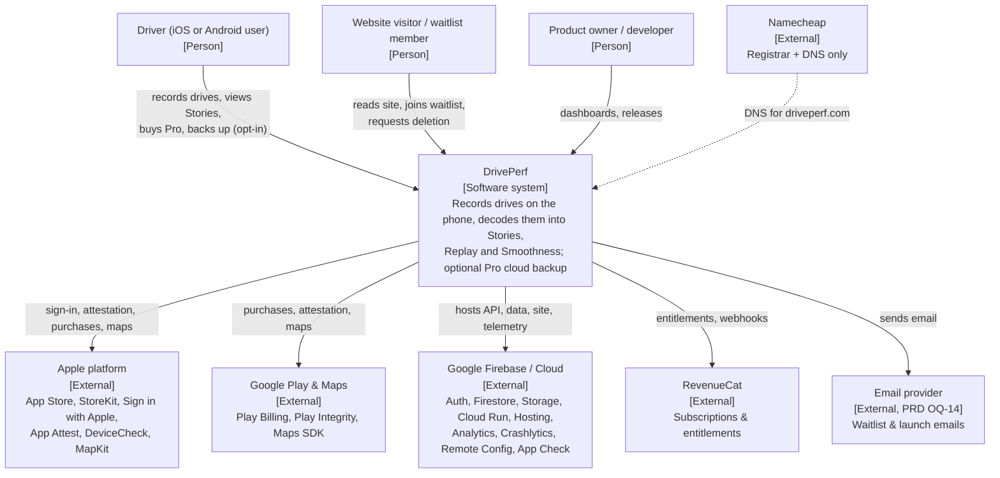
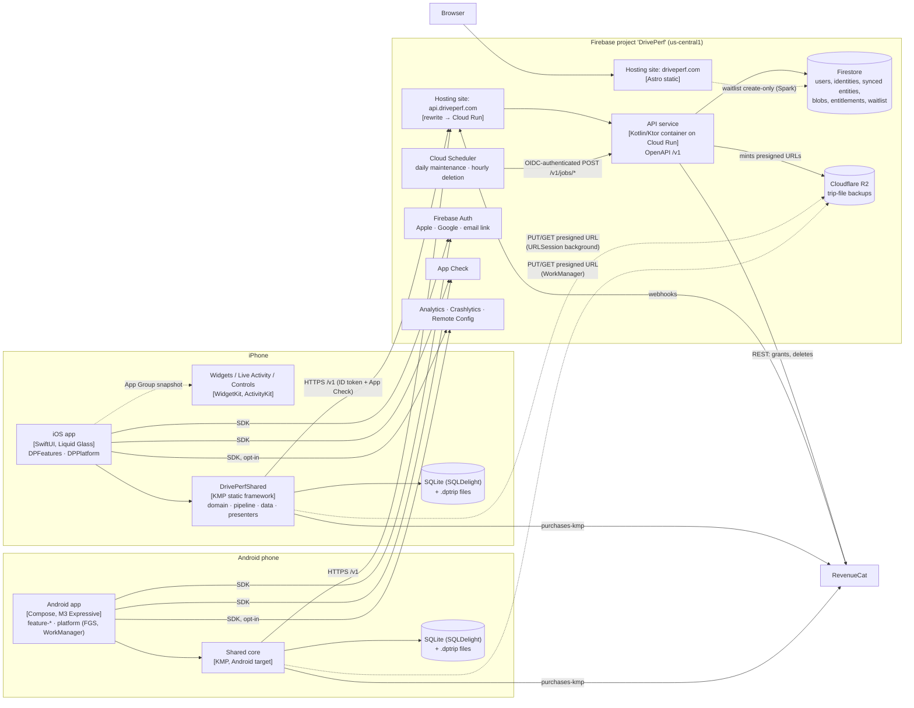
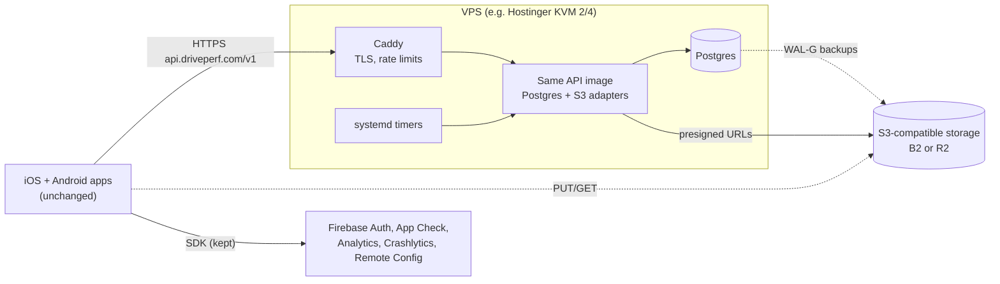
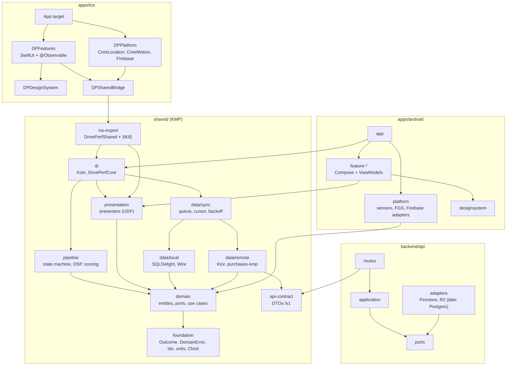
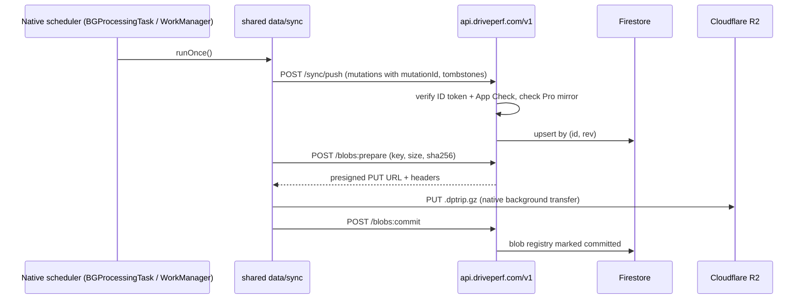

# DrivePerf v1 architecture overview

| | |
|---|---|
| **Status** | Proposed for Gate 4 · 6 Nov 2026 · author A10 |
| **Decisions** | [ADR index](adr/README.md) (ADR-001 … ADR-010) |
| **Companions** | [data-model.md](data-model.md) (A11: entities, schemas, sync, privacy data flow) · [pipeline-and-scoring.md](pipeline-and-scoring.md) (A12) |
| **Inputs** | [PRD v1](../product/PRD-v1.md) · [decisions log](../product/decisions.md) · [A3 feasibility](../research/2026-11/A3-platform-feasibility.md) · [kickoff plan §3](../planning/DrivePerf-v1-kickoff-plan.md) · AGENTS.md |

## 1. Architecture in ten lines

1. **Local-first.** Each phone's SQLDelight database and trip files are the source of truth. Free users never upload trip data. No feature needs an account except backup and multi-device ([ADR-003](adr/ADR-003-local-storage-trip-files-retention.md)).
2. **KMP shared core + native UI:** domain, pipeline, scoring, storage, sync and presenters in Kotlin; SwiftUI (Liquid Glass) and Compose (M3 Expressive) on top ([ADR-001](adr/ADR-001-cross-platform-approach.md)).
3. **Clean architecture, enforced by CI:** presentation → domain ← data; the domain imports no SDK ([ADR-002](adr/ADR-002-monorepo-modules-and-clean-architecture.md)).
4. **Sensors and background execution are native** and feed the shared pipeline in ~1 s batches.
5. **Apps talk to our own API, `api.driveperf.com/v1`, for all user data**: sync, trip-file tickets, account, deletion, grants ([ADR-004](adr/ADR-004-backend-v1-and-migration-seam.md)).
6. **SDK-direct only where it must be:** Firebase Auth, App Check, Analytics, Crashlytics, Remote Config, (later) FCM, and RevenueCat.
7. **Backend v1 = Firebase project "DrivePerf"**: Spark first; Blaze at the start of Phase 6 for Cloud Run (Kotlin/Ktor API) and Cloud Scheduler. Firestore holds server records; trip files are portable gzip-protobuf blobs on **Cloudflare R2** (S3-compatible, no egress fees; Gate 4).
8. **Portable by construction:** UUIDv7 keys, UTC timestamps, versioned schemas, issuer-agnostic JWT checks, presigned-URL blobs, no Firestore triggers.
9. **Stay on Firebase until a trigger fires** (cost, storage, scale, features, compliance, vendor risk), then move the server side to a VPS without an app release ([ADR-010](adr/ADR-010-firebase-now-vs-vps.md)).
10. **Web:** Astro static site on Firebase Hosting at `driveperf.com`; Namecheap is registrar/DNS only ([ADR-009](adr/ADR-009-web-stack.md)).

## 2. C4 level 1 — system context

## 3. C4 level 2 — containers (v1 on Firebase)

**Phase notes.** Phase 5 (Spark): Hosting web, waitlist in Firestore, Auth, App Check (debug provider until the paid Apple account), Analytics, Crashlytics, Remote Config. Phase 6 (Blaze): API, Storage, Scheduler. Free users who never sign in talk only to RevenueCat (anonymous ID), Remote Config, and, if they opt in, Analytics/Crashlytics. No trip, route, car or score data leaves the device.

### After migration (when ADR-010 triggers fire)

## 4. Module dependency diagram

Arrows mean "depends on". Anything not drawn is forbidden and fails CI (`assertModuleGraph`, Konsist, detekt; SPM target declarations on iOS). Full table: [ADR-002 §2](adr/ADR-002-monorepo-modules-and-clean-architecture.md).

## 5. Key runtime flows

### Trip capture (both platforms)

Native trigger (iOS SLC/visit/`CLMonitor`, Android Activity Recognition transition) → native session start (Core Location session first on iOS; FGS `location` on Android) → native sensor callbacks buffered into ~1 s batches → shared `TripStateMachine` + pipeline on a confined dispatcher → chunks appended to `.dptrip` (fsync ~5 s) → at trip end: processing, scoring and Story generation while location still keeps the app awake → gzip-finalise → summary rows in SQLDelight → local "Drive decoded." notification. Nothing leaves the device.

### Pro backup (opt-in, Wi-Fi by default, never during a trip)

### Account deletion (F-PRV-05)

`POST /v1/account:delete` after re-authentication → API marks the user `deleting` and responds → the deletion job (also scheduled hourly) deletes Storage objects, Firestore records, the RevenueCat customer and finally the Auth user, within 24 h → the app keeps or removes local data per the user's choice. The web request page (F-WEB-04) creates an email-verified `deletionRequests` record that feeds the same job.

## 6. Cross-cutting rules

- **Privacy baseline:** no coordinates, addresses, route/car names, speeds, G values or free text in analytics, logs, crash reports or server logs ([ADR-007](adr/ADR-007-analytics-crash-flags-privacy.md)). Public repo: no real-location fixtures ([ADR-008](adr/ADR-008-ci-cd-and-environments.md)).
- **Errors:** typed `Outcome`/`DomainError` across layers; exceptions mapped at adapters; cancellation always propagates.
- **Identity:** the account ID is the Firebase UID treated as an opaque string and kept forever (also the RevenueCat app user ID); the server maps `(issuer, subject)` → account ID so an identity-provider change never re-keys data. Every record ID is a device-generated UUIDv7.
- **Versioning:** `/v1` URL versioning (additive), per-document `schemaVersion`, trip-file `schema_version` readable forever, scoring algorithm versions shipped in releases only.
- **Retention:** on device until the user deletes; Pro cloud until the user deletes; 30 days after Pro ends, then deleted ([ADR-003](adr/ADR-003-local-storage-trip-files-retention.md)).
- **Markets:** Canada + US, English only; Firebase region us-central1 (disclosed; Law 25 PIA covers the transfer).

## 7. Gate 4 answers (Keval, 6 Nov 2026)

1. **R0 sensor log:** not pruned automatically; kept on the phone until the user deletes it (data-model.md §2.6).
2. **30-day window after Pro:** restore to a new phone and download stay possible (read-only).
3. **Privacy zones:** included in Pro backup; never in analytics.
4. **Email:** Zoho Mail recommended for the mailboxes, pending Keval's choice; the sending provider is picked before Phase 6 email features.
5. **Website analytics:** Cloudflare Web Analytics. App analytics and crash reporting: see `research/analytics-crash-privacy.md` and ADR-007.
6. **Trip files:** Cloudflare R2 from day one (ADR-004, ADR-010).
7. **Minimum OS:** iOS 26, Android 10.
8. **App ID:** `com.driveperf.app` on both stores.

Still open: Blaze at the start of Phase 6 and the two project IDs (`driveperf-prod`, `driveperf-dev`), confirmed when Keval creates them in the hosting session; counsel items (Android map snapshots, ADR-005; PRD OQ-02).
