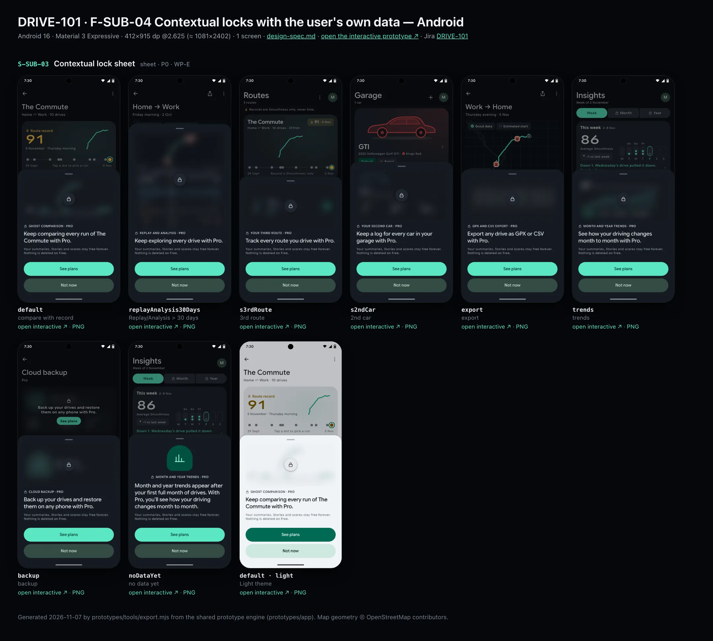
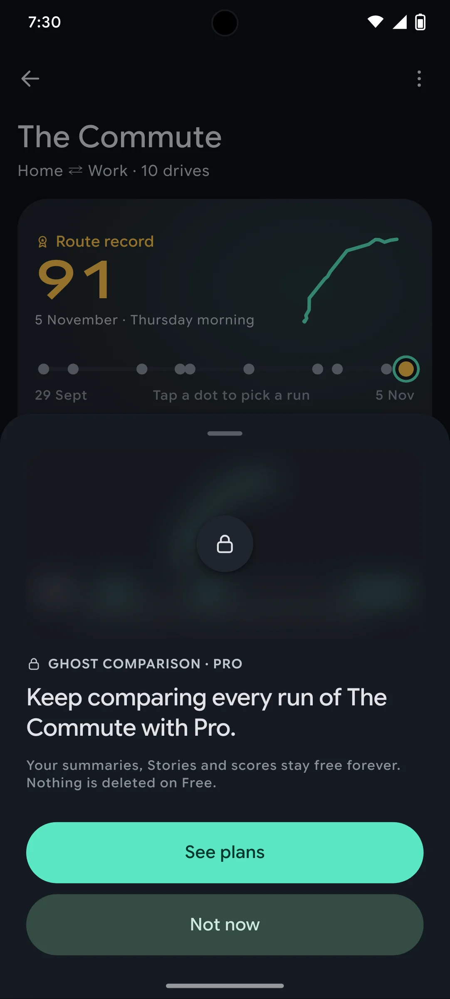
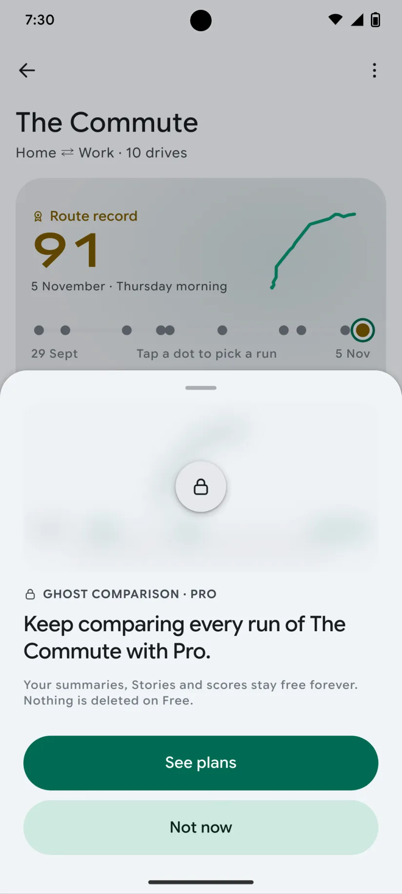

# DRIVE-101 · F-SUB-04 Contextual locks with the user's own data — Android design spec

> Generated by `prototypes/tools/export.mjs` on 2026-11-06 from the shared prototype engine. **Do not edit by hand:** change the screen's `spec` in `prototypes/app/screens/wp-*.js` (see `prototypes/app/AUTHORING.md`) and re-export.

- **Jira story:** [DRIVE-101](https://thekeval.atlassian.net/browse/DRIVE-101) · F-SUB-04 · P0
- **Platform:** Android 16 · Material 3 Expressive · 412×915 dp @2.625 (≈ 1081×2402)
- **Interactive prototype:** [../../../../prototypes/android/index.html#S-SUB-03](../../../../prototypes/android/index.html#S-SUB-03) (catalog panel: every screen and state; deep links `#S-ID/state?trip=…&ent=…&theme=light&text=xl&rm=1`)
- **Contact sheet:** [mockup.html](mockup.html) · 
- **Design system (source of truth for values):** [brand](../../system/brand.md) · [components](../../system/components.md) · [motion](../../system/motion.md) · [accessibility](../../system/accessibility.md) · [screen map](../../system/screen-map.md) · [fixtures](../../system/fixtures.md) · tokens `prototypes/shared/tokens.css`

## Screens in this story

| Screen | Name | Presentation | Priority | States | Status |
|---|---|---|---|---|---|
| `S-SUB-03` | Contextual lock sheet | Sheet (medium) | P0 | 8 | Prototyped |

## Tokens used on this platform

Values resolved from `prototypes/shared/tokens.css` inside the Android device (`[data-platform="android"]`). Use the token names in code; the hex values are for reference.

| Token | Dark | Light |
|---|---|---|
| `--app-bg` | `#0D1117` | `#F7F9FC` |
| `--card-bg` | `#191E25` | `#EBEEF2` |
| `--dp-bg-grouped` | `#0D1117` | `#F7F9FC` |
| `--dp-surface` | `#191E25` | `#EBEEF2` |
| `--dp-surface-2` | `#1F252D` | `#E5E8EC` |
| `--dp-surface-3` | `#2A3038` | `#DFE2E6` |
| `--dp-fill` | `#2A3038` | `#DFE2E6` |
| `--dp-fill-strong` | `#353B44` | `#D3D7DC` |
| `--dp-text` | `#E1E3E8` | `#181C20` |
| `--dp-text-2` | `#C0C7CF` | `#40474F` |
| `--dp-text-3` | `#8A929B` | `#707881` |
| `--dp-separator` | `#40474F` | `#C0C7CF` |
| `--dp-accent` | `#5BE7C4` | `#006B53` |
| `--dp-accent-text` | `#5BE7C4` | `#006B53` |
| `--dp-on-accent` | `#00382B` | `#FFFFFF` |
| `--dp-accent-container` | `#00513F` | `#91F1D8` |
| `--dp-record` | `#FFC24B` | `#7A5900` |
| `--dp-positive` | `#5BE7C4` | `#006B53` |
| `--dp-change-down` | `#C0C7CF` | `#40474F` |
| `--dp-warning` | `#F5B648` | `#7A5900` |
| `--dp-critical` | `#FFB4AB` | `#BA1A1A` |
| `--dp-glass-fill` | `#1F252DF2` | `#E5E8ECF2` |
| `--dp-glass-fill-strong` | `#2A3038` | `#DFE2E6` |
| `--dp-glass-stroke` | `#FFFFFF0F` | `#0000000A` |
| `--md-sys-color-primary` | `#5BE7C4` | `#006B53` |
| `--md-sys-color-on-primary` | `#00382B` | `#FFFFFF` |
| `--md-sys-color-primary-container` | `#00513F` | `#91F1D8` |
| `--md-sys-color-on-primary-container` | `#91F1D8` | `#002118` |
| `--md-sys-color-secondary-container` | `#344C44` | `#CEE9DF` |
| `--md-sys-color-surface` | `#0D1117` | `#F7F9FC` |
| `--md-sys-color-surface-container` | `#191E25` | `#EBEEF2` |
| `--md-sys-color-surface-container-high` | `#1F252D` | `#E5E8EC` |
| `--md-sys-color-on-surface-variant` | `#C0C7CF` | `#40474F` |
| `--dp-data-route` | `#5BE7C4` | `#079777` |
| `--dp-data-event-brake` | `#FF7A66` | `#A21F16` |
| `--dp-data-event-accel` | `#E58BD0` | `#A33A8C` |
| `--dp-data-event-corner` | `#EAD54E` | `#9A8A00` |
| `--dp-data-quality-good` | `#5FDB9C` | `#1E9E62` |
| `--dp-data-speed` | `#D6DCE4` | `#404A58` |
| `--dp-data-long-g` | `#5AB8F5` | `#0A6AB8` |
| `--dp-data-lat-g` | `#F5A142` | `#B25A00` |

| Type / layout token | Value |
|---|---|
| `--dp-font-screen-title` | `600 32px / 40px "Google Sans Flex", "Google Sans Display", "Roboto Flex", Roboto, system-ui, sans-serif` |
| `--dp-font-sheet-title` | `400 24px / 32px "Google Sans Flex", "Google Sans Display", "Roboto Flex", Roboto, system-ui, sans-serif` |
| `--dp-font-section-title` | `600 22px / 28px "Google Sans Flex", "Google Sans Display", "Roboto Flex", Roboto, system-ui, sans-serif` |
| `--dp-font-card-title` | `700 16px / 24px "Google Sans Flex", "Google Sans Text", "Roboto Flex", Roboto, system-ui, sans-serif` |
| `--dp-font-body` | `400 16px / 24px "Google Sans Flex", "Google Sans Text", "Roboto Flex", Roboto, system-ui, sans-serif` |
| `--dp-font-body-secondary` | `400 14px / 20px "Google Sans Flex", "Google Sans Text", "Roboto Flex", Roboto, system-ui, sans-serif` |
| `--dp-font-meta` | `400 12px / 16px "Google Sans Flex", "Google Sans Text", "Roboto Flex", Roboto, system-ui, sans-serif` |
| `--dp-font-caption` | `500 12px / 16px "Google Sans Flex", "Google Sans Text", "Roboto Flex", Roboto, system-ui, sans-serif` |
| `--dp-font-button` | `700 14px / 20px "Google Sans Flex", "Google Sans Text", "Roboto Flex", Roboto, system-ui, sans-serif` |
| `--dp-num-hero` | `600 72px / 72px "Google Sans Flex", "Roboto Flex", Roboto, system-ui, sans-serif` |
| `--dp-num-xl` | `600 48px / 52px "Google Sans Flex", "Roboto Flex", Roboto, system-ui, sans-serif` |
| `--dp-num-l` | `600 34px / 38px "Google Sans Flex", "Roboto Flex", Roboto, system-ui, sans-serif` |
| `--dp-num-m` | `600 24px / 28px "Google Sans Flex", "Roboto Flex", Roboto, system-ui, sans-serif` |
| `--dp-num-s` | `600 17px / 22px "Google Sans Flex", "Roboto Flex", Roboto, system-ui, sans-serif` |
| `--dp-num-xs` | `600 13px / 16px "Google Sans Flex", "Roboto Flex", Roboto, system-ui, sans-serif` |
| `--dp-screen-margin` | `16px` |
| `--dp-radius-card` | `16px` |
| `--dp-radius-card-hero` | `28px` |
| `--dp-radius-sheet` | `28px` |
| `--dp-radius-chip` | `8px` |
| `--dp-radius-button` | `999px` |
| `--dp-layout-list-row-min` | `56px` |
| `--dp-layout-touch-min` | `48px` |
| `--safe-top` | `40px` |
| `--safe-bottom` | `24px` |

Text sizes scale with `--dp-text-scale` (XL = 2.0×) and numerals with `--dp-num-scale` (XL = 1.3×). DP Numerals: Google Sans Flex wdth 120 wght 600, tabular.

---

## S-SUB-03 · Contextual lock sheet

 

- **Presentation:** sheet · tab: profile · detent: auto — screen map: “Sheet (medium)”
- **Entry points:** Any Pro gate (compare, > 30-day Replay/Analysis, 3rd route, 2nd car, export, trends, backup)
- **Leads to:** S-SUB-04 · "Not now" → exactly where the user was
- **PRD features:** F-SUB-04, F-HIS-03, F-RTE-04, F-RTE-05, F-ACC-03, F-RPL-01, F-SUB-08 · **Priority:** P0 · **WP:** E
- **Interactive:** [S-SUB-03](../../../../prototypes/android/index.html#S-SUB-03)

**Purpose.** When a Free user taps a Pro feature, show what Pro would show on their own data — blurred, never a stock screenshot — with one sentence of value, “See plans” and “Not now” (F-SUB-04, F-HIS-03 “locked, not lost”). Not now returns exactly where they were.

### States

| State | PRD label | Fixture params | Screenshot |
|---|---|---|---|
| `default` | compare with record | `ent=free` | [S-SUB-03.png](../../screens/android/S-SUB-03.webp) · [open](../../../../prototypes/android/index.html#S-SUB-03) |
| `replayAnalysis30Days` | Replay/Analysis > 30 days | `ent=free` | [S-SUB-03--replayAnalysis30Days.png](../../screens/android/S-SUB-03--replayAnalysis30Days.webp) · [open](../../../../prototypes/android/index.html#S-SUB-03/replayAnalysis30Days) |
| `s3rdRoute` | 3rd route | `ent=free` | [S-SUB-03--s3rdRoute.png](../../screens/android/S-SUB-03--s3rdRoute.webp) · [open](../../../../prototypes/android/index.html#S-SUB-03/s3rdRoute) |
| `s2ndCar` | 2nd car | `ent=free` | [S-SUB-03--s2ndCar.png](../../screens/android/S-SUB-03--s2ndCar.webp) · [open](../../../../prototypes/android/index.html#S-SUB-03/s2ndCar) |
| `export` | export | `ent=free` | [S-SUB-03--export.png](../../screens/android/S-SUB-03--export.webp) · [open](../../../../prototypes/android/index.html#S-SUB-03/export) |
| `trends` | trends | `ent=free` | [S-SUB-03--trends.png](../../screens/android/S-SUB-03--trends.webp) · [open](../../../../prototypes/android/index.html#S-SUB-03/trends) |
| `backup` | backup | `ent=free` | [S-SUB-03--backup.png](../../screens/android/S-SUB-03--backup.webp) · [open](../../../../prototypes/android/index.html#S-SUB-03/backup) |
| `noDataYet` | no data yet | `ent=free` | [S-SUB-03--noDataYet.png](../../screens/android/S-SUB-03--noDataYet.webp) · [open](../../../../prototypes/android/index.html#S-SUB-03/noDataYet) |
| default · light | Light theme | `theme=light` | [S-SUB-03--light.png](../../screens/android/S-SUB-03--light.webp) |

Every state also renders in light/dark (`theme=light`), XL text (`text=xl`) and reduced motion (`rm=1`).

### Layout

- Sheet fitted to content (spec: medium). Top: the user’s own content for that feature, blurred 14 px + 35% dim, radius 20, with a 52 lock disc centred (iOS glass, Android tonal).
- Variants (own data): compare = The Commute ghost vs record + 12 gained/lost segments · Replay/Analysis > 30 days = that trip’s map + synced timeline · 3rd route = Gym card (glyph, 2 drives, record 84, run dots) · 2nd car = Ioniq silhouette + drives/average/km tiles · export = that drive’s CSV rows · trends = October trend sparkline + Month/Year/Per car/Per route tabs · backup = backup status · no data yet = illustration instead of a blur.
- Kicker “🔒 Ghost comparison · Pro”, then the value sentence (sheetTitle-size, 20/26 semibold): entitlement.lockSheets.*, footnote “Your summaries, Stories and scores stay free forever. Nothing is deleted on Free.”
- Stacked large buttons: “See plans” (filled) · “Not now” (tonal).

### Components & tokens

| Component | Tokens / spec |
|---|---|
| `sheet` | iOS glass --dp-glass-fill-strong + --dp-glass-prominent-blur, radius --dp-radius-sheet 38 · Android ModalBottomSheet --md-sys-color-surface-container-low, top radius 28, drag handle 32×4 · motion spring.sheet |
| `lockPanel` | blur --dp-opacity-locked-blur 14px · dim --dp-opacity-locked-dim 35% · components.md §15.2 |
| `map` | --dp-data-map-land/road/grid · route --dp-data-route 3.8 + casing --dp-data-route-casing 7.5 · estimated dashed 4/4 at 60% · gap --dp-data-gap-stroke dotted 1/6 · pins DP_ICONS.pin 26 · attribution “© OpenStreetMap contributors” |
| `timeline` | --dp-data-speed · --dp-data-long-g · --dp-data-lat-g (dashed 6/3) · cursor --dp-data-cursor · components.md §7 |
| `glyph` | see components.md |
| `stats` | --dp-surface-2 / --md-sys-color-surface-container-high · radius 14 iOS / 12 Android · value --dp-num-m (DP Numerals) · components.md §5 |
| `sparkline` | see components.md |
| `scoreBadge` | iOS mini ring 46 · Android Cookie9Sided 46 · --dp-num-s |
| `button` | --dp-accent / --dp-on-accent (filled) · --dp-fill-strong · --md-sys-color-secondary-container (tonal) · --dp-radius-button · height iOS 50/44/34 · Android 56/40/32 · --dp-font-button · components.md §0 |

### Interactions & navigation

- See plans → S-SUB-04 (from = feature). Not now / drag / scrim → back to exactly where the user was (scroll position kept).
- Gate: never during a trip or on a worse-than-usual Story’s end card (F-SUB-08.3); the D1 gate holds it while moving.

### Motion

- The user’s content blurs from 0 → 14 px over 320 ms (spring.effects) while the sheet rises at the medium detent; the lock disc pops at 360 ms. RM: shown already blurred, fade.

### Accessibility

- The blurred preview is hidden from screen readers; the sheet reads “Ghost comparison, Pro. Keep comparing every run of The Commute with Pro.” then the buttons. XL: opens large; the preview keeps its height.

### Platform notes

- **Android (this spec):** ModalBottomSheet; lock disc on surfaceContainerHigh; RenderEffect blur (API 31+) or a pre-blurred bitmap.
- *iOS (for reference):* Glass sheet at a partial detent; lock disc in glass.

### Analytics

- `lock_viewed {feature}`
- `lock_cta {see_plans|not_now}`

### Copy

| Key | Text |
|---|---|
| compare | Keep comparing every run of The Commute with Pro. |
| oldAnalysis | Keep exploring every drive with Pro. |
| thirdRoute | Track every route you drive with Pro. |
| secondCar | Keep a log for every car in your garage with Pro. |
| export | Export any drive as GPX or CSV with Pro. |
| trends | See how your driving changes month to month with Pro. |
| backup | Back up your drives and restore them on any phone with Pro. |
| noDataYet | Month and year trends appear after your first full month of drives. With Pro, you’ll see how your driving changes month to month. |
| Footnote | Your summaries, Stories and scores stay free forever. Nothing is deleted on Free. |

### Free / Pro

Free users only (ent = free). Preview/Ride-along/Pro never see it.

### Data & fixtures

compare: route r_commute + ghost (91 vs 89) · replay: t20261002-0745 · 3rd route: r_gym · 2nd car: Ioniq (derived: its scored trips, average and km) · export: t20261105-1745 · trends: wrapped.monthly trend weeks [81, 85, 85, 87] · backup: privacy.dataSize. Parent screens rendered underneath on a deep link follow the variant (S-RTE-02, S-TRP-01 Lock, S-RTE-01, S-GAR-01, S-STA-01, S-ACC-04 Lock).

### Assets

[icon-lock.svg](assets/icon-lock.svg) · [icon-insights.svg](assets/icon-insights.svg) · [icon-cloud.svg](assets/icon-cloud.svg)

UI glyphs may be swapped for SF Symbols / Material Symbols Rounded equivalents; event-pin, quality and provenance glyphs must not be (components.md global rules).

### Checklist (accessibility.md §9)

- [ ] Light and dark both render, and contrast passes.
- [ ] The XL text state reflows with no truncation.
- [ ] The RM state is defined.
- [ ] Every control has a label; every chart and map has a summary sentence.
- [ ] Every target ≥ 44 pt / 48 dp (≥ 64 in-drive).
- [ ] No meaning by colour alone.
- [ ] Speed is neutral wherever it appears and absent from social or live surfaces.
- [ ] No streak, leaderboard, speed or “beat your time” language.
- [ ] Behaviour is defined while a trip is active (D1 gate).
- [ ] Haptics come from motion.md §6 only.

---

Map geometry in the prototype: © OpenStreetMap contributors (ODbL). Speed and G are simulated fixtures (fixtures.md).
