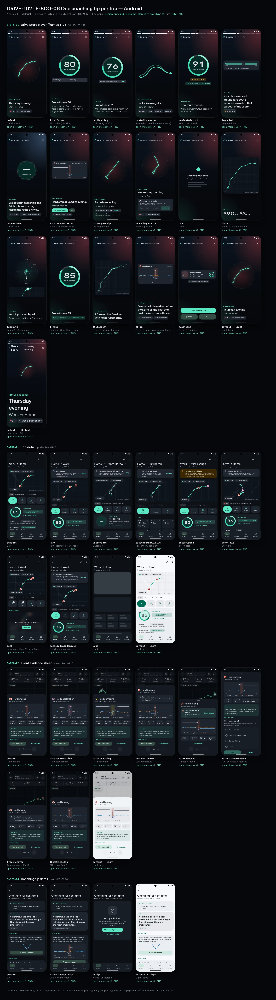
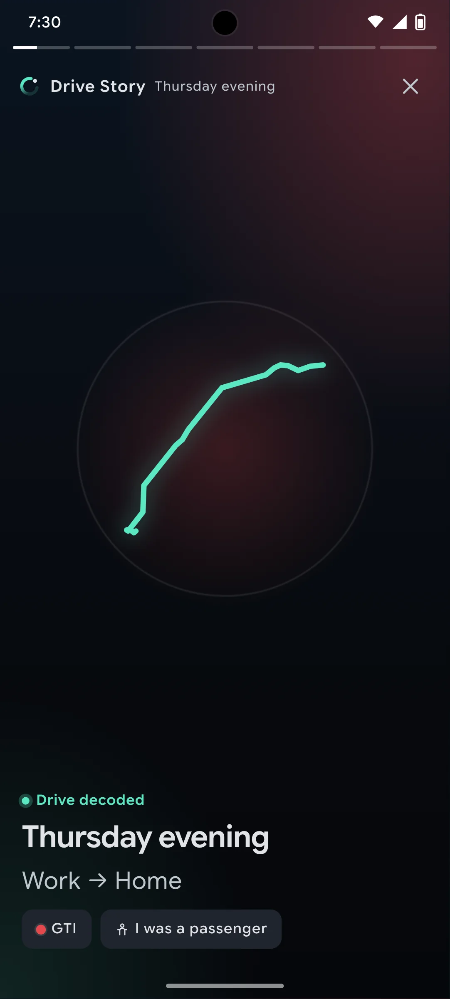
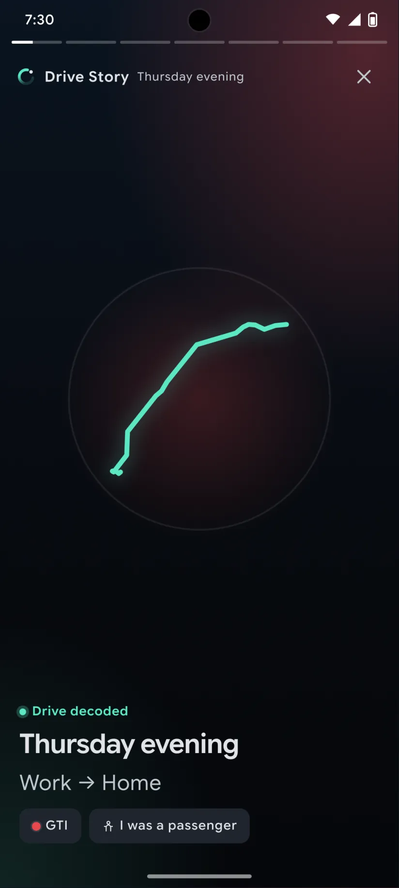
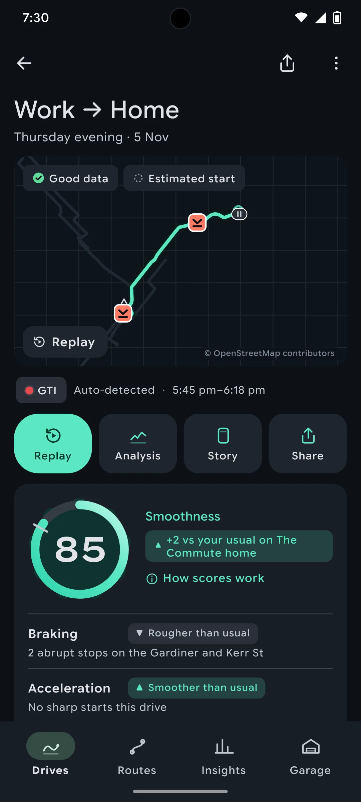
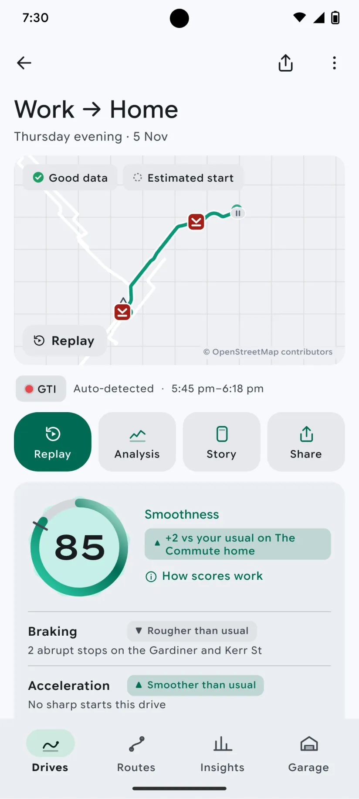
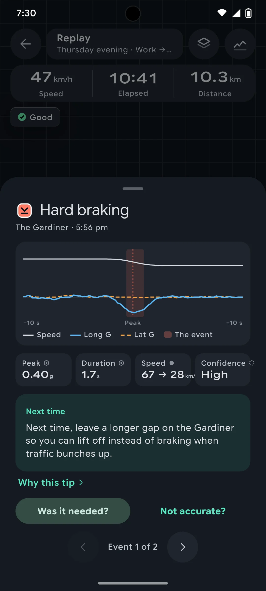
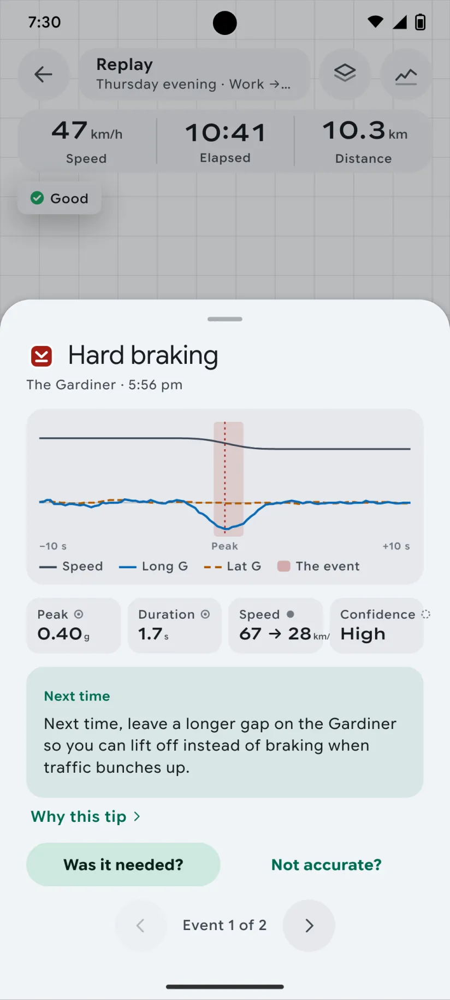
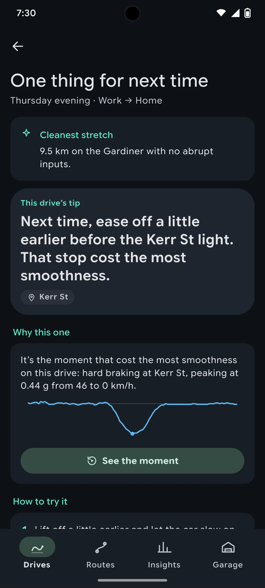
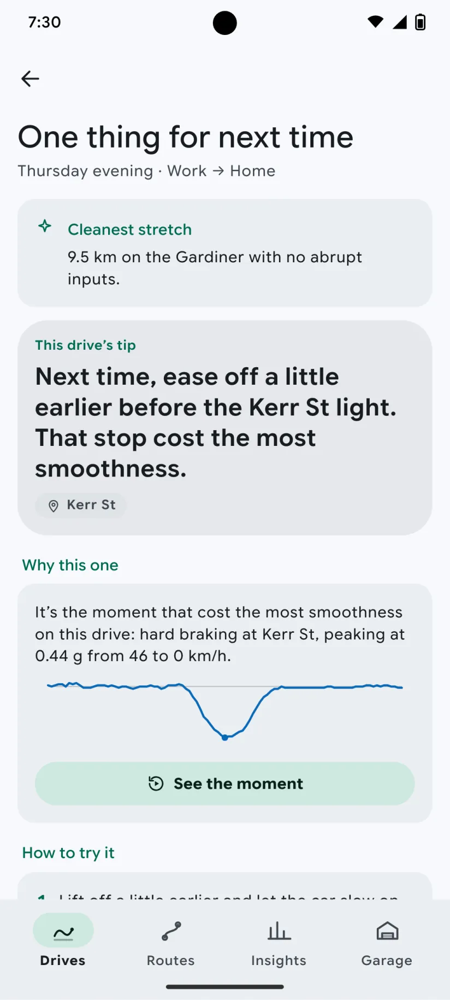

# DRIVE-102 · F-SCO-06 One coaching tip per trip — Android design spec

> Generated by `prototypes/tools/export.mjs` on 2026-11-06 from the shared prototype engine. **Do not edit by hand:** change the screen's `spec` in `prototypes/app/screens/wp-*.js` (see `prototypes/app/AUTHORING.md`) and re-export.

- **Jira story:** [DRIVE-102](https://thekeval.atlassian.net/browse/DRIVE-102) · F-SCO-06 · P0
- **Platform:** Android 16 · Material 3 Expressive · 412×915 dp @2.625 (≈ 1081×2402)
- **Interactive prototype:** [../../../../prototypes/android/index.html#S-STY-01](../../../../prototypes/android/index.html#S-STY-01) (catalog panel: every screen and state; deep links `#S-ID/state?trip=…&ent=…&theme=light&text=xl&rm=1`)
- **Contact sheet:** [mockup.html](mockup.html) · 
- **Design system (source of truth for values):** [brand](../../system/brand.md) · [components](../../system/components.md) · [motion](../../system/motion.md) · [accessibility](../../system/accessibility.md) · [screen map](../../system/screen-map.md) · [fixtures](../../system/fixtures.md) · tokens `prototypes/shared/tokens.css`

## Screens in this story

| Screen | Name | Presentation | Priority | States | Status |
|---|---|---|---|---|---|
| `S-STY-01` | Drive Story player (frames 1–7) | Full (player) | P0 | 17 | Prototyped |
| `S-TRP-01` | Trip detail | Push | P0 | 9 | Prototyped |
| `S-RPL-02` | Event evidence sheet | Sheet (medium → large) | P0 | 8 | Prototyped |
| `S-SCO-04` | Coaching tip detail | Push / sheet | P0 | 3 | Prototyped |

## Tokens used on this platform

Values resolved from `prototypes/shared/tokens.css` inside the Android device (`[data-platform="android"]`). Use the token names in code; the hex values are for reference.

| Token | Dark | Light |
|---|---|---|
| `--app-bg` | `#0D1117` | `#F7F9FC` |
| `--card-bg` | `#191E25` | `#EBEEF2` |
| `--dp-bg-grouped` | `#0D1117` | `#F7F9FC` |
| `--dp-surface` | `#191E25` | `#EBEEF2` |
| `--dp-surface-2` | `#1F252D` | `#E5E8EC` |
| `--dp-surface-3` | `#2A3038` | `#DFE2E6` |
| `--dp-fill` | `#2A3038` | `#DFE2E6` |
| `--dp-fill-strong` | `#353B44` | `#D3D7DC` |
| `--dp-text` | `#E1E3E8` | `#181C20` |
| `--dp-text-2` | `#C0C7CF` | `#40474F` |
| `--dp-text-3` | `#8A929B` | `#707881` |
| `--dp-separator` | `#40474F` | `#C0C7CF` |
| `--dp-accent` | `#5BE7C4` | `#006B53` |
| `--dp-accent-text` | `#5BE7C4` | `#006B53` |
| `--dp-on-accent` | `#00382B` | `#FFFFFF` |
| `--dp-accent-container` | `#00513F` | `#91F1D8` |
| `--dp-record` | `#FFC24B` | `#7A5900` |
| `--dp-positive` | `#5BE7C4` | `#006B53` |
| `--dp-change-down` | `#C0C7CF` | `#40474F` |
| `--dp-warning` | `#F5B648` | `#7A5900` |
| `--dp-critical` | `#FFB4AB` | `#BA1A1A` |
| `--dp-glass-fill` | `#1F252DF2` | `#E5E8ECF2` |
| `--dp-glass-fill-strong` | `#2A3038` | `#DFE2E6` |
| `--dp-glass-stroke` | `#FFFFFF0F` | `#0000000A` |
| `--md-sys-color-primary` | `#5BE7C4` | `#006B53` |
| `--md-sys-color-on-primary` | `#00382B` | `#FFFFFF` |
| `--md-sys-color-primary-container` | `#00513F` | `#91F1D8` |
| `--md-sys-color-on-primary-container` | `#91F1D8` | `#002118` |
| `--md-sys-color-secondary-container` | `#344C44` | `#CEE9DF` |
| `--md-sys-color-surface` | `#0D1117` | `#F7F9FC` |
| `--md-sys-color-surface-container` | `#191E25` | `#EBEEF2` |
| `--md-sys-color-surface-container-high` | `#1F252D` | `#E5E8EC` |
| `--md-sys-color-on-surface-variant` | `#C0C7CF` | `#40474F` |
| `--dp-data-route` | `#5BE7C4` | `#079777` |
| `--dp-data-event-brake` | `#FF7A66` | `#A21F16` |
| `--dp-data-event-accel` | `#E58BD0` | `#A33A8C` |
| `--dp-data-event-corner` | `#EAD54E` | `#9A8A00` |
| `--dp-data-quality-good` | `#5FDB9C` | `#1E9E62` |
| `--dp-data-speed` | `#D6DCE4` | `#404A58` |
| `--dp-data-long-g` | `#5AB8F5` | `#0A6AB8` |
| `--dp-data-lat-g` | `#F5A142` | `#B25A00` |

| Type / layout token | Value |
|---|---|
| `--dp-font-screen-title` | `600 32px / 40px "Google Sans Flex", "Google Sans Display", "Roboto Flex", Roboto, system-ui, sans-serif` |
| `--dp-font-sheet-title` | `400 24px / 32px "Google Sans Flex", "Google Sans Display", "Roboto Flex", Roboto, system-ui, sans-serif` |
| `--dp-font-section-title` | `600 22px / 28px "Google Sans Flex", "Google Sans Display", "Roboto Flex", Roboto, system-ui, sans-serif` |
| `--dp-font-card-title` | `700 16px / 24px "Google Sans Flex", "Google Sans Text", "Roboto Flex", Roboto, system-ui, sans-serif` |
| `--dp-font-body` | `400 16px / 24px "Google Sans Flex", "Google Sans Text", "Roboto Flex", Roboto, system-ui, sans-serif` |
| `--dp-font-body-secondary` | `400 14px / 20px "Google Sans Flex", "Google Sans Text", "Roboto Flex", Roboto, system-ui, sans-serif` |
| `--dp-font-meta` | `400 12px / 16px "Google Sans Flex", "Google Sans Text", "Roboto Flex", Roboto, system-ui, sans-serif` |
| `--dp-font-caption` | `500 12px / 16px "Google Sans Flex", "Google Sans Text", "Roboto Flex", Roboto, system-ui, sans-serif` |
| `--dp-font-button` | `700 14px / 20px "Google Sans Flex", "Google Sans Text", "Roboto Flex", Roboto, system-ui, sans-serif` |
| `--dp-num-hero` | `600 72px / 72px "Google Sans Flex", "Roboto Flex", Roboto, system-ui, sans-serif` |
| `--dp-num-xl` | `600 48px / 52px "Google Sans Flex", "Roboto Flex", Roboto, system-ui, sans-serif` |
| `--dp-num-l` | `600 34px / 38px "Google Sans Flex", "Roboto Flex", Roboto, system-ui, sans-serif` |
| `--dp-num-m` | `600 24px / 28px "Google Sans Flex", "Roboto Flex", Roboto, system-ui, sans-serif` |
| `--dp-num-s` | `600 17px / 22px "Google Sans Flex", "Roboto Flex", Roboto, system-ui, sans-serif` |
| `--dp-num-xs` | `600 13px / 16px "Google Sans Flex", "Roboto Flex", Roboto, system-ui, sans-serif` |
| `--dp-screen-margin` | `16px` |
| `--dp-radius-card` | `16px` |
| `--dp-radius-card-hero` | `28px` |
| `--dp-radius-sheet` | `28px` |
| `--dp-radius-chip` | `8px` |
| `--dp-radius-button` | `999px` |
| `--dp-layout-list-row-min` | `56px` |
| `--dp-layout-touch-min` | `48px` |
| `--safe-top` | `40px` |
| `--safe-bottom` | `24px` |

Text sizes scale with `--dp-text-scale` (XL = 2.0×) and numerals with `--dp-num-scale` (XL = 1.3×). DP Numerals: Google Sans Flex wdth 120 wght 600, tabular.

---

## S-STY-01 · Drive Story player (frames 1–7)

 

- **Presentation:** full · tab: drives — screen map: “Full (player)”
- **Entry points:** S-NTF-01 "Drive decoded" · S-HOME-01 card · S-DRV-04 · S-TRP-01 "Story" · S-LIVE-04/08
- **Leads to:** f7: S-RPL-01 (Explore) · S-SHR-01 (Share) · Done → caller · chips: S-RTE-03, S-SCO-03, S-TRP-02 (passenger/car), S-DQ-01
- **PRD features:** F-STY-01, F-STY-03, F-STY-04, F-STY-06, F-SCO-01, F-SCO-02, F-SCO-05, F-SCO-06, F-RTE-01, F-RTE-03, F-HIS-02, F-GAR-02, F-CAP-04, F-DQ-02, F-DQ-04, F-SHR-01, F-DQ-01 · **Priority:** P0 · **WP:** C
- **Interactive:** [S-STY-01](../../../../prototypes/android/index.html#S-STY-01)

**Purpose.** The “wow” after every drive (F-STY-01): a ~15 s full-screen Story that leads with what went well, scores the drive against the user’s own baseline, then gives exactly one tip. No speed or max speed appears in any frame (F-STY-01.3).

### States

| State | PRD label | Fixture params | Screenshot |
|---|---|---|---|
| `default` | Def (frame 1) | `trip=t20261105-1745` | [S-STY-01.png](../../screens/android/S-STY-01.webp) · [open](../../../../prototypes/android/index.html#S-STY-01) |
| `firstDrive` | First drive (baseline) | `trip=t20260928-1842` | [S-STY-01--firstDrive.png](../../screens/android/S-STY-01--firstDrive.webp) · [open](../../../../prototypes/android/index.html#S-STY-01/firstDrive) |
| `calibrating` | Calibrating (2 of 3) | `trip=t20260929-0738` | [S-STY-01--calibrating.png](../../screens/android/S-STY-01--calibrating.webp) · [open](../../../../prototypes/android/index.html#S-STY-01/calibrating) |
| `routeDiscovered` | Route discovered (merge + name) | `trip=t20261002-0745` | [S-STY-01--routeDiscovered.png](../../screens/android/S-STY-01--routeDiscovered.webp) · [open](../../../../prototypes/android/index.html#S-STY-01/routeDiscovered) |
| `newRouteRecord` | New route record | `trip=t20261105-0742` | [S-STY-01--newRouteRecord.png](../../screens/android/S-STY-01--newRouteRecord.webp) · [open](../../../../prototypes/android/index.html#S-STY-01/newRouteRecord) |
| `degraded` | Degraded (Part) | `trip=t20261027-1728` | [S-STY-01--degraded.png](../../screens/android/S-STY-01--degraded.webp) · [open](../../../../prototypes/android/index.html#S-STY-01/degraded) |
| `unscorable` | Unscorable | `trip=t20261106-1210` | [S-STY-01--unscorable.png](../../screens/android/S-STY-01--unscorable.webp) · [open](../../../../prototypes/android/index.html#S-STY-01/unscorable) |
| `wasItNeededInline` | “Was it needed?” inline | `trip=t20261020-0740` | [S-STY-01--wasItNeededInline.png](../../screens/android/S-STY-01--wasItNeededInline.webp) · [open](../../../../prototypes/android/index.html#S-STY-01/wasItNeededInline) |
| `passengerChip` | Passenger chip | `trip=t20261031-1905` | [S-STY-01--passengerChip.png](../../screens/android/S-STY-01--passengerChip.webp) · [open](../../../../prototypes/android/index.html#S-STY-01/passengerChip) |
| `transitQuestion` | Transit question | `trip=t20261104-0650` | [S-STY-01--transitQuestion.png](../../screens/android/S-STY-01--transitQuestion.webp) · [open](../../../../prototypes/android/index.html#S-STY-01/transitQuestion) |
| `Load` | Load | `trip=t20261105-1745` | [S-STY-01--Load.png](../../screens/android/S-STY-01--Load.webp) · [open](../../../../prototypes/android/index.html#S-STY-01/Load) |
| `f2Route` | Frame 2 · route draw-on | `trip=t20261105-1745` | [S-STY-01--f2Route.png](../../screens/android/S-STY-01--f2Route.webp) · [open](../../../../prototypes/android/index.html#S-STY-01/f2Route) |
| `f3Inputs` | Frame 3 · G-dot replay | `trip=t20261105-1745` | [S-STY-01--f3Inputs.png](../../screens/android/S-STY-01--f3Inputs.webp) · [open](../../../../prototypes/android/index.html#S-STY-01/f3Inputs) |
| `f4Ring` | Frame 4 · Smoothness ring | `trip=t20261105-1745` | [S-STY-01--f4Ring.png](../../screens/android/S-STY-01--f4Ring.webp) · [open](../../../../prototypes/android/index.html#S-STY-01/f4Ring) |
| `f5Cleanest` | Frame 5 · cleanest stretch | `trip=t20261105-1745` | [S-STY-01--f5Cleanest.png](../../screens/android/S-STY-01--f5Cleanest.webp) · [open](../../../../prototypes/android/index.html#S-STY-01/f5Cleanest) |
| `f6Tip` | Frame 6 · one thing for next time | `trip=t20261105-1745` | [S-STY-01--f6Tip.png](../../screens/android/S-STY-01--f6Tip.webp) · [open](../../../../prototypes/android/index.html#S-STY-01/f6Tip) |
| `f7Actions` | Frame 7 · actions | `trip=t20261105-1745` | [S-STY-01--f7Actions.png](../../screens/android/S-STY-01--f7Actions.webp) · [open](../../../../prototypes/android/index.html#S-STY-01/f7Actions) |
| default · light | Light theme | `theme=light` | [S-STY-01--light.png](../../screens/android/S-STY-01--light.webp) |
| default · XL | Largest text | `text=xl` | [S-STY-01--xl.png](../../screens/android/S-STY-01--xl.webp) |

Every state also renders in light/dark (`theme=light`), XL text (`text=xl`) and reduced motion (`rm=1`).

### Layout

- Full-screen player, always on the night stage (`--dp-gradient-night-sky`) with a car-colour wash (radial 30% of `--dp-car-{colour}` top-trailing, 14% Glide bottom-leading). Status bar light. Dark tokens are forced inside the player in both themes.
- Top (safe-top + 4): progress segments (3 px, gap 4, white 26% track, white fill) · header row: Loop mark 22 + “Drive Story” (14/600) + part of day (meta, text2) + glass close button (44).
- Frame stage: art region (flex, centred) above a bottom-left copy block: kicker (13/600, accent-text) · `storyHeadline` (28/34 iOS bold, 28/36 Android) · `storyBody` (20/25, text2) · chip row. Bottom padding safe-bottom + 24.
- f1 title: route glyph 250 (share-safe trip.glyph, Glide 5 px) · kicker “● Drive decoded” · part of day (headline) · route label (body) · car chip + “I was a passenger” chip (glass).
- f2 route: plain-canvas map, full width − 40, ≤ 380 tall, radius 28, estimated start dashed, “© OpenStreetMap contributors” · two DP Numerals 48 (“39.0 km” “33 min”) counting up.
- f3 inputs: friction circle 260 (±0.6 g, rings at 0.1 g, 0.3/0.5 labelled) with the G-dot and a 1.2 s trail; under it a 112-tall mini map with the tracking tick (marker).
- f4 ring: Smoothness ring 224 (stroke 15, baseline notch, gold record notch) · comparison chip (and gold “New route record” chip) · “Score based on 31 of 34 min” with the quality glyph for Limited trips. Tap the ring → S-SCO-01.
- f5 cleanest stretch: the map with the route dimmed to 45% and the cleanest span drawn in Glide 200 with a 14 px glow · kicker “✦ Cleanest stretch”.
- f6 tip: glass trace card (event pin 22 + type + place, the −10…+10 s evidence trace, legend) · kicker “One thing for next time” · tip as headline · chips “See the moment” → S-RPL-02, “More on this tip” → S-SCO-04.
- Variant frames: fDegraded (coverage strip with the hatched excluded span) · fUnscorable (dashed ring “—”, Why not? → S-DQ-01) · fRoute (two Glide lines merging + chips Commute/Gym/School run/Custom… → S-RTE-03) · fNeeded (evidence trace + “Yes, it was needed” / “No”, inline confirmation).
- f7 end: glass summary card (glyph 52 · label · part of day · car · km · min · ring 64) · full quality badge (“Good data · phone mounted”) · first-drive loop card · actions: Explore the drive (filled large, block) · Share + Done (glass large, side by side). Passenger trips drop Share.
- Load: Loop loader 64 (iOS) / M3E shape loader (Android) + “Decoding your drive…” + skeleton lines; segments empty.

### Components & tokens

| Component | Tokens / spec |
|---|---|
| `ring` | track --dp-fill-strong · arc --dp-gradient-ring (glide-400 → accent → glide-100) · baseline notch --dp-text-2 · record notch --dp-record · Android container Cookie9Sided --md-sys-color-primary-container 42% · components.md §3 |
| `deltaChip` | better: --dp-accent-text on --dp-accent 18% · lower: --dp-text-2 on --dp-fill (never red) · record: --dp-record on --dp-record 18% · components.md §4 |
| `chip` | --dp-radius-chip (iOS capsule · Android 8) · height 28 · --dp-font-caption |
| `carChip` | see components.md |
| `glyph` | see components.md |
| `map` | --dp-data-map-land/road/grid · route --dp-data-route 3.8 + casing --dp-data-route-casing 7.5 · estimated dashed 4/4 at 60% · gap --dp-data-gap-stroke dotted 1/6 · pins DP_ICONS.pin 26 · attribution “© OpenStreetMap contributors” |
| `evidenceTrace` | see components.md |
| `qualityBadge` | --dp-data-quality-{good\|usable\|limited\|unscorable} · components.md §10 |
| `button` | --dp-accent / --dp-on-accent (filled) · --dp-fill-strong · --md-sys-color-secondary-container (tonal) · --dp-radius-button · height iOS 50/44/34 · Android 56/40/32 · --dp-font-button · components.md §0 |
| `iconButton` | see components.md |
| `loader` | see components.md |
| `skeleton` | --dp-fill-strong, breathe 1.2 s (dp-skeleton) |
| `gg (local ggSvg)` | see components.md |
| `coverageStrip (local)` | see components.md |

### Interactions & navigation

- Tap the right 68% → next frame; tap the left 32% → previous; press and hold → pause (segment freezes); swipe down → exit (content scales to 0.9 and rounds its corners with the drag, commits past 120 pt with haptic gestureEnd); close button → back to the caller.
- f1: car chip → S-TRP-02/carPicker · “I was a passenger” → S-TRP-02/typePicker (≤ 2 taps, F-HIS-02.4) · transit question chips Bus/Train/Streetcar → moved to Not drives (toast + Undo, back) · “No, I drove” → dismisses the question.
- f4: ring → S-SCO-01 · “New route record” chip → S-RTE-02 · f6: “See the moment” → S-RPL-02/thisDrivesTip · “More on this tip” → S-SCO-04 · f5/fDegraded/fUnscorable badges → S-DQ-01 · placement chip → S-DQ-02.
- fRoute chips → S-RTE-03 (preset name) or S-RTE-03/custom · fNeeded “Yes, it was needed” → marks it inline, the score recomputes ≤ 1 s and the Story continues (F-STY-04.3); “No” → next frame; “Not sure?” → S-SCO-03.
- f7: Explore the drive → S-RPL-01 · Share → S-SHR-01 · Done → back. Quality badge → S-DQ-01. No paywall, share prompt or rating prompt ever follows a Story (D12, F-SUB-08).
- D1 gate: opened while moving or during a driver trip → S-DRV-05 (“Your Story will be ready when you’ve parked.”), which opens the Story once stationary for 60 s.
- Deep link a frame: `#S-STY-01?trip=…&frame=f4`.

### Motion

- Segments fill linearly over the frame duration (3 s; 3.5 s for f2/f3; 6 s for question frames; ×1.5 at XL); f7 waits.
- Frame change: outgoing frame fades (220 ms); incoming copy rises 12 px line by line (60 ms stagger, spring.default) while the frame’s hero runs.
- Heroes: f1 glyph draw-on 1100 ms · f2 route draw-on 1800 ms (ease.drawOn) + numbers count up 1200 ms (ease.countUp) · f3 G-dot replay 3000 ms (shared.gMeter ζ 0.55 k 120, 1.2 s tapering trail, cloud fades in and the envelope draws on at the end) · f4 ring reveal 1400 ms with baseline notch, record notch flip + doubleSuccess haptic, chip pop at 1600 ms · f5 cleanest-stretch draw-on · f6 trace draw-on · fRoute lines slide 14 px together (spring.default) then chips pop (spring.fast, 40 ms stagger).
- RM: 220 ms cross-fades; route, ring and numbers appear complete; f3 shows the static G-G plot with the trail (F-STY-06.2); auto-advance continues (tap and hold still pause). Haptics kept except ring ticks.

### Accessibility

- Each frame is one focusable element whose label is the full frame copy, e.g. “Frame 4 of 7. Smoothness 85. 2 above your usual on The Commute home.” Focus pauses auto-advance (F-STY-06.1); actions Next frame / Previous frame / Close.
- f3 summary: “Your inputs, replayed. Mostly gentle, with 2 firm stops.” (derived from the trip’s events).
- Focus is trapped inside the player until closed. Tap zones are buttons “Previous frame” / “Next frame”.
- XL: the copy block grows upward and the art shrinks (zoom 0.62); frames run 1.5× longer; nothing truncates.
- Never colour alone: ▲/▼/● on chips, rosette on records, hatched + dashed spans in the coverage strip, glyphs on quality badges.

### Platform notes

- **Android (this spec):** Full-screen dialog destination with fade-rise; tonal surface-container-high chips (no blur); Google Sans Flex story styles (28/36 600, body 22/28); ring sits on the Cookie9Sided primaryContainer shape that rotates during the count; M3E loading indicator for Load; Explore = filled button with shape morph, Share/Done = tonal.
- *iOS (for reference):* fullScreenCover; glass chips and glass close button (`.glassEffect(.clear)` over art with a 35% dim); SF Pro Display Bold story headline; Loop loader for Load; buttons glassProminent (Explore) and glass (Share/Done).

### Analytics

- `story_opened {source}`
- `story_frame_viewed {frame}`
- `story_completed`
- `story_action {action: explore|share|done}`
- `story_variant {degraded|unscorable}`
- `event_marked_needed {type, source: story}`
- `trip_flagged_transit`
- `trip_corrected {to: transit|passenger}`
- `a11y_story_mode {screen_reader, reduce_motion}`

### Copy

| Key | Text |
|---|---|
| f1 | {partOfDay} · {label} (trip.story.frames.f1.title) · kicker “Drive decoded” · chips “{car}” · “I was a passenger” |
| f2 | {distance} km · {duration} min (frames.f2.line) |
| f3 | Your inputs, replayed. / Every brake and turn in 3 seconds. |
| f4 | Smoothness {n} · {compareText} · record: “New route record.” + “{n} on {route}, beating {m} from {date}.” · first drive: “Your baseline. Every drive from here is compared to you, not to anyone else.” · calibrating: “Calibrating your baseline · k of 3” |
| f5 | Cleanest stretch: {km} km on {road} with no abrupt inputs. |
| f6 | One thing for next time: {tip} |
| fDegraded | Your phone moved around for about 3 minutes, so we left that part out of the score. |
| fUnscorable | We couldn’t score this one fairly (phone in a bag). Here’s the route anyway. |
| fRoute | Looks like a regular. Name this route? · Commute · Gym · School run · Custom… |
| fNeeded | Hard stop at Spadina & King. Was it needed? · Yes, it was needed · No · done: “Marked as needed. It doesn’t count. Your Smoothness is 83 without it.” |
| Transit | Was this a bus or train? It stopped and started like transit. If it was, we’ll leave it out of your scores. · Bus · Train · Streetcar · No, I drove |
| Passenger | Passenger · not scored · Change — Not scored, and it doesn’t count toward your baseline, routes or recaps. |
| f7 | Explore the drive · Share · Done · {badge} data · phone {state} · first drive: “That’s the loop. Every drive gets a Story. Explore it in Replay, and repeat trips become Routes.” |
| Load | Decoding your drive… Building the replay |

### Free / Pro

Free on every trip, forever (F-STY-01). Explore the drive opens S-RPL-01; on Free for a trip older than 30 days the replay shows its own lock (S-SUB-03 replayAnalysis30Days), never the Story. No paywall after any Story, and never after a worse-than-usual one (F-SUB-08).

### Data & fixtures

Copy: trip.story.frames (exact). States → trips: default t20261105-1745 · firstDrive t20260928-1842 · calibrating t20260929-0738 (2 of 3) · routeDiscovered t20261002-0745 (fRoute) · newRouteRecord t20261105-0742 · degraded t20261027-1728 (fDegraded) · unscorable t20261106-1210 · wasItNeededInline t20261020-0740 (fNeeded, e3) · passengerChip t20261031-1905 · transitQuestion t20261104-0650 (no fixture trip is flagged as transit; the question is simulated on a stop-start trip). Frame order follows the fixture keys, except Unscorable (f1, f2, fUnscorable, f7 per F-STY-04.2; the fixture’s f3 is dropped) and passenger (f1, f2, f7: the G-dot replay would show someone else’s inputs). The f3 accessibility sentence and the G-dot path are derived from trip.track (lonG/latG) and trip.events.

### Assets

[icon-story.svg](assets/icon-story.svg) · [icon-close.svg](assets/icon-close.svg) · [icon-passenger.svg](assets/icon-passenger.svg) · [icon-replay.svg](assets/icon-replay.svg) · [icon-share.svg](assets/icon-share.svg) · [icon-routes.svg](assets/icon-routes.svg) · [icon-rosette.svg](assets/icon-rosette.svg) · [icon-info.svg](assets/icon-info.svg) · [icon-phone.svg](assets/icon-phone.svg) · [icon-check.svg](assets/icon-check.svg) · [icon-sparkle.svg](assets/icon-sparkle.svg) · [icon-pinStop.svg](assets/icon-pinStop.svg) · [logo-a-loop.svg](assets/logo-a-loop.svg)

UI glyphs may be swapped for SF Symbols / Material Symbols Rounded equivalents; event-pin, quality and provenance glyphs must not be (components.md global rules).

### Checklist (accessibility.md §9)

- [ ] Light and dark both render, and contrast passes.
- [ ] The XL text state reflows with no truncation.
- [ ] The RM state is defined.
- [ ] Every control has a label; every chart and map has a summary sentence.
- [ ] Every target ≥ 44 pt / 48 dp (≥ 64 in-drive).
- [ ] No meaning by colour alone.
- [ ] Speed is neutral wherever it appears and absent from social or live surfaces.
- [ ] No streak, leaderboard, speed or “beat your time” language.
- [ ] Behaviour is defined while a trip is active (D1 gate).
- [ ] Haptics come from motion.md §6 only.

---

## S-TRP-01 · Trip detail

 

- **Presentation:** push · tab: drives — screen map: “Push”
- **Entry points:** S-HOME-01 · S-HIS-01 · S-RTE-02 runs · S-GAR-02 · S-RCP-01 drive of week
- **Leads to:** S-RPL-01 · S-ANL-01 · S-STY-01 · S-SHR-01 · S-PRV-04 (Export, Pro) · S-TRP-02 · S-DQ-01 · S-SCO-01 · S-SCO-04 · S-SUB-03 (Lock)
- **PRD features:** F-RPL-07, F-CAP-04, F-CAP-05, F-CAP-06, F-CAP-17, F-DQ-04, F-DQ-05, F-HIS-03, F-SCO-01, F-SCO-04, F-SCO-06, F-SCO-09, F-SHR-01, F-PRV-03, F-RPL-01 · **Priority:** P0 · **WP:** C
- **Interactive:** [S-TRP-01](../../../../prototypes/android/index.html#S-TRP-01)

**Purpose.** One place with a drive’s summary, scores, events and actions, so the user can decide where to dig in (F-RPL-07). The summary is Free forever; Replay/Analysis older than 30 days are Pro and shown locked with this trip’s own data blurred (F-HIS-03).

### States

| State | PRD label | Fixture params | Screenshot |
|---|---|---|---|
| `default` | Def | `trip=t20261105-1745` | [S-TRP-01.png](../../screens/android/S-TRP-01.webp) · [open](../../../../prototypes/android/index.html#S-TRP-01) |
| `Part` | Part (estimated start, gaps) | `trip=t20261020-0740` | [S-TRP-01--Part.png](../../screens/android/S-TRP-01--Part.webp) · [open](../../../../prototypes/android/index.html#S-TRP-01/Part) |
| `unscorable` | Unscorable | `trip=t20261106-1210` | [S-TRP-01--unscorable.png](../../screens/android/S-TRP-01--unscorable.webp) · [open](../../../../prototypes/android/index.html#S-TRP-01/unscorable) |
| `passengerNotADrive` | Passenger / not a drive | `trip=t20261031-1905` | [S-TRP-01--passengerNotADrive.png](../../screens/android/S-TRP-01--passengerNotADrive.webp) · [open](../../../../prototypes/android/index.html#S-TRP-01/passengerNotADrive) |
| `interrupted` | Interrupted | `trip=t20261013-1742` | [S-TRP-01--interrupted.png](../../screens/android/S-TRP-01--interrupted.webp) · [open](../../../../prototypes/android/index.html#S-TRP-01/interrupted) |
| `shortTrip` | Short trip | `trip=t20261104-0755` | [S-TRP-01--shortTrip.png](../../screens/android/S-TRP-01--shortTrip.webp) · [open](../../../../prototypes/android/index.html#S-TRP-01/shortTrip) |
| `Lock` | Lock (older than 30 days, Free) | `trip=t20261002-0745` `ent=free` | [S-TRP-01--Lock.png](../../screens/android/S-TRP-01--Lock.webp) · [open](../../../../prototypes/android/index.html#S-TRP-01/Lock) |
| `detailedDataRemoved` | Detailed data removed | `trip=t20261002-0745` | [S-TRP-01--detailedDataRemoved.png](../../screens/android/S-TRP-01--detailedDataRemoved.webp) · [open](../../../../prototypes/android/index.html#S-TRP-01/detailedDataRemoved) |
| `Load` | Load | `trip=t20261105-1745` | [S-TRP-01--Load.png](../../screens/android/S-TRP-01--Load.webp) · [open](../../../../prototypes/android/index.html#S-TRP-01/Load) |
| default · light | Light theme | `theme=light` | [S-TRP-01--light.png](../../screens/android/S-TRP-01--light.webp) |

Every state also renders in light/dark (`theme=light`), XL text (`text=xl`) and reduced motion (`rm=1`).

### Layout

- Top bar: iOS inline title (route label) + subtitle (part of day · date) with glass back, Share and “…” menu (Edit trip, Export GPX/CSV, Data quality, Delete) · Android MediumFlexibleTopAppBar (back, Share, overflow) with the title block in content that collapses into the bar on scroll.
- State banners (passenger, interrupted, unscorable, short trip, Part data, detailed data removed) directly under the bar.
- Map hero, full width minus 16 margins, 232 tall, radius = card (24 iOS / 16 Android): route in Glide over the plain-canvas map, estimated start dashed, GPS gap dotted, stop capsules, neutral max-speed triangle, event pins by shape; quality badge and “Estimated start” chips top-left (glass on iOS); “Replay” glass capsule bottom-left (“Replay in Pro” + lock when locked); “© OpenStreetMap contributors” bottom-right.
- Meta row: car chip (tap → car picker) · source (Auto-detected / Started from Widget, Control Center) · start–end time.
- Smoothness card: ring 124 (baseline notch, record notch) + comparison chip, record line (rosette, gold), “Score based on n of m min” when excluded, “How scores work”; four contributor rows (label · band chip ▲/●/▼ · reason); “Smoothness breakdown ›” → S-SCO-01.
- Action row directly under the meta row (4 equal buttons, 68 tall): Replay (primary) · Analysis · Story · Share. Locked: lock badges, both open S-SUB-03. Passenger: Replay · Analysis · Edit.
- Locked (Free > 30 days): “Replay & Analysis” lock panel — this trip’s synced timeline blurred 14 px + “Keep exploring every drive with Pro.” + See plans.
- Stats 3×3 tiles in PRD order: distance, duration, moving time, stopped, stops, avg moving speed, max speed (neutral, never first), climb, descent — each with its provenance glyph.
- Events · n: count chips by type (pin glyph + count) and event rows (pin 28 · “Hard braking” · place · time of day · 0.42 g · 1.4 s); “No abrupt inputs on this drive.” when there are none.
- Highlights: positive card first (“Cleanest stretch: …”), then the tip card (“One thing for next time”, long-G sparkline, “See the moment ›”).
- Details list: data quality (badge + detail) → S-DQ-01 · efficiency habits (≈ estimated) → S-SCO-06 · route (runs, record) → S-RTE-02. Manage list: Edit trip · Export GPX/CSV (Pro) · Delete drive (destructive).

### Components & tokens

| Component | Tokens / spec |
|---|---|
| `navBar` | --dp-font-card-title · --dp-font-meta · glass: --dp-glass-fill + --dp-glass-blur · components.md §2 |
| `menu` | iOS glass Menu: --dp-glass-fill-strong, radius 26 · Android DropdownMenu: --md-sys-color-surface-container, radius 16 |
| `banner` | radius 12 (--dp-radius-sm+) · info --dp-fill · attention --dp-warning-container · critical --dp-critical-container · components.md §22 |
| `map` | --dp-data-map-land/road/grid · route --dp-data-route 3.8 + casing --dp-data-route-casing 7.5 · estimated dashed 4/4 at 60% · gap --dp-data-gap-stroke dotted 1/6 · pins DP_ICONS.pin 26 · attribution “© OpenStreetMap contributors” |
| `qualityBadge` | --dp-data-quality-{good\|usable\|limited\|unscorable} · components.md §10 |
| `chip` | --dp-radius-chip (iOS capsule · Android 8) · height 28 · --dp-font-caption |
| `card` | --dp-surface / --md-sys-color-surface-container · --dp-radius-card (24 iOS · 16 Android) · hero: --dp-radius-card-hero (32 · 28) · light iOS: --dp-elev-1 |
| `ring` | track --dp-fill-strong · arc --dp-gradient-ring (glide-400 → accent → glide-100) · baseline notch --dp-text-2 · record notch --dp-record · Android container Cookie9Sided --md-sys-color-primary-container 42% · components.md §3 |
| `deltaChip` | better: --dp-accent-text on --dp-accent 18% · lower: --dp-text-2 on --dp-fill (never red) · record: --dp-record on --dp-record 18% · components.md §4 |
| `actionButton` | --dp-surface-2 · --md-sys-color-surface-container-high · --dp-radius-lg · min 44 pt / 48 dp |
| `lockPanel` | blur --dp-opacity-locked-blur 14px · dim --dp-opacity-locked-dim 35% · components.md §15.2 |
| `timeline` | --dp-data-speed · --dp-data-long-g · --dp-data-lat-g (dashed 6/3) · cursor --dp-data-cursor · components.md §7 |
| `stats` | --dp-surface-2 / --md-sys-color-surface-container-high · radius 14 iOS / 12 Android · value --dp-num-m (DP Numerals) · components.md §5 |
| `eventRow` | pin 28 (shape = meaning) · meta --dp-num-xs · min height 44 · components.md §9.2 |
| `tipCard` | --dp-accent 10% over --dp-surface · sparkline --dp-data-long-g · components.md §18 |
| `sparkline` | see components.md |
| `list` | iOS inset grouped radius --dp-radius-card, rows 52 pt, separators --dp-separator inset 16 · Android ListItem 56/72 dp in --md-sys-color-surface-container |
| `row` | --dp-font-body · --dp-font-meta (supporting) · --dp-layout-list-row-min |
| `section` | --dp-font-section-title · --dp-layout-section-gap 28 |
| `skeleton` | --dp-fill-strong, breathe 1.2 s (dp-skeleton) |

### Interactions & navigation

- Map / Replay → S-RPL-01 (Lock → S-SUB-03 replayAnalysis30Days). Analysis → S-ANL-01. Story → S-STY-01. Share (button or bar) → S-SHR-01. (Story/Replay/Analysis/Share pass the D1 gate → S-DRV-05 while moving.)
- Quality badge / Data quality row → S-DQ-01 · Smoothness card → S-SCO-01 · “How scores work” → S-SCO-02 · Event row → S-RPL-02 (event param) · Tip “See the moment” → S-RPL-02.
- Car chip → S-TRP-02/carPicker · Passenger “Change” → S-TRP-02/typePicker · Edit → S-TRP-02 · Export → S-PRV-04 (Pro) or S-SUB-03/export (Free) · Delete → S-TRP-03 dialog · Route row → S-RTE-02 · Efficiency → S-SCO-06.
- “…” opens a glass Menu (iOS) / DropdownMenu (Android). Long-press any stat tile → provenance popover (prototype: toast) with the glyph meaning, haptic longPress.

### Motion

- Enter from a trip card: iOS zoom transition from the card, Android container transform (spring.slow).
- Map: route draw-on 1800 ms ease.drawOn; estimated/gap overlays, stops and max pin fade in at 1500 ms; event pins pop in time order from 1600 ms, 40 ms stagger, shared.pinPop. RM: the complete route fades in (220 ms), pins appear in place.
- Smoothness ring reveal (motion.md §3.4): 1400 ms count-up locked to the arc, baseline notch scales in, landing tap haptic; Android Cookie9Sided container rotates as the count runs. RM: final ring, static number.
- Sections rise 8 px, 30 ms stagger, spring.default. Menu scales in from the top-trailing corner (spring.fast).

### Accessibility

- Score card is one element: “Smoothness 85. 2 above your usual on The Commute home.” (+ “New route record, beating 89 from 14 October.”).
- Map label: “Map of your drive, 39 kilometres from Work to Home. 2 events, 2 stops.” Event pins are a time-ordered list; each event row reads “Hard braking at the Gardiner. Peak 0.4 g.”
- Stat tiles: “Distance, 39.0 kilometres. Derived.” with the long-press action “Show how this was measured”; ⓘ footer explains long-press.
- Speed tiles use the same neutral component (no colour, no emphasis, never first). Deltas use ▲/▼/● and “above/below your usual”, never red.
- XL: tiles go to 2 columns, the action row to 2×2, contributor reasons wrap; nothing truncates.

### Platform notes

- **Android (this spec):** MediumFlexibleTopAppBar (title in content, collapses on scroll), overflow DropdownMenu; quality badge as AssistChip; ring on a Cookie9Sided primaryContainer shape; actions: filled primary (radius 28) + tonal surfaceContainerHigh buttons; list sections as M3E segmented ListItems; container transform from the card.
- *iOS (for reference):* Inline title + .navigationSubtitle, glass back/Share/“…” toolbar buttons, Menu for overflow; map chips and Replay capsule are glass; ring on content; zoom transition from the source card.

### Analytics

- `trip_detail_opened {source, age_bucket}`
- `locked_content_viewed {type: replay|analysis, age_bucket}`
- `trip_action_tapped {action: replay|analysis|story|share|export|edit|delete}`
- `provenance_viewed {metric}`

### Copy

| Key | Text |
|---|---|
| Passenger | Marked as passenger. It isn’t scored and doesn’t count toward your baseline, routes or recaps. · Change |
| Interrupted | Interrupted at {time}. {iOS ended DrivePerf in the background \| Android stopped DrivePerf in the background}. Everything before then is saved. The missing part is shown as a gap, never scored. |
| Unscorable | We couldn’t score this one fairly. {quality.reason}. Here’s the route and the stats anyway. |
| Part | {badge} data. {41} s without GPS downtown (dotted on the map) · the first ≈ 0.4 km is estimated (dashed). |
| Short trip | Short drive · {km} km. Short drives give the score less to work with, so expect it to move more from drive to drive. |
| Detailed data removed | You removed the raw sensor data to save space. The summary, route and score stay; Analysis and event traces are no longer available. |
| Lock | Keep exploring every drive with Pro. (entitlement.lockSheets.oldAnalysis) · Your summary, score and Story stay free forever. Nothing is deleted because of your plan. |
| No events | No abrupt inputs on this drive. Nothing crossed the braking, acceleration or cornering thresholds. |

### Free / Pro

Free: everything on this screen is visible for every trip of any age. For trips older than 30 days Replay and Analysis show lock badges and open S-SUB-03 (replayAnalysis30Days) over a blurred render of this trip; Export shows a PRO badge and opens S-SUB-03/export. Pro/Preview/Ride-along: no locks.

### Data & fixtures

Fixtures: default t20261105-1745 · Part t20261020-0740 (41 s gap, needed brake at Spadina & King) · unscorable t20261106-1210 · passenger t20261031-1905 · interrupted t20261013-1742 · short trip t20261104-0755 · Lock / detailed data removed t20261002-0745. Event time of day = trip.start + event.t (derived).

### Assets

[icon-replay.svg](assets/icon-replay.svg) · [icon-analysis.svg](assets/icon-analysis.svg) · [icon-story.svg](assets/icon-story.svg) · [icon-share.svg](assets/icon-share.svg) · [icon-more.svg](assets/icon-more.svg) · [icon-edit.svg](assets/icon-edit.svg) · [icon-export.svg](assets/icon-export.svg) · [icon-trash.svg](assets/icon-trash.svg) · [icon-lock.svg](assets/icon-lock.svg) · [icon-info.svg](assets/icon-info.svg) · [icon-routes.svg](assets/icon-routes.svg) · [icon-car.svg](assets/icon-car.svg) · [icon-bolt.svg](assets/icon-bolt.svg) · [icon-sparkle.svg](assets/icon-sparkle.svg) · [icon-passenger.svg](assets/icon-passenger.svg) · [icon-shield.svg](assets/icon-shield.svg) · [icon-check.svg](assets/icon-check.svg) · [icon-chevronRight.svg](assets/icon-chevronRight.svg) · [icon-rosette.svg](assets/icon-rosette.svg)

UI glyphs may be swapped for SF Symbols / Material Symbols Rounded equivalents; event-pin, quality and provenance glyphs must not be (components.md global rules).

### Checklist (accessibility.md §9)

- [ ] Light and dark both render, and contrast passes.
- [ ] The XL text state reflows with no truncation.
- [ ] The RM state is defined.
- [ ] Every control has a label; every chart and map has a summary sentence.
- [ ] Every target ≥ 44 pt / 48 dp (≥ 64 in-drive).
- [ ] No meaning by colour alone.
- [ ] Speed is neutral wherever it appears and absent from social or live surfaces.
- [ ] No streak, leaderboard, speed or “beat your time” language.
- [ ] Behaviour is defined while a trip is active (D1 gate).
- [ ] Haptics come from motion.md §6 only.

---

## S-RPL-02 · Event evidence sheet

 

- **Presentation:** sheet · tab: drives · detent: auto — screen map: “Sheet (medium → large)”
- **Entry points:** S-RPL-01 pin · S-ANL-01 tick · S-SCO-01 contributor · S-TRP-01 event list
- **Leads to:** S-SCO-03 · S-SCO-04 · "Not accurate?" list
- **PRD features:** F-RPL-04, F-SCO-04, F-SCO-05, F-SCO-06, F-DQ-05 · **Priority:** P0 · **WP:** C
- **Interactive:** [S-RPL-02](../../../../prototypes/android/index.html#S-RPL-02)

**Purpose.** After tapping a pin or tick, show the evidence (speed and G from 10 s before to 10 s after, with start/peak/end) and the related tip, so the user understands the event and what to try next time (F-RPL-04). It is also where “Was it needed?” and “Not accurate?” start (F-SCO-05).

### States

| State | PRD label | Fixture params | Screenshot |
|---|---|---|---|
| `default` | Hard braking | `trip=t20261105-1745` `event=e1` | [S-RPL-02.png](../../screens/android/S-RPL-02.webp) · [open](../../../../prototypes/android/index.html#S-RPL-02) |
| `hardAcceleration` | Hard acceleration | `trip=t20261027-1728` `event=e2` | [S-RPL-02--hardAcceleration.png](../../screens/android/S-RPL-02--hardAcceleration.webp) · [open](../../../../prototypes/android/index.html#S-RPL-02/hardAcceleration) |
| `hardCornering` | Hard cornering | `trip=t20261010-1015` `event=e4` | [S-RPL-02--hardCornering.png](../../screens/android/S-RPL-02--hardCornering.webp) · [open](../../../../prototypes/android/index.html#S-RPL-02/hardCornering) |
| `lowConfidence` | Low confidence | `trip=t20261022-0805` `event=e2` | [S-RPL-02--lowConfidence.png](../../screens/android/S-RPL-02--lowConfidence.webp) · [open](../../../../prototypes/android/index.html#S-RPL-02/lowConfidence) |
| `markedNeeded` | Marked needed | `trip=t20261020-0740` `event=e3` | [S-RPL-02--markedNeeded.png](../../screens/android/S-RPL-02--markedNeeded.webp) · [open](../../../../prototypes/android/index.html#S-RPL-02/markedNeeded) |
| `notAccurateReasons` | “Not accurate?” reasons | `trip=t20261105-1745` `event=e1` | [S-RPL-02--notAccurateReasons.png](../../screens/android/S-RPL-02--notAccurateReasons.webp) · [open](../../../../prototypes/android/index.html#S-RPL-02/notAccurateReasons) |
| `traceRemoved` | Trace removed (Part) | `trip=t20261002-0745` `event=e1` | [S-RPL-02--traceRemoved.png](../../screens/android/S-RPL-02--traceRemoved.webp) · [open](../../../../prototypes/android/index.html#S-RPL-02/traceRemoved) |
| `thisDrivesTip` | “This drive’s tip” | `trip=t20261105-1745` `event=e2` | [S-RPL-02--thisDrivesTip.png](../../screens/android/S-RPL-02--thisDrivesTip.webp) · [open](../../../../prototypes/android/index.html#S-RPL-02/thisDrivesTip) |
| default · light | Light theme | `theme=light` | [S-RPL-02--light.png](../../screens/android/S-RPL-02--light.webp) |

Every state also renders in light/dark (`theme=light`), XL text (`text=xl`) and reduced motion (`rm=1`).

### Layout

- iOS sheet at the medium detent (glass), expandable to large; Android ModalBottomSheet half → full with drag handle. Playback pauses and the map centres on the event underneath.
- Header: event pin 28 (hollow when needed) + “Hard braking” (`sheetTitle`) · “{Place} · {time of day}” (meta) · iOS glass close.
- Banners as needed: low confidence (info, dashed-ring glyph) · marked needed (positive, hollow pin, “Count it again”) · trace removed.
- Trace card (surface-2 / surface-container-high, radius 18, 12 padding): speed (neutral, top) and longitudinal + lateral G (one lane, sky solid and amber dashed), start/peak/end guides, −10 s … +10 s labels, legend row with swatch + pattern.
- Facts grid 4 columns (2 at XL): Peak 0.40 g · Duration 1.7 s · Speed 67 → 28 km/h (neutral) · Confidence High; each label carries its provenance glyph (derived/observed/estimated). Peak is struck through when needed.
- Tip card: “This drive’s tip” when trip.tip.eventId is this event, else “Next time” with the library tip for this event type and place; “Why this tip ›” → S-SCO-04.
- Actions: Was it needed? (tonal, block) → S-SCO-03 · Not accurate? (text) → inline reasons (radios: Phone moved · Pothole or speed bump · Not me driving · Other) + Send / Cancel.
- Event stepper: ‹ Event 1 of 2 › (gesture-free alternative to the scrubber’s next/previous event, accessibility.md §6).

### Components & tokens

| Component | Tokens / spec |
|---|---|
| `sheetHeader` | see components.md |
| `banner` | radius 12 (--dp-radius-sm+) · info --dp-fill · attention --dp-warning-container · critical --dp-critical-container · components.md §22 |
| `evidenceTrace` | see components.md |
| `tipCard` | --dp-accent 10% over --dp-surface · sparkline --dp-data-long-g · components.md §18 |
| `button` | --dp-accent / --dp-on-accent (filled) · --dp-fill-strong · --md-sys-color-secondary-container (tonal) · --dp-radius-button · height iOS 50/44/34 · Android 56/40/32 · --dp-font-button · components.md §0 |
| `radios` | see components.md |
| `iconButton` | see components.md |
| `provenance` | see components.md |

### Interactions & navigation

- Was it needed? → S-SCO-03 (small sheet over this one) · Count it again → S-SCO-03/countItAgain.
- Not accurate? → reasons list; Send → feedback stored locally, the event is excluded, toast, sheet closes. Cancel returns.
- Why this tip → S-SCO-04.
- ‹ / › → previous/next event (replaces this sheet, moves the replay marker and selection underneath).
- Drag down / scrim tap / close → back to Replay, selection clears.

### Motion

- Sheet rises with spring.sheet; the trace lines draw on in 700 ms after the sheet settles; detent snaps use the system spring + haptic selection.
- RM: the trace appears complete; the sheet cross-fades.

### Accessibility

- Sheet label: “Hard braking at Spadina and Front, 8:14 am. Peak 0.42 g over 1.4 seconds, from 48 to 0 kilometres per hour. Confidence high.” Focus moves to the title on open and returns to the pin on close.
- Trace summary: “Speed and G from 10 seconds before to 10 seconds after. Speed went from 67 to 28 kilometres per hour. Peak 0.40 g.”
- Each fact reads label, value, units spelled out and provenance. Needed state is announced in words, not only by the hollow pin.
- XL: facts go to 2 columns; the trace stays 118 tall; the sheet opens large.

### Platform notes

- **Android (this spec):** ModalBottomSheet (surface-container-low, radius 28, 32×4 handle); FilledTonalButton + TextButton; tonal icon buttons; no close button (drag or back).
- *iOS (for reference):* Glass sheet at the medium detent; tonal-glass “Was it needed?” button; glass stepper buttons; close button in the header.

### Analytics

- `evidence_opened {type}`
- `event_reported_inaccurate {type, reason}`
- `tip_viewed {tip_id}`

### Copy

| Key | Text |
|---|---|
| Low confidence | Your phone’s signal was weaker here, so treat this one lightly. |
| Needed | You marked this as needed. It doesn’t count toward your score. · Count it again |
| Trace removed | Detailed trace not kept. The raw sensor data for this drive was removed to save space. The summary values below stay. |
| Tip | This drive’s tip \| Next time |
| Actions | Was it needed? · Not accurate? |
| Reasons | What went wrong? We’ll leave this event out and use your answer to tune detection on this phone. · Phone moved · Pothole or speed bump · Not me driving · Other · Send · Cancel |
| Thanks | Thanks. This event won’t count. Your answer stays on this phone. |

### Free / Pro

Same window as Replay: Free for drives in the last 30 days, Pro for older ones (the sheet is only reachable from an unlocked replay).

### Data & fixtures

States → events: default t20261105-1745/e1 (the Gardiner) · thisDrivesTip t20261105-1745/e2 (Kerr St, trip.tip.eventId) · hardAcceleration t20261027-1728/e2 · hardCornering t20261010-1015/e4 · lowConfidence t20261022-0805/e2 (Low) · markedNeeded t20261020-0740/e3 · notAccurateReasons t20261105-1745/e1 · traceRemoved t20261002-0745/e1 (evidence withheld to simulate storage trimming). “Next time” tips are filled from DP_DATA.tips templates with the event’s place/road (derived); time of day = trip.start + event.t.

### Assets

[icon-info.svg](assets/icon-info.svg) · [icon-layers.svg](assets/icon-layers.svg) · [icon-chevronLeft.svg](assets/icon-chevronLeft.svg) · [icon-chevronRight.svg](assets/icon-chevronRight.svg) · [icon-check.svg](assets/icon-check.svg) · [icon-close.svg](assets/icon-close.svg)

UI glyphs may be swapped for SF Symbols / Material Symbols Rounded equivalents; event-pin, quality and provenance glyphs must not be (components.md global rules).

### Checklist (accessibility.md §9)

- [ ] Light and dark both render, and contrast passes.
- [ ] The XL text state reflows with no truncation.
- [ ] The RM state is defined.
- [ ] Every control has a label; every chart and map has a summary sentence.
- [ ] Every target ≥ 44 pt / 48 dp (≥ 64 in-drive).
- [ ] No meaning by colour alone.
- [ ] Speed is neutral wherever it appears and absent from social or live surfaces.
- [ ] No streak, leaderboard, speed or “beat your time” language.
- [ ] Behaviour is defined while a trip is active (D1 gate).
- [ ] Haptics come from motion.md §6 only.

---

## S-SCO-04 · Coaching tip detail

 

- **Presentation:** push · tab: drives — screen map: “Push / sheet”
- **Entry points:** S-TRP-01 tip · S-STY-01 f6 · S-RPL-02
- **Leads to:** S-RPL-02 (evidence)
- **PRD features:** F-SCO-06, F-RPL-04 · **Priority:** P0 · **WP:** C
- **Interactive:** [S-SCO-04](../../../../prototypes/android/index.html#S-SCO-04)

**Purpose.** One specific, evidence-backed thing to try next time (F-SCO-06), tied to a place and an event, always after a positive observation.

### States

| State | PRD label | Fixture params | Screenshot |
|---|---|---|---|
| `default` | Def | `trip=t20261105-1745` | [S-SCO-04.png](../../screens/android/S-SCO-04.webp) · [open](../../../../prototypes/android/index.html#S-SCO-04) |
| `withEvidenceTrace` | With evidence trace | `trip=t20261027-1728` | [S-SCO-04--withEvidenceTrace.png](../../screens/android/S-SCO-04--withEvidenceTrace.webp) · [open](../../../../prototypes/android/index.html#S-SCO-04/withEvidenceTrace) |
| `noTip` | No tip (Unscorable) | `trip=t20261106-1210` | [S-SCO-04--noTip.png](../../screens/android/S-SCO-04--noTip.webp) · [open](../../../../prototypes/android/index.html#S-SCO-04/noTip) |
| default · light | Light theme | `theme=light` | [S-SCO-04--light.png](../../screens/android/S-SCO-04--light.webp) |

Every state also renders in light/dark (`theme=light`), XL text (`text=xl`) and reduced motion (`rm=1`).

### Layout

- Push, title “One thing for next time” + part of day · label.
- Positive card first: ✦ “Cleanest stretch” + trip.cleanest.text.
- Hero tip card (accent 9% tint, radius hero): kicker “This drive’s tip” (or “Next time” for another event’s library tip) · tip text (`sectionTitle`) · place chip.
- “Why this one” card: one derived sentence (event type, place, peak g, speed before → after, neutral) + long-G sparkline (default) or the full −10…+10 s evidence trace (withEvidenceTrace) + See the moment (tonal) → S-RPL-02. Sub-threshold tips (no event) explain they come from the firmest stop.
- “How to try it” card: three numbered steps for the tip category; footer about one tip per drive, no speed targets.
- noTip: empty state with the Unscorable glyph, “No tip this time.”, placement guide (primary) and data quality (secondary).

### Components & tokens

| Component | Tokens / spec |
|---|---|
| `navBar` | --dp-font-card-title · --dp-font-meta · glass: --dp-glass-fill + --dp-glass-blur · components.md §2 |
| `card` | --dp-surface / --md-sys-color-surface-container · --dp-radius-card (24 iOS · 16 Android) · hero: --dp-radius-card-hero (32 · 28) · light iOS: --dp-elev-1 |
| `sparkline` | see components.md |
| `evidenceTrace` | see components.md |
| `button` | --dp-accent / --dp-on-accent (filled) · --dp-fill-strong · --md-sys-color-secondary-container (tonal) · --dp-radius-button · height iOS 50/44/34 · Android 56/40/32 · --dp-font-button · components.md §0 |
| `section` | --dp-font-section-title · --dp-layout-section-gap 28 |
| `empty` | illustration 120 in --dp-accent · --dp-font-section-title · components.md §21 |

### Interactions & navigation

- See the moment → S-RPL-02 (thisDrivesTip) · Where to put your phone → S-DQ-02 · See the data quality → S-DQ-01/unscorable · Back.

### Motion

- Blocks rise 8 px (40 ms stagger); the trace/sparkline draws on 900 ms. RM: static.

### Accessibility

- Tip card reads kicker + tip + place. Steps are an ordered list. Speed is plain text. XL: cards reflow.

### Platform notes

- **Android (this spec):** MediumFlexibleTopAppBar; hero card radius 28 surface-container-high.
- *iOS (for reference):* Inline title; hero card radius 32.

### Analytics

- `tip_viewed {tip_id}`
- `tip_evidence_opened {tip_id}`

### Copy

| Key | Text |
|---|---|
| Why | It’s the moment that cost the most smoothness on this drive: {type} at {place}, peaking at {g} g from {before} to {after} km/h. |
| Why (no event) | No stop crossed the hard-braking line on this drive, so this tip comes from your firmest stop, at {place}. Small things make the difference at this level. |
| Steps | braking · anticipation · acceleration · cornering · consistency: three steps each (see HOW in wp-c.js) |
| Footer | One tip per drive, always after something that went well. Tips never set speed targets. |
| No tip | No tip this time. We couldn’t score this drive fairly ({reason}), so there’s nothing fair to coach. |

### Free / Pro

Free.

### Data & fixtures

trip.tip + trip.cleanest + the tip event’s evidence. States: default t20261105-1745 (Kerr St) · withEvidenceTrace t20261027-1728 (Spadina & Lake Shore) · noTip t20261106-1210. “How to try it” steps are coaching copy per tip category (not fixtures); the “why” sentence is derived from the event.

### Assets

[icon-sparkle.svg](assets/icon-sparkle.svg) · [icon-pin.svg](assets/icon-pin.svg) · [icon-replay.svg](assets/icon-replay.svg)

UI glyphs may be swapped for SF Symbols / Material Symbols Rounded equivalents; event-pin, quality and provenance glyphs must not be (components.md global rules).

### Checklist (accessibility.md §9)

- [ ] Light and dark both render, and contrast passes.
- [ ] The XL text state reflows with no truncation.
- [ ] The RM state is defined.
- [ ] Every control has a label; every chart and map has a summary sentence.
- [ ] Every target ≥ 44 pt / 48 dp (≥ 64 in-drive).
- [ ] No meaning by colour alone.
- [ ] Speed is neutral wherever it appears and absent from social or live surfaces.
- [ ] No streak, leaderboard, speed or “beat your time” language.
- [ ] Behaviour is defined while a trip is active (D1 gate).
- [ ] Haptics come from motion.md §6 only.

---

Map geometry in the prototype: © OpenStreetMap contributors (ODbL). Speed and G are simulated fixtures (fixtures.md).
