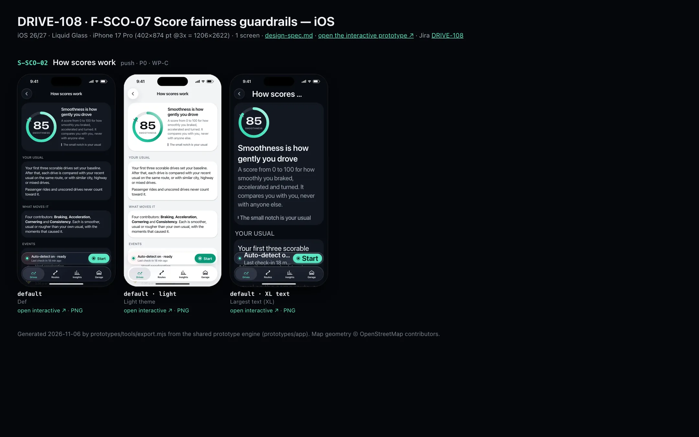
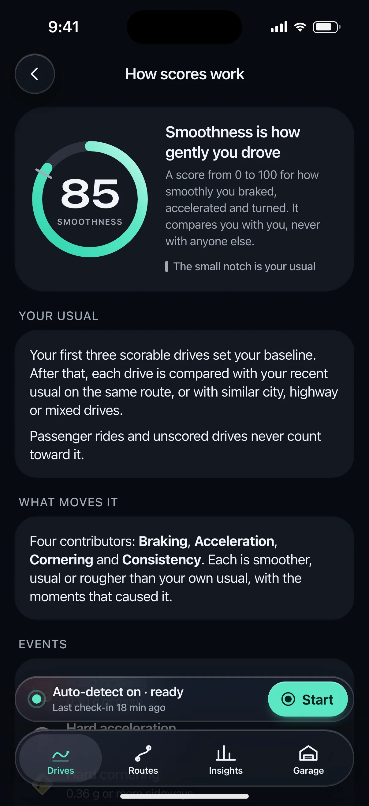
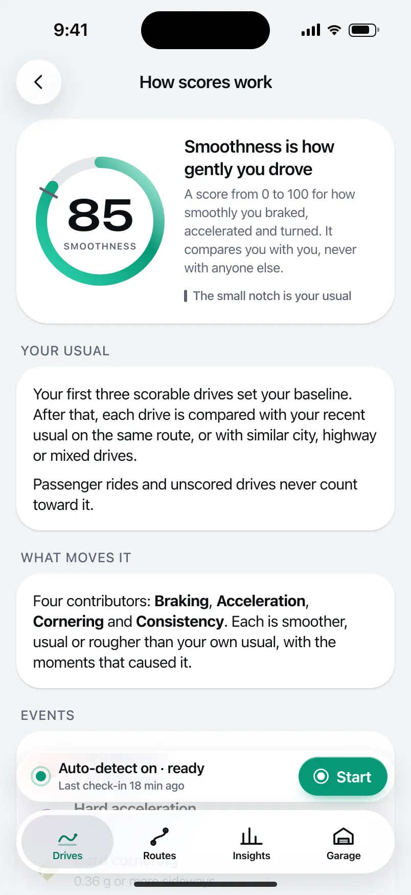

# DRIVE-108 · F-SCO-07 Score fairness guardrails — iOS design spec

> Generated by `prototypes/tools/export.mjs` on 2026-11-06 from the shared prototype engine. **Do not edit by hand:** change the screen's `spec` in `prototypes/app/screens/wp-*.js` (see `prototypes/app/AUTHORING.md`) and re-export.

- **Jira story:** [DRIVE-108](https://thekeval.atlassian.net/browse/DRIVE-108) · F-SCO-07 · P0
- **Platform:** iOS 26/27 · Liquid Glass · iPhone 17 Pro (402×874 pt @3x = 1206×2622)
- **Interactive prototype:** [../../../../prototypes/ios/index.html#S-SCO-02](../../../../prototypes/ios/index.html#S-SCO-02) (catalog panel: every screen and state; deep links `#S-ID/state?trip=…&ent=…&theme=light&text=xl&rm=1`)
- **Contact sheet:** [mockup.html](mockup.html) · 
- **Design system (source of truth for values):** [brand](../../system/brand.md) · [components](../../system/components.md) · [motion](../../system/motion.md) · [accessibility](../../system/accessibility.md) · [screen map](../../system/screen-map.md) · [fixtures](../../system/fixtures.md) · tokens `prototypes/shared/tokens.css`

## Screens in this story

| Screen | Name | Presentation | Priority | States | Status |
|---|---|---|---|---|---|
| `S-SCO-02` | How scores work | Push | P0 | 1 | Prototyped |

## Tokens used on this platform

Values resolved from `prototypes/shared/tokens.css` inside the iOS device (`[data-platform="ios"]`). Use the token names in code; the hex values are for reference.

| Token | Dark | Light |
|---|---|---|
| `--app-bg` | `#080B10` | `#F2F3F6` |
| `--card-bg` | `#131822` | `#FFFFFF` |
| `--dp-bg-grouped` | `#080B10` | `#F2F3F6` |
| `--dp-surface` | `#131822` | `#FFFFFF` |
| `--dp-surface-2` | `#1B222D` | `#F2F3F6` |
| `--dp-surface-3` | `#262E3B` | `#E4E7EC` |
| `--dp-fill` | `#7880961F` | `#7880961F` |
| `--dp-fill-strong` | `#7880963D` | `#78809633` |
| `--dp-text` | `#F2F4F7` | `#0B0E13` |
| `--dp-text-2` | `#A3AAB6` | `#5A6271` |
| `--dp-text-3` | `#6E7787` | `#8A919D` |
| `--dp-separator` | `#96A0B429` | `#3C435024` |
| `--dp-accent` | `#5BE7C4` | `#079777` |
| `--dp-accent-text` | `#5BE7C4` | `#06775E` |
| `--dp-on-accent` | `#04241D` | `#FFFFFF` |
| `--dp-accent-container` | `#0A4439` | `#C6F8EA` |
| `--dp-record` | `#FFC24B` | `#9A6300` |
| `--dp-positive` | `#5BE7C4` | `#06775E` |
| `--dp-change-down` | `#A3AAB6` | `#5A6271` |
| `--dp-warning` | `#F5B648` | `#9A5F00` |
| `--dp-critical` | `#FF6B6B` | `#C62828` |
| `--dp-glass-fill` | `#1C222C6B` | `#FFFFFF8C` |
| `--dp-glass-fill-strong` | `#1C222CB8` | `#FFFFFFD1` |
| `--dp-glass-stroke` | `#FFFFFF24` | `#FFFFFF99` |
| `--dp-data-route` | `#5BE7C4` | `#079777` |
| `--dp-data-event-brake` | `#FF7A66` | `#A21F16` |
| `--dp-data-event-accel` | `#E58BD0` | `#A33A8C` |
| `--dp-data-event-corner` | `#EAD54E` | `#9A8A00` |
| `--dp-data-quality-good` | `#5FDB9C` | `#1E9E62` |
| `--dp-data-speed` | `#D6DCE4` | `#404A58` |
| `--dp-data-long-g` | `#5AB8F5` | `#0A6AB8` |
| `--dp-data-lat-g` | `#F5A142` | `#B25A00` |

| Type / layout token | Value |
|---|---|
| `--dp-font-screen-title` | `700 34px / 41px -apple-system, BlinkMacSystemFont, "SF Pro Display", system-ui, sans-serif` |
| `--dp-font-sheet-title` | `700 22px / 28px -apple-system, BlinkMacSystemFont, "SF Pro Display", system-ui, sans-serif` |
| `--dp-font-section-title` | `600 20px / 25px -apple-system, BlinkMacSystemFont, "SF Pro Display", system-ui, sans-serif` |
| `--dp-font-card-title` | `600 17px / 22px -apple-system, BlinkMacSystemFont, "SF Pro Text", system-ui, sans-serif` |
| `--dp-font-body` | `400 17px / 22px -apple-system, BlinkMacSystemFont, "SF Pro Text", system-ui, sans-serif` |
| `--dp-font-body-secondary` | `400 15px / 20px -apple-system, BlinkMacSystemFont, "SF Pro Text", system-ui, sans-serif` |
| `--dp-font-meta` | `400 13px / 18px -apple-system, BlinkMacSystemFont, "SF Pro Text", system-ui, sans-serif` |
| `--dp-font-caption` | `400 12px / 16px -apple-system, BlinkMacSystemFont, "SF Pro Text", system-ui, sans-serif` |
| `--dp-font-button` | `600 17px / 22px -apple-system, BlinkMacSystemFont, "SF Pro Text", system-ui, sans-serif` |
| `--dp-num-hero` | `600 72px / 72px -apple-system, BlinkMacSystemFont, "SF Pro Display", system-ui, sans-serif` |
| `--dp-num-xl` | `600 48px / 52px -apple-system, BlinkMacSystemFont, "SF Pro Display", system-ui, sans-serif` |
| `--dp-num-l` | `600 34px / 38px -apple-system, BlinkMacSystemFont, "SF Pro Display", system-ui, sans-serif` |
| `--dp-num-m` | `600 24px / 28px -apple-system, BlinkMacSystemFont, "SF Pro Display", system-ui, sans-serif` |
| `--dp-num-s` | `600 17px / 22px -apple-system, BlinkMacSystemFont, "SF Pro Display", system-ui, sans-serif` |
| `--dp-num-xs` | `600 13px / 16px -apple-system, BlinkMacSystemFont, "SF Pro Display", system-ui, sans-serif` |
| `--dp-screen-margin` | `16px` |
| `--dp-radius-card` | `24px` |
| `--dp-radius-card-hero` | `32px` |
| `--dp-radius-sheet` | `38px` |
| `--dp-radius-chip` | `999px` |
| `--dp-radius-button` | `999px` |
| `--dp-layout-list-row-min` | `52px` |
| `--dp-layout-touch-min` | `44px` |
| `--safe-top` | `62px` |
| `--safe-bottom` | `34px` |

Text sizes scale with `--dp-text-scale` (XL = 2.0×) and numerals with `--dp-num-scale` (XL = 1.3×). DP Numerals: SF Pro Expanded Semibold, tabular.

---

## S-SCO-02 · How scores work

 

- **Presentation:** push · tab: drives — screen map: “Push”
- **Entry points:** ⓘ on any score · S-DQ-01
- **Leads to:** Back
- **PRD features:** F-SCO-08, F-SCO-07, F-DQ-05 · **Priority:** P0 · **WP:** C
- **Interactive:** [S-SCO-02](../../../../prototypes/ios/index.html#S-SCO-02)

**Purpose.** A plain explanation of Smoothness, the baseline, contributors, events and thresholds, provenance, data quality, efficiency as a proxy, and that a smooth score isn’t a safety certificate (F-SCO-08, F-SCO-07, F-DQ-05).

### States

| State | PRD label | Fixture params | Screenshot |
|---|---|---|---|
| `default` | Def | — | [S-SCO-02.png](../../screens/ios/S-SCO-02.webp) · [open](../../../../prototypes/ios/index.html#S-SCO-02) |
| default · light | Light theme | `theme=light` | [S-SCO-02--light.png](../../screens/ios/S-SCO-02--light.webp) |
| default · XL | Largest text | `text=xl` | [S-SCO-02--xl.png](../../screens/ios/S-SCO-02--xl.webp) |

Every state also renders in light/dark (`theme=light`), XL text (`text=xl`) and reduced motion (`rm=1`).

### Layout

- Push, title “How scores work”.
- Hero card: example ring 132 (85 with the usual notch at 83) + “Smoothness is how gently you drove” + one paragraph + notch key.
- Caption sections, each one short card: Your usual · What moves it · Events (three pins by shape with thresholds from meta.thresholdsG) · Was it needed? · Fair by design · Data quality (four glyph chips) · Where numbers come from (provenance list) · Efficiency habits · What it isn’t.
- Footer: “Scoring version smooth-v0.3 · updated 6 November 2026”.

### Components & tokens

| Component | Tokens / spec |
|---|---|
| `navBar` | --dp-font-card-title · --dp-font-meta · glass: --dp-glass-fill + --dp-glass-blur · components.md §2 |
| `card` | --dp-surface / --md-sys-color-surface-container · --dp-radius-card (24 iOS · 16 Android) · hero: --dp-radius-card-hero (32 · 28) · light iOS: --dp-elev-1 |
| `ring` | track --dp-fill-strong · arc --dp-gradient-ring (glide-400 → accent → glide-100) · baseline notch --dp-text-2 · record notch --dp-record · Android container Cookie9Sided --md-sys-color-primary-container 42% · components.md §3 |
| `section` | --dp-font-section-title · --dp-layout-section-gap 28 |
| `list` | iOS inset grouped radius --dp-radius-card, rows 52 pt, separators --dp-separator inset 16 · Android ListItem 56/72 dp in --md-sys-color-surface-container |
| `row` | --dp-font-body · --dp-font-meta (supporting) · --dp-layout-list-row-min |
| `qualityBadge` | --dp-data-quality-{good\|usable\|limited\|unscorable} · components.md §10 |
| `provenance` | see components.md |

### Interactions & navigation

- Back only. (Linked from every ⓘ next to a score and from S-DQ-01.)

### Motion

- Hero ring reveal (no ticks); sections rise 8 px. RM: static.

### Accessibility

- Headings for each section (rotor / headings navigation). XL: the hero stacks ring above text; nothing truncates.
- First mention glosses G: “G is how hard the car pushed you.”

### Platform notes

- **iOS (this spec):** Inline title, inset cards.
- *Android (for reference):* MediumFlexibleTopAppBar; cards on surface-container.

### Analytics

- `scores_explainer_viewed {source}`

### Copy

| Key | Text |
|---|---|
| Hero | Smoothness is how gently you drove. A score from 0 to 100 for how smoothly you braked, accelerated and turned. It compares you with you, never with anyone else. |
| Usual | Your first three scorable drives set your baseline. After that, each drive is compared with your recent usual on the same route, or with similar city, highway or mixed drives. Passenger rides and unscored drives never count toward it. |
| Fair | A full, gentle stop always scores at least as well as a rolling one. Speed never adds points; only how abruptly you changed it. Drives at an unusual pace can’t set route records. |
| Isnt | A smooth score is not a safety certificate. DrivePerf can’t see the road, the weather or other drivers. |
| Version | Scoring version {version} · updated {date} |

### Free / Pro

Free.

### Data & fixtures

Thresholds from DP_DATA.meta.thresholdsG (placeholders, A12). Version from smoothness.algorithm; “updated” uses meta.generated (fixture date, derived).

### Assets

[icon-info.svg](assets/icon-info.svg)

UI glyphs may be swapped for SF Symbols / Material Symbols Rounded equivalents; event-pin, quality and provenance glyphs must not be (components.md global rules).

### Checklist (accessibility.md §9)

- [ ] Light and dark both render, and contrast passes.
- [ ] The XL text state reflows with no truncation.
- [ ] The RM state is defined.
- [ ] Every control has a label; every chart and map has a summary sentence.
- [ ] Every target ≥ 44 pt / 48 dp (≥ 64 in-drive).
- [ ] No meaning by colour alone.
- [ ] Speed is neutral wherever it appears and absent from social or live surfaces.
- [ ] No streak, leaderboard, speed or “beat your time” language.
- [ ] Behaviour is defined while a trip is active (D1 gate).
- [ ] Haptics come from motion.md §6 only.

---

Map geometry in the prototype: © OpenStreetMap contributors (ODbL). Speed and G are simulated fixtures (fixtures.md).
