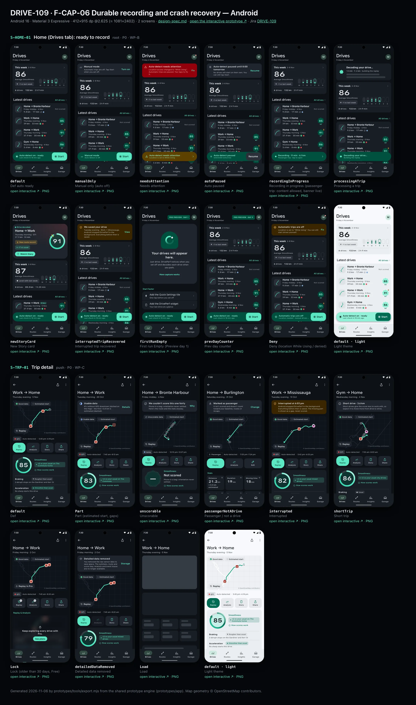
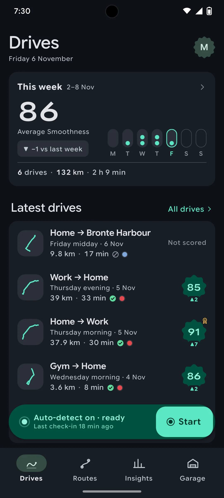
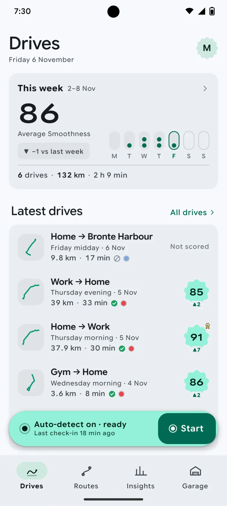
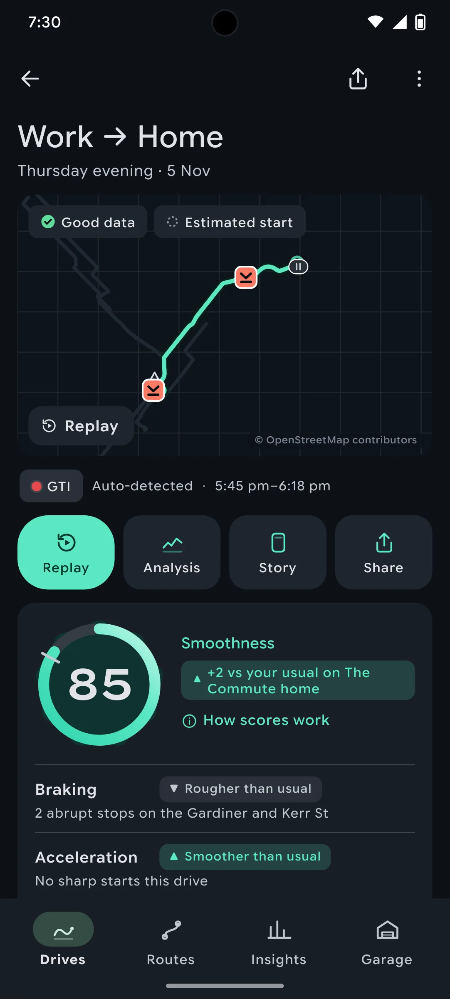
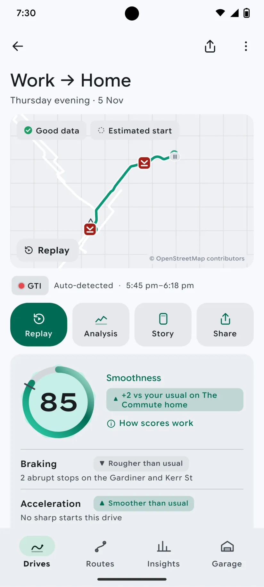

# DRIVE-109 · F-CAP-06 Durable recording and crash recovery — Android design spec

> Generated by `prototypes/tools/export.mjs` on 2026-11-06 from the shared prototype engine. **Do not edit by hand:** change the screen's `spec` in `prototypes/app/screens/wp-*.js` (see `prototypes/app/AUTHORING.md`) and re-export.

- **Jira story:** [DRIVE-109](https://thekeval.atlassian.net/browse/DRIVE-109) · F-CAP-06 · P0
- **Platform:** Android 16 · Material 3 Expressive · 412×915 dp @2.625 (≈ 1081×2402)
- **Interactive prototype:** [../../../../prototypes/android/index.html#S-HOME-01](../../../../prototypes/android/index.html#S-HOME-01) (catalog panel: every screen and state; deep links `#S-ID/state?trip=…&ent=…&theme=light&text=xl&rm=1`)
- **Contact sheet:** [mockup.html](mockup.html) · 
- **Design system (source of truth for values):** [brand](../../system/brand.md) · [components](../../system/components.md) · [motion](../../system/motion.md) · [accessibility](../../system/accessibility.md) · [screen map](../../system/screen-map.md) · [fixtures](../../system/fixtures.md) · tokens `prototypes/shared/tokens.css`

## Screens in this story

| Screen | Name | Presentation | Priority | States | Status |
|---|---|---|---|---|---|
| `S-HOME-01` | Home (Drives tab): ready to record | Root (Drives tab) | P0 | 11 | Prototyped |
| `S-TRP-01` | Trip detail | Push | P0 | 9 | Prototyped |

## Tokens used on this platform

Values resolved from `prototypes/shared/tokens.css` inside the Android device (`[data-platform="android"]`). Use the token names in code; the hex values are for reference.

| Token | Dark | Light |
|---|---|---|
| `--app-bg` | `#0D1117` | `#F7F9FC` |
| `--card-bg` | `#191E25` | `#EBEEF2` |
| `--dp-bg-grouped` | `#0D1117` | `#F7F9FC` |
| `--dp-surface` | `#191E25` | `#EBEEF2` |
| `--dp-surface-2` | `#1F252D` | `#E5E8EC` |
| `--dp-surface-3` | `#2A3038` | `#DFE2E6` |
| `--dp-fill` | `#2A3038` | `#DFE2E6` |
| `--dp-fill-strong` | `#353B44` | `#D3D7DC` |
| `--dp-text` | `#E1E3E8` | `#181C20` |
| `--dp-text-2` | `#C0C7CF` | `#40474F` |
| `--dp-text-3` | `#8A929B` | `#707881` |
| `--dp-separator` | `#40474F` | `#C0C7CF` |
| `--dp-accent` | `#5BE7C4` | `#006B53` |
| `--dp-accent-text` | `#5BE7C4` | `#006B53` |
| `--dp-on-accent` | `#00382B` | `#FFFFFF` |
| `--dp-accent-container` | `#00513F` | `#91F1D8` |
| `--dp-record` | `#FFC24B` | `#7A5900` |
| `--dp-positive` | `#5BE7C4` | `#006B53` |
| `--dp-change-down` | `#C0C7CF` | `#40474F` |
| `--dp-warning` | `#F5B648` | `#7A5900` |
| `--dp-critical` | `#FFB4AB` | `#BA1A1A` |
| `--dp-glass-fill` | `#1F252DF2` | `#E5E8ECF2` |
| `--dp-glass-fill-strong` | `#2A3038` | `#DFE2E6` |
| `--dp-glass-stroke` | `#FFFFFF0F` | `#0000000A` |
| `--md-sys-color-primary` | `#5BE7C4` | `#006B53` |
| `--md-sys-color-on-primary` | `#00382B` | `#FFFFFF` |
| `--md-sys-color-primary-container` | `#00513F` | `#91F1D8` |
| `--md-sys-color-on-primary-container` | `#91F1D8` | `#002118` |
| `--md-sys-color-secondary-container` | `#344C44` | `#CEE9DF` |
| `--md-sys-color-surface` | `#0D1117` | `#F7F9FC` |
| `--md-sys-color-surface-container` | `#191E25` | `#EBEEF2` |
| `--md-sys-color-surface-container-high` | `#1F252D` | `#E5E8EC` |
| `--md-sys-color-on-surface-variant` | `#C0C7CF` | `#40474F` |
| `--dp-data-route` | `#5BE7C4` | `#079777` |
| `--dp-data-event-brake` | `#FF7A66` | `#A21F16` |
| `--dp-data-event-accel` | `#E58BD0` | `#A33A8C` |
| `--dp-data-event-corner` | `#EAD54E` | `#9A8A00` |
| `--dp-data-quality-good` | `#5FDB9C` | `#1E9E62` |
| `--dp-data-speed` | `#D6DCE4` | `#404A58` |
| `--dp-data-long-g` | `#5AB8F5` | `#0A6AB8` |
| `--dp-data-lat-g` | `#F5A142` | `#B25A00` |

| Type / layout token | Value |
|---|---|
| `--dp-font-screen-title` | `600 32px / 40px "Google Sans Flex", "Google Sans Display", "Roboto Flex", Roboto, system-ui, sans-serif` |
| `--dp-font-sheet-title` | `400 24px / 32px "Google Sans Flex", "Google Sans Display", "Roboto Flex", Roboto, system-ui, sans-serif` |
| `--dp-font-section-title` | `600 22px / 28px "Google Sans Flex", "Google Sans Display", "Roboto Flex", Roboto, system-ui, sans-serif` |
| `--dp-font-card-title` | `700 16px / 24px "Google Sans Flex", "Google Sans Text", "Roboto Flex", Roboto, system-ui, sans-serif` |
| `--dp-font-body` | `400 16px / 24px "Google Sans Flex", "Google Sans Text", "Roboto Flex", Roboto, system-ui, sans-serif` |
| `--dp-font-body-secondary` | `400 14px / 20px "Google Sans Flex", "Google Sans Text", "Roboto Flex", Roboto, system-ui, sans-serif` |
| `--dp-font-meta` | `400 12px / 16px "Google Sans Flex", "Google Sans Text", "Roboto Flex", Roboto, system-ui, sans-serif` |
| `--dp-font-caption` | `500 12px / 16px "Google Sans Flex", "Google Sans Text", "Roboto Flex", Roboto, system-ui, sans-serif` |
| `--dp-font-button` | `700 14px / 20px "Google Sans Flex", "Google Sans Text", "Roboto Flex", Roboto, system-ui, sans-serif` |
| `--dp-num-hero` | `600 72px / 72px "Google Sans Flex", "Roboto Flex", Roboto, system-ui, sans-serif` |
| `--dp-num-xl` | `600 48px / 52px "Google Sans Flex", "Roboto Flex", Roboto, system-ui, sans-serif` |
| `--dp-num-l` | `600 34px / 38px "Google Sans Flex", "Roboto Flex", Roboto, system-ui, sans-serif` |
| `--dp-num-m` | `600 24px / 28px "Google Sans Flex", "Roboto Flex", Roboto, system-ui, sans-serif` |
| `--dp-num-s` | `600 17px / 22px "Google Sans Flex", "Roboto Flex", Roboto, system-ui, sans-serif` |
| `--dp-num-xs` | `600 13px / 16px "Google Sans Flex", "Roboto Flex", Roboto, system-ui, sans-serif` |
| `--dp-screen-margin` | `16px` |
| `--dp-radius-card` | `16px` |
| `--dp-radius-card-hero` | `28px` |
| `--dp-radius-sheet` | `28px` |
| `--dp-radius-chip` | `8px` |
| `--dp-radius-button` | `999px` |
| `--dp-layout-list-row-min` | `56px` |
| `--dp-layout-touch-min` | `48px` |
| `--safe-top` | `40px` |
| `--safe-bottom` | `24px` |

Text sizes scale with `--dp-text-scale` (XL = 2.0×) and numerals with `--dp-num-scale` (XL = 1.3×). DP Numerals: Google Sans Flex wdth 120 wght 600, tabular.

---

## S-HOME-01 · Home (Drives tab): ready to record

 

- **Presentation:** root · tab: drives — screen map: “Root (Drives tab)”
- **Entry points:** Tab · S-ONB-15 · S-DRV-04 done (new Story card)
- **Leads to:** S-STY-01 (new Story) · S-TRP-01 · S-HIS-01 ("All drives") · S-HOME-02 · S-HOME-03 · S-DRV-01 (Start) · S-SET-05 (needs attention) · S-SUB-01 (Prev badge)
- **PRD features:** F-CAP-01, F-CAP-02, F-CAP-06, F-CAP-14, F-SET-02, F-SUB-02 · **Priority:** P0 · **WP:** B
- **Interactive:** [S-HOME-01](../../../../prototypes/android/index.html#S-HOME-01)

**Purpose.** The Drives tab root: glanceable capture status, the newest decoded drive (Story card), this week at a glance and the latest drives. It never shows live speed, score or record pace while recording (SAF-02).

### States

| State | PRD label | Fixture params | Screenshot |
|---|---|---|---|
| `default` | Def auto ready | — | [S-HOME-01.png](../../screens/android/S-HOME-01.webp) · [open](../../../../prototypes/android/index.html#S-HOME-01) |
| `manualOnly` | Manual only (auto off) | `capture=manual` | [S-HOME-01--manualOnly.png](../../screens/android/S-HOME-01--manualOnly.webp) · [open](../../../../prototypes/android/index.html#S-HOME-01/manualOnly) |
| `needsAttention` | Needs attention | `health=alwaysLost` | [S-HOME-01--needsAttention.png](../../screens/android/S-HOME-01--needsAttention.webp) · [open](../../../../prototypes/android/index.html#S-HOME-01/needsAttention) |
| `autoPaused` | Auto paused | `capture=paused` | [S-HOME-01--autoPaused.png](../../screens/android/S-HOME-01--autoPaused.webp) · [open](../../../../prototypes/android/index.html#S-HOME-01/autoPaused) |
| `recordingInProgress` | Recording in progress (passenger trip: content allowed, banner live) | — | [S-HOME-01--recordingInProgress.png](../../screens/android/S-HOME-01--recordingInProgress.webp) · [open](../../../../prototypes/android/index.html#S-HOME-01/recordingInProgress) |
| `processingATrip` | Processing a trip | — | [S-HOME-01--processingATrip.png](../../screens/android/S-HOME-01--processingATrip.webp) · [open](../../../../prototypes/android/index.html#S-HOME-01/processingATrip) |
| `newStoryCard` | New Story card | `trip=t20261105-0742` | [S-HOME-01--newStoryCard.png](../../screens/android/S-HOME-01--newStoryCard.webp) · [open](../../../../prototypes/android/index.html#S-HOME-01/newStoryCard) |
| `interruptedTripRecovered` | Interrupted trip recovered | `trip=t20261013-1742` | [S-HOME-01--interruptedTripRecovered.png](../../screens/android/S-HOME-01--interruptedTripRecovered.webp) · [open](../../../../prototypes/android/index.html#S-HOME-01/interruptedTripRecovered) |
| `firstRunEmpty` | First run Empty (Preview day 1) | `ent=preview` | [S-HOME-01--firstRunEmpty.png](../../screens/android/S-HOME-01--firstRunEmpty.webp) · [open](../../../../prototypes/android/index.html#S-HOME-01/firstRunEmpty) |
| `prevDayCounter` | Prev day counter | `ent=preview` | [S-HOME-01--prevDayCounter.png](../../screens/android/S-HOME-01--prevDayCounter.webp) · [open](../../../../prototypes/android/index.html#S-HOME-01/prevDayCounter) |
| `Deny` | Deny (location While Using / denied) | `capture=denied` | [S-HOME-01--Deny.png](../../screens/android/S-HOME-01--Deny.webp) · [open](../../../../prototypes/android/index.html#S-HOME-01/Deny) |
| default · light | Light theme | `theme=light` | [S-HOME-01--light.png](../../screens/android/S-HOME-01--light.webp) |

Every state also renders in light/dark (`theme=light`), XL text (`text=xl`) and reduced motion (`rm=1`).

### Layout

- Large title “Drives” (iOS 34/41 bold large title · Android LargeFlexibleTopAppBar 32/40 with the date as subtitle); trailing: Preview/Ride-along badge (when active) + profile avatar (dot = needs attention).
- State banner slot (needs attention · paused · manual · denied · interrupted recovered · processing), full width, 16 margins.
- New Story card (state newStoryCard): hero card (radius 32 iOS / 28 Android) tinted 18% with the car colour; kicker “● Drive decoded”, route label, part of day · car, distance · duration, record + delta chips, “Watch Story” filled small button; Smoothness ring 116 with baseline and record notches.
- “This week” card: average Smoothness (DP Numerals 48), delta vs last week (neutral when lower, never red), 7-day dot strip (Mon–Sun, ≤ 3 dots per day, future days dimmed), drives · km · time footer. Tap → Insights tab.
- “Latest drives” section (title + “All drives” → S-HIS-01): 5 trip cards in one card, newest first (components.md §12).
- Capture status: iOS tabViewBottomAccessory glass capsule (50 pt, 8 above the floating tab bar) · Android M3E floating toolbar (64 dp, primaryContainer, 16 above the navigation bar, Drives tab only). Start → S-DRV-01 with the trip-start expansion.

### Components & tokens

| Component | Tokens / spec |
|---|---|
| `largeTitle` | --dp-font-screen-title (iOS 34/41 bold · Android 32/40) · components.md §2 |
| `previewBadge` | see components.md |
| `avatar` | see components.md |
| `banner` | radius 12 (--dp-radius-sm+) · info --dp-fill · attention --dp-warning-container · critical --dp-critical-container · components.md §22 |
| `card` | --dp-surface / --md-sys-color-surface-container · --dp-radius-card (24 iOS · 16 Android) · hero: --dp-radius-card-hero (32 · 28) · light iOS: --dp-elev-1 |
| `ring` | track --dp-fill-strong · arc --dp-gradient-ring (glide-400 → accent → glide-100) · baseline notch --dp-text-2 · record notch --dp-record · Android container Cookie9Sided --md-sys-color-primary-container 42% · components.md §3 |
| `deltaChip` | better: --dp-accent-text on --dp-accent 18% · lower: --dp-text-2 on --dp-fill (never red) · record: --dp-record on --dp-record 18% · components.md §4 |
| `chip` | --dp-radius-chip (iOS capsule · Android 8) · height 28 · --dp-font-caption |
| `button` | --dp-accent / --dp-on-accent (filled) · --dp-fill-strong · --md-sys-color-secondary-container (tonal) · --dp-radius-button · height iOS 50/44/34 · Android 56/40/32 · --dp-font-button · components.md §0 |
| `tripRow` | glyph 40 on --dp-surface-2 · --dp-font-card-title · --dp-font-meta · components.md §12 |
| `scoreBadge` | iOS mini ring 46 · Android Cookie9Sided 46 · --dp-num-s |
| `qualityBadge` | --dp-data-quality-{good\|usable\|limited\|unscorable} · components.md §10 |
| `section` | --dp-font-section-title · --dp-layout-section-gap 28 |
| `empty` | illustration 120 in --dp-accent · --dp-font-section-title · components.md §21 |
| `loader` | see components.md |
| `skeleton` | --dp-fill-strong, breathe 1.2 s (dp-skeleton) |
| `list` | iOS inset grouped radius --dp-radius-card, rows 52 pt, separators --dp-separator inset 16 · Android ListItem 56/72 dp in --md-sys-color-surface-container |
| `row` | --dp-font-body · --dp-font-meta (supporting) · --dp-layout-list-row-min |
| `tabBar` | iOS floating glass: inset 16, bottom 21, height 62, lens --dp-fill-strong · Android NavigationBar 64 dp + indicator 56×32 --md-sys-color-secondary-container · components.md §1 |
| `accessory` | iOS tabViewBottomAccessory glass 48 pt, 8 above tab bar · Android floating toolbar 64 dp --md-sys-color-primary-container, 16 above nav bar · Start: --dp-accent |

### Interactions & navigation

- Trip card → S-TRP-01 (zoom transition on iOS, container transform on Android).
- New Story card / “Watch Story” → S-STY-01 (D1 gate: held on S-DRV-05 while moving).
- “This week” card → Insights tab (S-STA-01). “All drives” → S-HIS-01.
- Accessory/toolbar body → S-HOME-02 capture status sheet; Start → S-DRV-01 (manual trip; gate locks the app to the in-drive screen); recording banner → S-DRV-01; needs attention → S-SET-05; denied → S-ONB-16.
- Avatar → S-ACC-01 (iOS sheet, Android full-screen). Preview badge → S-SUB-01.
- Banners: Fix → S-SET-05 / S-ONB-16 · Turn on → S-SET-03 · Resume → resumes auto-detect (toast) · View → S-TRP-01/interrupted.
- Scroll: large title collapses to an inline title; iOS tab bar minimises to a compact capsule with the accessory inline; Android toolbar slides away and returns on scroll up.

### Motion

- Blocks rise 8 px and fade in, 40 ms stagger, spring.default (RM: 220 ms cross-fade).
- Story card ring: ring reveal (motion.md §3.4) 1400 ms count-up locked to the arc; record notch turns solid gold as the arc passes 89 (doubleSuccess haptic); RM: full ring, static number.
- Start: press scale 0.96 (spring.fast) + confirm haptic, then the accessory/toolbar expands into the in-drive surface (spring.slow container transform, motion.md §3.1).
- Recording banner dot: continuous livePulse breathe 2400 ms (passenger trip / finalising only); RM: static dot.
- Tab switch: iOS cross-fade + lens slides (spring.default); Android fade-through.

### Accessibility

- Trip card label: “Home to Work, Thursday morning, 5 November. 37.9 kilometres, 30 minutes. Smoothness 91. Good data.” (one element, button).
- This-week card is one element: “This week: 6 drives, 132.1 kilometres, 2 h 9 min. Average Smoothness 86, 1 down on last week.”
- Accessory: “Auto-detect on · ready. Last check-in 18 min ago” + separate “Start drive” button (≥ 44 pt / 48 dp).
- XL text: trip cards stack (glyph above), stats wrap; the accessory keeps one line with ellipsis and the full text in its label.
- Colour never carries meaning alone: ▲/▼/● glyphs on deltas, shapes on quality glyphs, the attention state has a triangle glyph and text.

### Platform notes

- **Android (this spec):** NavigationBar (64 dp + gesture area) with 56×32 secondaryContainer indicator; capture status is an M3E floating toolbar on the Drives tab only (other tabs show a status chip when it needs attention); avatar in a Cookie12Sided shape opens Profile full-screen; score badges use Cookie9Sided; LargeFlexibleTopAppBar with date subtitle.
- *iOS (for reference):* Floating Liquid Glass tab bar (inset 16, bottom 21, 62 tall) with lens selection; tabViewBottomAccessory carries capture status on every tab; glass avatar toolbar item opens Profile as a sheet; score badges are mini rings; large title collapses to the inline title with a scroll-edge fade.

### Analytics

- `home_viewed {state}`
- `story_card_tapped {trip_age}`
- `manual_start_tapped {source: accessory|toolbar}`
- `capture_status_opened`
- `history_opened {source: home}`

### Copy

| Key | Text |
|---|---|
| Accessory ready | Auto-detect on · ready / Last check-in {n} min ago |
| Accessory manual | Manual mode / Auto-detect is off |
| Accessory paused | Auto-detect paused / Until 8:00 tomorrow · Resume |
| Accessory attention | Auto-detect needs attention / Location is set to While Using |
| Accessory recording | Recording · {min} min · {km} km / Passenger trip · tap to open |
| Empty | Your drives will appear here. Just drive. DrivePerf notices when you set off and decodes each drive when you park. |
| Interrupted | We saved your drive. {part of day} · {label}. {iOS ended DrivePerf in the background \| Android stopped DrivePerf in the background}. Everything before then is saved. |
| Story card kicker | Drive decoded |

### Free / Pro

Free: identical layout (summaries are free forever); trips older than 30 days show a small lock after the score for “Replay & Analysis in Pro”. Preview/Ride-along: “PRO PREVIEW · DAY n” / “RIDE-ALONG · DAY n” badge → S-SUB-01. No paywall is ever shown here during or right after a trip (D12, F-SUB-08).

### Data & fixtures

This-week numbers are derived from DP_DATA.trips for the current week (they equal recaps[0]: 6 drives · 132.1 km · 2 h 9 min · 86, −1 vs 87). In newStoryCard the week is computed as of the Story trip’s end (Thu 5 Nov 08:13).

### Assets

[icon-drives.svg](assets/icon-drives.svg) · [icon-routes.svg](assets/icon-routes.svg) · [icon-insights.svg](assets/icon-insights.svg) · [icon-garage.svg](assets/icon-garage.svg) · [icon-record.svg](assets/icon-record.svg) · [icon-story.svg](assets/icon-story.svg) · [icon-chevronRight.svg](assets/icon-chevronRight.svg) · [icon-rosette.svg](assets/icon-rosette.svg) · [icon-lock.svg](assets/icon-lock.svg) · [icon-gps.svg](assets/icon-gps.svg) · [icon-shield.svg](assets/icon-shield.svg) · [icon-pause.svg](assets/icon-pause.svg) · [logo-a-loop.svg](assets/logo-a-loop.svg)

UI glyphs may be swapped for SF Symbols / Material Symbols Rounded equivalents; event-pin, quality and provenance glyphs must not be (components.md global rules).

### Checklist (accessibility.md §9)

- [ ] Light and dark both render, and contrast passes.
- [ ] The XL text state reflows with no truncation.
- [ ] The RM state is defined.
- [ ] Every control has a label; every chart and map has a summary sentence.
- [ ] Every target ≥ 44 pt / 48 dp (≥ 64 in-drive).
- [ ] No meaning by colour alone.
- [ ] Speed is neutral wherever it appears and absent from social or live surfaces.
- [ ] No streak, leaderboard, speed or “beat your time” language.
- [ ] Behaviour is defined while a trip is active (D1 gate).
- [ ] Haptics come from motion.md §6 only.

---

## S-TRP-01 · Trip detail

 

- **Presentation:** push · tab: drives — screen map: “Push”
- **Entry points:** S-HOME-01 · S-HIS-01 · S-RTE-02 runs · S-GAR-02 · S-RCP-01 drive of week
- **Leads to:** S-RPL-01 · S-ANL-01 · S-STY-01 · S-SHR-01 · S-PRV-04 (Export, Pro) · S-TRP-02 · S-DQ-01 · S-SCO-01 · S-SCO-04 · S-SUB-03 (Lock)
- **PRD features:** F-RPL-07, F-CAP-04, F-CAP-05, F-CAP-06, F-CAP-17, F-DQ-04, F-DQ-05, F-HIS-03, F-SCO-01, F-SCO-04, F-SCO-06, F-SCO-09, F-SHR-01, F-PRV-03, F-RPL-01 · **Priority:** P0 · **WP:** C
- **Interactive:** [S-TRP-01](../../../../prototypes/android/index.html#S-TRP-01)

**Purpose.** One place with a drive’s summary, scores, events and actions, so the user can decide where to dig in (F-RPL-07). The summary is Free forever; Replay/Analysis older than 30 days are Pro and shown locked with this trip’s own data blurred (F-HIS-03).

### States

| State | PRD label | Fixture params | Screenshot |
|---|---|---|---|
| `default` | Def | `trip=t20261105-1745` | [S-TRP-01.png](../../screens/android/S-TRP-01.webp) · [open](../../../../prototypes/android/index.html#S-TRP-01) |
| `Part` | Part (estimated start, gaps) | `trip=t20261020-0740` | [S-TRP-01--Part.png](../../screens/android/S-TRP-01--Part.webp) · [open](../../../../prototypes/android/index.html#S-TRP-01/Part) |
| `unscorable` | Unscorable | `trip=t20261106-1210` | [S-TRP-01--unscorable.png](../../screens/android/S-TRP-01--unscorable.webp) · [open](../../../../prototypes/android/index.html#S-TRP-01/unscorable) |
| `passengerNotADrive` | Passenger / not a drive | `trip=t20261031-1905` | [S-TRP-01--passengerNotADrive.png](../../screens/android/S-TRP-01--passengerNotADrive.webp) · [open](../../../../prototypes/android/index.html#S-TRP-01/passengerNotADrive) |
| `interrupted` | Interrupted | `trip=t20261013-1742` | [S-TRP-01--interrupted.png](../../screens/android/S-TRP-01--interrupted.webp) · [open](../../../../prototypes/android/index.html#S-TRP-01/interrupted) |
| `shortTrip` | Short trip | `trip=t20261104-0755` | [S-TRP-01--shortTrip.png](../../screens/android/S-TRP-01--shortTrip.webp) · [open](../../../../prototypes/android/index.html#S-TRP-01/shortTrip) |
| `Lock` | Lock (older than 30 days, Free) | `trip=t20261002-0745` `ent=free` | [S-TRP-01--Lock.png](../../screens/android/S-TRP-01--Lock.webp) · [open](../../../../prototypes/android/index.html#S-TRP-01/Lock) |
| `detailedDataRemoved` | Detailed data removed | `trip=t20261002-0745` | [S-TRP-01--detailedDataRemoved.png](../../screens/android/S-TRP-01--detailedDataRemoved.webp) · [open](../../../../prototypes/android/index.html#S-TRP-01/detailedDataRemoved) |
| `Load` | Load | `trip=t20261105-1745` | [S-TRP-01--Load.png](../../screens/android/S-TRP-01--Load.webp) · [open](../../../../prototypes/android/index.html#S-TRP-01/Load) |
| default · light | Light theme | `theme=light` | [S-TRP-01--light.png](../../screens/android/S-TRP-01--light.webp) |

Every state also renders in light/dark (`theme=light`), XL text (`text=xl`) and reduced motion (`rm=1`).

### Layout

- Top bar: iOS inline title (route label) + subtitle (part of day · date) with glass back, Share and “…” menu (Edit trip, Export GPX/CSV, Data quality, Delete) · Android MediumFlexibleTopAppBar (back, Share, overflow) with the title block in content that collapses into the bar on scroll.
- State banners (passenger, interrupted, unscorable, short trip, Part data, detailed data removed) directly under the bar.
- Map hero, full width minus 16 margins, 232 tall, radius = card (24 iOS / 16 Android): route in Glide over the plain-canvas map, estimated start dashed, GPS gap dotted, stop capsules, neutral max-speed triangle, event pins by shape; quality badge and “Estimated start” chips top-left (glass on iOS); “Replay” glass capsule bottom-left (“Replay in Pro” + lock when locked); “© OpenStreetMap contributors” bottom-right.
- Meta row: car chip (tap → car picker) · source (Auto-detected / Started from Widget, Control Center) · start–end time.
- Smoothness card: ring 124 (baseline notch, record notch) + comparison chip, record line (rosette, gold), “Score based on n of m min” when excluded, “How scores work”; four contributor rows (label · band chip ▲/●/▼ · reason); “Smoothness breakdown ›” → S-SCO-01.
- Action row directly under the meta row (4 equal buttons, 68 tall): Replay (primary) · Analysis · Story · Share. Locked: lock badges, both open S-SUB-03. Passenger: Replay · Analysis · Edit.
- Locked (Free > 30 days): “Replay & Analysis” lock panel — this trip’s synced timeline blurred 14 px + “Keep exploring every drive with Pro.” + See plans.
- Stats 3×3 tiles in PRD order: distance, duration, moving time, stopped, stops, avg moving speed, max speed (neutral, never first), climb, descent — each with its provenance glyph.
- Events · n: count chips by type (pin glyph + count) and event rows (pin 28 · “Hard braking” · place · time of day · 0.42 g · 1.4 s); “No abrupt inputs on this drive.” when there are none.
- Highlights: positive card first (“Cleanest stretch: …”), then the tip card (“One thing for next time”, long-G sparkline, “See the moment ›”).
- Details list: data quality (badge + detail) → S-DQ-01 · efficiency habits (≈ estimated) → S-SCO-06 · route (runs, record) → S-RTE-02. Manage list: Edit trip · Export GPX/CSV (Pro) · Delete drive (destructive).

### Components & tokens

| Component | Tokens / spec |
|---|---|
| `navBar` | --dp-font-card-title · --dp-font-meta · glass: --dp-glass-fill + --dp-glass-blur · components.md §2 |
| `menu` | iOS glass Menu: --dp-glass-fill-strong, radius 26 · Android DropdownMenu: --md-sys-color-surface-container, radius 16 |
| `banner` | radius 12 (--dp-radius-sm+) · info --dp-fill · attention --dp-warning-container · critical --dp-critical-container · components.md §22 |
| `map` | --dp-data-map-land/road/grid · route --dp-data-route 3.8 + casing --dp-data-route-casing 7.5 · estimated dashed 4/4 at 60% · gap --dp-data-gap-stroke dotted 1/6 · pins DP_ICONS.pin 26 · attribution “© OpenStreetMap contributors” |
| `qualityBadge` | --dp-data-quality-{good\|usable\|limited\|unscorable} · components.md §10 |
| `chip` | --dp-radius-chip (iOS capsule · Android 8) · height 28 · --dp-font-caption |
| `card` | --dp-surface / --md-sys-color-surface-container · --dp-radius-card (24 iOS · 16 Android) · hero: --dp-radius-card-hero (32 · 28) · light iOS: --dp-elev-1 |
| `ring` | track --dp-fill-strong · arc --dp-gradient-ring (glide-400 → accent → glide-100) · baseline notch --dp-text-2 · record notch --dp-record · Android container Cookie9Sided --md-sys-color-primary-container 42% · components.md §3 |
| `deltaChip` | better: --dp-accent-text on --dp-accent 18% · lower: --dp-text-2 on --dp-fill (never red) · record: --dp-record on --dp-record 18% · components.md §4 |
| `actionButton` | --dp-surface-2 · --md-sys-color-surface-container-high · --dp-radius-lg · min 44 pt / 48 dp |
| `lockPanel` | blur --dp-opacity-locked-blur 14px · dim --dp-opacity-locked-dim 35% · components.md §15.2 |
| `timeline` | --dp-data-speed · --dp-data-long-g · --dp-data-lat-g (dashed 6/3) · cursor --dp-data-cursor · components.md §7 |
| `stats` | --dp-surface-2 / --md-sys-color-surface-container-high · radius 14 iOS / 12 Android · value --dp-num-m (DP Numerals) · components.md §5 |
| `eventRow` | pin 28 (shape = meaning) · meta --dp-num-xs · min height 44 · components.md §9.2 |
| `tipCard` | --dp-accent 10% over --dp-surface · sparkline --dp-data-long-g · components.md §18 |
| `sparkline` | see components.md |
| `list` | iOS inset grouped radius --dp-radius-card, rows 52 pt, separators --dp-separator inset 16 · Android ListItem 56/72 dp in --md-sys-color-surface-container |
| `row` | --dp-font-body · --dp-font-meta (supporting) · --dp-layout-list-row-min |
| `section` | --dp-font-section-title · --dp-layout-section-gap 28 |
| `skeleton` | --dp-fill-strong, breathe 1.2 s (dp-skeleton) |

### Interactions & navigation

- Map / Replay → S-RPL-01 (Lock → S-SUB-03 replayAnalysis30Days). Analysis → S-ANL-01. Story → S-STY-01. Share (button or bar) → S-SHR-01. (Story/Replay/Analysis/Share pass the D1 gate → S-DRV-05 while moving.)
- Quality badge / Data quality row → S-DQ-01 · Smoothness card → S-SCO-01 · “How scores work” → S-SCO-02 · Event row → S-RPL-02 (event param) · Tip “See the moment” → S-RPL-02.
- Car chip → S-TRP-02/carPicker · Passenger “Change” → S-TRP-02/typePicker · Edit → S-TRP-02 · Export → S-PRV-04 (Pro) or S-SUB-03/export (Free) · Delete → S-TRP-03 dialog · Route row → S-RTE-02 · Efficiency → S-SCO-06.
- “…” opens a glass Menu (iOS) / DropdownMenu (Android). Long-press any stat tile → provenance popover (prototype: toast) with the glyph meaning, haptic longPress.

### Motion

- Enter from a trip card: iOS zoom transition from the card, Android container transform (spring.slow).
- Map: route draw-on 1800 ms ease.drawOn; estimated/gap overlays, stops and max pin fade in at 1500 ms; event pins pop in time order from 1600 ms, 40 ms stagger, shared.pinPop. RM: the complete route fades in (220 ms), pins appear in place.
- Smoothness ring reveal (motion.md §3.4): 1400 ms count-up locked to the arc, baseline notch scales in, landing tap haptic; Android Cookie9Sided container rotates as the count runs. RM: final ring, static number.
- Sections rise 8 px, 30 ms stagger, spring.default. Menu scales in from the top-trailing corner (spring.fast).

### Accessibility

- Score card is one element: “Smoothness 85. 2 above your usual on The Commute home.” (+ “New route record, beating 89 from 14 October.”).
- Map label: “Map of your drive, 39 kilometres from Work to Home. 2 events, 2 stops.” Event pins are a time-ordered list; each event row reads “Hard braking at the Gardiner. Peak 0.4 g.”
- Stat tiles: “Distance, 39.0 kilometres. Derived.” with the long-press action “Show how this was measured”; ⓘ footer explains long-press.
- Speed tiles use the same neutral component (no colour, no emphasis, never first). Deltas use ▲/▼/● and “above/below your usual”, never red.
- XL: tiles go to 2 columns, the action row to 2×2, contributor reasons wrap; nothing truncates.

### Platform notes

- **Android (this spec):** MediumFlexibleTopAppBar (title in content, collapses on scroll), overflow DropdownMenu; quality badge as AssistChip; ring on a Cookie9Sided primaryContainer shape; actions: filled primary (radius 28) + tonal surfaceContainerHigh buttons; list sections as M3E segmented ListItems; container transform from the card.
- *iOS (for reference):* Inline title + .navigationSubtitle, glass back/Share/“…” toolbar buttons, Menu for overflow; map chips and Replay capsule are glass; ring on content; zoom transition from the source card.

### Analytics

- `trip_detail_opened {source, age_bucket}`
- `locked_content_viewed {type: replay|analysis, age_bucket}`
- `trip_action_tapped {action: replay|analysis|story|share|export|edit|delete}`
- `provenance_viewed {metric}`

### Copy

| Key | Text |
|---|---|
| Passenger | Marked as passenger. It isn’t scored and doesn’t count toward your baseline, routes or recaps. · Change |
| Interrupted | Interrupted at {time}. {iOS ended DrivePerf in the background \| Android stopped DrivePerf in the background}. Everything before then is saved. The missing part is shown as a gap, never scored. |
| Unscorable | We couldn’t score this one fairly. {quality.reason}. Here’s the route and the stats anyway. |
| Part | {badge} data. {41} s without GPS downtown (dotted on the map) · the first ≈ 0.4 km is estimated (dashed). |
| Short trip | Short drive · {km} km. Short drives give the score less to work with, so expect it to move more from drive to drive. |
| Detailed data removed | You removed the raw sensor data to save space. The summary, route and score stay; Analysis and event traces are no longer available. |
| Lock | Keep exploring every drive with Pro. (entitlement.lockSheets.oldAnalysis) · Your summary, score and Story stay free forever. Nothing is deleted because of your plan. |
| No events | No abrupt inputs on this drive. Nothing crossed the braking, acceleration or cornering thresholds. |

### Free / Pro

Free: everything on this screen is visible for every trip of any age. For trips older than 30 days Replay and Analysis show lock badges and open S-SUB-03 (replayAnalysis30Days) over a blurred render of this trip; Export shows a PRO badge and opens S-SUB-03/export. Pro/Preview/Ride-along: no locks.

### Data & fixtures

Fixtures: default t20261105-1745 · Part t20261020-0740 (41 s gap, needed brake at Spadina & King) · unscorable t20261106-1210 · passenger t20261031-1905 · interrupted t20261013-1742 · short trip t20261104-0755 · Lock / detailed data removed t20261002-0745. Event time of day = trip.start + event.t (derived).

### Assets

[icon-replay.svg](assets/icon-replay.svg) · [icon-analysis.svg](assets/icon-analysis.svg) · [icon-story.svg](assets/icon-story.svg) · [icon-share.svg](assets/icon-share.svg) · [icon-more.svg](assets/icon-more.svg) · [icon-edit.svg](assets/icon-edit.svg) · [icon-export.svg](assets/icon-export.svg) · [icon-trash.svg](assets/icon-trash.svg) · [icon-lock.svg](assets/icon-lock.svg) · [icon-info.svg](assets/icon-info.svg) · [icon-routes.svg](assets/icon-routes.svg) · [icon-car.svg](assets/icon-car.svg) · [icon-bolt.svg](assets/icon-bolt.svg) · [icon-sparkle.svg](assets/icon-sparkle.svg) · [icon-passenger.svg](assets/icon-passenger.svg) · [icon-shield.svg](assets/icon-shield.svg) · [icon-check.svg](assets/icon-check.svg) · [icon-chevronRight.svg](assets/icon-chevronRight.svg) · [icon-rosette.svg](assets/icon-rosette.svg)

UI glyphs may be swapped for SF Symbols / Material Symbols Rounded equivalents; event-pin, quality and provenance glyphs must not be (components.md global rules).

### Checklist (accessibility.md §9)

- [ ] Light and dark both render, and contrast passes.
- [ ] The XL text state reflows with no truncation.
- [ ] The RM state is defined.
- [ ] Every control has a label; every chart and map has a summary sentence.
- [ ] Every target ≥ 44 pt / 48 dp (≥ 64 in-drive).
- [ ] No meaning by colour alone.
- [ ] Speed is neutral wherever it appears and absent from social or live surfaces.
- [ ] No streak, leaderboard, speed or “beat your time” language.
- [ ] Behaviour is defined while a trip is active (D1 gate).
- [ ] Haptics come from motion.md §6 only.

---

Map geometry in the prototype: © OpenStreetMap contributors (ODbL). Speed and G are simulated fixtures (fixtures.md).
