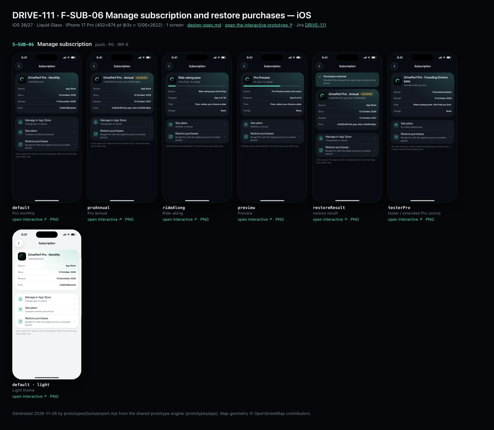
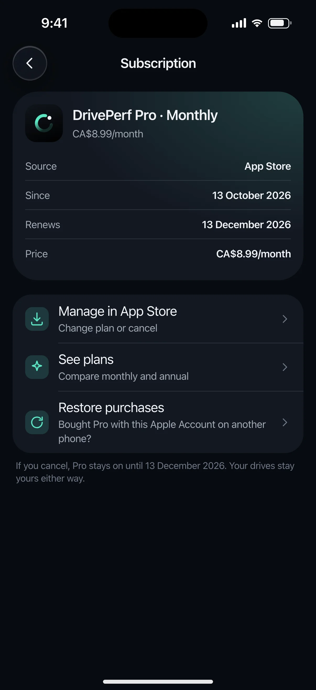
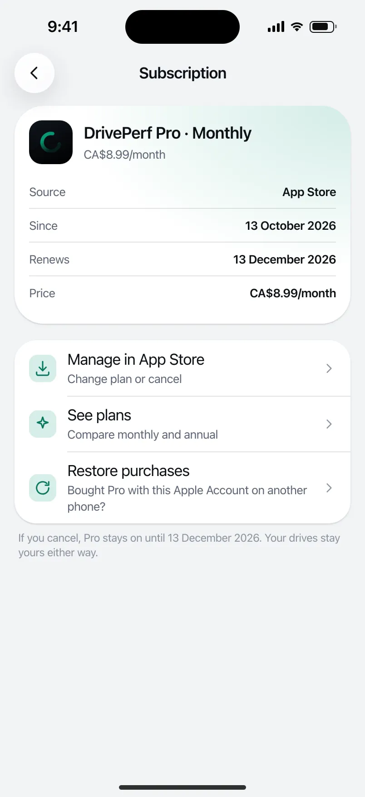

# DRIVE-111 · F-SUB-06 Manage subscription and restore purchases — iOS design spec

> Generated by `prototypes/tools/export.mjs` on 2026-11-07 from the shared prototype engine. **Do not edit by hand:** change the screen's `spec` in `prototypes/app/screens/wp-*.js` (see `prototypes/app/AUTHORING.md`) and re-export.

- **Jira story:** [DRIVE-111](https://thekeval.atlassian.net/browse/DRIVE-111) · F-SUB-06 · P0
- **Platform:** iOS 26/27 · Liquid Glass · iPhone 17 Pro (402×874 pt @3x = 1206×2622)
- **Interactive prototype:** [../../../../prototypes/ios/index.html#S-SUB-06](../../../../prototypes/ios/index.html#S-SUB-06) (catalog panel: every screen and state; deep links `#S-ID/state?trip=…&ent=…&theme=light&text=xl&rm=1`)
- **Contact sheet:** [mockup.html](mockup.html) · 
- **Design system (source of truth for values):** [brand](../../system/brand.md) · [components](../../system/components.md) · [motion](../../system/motion.md) · [accessibility](../../system/accessibility.md) · [screen map](../../system/screen-map.md) · [fixtures](../../system/fixtures.md) · tokens `prototypes/shared/tokens.css`

## Screens in this story

| Screen | Name | Presentation | Priority | States | Status |
|---|---|---|---|---|---|
| `S-SUB-06` | Manage subscription | Push | P0 | 6 | Prototyped |

## Tokens used on this platform

Values resolved from `prototypes/shared/tokens.css` inside the iOS device (`[data-platform="ios"]`). Use the token names in code; the hex values are for reference.

| Token | Dark | Light |
|---|---|---|
| `--app-bg` | `#080B10` | `#F2F3F6` |
| `--card-bg` | `#131822` | `#FFFFFF` |
| `--dp-bg-grouped` | `#080B10` | `#F2F3F6` |
| `--dp-surface` | `#131822` | `#FFFFFF` |
| `--dp-surface-2` | `#1B222D` | `#F2F3F6` |
| `--dp-surface-3` | `#262E3B` | `#E4E7EC` |
| `--dp-fill` | `#7880961F` | `#7880961F` |
| `--dp-fill-strong` | `#7880963D` | `#78809633` |
| `--dp-text` | `#F2F4F7` | `#0B0E13` |
| `--dp-text-2` | `#A3AAB6` | `#5A6271` |
| `--dp-text-3` | `#6E7787` | `#8A919D` |
| `--dp-separator` | `#96A0B429` | `#3C435024` |
| `--dp-accent` | `#5BE7C4` | `#079777` |
| `--dp-accent-text` | `#5BE7C4` | `#06775E` |
| `--dp-on-accent` | `#04241D` | `#FFFFFF` |
| `--dp-accent-container` | `#0A4439` | `#C6F8EA` |
| `--dp-record` | `#FFC24B` | `#9A6300` |
| `--dp-positive` | `#5BE7C4` | `#06775E` |
| `--dp-change-down` | `#A3AAB6` | `#5A6271` |
| `--dp-warning` | `#F5B648` | `#9A5F00` |
| `--dp-critical` | `#FF6B6B` | `#C62828` |
| `--dp-glass-fill` | `#1C222C6B` | `#FFFFFF8C` |
| `--dp-glass-fill-strong` | `#1C222CB8` | `#FFFFFFD1` |
| `--dp-glass-stroke` | `#FFFFFF24` | `#FFFFFF99` |
| `--dp-data-route` | `#5BE7C4` | `#079777` |
| `--dp-data-event-brake` | `#FF7A66` | `#A21F16` |
| `--dp-data-event-accel` | `#E58BD0` | `#A33A8C` |
| `--dp-data-event-corner` | `#EAD54E` | `#9A8A00` |
| `--dp-data-quality-good` | `#5FDB9C` | `#1E9E62` |
| `--dp-data-speed` | `#D6DCE4` | `#404A58` |
| `--dp-data-long-g` | `#5AB8F5` | `#0A6AB8` |
| `--dp-data-lat-g` | `#F5A142` | `#B25A00` |

| Type / layout token | Value |
|---|---|
| `--dp-font-screen-title` | `700 34px / 41px -apple-system, BlinkMacSystemFont, "SF Pro Display", system-ui, sans-serif` |
| `--dp-font-sheet-title` | `700 22px / 28px -apple-system, BlinkMacSystemFont, "SF Pro Display", system-ui, sans-serif` |
| `--dp-font-section-title` | `600 20px / 25px -apple-system, BlinkMacSystemFont, "SF Pro Display", system-ui, sans-serif` |
| `--dp-font-card-title` | `600 17px / 22px -apple-system, BlinkMacSystemFont, "SF Pro Text", system-ui, sans-serif` |
| `--dp-font-body` | `400 17px / 22px -apple-system, BlinkMacSystemFont, "SF Pro Text", system-ui, sans-serif` |
| `--dp-font-body-secondary` | `400 15px / 20px -apple-system, BlinkMacSystemFont, "SF Pro Text", system-ui, sans-serif` |
| `--dp-font-meta` | `400 13px / 18px -apple-system, BlinkMacSystemFont, "SF Pro Text", system-ui, sans-serif` |
| `--dp-font-caption` | `400 12px / 16px -apple-system, BlinkMacSystemFont, "SF Pro Text", system-ui, sans-serif` |
| `--dp-font-button` | `600 17px / 22px -apple-system, BlinkMacSystemFont, "SF Pro Text", system-ui, sans-serif` |
| `--dp-num-hero` | `600 72px / 72px -apple-system, BlinkMacSystemFont, "SF Pro Display", system-ui, sans-serif` |
| `--dp-num-xl` | `600 48px / 52px -apple-system, BlinkMacSystemFont, "SF Pro Display", system-ui, sans-serif` |
| `--dp-num-l` | `600 34px / 38px -apple-system, BlinkMacSystemFont, "SF Pro Display", system-ui, sans-serif` |
| `--dp-num-m` | `600 24px / 28px -apple-system, BlinkMacSystemFont, "SF Pro Display", system-ui, sans-serif` |
| `--dp-num-s` | `600 17px / 22px -apple-system, BlinkMacSystemFont, "SF Pro Display", system-ui, sans-serif` |
| `--dp-num-xs` | `600 13px / 16px -apple-system, BlinkMacSystemFont, "SF Pro Display", system-ui, sans-serif` |
| `--dp-screen-margin` | `16px` |
| `--dp-radius-card` | `24px` |
| `--dp-radius-card-hero` | `32px` |
| `--dp-radius-sheet` | `38px` |
| `--dp-radius-chip` | `999px` |
| `--dp-radius-button` | `999px` |
| `--dp-layout-list-row-min` | `52px` |
| `--dp-layout-touch-min` | `44px` |
| `--safe-top` | `62px` |
| `--safe-bottom` | `34px` |

Text sizes scale with `--dp-text-scale` (XL = 2.0×) and numerals with `--dp-num-scale` (XL = 1.3×). DP Numerals: SF Pro Expanded Semibold, tabular.

---

## S-SUB-06 · Manage subscription

 

- **Presentation:** push · tab: profile — screen map: “Push”
- **Entry points:** S-ACC-01
- **Leads to:** System subscription management · restore result · S-SUB-04
- **PRD features:** F-SUB-06 · **Priority:** P0 · **WP:** E
- **Interactive:** [S-SUB-06](../../../../prototypes/ios/index.html#S-SUB-06)

**Purpose.** See the plan, price, renewal date and source (Preview, Ride-along, store, or a tester promotion), manage it in the store and restore purchases (F-SUB-06). Includes the beta/internal “free or extended Pro” promotional entitlement (Gate 2 OQ-08).

### States

| State | PRD label | Fixture params | Screenshot |
|---|---|---|---|
| `default` | Pro monthly | `ent=proMonthly` | [S-SUB-06.png](../../screens/ios/S-SUB-06.webp) · [open](../../../../prototypes/ios/index.html#S-SUB-06) |
| `proAnnual` | Pro annual | `ent=pro` | [S-SUB-06--proAnnual.png](../../screens/ios/S-SUB-06--proAnnual.webp) · [open](../../../../prototypes/ios/index.html#S-SUB-06/proAnnual) |
| `rideAlong` | Ride-along | `ent=rideAlong` | [S-SUB-06--rideAlong.png](../../screens/ios/S-SUB-06--rideAlong.webp) · [open](../../../../prototypes/ios/index.html#S-SUB-06/rideAlong) |
| `preview` | Preview | `ent=preview` | [S-SUB-06--preview.png](../../screens/ios/S-SUB-06--preview.webp) · [open](../../../../prototypes/ios/index.html#S-SUB-06/preview) |
| `restoreResult` | restore result | `ent=pro` | [S-SUB-06--restoreResult.png](../../screens/ios/S-SUB-06--restoreResult.webp) · [open](../../../../prototypes/ios/index.html#S-SUB-06/restoreResult) |
| `testerPro` | tester / extended Pro (extra) | `ent=pro` `tester=1` | [S-SUB-06--testerPro.png](../../screens/ios/S-SUB-06--testerPro.webp) · [open](../../../../prototypes/ios/index.html#S-SUB-06/testerPro) |
| default · light | Light theme | `theme=light` | [S-SUB-06--light.png](../../screens/ios/S-SUB-06--light.webp) |

Every state also renders in light/dark (`theme=light`), XL text (`text=xl`) and reduced motion (`rm=1`).

### Layout

- Push, title “Subscription”. restore result: positive banner “Purchases restored. DrivePerf Pro (Annual) from App Store is active on this phone.”
- Plan hero card (Glide tint): Loop tile + plan name (+ gold “FOUNDING” capsule for the founding annual) + price line; Preview/Ride-along add a day progress bar; facts (Source · Since/Progress · Renews/Then · Price/Charge).
- Actions list: Manage in App Store / Google Play (change plan or cancel) · See plans (monthly, Preview, Ride-along, tester) · Restore purchases. Footer: what happens if they cancel, or that nothing renews.

### Components & tokens

| Component | Tokens / spec |
|---|---|
| `navBar` | --dp-font-card-title · --dp-font-meta · glass: --dp-glass-fill + --dp-glass-blur · components.md §2 |
| `banner` | radius 12 (--dp-radius-sm+) · info --dp-fill · attention --dp-warning-container · critical --dp-critical-container · components.md §22 |
| `card` | --dp-surface / --md-sys-color-surface-container · --dp-radius-card (24 iOS · 16 Android) · hero: --dp-radius-card-hero (32 · 28) · light iOS: --dp-elev-1 |
| `list` | iOS inset grouped radius --dp-radius-card, rows 52 pt, separators --dp-separator inset 16 · Android ListItem 56/72 dp in --md-sys-color-surface-container |
| `row` | --dp-font-body · --dp-font-meta (supporting) · --dp-layout-list-row-min |
| `section` | --dp-font-section-title · --dp-layout-section-gap 28 |

### Interactions & navigation

- Manage in App Store → StoreKit showManageSubscriptions · Google Play → the Play subscriptions deep link. See plans → S-SUB-04. Restore purchases → restores within 10 s → restore result (toast while checking).

### Motion

- Blocks rise 8 px, 40 ms stagger. RM: fade.

### Accessibility

- Hero card reads plan, price and each fact as label–value pairs. XL: facts stack.

### Platform notes

- **iOS (this spec):** “Manage in App Store” → showManageSubscriptions(in:) sheet; “Apple Account”.
- *Android (for reference):* “Manage in Google Play” → https://play.google.com/store/account/subscriptions?sku=…; “Google account”.

### Analytics

- `subscription_managed`
- `restore_purchases {result}`

### Copy

| Key | Text |
|---|---|
| Monthly | DrivePerf Pro · Monthly · CA$8.99/month · Renews 13 December 2026. If you cancel, Pro stays on until 13 December 2026. Your drives stay yours either way. |
| Annual | DrivePerf Pro · Annual · Founding · CA$39.99 first year, then CA$49.99/yr · Renews 13 October 2027 |
| Ride-along | Ride-along pass · From Priya · no charge · Day 4 of 30 · Then Free, unless you choose a plan. Nothing renews automatically. |
| Preview | Pro Preview · No card · no charge · Day 9 of 14 |
| Tester | DrivePerf Pro · Founding Drivers beta · Included while you test · Source Promotional (beta) · No card, nothing to cancel. |
| Restored | Purchases restored. DrivePerf Pro (Annual) from App Store is active on this phone. |

### Free / Pro

Pro monthly / annual (store), Preview, Ride-along and tester promotional Pro (RevenueCat promotional entitlement). Free users reach S-SUB-04 instead.

### Data & fixtures

entitlement.states.proMonthly (since 13 Oct, renews 13 Dec 2026, CA$8.99/month), pro (founding, renews 13 Oct 2027, “CA$39.99 first year, then CA$49.99/yr”), rideAlong (Priya, 4/30), preview (9/14). Tester start date (13 Oct) is a prototype value.

### Assets

[icon-export.svg](assets/icon-export.svg) · [icon-sparkle.svg](assets/icon-sparkle.svg) · [icon-refresh.svg](assets/icon-refresh.svg) · [logo-a-loop.svg](assets/logo-a-loop.svg)

UI glyphs may be swapped for SF Symbols / Material Symbols Rounded equivalents; event-pin, quality and provenance glyphs must not be (components.md global rules).

### Checklist (accessibility.md §9)

- [ ] Light and dark both render, and contrast passes.
- [ ] The XL text state reflows with no truncation.
- [ ] The RM state is defined.
- [ ] Every control has a label; every chart and map has a summary sentence.
- [ ] Every target ≥ 44 pt / 48 dp (≥ 64 in-drive).
- [ ] No meaning by colour alone.
- [ ] Speed is neutral wherever it appears and absent from social or live surfaces.
- [ ] No streak, leaderboard, speed or “beat your time” language.
- [ ] Behaviour is defined while a trip is active (D1 gate).
- [ ] Haptics come from motion.md §6 only.

---

Map geometry in the prototype: © OpenStreetMap contributors (ODbL). Speed and G are simulated fixtures (fixtures.md).
