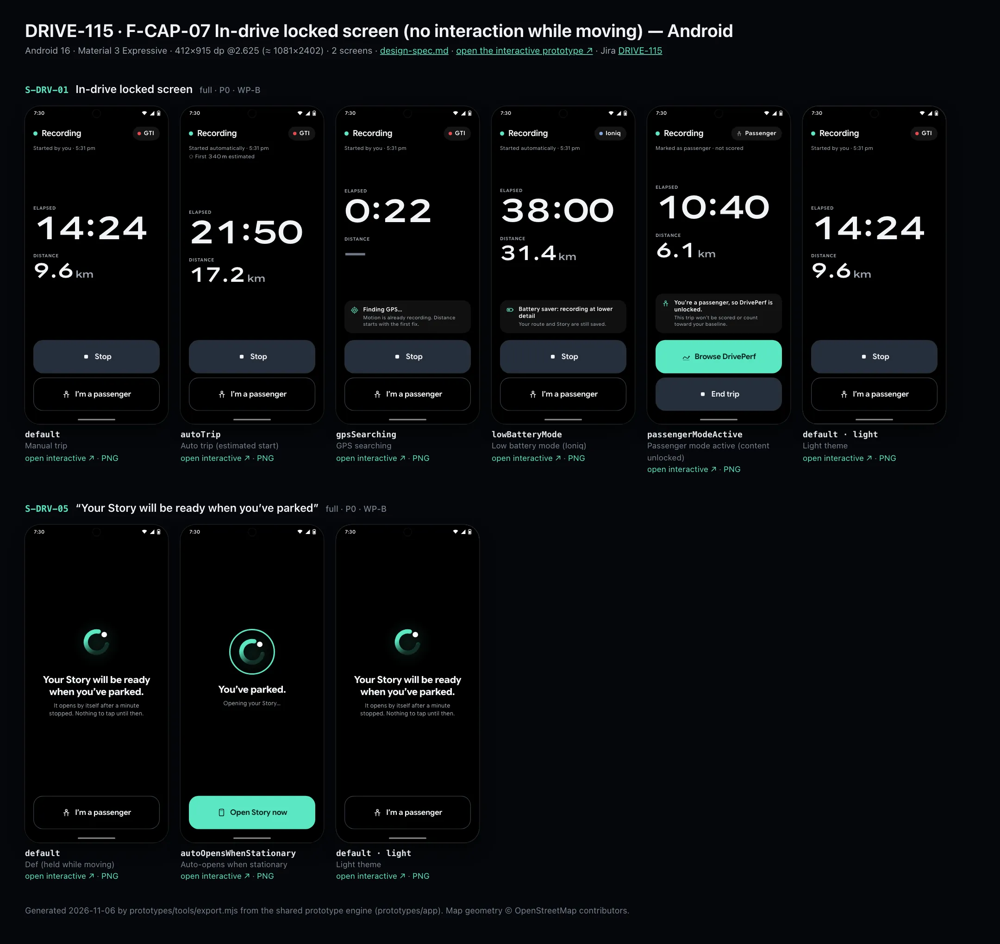
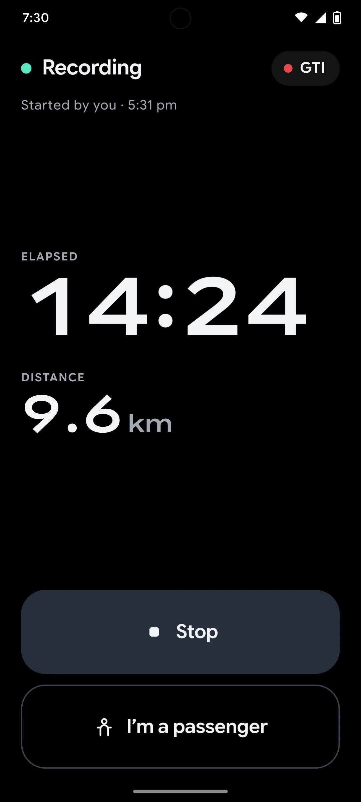
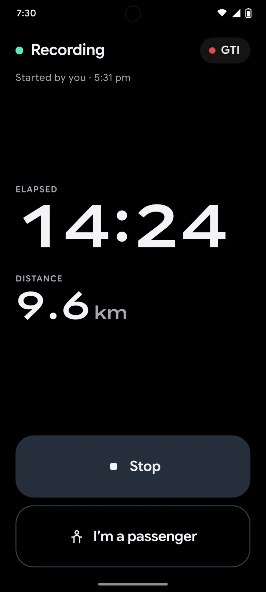
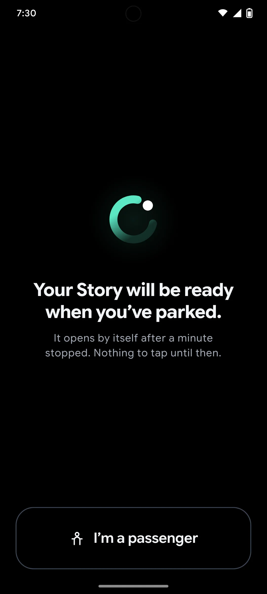

# DRIVE-115 · F-CAP-07 In-drive locked screen (no interaction while moving) — Android design spec

> Generated by `prototypes/tools/export.mjs` on 2026-11-06 from the shared prototype engine. **Do not edit by hand:** change the screen's `spec` in `prototypes/app/screens/wp-*.js` (see `prototypes/app/AUTHORING.md`) and re-export.

- **Jira story:** [DRIVE-115](https://thekeval.atlassian.net/browse/DRIVE-115) · F-CAP-07 · P0
- **Platform:** Android 16 · Material 3 Expressive · 412×915 dp @2.625 (≈ 1081×2402)
- **Interactive prototype:** [../../../../prototypes/android/index.html#S-DRV-01](../../../../prototypes/android/index.html#S-DRV-01) (catalog panel: every screen and state; deep links `#S-ID/state?trip=…&ent=…&theme=light&text=xl&rm=1`)
- **Contact sheet:** [mockup.html](mockup.html) · 
- **Design system (source of truth for values):** [brand](../../system/brand.md) · [components](../../system/components.md) · [motion](../../system/motion.md) · [accessibility](../../system/accessibility.md) · [screen map](../../system/screen-map.md) · [fixtures](../../system/fixtures.md) · tokens `prototypes/shared/tokens.css`

## Screens in this story

| Screen | Name | Presentation | Priority | States | Status |
|---|---|---|---|---|---|
| `S-DRV-01` | In-drive locked screen | Full (locked) | P0 | 5 | Prototyped |
| `S-DRV-05` | “Your Story will be ready when you’ve parked” | Full (locked) | P0 | 2 | Prototyped |

## Tokens used on this platform

Values resolved from `prototypes/shared/tokens.css` inside the Android device (`[data-platform="android"]`). Use the token names in code; the hex values are for reference.

| Token | Dark | Light |
|---|---|---|
| `--app-bg` | `#0D1117` | `#F7F9FC` |
| `--card-bg` | `#191E25` | `#EBEEF2` |
| `--dp-bg-grouped` | `#0D1117` | `#F7F9FC` |
| `--dp-surface` | `#191E25` | `#EBEEF2` |
| `--dp-surface-2` | `#1F252D` | `#E5E8EC` |
| `--dp-surface-3` | `#2A3038` | `#DFE2E6` |
| `--dp-fill` | `#2A3038` | `#DFE2E6` |
| `--dp-fill-strong` | `#353B44` | `#D3D7DC` |
| `--dp-text` | `#E1E3E8` | `#181C20` |
| `--dp-text-2` | `#C0C7CF` | `#40474F` |
| `--dp-text-3` | `#8A929B` | `#707881` |
| `--dp-separator` | `#40474F` | `#C0C7CF` |
| `--dp-accent` | `#5BE7C4` | `#006B53` |
| `--dp-accent-text` | `#5BE7C4` | `#006B53` |
| `--dp-on-accent` | `#00382B` | `#FFFFFF` |
| `--dp-accent-container` | `#00513F` | `#91F1D8` |
| `--dp-record` | `#FFC24B` | `#7A5900` |
| `--dp-positive` | `#5BE7C4` | `#006B53` |
| `--dp-change-down` | `#C0C7CF` | `#40474F` |
| `--dp-warning` | `#F5B648` | `#7A5900` |
| `--dp-critical` | `#FFB4AB` | `#BA1A1A` |
| `--dp-glass-fill` | `#1F252DF2` | `#E5E8ECF2` |
| `--dp-glass-fill-strong` | `#2A3038` | `#DFE2E6` |
| `--dp-glass-stroke` | `#FFFFFF0F` | `#0000000A` |
| `--md-sys-color-primary` | `#5BE7C4` | `#006B53` |
| `--md-sys-color-on-primary` | `#00382B` | `#FFFFFF` |
| `--md-sys-color-primary-container` | `#00513F` | `#91F1D8` |
| `--md-sys-color-on-primary-container` | `#91F1D8` | `#002118` |
| `--md-sys-color-secondary-container` | `#344C44` | `#CEE9DF` |
| `--md-sys-color-surface` | `#0D1117` | `#F7F9FC` |
| `--md-sys-color-surface-container` | `#191E25` | `#EBEEF2` |
| `--md-sys-color-surface-container-high` | `#1F252D` | `#E5E8EC` |
| `--md-sys-color-on-surface-variant` | `#C0C7CF` | `#40474F` |
| `--dp-data-route` | `#5BE7C4` | `#079777` |
| `--dp-data-event-brake` | `#FF7A66` | `#A21F16` |
| `--dp-data-event-accel` | `#E58BD0` | `#A33A8C` |
| `--dp-data-event-corner` | `#EAD54E` | `#9A8A00` |
| `--dp-data-quality-good` | `#5FDB9C` | `#1E9E62` |
| `--dp-data-speed` | `#D6DCE4` | `#404A58` |
| `--dp-data-long-g` | `#5AB8F5` | `#0A6AB8` |
| `--dp-data-lat-g` | `#F5A142` | `#B25A00` |

| Type / layout token | Value |
|---|---|
| `--dp-font-screen-title` | `600 32px / 40px "Google Sans Flex", "Google Sans Display", "Roboto Flex", Roboto, system-ui, sans-serif` |
| `--dp-font-sheet-title` | `400 24px / 32px "Google Sans Flex", "Google Sans Display", "Roboto Flex", Roboto, system-ui, sans-serif` |
| `--dp-font-section-title` | `600 22px / 28px "Google Sans Flex", "Google Sans Display", "Roboto Flex", Roboto, system-ui, sans-serif` |
| `--dp-font-card-title` | `700 16px / 24px "Google Sans Flex", "Google Sans Text", "Roboto Flex", Roboto, system-ui, sans-serif` |
| `--dp-font-body` | `400 16px / 24px "Google Sans Flex", "Google Sans Text", "Roboto Flex", Roboto, system-ui, sans-serif` |
| `--dp-font-body-secondary` | `400 14px / 20px "Google Sans Flex", "Google Sans Text", "Roboto Flex", Roboto, system-ui, sans-serif` |
| `--dp-font-meta` | `400 12px / 16px "Google Sans Flex", "Google Sans Text", "Roboto Flex", Roboto, system-ui, sans-serif` |
| `--dp-font-caption` | `500 12px / 16px "Google Sans Flex", "Google Sans Text", "Roboto Flex", Roboto, system-ui, sans-serif` |
| `--dp-font-button` | `700 14px / 20px "Google Sans Flex", "Google Sans Text", "Roboto Flex", Roboto, system-ui, sans-serif` |
| `--dp-num-hero` | `600 72px / 72px "Google Sans Flex", "Roboto Flex", Roboto, system-ui, sans-serif` |
| `--dp-num-xl` | `600 48px / 52px "Google Sans Flex", "Roboto Flex", Roboto, system-ui, sans-serif` |
| `--dp-num-l` | `600 34px / 38px "Google Sans Flex", "Roboto Flex", Roboto, system-ui, sans-serif` |
| `--dp-num-m` | `600 24px / 28px "Google Sans Flex", "Roboto Flex", Roboto, system-ui, sans-serif` |
| `--dp-num-s` | `600 17px / 22px "Google Sans Flex", "Roboto Flex", Roboto, system-ui, sans-serif` |
| `--dp-num-xs` | `600 13px / 16px "Google Sans Flex", "Roboto Flex", Roboto, system-ui, sans-serif` |
| `--dp-screen-margin` | `16px` |
| `--dp-radius-card` | `16px` |
| `--dp-radius-card-hero` | `28px` |
| `--dp-radius-sheet` | `28px` |
| `--dp-radius-chip` | `8px` |
| `--dp-radius-button` | `999px` |
| `--dp-layout-list-row-min` | `56px` |
| `--dp-layout-touch-min` | `48px` |
| `--safe-top` | `40px` |
| `--safe-bottom` | `24px` |

Text sizes scale with `--dp-text-scale` (XL = 2.0×) and numerals with `--dp-num-scale` (XL = 1.3×). DP Numerals: Google Sans Flex wdth 120 wght 600, tabular.

---

## S-DRV-01 · In-drive locked screen

 

- **Presentation:** full — screen map: “Full (locked)”
- **Entry points:** Start (S-HOME-01, S-LIVE-03/04/07/08) · any deep link during a driver trip · S-LIVE-09 tap
- **Leads to:** S-DRV-02 (Stop) · S-DRV-03 (passenger) · auto end → S-DRV-04
- **PRD features:** F-CAP-01, F-CAP-02, F-CAP-07, F-CAP-08 · **Priority:** P0 · **WP:** B
- **Interactive:** [S-DRV-01](../../../../prototypes/android/index.html#S-DRV-01)

**Purpose.** The only screen the app shows while a driver trip is active (D1, F-CAP-07): proof that it is recording — elapsed time, distance and car — plus two huge exits, Stop and I’m a passenger. Nothing else: no score, speed, events, tips, map, navigation or tab bar.

### States

| State | PRD label | Fixture params | Screenshot |
|---|---|---|---|
| `default` | Manual trip | — | [S-DRV-01.png](../../screens/android/S-DRV-01.webp) · [open](../../../../prototypes/android/index.html#S-DRV-01) |
| `autoTrip` | Auto trip (estimated start) | `live=auto` | [S-DRV-01--autoTrip.png](../../screens/android/S-DRV-01--autoTrip.webp) · [open](../../../../prototypes/android/index.html#S-DRV-01/autoTrip) |
| `gpsSearching` | GPS searching | `live=gpsSearching` | [S-DRV-01--gpsSearching.png](../../screens/android/S-DRV-01--gpsSearching.webp) · [open](../../../../prototypes/android/index.html#S-DRV-01/gpsSearching) |
| `lowBatteryMode` | Low battery mode (Ioniq) | `live=lowBattery` | [S-DRV-01--lowBatteryMode.png](../../screens/android/S-DRV-01--lowBatteryMode.webp) · [open](../../../../prototypes/android/index.html#S-DRV-01/lowBatteryMode) |
| `passengerModeActive` | Passenger mode active (content unlocked) | `live=passenger` | [S-DRV-01--passengerModeActive.png](../../screens/android/S-DRV-01--passengerModeActive.webp) · [open](../../../../prototypes/android/index.html#S-DRV-01/passengerModeActive) |
| default · light | Light theme | `theme=light` | [S-DRV-01--light.png](../../screens/android/S-DRV-01--light.webp) |

Every state also renders in light/dark (`theme=light`), XL text (`text=xl`) and reduced motion (`rm=1`).

### Layout

- Full-screen cover on --dp-drive-bg #000 on both platforms and in both themes (status bar light). Content is a single column with 24 side margins.
- Top row (safe top + 18): 12 px live dot (--wb-drv-live = Glide #5BE7C4) + “Recording” (600 24/28) · car chip trailing (car dot in the car colour + nickname, 600 17, #F2F4F7 on #ffffff14, capsule 40 tall) or a “Passenger” chip.
- Source line (meta 15/20, #A3AAB6): “Started by you · 5:31 pm” / “Started automatically · 5:31 pm” + “First 340 m estimated” with the estimated provenance glyph (auto trips) / “Marked as passenger · not scored”.
- Numbers block, vertically centred in the free space: label “Elapsed” (caps 13, #A3AAB6) over the timer in DP Numerals 96/96 (tabular, 125% stretch, scales with Dynamic Type up to the container width), then “Distance” over 9.6 + “km” at 50%. GPS searching shows “—”. Times ≥ 1 h render h:mm:ss.
- Status card when needed (radius 20, #ffffff10, 16 padding, 22 icon): Finding GPS… · Battery saver: recording at lower detail · You’re a passenger, so DrivePerf is unlocked.
- Bottom stack (safe bottom + 16, 12 gap): Stop = 96 tall, full width, radius 28, --dp-surface-3 (#262E3B) with a 26 stop glyph and 600 22 label · I’m a passenger = 96 tall, 1.5 px #3A4351 outline. Passenger mode: “Browse DrivePerf” (Glide filled, on-accent text) + “End trip”.

### Components & tokens

| Component | Tokens / spec |
|---|---|
| `page` | --dp-bg-grouped (iOS) / --md-sys-color-surface (Android) · --dp-screen-margin 16 |
| `drvButton (local, 96 tall)` | see components.md |
| `carChip (in-drive variant)` | see components.md |
| `provenance` | see components.md |
| `liveDot` | see components.md |

### Interactions & navigation

- Stop → S-DRV-02 (sheet). I’m a passenger → S-DRV-03 (sheet). Both are the only destinations allowed by the D1 gate besides S-DRV-05.
- Passenger mode: Browse DrivePerf → S-NAV-01 recording banner (live=passenger, content unlocked); End trip → S-DRV-02 (passenger copy).
- Every other deep link, notification, widget, Control Center / QS tile and Live Activity tap lands here while a driver trip is active (DP.gate; the target waits in DP.session.pending and opens on S-DRV-05 rules after the trip).
- Auto end (stationary for the stop timer, F-CAP-03) → S-DRV-04 with no tap. There is no swipe, back gesture or tab bar.

### Motion

- Manual start: the accessory (iOS) / floating toolbar (Android) expands into this screen (container transform, spring.slow), then the rows rise 8 px with a 60 ms stagger (spring.default) — motion.md §3.1. Auto trip: 220 ms cross-fade, no theatre.
- Live dot: halo scale 1 → 1.9, opacity .5 → 0, 900 ms ease.glide once per second for 10 s after appearing or after any touch, then still (§3.2). The timer updates once per second; nothing else moves. RM / shot: static dot.
- Haptics: none on this screen (confirm fires only on the Stop / passenger confirmation in the sheets).

### Accessibility

- One summary element: “Recording. 14 minutes, 9.6 kilometres, GTI.” — no live region, so the timer is never announced every second.
- Buttons: “Stop” and “I’m a passenger” (96 tall, ≥ 64 rule); order: summary → Stop → I’m a passenger.
- XL: numerals scale but are capped to the screen width (never truncated); the status card wraps; buttons keep 96 minimum height and grow with the label.
- Contrast: #F2F4F7 on #000 (19:1), #A3AAB6 on #000 (8.7:1). Meaning never by colour: the dot is paired with the word Recording.

### Platform notes

- **Android (this spec):** Full-screen destination with BackHandler consumed (back does nothing while driving); FLAG_KEEP_SCREEN_ON optional; the Live Update / FGS notification runs alongside (S-LIVE-05/06).
- *iOS (for reference):* .fullScreenCover with .interactiveDismissDisabled(); .persistentSystemOverlays(.hidden) not used (status bar stays for the recording indicator); Live Activity runs alongside (S-LIVE-01/02).

### Analytics

- `in_drive_screen_viewed {mode: manual|auto, gps, battery_saver}`
- `in_drive_stop_tapped`
- `in_drive_passenger_tapped`
- `content_blocked_while_moving {target} (from the gate)`

### Copy

| Key | Text |
|---|---|
| Title | Recording |
| Manual | Started by you · {5:31 pm} |
| Auto | Started automatically · {5:31 pm} · First {340} m estimated |
| GPS | Finding GPS… · Motion is already recording. Distance starts with the first fix. |
| Low battery | Battery saver: recording at lower detail · Your route and Story are still saved. |
| Passenger | You’re a passenger, so DrivePerf is unlocked. · This trip won’t be scored or count toward your baseline. |
| Buttons | Stop · I’m a passenger · Browse DrivePerf · End trip |

### Free / Pro

Identical for every plan. No upsell, badge, paywall or share prompt can appear while this screen is up (D12).

### Data & fixtures

DP_DATA.liveTrip.states: manual (default, 14:24 · 9.6 km · GTI) · auto (21:50 · 17.2 km · estimatedStartM 340) · gpsSearching (0:22, no distance) · lowBattery (38:00 · 31.4 km · Ioniq, batterySaver) · passenger (10:40 · 6.1 km). Start time = startedAt (5:31 pm). Only these fields are used (fixtures.md §8). The prototype timer ticks from elapsedS once per second.

### Assets

[icon-stop.svg](assets/icon-stop.svg) · [icon-passenger.svg](assets/icon-passenger.svg) · [icon-gps.svg](assets/icon-gps.svg) · [icon-battery.svg](assets/icon-battery.svg) · [icon-drives.svg](assets/icon-drives.svg)

UI glyphs may be swapped for SF Symbols / Material Symbols Rounded equivalents; event-pin, quality and provenance glyphs must not be (components.md global rules).

### Checklist (accessibility.md §9)

- [ ] Light and dark both render, and contrast passes.
- [ ] The XL text state reflows with no truncation.
- [ ] The RM state is defined.
- [ ] Every control has a label; every chart and map has a summary sentence.
- [ ] Every target ≥ 44 pt / 48 dp (≥ 64 in-drive).
- [ ] No meaning by colour alone.
- [ ] Speed is neutral wherever it appears and absent from social or live surfaces.
- [ ] No streak, leaderboard, speed or “beat your time” language.
- [ ] Behaviour is defined while a trip is active (D1 gate).
- [ ] Haptics come from motion.md §6 only.

---

## S-DRV-05 · “Your Story will be ready when you’ve parked”

 

- **Presentation:** full — screen map: “Full (locked)”
- **Entry points:** Any Story/Replay/Analysis/share/paywall request while moving or in a driver trip
- **Leads to:** Auto-opens requested content after 60 s stationary · S-DRV-03
- **PRD features:** F-CAP-07, F-STY-05 · **Priority:** P0 · **WP:** B
- **Interactive:** [S-DRV-05](../../../../prototypes/android/index.html#S-DRV-05)

**Purpose.** What anyone sees when they ask for a Story, Replay, Analysis, recap, Wrapped, share card or paywall while the phone is moving or a driver trip is active (F-CAP-07, F-STY-05, D1/D12). It refuses calmly and opens the content by itself once parked for 60 s.

### States

| State | PRD label | Fixture params | Screenshot |
|---|---|---|---|
| `default` | Def (held while moving) | — | [S-DRV-05.png](../../screens/android/S-DRV-05.webp) · [open](../../../../prototypes/android/index.html#S-DRV-05) |
| `autoOpensWhenStationary` | Auto-opens when stationary | — | [S-DRV-05--autoOpensWhenStationary.png](../../screens/android/S-DRV-05--autoOpensWhenStationary.webp) · [open](../../../../prototypes/android/index.html#S-DRV-05/autoOpensWhenStationary) |
| default · light | Light theme | `theme=light` | [S-DRV-05--light.png](../../screens/android/S-DRV-05--light.webp) |

Every state also renders in light/dark (`theme=light`), XL text (`text=xl`) and reduced motion (`rm=1`).

### Layout

- Full-screen cover, #000 on both themes, status bar light, no navigation. Content centred in the free space; bottom button stack like S-DRV-01.
- The Loop mark 96 (static, Glide) above the title “Your Story will be ready when you’ve parked.” (story headline 28/34, #F2F4F7, max 300 wide) and “It opens by itself after a minute stopped. Nothing to tap until then.” (body, #A3AAB6). When something other than a Story was held, the title names it (“Your Replay will be ready when you’ve parked.”); a held paywall or share prompt is never named — it shows the Story copy.
- Bottom: “I’m a passenger” 96 tall, outlined (D14).
- autoOpensWhenStationary: the Loop inside a 140 Glide progress ring that completes, “You’ve parked.” + “Opening your Story…”, and a 96 “Open Story now” filled button for an immediate open.

### Components & tokens

| Component | Tokens / spec |
|---|---|
| `page` | --dp-bg-grouped (iOS) / --md-sys-color-surface (Android) · --dp-screen-margin 16 |
| `drvButton (local)` | see components.md |
| `loop` | see components.md |

### Interactions & navigation

- Reached only via the D1 gate (DP.gate: moving=1 + content target, or any content during a driver trip); the held target waits in DP.session.pending.
- Stationary / not automotive for 60 s → autoOpensWhenStationary → the held target opens automatically (prototype: 9 s simulated, then 2.4 s), with moving cleared. Open … now opens it immediately.
- I’m a passenger → S-DRV-03; “Keep as passenger” unlocks content right away.
- Paywalls (S-SUB-02/03/04) and share prompts held here are dropped, not reopened: S-SUB-02 waits for the next parked foreground open (D12).

### Motion

- Nothing moves while held (in-drive rule). Stationary: the progress ring completes linearly (2.2 s), then the held content opens with its own transition. RM: no ring animation, instant open after the delay.
- Haptic: none on auto-open; tap on “Open now”.

### Accessibility

- Title is the first focus and reads in full. “I’m a passenger” button 96 tall.
- The opening state announces “You’ve parked. Opening your Story.” once (polite).
- XL: title wraps over 3–4 lines; the Loop shrinks to 72 before the text does.

### Platform notes

- **Android (this spec):** Full-screen destination; system back is consumed while held.
- *iOS (for reference):* .fullScreenCover with interactive dismiss disabled.

### Analytics

- `content_blocked_while_moving {target}`
- `held_content_opened {target, by: auto|tap, wait_s}`
- `passenger_marked {when: held}`

### Copy

| Key | Text |
|---|---|
| Title | Your Story will be ready when you’ve parked. / Your {Replay} will be ready when you’ve parked. |
| Line | It opens by itself after a minute stopped. Nothing to tap until then. |
| Opening | You’ve parked. · Opening your Story… · Open Story now |
| Button | I’m a passenger |

### Free / Pro

Same for every plan. A held paywall is never shown afterwards in this session (D12, F-SUB-08).

### Data & fixtures

Default held target when none is pending: S-STY-01 for t20261105-0742 (the newest Story). Reads DP.session.pending / gateReason set by the gate.

### Assets

[icon-passenger.svg](assets/icon-passenger.svg) · [icon-story.svg](assets/icon-story.svg) · [logo-a-loop.svg](assets/logo-a-loop.svg)

UI glyphs may be swapped for SF Symbols / Material Symbols Rounded equivalents; event-pin, quality and provenance glyphs must not be (components.md global rules).

### Checklist (accessibility.md §9)

- [ ] Light and dark both render, and contrast passes.
- [ ] The XL text state reflows with no truncation.
- [ ] The RM state is defined.
- [ ] Every control has a label; every chart and map has a summary sentence.
- [ ] Every target ≥ 44 pt / 48 dp (≥ 64 in-drive).
- [ ] No meaning by colour alone.
- [ ] Speed is neutral wherever it appears and absent from social or live surfaces.
- [ ] No streak, leaderboard, speed or “beat your time” language.
- [ ] Behaviour is defined while a trip is active (D1 gate).
- [ ] Haptics come from motion.md §6 only.

---

Map geometry in the prototype: © OpenStreetMap contributors (ODbL). Speed and G are simulated fixtures (fixtures.md).
