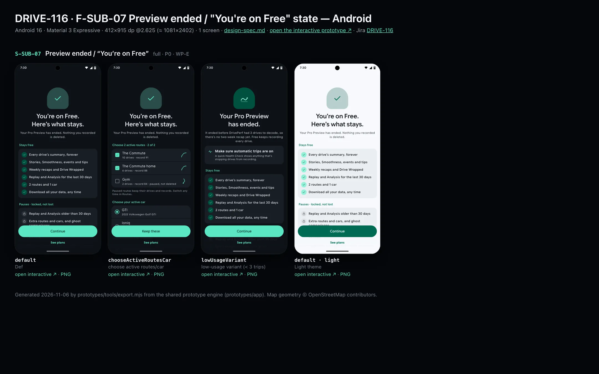
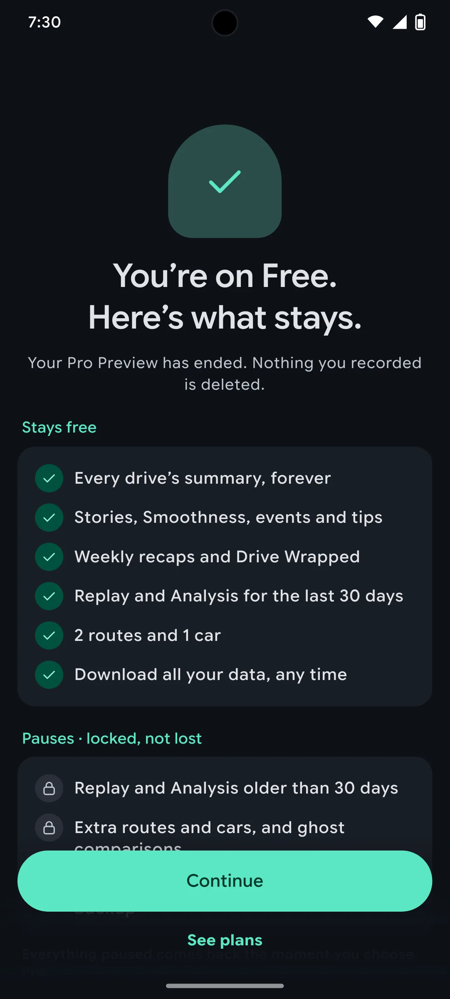
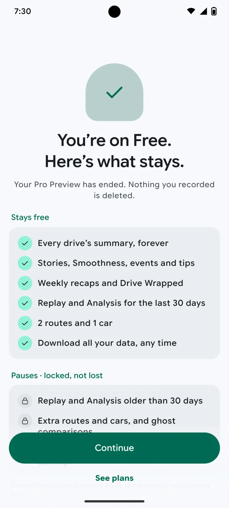

# DRIVE-116 · F-SUB-07 Preview ended / "You're on Free" state — Android design spec

> Generated by `prototypes/tools/export.mjs` on 2026-11-07 from the shared prototype engine. **Do not edit by hand:** change the screen's `spec` in `prototypes/app/screens/wp-*.js` (see `prototypes/app/AUTHORING.md`) and re-export.

- **Jira story:** [DRIVE-116](https://thekeval.atlassian.net/browse/DRIVE-116) · F-SUB-07 · P0
- **Platform:** Android 16 · Material 3 Expressive · 412×915 dp @2.625 (≈ 1081×2402)
- **Interactive prototype:** [../../../../prototypes/android/index.html#S-SUB-07](../../../../prototypes/android/index.html#S-SUB-07) (catalog panel: every screen and state; deep links `#S-ID/state?trip=…&ent=…&theme=light&text=xl&rm=1`)
- **Contact sheet:** [mockup.html](mockup.html) · 
- **Design system (source of truth for values):** [brand](../../system/brand.md) · [components](../../system/components.md) · [motion](../../system/motion.md) · [accessibility](../../system/accessibility.md) · [screen map](../../system/screen-map.md) · [fixtures](../../system/fixtures.md) · tokens `prototypes/shared/tokens.css`

## Screens in this story

| Screen | Name | Presentation | Priority | States | Status |
|---|---|---|---|---|---|
| `S-SUB-07` | Preview ended / “You’re on Free” | Full | P0 | 3 | Prototyped |

## Tokens used on this platform

Values resolved from `prototypes/shared/tokens.css` inside the Android device (`[data-platform="android"]`). Use the token names in code; the hex values are for reference.

| Token | Dark | Light |
|---|---|---|
| `--app-bg` | `#0D1117` | `#F7F9FC` |
| `--card-bg` | `#191E25` | `#EBEEF2` |
| `--dp-bg-grouped` | `#0D1117` | `#F7F9FC` |
| `--dp-surface` | `#191E25` | `#EBEEF2` |
| `--dp-surface-2` | `#1F252D` | `#E5E8EC` |
| `--dp-surface-3` | `#2A3038` | `#DFE2E6` |
| `--dp-fill` | `#2A3038` | `#DFE2E6` |
| `--dp-fill-strong` | `#353B44` | `#D3D7DC` |
| `--dp-text` | `#E1E3E8` | `#181C20` |
| `--dp-text-2` | `#C0C7CF` | `#40474F` |
| `--dp-text-3` | `#8A929B` | `#707881` |
| `--dp-separator` | `#40474F` | `#C0C7CF` |
| `--dp-accent` | `#5BE7C4` | `#006B53` |
| `--dp-accent-text` | `#5BE7C4` | `#006B53` |
| `--dp-on-accent` | `#00382B` | `#FFFFFF` |
| `--dp-accent-container` | `#00513F` | `#91F1D8` |
| `--dp-record` | `#FFC24B` | `#7A5900` |
| `--dp-positive` | `#5BE7C4` | `#006B53` |
| `--dp-change-down` | `#C0C7CF` | `#40474F` |
| `--dp-warning` | `#F5B648` | `#7A5900` |
| `--dp-critical` | `#FFB4AB` | `#BA1A1A` |
| `--dp-glass-fill` | `#1F252DF2` | `#E5E8ECF2` |
| `--dp-glass-fill-strong` | `#2A3038` | `#DFE2E6` |
| `--dp-glass-stroke` | `#FFFFFF0F` | `#0000000A` |
| `--md-sys-color-primary` | `#5BE7C4` | `#006B53` |
| `--md-sys-color-on-primary` | `#00382B` | `#FFFFFF` |
| `--md-sys-color-primary-container` | `#00513F` | `#91F1D8` |
| `--md-sys-color-on-primary-container` | `#91F1D8` | `#002118` |
| `--md-sys-color-secondary-container` | `#344C44` | `#CEE9DF` |
| `--md-sys-color-surface` | `#0D1117` | `#F7F9FC` |
| `--md-sys-color-surface-container` | `#191E25` | `#EBEEF2` |
| `--md-sys-color-surface-container-high` | `#1F252D` | `#E5E8EC` |
| `--md-sys-color-on-surface-variant` | `#C0C7CF` | `#40474F` |
| `--dp-data-route` | `#5BE7C4` | `#079777` |
| `--dp-data-event-brake` | `#FF7A66` | `#A21F16` |
| `--dp-data-event-accel` | `#E58BD0` | `#A33A8C` |
| `--dp-data-event-corner` | `#EAD54E` | `#9A8A00` |
| `--dp-data-quality-good` | `#5FDB9C` | `#1E9E62` |
| `--dp-data-speed` | `#D6DCE4` | `#404A58` |
| `--dp-data-long-g` | `#5AB8F5` | `#0A6AB8` |
| `--dp-data-lat-g` | `#F5A142` | `#B25A00` |

| Type / layout token | Value |
|---|---|
| `--dp-font-screen-title` | `600 32px / 40px "Google Sans Flex", "Google Sans Display", "Roboto Flex", Roboto, system-ui, sans-serif` |
| `--dp-font-sheet-title` | `400 24px / 32px "Google Sans Flex", "Google Sans Display", "Roboto Flex", Roboto, system-ui, sans-serif` |
| `--dp-font-section-title` | `600 22px / 28px "Google Sans Flex", "Google Sans Display", "Roboto Flex", Roboto, system-ui, sans-serif` |
| `--dp-font-card-title` | `700 16px / 24px "Google Sans Flex", "Google Sans Text", "Roboto Flex", Roboto, system-ui, sans-serif` |
| `--dp-font-body` | `400 16px / 24px "Google Sans Flex", "Google Sans Text", "Roboto Flex", Roboto, system-ui, sans-serif` |
| `--dp-font-body-secondary` | `400 14px / 20px "Google Sans Flex", "Google Sans Text", "Roboto Flex", Roboto, system-ui, sans-serif` |
| `--dp-font-meta` | `400 12px / 16px "Google Sans Flex", "Google Sans Text", "Roboto Flex", Roboto, system-ui, sans-serif` |
| `--dp-font-caption` | `500 12px / 16px "Google Sans Flex", "Google Sans Text", "Roboto Flex", Roboto, system-ui, sans-serif` |
| `--dp-font-button` | `700 14px / 20px "Google Sans Flex", "Google Sans Text", "Roboto Flex", Roboto, system-ui, sans-serif` |
| `--dp-num-hero` | `600 72px / 72px "Google Sans Flex", "Roboto Flex", Roboto, system-ui, sans-serif` |
| `--dp-num-xl` | `600 48px / 52px "Google Sans Flex", "Roboto Flex", Roboto, system-ui, sans-serif` |
| `--dp-num-l` | `600 34px / 38px "Google Sans Flex", "Roboto Flex", Roboto, system-ui, sans-serif` |
| `--dp-num-m` | `600 24px / 28px "Google Sans Flex", "Roboto Flex", Roboto, system-ui, sans-serif` |
| `--dp-num-s` | `600 17px / 22px "Google Sans Flex", "Roboto Flex", Roboto, system-ui, sans-serif` |
| `--dp-num-xs` | `600 13px / 16px "Google Sans Flex", "Roboto Flex", Roboto, system-ui, sans-serif` |
| `--dp-screen-margin` | `16px` |
| `--dp-radius-card` | `16px` |
| `--dp-radius-card-hero` | `28px` |
| `--dp-radius-sheet` | `28px` |
| `--dp-radius-chip` | `8px` |
| `--dp-radius-button` | `999px` |
| `--dp-layout-list-row-min` | `56px` |
| `--dp-layout-touch-min` | `48px` |
| `--safe-top` | `40px` |
| `--safe-bottom` | `24px` |

Text sizes scale with `--dp-text-scale` (XL = 2.0×) and numerals with `--dp-num-scale` (XL = 1.3×). DP Numerals: Google Sans Flex wdth 120 wght 600, tabular.

---

## S-SUB-07 · Preview ended / “You’re on Free”

 

- **Presentation:** full · tab: profile — screen map: “Full”
- **Entry points:** Preview ended with < 3 trips · after "Continue with Free"
- **Leads to:** S-RTE-05 (choose active routes) · S-GAR-01 (choose car) · S-HOME-01
- **PRD features:** F-SUB-03, F-SUB-07 · **Priority:** P0 · **WP:** E
- **Interactive:** [S-SUB-07](../../../../prototypes/android/index.html#S-SUB-07)

**Purpose.** When the Preview ends (or after “Continue with Free”), say exactly what stays and what pauses so nothing feels taken (F-SUB-07), let the user pick which routes and car stay active, and handle the low-usage case kindly (F-SUB-03.3).

### States

| State | PRD label | Fixture params | Screenshot |
|---|---|---|---|
| `default` | Def | `ent=free` | [S-SUB-07.png](../../screens/android/S-SUB-07.webp) · [open](../../../../prototypes/android/index.html#S-SUB-07) |
| `chooseActiveRoutesCar` | choose active routes/car | `ent=free` | [S-SUB-07--chooseActiveRoutesCar.png](../../screens/android/S-SUB-07--chooseActiveRoutesCar.webp) · [open](../../../../prototypes/android/index.html#S-SUB-07/chooseActiveRoutesCar) |
| `lowUsageVariant` | low-usage variant (< 3 trips) | `ent=free` | [S-SUB-07--lowUsageVariant.png](../../screens/android/S-SUB-07--lowUsageVariant.webp) · [open](../../../../prototypes/android/index.html#S-SUB-07/lowUsageVariant) |
| default · light | Light theme | `theme=light` | [S-SUB-07--light.png](../../screens/android/S-SUB-07--light.webp) |

Every state also renders in light/dark (`theme=light`), XL text (`text=xl`) and reduced motion (`rm=1`).

### Layout

- Full-screen cover (theme-following). Header: positive check illustration (low usage: drives glyph) + “You’re on Free. Here’s what stays.” + “Your Pro Preview has ended. Nothing you recorded is deleted.”
- low usage: “Your Pro Preview has ended.” + “It ended before DrivePerf had 3 drives to decode…” + a Health Check card → S-SET-05.
- choose active routes/car: “Choose 2 active routes · 2 of 2” checklist rows (checkbox, name, runs, record, glyph) + “Choose your active car” radios (GTI / Ioniq) + links to S-RTE-05 and S-GAR-01.
- Stays free card (✓ ×6) and “Pauses · locked, not lost” card (lock ×3) + footer “Everything paused comes back the moment you choose Pro.”
- Dock: filled “Continue” (“Keep these”) + text “See plans”.

### Components & tokens

| Component | Tokens / spec |
|---|---|
| `page` | --dp-bg-grouped (iOS) / --md-sys-color-surface (Android) · --dp-screen-margin 16 |
| `card` | --dp-surface / --md-sys-color-surface-container · --dp-radius-card (24 iOS · 16 Android) · hero: --dp-radius-card-hero (32 · 28) · light iOS: --dp-elev-1 |
| `list` | iOS inset grouped radius --dp-radius-card, rows 52 pt, separators --dp-separator inset 16 · Android ListItem 56/72 dp in --md-sys-color-surface-container |
| `row` | --dp-font-body · --dp-font-meta (supporting) · --dp-layout-list-row-min |
| `radios` | see components.md |
| `section` | --dp-font-section-title · --dp-layout-section-gap 28 |
| `button` | --dp-accent / --dp-on-accent (filled) · --dp-fill-strong · --md-sys-color-secondary-container (tonal) · --dp-radius-button · height iOS 50/44/34 · Android 56/40/32 · --dp-font-button · components.md §0 |

### Interactions & navigation

- Route rows toggle (max 2; a third shows a toast). Car radios select. Continue / Keep these → S-HOME-01 on Free. See plans → S-SUB-04. Health Check card → S-SET-05. More route options → S-RTE-05 · Open Garage → S-GAR-01.

### Motion

- Illustration pops; blocks rise 8 px, 40 ms stagger. RM: fade.

### Accessibility

- Checkbox rows: “The Commute, 10 drives, record 91, checkbox, checked”. The section title announces “2 of 2”. XL: rows wrap, glyphs hide behind the text.

### Platform notes

- **Android (this spec):** Full-screen destination; M3 Checkbox ListItems and RadioButtons.
- *iOS (for reference):* fullScreenCover; inset-grouped lists; checkmark circles.

### Analytics

- `preview_ended {trips_bucket}`
- `free_active_routes_set`
- `free_active_car_set`

### Copy

| Key | Text |
|---|---|
| Title | You’re on Free. Here’s what stays. |
| Lead | Your Pro Preview has ended. Nothing you recorded is deleted. |
| Low usage | Your Pro Preview has ended. It ended before DrivePerf had 3 drives to decode, so there’s no two-week recap yet. Free keeps recording every drive. |
| Stays | Every drive’s summary, forever · Stories, Smoothness, events and tips · Weekly recaps and Drive Wrapped · Replay and Analysis for the last 30 days · 2 routes and 1 car · Download all your data, any time |
| Pauses | Replay and Analysis older than 30 days · Extra routes and cars, and ghost comparisons · Month and year trends, export and backup |
| Footer | Everything paused comes back the moment you choose Pro. |

### Free / Pro

Free (after Preview). Defaults per F-RTE-05: entitlement.states.free.activeRouteIds (The Commute, The Commute home) and activeVehicleId (GTI).

### Data & fixtures

Named routes r_commute, r_commute_home, r_gym (the unnamed candidate isn’t offered); cars GTI, Ioniq. The low-usage variant uses no trip count from the fixtures (Marcus had 8), so the copy avoids a number.

### Assets

[icon-check.svg](assets/icon-check.svg) · [icon-lock.svg](assets/icon-lock.svg) · [icon-drives.svg](assets/icon-drives.svg) · [icon-health.svg](assets/icon-health.svg) · [icon-routes.svg](assets/icon-routes.svg) · [icon-garage.svg](assets/icon-garage.svg)

UI glyphs may be swapped for SF Symbols / Material Symbols Rounded equivalents; event-pin, quality and provenance glyphs must not be (components.md global rules).

### Checklist (accessibility.md §9)

- [ ] Light and dark both render, and contrast passes.
- [ ] The XL text state reflows with no truncation.
- [ ] The RM state is defined.
- [ ] Every control has a label; every chart and map has a summary sentence.
- [ ] Every target ≥ 44 pt / 48 dp (≥ 64 in-drive).
- [ ] No meaning by colour alone.
- [ ] Speed is neutral wherever it appears and absent from social or live surfaces.
- [ ] No streak, leaderboard, speed or “beat your time” language.
- [ ] Behaviour is defined while a trip is active (D1 gate).
- [ ] Haptics come from motion.md §6 only.

---

Map geometry in the prototype: © OpenStreetMap contributors (ODbL). Speed and G are simulated fixtures (fixtures.md).
