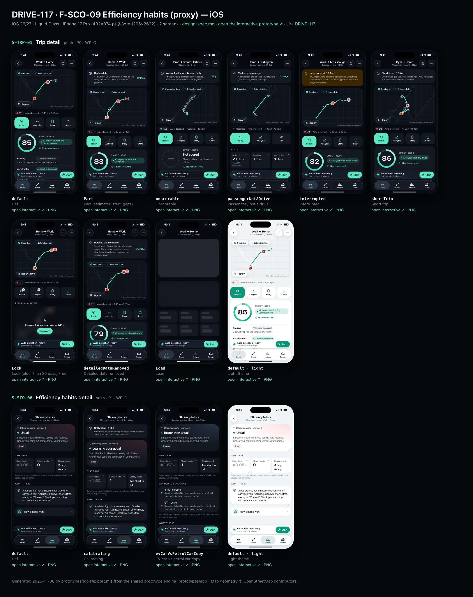
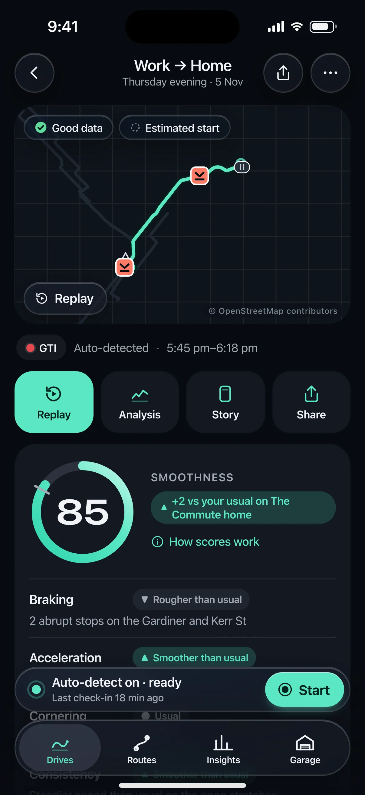
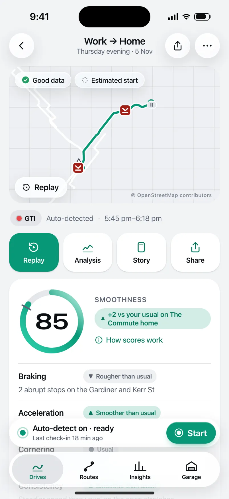
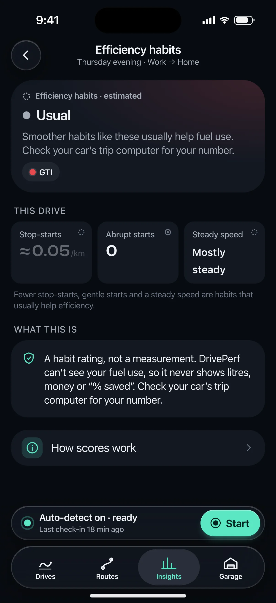
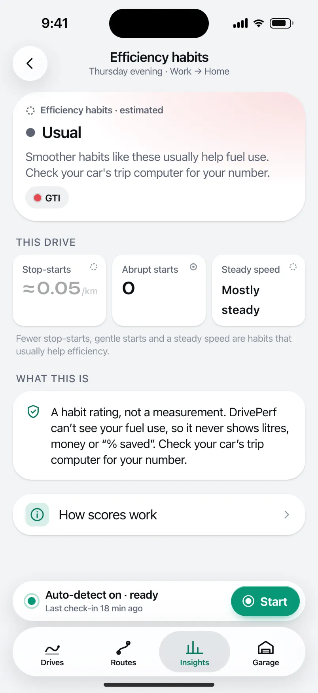

# DRIVE-117 · F-SCO-09 Efficiency habits (proxy) — iOS design spec

> Generated by `prototypes/tools/export.mjs` on 2026-11-06 from the shared prototype engine. **Do not edit by hand:** change the screen's `spec` in `prototypes/app/screens/wp-*.js` (see `prototypes/app/AUTHORING.md`) and re-export.

- **Jira story:** [DRIVE-117](https://thekeval.atlassian.net/browse/DRIVE-117) · F-SCO-09 · P1
- **Platform:** iOS 26/27 · Liquid Glass · iPhone 17 Pro (402×874 pt @3x = 1206×2622)
- **Interactive prototype:** [../../../../prototypes/ios/index.html#S-TRP-01](../../../../prototypes/ios/index.html#S-TRP-01) (catalog panel: every screen and state; deep links `#S-ID/state?trip=…&ent=…&theme=light&text=xl&rm=1`)
- **Contact sheet:** [mockup.html](mockup.html) · 
- **Design system (source of truth for values):** [brand](../../system/brand.md) · [components](../../system/components.md) · [motion](../../system/motion.md) · [accessibility](../../system/accessibility.md) · [screen map](../../system/screen-map.md) · [fixtures](../../system/fixtures.md) · tokens `prototypes/shared/tokens.css`

## Screens in this story

| Screen | Name | Presentation | Priority | States | Status |
|---|---|---|---|---|---|
| `S-TRP-01` | Trip detail | Push | P0 | 9 | Prototyped |
| `S-SCO-06` | Efficiency habits detail | Push | P1 | 3 | Prototyped |

## Tokens used on this platform

Values resolved from `prototypes/shared/tokens.css` inside the iOS device (`[data-platform="ios"]`). Use the token names in code; the hex values are for reference.

| Token | Dark | Light |
|---|---|---|
| `--app-bg` | `#080B10` | `#F2F3F6` |
| `--card-bg` | `#131822` | `#FFFFFF` |
| `--dp-bg-grouped` | `#080B10` | `#F2F3F6` |
| `--dp-surface` | `#131822` | `#FFFFFF` |
| `--dp-surface-2` | `#1B222D` | `#F2F3F6` |
| `--dp-surface-3` | `#262E3B` | `#E4E7EC` |
| `--dp-fill` | `#7880961F` | `#7880961F` |
| `--dp-fill-strong` | `#7880963D` | `#78809633` |
| `--dp-text` | `#F2F4F7` | `#0B0E13` |
| `--dp-text-2` | `#A3AAB6` | `#5A6271` |
| `--dp-text-3` | `#6E7787` | `#8A919D` |
| `--dp-separator` | `#96A0B429` | `#3C435024` |
| `--dp-accent` | `#5BE7C4` | `#079777` |
| `--dp-accent-text` | `#5BE7C4` | `#06775E` |
| `--dp-on-accent` | `#04241D` | `#FFFFFF` |
| `--dp-accent-container` | `#0A4439` | `#C6F8EA` |
| `--dp-record` | `#FFC24B` | `#9A6300` |
| `--dp-positive` | `#5BE7C4` | `#06775E` |
| `--dp-change-down` | `#A3AAB6` | `#5A6271` |
| `--dp-warning` | `#F5B648` | `#9A5F00` |
| `--dp-critical` | `#FF6B6B` | `#C62828` |
| `--dp-glass-fill` | `#1C222C6B` | `#FFFFFF8C` |
| `--dp-glass-fill-strong` | `#1C222CB8` | `#FFFFFFD1` |
| `--dp-glass-stroke` | `#FFFFFF24` | `#FFFFFF99` |
| `--dp-data-route` | `#5BE7C4` | `#079777` |
| `--dp-data-event-brake` | `#FF7A66` | `#A21F16` |
| `--dp-data-event-accel` | `#E58BD0` | `#A33A8C` |
| `--dp-data-event-corner` | `#EAD54E` | `#9A8A00` |
| `--dp-data-quality-good` | `#5FDB9C` | `#1E9E62` |
| `--dp-data-speed` | `#D6DCE4` | `#404A58` |
| `--dp-data-long-g` | `#5AB8F5` | `#0A6AB8` |
| `--dp-data-lat-g` | `#F5A142` | `#B25A00` |

| Type / layout token | Value |
|---|---|
| `--dp-font-screen-title` | `700 34px / 41px -apple-system, BlinkMacSystemFont, "SF Pro Display", system-ui, sans-serif` |
| `--dp-font-sheet-title` | `700 22px / 28px -apple-system, BlinkMacSystemFont, "SF Pro Display", system-ui, sans-serif` |
| `--dp-font-section-title` | `600 20px / 25px -apple-system, BlinkMacSystemFont, "SF Pro Display", system-ui, sans-serif` |
| `--dp-font-card-title` | `600 17px / 22px -apple-system, BlinkMacSystemFont, "SF Pro Text", system-ui, sans-serif` |
| `--dp-font-body` | `400 17px / 22px -apple-system, BlinkMacSystemFont, "SF Pro Text", system-ui, sans-serif` |
| `--dp-font-body-secondary` | `400 15px / 20px -apple-system, BlinkMacSystemFont, "SF Pro Text", system-ui, sans-serif` |
| `--dp-font-meta` | `400 13px / 18px -apple-system, BlinkMacSystemFont, "SF Pro Text", system-ui, sans-serif` |
| `--dp-font-caption` | `400 12px / 16px -apple-system, BlinkMacSystemFont, "SF Pro Text", system-ui, sans-serif` |
| `--dp-font-button` | `600 17px / 22px -apple-system, BlinkMacSystemFont, "SF Pro Text", system-ui, sans-serif` |
| `--dp-num-hero` | `600 72px / 72px -apple-system, BlinkMacSystemFont, "SF Pro Display", system-ui, sans-serif` |
| `--dp-num-xl` | `600 48px / 52px -apple-system, BlinkMacSystemFont, "SF Pro Display", system-ui, sans-serif` |
| `--dp-num-l` | `600 34px / 38px -apple-system, BlinkMacSystemFont, "SF Pro Display", system-ui, sans-serif` |
| `--dp-num-m` | `600 24px / 28px -apple-system, BlinkMacSystemFont, "SF Pro Display", system-ui, sans-serif` |
| `--dp-num-s` | `600 17px / 22px -apple-system, BlinkMacSystemFont, "SF Pro Display", system-ui, sans-serif` |
| `--dp-num-xs` | `600 13px / 16px -apple-system, BlinkMacSystemFont, "SF Pro Display", system-ui, sans-serif` |
| `--dp-screen-margin` | `16px` |
| `--dp-radius-card` | `24px` |
| `--dp-radius-card-hero` | `32px` |
| `--dp-radius-sheet` | `38px` |
| `--dp-radius-chip` | `999px` |
| `--dp-radius-button` | `999px` |
| `--dp-layout-list-row-min` | `52px` |
| `--dp-layout-touch-min` | `44px` |
| `--safe-top` | `62px` |
| `--safe-bottom` | `34px` |

Text sizes scale with `--dp-text-scale` (XL = 2.0×) and numerals with `--dp-num-scale` (XL = 1.3×). DP Numerals: SF Pro Expanded Semibold, tabular.

---

## S-TRP-01 · Trip detail

 

- **Presentation:** push · tab: drives — screen map: “Push”
- **Entry points:** S-HOME-01 · S-HIS-01 · S-RTE-02 runs · S-GAR-02 · S-RCP-01 drive of week
- **Leads to:** S-RPL-01 · S-ANL-01 · S-STY-01 · S-SHR-01 · S-PRV-04 (Export, Pro) · S-TRP-02 · S-DQ-01 · S-SCO-01 · S-SCO-04 · S-SUB-03 (Lock)
- **PRD features:** F-RPL-07, F-CAP-04, F-CAP-05, F-CAP-06, F-CAP-17, F-DQ-04, F-DQ-05, F-HIS-03, F-SCO-01, F-SCO-04, F-SCO-06, F-SCO-09, F-SHR-01, F-PRV-03, F-RPL-01 · **Priority:** P0 · **WP:** C
- **Interactive:** [S-TRP-01](../../../../prototypes/ios/index.html#S-TRP-01)

**Purpose.** One place with a drive’s summary, scores, events and actions, so the user can decide where to dig in (F-RPL-07). The summary is Free forever; Replay/Analysis older than 30 days are Pro and shown locked with this trip’s own data blurred (F-HIS-03).

### States

| State | PRD label | Fixture params | Screenshot |
|---|---|---|---|
| `default` | Def | `trip=t20261105-1745` | [S-TRP-01.png](../../screens/ios/S-TRP-01.webp) · [open](../../../../prototypes/ios/index.html#S-TRP-01) |
| `Part` | Part (estimated start, gaps) | `trip=t20261020-0740` | [S-TRP-01--Part.png](../../screens/ios/S-TRP-01--Part.webp) · [open](../../../../prototypes/ios/index.html#S-TRP-01/Part) |
| `unscorable` | Unscorable | `trip=t20261106-1210` | [S-TRP-01--unscorable.png](../../screens/ios/S-TRP-01--unscorable.webp) · [open](../../../../prototypes/ios/index.html#S-TRP-01/unscorable) |
| `passengerNotADrive` | Passenger / not a drive | `trip=t20261031-1905` | [S-TRP-01--passengerNotADrive.png](../../screens/ios/S-TRP-01--passengerNotADrive.webp) · [open](../../../../prototypes/ios/index.html#S-TRP-01/passengerNotADrive) |
| `interrupted` | Interrupted | `trip=t20261013-1742` | [S-TRP-01--interrupted.png](../../screens/ios/S-TRP-01--interrupted.webp) · [open](../../../../prototypes/ios/index.html#S-TRP-01/interrupted) |
| `shortTrip` | Short trip | `trip=t20261104-0755` | [S-TRP-01--shortTrip.png](../../screens/ios/S-TRP-01--shortTrip.webp) · [open](../../../../prototypes/ios/index.html#S-TRP-01/shortTrip) |
| `Lock` | Lock (older than 30 days, Free) | `trip=t20261002-0745` `ent=free` | [S-TRP-01--Lock.png](../../screens/ios/S-TRP-01--Lock.webp) · [open](../../../../prototypes/ios/index.html#S-TRP-01/Lock) |
| `detailedDataRemoved` | Detailed data removed | `trip=t20261002-0745` | [S-TRP-01--detailedDataRemoved.png](../../screens/ios/S-TRP-01--detailedDataRemoved.webp) · [open](../../../../prototypes/ios/index.html#S-TRP-01/detailedDataRemoved) |
| `Load` | Load | `trip=t20261105-1745` | [S-TRP-01--Load.png](../../screens/ios/S-TRP-01--Load.webp) · [open](../../../../prototypes/ios/index.html#S-TRP-01/Load) |
| default · light | Light theme | `theme=light` | [S-TRP-01--light.png](../../screens/ios/S-TRP-01--light.webp) |

Every state also renders in light/dark (`theme=light`), XL text (`text=xl`) and reduced motion (`rm=1`).

### Layout

- Top bar: iOS inline title (route label) + subtitle (part of day · date) with glass back, Share and “…” menu (Edit trip, Export GPX/CSV, Data quality, Delete) · Android MediumFlexibleTopAppBar (back, Share, overflow) with the title block in content that collapses into the bar on scroll.
- State banners (passenger, interrupted, unscorable, short trip, Part data, detailed data removed) directly under the bar.
- Map hero, full width minus 16 margins, 232 tall, radius = card (24 iOS / 16 Android): route in Glide over the plain-canvas map, estimated start dashed, GPS gap dotted, stop capsules, neutral max-speed triangle, event pins by shape; quality badge and “Estimated start” chips top-left (glass on iOS); “Replay” glass capsule bottom-left (“Replay in Pro” + lock when locked); “© OpenStreetMap contributors” bottom-right.
- Meta row: car chip (tap → car picker) · source (Auto-detected / Started from Widget, Control Center) · start–end time.
- Smoothness card: ring 124 (baseline notch, record notch) + comparison chip, record line (rosette, gold), “Score based on n of m min” when excluded, “How scores work”; four contributor rows (label · band chip ▲/●/▼ · reason); “Smoothness breakdown ›” → S-SCO-01.
- Action row directly under the meta row (4 equal buttons, 68 tall): Replay (primary) · Analysis · Story · Share. Locked: lock badges, both open S-SUB-03. Passenger: Replay · Analysis · Edit.
- Locked (Free > 30 days): “Replay & Analysis” lock panel — this trip’s synced timeline blurred 14 px + “Keep exploring every drive with Pro.” + See plans.
- Stats 3×3 tiles in PRD order: distance, duration, moving time, stopped, stops, avg moving speed, max speed (neutral, never first), climb, descent — each with its provenance glyph.
- Events · n: count chips by type (pin glyph + count) and event rows (pin 28 · “Hard braking” · place · time of day · 0.42 g · 1.4 s); “No abrupt inputs on this drive.” when there are none.
- Highlights: positive card first (“Cleanest stretch: …”), then the tip card (“One thing for next time”, long-G sparkline, “See the moment ›”).
- Details list: data quality (badge + detail) → S-DQ-01 · efficiency habits (≈ estimated) → S-SCO-06 · route (runs, record) → S-RTE-02. Manage list: Edit trip · Export GPX/CSV (Pro) · Delete drive (destructive).

### Components & tokens

| Component | Tokens / spec |
|---|---|
| `navBar` | --dp-font-card-title · --dp-font-meta · glass: --dp-glass-fill + --dp-glass-blur · components.md §2 |
| `menu` | iOS glass Menu: --dp-glass-fill-strong, radius 26 · Android DropdownMenu: --md-sys-color-surface-container, radius 16 |
| `banner` | radius 12 (--dp-radius-sm+) · info --dp-fill · attention --dp-warning-container · critical --dp-critical-container · components.md §22 |
| `map` | --dp-data-map-land/road/grid · route --dp-data-route 3.8 + casing --dp-data-route-casing 7.5 · estimated dashed 4/4 at 60% · gap --dp-data-gap-stroke dotted 1/6 · pins DP_ICONS.pin 26 · attribution “© OpenStreetMap contributors” |
| `qualityBadge` | --dp-data-quality-{good\|usable\|limited\|unscorable} · components.md §10 |
| `chip` | --dp-radius-chip (iOS capsule · Android 8) · height 28 · --dp-font-caption |
| `card` | --dp-surface / --md-sys-color-surface-container · --dp-radius-card (24 iOS · 16 Android) · hero: --dp-radius-card-hero (32 · 28) · light iOS: --dp-elev-1 |
| `ring` | track --dp-fill-strong · arc --dp-gradient-ring (glide-400 → accent → glide-100) · baseline notch --dp-text-2 · record notch --dp-record · Android container Cookie9Sided --md-sys-color-primary-container 42% · components.md §3 |
| `deltaChip` | better: --dp-accent-text on --dp-accent 18% · lower: --dp-text-2 on --dp-fill (never red) · record: --dp-record on --dp-record 18% · components.md §4 |
| `actionButton` | --dp-surface-2 · --md-sys-color-surface-container-high · --dp-radius-lg · min 44 pt / 48 dp |
| `lockPanel` | blur --dp-opacity-locked-blur 14px · dim --dp-opacity-locked-dim 35% · components.md §15.2 |
| `timeline` | --dp-data-speed · --dp-data-long-g · --dp-data-lat-g (dashed 6/3) · cursor --dp-data-cursor · components.md §7 |
| `stats` | --dp-surface-2 / --md-sys-color-surface-container-high · radius 14 iOS / 12 Android · value --dp-num-m (DP Numerals) · components.md §5 |
| `eventRow` | pin 28 (shape = meaning) · meta --dp-num-xs · min height 44 · components.md §9.2 |
| `tipCard` | --dp-accent 10% over --dp-surface · sparkline --dp-data-long-g · components.md §18 |
| `sparkline` | see components.md |
| `list` | iOS inset grouped radius --dp-radius-card, rows 52 pt, separators --dp-separator inset 16 · Android ListItem 56/72 dp in --md-sys-color-surface-container |
| `row` | --dp-font-body · --dp-font-meta (supporting) · --dp-layout-list-row-min |
| `section` | --dp-font-section-title · --dp-layout-section-gap 28 |
| `skeleton` | --dp-fill-strong, breathe 1.2 s (dp-skeleton) |

### Interactions & navigation

- Map / Replay → S-RPL-01 (Lock → S-SUB-03 replayAnalysis30Days). Analysis → S-ANL-01. Story → S-STY-01. Share (button or bar) → S-SHR-01. (Story/Replay/Analysis/Share pass the D1 gate → S-DRV-05 while moving.)
- Quality badge / Data quality row → S-DQ-01 · Smoothness card → S-SCO-01 · “How scores work” → S-SCO-02 · Event row → S-RPL-02 (event param) · Tip “See the moment” → S-RPL-02.
- Car chip → S-TRP-02/carPicker · Passenger “Change” → S-TRP-02/typePicker · Edit → S-TRP-02 · Export → S-PRV-04 (Pro) or S-SUB-03/export (Free) · Delete → S-TRP-03 dialog · Route row → S-RTE-02 · Efficiency → S-SCO-06.
- “…” opens a glass Menu (iOS) / DropdownMenu (Android). Long-press any stat tile → provenance popover (prototype: toast) with the glyph meaning, haptic longPress.

### Motion

- Enter from a trip card: iOS zoom transition from the card, Android container transform (spring.slow).
- Map: route draw-on 1800 ms ease.drawOn; estimated/gap overlays, stops and max pin fade in at 1500 ms; event pins pop in time order from 1600 ms, 40 ms stagger, shared.pinPop. RM: the complete route fades in (220 ms), pins appear in place.
- Smoothness ring reveal (motion.md §3.4): 1400 ms count-up locked to the arc, baseline notch scales in, landing tap haptic; Android Cookie9Sided container rotates as the count runs. RM: final ring, static number.
- Sections rise 8 px, 30 ms stagger, spring.default. Menu scales in from the top-trailing corner (spring.fast).

### Accessibility

- Score card is one element: “Smoothness 85. 2 above your usual on The Commute home.” (+ “New route record, beating 89 from 14 October.”).
- Map label: “Map of your drive, 39 kilometres from Work to Home. 2 events, 2 stops.” Event pins are a time-ordered list; each event row reads “Hard braking at the Gardiner. Peak 0.4 g.”
- Stat tiles: “Distance, 39.0 kilometres. Derived.” with the long-press action “Show how this was measured”; ⓘ footer explains long-press.
- Speed tiles use the same neutral component (no colour, no emphasis, never first). Deltas use ▲/▼/● and “above/below your usual”, never red.
- XL: tiles go to 2 columns, the action row to 2×2, contributor reasons wrap; nothing truncates.

### Platform notes

- **iOS (this spec):** Inline title + .navigationSubtitle, glass back/Share/“…” toolbar buttons, Menu for overflow; map chips and Replay capsule are glass; ring on content; zoom transition from the source card.
- *Android (for reference):* MediumFlexibleTopAppBar (title in content, collapses on scroll), overflow DropdownMenu; quality badge as AssistChip; ring on a Cookie9Sided primaryContainer shape; actions: filled primary (radius 28) + tonal surfaceContainerHigh buttons; list sections as M3E segmented ListItems; container transform from the card.

### Analytics

- `trip_detail_opened {source, age_bucket}`
- `locked_content_viewed {type: replay|analysis, age_bucket}`
- `trip_action_tapped {action: replay|analysis|story|share|export|edit|delete}`
- `provenance_viewed {metric}`

### Copy

| Key | Text |
|---|---|
| Passenger | Marked as passenger. It isn’t scored and doesn’t count toward your baseline, routes or recaps. · Change |
| Interrupted | Interrupted at {time}. {iOS ended DrivePerf in the background \| Android stopped DrivePerf in the background}. Everything before then is saved. The missing part is shown as a gap, never scored. |
| Unscorable | We couldn’t score this one fairly. {quality.reason}. Here’s the route and the stats anyway. |
| Part | {badge} data. {41} s without GPS downtown (dotted on the map) · the first ≈ 0.4 km is estimated (dashed). |
| Short trip | Short drive · {km} km. Short drives give the score less to work with, so expect it to move more from drive to drive. |
| Detailed data removed | You removed the raw sensor data to save space. The summary, route and score stay; Analysis and event traces are no longer available. |
| Lock | Keep exploring every drive with Pro. (entitlement.lockSheets.oldAnalysis) · Your summary, score and Story stay free forever. Nothing is deleted because of your plan. |
| No events | No abrupt inputs on this drive. Nothing crossed the braking, acceleration or cornering thresholds. |

### Free / Pro

Free: everything on this screen is visible for every trip of any age. For trips older than 30 days Replay and Analysis show lock badges and open S-SUB-03 (replayAnalysis30Days) over a blurred render of this trip; Export shows a PRO badge and opens S-SUB-03/export. Pro/Preview/Ride-along: no locks.

### Data & fixtures

Fixtures: default t20261105-1745 · Part t20261020-0740 (41 s gap, needed brake at Spadina & King) · unscorable t20261106-1210 · passenger t20261031-1905 · interrupted t20261013-1742 · short trip t20261104-0755 · Lock / detailed data removed t20261002-0745. Event time of day = trip.start + event.t (derived).

### Assets

[icon-replay.svg](assets/icon-replay.svg) · [icon-analysis.svg](assets/icon-analysis.svg) · [icon-story.svg](assets/icon-story.svg) · [icon-share.svg](assets/icon-share.svg) · [icon-more.svg](assets/icon-more.svg) · [icon-edit.svg](assets/icon-edit.svg) · [icon-export.svg](assets/icon-export.svg) · [icon-trash.svg](assets/icon-trash.svg) · [icon-lock.svg](assets/icon-lock.svg) · [icon-info.svg](assets/icon-info.svg) · [icon-routes.svg](assets/icon-routes.svg) · [icon-car.svg](assets/icon-car.svg) · [icon-bolt.svg](assets/icon-bolt.svg) · [icon-sparkle.svg](assets/icon-sparkle.svg) · [icon-passenger.svg](assets/icon-passenger.svg) · [icon-shield.svg](assets/icon-shield.svg) · [icon-check.svg](assets/icon-check.svg) · [icon-chevronRight.svg](assets/icon-chevronRight.svg) · [icon-rosette.svg](assets/icon-rosette.svg)

UI glyphs may be swapped for SF Symbols / Material Symbols Rounded equivalents; event-pin, quality and provenance glyphs must not be (components.md global rules).

### Checklist (accessibility.md §9)

- [ ] Light and dark both render, and contrast passes.
- [ ] The XL text state reflows with no truncation.
- [ ] The RM state is defined.
- [ ] Every control has a label; every chart and map has a summary sentence.
- [ ] Every target ≥ 44 pt / 48 dp (≥ 64 in-drive).
- [ ] No meaning by colour alone.
- [ ] Speed is neutral wherever it appears and absent from social or live surfaces.
- [ ] No streak, leaderboard, speed or “beat your time” language.
- [ ] Behaviour is defined while a trip is active (D1 gate).
- [ ] Haptics come from motion.md §6 only.

---

## S-SCO-06 · Efficiency habits detail

 

- **Presentation:** push · tab: insights — screen map: “Push”
- **Entry points:** S-TRP-01 efficiency row · S-GAR-02
- **Leads to:** Back
- **PRD features:** F-SCO-09 · **Priority:** P1 · **WP:** C
- **Interactive:** [S-SCO-06](../../../../prototypes/ios/index.html#S-SCO-06)

**Purpose.** Show whether the drive’s habits were efficiency-friendly without fake energy numbers (F-SCO-09): a proxy from stop-starts per km, abrupt accelerations and speed consistency.

### States

| State | PRD label | Fixture params | Screenshot |
|---|---|---|---|
| `default` | Def | `trip=t20261105-1745` | [S-SCO-06.png](../../screens/ios/S-SCO-06.webp) · [open](../../../../prototypes/ios/index.html#S-SCO-06) |
| `calibrating` | Calibrating | `trip=t20260928-1842` | [S-SCO-06--calibrating.png](../../screens/ios/S-SCO-06--calibrating.webp) · [open](../../../../prototypes/ios/index.html#S-SCO-06/calibrating) |
| `evCarVsPetrolCarCopy` | EV car vs petrol car copy | `trip=t20261017-1120` | [S-SCO-06--evCarVsPetrolCarCopy.png](../../screens/ios/S-SCO-06--evCarVsPetrolCarCopy.webp) · [open](../../../../prototypes/ios/index.html#S-SCO-06/evCarVsPetrolCarCopy) |
| default · light | Light theme | `theme=light` | [S-SCO-06--light.png](../../screens/ios/S-SCO-06--light.webp) |

Every state also renders in light/dark (`theme=light`), XL text (`text=xl`) and reduced motion (`rm=1`).

### Layout

- Push (Insights tab), title “Efficiency habits” + part of day · label.
- Calibrating banner (first drives).
- Hero card tinted with the car colour: kicker “≋ Efficiency habits · estimated” (dashed-ring glyph) · rating with ▲/●/▼ (Better than usual / Usual / Less efficient than usual) · trip.efficiency.copy · car chip.
- “This drive”: three tiles — Stop-starts ≈ 0.05 per km (estimated) · Abrupt starts 0 (derived) · Speed consistency in words (Steady / Mostly steady / Variable, estimated).
- evCarVsPetrolCarCopy: “Worded for each car” list with the EV and petrol copy side by side.
- “What this is” honesty card (never litres, kWh, money or % saved) · How scores work row.

### Components & tokens

| Component | Tokens / spec |
|---|---|
| `navBar` | --dp-font-card-title · --dp-font-meta · glass: --dp-glass-fill + --dp-glass-blur · components.md §2 |
| `banner` | radius 12 (--dp-radius-sm+) · info --dp-fill · attention --dp-warning-container · critical --dp-critical-container · components.md §22 |
| `card` | --dp-surface / --md-sys-color-surface-container · --dp-radius-card (24 iOS · 16 Android) · hero: --dp-radius-card-hero (32 · 28) · light iOS: --dp-elev-1 |
| `carChip` | see components.md |
| `stats` | --dp-surface-2 / --md-sys-color-surface-container-high · radius 14 iOS / 12 Android · value --dp-num-m (DP Numerals) · components.md §5 |
| `section` | --dp-font-section-title · --dp-layout-section-gap 28 |
| `list` | iOS inset grouped radius --dp-radius-card, rows 52 pt, separators --dp-separator inset 16 · Android ListItem 56/72 dp in --md-sys-color-surface-container |
| `row` | --dp-font-body · --dp-font-meta (supporting) · --dp-layout-list-row-min |
| `carDot` | see components.md |

### Interactions & navigation

- How scores work → S-SCO-02 · Back → S-TRP-01 / S-GAR-02.

### Motion

- Tiles rise 8 px (40 ms stagger). RM: static.

### Accessibility

- Rating: “Efficiency habits, estimated. Usual.” Tiles: “Stop-starts, about 0.05 per kilometre. Estimated.” Estimated values use ≈ and the dashed-ring glyph, not colour alone.

### Platform notes

- **iOS (this spec):** Inline title; hero tinted 18% car colour.
- *Android (for reference):* MediumFlexibleTopAppBar; tonal hero.

### Analytics

- `efficiency_viewed`

### Copy

| Key | Text |
|---|---|
| Petrol | Smoother habits like these usually help fuel use. Check your car's trip computer for your number. |
| EV | Smoother habits like these usually help range. Check your car's display to see your number. |
| Honest | A habit rating, not a measurement. DrivePerf can’t see your {fuel\|battery} use, so it never shows {litres\|kWh}, money or “% saved”. Check your car’s {trip computer\|display} for your number. |
| Calibrating | Calibrating · 1 of 3. After three drives we’ll compare these habits with your usual. Until then, here’s what we saw. |

### Free / Pro

Free.

### Data & fixtures

trip.efficiency (rating, label, stopsPerKm, abruptAccels, speedConsistencyCv, copy). States: default t20261105-1745 (GTI, Usual) · calibrating t20260928-1842 (first drive) · evCarVsPetrolCarCopy t20261017-1120 (Ioniq) with the petrol copy from the newest GTI trip. Consistency words are derived from the CV (< 0.15 Steady, < 0.20 Mostly steady, else Variable).

### Assets

[icon-shield.svg](assets/icon-shield.svg) · [icon-info.svg](assets/icon-info.svg)

UI glyphs may be swapped for SF Symbols / Material Symbols Rounded equivalents; event-pin, quality and provenance glyphs must not be (components.md global rules).

### Checklist (accessibility.md §9)

- [ ] Light and dark both render, and contrast passes.
- [ ] The XL text state reflows with no truncation.
- [ ] The RM state is defined.
- [ ] Every control has a label; every chart and map has a summary sentence.
- [ ] Every target ≥ 44 pt / 48 dp (≥ 64 in-drive).
- [ ] No meaning by colour alone.
- [ ] Speed is neutral wherever it appears and absent from social or live surfaces.
- [ ] No streak, leaderboard, speed or “beat your time” language.
- [ ] Behaviour is defined while a trip is active (D1 gate).
- [ ] Haptics come from motion.md §6 only.

---

Map geometry in the prototype: © OpenStreetMap contributors (ODbL). Speed and G are simulated fixtures (fixtures.md).
