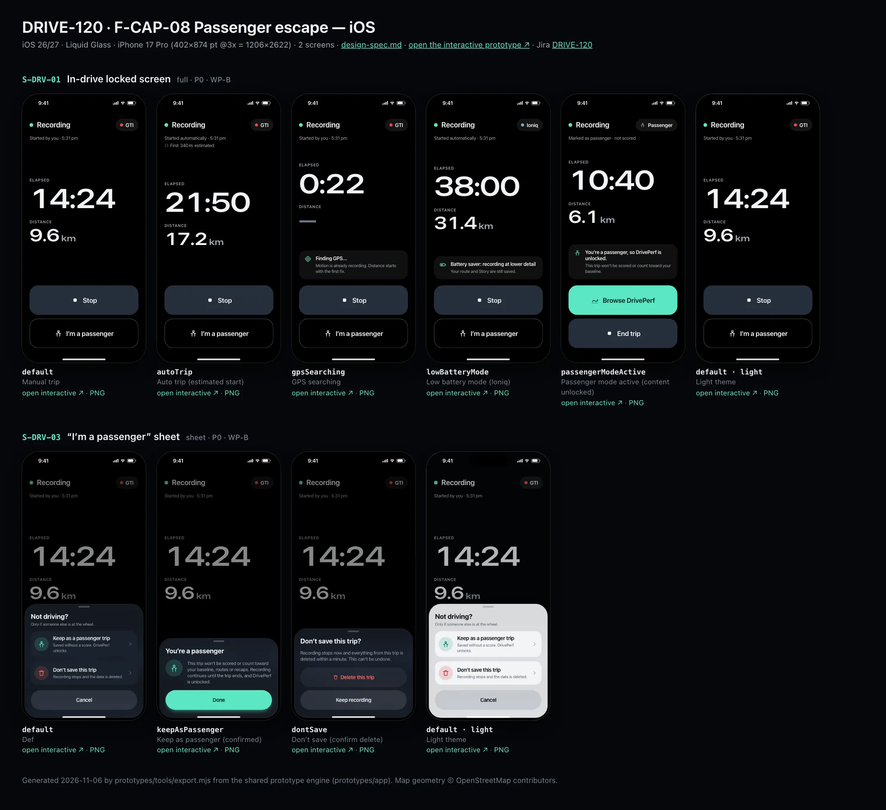
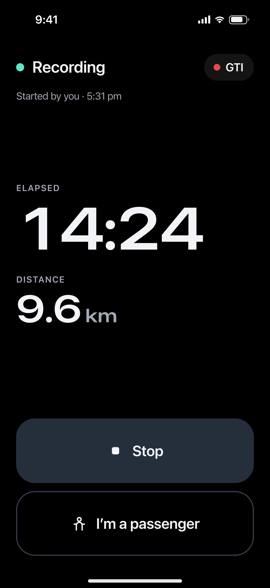
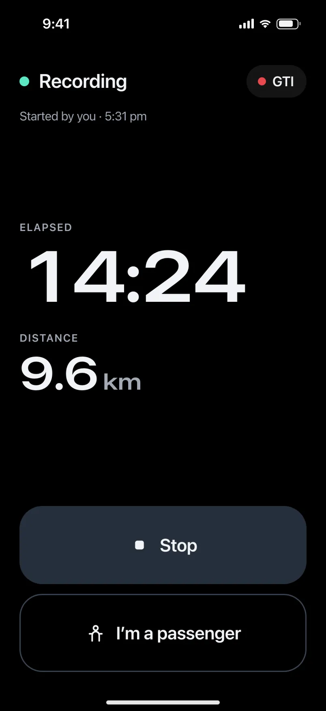
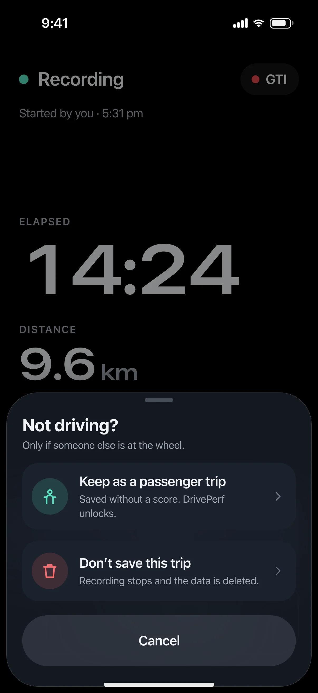
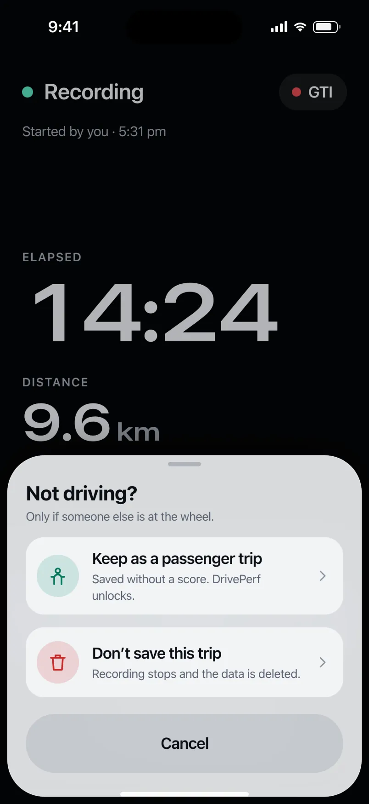

# DRIVE-120 · F-CAP-08 Passenger escape — iOS design spec

> Generated by `prototypes/tools/export.mjs` on 2026-11-06 from the shared prototype engine. **Do not edit by hand:** change the screen's `spec` in `prototypes/app/screens/wp-*.js` (see `prototypes/app/AUTHORING.md`) and re-export.

- **Jira story:** [DRIVE-120](https://thekeval.atlassian.net/browse/DRIVE-120) · F-CAP-08 · P0
- **Platform:** iOS 26/27 · Liquid Glass · iPhone 17 Pro (402×874 pt @3x = 1206×2622)
- **Interactive prototype:** [../../../../prototypes/ios/index.html#S-DRV-01](../../../../prototypes/ios/index.html#S-DRV-01) (catalog panel: every screen and state; deep links `#S-ID/state?trip=…&ent=…&theme=light&text=xl&rm=1`)
- **Contact sheet:** [mockup.html](mockup.html) · 
- **Design system (source of truth for values):** [brand](../../system/brand.md) · [components](../../system/components.md) · [motion](../../system/motion.md) · [accessibility](../../system/accessibility.md) · [screen map](../../system/screen-map.md) · [fixtures](../../system/fixtures.md) · tokens `prototypes/shared/tokens.css`

## Screens in this story

| Screen | Name | Presentation | Priority | States | Status |
|---|---|---|---|---|---|
| `S-DRV-01` | In-drive locked screen | Full (locked) | P0 | 5 | Prototyped |
| `S-DRV-03` | “I’m a passenger” sheet | Sheet (small) | P0 | 3 | Prototyped |

## Tokens used on this platform

Values resolved from `prototypes/shared/tokens.css` inside the iOS device (`[data-platform="ios"]`). Use the token names in code; the hex values are for reference.

| Token | Dark | Light |
|---|---|---|
| `--app-bg` | `#080B10` | `#F2F3F6` |
| `--card-bg` | `#131822` | `#FFFFFF` |
| `--dp-bg-grouped` | `#080B10` | `#F2F3F6` |
| `--dp-surface` | `#131822` | `#FFFFFF` |
| `--dp-surface-2` | `#1B222D` | `#F2F3F6` |
| `--dp-surface-3` | `#262E3B` | `#E4E7EC` |
| `--dp-fill` | `#7880961F` | `#7880961F` |
| `--dp-fill-strong` | `#7880963D` | `#78809633` |
| `--dp-text` | `#F2F4F7` | `#0B0E13` |
| `--dp-text-2` | `#A3AAB6` | `#5A6271` |
| `--dp-text-3` | `#6E7787` | `#8A919D` |
| `--dp-separator` | `#96A0B429` | `#3C435024` |
| `--dp-accent` | `#5BE7C4` | `#079777` |
| `--dp-accent-text` | `#5BE7C4` | `#06775E` |
| `--dp-on-accent` | `#04241D` | `#FFFFFF` |
| `--dp-accent-container` | `#0A4439` | `#C6F8EA` |
| `--dp-record` | `#FFC24B` | `#9A6300` |
| `--dp-positive` | `#5BE7C4` | `#06775E` |
| `--dp-change-down` | `#A3AAB6` | `#5A6271` |
| `--dp-warning` | `#F5B648` | `#9A5F00` |
| `--dp-critical` | `#FF6B6B` | `#C62828` |
| `--dp-glass-fill` | `#1C222C6B` | `#FFFFFF8C` |
| `--dp-glass-fill-strong` | `#1C222CB8` | `#FFFFFFD1` |
| `--dp-glass-stroke` | `#FFFFFF24` | `#FFFFFF99` |
| `--dp-data-route` | `#5BE7C4` | `#079777` |
| `--dp-data-event-brake` | `#FF7A66` | `#A21F16` |
| `--dp-data-event-accel` | `#E58BD0` | `#A33A8C` |
| `--dp-data-event-corner` | `#EAD54E` | `#9A8A00` |
| `--dp-data-quality-good` | `#5FDB9C` | `#1E9E62` |
| `--dp-data-speed` | `#D6DCE4` | `#404A58` |
| `--dp-data-long-g` | `#5AB8F5` | `#0A6AB8` |
| `--dp-data-lat-g` | `#F5A142` | `#B25A00` |

| Type / layout token | Value |
|---|---|
| `--dp-font-screen-title` | `700 34px / 41px -apple-system, BlinkMacSystemFont, "SF Pro Display", system-ui, sans-serif` |
| `--dp-font-sheet-title` | `700 22px / 28px -apple-system, BlinkMacSystemFont, "SF Pro Display", system-ui, sans-serif` |
| `--dp-font-section-title` | `600 20px / 25px -apple-system, BlinkMacSystemFont, "SF Pro Display", system-ui, sans-serif` |
| `--dp-font-card-title` | `600 17px / 22px -apple-system, BlinkMacSystemFont, "SF Pro Text", system-ui, sans-serif` |
| `--dp-font-body` | `400 17px / 22px -apple-system, BlinkMacSystemFont, "SF Pro Text", system-ui, sans-serif` |
| `--dp-font-body-secondary` | `400 15px / 20px -apple-system, BlinkMacSystemFont, "SF Pro Text", system-ui, sans-serif` |
| `--dp-font-meta` | `400 13px / 18px -apple-system, BlinkMacSystemFont, "SF Pro Text", system-ui, sans-serif` |
| `--dp-font-caption` | `400 12px / 16px -apple-system, BlinkMacSystemFont, "SF Pro Text", system-ui, sans-serif` |
| `--dp-font-button` | `600 17px / 22px -apple-system, BlinkMacSystemFont, "SF Pro Text", system-ui, sans-serif` |
| `--dp-num-hero` | `600 72px / 72px -apple-system, BlinkMacSystemFont, "SF Pro Display", system-ui, sans-serif` |
| `--dp-num-xl` | `600 48px / 52px -apple-system, BlinkMacSystemFont, "SF Pro Display", system-ui, sans-serif` |
| `--dp-num-l` | `600 34px / 38px -apple-system, BlinkMacSystemFont, "SF Pro Display", system-ui, sans-serif` |
| `--dp-num-m` | `600 24px / 28px -apple-system, BlinkMacSystemFont, "SF Pro Display", system-ui, sans-serif` |
| `--dp-num-s` | `600 17px / 22px -apple-system, BlinkMacSystemFont, "SF Pro Display", system-ui, sans-serif` |
| `--dp-num-xs` | `600 13px / 16px -apple-system, BlinkMacSystemFont, "SF Pro Display", system-ui, sans-serif` |
| `--dp-screen-margin` | `16px` |
| `--dp-radius-card` | `24px` |
| `--dp-radius-card-hero` | `32px` |
| `--dp-radius-sheet` | `38px` |
| `--dp-radius-chip` | `999px` |
| `--dp-radius-button` | `999px` |
| `--dp-layout-list-row-min` | `52px` |
| `--dp-layout-touch-min` | `44px` |
| `--safe-top` | `62px` |
| `--safe-bottom` | `34px` |

Text sizes scale with `--dp-text-scale` (XL = 2.0×) and numerals with `--dp-num-scale` (XL = 1.3×). DP Numerals: SF Pro Expanded Semibold, tabular.

---

## S-DRV-01 · In-drive locked screen

 

- **Presentation:** full — screen map: “Full (locked)”
- **Entry points:** Start (S-HOME-01, S-LIVE-03/04/07/08) · any deep link during a driver trip · S-LIVE-09 tap
- **Leads to:** S-DRV-02 (Stop) · S-DRV-03 (passenger) · auto end → S-DRV-04
- **PRD features:** F-CAP-01, F-CAP-02, F-CAP-07, F-CAP-08 · **Priority:** P0 · **WP:** B
- **Interactive:** [S-DRV-01](../../../../prototypes/ios/index.html#S-DRV-01)

**Purpose.** The only screen the app shows while a driver trip is active (D1, F-CAP-07): proof that it is recording — elapsed time, distance and car — plus two huge exits, Stop and I’m a passenger. Nothing else: no score, speed, events, tips, map, navigation or tab bar.

### States

| State | PRD label | Fixture params | Screenshot |
|---|---|---|---|
| `default` | Manual trip | — | [S-DRV-01.png](../../screens/ios/S-DRV-01.webp) · [open](../../../../prototypes/ios/index.html#S-DRV-01) |
| `autoTrip` | Auto trip (estimated start) | `live=auto` | [S-DRV-01--autoTrip.png](../../screens/ios/S-DRV-01--autoTrip.webp) · [open](../../../../prototypes/ios/index.html#S-DRV-01/autoTrip) |
| `gpsSearching` | GPS searching | `live=gpsSearching` | [S-DRV-01--gpsSearching.png](../../screens/ios/S-DRV-01--gpsSearching.webp) · [open](../../../../prototypes/ios/index.html#S-DRV-01/gpsSearching) |
| `lowBatteryMode` | Low battery mode (Ioniq) | `live=lowBattery` | [S-DRV-01--lowBatteryMode.png](../../screens/ios/S-DRV-01--lowBatteryMode.webp) · [open](../../../../prototypes/ios/index.html#S-DRV-01/lowBatteryMode) |
| `passengerModeActive` | Passenger mode active (content unlocked) | `live=passenger` | [S-DRV-01--passengerModeActive.png](../../screens/ios/S-DRV-01--passengerModeActive.webp) · [open](../../../../prototypes/ios/index.html#S-DRV-01/passengerModeActive) |
| default · light | Light theme | `theme=light` | [S-DRV-01--light.png](../../screens/ios/S-DRV-01--light.webp) |

Every state also renders in light/dark (`theme=light`), XL text (`text=xl`) and reduced motion (`rm=1`).

### Layout

- Full-screen cover on --dp-drive-bg #000 on both platforms and in both themes (status bar light). Content is a single column with 24 side margins.
- Top row (safe top + 18): 12 px live dot (--wb-drv-live = Glide #5BE7C4) + “Recording” (600 24/28) · car chip trailing (car dot in the car colour + nickname, 600 17, #F2F4F7 on #ffffff14, capsule 40 tall) or a “Passenger” chip.
- Source line (meta 15/20, #A3AAB6): “Started by you · 5:31 pm” / “Started automatically · 5:31 pm” + “First 340 m estimated” with the estimated provenance glyph (auto trips) / “Marked as passenger · not scored”.
- Numbers block, vertically centred in the free space: label “Elapsed” (caps 13, #A3AAB6) over the timer in DP Numerals 96/96 (tabular, 125% stretch, scales with Dynamic Type up to the container width), then “Distance” over 9.6 + “km” at 50%. GPS searching shows “—”. Times ≥ 1 h render h:mm:ss.
- Status card when needed (radius 20, #ffffff10, 16 padding, 22 icon): Finding GPS… · Battery saver: recording at lower detail · You’re a passenger, so DrivePerf is unlocked.
- Bottom stack (safe bottom + 16, 12 gap): Stop = 96 tall, full width, radius 28, --dp-surface-3 (#262E3B) with a 26 stop glyph and 600 22 label · I’m a passenger = 96 tall, 1.5 px #3A4351 outline. Passenger mode: “Browse DrivePerf” (Glide filled, on-accent text) + “End trip”.

### Components & tokens

| Component | Tokens / spec |
|---|---|
| `page` | --dp-bg-grouped (iOS) / --md-sys-color-surface (Android) · --dp-screen-margin 16 |
| `drvButton (local, 96 tall)` | see components.md |
| `carChip (in-drive variant)` | see components.md |
| `provenance` | see components.md |
| `liveDot` | see components.md |

### Interactions & navigation

- Stop → S-DRV-02 (sheet). I’m a passenger → S-DRV-03 (sheet). Both are the only destinations allowed by the D1 gate besides S-DRV-05.
- Passenger mode: Browse DrivePerf → S-NAV-01 recording banner (live=passenger, content unlocked); End trip → S-DRV-02 (passenger copy).
- Every other deep link, notification, widget, Control Center / QS tile and Live Activity tap lands here while a driver trip is active (DP.gate; the target waits in DP.session.pending and opens on S-DRV-05 rules after the trip).
- Auto end (stationary for the stop timer, F-CAP-03) → S-DRV-04 with no tap. There is no swipe, back gesture or tab bar.

### Motion

- Manual start: the accessory (iOS) / floating toolbar (Android) expands into this screen (container transform, spring.slow), then the rows rise 8 px with a 60 ms stagger (spring.default) — motion.md §3.1. Auto trip: 220 ms cross-fade, no theatre.
- Live dot: halo scale 1 → 1.9, opacity .5 → 0, 900 ms ease.glide once per second for 10 s after appearing or after any touch, then still (§3.2). The timer updates once per second; nothing else moves. RM / shot: static dot.
- Haptics: none on this screen (confirm fires only on the Stop / passenger confirmation in the sheets).

### Accessibility

- One summary element: “Recording. 14 minutes, 9.6 kilometres, GTI.” — no live region, so the timer is never announced every second.
- Buttons: “Stop” and “I’m a passenger” (96 tall, ≥ 64 rule); order: summary → Stop → I’m a passenger.
- XL: numerals scale but are capped to the screen width (never truncated); the status card wraps; buttons keep 96 minimum height and grow with the label.
- Contrast: #F2F4F7 on #000 (19:1), #A3AAB6 on #000 (8.7:1). Meaning never by colour: the dot is paired with the word Recording.

### Platform notes

- **iOS (this spec):** .fullScreenCover with .interactiveDismissDisabled(); .persistentSystemOverlays(.hidden) not used (status bar stays for the recording indicator); Live Activity runs alongside (S-LIVE-01/02).
- *Android (for reference):* Full-screen destination with BackHandler consumed (back does nothing while driving); FLAG_KEEP_SCREEN_ON optional; the Live Update / FGS notification runs alongside (S-LIVE-05/06).

### Analytics

- `in_drive_screen_viewed {mode: manual|auto, gps, battery_saver}`
- `in_drive_stop_tapped`
- `in_drive_passenger_tapped`
- `content_blocked_while_moving {target} (from the gate)`

### Copy

| Key | Text |
|---|---|
| Title | Recording |
| Manual | Started by you · {5:31 pm} |
| Auto | Started automatically · {5:31 pm} · First {340} m estimated |
| GPS | Finding GPS… · Motion is already recording. Distance starts with the first fix. |
| Low battery | Battery saver: recording at lower detail · Your route and Story are still saved. |
| Passenger | You’re a passenger, so DrivePerf is unlocked. · This trip won’t be scored or count toward your baseline. |
| Buttons | Stop · I’m a passenger · Browse DrivePerf · End trip |

### Free / Pro

Identical for every plan. No upsell, badge, paywall or share prompt can appear while this screen is up (D12).

### Data & fixtures

DP_DATA.liveTrip.states: manual (default, 14:24 · 9.6 km · GTI) · auto (21:50 · 17.2 km · estimatedStartM 340) · gpsSearching (0:22, no distance) · lowBattery (38:00 · 31.4 km · Ioniq, batterySaver) · passenger (10:40 · 6.1 km). Start time = startedAt (5:31 pm). Only these fields are used (fixtures.md §8). The prototype timer ticks from elapsedS once per second.

### Assets

[icon-stop.svg](assets/icon-stop.svg) · [icon-passenger.svg](assets/icon-passenger.svg) · [icon-gps.svg](assets/icon-gps.svg) · [icon-battery.svg](assets/icon-battery.svg) · [icon-drives.svg](assets/icon-drives.svg)

UI glyphs may be swapped for SF Symbols / Material Symbols Rounded equivalents; event-pin, quality and provenance glyphs must not be (components.md global rules).

### Checklist (accessibility.md §9)

- [ ] Light and dark both render, and contrast passes.
- [ ] The XL text state reflows with no truncation.
- [ ] The RM state is defined.
- [ ] Every control has a label; every chart and map has a summary sentence.
- [ ] Every target ≥ 44 pt / 48 dp (≥ 64 in-drive).
- [ ] No meaning by colour alone.
- [ ] Speed is neutral wherever it appears and absent from social or live surfaces.
- [ ] No streak, leaderboard, speed or “beat your time” language.
- [ ] Behaviour is defined while a trip is active (D1 gate).
- [ ] Haptics come from motion.md §6 only.

---

## S-DRV-03 · “I’m a passenger” sheet

 

- **Presentation:** sheet · detent: auto — screen map: “Sheet (small)”
- **Entry points:** S-DRV-01 / S-DRV-05 "I'm a passenger"
- **Leads to:** Keep as passenger → S-NAV-01 (content unlocked) · Don't save → S-HOME-01
- **PRD features:** F-CAP-08 · **Priority:** P0 · **WP:** B
- **Interactive:** [S-DRV-03](../../../../prototypes/ios/index.html#S-DRV-03)

**Purpose.** The one-tap escape for passengers (F-CAP-08, D14): mark the trip as not driven so it isn’t scored and the app unlocks, or throw the trip away.

### States

| State | PRD label | Fixture params | Screenshot |
|---|---|---|---|
| `default` | Def | — | [S-DRV-03.png](../../screens/ios/S-DRV-03.webp) · [open](../../../../prototypes/ios/index.html#S-DRV-03) |
| `keepAsPassenger` | Keep as passenger (confirmed) | — | [S-DRV-03--keepAsPassenger.png](../../screens/ios/S-DRV-03--keepAsPassenger.webp) · [open](../../../../prototypes/ios/index.html#S-DRV-03/keepAsPassenger) |
| `dontSave` | Don’t save (confirm delete) | — | [S-DRV-03--dontSave.png](../../screens/ios/S-DRV-03--dontSave.webp) · [open](../../../../prototypes/ios/index.html#S-DRV-03/dontSave) |
| default · light | Light theme | `theme=light` | [S-DRV-03--light.png](../../screens/ios/S-DRV-03--light.webp) |

Every state also renders in light/dark (`theme=light`), XL text (`text=xl`) and reduced motion (`rm=1`).

### Layout

- Sheet over S-DRV-01 or S-DRV-05, fitted to content. Header “Not driving?” + “Only if someone else is at the wheel.”
- Two option rows, 76 tall, radius 20, --tile-bg-in: passenger glyph in a 44 tonal disc + “Keep as a passenger trip / Saved without a score. DrivePerf unlocks.” · trash glyph (critical tint) + “Don’t save this trip / Recording stops and the data is deleted.” Trailing chevron.
- Cancel: full-width tonal button, 64 tall.
- keepAsPassenger: passenger glyph in a 56 disc + explanation + Done (filled, 64). dontSave: explanation + “Delete this trip” (destructive, trash glyph, 64) + Keep recording (tonal).

### Components & tokens

| Component | Tokens / spec |
|---|---|
| `sheet` | iOS glass --dp-glass-fill-strong + --dp-glass-prominent-blur, radius --dp-radius-sheet 38 · Android ModalBottomSheet --md-sys-color-surface-container-low, top radius 28, drag handle 32×4 · motion spring.sheet |
| `sheetHeader` | see components.md |
| `button` | --dp-accent / --dp-on-accent (filled) · --dp-fill-strong · --md-sys-color-secondary-container (tonal) · --dp-radius-button · height iOS 50/44/34 · Android 56/40/32 · --dp-font-button · components.md §0 |
| `optionRow (local)` | see components.md |

### Interactions & navigation

- Keep as a passenger trip → keepAsPassenger; Done → S-NAV-01 recording banner with live=passenger (gate lets content through; shell shows “Recording · Passenger trip”).
- Don’t save this trip → dontSave (a second, explicit step because it deletes); Delete this trip → recording stops, samples deleted within 1 min, S-HOME-01 + toast “Trip not saved. Nothing was kept.” Keep recording → S-DRV-01.
- Cancel / scrim / drag → back to S-DRV-01 or S-DRV-05. Confirm haptic on Done and Delete only.

### Motion

- spring.sheet; state changes cross-fade inside the sheet (180 ms) and the sheet height animates to fit (system detent spring). RM: cross-fade, no height spring.

### Accessibility

- Option rows are buttons: “Keep as a passenger trip. Saved without a score. DrivePerf unlocks.”
- Destructive copy says what is lost (“deleted within a minute. This can’t be undone.”); the delete button is not the first focus.
- Targets ≥ 64 (in-drive). XL: rows grow; subtitles wrap.

### Platform notes

- **iOS (this spec):** Glass sheet; option rows as glass-on-glass tiles; destructive button uses the .destructive role.
- *Android (for reference):* ModalBottomSheet; option rows as M3E segmented ListItems on surfaceContainerHigh; destructive = FilledTonalButton with error colours.

### Analytics

- `passenger_sheet_opened {from: in_drive|held}`
- `passenger_marked {when: during, keep: true}`
- `trip_discarded {by: passenger_sheet}`

### Copy

| Key | Text |
|---|---|
| Title | Not driving? · Only if someone else is at the wheel. |
| Keep | Keep as a passenger trip · Saved without a score. DrivePerf unlocks. |
| Discard | Don’t save this trip · Recording stops and the data is deleted. |
| Confirmed | You’re a passenger · This trip won’t be scored or count toward your baseline, routes or recaps. Recording continues until the trip ends, and DrivePerf is unlocked. |
| Delete confirm | Don’t save this trip? · Recording stops now and everything from this trip is deleted within a minute. This can’t be undone. · Delete this trip · Keep recording |
| Toast | Trip not saved. Nothing was kept. |

### Free / Pro

Same for every plan.

### Data & fixtures

No trip data shown; the passenger outcome uses DP_DATA.liveTrip.states.passenger for the shell banner.

### Assets

[icon-passenger.svg](assets/icon-passenger.svg) · [icon-trash.svg](assets/icon-trash.svg) · [icon-chevronRight.svg](assets/icon-chevronRight.svg)

UI glyphs may be swapped for SF Symbols / Material Symbols Rounded equivalents; event-pin, quality and provenance glyphs must not be (components.md global rules).

### Checklist (accessibility.md §9)

- [ ] Light and dark both render, and contrast passes.
- [ ] The XL text state reflows with no truncation.
- [ ] The RM state is defined.
- [ ] Every control has a label; every chart and map has a summary sentence.
- [ ] Every target ≥ 44 pt / 48 dp (≥ 64 in-drive).
- [ ] No meaning by colour alone.
- [ ] Speed is neutral wherever it appears and absent from social or live surfaces.
- [ ] No streak, leaderboard, speed or “beat your time” language.
- [ ] Behaviour is defined while a trip is active (D1 gate).
- [ ] Haptics come from motion.md §6 only.

---

Map geometry in the prototype: © OpenStreetMap contributors (ODbL). Speed and G are simulated fixtures (fixtures.md).
