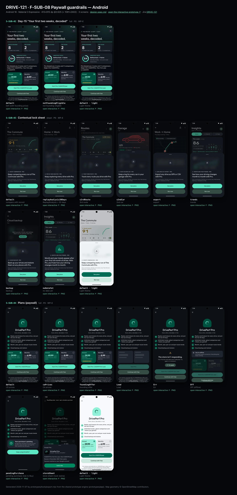
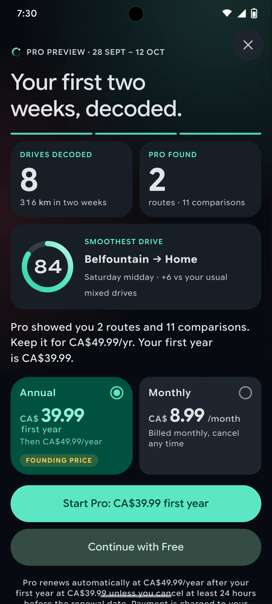
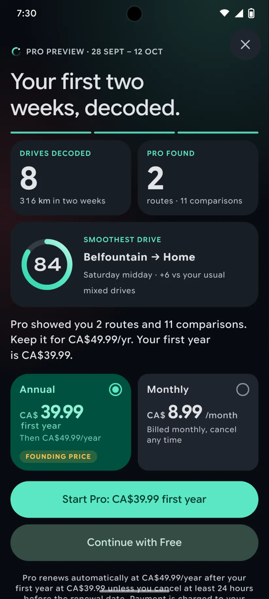
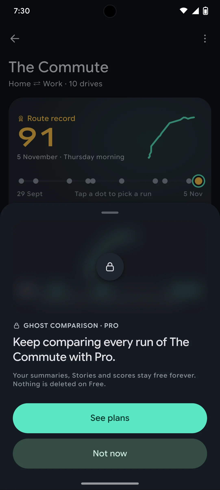
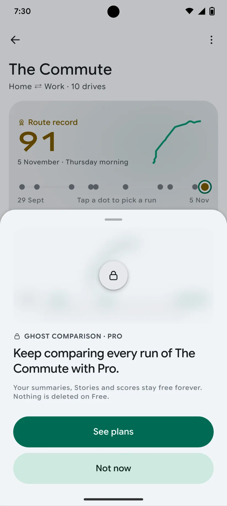
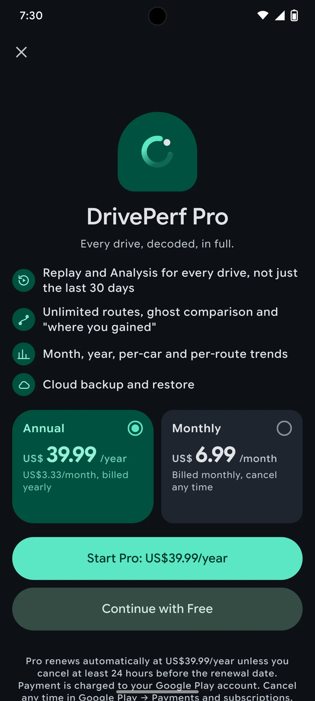
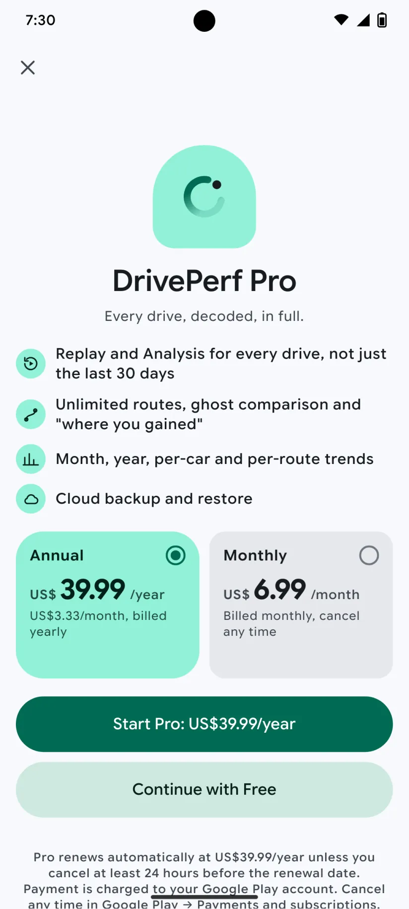

# DRIVE-121 · F-SUB-08 Paywall guardrails — Android design spec

> Generated by `prototypes/tools/export.mjs` on 2026-11-07 from the shared prototype engine. **Do not edit by hand:** change the screen's `spec` in `prototypes/app/screens/wp-*.js` (see `prototypes/app/AUTHORING.md`) and re-export.

- **Jira story:** [DRIVE-121](https://thekeval.atlassian.net/browse/DRIVE-121) · F-SUB-08 · P0
- **Platform:** Android 16 · Material 3 Expressive · 412×915 dp @2.625 (≈ 1081×2402)
- **Interactive prototype:** [../../../../prototypes/android/index.html#S-SUB-02](../../../../prototypes/android/index.html#S-SUB-02) (catalog panel: every screen and state; deep links `#S-ID/state?trip=…&ent=…&theme=light&text=xl&rm=1`)
- **Contact sheet:** [mockup.html](mockup.html) · 
- **Design system (source of truth for values):** [brand](../../system/brand.md) · [components](../../system/components.md) · [motion](../../system/motion.md) · [accessibility](../../system/accessibility.md) · [screen map](../../system/screen-map.md) · [fixtures](../../system/fixtures.md) · tokens `prototypes/shared/tokens.css`

## Screens in this story

| Screen | Name | Presentation | Priority | States | Status |
|---|---|---|---|---|---|
| `S-SUB-02` | Day-15 “Your first two weeks, decoded” | Full (cover) | P0 | 2 | Prototyped |
| `S-SUB-03` | Contextual lock sheet | Sheet (medium) | P0 | 8 | Prototyped |
| `S-SUB-04` | Plans (paywall) | Sheet (large) / Full | P0 | 8 | Prototyped |

## Tokens used on this platform

Values resolved from `prototypes/shared/tokens.css` inside the Android device (`[data-platform="android"]`). Use the token names in code; the hex values are for reference.

| Token | Dark | Light |
|---|---|---|
| `--app-bg` | `#0D1117` | `#F7F9FC` |
| `--card-bg` | `#191E25` | `#EBEEF2` |
| `--dp-bg-grouped` | `#0D1117` | `#F7F9FC` |
| `--dp-surface` | `#191E25` | `#EBEEF2` |
| `--dp-surface-2` | `#1F252D` | `#E5E8EC` |
| `--dp-surface-3` | `#2A3038` | `#DFE2E6` |
| `--dp-fill` | `#2A3038` | `#DFE2E6` |
| `--dp-fill-strong` | `#353B44` | `#D3D7DC` |
| `--dp-text` | `#E1E3E8` | `#181C20` |
| `--dp-text-2` | `#C0C7CF` | `#40474F` |
| `--dp-text-3` | `#8A929B` | `#707881` |
| `--dp-separator` | `#40474F` | `#C0C7CF` |
| `--dp-accent` | `#5BE7C4` | `#006B53` |
| `--dp-accent-text` | `#5BE7C4` | `#006B53` |
| `--dp-on-accent` | `#00382B` | `#FFFFFF` |
| `--dp-accent-container` | `#00513F` | `#91F1D8` |
| `--dp-record` | `#FFC24B` | `#7A5900` |
| `--dp-positive` | `#5BE7C4` | `#006B53` |
| `--dp-change-down` | `#C0C7CF` | `#40474F` |
| `--dp-warning` | `#F5B648` | `#7A5900` |
| `--dp-critical` | `#FFB4AB` | `#BA1A1A` |
| `--dp-glass-fill` | `#1F252DF2` | `#E5E8ECF2` |
| `--dp-glass-fill-strong` | `#2A3038` | `#DFE2E6` |
| `--dp-glass-stroke` | `#FFFFFF0F` | `#0000000A` |
| `--md-sys-color-primary` | `#5BE7C4` | `#006B53` |
| `--md-sys-color-on-primary` | `#00382B` | `#FFFFFF` |
| `--md-sys-color-primary-container` | `#00513F` | `#91F1D8` |
| `--md-sys-color-on-primary-container` | `#91F1D8` | `#002118` |
| `--md-sys-color-secondary-container` | `#344C44` | `#CEE9DF` |
| `--md-sys-color-surface` | `#0D1117` | `#F7F9FC` |
| `--md-sys-color-surface-container` | `#191E25` | `#EBEEF2` |
| `--md-sys-color-surface-container-high` | `#1F252D` | `#E5E8EC` |
| `--md-sys-color-on-surface-variant` | `#C0C7CF` | `#40474F` |
| `--dp-data-route` | `#5BE7C4` | `#079777` |
| `--dp-data-event-brake` | `#FF7A66` | `#A21F16` |
| `--dp-data-event-accel` | `#E58BD0` | `#A33A8C` |
| `--dp-data-event-corner` | `#EAD54E` | `#9A8A00` |
| `--dp-data-quality-good` | `#5FDB9C` | `#1E9E62` |
| `--dp-data-speed` | `#D6DCE4` | `#404A58` |
| `--dp-data-long-g` | `#5AB8F5` | `#0A6AB8` |
| `--dp-data-lat-g` | `#F5A142` | `#B25A00` |

| Type / layout token | Value |
|---|---|
| `--dp-font-screen-title` | `600 32px / 40px "Google Sans Flex", "Google Sans Display", "Roboto Flex", Roboto, system-ui, sans-serif` |
| `--dp-font-sheet-title` | `400 24px / 32px "Google Sans Flex", "Google Sans Display", "Roboto Flex", Roboto, system-ui, sans-serif` |
| `--dp-font-section-title` | `600 22px / 28px "Google Sans Flex", "Google Sans Display", "Roboto Flex", Roboto, system-ui, sans-serif` |
| `--dp-font-card-title` | `700 16px / 24px "Google Sans Flex", "Google Sans Text", "Roboto Flex", Roboto, system-ui, sans-serif` |
| `--dp-font-body` | `400 16px / 24px "Google Sans Flex", "Google Sans Text", "Roboto Flex", Roboto, system-ui, sans-serif` |
| `--dp-font-body-secondary` | `400 14px / 20px "Google Sans Flex", "Google Sans Text", "Roboto Flex", Roboto, system-ui, sans-serif` |
| `--dp-font-meta` | `400 12px / 16px "Google Sans Flex", "Google Sans Text", "Roboto Flex", Roboto, system-ui, sans-serif` |
| `--dp-font-caption` | `500 12px / 16px "Google Sans Flex", "Google Sans Text", "Roboto Flex", Roboto, system-ui, sans-serif` |
| `--dp-font-button` | `700 14px / 20px "Google Sans Flex", "Google Sans Text", "Roboto Flex", Roboto, system-ui, sans-serif` |
| `--dp-num-hero` | `600 72px / 72px "Google Sans Flex", "Roboto Flex", Roboto, system-ui, sans-serif` |
| `--dp-num-xl` | `600 48px / 52px "Google Sans Flex", "Roboto Flex", Roboto, system-ui, sans-serif` |
| `--dp-num-l` | `600 34px / 38px "Google Sans Flex", "Roboto Flex", Roboto, system-ui, sans-serif` |
| `--dp-num-m` | `600 24px / 28px "Google Sans Flex", "Roboto Flex", Roboto, system-ui, sans-serif` |
| `--dp-num-s` | `600 17px / 22px "Google Sans Flex", "Roboto Flex", Roboto, system-ui, sans-serif` |
| `--dp-num-xs` | `600 13px / 16px "Google Sans Flex", "Roboto Flex", Roboto, system-ui, sans-serif` |
| `--dp-screen-margin` | `16px` |
| `--dp-radius-card` | `16px` |
| `--dp-radius-card-hero` | `28px` |
| `--dp-radius-sheet` | `28px` |
| `--dp-radius-chip` | `8px` |
| `--dp-radius-button` | `999px` |
| `--dp-layout-list-row-min` | `56px` |
| `--dp-layout-touch-min` | `48px` |
| `--safe-top` | `40px` |
| `--safe-bottom` | `24px` |

Text sizes scale with `--dp-text-scale` (XL = 2.0×) and numerals with `--dp-num-scale` (XL = 1.3×). DP Numerals: Google Sans Flex wdth 120 wght 600, tabular.

---

## S-SUB-02 · Day-15 “Your first two weeks, decoded”

 

- **Presentation:** full · tab: profile — screen map: “Full (cover)”
- **Entry points:** First foreground open after day 14, ≥ 3 trips, not in a trip (F-SUB-03)
- **Leads to:** S-SUB-04 purchase · "Continue with Free" → S-SUB-07 / S-HOME-01
- **PRD features:** F-SUB-03, F-SUB-05, F-SUB-08 · **Priority:** P0 · **WP:** E
- **Interactive:** [S-SUB-02](../../../../prototypes/android/index.html#S-SUB-02)

**Purpose.** The day-15 moment (F-SUB-03/05/08): a short recap of what Pro showed the user in their own first two weeks, then a fair choice between Pro and Free with equal weight. Shown once, on the first parked foreground open after day 14 with ≥ 3 driver trips; never during a trip, never after a worse-than-usual Story.

### States

| State | PRD label | Fixture params | Screenshot |
|---|---|---|---|
| `default` | Def (with founding price) | `ent=free` | [S-SUB-02.png](../../screens/android/S-SUB-02.webp) · [open](../../../../prototypes/android/index.html#S-SUB-02) |
| `notFoundingEligible` | not founding-eligible | `ent=free` | [S-SUB-02--notFoundingEligible.png](../../screens/android/S-SUB-02--notFoundingEligible.webp) · [open](../../../../prototypes/android/index.html#S-SUB-02/notFoundingEligible) |
| default · light | Light theme | `theme=light` | [S-SUB-02--light.png](../../screens/android/S-SUB-02--light.webp) |

Every state also renders in light/dark (`theme=light`), XL text (`text=xl`) and reduced motion (`rm=1`).

### Layout

- Full-screen cover, always the dark night art (status bar light). Floating close (glass 44 / tonal 48) top-trailing, visible immediately (= Continue with Free).
- Kicker: Loop + “Pro Preview · 28 Sep – 12 Oct”. Headline “Your first two weeks, decoded.” (34/40 display bold).
- Recap frames (Story-player mini frames with 3 segment bars): “Drives decoded 8 · 316 km in two weeks” and “Pro found 2 routes · 11 comparisons” side by side (radius 22, surface over night), then “Smoothest drive” full width with an 84 ring (84), “Belfountain → Home”, “Saturday midday · +6 vs your usual mixed drives”.
- Closing line (body, text): previewRecap.closingLine[CA|US]; not founding-eligible drops the founding sentence.
- Plan cards side by side, identical size and type (Annual pre-selected with a 2 px Glide ring / Android primaryContainer + shape morph): Annual “CA$39.99 first year · Then CA$49.99/year · FOUNDING PRICE” (non-founding: “CA$49.99 /year · CA$4.17/month, billed yearly”) · Monthly “CA$8.99 /month · Billed monthly, cancel any time”.
- Equal-weight pair, stacked, same height (52/56) and type: “Start Pro: CA$39.99 first year” (filled) and “Continue with Free” (glass on iOS / secondaryContainer on Android; not greyed, same weight).
- Legal: auto-renewal terms, where payment is charged, how to cancel; Terms · Privacy · Restore purchases; “Compare plans in detail” → S-SUB-04.

### Components & tokens

| Component | Tokens / spec |
|---|---|
| `page` | --dp-bg-grouped (iOS) / --md-sys-color-surface (Android) · --dp-screen-margin 16 |
| `ring` | track --dp-fill-strong · arc --dp-gradient-ring (glide-400 → accent → glide-100) · baseline notch --dp-text-2 · record notch --dp-record · Android container Cookie9Sided --md-sys-color-primary-container 42% · components.md §3 |
| `button` | --dp-accent / --dp-on-accent (filled) · --dp-fill-strong · --md-sys-color-secondary-container (tonal) · --dp-radius-button · height iOS 50/44/34 · Android 56/40/32 · --dp-font-button · components.md §0 |
| `iconButton` | see components.md |

### Interactions & navigation

- Plan card → selects (selection ring slides, haptic selection); the primary label follows the plan (“Start Pro: CA$8.99/month”).
- Start Pro → StoreKit / Play Billing sheet (mocked; tap = purchase) → S-SUB-05 (haptic success). Purchase failure → toast + error haptic, the cover stays.
- Continue with Free / close → S-SUB-07 (and S-SUB-02 is never shown again automatically, F-SUB-03.4). Restore purchases → store restore.
- Gate: the D1 gate holds S-SUB-02 while a trip is active or the car is moving (S-DRV-05); it then waits for the next parked open (F-SUB-08.2).

### Motion

- Present: slide up with spring.sheet (paywallPresent ≈ 520 ms).
- Recap: three mini frames rise 12 px one after another (420 ms each; segment bars fill linearly); the smoothest-drive ring sweeps (no haptics on a paywall).
- Then the plans rise (stagger 70 ms, spring.default) with Annual’s selection ring already drawn; the Start Pro and Continue with Free buttons enter together with identical motion. Never a pulse, shimmer, countdown or delayed close.
- RM: everything is shown at once with a 220 ms cross-fade; the ring is static.

### Accessibility

- The frames are read in order: “Drives decoded, 8. 316 kilometres in two weeks.” · “Pro found 2 routes, 11 comparisons.” · “Smoothest drive, Smoothness 84, Belfountain to Home, Saturday midday, 6 above your usual mixed drives.”
- Plan cards are a radio group (“Annual, CA$39.99 first year. Then CA$49.99/year. Founding price, selected”). Close is labelled “Close. Continue with Free”.
- XL: plan cards stack (Annual first), legal text stays fully visible and scrolls, never shrinks.

### Platform notes

- **Android (this spec):** Full-screen dialog; plan cards surfaceContainerHigh, the selected one primaryContainer morphing to extraLargeIncreased; Continue with Free is a FilledTonalButton at the same size; Play Billing sheet.
- *iOS (for reference):* fullScreenCover; glass plan cards with a Glide ring; Continue with Free uses .glass at the same size as .glassProminent; StoreKit purchase sheet.

### Analytics

- `day15_paywall_viewed`
- `plan_selected {plan}`
- `day15_paywall_choice {purchase|free}`
- `purchase_started`
- `purchase_completed {plan, offer}`

### Copy

| Key | Text |
|---|---|
| Title | Your first two weeks, decoded. |
| Closing (CA, founding) | Pro showed you 2 routes and 11 comparisons. Keep it for CA$49.99/yr. Your first year is CA$39.99. |
| Closing (US, founding) | Pro showed you 2 routes and 11 comparisons. Keep it for US$39.99/yr. Your first year is US$29.99. |
| Closing (not eligible) | Pro showed you 2 routes and 11 comparisons. Keep it for CA$49.99/yr. |
| Buttons | Start Pro: CA$39.99 first year · Continue with Free |
| Legal | Pro renews automatically at CA$49.99/year after your first year at CA$39.99 unless you cancel at least 24 hours before the renewal date. Payment is charged to your Apple Account. Cancel any time in Settings → your name → Subscriptions. |

### Free / Pro

Shown to Preview users at the end of day 14 (≥ 3 trips). Founding price only when eligible (F-SUB-05); otherwise the standard annual. < 3 trips → S-SUB-07 low-usage variant instead.

### Data & fixtures

previewRecap: 8 drives, 316.2 km, smoothest t20261010-1340 (84, +6), 2 routes, 11 comparisons, period 28 Sep–12 Oct, closing lines CA/US. Prices from entitlement.prices (CA storefront for Marcus; region=US shows US$). Renewal date in the store mock = today + 1 year.

### Assets

[icon-close.svg](assets/icon-close.svg) · [icon-refresh.svg](assets/icon-refresh.svg) · [logo-a-loop.svg](assets/logo-a-loop.svg)

UI glyphs may be swapped for SF Symbols / Material Symbols Rounded equivalents; event-pin, quality and provenance glyphs must not be (components.md global rules).

### Checklist (accessibility.md §9)

- [ ] Light and dark both render, and contrast passes.
- [ ] The XL text state reflows with no truncation.
- [ ] The RM state is defined.
- [ ] Every control has a label; every chart and map has a summary sentence.
- [ ] Every target ≥ 44 pt / 48 dp (≥ 64 in-drive).
- [ ] No meaning by colour alone.
- [ ] Speed is neutral wherever it appears and absent from social or live surfaces.
- [ ] No streak, leaderboard, speed or “beat your time” language.
- [ ] Behaviour is defined while a trip is active (D1 gate).
- [ ] Haptics come from motion.md §6 only.

---

## S-SUB-03 · Contextual lock sheet

 

- **Presentation:** sheet · tab: profile · detent: auto — screen map: “Sheet (medium)”
- **Entry points:** Any Pro gate (compare, > 30-day Replay/Analysis, 3rd route, 2nd car, export, trends, backup)
- **Leads to:** S-SUB-04 · "Not now" → exactly where the user was
- **PRD features:** F-SUB-04, F-HIS-03, F-RTE-04, F-RTE-05, F-ACC-03, F-RPL-01, F-SUB-08 · **Priority:** P0 · **WP:** E
- **Interactive:** [S-SUB-03](../../../../prototypes/android/index.html#S-SUB-03)

**Purpose.** When a Free user taps a Pro feature, show what Pro would show on their own data — blurred, never a stock screenshot — with one sentence of value, “See plans” and “Not now” (F-SUB-04, F-HIS-03 “locked, not lost”). Not now returns exactly where they were.

### States

| State | PRD label | Fixture params | Screenshot |
|---|---|---|---|
| `default` | compare with record | `ent=free` | [S-SUB-03.png](../../screens/android/S-SUB-03.webp) · [open](../../../../prototypes/android/index.html#S-SUB-03) |
| `replayAnalysis30Days` | Replay/Analysis > 30 days | `ent=free` | [S-SUB-03--replayAnalysis30Days.png](../../screens/android/S-SUB-03--replayAnalysis30Days.webp) · [open](../../../../prototypes/android/index.html#S-SUB-03/replayAnalysis30Days) |
| `s3rdRoute` | 3rd route | `ent=free` | [S-SUB-03--s3rdRoute.png](../../screens/android/S-SUB-03--s3rdRoute.webp) · [open](../../../../prototypes/android/index.html#S-SUB-03/s3rdRoute) |
| `s2ndCar` | 2nd car | `ent=free` | [S-SUB-03--s2ndCar.png](../../screens/android/S-SUB-03--s2ndCar.webp) · [open](../../../../prototypes/android/index.html#S-SUB-03/s2ndCar) |
| `export` | export | `ent=free` | [S-SUB-03--export.png](../../screens/android/S-SUB-03--export.webp) · [open](../../../../prototypes/android/index.html#S-SUB-03/export) |
| `trends` | trends | `ent=free` | [S-SUB-03--trends.png](../../screens/android/S-SUB-03--trends.webp) · [open](../../../../prototypes/android/index.html#S-SUB-03/trends) |
| `backup` | backup | `ent=free` | [S-SUB-03--backup.png](../../screens/android/S-SUB-03--backup.webp) · [open](../../../../prototypes/android/index.html#S-SUB-03/backup) |
| `noDataYet` | no data yet | `ent=free` | [S-SUB-03--noDataYet.png](../../screens/android/S-SUB-03--noDataYet.webp) · [open](../../../../prototypes/android/index.html#S-SUB-03/noDataYet) |
| default · light | Light theme | `theme=light` | [S-SUB-03--light.png](../../screens/android/S-SUB-03--light.webp) |

Every state also renders in light/dark (`theme=light`), XL text (`text=xl`) and reduced motion (`rm=1`).

### Layout

- Sheet fitted to content (spec: medium). Top: the user’s own content for that feature, blurred 14 px + 35% dim, radius 20, with a 52 lock disc centred (iOS glass, Android tonal).
- Variants (own data): compare = The Commute ghost vs record + 12 gained/lost segments · Replay/Analysis > 30 days = that trip’s map + synced timeline · 3rd route = Gym card (glyph, 2 drives, record 84, run dots) · 2nd car = Ioniq silhouette + drives/average/km tiles · export = that drive’s CSV rows · trends = October trend sparkline + Month/Year/Per car/Per route tabs · backup = backup status · no data yet = illustration instead of a blur.
- Kicker “🔒 Ghost comparison · Pro”, then the value sentence (sheetTitle-size, 20/26 semibold): entitlement.lockSheets.*, footnote “Your summaries, Stories and scores stay free forever. Nothing is deleted on Free.”
- Stacked large buttons: “See plans” (filled) · “Not now” (tonal).

### Components & tokens

| Component | Tokens / spec |
|---|---|
| `sheet` | iOS glass --dp-glass-fill-strong + --dp-glass-prominent-blur, radius --dp-radius-sheet 38 · Android ModalBottomSheet --md-sys-color-surface-container-low, top radius 28, drag handle 32×4 · motion spring.sheet |
| `lockPanel` | blur --dp-opacity-locked-blur 14px · dim --dp-opacity-locked-dim 35% · components.md §15.2 |
| `map` | --dp-data-map-land/road/grid · route --dp-data-route 3.8 + casing --dp-data-route-casing 7.5 · estimated dashed 4/4 at 60% · gap --dp-data-gap-stroke dotted 1/6 · pins DP_ICONS.pin 26 · attribution “© OpenStreetMap contributors” |
| `timeline` | --dp-data-speed · --dp-data-long-g · --dp-data-lat-g (dashed 6/3) · cursor --dp-data-cursor · components.md §7 |
| `glyph` | see components.md |
| `stats` | --dp-surface-2 / --md-sys-color-surface-container-high · radius 14 iOS / 12 Android · value --dp-num-m (DP Numerals) · components.md §5 |
| `sparkline` | see components.md |
| `scoreBadge` | iOS mini ring 46 · Android Cookie9Sided 46 · --dp-num-s |
| `button` | --dp-accent / --dp-on-accent (filled) · --dp-fill-strong · --md-sys-color-secondary-container (tonal) · --dp-radius-button · height iOS 50/44/34 · Android 56/40/32 · --dp-font-button · components.md §0 |

### Interactions & navigation

- See plans → S-SUB-04 (from = feature). Not now / drag / scrim → back to exactly where the user was (scroll position kept).
- Gate: never during a trip or on a worse-than-usual Story’s end card (F-SUB-08.3); the D1 gate holds it while moving.

### Motion

- The user’s content blurs from 0 → 14 px over 320 ms (spring.effects) while the sheet rises at the medium detent; the lock disc pops at 360 ms. RM: shown already blurred, fade.

### Accessibility

- The blurred preview is hidden from screen readers; the sheet reads “Ghost comparison, Pro. Keep comparing every run of The Commute with Pro.” then the buttons. XL: opens large; the preview keeps its height.

### Platform notes

- **Android (this spec):** ModalBottomSheet; lock disc on surfaceContainerHigh; RenderEffect blur (API 31+) or a pre-blurred bitmap.
- *iOS (for reference):* Glass sheet at a partial detent; lock disc in glass.

### Analytics

- `lock_viewed {feature}`
- `lock_cta {see_plans|not_now}`

### Copy

| Key | Text |
|---|---|
| compare | Keep comparing every run of The Commute with Pro. |
| oldAnalysis | Keep exploring every drive with Pro. |
| thirdRoute | Track every route you drive with Pro. |
| secondCar | Keep a log for every car in your garage with Pro. |
| export | Export any drive as GPX or CSV with Pro. |
| trends | See how your driving changes month to month with Pro. |
| backup | Back up your drives and restore them on any phone with Pro. |
| noDataYet | Month and year trends appear after your first full month of drives. With Pro, you’ll see how your driving changes month to month. |
| Footnote | Your summaries, Stories and scores stay free forever. Nothing is deleted on Free. |

### Free / Pro

Free users only (ent = free). Preview/Ride-along/Pro never see it.

### Data & fixtures

compare: route r_commute + ghost (91 vs 89) · replay: t20261002-0745 · 3rd route: r_gym · 2nd car: Ioniq (derived: its scored trips, average and km) · export: t20261105-1745 · trends: wrapped.monthly trend weeks [81, 85, 85, 87] · backup: privacy.dataSize. Parent screens rendered underneath on a deep link follow the variant (S-RTE-02, S-TRP-01 Lock, S-RTE-01, S-GAR-01, S-STA-01, S-ACC-04 Lock).

### Assets

[icon-lock.svg](assets/icon-lock.svg) · [icon-insights.svg](assets/icon-insights.svg) · [icon-cloud.svg](assets/icon-cloud.svg)

UI glyphs may be swapped for SF Symbols / Material Symbols Rounded equivalents; event-pin, quality and provenance glyphs must not be (components.md global rules).

### Checklist (accessibility.md §9)

- [ ] Light and dark both render, and contrast passes.
- [ ] The XL text state reflows with no truncation.
- [ ] The RM state is defined.
- [ ] Every control has a label; every chart and map has a summary sentence.
- [ ] Every target ≥ 44 pt / 48 dp (≥ 64 in-drive).
- [ ] No meaning by colour alone.
- [ ] Speed is neutral wherever it appears and absent from social or live surfaces.
- [ ] No streak, leaderboard, speed or “beat your time” language.
- [ ] Behaviour is defined while a trip is active (D1 gate).
- [ ] Haptics come from motion.md §6 only.

---

## S-SUB-04 · Plans (paywall)

 

- **Presentation:** full (iOS sheet, Android full) · tab: profile — screen map: “Sheet (large) / Full”
- **Entry points:** S-SUB-01 · S-SUB-02 · S-SUB-03 · S-SUB-06
- **Leads to:** Store sheet mock → S-SUB-05 · Err/Off states
- **PRD features:** F-SUB-01, F-SUB-05, F-SUB-08, F-SUB-03 · **Priority:** P0 · **WP:** E
- **Interactive:** [S-SUB-04](../../../../prototypes/android/index.html#S-SUB-04)

**Purpose.** Clear monthly and annual plans at fair local prices with every required disclosure (F-SUB-01, F-SUB-05; Apple 3.1.2, Play subscriptions policy): Annual pre-selected, Monthly equal in size, “Continue with Free” equal in weight to the purchase button, close visible immediately, no weekly or lifetime plan, no countdown, no strikethrough.

### States

| State | PRD label | Fixture params | Screenshot |
|---|---|---|---|
| `default` | US prices | `region=US` | [S-SUB-04.png](../../screens/android/S-SUB-04.webp) · [open](../../../../prototypes/android/index.html#S-SUB-04) |
| `caPrices` | CA prices | `region=CA` | [S-SUB-04--caPrices.png](../../screens/android/S-SUB-04--caPrices.webp) · [open](../../../../prototypes/android/index.html#S-SUB-04/caPrices) |
| `foundingOffer` | founding offer | `region=CA` `founding=1` | [S-SUB-04--foundingOffer.png](../../screens/android/S-SUB-04--foundingOffer.webp) · [open](../../../../prototypes/android/index.html#S-SUB-04/foundingOffer) |
| `Load` | Load | `region=CA` `founding=1` | [S-SUB-04--Load.png](../../screens/android/S-SUB-04--Load.webp) · [open](../../../../prototypes/android/index.html#S-SUB-04/Load) |
| `Err` | Err | `region=CA` `founding=1` | [S-SUB-04--Err.png](../../screens/android/S-SUB-04--Err.webp) · [open](../../../../prototypes/android/index.html#S-SUB-04/Err) |
| `Off` | Off (offline) | `region=CA` `founding=1` | [S-SUB-04--Off.png](../../screens/android/S-SUB-04--Off.webp) · [open](../../../../prototypes/android/index.html#S-SUB-04/Off) |
| `pendingPurchase` | pending purchase (Ask to Buy) | `region=CA` `founding=1` | [S-SUB-04--pendingPurchase.png](../../screens/android/S-SUB-04--pendingPurchase.webp) · [open](../../../../prototypes/android/index.html#S-SUB-04/pendingPurchase) |
| `storeSheet` | store sheet mock (extra) | `region=CA` `founding=1` | [S-SUB-04--storeSheet.png](../../screens/android/S-SUB-04--storeSheet.webp) · [open](../../../../prototypes/android/index.html#S-SUB-04/storeSheet) |
| default · light | Light theme | `theme=light` | [S-SUB-04--light.png](../../screens/android/S-SUB-04--light.webp) |

Every state also renders in light/dark (`theme=light`), XL text (`text=xl`) and reduced motion (`rm=1`).

### Layout

- iOS: sheet at the large detent, glass close top-trailing. Android: full-screen dialog with close leading.
- Header: Loop in a 104 illustration tile, “DrivePerf Pro” (28/34), “Every drive, decoded, in full.”
- Value list: 4 Pro features with glyphs (replay, routes, insights, cloud) from entitlement.proFeatures.
- Plan cards side by side, identical (radius 20 iOS / 16 → selected 28 Android, min height 148): label + radio, price in DP Numerals with the currency at 50% (“US$ 39.99 /year”), sub line, optional gold “FOUNDING PRICE” capsule. US: Annual US$39.99/year · US$3.33/month, billed yearly · Monthly US$6.99/month. CA: CA$49.99 · CA$4.17 · CA$8.99. Founding: Annual “CA$39.99 first year · Then CA$49.99/year”.
- Equal-weight pair: “Start Pro: US$39.99/year” (filled) + “Continue with Free” (glass / secondaryContainer), same size and type, stacked.
- Legal (caption, text-2, never truncated): auto-renewal at the plan price, 24-hour rule, where it is charged and how to cancel; Terms · Privacy · Restore purchases.
- Load: plan-card skeletons, Start Pro disabled. Err: error state “The store isn’t responding. Your Preview and data aren’t affected.” + Try again. Off: info banner “You’re offline. Purchases need a connection.” + cards and Start Pro disabled (Continue with Free stays). pending: “Waiting for approval” card (Ask to Buy) / “Your purchase is pending” (Play) + “Keep using DrivePerf”. Store sheet: StoreKit / Play Billing mock over the paywall.

### Components & tokens

| Component | Tokens / spec |
|---|---|
| `sheet` | iOS glass --dp-glass-fill-strong + --dp-glass-prominent-blur, radius --dp-radius-sheet 38 · Android ModalBottomSheet --md-sys-color-surface-container-low, top radius 28, drag handle 32×4 · motion spring.sheet |
| `iconButton` | see components.md |
| `button` | --dp-accent / --dp-on-accent (filled) · --dp-fill-strong · --md-sys-color-secondary-container (tonal) · --dp-radius-button · height iOS 50/44/34 · Android 56/40/32 · --dp-font-button · components.md §0 |
| `banner` | radius 12 (--dp-radius-sm+) · info --dp-fill · attention --dp-warning-container · critical --dp-critical-container · components.md §22 |
| `error` | see components.md |
| `skeleton` | --dp-fill-strong, breathe 1.2 s (dp-skeleton) |
| `card` | --dp-surface / --md-sys-color-surface-container · --dp-radius-card (24 iOS · 16 Android) · hero: --dp-radius-card-hero (32 · 28) · light iOS: --dp-elev-1 |

### Interactions & navigation

- Plan card → select (ring slides between cards, spring.fast, haptic selection); the primary label and legal text follow the plan.
- Start Pro → StoreKit purchase sheet / Play Billing flow (mocked: tap = purchase) → entitlement active within 5 s → S-SUB-05. Failure → toast + error haptic. Ask to Buy / pending → pending state.
- Continue with Free / close / drag down → back to where the user was. Restore purchases → store restore (toast with the result).
- Gate: S-SUB-04 is never reachable during a trip or while moving (D1 → S-DRV-05) and never auto-opens.

### Motion

- Present: spring.sheet (iOS) / slide-up full-screen dialog + scrim fade (Android), ≈ 520 ms. Illustration pops; value rows and plan cards rise 8 px, 50 ms stagger; the button pair rises as one block. No pulsing or shimmering CTA. RM: fade.

### Accessibility

- Plan cards are a radio group: “Annual, US$39.99 /year. US$3.33/month, billed yearly, selected”. Close is the first focusable element.
- XL: plan cards stack (Annual first), the legal block stays fully visible and scrolls.
- Prices are read as “39 dollars 99 US” by the system from the store’s localized string.

### Platform notes

- **Android (this spec):** Full-screen dialog; plan cards surfaceContainerHigh → selected primaryContainer with shape morph to extraLargeIncreased; filled + FilledTonal buttons at equal size; Play Billing (PENDING purchase state).
- *iOS (for reference):* Sheet .large; glass plan cards with a Glide selection ring; .glassProminent + .glass buttons at equal size; StoreKit 2 purchase + Ask to Buy (.pending).

### Analytics

- `paywall_viewed {source}`
- `plan_selected {plan}`
- `purchase_started`
- `purchase_completed {plan, offer}`
- `purchase_failed {reason}`
- `offer_shown {offer: founding}`

### Copy

| Key | Text |
|---|---|
| Header | DrivePerf Pro · Every drive, decoded, in full. |
| US plans | Annual US$39.99/year (US$3.33/month, billed yearly) · Monthly US$6.99/month (Billed monthly, cancel any time) |
| CA plans | Annual CA$49.99/year (CA$4.17/month, billed yearly) · Monthly CA$8.99/month |
| Founding | Annual CA$39.99 first year · Then CA$49.99/year · Founding price (US: US$29.99 then US$39.99/yr) |
| Err | The store isn’t responding. Your Preview and data aren’t affected. Try again in a moment. |
| Off | You’re offline. Purchases need a connection. Everything else keeps working. |
| Pending | Waiting for approval. We’ve asked your family organiser to approve DrivePerf Pro (Annual). You’ll get Pro as soon as they do, and we’ll let you know. |
| Legal | Pro renews automatically at {price} unless you cancel at least 24 hours before the renewal date. Payment is charged to your Apple Account / Google Play account. Cancel any time in Settings → your name → Subscriptions / Google Play → Payments and subscriptions. |

### Free / Pro

Shown to Free and Preview users. Prices come from the store at runtime (RevenueCat offerings); the prototype uses entitlement.prices. One subscription group “DrivePerf Pro”; no weekly, no lifetime product.

### Data & fixtures

entitlement.prices.US / CA (annualPerMonth derived by the fixture). Founding = user.founding; the default state shows standard US prices per the PRD state list. Renewal in the store mock = today + 1 year.

### Assets

[icon-replay.svg](assets/icon-replay.svg) · [icon-routes.svg](assets/icon-routes.svg) · [icon-insights.svg](assets/icon-insights.svg) · [icon-cloud.svg](assets/icon-cloud.svg) · [icon-close.svg](assets/icon-close.svg) · [icon-clock.svg](assets/icon-clock.svg) · [icon-gps.svg](assets/icon-gps.svg) · [icon-refresh.svg](assets/icon-refresh.svg) · [logo-a-loop.svg](assets/logo-a-loop.svg)

UI glyphs may be swapped for SF Symbols / Material Symbols Rounded equivalents; event-pin, quality and provenance glyphs must not be (components.md global rules).

### Checklist (accessibility.md §9)

- [ ] Light and dark both render, and contrast passes.
- [ ] The XL text state reflows with no truncation.
- [ ] The RM state is defined.
- [ ] Every control has a label; every chart and map has a summary sentence.
- [ ] Every target ≥ 44 pt / 48 dp (≥ 64 in-drive).
- [ ] No meaning by colour alone.
- [ ] Speed is neutral wherever it appears and absent from social or live surfaces.
- [ ] No streak, leaderboard, speed or “beat your time” language.
- [ ] Behaviour is defined while a trip is active (D1 gate).
- [ ] Haptics come from motion.md §6 only.

---

Map geometry in the prototype: © OpenStreetMap contributors (ODbL). Speed and G are simulated fixtures (fixtures.md).
