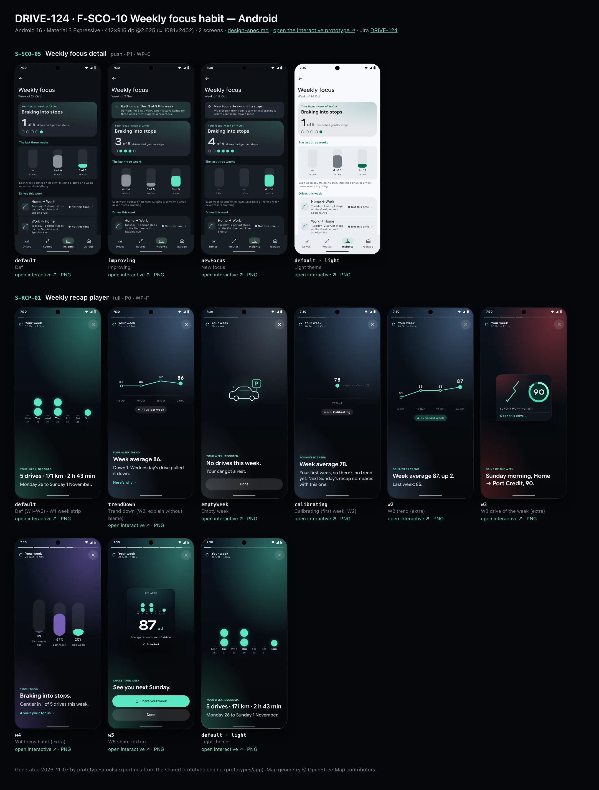
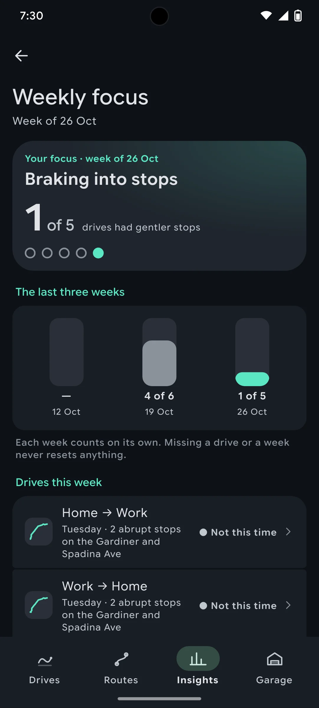
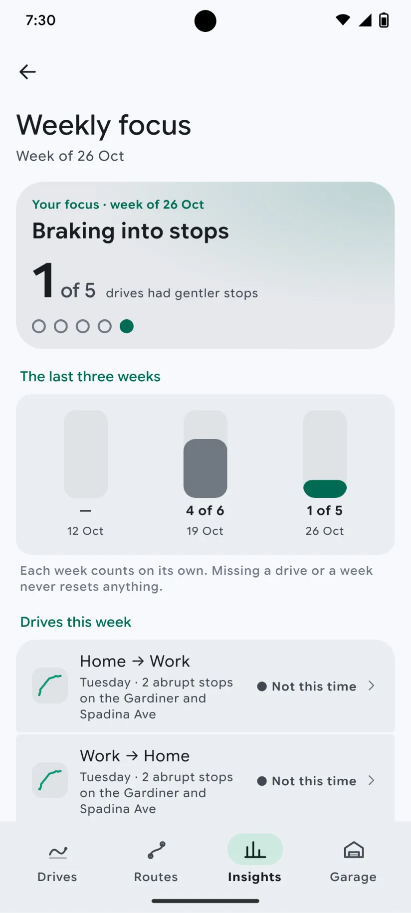
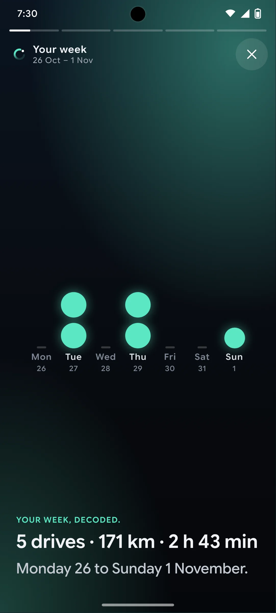
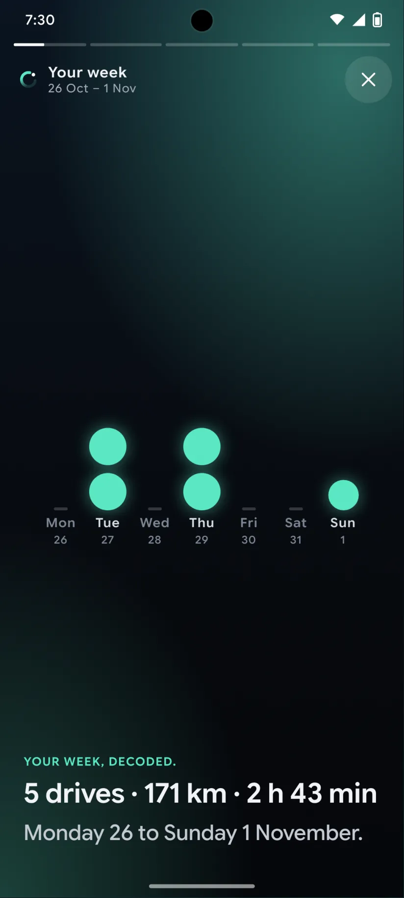

# DRIVE-124 · F-SCO-10 Weekly focus habit — Android design spec

> Generated by `prototypes/tools/export.mjs` on 2026-11-06 from the shared prototype engine. **Do not edit by hand:** change the screen's `spec` in `prototypes/app/screens/wp-*.js` (see `prototypes/app/AUTHORING.md`) and re-export.

- **Jira story:** [DRIVE-124](https://thekeval.atlassian.net/browse/DRIVE-124) · F-SCO-10 · P1
- **Platform:** Android 16 · Material 3 Expressive · 412×915 dp @2.625 (≈ 1081×2402)
- **Interactive prototype:** [../../../../prototypes/android/index.html#S-SCO-05](../../../../prototypes/android/index.html#S-SCO-05) (catalog panel: every screen and state; deep links `#S-ID/state?trip=…&ent=…&theme=light&text=xl&rm=1`)
- **Contact sheet:** [mockup.html](mockup.html) · 
- **Design system (source of truth for values):** [brand](../../system/brand.md) · [components](../../system/components.md) · [motion](../../system/motion.md) · [accessibility](../../system/accessibility.md) · [screen map](../../system/screen-map.md) · [fixtures](../../system/fixtures.md) · tokens `prototypes/shared/tokens.css`

## Screens in this story

| Screen | Name | Presentation | Priority | States | Status |
|---|---|---|---|---|---|
| `S-SCO-05` | Weekly focus detail | Push | P1 | 3 | Prototyped |
| `S-RCP-01` | Weekly recap player | Full (player) | P0 | 8 | Prototyped |

## Tokens used on this platform

Values resolved from `prototypes/shared/tokens.css` inside the Android device (`[data-platform="android"]`). Use the token names in code; the hex values are for reference.

| Token | Dark | Light |
|---|---|---|
| `--app-bg` | `#0D1117` | `#F7F9FC` |
| `--card-bg` | `#191E25` | `#EBEEF2` |
| `--dp-bg-grouped` | `#0D1117` | `#F7F9FC` |
| `--dp-surface` | `#191E25` | `#EBEEF2` |
| `--dp-surface-2` | `#1F252D` | `#E5E8EC` |
| `--dp-surface-3` | `#2A3038` | `#DFE2E6` |
| `--dp-fill` | `#2A3038` | `#DFE2E6` |
| `--dp-fill-strong` | `#353B44` | `#D3D7DC` |
| `--dp-text` | `#E1E3E8` | `#181C20` |
| `--dp-text-2` | `#C0C7CF` | `#40474F` |
| `--dp-text-3` | `#8A929B` | `#707881` |
| `--dp-separator` | `#40474F` | `#C0C7CF` |
| `--dp-accent` | `#5BE7C4` | `#006B53` |
| `--dp-accent-text` | `#5BE7C4` | `#006B53` |
| `--dp-on-accent` | `#00382B` | `#FFFFFF` |
| `--dp-accent-container` | `#00513F` | `#91F1D8` |
| `--dp-record` | `#FFC24B` | `#7A5900` |
| `--dp-positive` | `#5BE7C4` | `#006B53` |
| `--dp-change-down` | `#C0C7CF` | `#40474F` |
| `--dp-warning` | `#F5B648` | `#7A5900` |
| `--dp-critical` | `#FFB4AB` | `#BA1A1A` |
| `--dp-glass-fill` | `#1F252DF2` | `#E5E8ECF2` |
| `--dp-glass-fill-strong` | `#2A3038` | `#DFE2E6` |
| `--dp-glass-stroke` | `#FFFFFF0F` | `#0000000A` |
| `--md-sys-color-primary` | `#5BE7C4` | `#006B53` |
| `--md-sys-color-on-primary` | `#00382B` | `#FFFFFF` |
| `--md-sys-color-primary-container` | `#00513F` | `#91F1D8` |
| `--md-sys-color-on-primary-container` | `#91F1D8` | `#002118` |
| `--md-sys-color-secondary-container` | `#344C44` | `#CEE9DF` |
| `--md-sys-color-surface` | `#0D1117` | `#F7F9FC` |
| `--md-sys-color-surface-container` | `#191E25` | `#EBEEF2` |
| `--md-sys-color-surface-container-high` | `#1F252D` | `#E5E8EC` |
| `--md-sys-color-on-surface-variant` | `#C0C7CF` | `#40474F` |
| `--dp-data-route` | `#5BE7C4` | `#079777` |
| `--dp-data-event-brake` | `#FF7A66` | `#A21F16` |
| `--dp-data-event-accel` | `#E58BD0` | `#A33A8C` |
| `--dp-data-event-corner` | `#EAD54E` | `#9A8A00` |
| `--dp-data-quality-good` | `#5FDB9C` | `#1E9E62` |
| `--dp-data-speed` | `#D6DCE4` | `#404A58` |
| `--dp-data-long-g` | `#5AB8F5` | `#0A6AB8` |
| `--dp-data-lat-g` | `#F5A142` | `#B25A00` |

| Type / layout token | Value |
|---|---|
| `--dp-font-screen-title` | `600 32px / 40px "Google Sans Flex", "Google Sans Display", "Roboto Flex", Roboto, system-ui, sans-serif` |
| `--dp-font-sheet-title` | `400 24px / 32px "Google Sans Flex", "Google Sans Display", "Roboto Flex", Roboto, system-ui, sans-serif` |
| `--dp-font-section-title` | `600 22px / 28px "Google Sans Flex", "Google Sans Display", "Roboto Flex", Roboto, system-ui, sans-serif` |
| `--dp-font-card-title` | `700 16px / 24px "Google Sans Flex", "Google Sans Text", "Roboto Flex", Roboto, system-ui, sans-serif` |
| `--dp-font-body` | `400 16px / 24px "Google Sans Flex", "Google Sans Text", "Roboto Flex", Roboto, system-ui, sans-serif` |
| `--dp-font-body-secondary` | `400 14px / 20px "Google Sans Flex", "Google Sans Text", "Roboto Flex", Roboto, system-ui, sans-serif` |
| `--dp-font-meta` | `400 12px / 16px "Google Sans Flex", "Google Sans Text", "Roboto Flex", Roboto, system-ui, sans-serif` |
| `--dp-font-caption` | `500 12px / 16px "Google Sans Flex", "Google Sans Text", "Roboto Flex", Roboto, system-ui, sans-serif` |
| `--dp-font-button` | `700 14px / 20px "Google Sans Flex", "Google Sans Text", "Roboto Flex", Roboto, system-ui, sans-serif` |
| `--dp-num-hero` | `600 72px / 72px "Google Sans Flex", "Roboto Flex", Roboto, system-ui, sans-serif` |
| `--dp-num-xl` | `600 48px / 52px "Google Sans Flex", "Roboto Flex", Roboto, system-ui, sans-serif` |
| `--dp-num-l` | `600 34px / 38px "Google Sans Flex", "Roboto Flex", Roboto, system-ui, sans-serif` |
| `--dp-num-m` | `600 24px / 28px "Google Sans Flex", "Roboto Flex", Roboto, system-ui, sans-serif` |
| `--dp-num-s` | `600 17px / 22px "Google Sans Flex", "Roboto Flex", Roboto, system-ui, sans-serif` |
| `--dp-num-xs` | `600 13px / 16px "Google Sans Flex", "Roboto Flex", Roboto, system-ui, sans-serif` |
| `--dp-screen-margin` | `16px` |
| `--dp-radius-card` | `16px` |
| `--dp-radius-card-hero` | `28px` |
| `--dp-radius-sheet` | `28px` |
| `--dp-radius-chip` | `8px` |
| `--dp-radius-button` | `999px` |
| `--dp-layout-list-row-min` | `56px` |
| `--dp-layout-touch-min` | `48px` |
| `--safe-top` | `40px` |
| `--safe-bottom` | `24px` |

Text sizes scale with `--dp-text-scale` (XL = 2.0×) and numerals with `--dp-num-scale` (XL = 1.3×). DP Numerals: Google Sans Flex wdth 120 wght 600, tabular.

---

## S-SCO-05 · Weekly focus detail

 

- **Presentation:** push · tab: insights — screen map: “Push”
- **Entry points:** S-STA-01 focus card · S-RCP-01 W4
- **Leads to:** Back
- **PRD features:** F-SCO-10 · **Priority:** P1 · **WP:** C
- **Interactive:** [S-SCO-05](../../../../prototypes/android/index.html#S-SCO-05)

**Purpose.** One habit to focus on for a few weeks with a check on progress, so coaching has follow-through (F-SCO-10). It is never a streak (D7).

### States

| State | PRD label | Fixture params | Screenshot |
|---|---|---|---|
| `default` | Def | `recap=w2026-10-26` | [S-SCO-05.png](../../screens/android/S-SCO-05.webp) · [open](../../../../prototypes/android/index.html#S-SCO-05) |
| `improving` | Improving | `recap=w2026-11-02` | [S-SCO-05--improving.png](../../screens/android/S-SCO-05--improving.webp) · [open](../../../../prototypes/android/index.html#S-SCO-05/improving) |
| `newFocus` | New focus | `recap=w2026-10-19` | [S-SCO-05--newFocus.png](../../screens/android/S-SCO-05--newFocus.webp) · [open](../../../../prototypes/android/index.html#S-SCO-05/newFocus) |
| default · light | Light theme | `theme=light` | [S-SCO-05--light.png](../../screens/android/S-SCO-05--light.webp) |

Every state also renders in light/dark (`theme=light`), XL text (`text=xl`) and reduced motion (`rm=1`).

### Layout

- Push (Insights tab), title “Weekly focus” + “Week of 26 Oct”.
- State banner: improving (positive, “Getting gentler: 3 of 5 this week · Up from 1 of 5 last week…”) · newFocus (info, “New focus: braking into stops…”).
- Hero card (accent tint): kicker “Your focus · week of {date}” · habit (sectionTitle) · “3 of 5” (DP Numerals 48, “of 5” as unit) + “drives had gentler stops” · one dot per scored drive in drive order (filled Glide = gentler) — drives, not days, and no chain.
- “The last three weeks”: three bars (height = gentler/of, current week in Glide) with “4 of 6 · 19 Oct” labels; footer “Each week counts on its own. Missing a drive or a week never resets anything.”
- “Drives this week”: each scored drive (glyph, label, weekday · braking reason) with ▲ Gentler / ● Not this time → S-TRP-01.
- “How to practise”: three braking steps.
- “Choose a different focus” → inline radio card (Braking into stops · Smoother starts · Steadier cornering · Holding a steady speed).

### Components & tokens

| Component | Tokens / spec |
|---|---|
| `navBar` | --dp-font-card-title · --dp-font-meta · glass: --dp-glass-fill + --dp-glass-blur · components.md §2 |
| `banner` | radius 12 (--dp-radius-sm+) · info --dp-fill · attention --dp-warning-container · critical --dp-critical-container · components.md §22 |
| `card` | --dp-surface / --md-sys-color-surface-container · --dp-radius-card (24 iOS · 16 Android) · hero: --dp-radius-card-hero (32 · 28) · light iOS: --dp-elev-1 |
| `section` | --dp-font-section-title · --dp-layout-section-gap 28 |
| `list` | iOS inset grouped radius --dp-radius-card, rows 52 pt, separators --dp-separator inset 16 · Android ListItem 56/72 dp in --md-sys-color-surface-container |
| `row` | --dp-font-body · --dp-font-meta (supporting) · --dp-layout-list-row-min |
| `glyph` | see components.md |
| `radios` | see components.md |

### Interactions & navigation

- Drive row → S-TRP-01 · Choose a different focus → radios; picking another → toast “New focus from your next drive: …”.

### Motion

- Hero: bars grow from the baseline (spring.default, 70 ms stagger) and dots pop (spring.fast, 40 ms stagger). RM: static.

### Accessibility

- Hero label = recap.focus.line (“Your focus: braking into stops. Gentler in 3 of 5 drives this week.”). Bars have a text summary. ▲/● plus words, never colour alone.
- No streak, “don’t break it” or consecutive-day language anywhere (D7).

### Platform notes

- **Android (this spec):** MediumFlexibleTopAppBar; tonal hero card; radios as M3 RadioButtons.
- *iOS (for reference):* Inline title; hero card tinted 18% accent.

### Analytics

- `focus_viewed {habit}`
- `focus_changed {by: user}`

### Copy

| Key | Text |
|---|---|
| Kicker | Your focus · week of {date} |
| Count | {gentler} of {of} drives had gentler stops |
| Improving | Getting gentler: {x} of {y} this week. Up from {a} of {b} last week. When it stays gentle for three weeks, we’ll suggest a new focus. |
| New | New focus: braking into stops. We picked it from your recent drives: braking is where your score moved most. |
| Footer | Each week counts on its own. Missing a drive or a week never resets anything. |
| Change | Choose a different focus · One focus at a time |

### Free / Pro

Free.

### Data & fixtures

recaps[].focus (habit, line, gentler, of) for the chosen week and the two before it. States: default w2026-10-26 (1 of 5) · improving w2026-11-02 (3 of 5, up from 1) · newFocus w2026-10-19 (first focus week, 4 of 6). Per-drive “gentler” = that trip’s braking contributor is not “rougher” (derived; it reproduces the fixture counts exactly).

### Assets

[icon-up.svg](assets/icon-up.svg) · [icon-sparkle.svg](assets/icon-sparkle.svg) · [icon-edit.svg](assets/icon-edit.svg)

UI glyphs may be swapped for SF Symbols / Material Symbols Rounded equivalents; event-pin, quality and provenance glyphs must not be (components.md global rules).

### Checklist (accessibility.md §9)

- [ ] Light and dark both render, and contrast passes.
- [ ] The XL text state reflows with no truncation.
- [ ] The RM state is defined.
- [ ] Every control has a label; every chart and map has a summary sentence.
- [ ] Every target ≥ 44 pt / 48 dp (≥ 64 in-drive).
- [ ] No meaning by colour alone.
- [ ] Speed is neutral wherever it appears and absent from social or live surfaces.
- [ ] No streak, leaderboard, speed or “beat your time” language.
- [ ] Behaviour is defined while a trip is active (D1 gate).
- [ ] Haptics come from motion.md §6 only.

---

## S-RCP-01 · Weekly recap player

 

- **Presentation:** full · tab: insights — screen map: “Full (player)”
- **Entry points:** Weekly recap notification · S-STA-01 card
- **Leads to:** S-SHR-01 (W5) · S-TRP-01 (drive of week) · S-SCO-05
- **PRD features:** F-NTF-03, F-SCO-10, F-SHR-04, F-STY-06 · **Priority:** P0 · **WP:** F
- **Interactive:** [S-RCP-01](../../../../prototypes/android/index.html#S-RCP-01)

**Purpose.** A short weekly recap every Sunday at 18:00 (≈ 20 s): week strip, 4-week trend, drive of the week, one focus habit and a share card, generated on the device (F-NTF-03, F-SCO-10, F-SHR-04, A2 §3.3).

### States

| State | PRD label | Fixture params | Screenshot |
|---|---|---|---|
| `default` | Def (W1–W5) · W1 week strip | — | [S-RCP-01.png](../../screens/android/S-RCP-01.webp) · [open](../../../../prototypes/android/index.html#S-RCP-01) |
| `trendDown` | Trend down (W2, explain without blame) | — | [S-RCP-01--trendDown.png](../../screens/android/S-RCP-01--trendDown.webp) · [open](../../../../prototypes/android/index.html#S-RCP-01/trendDown) |
| `emptyWeek` | Empty week | — | [S-RCP-01--emptyWeek.png](../../screens/android/S-RCP-01--emptyWeek.webp) · [open](../../../../prototypes/android/index.html#S-RCP-01/emptyWeek) |
| `calibrating` | Calibrating (first week, W2) | — | [S-RCP-01--calibrating.png](../../screens/android/S-RCP-01--calibrating.webp) · [open](../../../../prototypes/android/index.html#S-RCP-01/calibrating) |
| `w2` | W2 trend (extra) | — | [S-RCP-01--w2.png](../../screens/android/S-RCP-01--w2.webp) · [open](../../../../prototypes/android/index.html#S-RCP-01/w2) |
| `w3` | W3 drive of the week (extra) | — | [S-RCP-01--w3.png](../../screens/android/S-RCP-01--w3.webp) · [open](../../../../prototypes/android/index.html#S-RCP-01/w3) |
| `w4` | W4 focus habit (extra) | — | [S-RCP-01--w4.png](../../screens/android/S-RCP-01--w4.webp) · [open](../../../../prototypes/android/index.html#S-RCP-01/w4) |
| `w5` | W5 share (extra) | — | [S-RCP-01--w5.png](../../screens/android/S-RCP-01--w5.webp) · [open](../../../../prototypes/android/index.html#S-RCP-01/w5) |
| default · light | Light theme | `theme=light` | [S-RCP-01--light.png](../../screens/android/S-RCP-01--light.webp) |

Every state also renders in light/dark (`theme=light`), XL text (`text=xl`) and reduced motion (`rm=1`).

### Layout

- Full-screen player, always night (gradient night sky + a 30–40% wash per frame: Glide W1/W5, Lucid W2, the car colour W3, Violet W4). Status bar light.
- Top: segment progress (3 px bars, 4 gap, one per frame; done = white 90%, current fills linearly) · header row: Loop + “Your week” + range (“26 Oct – 1 Nov”) · close (glass circle iOS / icon button Android).
- Stage: hero art centred in the upper 55%, copy block bottom-left (kicker caption caps · storyHeadline 28/34 · storyBody 20/25, max 3 + 2 lines; XL: copy grows upward, art shrinks to 40%).
- W1: 7 day columns (Mon–Sun + date), one Glide dot per drive sized by distance; empty days show a dashed stub. Copy: “5 drives · 171.2 km · 2 h 43 min”.
- W2: 4-week line with values, this week’s point larger and Glide; delta capsule (▲ +2 vs last week · ▼ −1 neutral · ● Level · calibrating dots). Down: “Week average 86.” + “Down 1. Wednesday’s drive pulled it down.” + “Here’s why ›” → that drive.
- W3: drive card (share-safe glyph, ring, part of day · car, “Open this drive ›”) that flips in. Copy: “Sunday morning, Home → Port Credit, 90.”
- W4 (≥ 5 scorable drives only): 3-week meter (bars + %), “Your focus: braking into stops.” + “Gentler in 1 of 5 drives this week.” + “About your focus ›” → S-SCO-05. No streak language.
- W5: week share card (4:5, night): “My week”, mini strip, average + ▲/▼ delta, “Average Smoothness · 5 drives”, Loop mark. Buttons: Share your week (filled) → S-SHR-01/weekStrip · Done (glass).
- Empty week: parked-car line art, “No drives this week. Your car got a rest.”, Done. No notification is sent for an empty week.

### Components & tokens

| Component | Tokens / spec |
|---|---|
| `iconButton` | see components.md |
| `button` | --dp-accent / --dp-on-accent (filled) · --dp-fill-strong · --md-sys-color-secondary-container (tonal) · --dp-radius-button · height iOS 50/44/34 · Android 56/40/32 · --dp-font-button · components.md §0 |
| `ring` | track --dp-fill-strong · arc --dp-gradient-ring (glide-400 → accent → glide-100) · baseline notch --dp-text-2 · record notch --dp-record · Android container Cookie9Sided --md-sys-color-primary-container 42% · components.md §3 |
| `glyph` | see components.md |
| `num` | see components.md |

### Interactions & navigation

- Tap right two-thirds = next, left third = previous, press and hold = pause, arrow keys on hardware keyboards; close / Done = dismiss (back to S-STA-01 or the notification origin). Swipe down to exit natively (interactive scale 0.9 + corner radius; gestureEnd haptic).
- Auto-advance every 4.2 s; stops on the last frame; pauses on hold and whenever VoiceOver/TalkBack focuses the frame (F-STY-06.1).
- “Here’s why ›” → S-TRP-01 (the lowest-scoring drive on the named day). Drive card → S-TRP-01. “About your focus ›” → S-SCO-05. Share → S-SHR-01/weekStrip (recap param).
- D1 gate: opened from the notification while moving → S-DRV-05, which opens the recap once parked.

### Motion

- Frame change (motion.md §3.8): wash morphs (spring.effects), art rises 12 px (spring.slow), copy lines rise 12 px with a 60 ms stagger (spring.default).
- W1 dots land day by day (drop 28 px + scale, spring.bouncy, 110 ms per day). W2 line redraws (900 ms ease.drawOn) and this week’s point drops in last (spring.bouncy). W3 card flips in (rotateY 100° → 0, spring.bouncy) with the ring reveal. W4 bars fill upward (spring.slow, 160 ms stagger). W5 card pieces fly into their slots (spring.slow, 90 ms stagger; motion.md §3.7), success haptic when ready.
- RM: 220 ms cross-fades, final values, no flips. Haptics kept (no ring ticks).

### Accessibility

- Each frame is one focusable element whose label is the full copy, e.g. “Your week. Frame 2 of 5. Four-week trend. Week average 87, up 2. Last week: 85.”; focus pauses auto-advance.
- Hidden “Previous frame” / “Next frame” buttons for switch control and screen readers; charts have text summaries (“Drives by day, dot size by distance: Tue 2, Thu 2, Sun 1”).
- Delta uses ▲/▼/● glyph + words; down is neutral grey, never red.
- XL: copy reflows (no truncation), art scales down; the share buttons stack.

### Platform notes

- **Android (this spec):** Full-screen destination (edge-to-edge, light status icons); HorizontalPager; M3 icon button close; predictive back = dismiss.
- *iOS (for reference):* fullScreenCover with a TabView(.page) or custom pager; glass close button; Share uses the system share sheet via S-SHR-01.

### Analytics

- `recap_opened {source: notification|insights}`
- `recap_frame_viewed {frame}`
- `recap_completed`
- `recap_shared`

### Copy

| Key | Text |
|---|---|
| W1 | {n} drives · {km} km · {duration}  (5 drives · 171.2 km · 2 h 43 min) |
| W2 up | Week average 87, up 2. · Last week: 85. |
| W2 down | Week average 86. · Down 1. Wednesday’s drive pulled it down. · Here’s why |
| W2 level | Week average 85, level with last week. · Steady. |
| W2 calibrating | Week average 78. · Your first week, so there’s no trend yet. Next Sunday’s recap compares with this one. |
| W3 | Drive of the week · {part of day}, {route name or label}, {score}. |
| W4 | Your focus · Braking into stops. · Gentler in {x} of {y} drives this week. |
| W5 | Share your week · See you next Sunday. · Share your week · Done |
| Empty | No drives this week. · Your car got a rest. |

### Free / Pro

Free (the weekly recap and its share card are free forever). Pro adds card styles in S-SHR-01 only. No paywall in the recap.

### Data & fixtures

Default + W2–W5: recaps w2026-10-26 (latest complete, matches the n_week notification). trendDown: w2026-11-02 (the current week as it will be delivered on Sun 8 Nov; down 1, “Wednesday’s drive”; Here’s why → t20261104-0650, the lower of Wednesday’s two drives). calibrating: w2026-09-28 (no delta, no focus, so 4 frames). Empty: recapExamples.emptyWeek. Dot size = 11 + 2.6·√km px (cap 30).

### Assets

[icon-close.svg](assets/icon-close.svg) · [icon-share.svg](assets/icon-share.svg) · [icon-chevronRight.svg](assets/icon-chevronRight.svg) · [icon-rosette.svg](assets/icon-rosette.svg) · [logo-a-loop.svg](assets/logo-a-loop.svg)

UI glyphs may be swapped for SF Symbols / Material Symbols Rounded equivalents; event-pin, quality and provenance glyphs must not be (components.md global rules).

### Checklist (accessibility.md §9)

- [ ] Light and dark both render, and contrast passes.
- [ ] The XL text state reflows with no truncation.
- [ ] The RM state is defined.
- [ ] Every control has a label; every chart and map has a summary sentence.
- [ ] Every target ≥ 44 pt / 48 dp (≥ 64 in-drive).
- [ ] No meaning by colour alone.
- [ ] Speed is neutral wherever it appears and absent from social or live surfaces.
- [ ] No streak, leaderboard, speed or “beat your time” language.
- [ ] Behaviour is defined while a trip is active (D1 gate).
- [ ] Haptics come from motion.md §6 only.

---

Map geometry in the prototype: © OpenStreetMap contributors (ODbL). Speed and G are simulated fixtures (fixtures.md).
