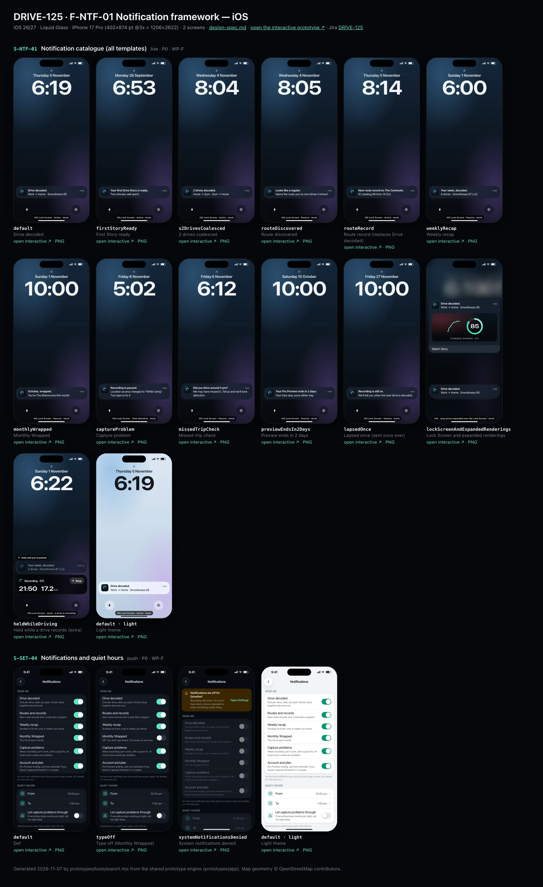
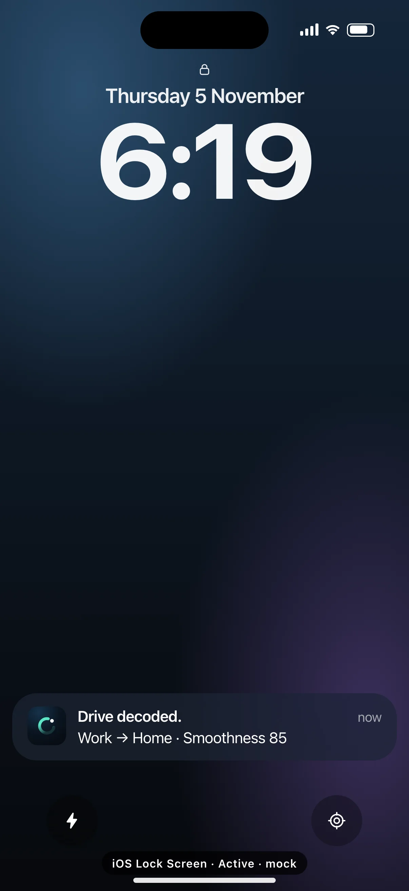
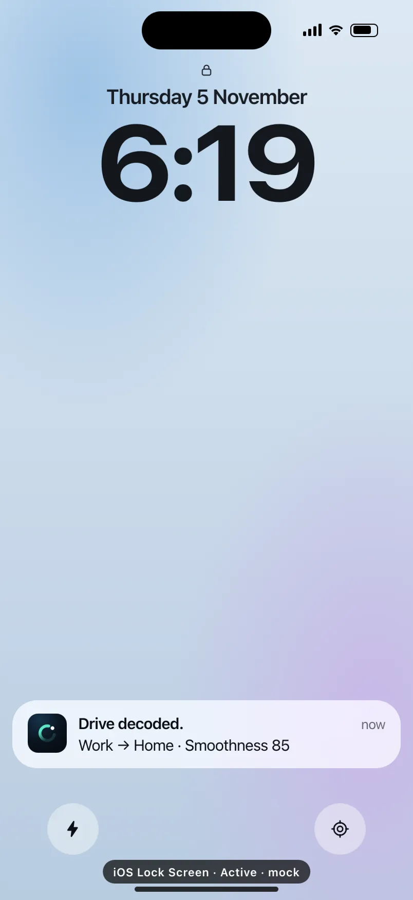
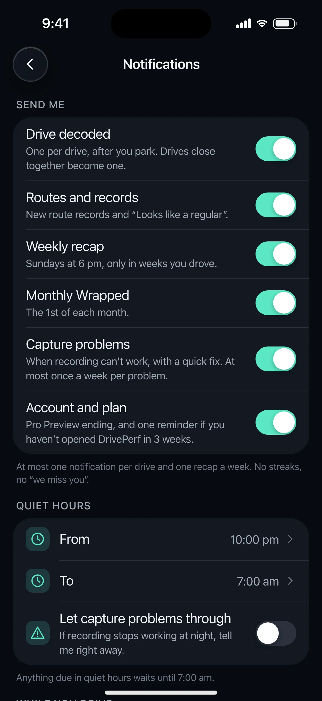
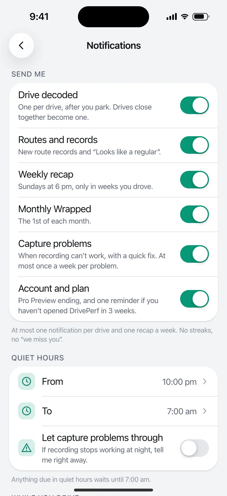

# DRIVE-125 · F-NTF-01 Notification framework — iOS design spec

> Generated by `prototypes/tools/export.mjs` on 2026-11-06 from the shared prototype engine. **Do not edit by hand:** change the screen's `spec` in `prototypes/app/screens/wp-*.js` (see `prototypes/app/AUTHORING.md`) and re-export.

- **Jira story:** [DRIVE-125](https://thekeval.atlassian.net/browse/DRIVE-125) · F-NTF-01 · P0
- **Platform:** iOS 26/27 · Liquid Glass · iPhone 17 Pro (402×874 pt @3x = 1206×2622)
- **Interactive prototype:** [../../../../prototypes/ios/index.html#S-NTF-01](../../../../prototypes/ios/index.html#S-NTF-01) (catalog panel: every screen and state; deep links `#S-ID/state?trip=…&ent=…&theme=light&text=xl&rm=1`)
- **Contact sheet:** [mockup.html](mockup.html) · 
- **Design system (source of truth for values):** [brand](../../system/brand.md) · [components](../../system/components.md) · [motion](../../system/motion.md) · [accessibility](../../system/accessibility.md) · [screen map](../../system/screen-map.md) · [fixtures](../../system/fixtures.md) · tokens `prototypes/shared/tokens.css`

## Screens in this story

| Screen | Name | Presentation | Priority | States | Status |
|---|---|---|---|---|---|
| `S-NTF-01` | Notification catalogue (all templates) | Live (notification catalogue) | P0 | 13 | Prototyped |
| `S-SET-04` | Notifications and quiet hours | Push | P0 | 3 | Prototyped |

## Tokens used on this platform

Values resolved from `prototypes/shared/tokens.css` inside the iOS device (`[data-platform="ios"]`). Use the token names in code; the hex values are for reference.

| Token | Dark | Light |
|---|---|---|
| `--app-bg` | `#080B10` | `#F2F3F6` |
| `--card-bg` | `#131822` | `#FFFFFF` |
| `--dp-bg-grouped` | `#080B10` | `#F2F3F6` |
| `--dp-surface` | `#131822` | `#FFFFFF` |
| `--dp-surface-2` | `#1B222D` | `#F2F3F6` |
| `--dp-surface-3` | `#262E3B` | `#E4E7EC` |
| `--dp-fill` | `#7880961F` | `#7880961F` |
| `--dp-fill-strong` | `#7880963D` | `#78809633` |
| `--dp-text` | `#F2F4F7` | `#0B0E13` |
| `--dp-text-2` | `#A3AAB6` | `#5A6271` |
| `--dp-text-3` | `#6E7787` | `#8A919D` |
| `--dp-separator` | `#96A0B429` | `#3C435024` |
| `--dp-accent` | `#5BE7C4` | `#079777` |
| `--dp-accent-text` | `#5BE7C4` | `#06775E` |
| `--dp-on-accent` | `#04241D` | `#FFFFFF` |
| `--dp-accent-container` | `#0A4439` | `#C6F8EA` |
| `--dp-record` | `#FFC24B` | `#9A6300` |
| `--dp-positive` | `#5BE7C4` | `#06775E` |
| `--dp-change-down` | `#A3AAB6` | `#5A6271` |
| `--dp-warning` | `#F5B648` | `#9A5F00` |
| `--dp-critical` | `#FF6B6B` | `#C62828` |
| `--dp-glass-fill` | `#1C222C6B` | `#FFFFFF8C` |
| `--dp-glass-fill-strong` | `#1C222CB8` | `#FFFFFFD1` |
| `--dp-glass-stroke` | `#FFFFFF24` | `#FFFFFF99` |
| `--dp-data-route` | `#5BE7C4` | `#079777` |
| `--dp-data-event-brake` | `#FF7A66` | `#A21F16` |
| `--dp-data-event-accel` | `#E58BD0` | `#A33A8C` |
| `--dp-data-event-corner` | `#EAD54E` | `#9A8A00` |
| `--dp-data-quality-good` | `#5FDB9C` | `#1E9E62` |
| `--dp-data-speed` | `#D6DCE4` | `#404A58` |
| `--dp-data-long-g` | `#5AB8F5` | `#0A6AB8` |
| `--dp-data-lat-g` | `#F5A142` | `#B25A00` |

| Type / layout token | Value |
|---|---|
| `--dp-font-screen-title` | `700 34px / 41px -apple-system, BlinkMacSystemFont, "SF Pro Display", system-ui, sans-serif` |
| `--dp-font-sheet-title` | `700 22px / 28px -apple-system, BlinkMacSystemFont, "SF Pro Display", system-ui, sans-serif` |
| `--dp-font-section-title` | `600 20px / 25px -apple-system, BlinkMacSystemFont, "SF Pro Display", system-ui, sans-serif` |
| `--dp-font-card-title` | `600 17px / 22px -apple-system, BlinkMacSystemFont, "SF Pro Text", system-ui, sans-serif` |
| `--dp-font-body` | `400 17px / 22px -apple-system, BlinkMacSystemFont, "SF Pro Text", system-ui, sans-serif` |
| `--dp-font-body-secondary` | `400 15px / 20px -apple-system, BlinkMacSystemFont, "SF Pro Text", system-ui, sans-serif` |
| `--dp-font-meta` | `400 13px / 18px -apple-system, BlinkMacSystemFont, "SF Pro Text", system-ui, sans-serif` |
| `--dp-font-caption` | `400 12px / 16px -apple-system, BlinkMacSystemFont, "SF Pro Text", system-ui, sans-serif` |
| `--dp-font-button` | `600 17px / 22px -apple-system, BlinkMacSystemFont, "SF Pro Text", system-ui, sans-serif` |
| `--dp-num-hero` | `600 72px / 72px -apple-system, BlinkMacSystemFont, "SF Pro Display", system-ui, sans-serif` |
| `--dp-num-xl` | `600 48px / 52px -apple-system, BlinkMacSystemFont, "SF Pro Display", system-ui, sans-serif` |
| `--dp-num-l` | `600 34px / 38px -apple-system, BlinkMacSystemFont, "SF Pro Display", system-ui, sans-serif` |
| `--dp-num-m` | `600 24px / 28px -apple-system, BlinkMacSystemFont, "SF Pro Display", system-ui, sans-serif` |
| `--dp-num-s` | `600 17px / 22px -apple-system, BlinkMacSystemFont, "SF Pro Display", system-ui, sans-serif` |
| `--dp-num-xs` | `600 13px / 16px -apple-system, BlinkMacSystemFont, "SF Pro Display", system-ui, sans-serif` |
| `--dp-screen-margin` | `16px` |
| `--dp-radius-card` | `24px` |
| `--dp-radius-card-hero` | `32px` |
| `--dp-radius-sheet` | `38px` |
| `--dp-radius-chip` | `999px` |
| `--dp-radius-button` | `999px` |
| `--dp-layout-list-row-min` | `52px` |
| `--dp-layout-touch-min` | `44px` |
| `--safe-top` | `62px` |
| `--safe-bottom` | `34px` |

Text sizes scale with `--dp-text-scale` (XL = 2.0×) and numerals with `--dp-num-scale` (XL = 1.3×). DP Numerals: SF Pro Expanded Semibold, tabular.

---

## S-NTF-01 · Notification catalogue (all templates)

 

- **Presentation:** live — screen map: “Live (notification catalogue)”
- **Entry points:** OS notification centre
- **Leads to:** Drive decoded → S-STY-01 · route → S-RTE-03/S-RTE-02 · recap → S-RCP-01 · Wrapped → S-WRP-01 · capture → S-SET-05 · missed trip → S-NTF-02 · preview → S-SUB-01 (all via the D1 gate)
- **PRD features:** F-NTF-01, F-NTF-02, F-NTF-03, F-NTF-04, F-NTF-06, F-STY-02, F-RTE-01, F-RTE-03 · **Priority:** P0 · **WP:** F
- **Interactive:** [S-NTF-01](../../../../prototypes/ios/index.html#S-NTF-01)

**Purpose.** Every local notification DrivePerf sends, rendered on the real OS surface (iOS Lock Screen, Android notification shade / Lock Screen) with fixture copy, so native developers can match title, body, category/channel, actions and tap targets. All are local (no push server) and none arrives while a driver trip records (F-NTF-01).

### States

| State | PRD label | Fixture params | Screenshot |
|---|---|---|---|
| `default` | Drive decoded | — | [S-NTF-01.png](../../screens/ios/S-NTF-01.webp) · [open](../../../../prototypes/ios/index.html#S-NTF-01) |
| `firstStoryReady` | First Story ready | — | [S-NTF-01--firstStoryReady.png](../../screens/ios/S-NTF-01--firstStoryReady.webp) · [open](../../../../prototypes/ios/index.html#S-NTF-01/firstStoryReady) |
| `s2DrivesCoalesced` | 2 drives coalesced | — | [S-NTF-01--s2DrivesCoalesced.png](../../screens/ios/S-NTF-01--s2DrivesCoalesced.webp) · [open](../../../../prototypes/ios/index.html#S-NTF-01/s2DrivesCoalesced) |
| `routeDiscovered` | Route discovered | — | [S-NTF-01--routeDiscovered.png](../../screens/ios/S-NTF-01--routeDiscovered.webp) · [open](../../../../prototypes/ios/index.html#S-NTF-01/routeDiscovered) |
| `routeRecord` | Route record (replaces Drive decoded) | — | [S-NTF-01--routeRecord.png](../../screens/ios/S-NTF-01--routeRecord.webp) · [open](../../../../prototypes/ios/index.html#S-NTF-01/routeRecord) |
| `weeklyRecap` | Weekly recap | — | [S-NTF-01--weeklyRecap.png](../../screens/ios/S-NTF-01--weeklyRecap.webp) · [open](../../../../prototypes/ios/index.html#S-NTF-01/weeklyRecap) |
| `monthlyWrapped` | Monthly Wrapped | — | [S-NTF-01--monthlyWrapped.png](../../screens/ios/S-NTF-01--monthlyWrapped.webp) · [open](../../../../prototypes/ios/index.html#S-NTF-01/monthlyWrapped) |
| `captureProblem` | Capture problem | — | [S-NTF-01--captureProblem.png](../../screens/ios/S-NTF-01--captureProblem.webp) · [open](../../../../prototypes/ios/index.html#S-NTF-01/captureProblem) |
| `missedTripCheck` | Missed-trip check | — | [S-NTF-01--missedTripCheck.png](../../screens/ios/S-NTF-01--missedTripCheck.webp) · [open](../../../../prototypes/ios/index.html#S-NTF-01/missedTripCheck) |
| `previewEndsIn2Days` | Preview ends in 2 days | — | [S-NTF-01--previewEndsIn2Days.png](../../screens/ios/S-NTF-01--previewEndsIn2Days.webp) · [open](../../../../prototypes/ios/index.html#S-NTF-01/previewEndsIn2Days) |
| `lapsedOnce` | Lapsed once (sent once ever) | — | [S-NTF-01--lapsedOnce.png](../../screens/ios/S-NTF-01--lapsedOnce.webp) · [open](../../../../prototypes/ios/index.html#S-NTF-01/lapsedOnce) |
| `lockScreenAndExpandedRenderings` | Lock Screen and expanded renderings | — | [S-NTF-01--lockScreenAndExpandedRenderings.png](../../screens/ios/S-NTF-01--lockScreenAndExpandedRenderings.webp) · [open](../../../../prototypes/ios/index.html#S-NTF-01/lockScreenAndExpandedRenderings) |
| `heldWhileDriving` | Held while a drive records (extra) | — | [S-NTF-01--heldWhileDriving.png](../../screens/ios/S-NTF-01--heldWhileDriving.webp) · [open](../../../../prototypes/ios/index.html#S-NTF-01/heldWhileDriving) |
| default · light | Light theme | `theme=light` | [S-NTF-01--light.png](../../screens/ios/S-NTF-01--light.webp) |

Every state also renders in light/dark (`theme=light`), XL text (`text=xl`) and reduced motion (`rm=1`).

### Layout

- iOS: Lock Screen mock (wallpaper, date, 104 pt clock, flashlight/camera). The notification sits at the bottom of the stack: 38 pt app icon (The Loop on night), bold title (sentence case, full stop), body, relative time. Long-press expanded rendering = dimmed, blurred Lock Screen + the expanded platter with a rich preview (share-safe route glyph + Smoothness ring, part of day · car) and action buttons.
- Android: notification shade mock (clock + date, Quick Settings tiles, “Notifications” header, Manage / Clear all). Each notification: small mono Loop icon · “DrivePerf · {channel} · now” · expand chevron, title (Title Medium), body (Body Medium), action buttons as tonal pills when expanded.
- Android Lock Screen rendering: the expanded Drive decoded card on top, then collapsed Route record and Weekly recap cards.
- Held while driving (extra state): the recording surface (iOS Live Activity · Android ongoing “Recording your drive” notification with the minutes chip and the QS tile in “Recording”) plus a ghosted card “Held until you’ve parked” showing what will be delivered after the trip.
- A small black “· mock” tag marks every frame as a non-interactive OS surface (only the notification itself and its actions are tappable in the prototype).

### Components & tokens

| Component | Tokens / spec |
|---|---|
| `lockScreen` | see components.md |
| `notification` | components.md §20.6 |
| `shade` | see components.md |
| `qsTile` | see components.md |
| `liveActivity` | background black 55% · Glide accent · components.md §20 |
| `ring` | track --dp-fill-strong · arc --dp-gradient-ring (glide-400 → accent → glide-100) · baseline notch --dp-text-2 · record notch --dp-record · Android container Cookie9Sided --md-sys-color-primary-container 42% · components.md §3 |
| `glyph` | see components.md |

### Interactions & navigation

- Every tap goes through the D1 gate (screen-map §2.2): with a driver trip active it lands on S-DRV-01; with moving=1, Story/Recap/Wrapped/Paywall targets wait on S-DRV-05.
- Drive decoded → S-STY-01 (trip). First Story ready → S-STY-01/firstDrive. 2 drives decoded → S-HOME-01 (both new Story cards). Looks like a regular → S-RTE-03 (route candidate) · action “Not now” dismisses. New route record → S-STY-01/newRouteRecord · action “See route” → S-RTE-02.
- Your week, decoded. → S-RCP-01 (recap w2026-10-26). October, wrapped. → S-WRP-01. Recording is paused. → S-SET-05/red (Always lost). Did you drive around 5 pm? → S-NTF-02 (actions: Yes, I drove · I was a passenger → S-NTF-02/iWasAPassenger). Pro Preview ends in 2 days → S-SUB-01/day13. Recording is still on. → opens the app (S-HOME-01).
- iOS: tap = open, long-press = expanded with actions, swipe left = Options/Clear. Android: tap = open, chevron = expand, swipe = dismiss; channel settings from long-press.

### Motion

- Arrival: iOS platter drops 14 pt and scales 0.96 → 1 (spring.default); Android card slides down 10 dp and fades in (spring.default). The expanded preview scales 0.92 → 1 from the stack. The ring in the rich preview runs the ring reveal without haptics.
- No haptics are ever attached to notifications (motion.md §6). RM: notifications appear in place (220 ms cross-fade).

### Accessibility

- Each notification is one element read as “DrivePerf notification. Drive decoded. Work → Home · Smoothness 85.”; actions are separate buttons.
- Rich preview ring: “Smoothness 85”. Glyph is decorative (aria-hidden).
- Copy never relies on colour; titles are short and complete sentences so they survive truncation at the largest text sizes (the OS truncates the body, never the title).
- Held notifications are never announced during a trip.

### Platform notes

- **iOS (this spec):** UNNotificationCategory per type with UNNotificationAction buttons; interruption level: Drive decoded / First Story / Route record = active, Capture problem = timeSensitive (only if the user lets capture problems through quiet hours), the rest passive; threadIdentifier groups DrivePerf notifications; a Notification Content Extension draws the rich preview (glyph + ring, never a map).
- *Android (for reference):* One NotificationChannel per type: Drive decoded · Routes and records · Weekly recap and Wrapped · Capture problems · Account and plan (default importance) · Recording (low, ongoing, Live Update). Actions via NotificationCompat.Action; expanded rich preview via a custom BigPicture-style layout; capture problems use CATEGORY_ERROR, recording CATEGORY_PROGRESS.

### Analytics

- `notification_sent {type}`
- `notification_held {type, reason: trip_active|quiet_hours}`
- `notification_opened {type, action}`
- `notification_dismissed {type}`

### Copy

| Key | Text |
|---|---|
| Drive decoded | Drive decoded. · {route label} · Smoothness {n}  (e.g. “Work → Home · Smoothness 85”) |
| First Story | Your first Drive Story is ready. · Two minutes well spent. |
| Coalesced | 2 drives decoded. · Home → Gym · Gym → Home |
| Route discovered | Looks like a regular. · Name the route you’ve now driven 3 times? |
| Route record | New route record on The Commute. · 91, beating 89 from 14 Oct. |
| Weekly recap | Your week, decoded. · 5 drives · Smoothness 87 (+2) |
| Monthly Wrapped | October, wrapped. · You’re The Metronome this month. |
| Capture problem | Recording is paused. · Location access changed to “While Using” (Android: “While using the app”). Two taps to fix it. |
| Missed trip | Did you drive around 5 pm? · We may have missed it. Tell us and we’ll tune detection. |
| Preview ending | Your Pro Preview ends in 2 days. · Your trips stay yours either way. |
| Lapsed | Recording is still on. · We’ll tell you when the next drive is decoded. |
| Held | Held until you’ve parked |
| Actions | Watch Story · See drives · Name it · Not now · See route · Play recap · Open Wrapped · Fix it · Yes, I drove · I was a passenger · See what Pro keeps |

### Free / Pro

All notifications are Free. The Preview-ending notice is the only one that mentions the plan, and it never shows a price. No notification links to a paywall except Preview ending → S-SUB-01 (status sheet, not a paywall).

### Data & fixtures

Copy from DP_DATA.notifications (n_first, n_coalesced, n_route, n_record, n_week, n_wrapped, n_capture, n_missed, n_preview, n_lapsed, n_recording). Default Drive decoded is filled from t20261105-1745 with the F-STY-02 template, because t20261105-0742 set a record and its decoded notice is replaced by the record notice (F-NTF-06.2). Scene times are derived from trip end times (5 Nov 18:18 → 6:19; 28 Sep 18:52 → 6:53; 4 Nov 08:03 → 8:04; 5 Nov 08:13 → 8:14), recap deliveredAt (Sun 18:00), Preview day 13 (10 Oct). Monthly Wrapped is shown at 10:00 per F-NTF-04 (fixture wrapped.monthly.deliveredAt says 09:00). The lapsed date (27 Nov) is illustrative: 21 days without opening. Held state uses liveTrip.states.auto (21 min · 17.2 km · GTI).

### Assets

[icon-pause.svg](assets/icon-pause.svg) · [icon-stop.svg](assets/icon-stop.svg) · [icon-up.svg](assets/icon-up.svg) · [icon-down.svg](assets/icon-down.svg) · [logo-a-loop.svg](assets/logo-a-loop.svg)

UI glyphs may be swapped for SF Symbols / Material Symbols Rounded equivalents; event-pin, quality and provenance glyphs must not be (components.md global rules).

### Checklist (accessibility.md §9)

- [ ] Light and dark both render, and contrast passes.
- [ ] The XL text state reflows with no truncation.
- [ ] The RM state is defined.
- [ ] Every control has a label; every chart and map has a summary sentence.
- [ ] Every target ≥ 44 pt / 48 dp (≥ 64 in-drive).
- [ ] No meaning by colour alone.
- [ ] Speed is neutral wherever it appears and absent from social or live surfaces.
- [ ] No streak, leaderboard, speed or “beat your time” language.
- [ ] Behaviour is defined while a trip is active (D1 gate).
- [ ] Haptics come from motion.md §6 only.

---

## S-SET-04 · Notifications and quiet hours

 

- **Presentation:** push · tab: profile — screen map: “Push”
- **Entry points:** S-SET-01
- **Leads to:** System notification settings
- **PRD features:** F-NTF-01 · **Priority:** P0 · **WP:** F
- **Interactive:** [S-SET-04](../../../../prototypes/ios/index.html#S-SET-04)

**Purpose.** Few, useful notifications that never arrive while driving: per-type switches, quiet hours and the system permission state (F-NTF-01).

### States

| State | PRD label | Fixture params | Screenshot |
|---|---|---|---|
| `default` | Def | — | [S-SET-04.png](../../screens/ios/S-SET-04.webp) · [open](../../../../prototypes/ios/index.html#S-SET-04) |
| `typeOff` | Type off (Monthly Wrapped) | — | [S-SET-04--typeOff.png](../../screens/ios/S-SET-04--typeOff.webp) · [open](../../../../prototypes/ios/index.html#S-SET-04/typeOff) |
| `systemNotificationsDenied` | System notifications denied | — | [S-SET-04--systemNotificationsDenied.png](../../screens/ios/S-SET-04--systemNotificationsDenied.webp) · [open](../../../../prototypes/ios/index.html#S-SET-04/systemNotificationsDenied) |
| default · light | Light theme | `theme=light` | [S-SET-04--light.png](../../screens/ios/S-SET-04--light.webp) |

Every state also renders in light/dark (`theme=light`), XL text (`text=xl`) and reduced motion (`rm=1`).

### Layout

- Denied banner (system notifications off): attention banner “Notifications are off for DrivePerf” + “Recording still works…” + Open Settings.
- “Send me”: six switch rows with a one-line promise each — Drive decoded · Routes and records · Weekly recap · Monthly Wrapped · Capture problems · Account and plan. A switched-off type reads “Off. You won’t get these. Turn back on any time.” Footer: caps + “No streaks, no ‘we miss you’.”
- Quiet hours: From 10:00 pm · To 7:00 am (time pickers) · “Let capture problems through” switch. Footer: “Anything due in quiet hours waits until 7:00 am.”
- “While you drive”: info row “Held until you’ve parked”.
- System link row: iOS “Notification settings in iOS” · Android “Notification categories in Android settings” → OS Settings mock.
- Denied: all switches dim and show off; tapping one explains that the system permission comes first.

### Components & tokens

| Component | Tokens / spec |
|---|---|
| `navBar` | --dp-font-card-title · --dp-font-meta · glass: --dp-glass-fill + --dp-glass-blur · components.md §2 |
| `banner` | radius 12 (--dp-radius-sm+) · info --dp-fill · attention --dp-warning-container · critical --dp-critical-container · components.md §22 |
| `list` | iOS inset grouped radius --dp-radius-card, rows 52 pt, separators --dp-separator inset 16 · Android ListItem 56/72 dp in --md-sys-color-surface-container |
| `row` | --dp-font-body · --dp-font-meta (supporting) · --dp-layout-list-row-min |
| `toggle` | iOS 51×31 tint --dp-accent · Android M3 Switch 52×32 --md-sys-color-primary |
| `section` | --dp-font-section-title · --dp-layout-section-gap 28 |
| `sysSettings` | see components.md |

### Interactions & navigation

- Type switch → on/off (toggle haptics). F-NTF-01.4: a type switched off is never sent again.
- From/To → native time picker (prototype: toast). Capture-problems-through switch → on/off.
- Open Settings / system row → OS Settings mock (iOS Settings › DrivePerf › Notifications with “Allow Notifications” highlighted · Android App notifications with the main switch highlighted). Tap the mock to return.

### Motion

- Groups rise 8 px, 30 ms stagger. RM: none.

### Accessibility

- Each switch row reads its title, state and promise: “Weekly recap, on. Sundays at 6 pm, only in weeks you drove.”
- Denied switches are announced “dimmed” and the banner is read first.
- XL text: rows grow to two or more lines and trailing values move under the title; nothing truncates. Every row is ≥ 52 pt (iOS) / 56 dp (Android).

### Platform notes

- **iOS (this spec):** In-app switches map to UNNotificationCategory filtering inside the app (iOS has no per-category system switches); “Notification settings in iOS” opens UIApplication.openNotificationSettingsURLString.
- *Android (for reference):* Each in-app switch mirrors a NotificationChannel (users can also change channels in system settings; the app reads channel importance on resume). The system row opens Settings.ACTION_APP_NOTIFICATION_SETTINGS.

### Analytics

- `notification_type_disabled {type}`
- `notification_type_enabled {type}`
- `quiet_hours_changed`
- `notification_settings_opened {source}`

### Copy

| Key | Text |
|---|---|
| Drive decoded | One per drive, after you park. Drives close together become one. |
| Routes and records | New route records and “Looks like a regular”. |
| Weekly recap | Sundays at 6 pm, only in weeks you drove. |
| Monthly Wrapped | The 1st of each month. |
| Capture problems | When recording can’t work, with a quick fix. At most once a week per problem. |
| Account and plan | Pro Preview ending, and one reminder if you haven’t opened DrivePerf in 3 weeks. |
| Off | Off. You won’t get these. Turn back on any time. |
| Caps footer | At most one notification per drive and one recap a week. No streaks, no “we miss you”. |
| Quiet footer | Anything due in quiet hours waits until 7:00 am. |
| Held | Held until you’ve parked. Nothing but the recording notice appears while a drive is recording. Everything else waits. |
| Denied | Notifications are off for DrivePerf. Recording still works. You won’t hear when a drive is decoded or when something needs fixing. |

### Free / Pro

Free. No plan-dependent types.

### Data & fixtures

user.notifications (all six on) and quietHours 22:00–07:00. typeOff switches Monthly Wrapped off.

### Assets

[icon-bell.svg](assets/icon-bell.svg) · [icon-clock.svg](assets/icon-clock.svg) · [icon-warn.svg](assets/icon-warn.svg) · [icon-shield.svg](assets/icon-shield.svg) · [icon-gear.svg](assets/icon-gear.svg)

UI glyphs may be swapped for SF Symbols / Material Symbols Rounded equivalents; event-pin, quality and provenance glyphs must not be (components.md global rules).

### Checklist (accessibility.md §9)

- [ ] Light and dark both render, and contrast passes.
- [ ] The XL text state reflows with no truncation.
- [ ] The RM state is defined.
- [ ] Every control has a label; every chart and map has a summary sentence.
- [ ] Every target ≥ 44 pt / 48 dp (≥ 64 in-drive).
- [ ] No meaning by colour alone.
- [ ] Speed is neutral wherever it appears and absent from social or live surfaces.
- [ ] No streak, leaderboard, speed or “beat your time” language.
- [ ] Behaviour is defined while a trip is active (D1 gate).
- [ ] Haptics come from motion.md §6 only.

---

Map geometry in the prototype: © OpenStreetMap contributors (ODbL). Speed and G are simulated fixtures (fixtures.md).
