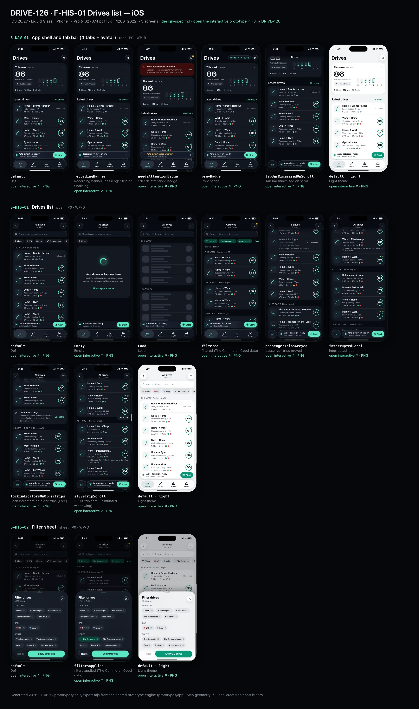
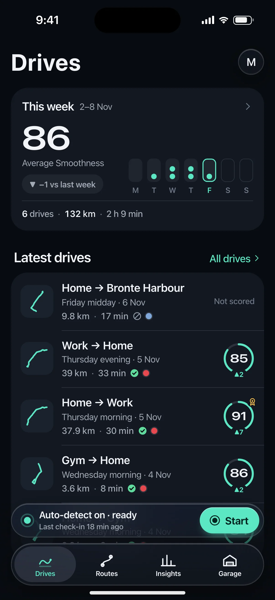
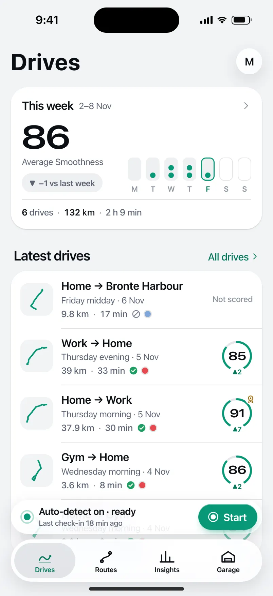
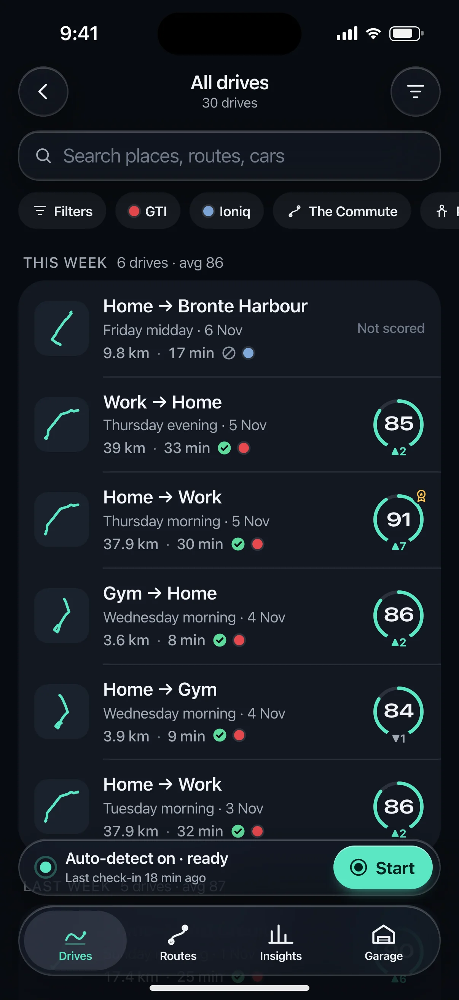
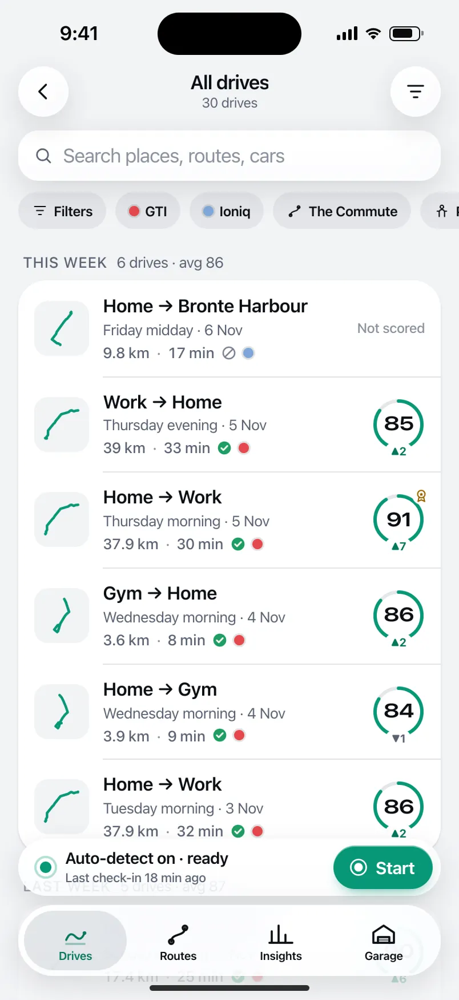
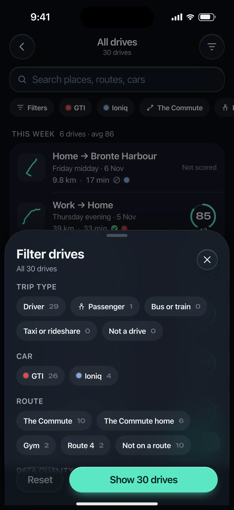
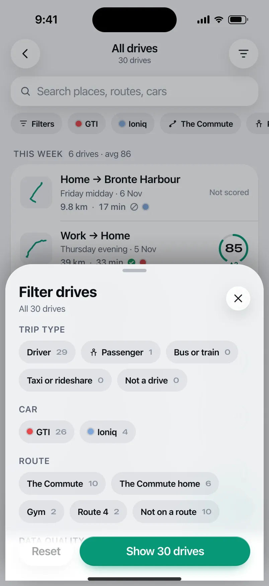

# DRIVE-126 · F-HIS-01 Drives list — iOS design spec

> Generated by `prototypes/tools/export.mjs` on 2026-11-06 from the shared prototype engine. **Do not edit by hand:** change the screen's `spec` in `prototypes/app/screens/wp-*.js` (see `prototypes/app/AUTHORING.md`) and re-export.

- **Jira story:** [DRIVE-126](https://thekeval.atlassian.net/browse/DRIVE-126) · F-HIS-01 · P0
- **Platform:** iOS 26/27 · Liquid Glass · iPhone 17 Pro (402×874 pt @3x = 1206×2622)
- **Interactive prototype:** [../../../../prototypes/ios/index.html#S-NAV-01](../../../../prototypes/ios/index.html#S-NAV-01) (catalog panel: every screen and state; deep links `#S-ID/state?trip=…&ent=…&theme=light&text=xl&rm=1`)
- **Contact sheet:** [mockup.html](mockup.html) · 
- **Design system (source of truth for values):** [brand](../../system/brand.md) · [components](../../system/components.md) · [motion](../../system/motion.md) · [accessibility](../../system/accessibility.md) · [screen map](../../system/screen-map.md) · [fixtures](../../system/fixtures.md) · tokens `prototypes/shared/tokens.css`

## Screens in this story

| Screen | Name | Presentation | Priority | States | Status |
|---|---|---|---|---|---|
| `S-NAV-01` | App shell and tab bar (4 tabs + avatar) | Shell | P0 | 5 | Prototyped |
| `S-HIS-01` | Drives list | Push (from Drives tab) | P0 | 8 | Prototyped |
| `S-HIS-02` | Filter sheet | Sheet (medium) | P0 | 2 | Prototyped |

## Tokens used on this platform

Values resolved from `prototypes/shared/tokens.css` inside the iOS device (`[data-platform="ios"]`). Use the token names in code; the hex values are for reference.

| Token | Dark | Light |
|---|---|---|
| `--app-bg` | `#080B10` | `#F2F3F6` |
| `--card-bg` | `#131822` | `#FFFFFF` |
| `--dp-bg-grouped` | `#080B10` | `#F2F3F6` |
| `--dp-surface` | `#131822` | `#FFFFFF` |
| `--dp-surface-2` | `#1B222D` | `#F2F3F6` |
| `--dp-surface-3` | `#262E3B` | `#E4E7EC` |
| `--dp-fill` | `#7880961F` | `#7880961F` |
| `--dp-fill-strong` | `#7880963D` | `#78809633` |
| `--dp-text` | `#F2F4F7` | `#0B0E13` |
| `--dp-text-2` | `#A3AAB6` | `#5A6271` |
| `--dp-text-3` | `#6E7787` | `#8A919D` |
| `--dp-separator` | `#96A0B429` | `#3C435024` |
| `--dp-accent` | `#5BE7C4` | `#079777` |
| `--dp-accent-text` | `#5BE7C4` | `#06775E` |
| `--dp-on-accent` | `#04241D` | `#FFFFFF` |
| `--dp-accent-container` | `#0A4439` | `#C6F8EA` |
| `--dp-record` | `#FFC24B` | `#9A6300` |
| `--dp-positive` | `#5BE7C4` | `#06775E` |
| `--dp-change-down` | `#A3AAB6` | `#5A6271` |
| `--dp-warning` | `#F5B648` | `#9A5F00` |
| `--dp-critical` | `#FF6B6B` | `#C62828` |
| `--dp-glass-fill` | `#1C222C6B` | `#FFFFFF8C` |
| `--dp-glass-fill-strong` | `#1C222CB8` | `#FFFFFFD1` |
| `--dp-glass-stroke` | `#FFFFFF24` | `#FFFFFF99` |
| `--dp-data-route` | `#5BE7C4` | `#079777` |
| `--dp-data-event-brake` | `#FF7A66` | `#A21F16` |
| `--dp-data-event-accel` | `#E58BD0` | `#A33A8C` |
| `--dp-data-event-corner` | `#EAD54E` | `#9A8A00` |
| `--dp-data-quality-good` | `#5FDB9C` | `#1E9E62` |
| `--dp-data-speed` | `#D6DCE4` | `#404A58` |
| `--dp-data-long-g` | `#5AB8F5` | `#0A6AB8` |
| `--dp-data-lat-g` | `#F5A142` | `#B25A00` |

| Type / layout token | Value |
|---|---|
| `--dp-font-screen-title` | `700 34px / 41px -apple-system, BlinkMacSystemFont, "SF Pro Display", system-ui, sans-serif` |
| `--dp-font-sheet-title` | `700 22px / 28px -apple-system, BlinkMacSystemFont, "SF Pro Display", system-ui, sans-serif` |
| `--dp-font-section-title` | `600 20px / 25px -apple-system, BlinkMacSystemFont, "SF Pro Display", system-ui, sans-serif` |
| `--dp-font-card-title` | `600 17px / 22px -apple-system, BlinkMacSystemFont, "SF Pro Text", system-ui, sans-serif` |
| `--dp-font-body` | `400 17px / 22px -apple-system, BlinkMacSystemFont, "SF Pro Text", system-ui, sans-serif` |
| `--dp-font-body-secondary` | `400 15px / 20px -apple-system, BlinkMacSystemFont, "SF Pro Text", system-ui, sans-serif` |
| `--dp-font-meta` | `400 13px / 18px -apple-system, BlinkMacSystemFont, "SF Pro Text", system-ui, sans-serif` |
| `--dp-font-caption` | `400 12px / 16px -apple-system, BlinkMacSystemFont, "SF Pro Text", system-ui, sans-serif` |
| `--dp-font-button` | `600 17px / 22px -apple-system, BlinkMacSystemFont, "SF Pro Text", system-ui, sans-serif` |
| `--dp-num-hero` | `600 72px / 72px -apple-system, BlinkMacSystemFont, "SF Pro Display", system-ui, sans-serif` |
| `--dp-num-xl` | `600 48px / 52px -apple-system, BlinkMacSystemFont, "SF Pro Display", system-ui, sans-serif` |
| `--dp-num-l` | `600 34px / 38px -apple-system, BlinkMacSystemFont, "SF Pro Display", system-ui, sans-serif` |
| `--dp-num-m` | `600 24px / 28px -apple-system, BlinkMacSystemFont, "SF Pro Display", system-ui, sans-serif` |
| `--dp-num-s` | `600 17px / 22px -apple-system, BlinkMacSystemFont, "SF Pro Display", system-ui, sans-serif` |
| `--dp-num-xs` | `600 13px / 16px -apple-system, BlinkMacSystemFont, "SF Pro Display", system-ui, sans-serif` |
| `--dp-screen-margin` | `16px` |
| `--dp-radius-card` | `24px` |
| `--dp-radius-card-hero` | `32px` |
| `--dp-radius-sheet` | `38px` |
| `--dp-radius-chip` | `999px` |
| `--dp-radius-button` | `999px` |
| `--dp-layout-list-row-min` | `52px` |
| `--dp-layout-touch-min` | `44px` |
| `--safe-top` | `62px` |
| `--safe-bottom` | `34px` |

Text sizes scale with `--dp-text-scale` (XL = 2.0×) and numerals with `--dp-num-scale` (XL = 1.3×). DP Numerals: SF Pro Expanded Semibold, tabular.

---

## S-NAV-01 · App shell and tab bar (4 tabs + avatar)

 

- **Presentation:** root · tab: drives — screen map: “Shell”
- **Entry points:** App launch (after onboarding)
- **Leads to:** Tab roots S-HOME-01 · S-RTE-01 · S-STA-01 · S-GAR-01; avatar → S-ACC-01; accessory/toolbar → S-DRV-01 (recording) or S-HOME-02
- **PRD features:** F-HIS-01, F-RTE-02, F-GAR-01, F-ACC-01, F-HIS-04 · **Priority:** P0 · **WP:** B
- **Interactive:** [S-NAV-01](../../../../prototypes/ios/index.html#S-NAV-01)

**Purpose.** The app shell (screen-map.md §1, validated): four tabs — Drives · Routes · Insights · Garage — with Profile moved to an avatar in the top-trailing corner of every tab root, and capture status always one glance away. Every other screen mounts inside it.

### States

| State | PRD label | Fixture params | Screenshot |
|---|---|---|---|
| `default` | Def | — | [S-NAV-01.png](../../screens/ios/S-NAV-01.webp) · [open](../../../../prototypes/ios/index.html#S-NAV-01) |
| `recordingBanner` | Recording banner (passenger trip or finalising) | — | [S-NAV-01--recordingBanner.png](../../screens/ios/S-NAV-01--recordingBanner.webp) · [open](../../../../prototypes/ios/index.html#S-NAV-01/recordingBanner) |
| `needsAttentionBadge` | “Needs attention” badge | `health=alwaysLost` | [S-NAV-01--needsAttentionBadge.png](../../screens/ios/S-NAV-01--needsAttentionBadge.webp) · [open](../../../../prototypes/ios/index.html#S-NAV-01/needsAttentionBadge) |
| `prevBadge` | Prev badge | `ent=preview` | [S-NAV-01--prevBadge.png](../../screens/ios/S-NAV-01--prevBadge.webp) · [open](../../../../prototypes/ios/index.html#S-NAV-01/prevBadge) |
| `tabBarMinimisedOnScroll` | Tab bar minimised on scroll | — | [S-NAV-01--tabBarMinimisedOnScroll.png](../../screens/ios/S-NAV-01--tabBarMinimisedOnScroll.webp) · [open](../../../../prototypes/ios/index.html#S-NAV-01/tabBarMinimisedOnScroll) |
| default · light | Light theme | `theme=light` | [S-NAV-01--light.png](../../screens/ios/S-NAV-01--light.webp) |

Every state also renders in light/dark (`theme=light`), XL text (`text=xl`) and reduced motion (`rm=1`).

### Layout

- Tab roots: Drives S-HOME-01 · Routes S-RTE-01 · Insights S-STA-01 · Garage S-GAR-01 (icons DP_ICONS drives/routes/insights/garage).
- iOS: floating Liquid Glass tab bar (inset 16, bottom 21, height 62, selected = Glide icon + label inside a glass lens) + tabViewBottomAccessory capture capsule (50 pt, 8 above the bar) on all tabs.
- Android: NavigationBar (64 dp + 24 dp gesture area, surfaceContainer, indicator 56×32 secondaryContainer, labels always visible) + M3E floating toolbar (64 dp, primaryContainer) docked 16 dp above it on the Drives tab only.
- Avatar top-trailing on every tab root: iOS 38 pt glass circle (initial) · Android 40 dp Cookie12Sided secondaryContainer. Badge dot = needs attention; Preview badge beside it.
- Minimised on scroll (iOS): the bar shrinks to a 54 pt capsule showing only the selected icon; the accessory folds inline to its right. Android: the toolbar slides out on scroll down and back on scroll up; the navigation bar stays.

### Components & tokens

| Component | Tokens / spec |
|---|---|
| `tabBar` | iOS floating glass: inset 16, bottom 21, height 62, lens --dp-fill-strong · Android NavigationBar 64 dp + indicator 56×32 --md-sys-color-secondary-container · components.md §1 |
| `accessory` | iOS tabViewBottomAccessory glass 48 pt, 8 above tab bar · Android floating toolbar 64 dp --md-sys-color-primary-container, 16 above nav bar · Start: --dp-accent |
| `avatar` | see components.md |
| `previewBadge` | see components.md |
| `largeTitle` | --dp-font-screen-title (iOS 34/41 bold · Android 32/40) · components.md §2 |

### Interactions & navigation

- Tab tap → that tab root (iOS cross-fade + lens spring · Android fade-through). Re-tapping the current tab scrolls to top.
- Avatar → S-ACC-01 (iOS sheet, large detent, own NavigationStack · Android full-screen, shared axis X, predictive back).
- Accessory / toolbar → S-HOME-02 (ready), S-DRV-01 (recording), S-SET-05 (attention); Start → S-DRV-01 (trip start).
- Every navigation passes the D1 gate (router → DP.gate): while a driver trip is active only S-DRV-01/02/03 are reachable; content opened while moving waits on S-DRV-05.

### Motion

- Tab lens: spring.default slide between tabs · selection haptic.
- Minimise on scroll: spring.default (iOS) · toolbar 150 ms emphasizedAccelerate out / spring.fast in (Android).
- Recording banner: livePulse 2400 ms breathe on the dot; RM static.
- Trip start: accessory/toolbar expands into S-DRV-01 (container transform, spring.slow).

### Accessibility

- Tabs are a tablist: “Drives, tab, 1 of 4, selected”. Labels always visible on both platforms; iOS large-content viewer on long-press at AX sizes.
- Avatar: “Profile, needs attention” when badged. Preview badge: “Pro Preview, day 9 of 14”.
- The accessory never announces timer updates (no live region).

### Platform notes

- **iOS (this spec):** TabView + Tab, .tabBarMinimizeBehavior(.onScrollDown), .tabViewBottomAccessory { CaptureStatusAccessory() }; Profile is a glass toolbar item → sheet.
- *Android (for reference):* NavigationBar (short) always visible; HorizontalFloatingToolbar on Drives; avatar in the top app bar trailing slot → full-screen destination.

### Analytics

- `tab_selected {tab}`
- `profile_opened {source: avatar}`
- `capture_status_opened {source: accessory|toolbar}`

### Copy

| Key | Text |
|---|---|
| Tabs | Drives · Routes · Insights · Garage |
| Recording banner | Recording · {min} min · {km} km |
| Needs attention | Auto-detect needs attention |

### Free / Pro

Same shell for every plan. Preview: “PRO PREVIEW · DAY n” badge beside the avatar.

### Assets

[icon-drives.svg](assets/icon-drives.svg) · [icon-routes.svg](assets/icon-routes.svg) · [icon-insights.svg](assets/icon-insights.svg) · [icon-garage.svg](assets/icon-garage.svg) · [icon-record.svg](assets/icon-record.svg) · [icon-profile.svg](assets/icon-profile.svg) · [logo-a-loop.svg](assets/logo-a-loop.svg)

UI glyphs may be swapped for SF Symbols / Material Symbols Rounded equivalents; event-pin, quality and provenance glyphs must not be (components.md global rules).

### Checklist (accessibility.md §9)

- [ ] Light and dark both render, and contrast passes.
- [ ] The XL text state reflows with no truncation.
- [ ] The RM state is defined.
- [ ] Every control has a label; every chart and map has a summary sentence.
- [ ] Every target ≥ 44 pt / 48 dp (≥ 64 in-drive).
- [ ] No meaning by colour alone.
- [ ] Speed is neutral wherever it appears and absent from social or live surfaces.
- [ ] No streak, leaderboard, speed or “beat your time” language.
- [ ] Behaviour is defined while a trip is active (D1 gate).
- [ ] Haptics come from motion.md §6 only.

---

## S-HIS-01 · Drives list

 

- **Presentation:** push · tab: drives — screen map: “Push (from Drives tab)”
- **Entry points:** S-HOME-01 "All drives"
- **Leads to:** S-TRP-01 · S-HIS-02 · S-SUB-03 (locked older trip actions)
- **PRD features:** F-HIS-01, F-HIS-03 · **Priority:** P0 · **WP:** D
- **Interactive:** [S-HIS-01](../../../../prototypes/ios/index.html#S-HIS-01)

**Purpose.** Every drive in one scrollable list, newest first and grouped by week, so the user can find any trip (F-HIS-01). Summaries are free forever; on Free, drives older than 30 days keep their full summary and only show a small lock for Replay & Analysis (F-HIS-03 “locked, not lost”).

### States

| State | PRD label | Fixture params | Screenshot |
|---|---|---|---|
| `default` | Def | — | [S-HIS-01.png](../../screens/ios/S-HIS-01.webp) · [open](../../../../prototypes/ios/index.html#S-HIS-01) |
| `Empty` | Empty | — | [S-HIS-01--Empty.png](../../screens/ios/S-HIS-01--Empty.webp) · [open](../../../../prototypes/ios/index.html#S-HIS-01/Empty) |
| `Load` | Load | — | [S-HIS-01--Load.png](../../screens/ios/S-HIS-01--Load.webp) · [open](../../../../prototypes/ios/index.html#S-HIS-01/Load) |
| `filtered` | filtered (The Commute · Good data) | — | [S-HIS-01--filtered.png](../../screens/ios/S-HIS-01--filtered.webp) · [open](../../../../prototypes/ios/index.html#S-HIS-01/filtered) |
| `passengerTripsGreyed` | passenger trips greyed | — | [S-HIS-01--passengerTripsGreyed.png](../../screens/ios/S-HIS-01--passengerTripsGreyed.webp) · [open](../../../../prototypes/ios/index.html#S-HIS-01/passengerTripsGreyed) |
| `interruptedLabel` | interrupted label | — | [S-HIS-01--interruptedLabel.png](../../screens/ios/S-HIS-01--interruptedLabel.webp) · [open](../../../../prototypes/ios/index.html#S-HIS-01/interruptedLabel) |
| `lockIndicatorsOnOlderTrips` | Lock indicators on older trips (Free) | `ent=free` | [S-HIS-01--lockIndicatorsOnOlderTrips.png](../../screens/ios/S-HIS-01--lockIndicatorsOnOlderTrips.webp) · [open](../../../../prototypes/ios/index.html#S-HIS-01/lockIndicatorsOnOlderTrips) |
| `s1000TripScroll` | 1,000-trip scroll (simulated windowing) | — | [S-HIS-01--s1000TripScroll.png](../../screens/ios/S-HIS-01--s1000TripScroll.webp) · [open](../../../../prototypes/ios/index.html#S-HIS-01/s1000TripScroll) |
| default · light | Light theme | `theme=light` | [S-HIS-01--light.png](../../screens/ios/S-HIS-01--light.webp) |

Every state also renders in light/dark (`theme=light`), XL text (`text=xl`) and reduced motion (`rm=1`).

### Layout

- Top bar: iOS inline title “All drives” + subtitle “{n} drives” (· filtered) with glass back and a glass Filter button (badge dot when filters are applied) · Android MediumFlexibleTopAppBar (title in content, collapses on scroll), back arrow, filter icon.
- Search: iOS glass search field (radius 18, 44 tall) / Android M3 SearchBar (56 dp, surface-container-high, full radius) “Search places, routes, cars”. Tapping shows “Try” suggestion chips (Gardiner · Niagara · Ioniq · Gym · Passenger); a query shows “{n} drives match “{q}” · {km} km”.
- Filter chip row (horizontal scroll, 16 margins): “Filters” chip (→ S-HIS-02) then quick filters (GTI · Ioniq · The Commute · Passenger). Applied filters become selected chips with × plus “Clear”.
- Week sections, newest first: caption header “This week” / “Last week” / “19–25 Oct” with meta “{n} drives · avg {score}” (driver drives only), then one card (radius 24 iOS / 16 Android) of trip cards (components.md §12) separated by 0.5 px separators (iOS) or 2 dp gaps (Android).
- Trip card: route glyph 48 · label · part of day · date · km · min · quality glyph · car dot (more than one car) · score badge (mini ring iOS / Cookie9Sided Android) · lock glyph after the badge for locked older trips. Interrupted and passenger rows add a one-line note under the card.
- Free: an info banner “Older than 30 days” precedes the first week with locked drives (See plans → S-SUB-03 replayAnalysis30Days). Summaries are never blurred.
- Footer caption “That’s every drive since 28 September.” · iOS capture accessory + floating tab bar remain (Drives tab).
- 1,000 drives: list is windowed (rows outside the viewport render as skeleton rows), with a fast-scroll thumb and a month bubble on the trailing edge (iOS section index scrubber · Android fast scroller).

### Components & tokens

| Component | Tokens / spec |
|---|---|
| `page` | --dp-bg-grouped (iOS) / --md-sys-color-surface (Android) · --dp-screen-margin 16 |
| `navBar` | --dp-font-card-title · --dp-font-meta · glass: --dp-glass-fill + --dp-glass-blur · components.md §2 |
| `iconButton` | see components.md |
| `chip` | --dp-radius-chip (iOS capsule · Android 8) · height 28 · --dp-font-caption |
| `carDot` | see components.md |
| `section` | --dp-font-section-title · --dp-layout-section-gap 28 |
| `card` | --dp-surface / --md-sys-color-surface-container · --dp-radius-card (24 iOS · 16 Android) · hero: --dp-radius-card-hero (32 · 28) · light iOS: --dp-elev-1 |
| `tripRow` | glyph 40 on --dp-surface-2 · --dp-font-card-title · --dp-font-meta · components.md §12 |
| `scoreBadge` | iOS mini ring 46 · Android Cookie9Sided 46 · --dp-num-s |
| `qualityBadge` | --dp-data-quality-{good\|usable\|limited\|unscorable} · components.md §10 |
| `banner` | radius 12 (--dp-radius-sm+) · info --dp-fill · attention --dp-warning-container · critical --dp-critical-container · components.md §22 |
| `menu` | iOS glass Menu: --dp-glass-fill-strong, radius 26 · Android DropdownMenu: --md-sys-color-surface-container, radius 16 |
| `empty` | illustration 120 in --dp-accent · --dp-font-section-title · components.md §21 |
| `skeleton` | --dp-fill-strong, breathe 1.2 s (dp-skeleton) |

### Interactions & navigation

- Trip card → S-TRP-01 (iOS zoom / Android container transform from the card). Locked older trips still open S-TRP-01 (summary); Replay/Analysis there open S-SUB-03.
- Long-press a trip card (Android M3E long-press · iOS context menu; iOS swipe: leading Share, trailing Delete) → Share (S-SHR-01) · Replay (S-RPL-01, or S-SUB-03/replayAnalysis30Days when locked) · Edit trip (S-TRP-02) · Delete drive (S-TRP-03).
- Filter button / “Filters” chip → S-HIS-02 (medium sheet); “Show n drives” returns here with the filter applied as chips. Quick chips toggle a filter in place; chip × removes it; “Clear” resets.
- Search field → suggestions; a suggestion runs the search over route label, places, roads, route and car names. × clears.
- Empty: “How capture works” → S-HOME-02; Android shows the capture row inline with Start (iOS uses the accessory).
- Share/Replay from the long-press menu pass the D1 gate (held on S-DRV-05 while moving).

### Motion

- Push in from Home “All drives”: iOS push (spring.default), Android shared axis X.
- Hero motion: week sections rise 8 px and fade in, 30 ms stagger (spring.default). RM: 220 ms cross-fade, no rise.
- Filter change: list cross-fades (180 ms); chip selection uses spring.fast + selection haptic. Long-press menu scales in from the card (spring.fast) with the longPress haptic.

### Accessibility

- Trip card is one button: “Home to Work, Thursday morning, 5 November. 37.9 kilometres, 30 minutes. Smoothness 91. Good data.” + “Replay and Analysis in Pro.” when locked. Custom actions: Share, Replay, Edit, Delete.
- Week headers are headings (“This week, 6 drives, average 86”). Filter chips are a toolbar; selected chips announce “Remove filter The Commute”.
- Result count is a status region (“8 drives match Gardiner”). The filter button announces “Filters, 2 applied”.
- XL: trip cards stack the glyph above the text; meta wraps to two lines; chips wrap onto multiple rows; nothing truncates.
- Passenger rows are dimmed to 55% but keep 4.5:1 for their label; the note “Passenger · not scored, not counted” carries the meaning in text.

### Platform notes

- **iOS (this spec):** NavigationStack push; .searchable(placement: .navigationBarDrawer) glass field; trip cards in an inset-grouped List section per week; swipe actions (leading Share, trailing Delete) and .contextMenu; floating glass tab bar + capture accessory stay visible; fast scroll via the section index scrubber.
- *Android (for reference):* MediumFlexibleTopAppBar + M3 SearchBar; LazyColumn with sticky week headers and segmented ListItems; combinedClickable long-press → DropdownMenu; FilterChips (selected = secondaryContainer); fast scroller thumb with a month bubble; NavigationBar stays (no capture toolbar on non-root tabs).

### Analytics

- `history_opened {source: home|car_detail}`
- `history_filtered {filter: car|route|quality|type, count_bucket}`
- `history_searched {result_bucket}`
- `trip_context_action {action: share|replay|edit|delete, locked}`

### Copy

| Key | Text |
|---|---|
| Title | All drives |
| Search placeholder | Search places, routes, cars |
| Week meta | {n} drives · avg {score} |
| Lock divider | Older than 30 days. Summaries, scores and Stories stay free forever. Replay and Analysis for these drives are in Pro. · See plans |
| Interrupted note | {iOS ended DrivePerf in the background \| Android stopped DrivePerf in the background}. Saved up to {time}. |
| Passenger note | Passenger · not scored, not counted |
| Empty | Your drives will appear here. Just drive. DrivePerf notices when you set off and decodes each drive when you park. |
| No match | No drives match. Try fewer filters, or a different place or car. · Clear filters |
| Footer | That’s every drive since {install date}. |

### Free / Pro

Free: every summary of every age is visible; the 4 drives older than 30 days show a lock glyph after the score and the “Older than 30 days” banner; their Replay/Analysis (long-press menu or trip detail) open S-SUB-03 replayAnalysis30Days. Pro / Preview / Ride-along: no locks.

### Data & fixtures

All 30 DP_DATA.trips, newest first, grouped by DP_DATA.util.weekOf (recap weeks). Week meta is derived (driver drives; average of scored drives). Filtered = route r_commute + Good data (9 drives). Passenger row t20261031-1905; interrupted row t20261013-1742 (the states scroll to them). Lock state = ent free (t20261002-0745, t20260929-*, t20260928-1842 locked). 1,000-trip scroll is simulated: the fixture has 30 drives, older weeks render as skeleton (windowed) rows. Delete from S-TRP-03 returns here with ?deleted=<trip> (the row is removed).

### Assets

[icon-search.svg](assets/icon-search.svg) · [icon-filter.svg](assets/icon-filter.svg) · [icon-close.svg](assets/icon-close.svg) · [icon-routes.svg](assets/icon-routes.svg) · [icon-passenger.svg](assets/icon-passenger.svg) · [icon-shield.svg](assets/icon-shield.svg) · [icon-lock.svg](assets/icon-lock.svg) · [icon-share.svg](assets/icon-share.svg) · [icon-replay.svg](assets/icon-replay.svg) · [icon-edit.svg](assets/icon-edit.svg) · [icon-trash.svg](assets/icon-trash.svg) · [icon-record.svg](assets/icon-record.svg) · [icon-drives.svg](assets/icon-drives.svg) · [logo-a-loop.svg](assets/logo-a-loop.svg)

UI glyphs may be swapped for SF Symbols / Material Symbols Rounded equivalents; event-pin, quality and provenance glyphs must not be (components.md global rules).

### Checklist (accessibility.md §9)

- [ ] Light and dark both render, and contrast passes.
- [ ] The XL text state reflows with no truncation.
- [ ] The RM state is defined.
- [ ] Every control has a label; every chart and map has a summary sentence.
- [ ] Every target ≥ 44 pt / 48 dp (≥ 64 in-drive).
- [ ] No meaning by colour alone.
- [ ] Speed is neutral wherever it appears and absent from social or live surfaces.
- [ ] No streak, leaderboard, speed or “beat your time” language.
- [ ] Behaviour is defined while a trip is active (D1 gate).
- [ ] Haptics come from motion.md §6 only.

---

## S-HIS-02 · Filter sheet

 

- **Presentation:** sheet · tab: drives · detent: medium — screen map: “Sheet (medium)”
- **Entry points:** S-HIS-01 filter
- **Leads to:** Back (chips applied)
- **PRD features:** F-HIS-01 · **Priority:** P0 · **WP:** D
- **Interactive:** [S-HIS-02](../../../../prototypes/ios/index.html#S-HIS-02)

**Purpose.** Narrow the drives list by trip type, car, route and data quality (F-HIS-01.3). The applied filters come back to S-HIS-01 as chips.

### States

| State | PRD label | Fixture params | Screenshot |
|---|---|---|---|
| `default` | Def | — | [S-HIS-02.png](../../screens/ios/S-HIS-02.webp) · [open](../../../../prototypes/ios/index.html#S-HIS-02) |
| `filtersApplied` | filters applied (The Commute · Good data) | — | [S-HIS-02--filtersApplied.png](../../screens/ios/S-HIS-02--filtersApplied.webp) · [open](../../../../prototypes/ios/index.html#S-HIS-02/filtersApplied) |
| default · light | Light theme | `theme=light` | [S-HIS-02--light.png](../../screens/ios/S-HIS-02--light.webp) |

Every state also renders in light/dark (`theme=light`), XL text (`text=xl`) and reduced motion (`rm=1`).

### Layout

- Medium sheet (iOS glass sheet 54% detent, radius 40 inset 8 · Android ModalBottomSheet, surface-container-low, top radius 28, drag handle). Header “Filter drives” + sub “All 30 drives” / “2 filters · 8 drives”; iOS glass close.
- Four groups, 18 apart, each a caption title then wrapping chips: Trip type (Driver · Passenger · Bus or train · Taxi or rideshare · Not a drive) · Car (dot + nickname) · Route (named routes, Route 4, Not on a route) · Data quality (quality glyph + Good/Usable/Limited/Unscorable). Each chip shows its drive count in text-3.
- Sticky footer (glass on iOS, surface on Android): Reset (glass / outlined) + primary “Show {n} drives” (filled, block). The count updates live; with no match the button reads “No drives match” and is disabled.

### Components & tokens

| Component | Tokens / spec |
|---|---|
| `sheetHeader` | see components.md |
| `chip` | --dp-radius-chip (iOS capsule · Android 8) · height 28 · --dp-font-caption |
| `carDot` | see components.md |
| `qualityBadge` | --dp-data-quality-{good\|usable\|limited\|unscorable} · components.md §10 |
| `button` | --dp-accent / --dp-on-accent (filled) · --dp-fill-strong · --md-sys-color-secondary-container (tonal) · --dp-radius-button · height iOS 50/44/34 · Android 56/40/32 · --dp-font-button · components.md §0 |

### Interactions & navigation

- Chip tap toggles that filter (multi-select within a group, AND across groups); selected chips show a check (M3 FilterChip leading check).
- “Show n drives” → dismiss and apply to S-HIS-01 (chips + “filtered” subtitle). Reset clears all. Drag down / scrim / close → dismiss without applying.

### Motion

- Sheet: spring.sheet up from the bottom; detent snap = selection haptic.
- Hero motion: groups rise 8 px, 30 ms stagger. Chip select: spring.fast colour/shape change + selection haptic. RM: cross-fades only.

### Accessibility

- Focus moves to “Filter drives” on open and returns to the filter button on close.
- Chips read “The Commute, 10 drives, selected” (toggle buttons). Groups are headings.
- XL: the sheet opens at the large detent; chips wrap; the footer stays pinned and its label wraps.

### Platform notes

- **iOS (this spec):** presentationDetents([.medium, .large]) glass sheet; chips are glass capsules; selected = accent container; Reset is a glass button.
- *Android (for reference):* ModalBottomSheet with drag handle; M3 FilterChip (8 dp radius, leading check when selected, secondaryContainer); OutlinedButton Reset + filled Show.

### Analytics

- `history_filter_opened`
- `history_filtered {filter, count_bucket}`
- `history_filter_reset`

### Copy

| Key | Text |
|---|---|
| Title | Filter drives |
| Sub | All {n} drives / {k} filters · {n} drives |
| Groups | Trip type · Car · Route · Data quality |
| CTA | Show {n} drives / No drives match |
| Reset | Reset |

### Free / Pro

Same for every plan: filtering summaries is free.

### Data & fixtures

Counts are derived live from DP_DATA.trips (e.g. Passenger 1, Ioniq 4, The Commute 10, Limited 1). filtersApplied = route r_commute + Good (9 drives). Bus/train, taxi and “not a drive” have 0 in the fixture.

### Assets

[icon-check.svg](assets/icon-check.svg) · [icon-passenger.svg](assets/icon-passenger.svg) · [icon-close.svg](assets/icon-close.svg)

UI glyphs may be swapped for SF Symbols / Material Symbols Rounded equivalents; event-pin, quality and provenance glyphs must not be (components.md global rules).

### Checklist (accessibility.md §9)

- [ ] Light and dark both render, and contrast passes.
- [ ] The XL text state reflows with no truncation.
- [ ] The RM state is defined.
- [ ] Every control has a label; every chart and map has a summary sentence.
- [ ] Every target ≥ 44 pt / 48 dp (≥ 64 in-drive).
- [ ] No meaning by colour alone.
- [ ] Speed is neutral wherever it appears and absent from social or live surfaces.
- [ ] No streak, leaderboard, speed or “beat your time” language.
- [ ] Behaviour is defined while a trip is active (D1 gate).
- [ ] Haptics come from motion.md §6 only.

---

Map geometry in the prototype: © OpenStreetMap contributors (ODbL). Speed and G are simulated fixtures (fixtures.md).
