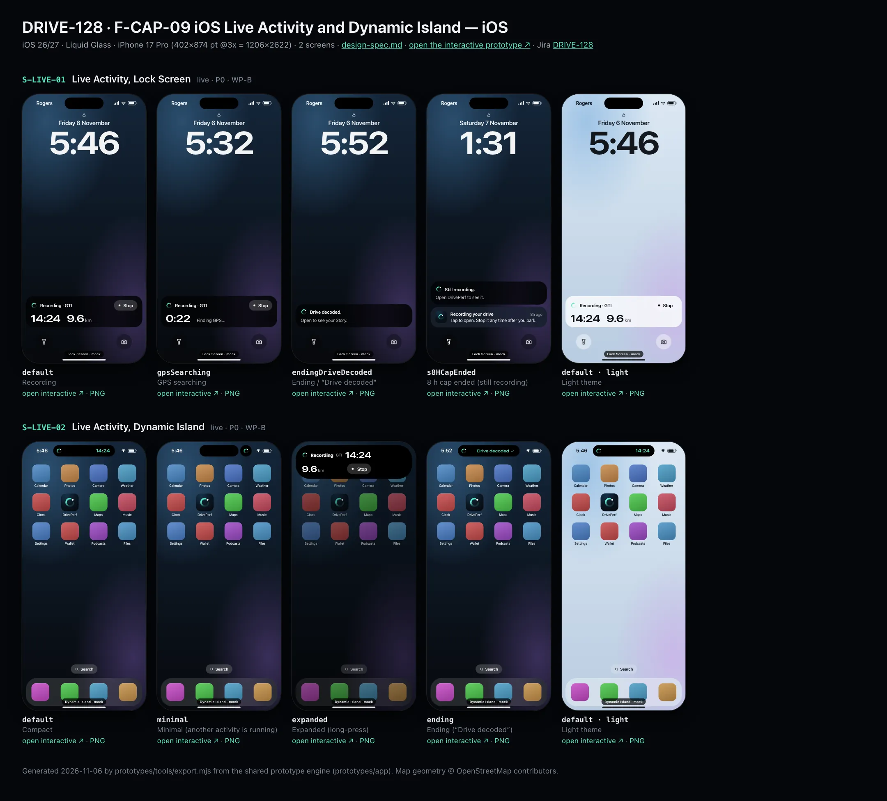
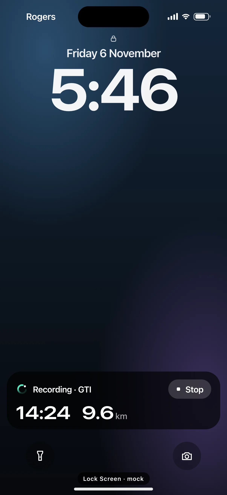
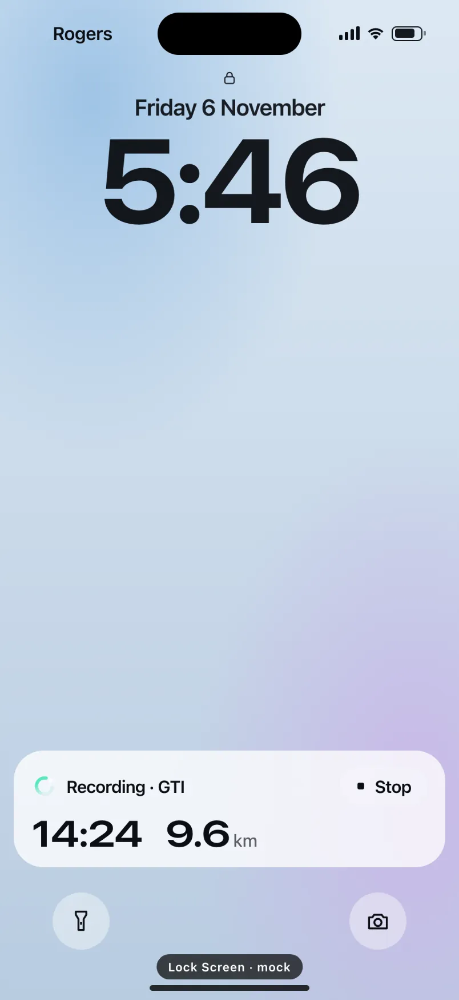
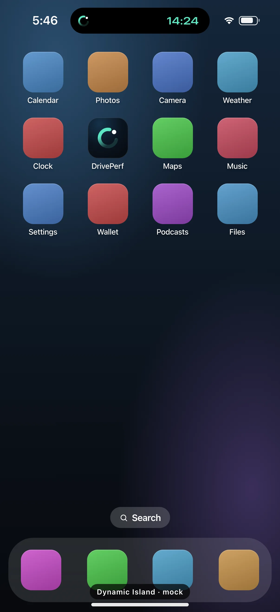
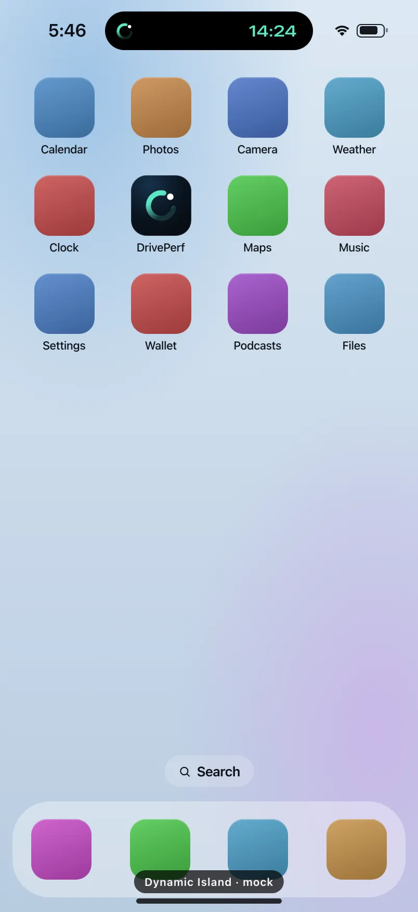

# DRIVE-128 · F-CAP-09 iOS Live Activity and Dynamic Island — iOS design spec

> Generated by `prototypes/tools/export.mjs` on 2026-11-06 from the shared prototype engine. **Do not edit by hand:** change the screen's `spec` in `prototypes/app/screens/wp-*.js` (see `prototypes/app/AUTHORING.md`) and re-export.

- **Jira story:** [DRIVE-128](https://thekeval.atlassian.net/browse/DRIVE-128) · F-CAP-09 · P0
- **Platform:** iOS 26/27 · Liquid Glass · iPhone 17 Pro (402×874 pt @3x = 1206×2622)
- **Interactive prototype:** [../../../../prototypes/ios/index.html#S-LIVE-01](../../../../prototypes/ios/index.html#S-LIVE-01) (catalog panel: every screen and state; deep links `#S-ID/state?trip=…&ent=…&theme=light&text=xl&rm=1`)
- **Contact sheet:** [mockup.html](mockup.html) · 
- **Design system (source of truth for values):** [brand](../../system/brand.md) · [components](../../system/components.md) · [motion](../../system/motion.md) · [accessibility](../../system/accessibility.md) · [screen map](../../system/screen-map.md) · [fixtures](../../system/fixtures.md) · tokens `prototypes/shared/tokens.css`

## Screens in this story

| Screen | Name | Presentation | Priority | States | Status |
|---|---|---|---|---|---|
| `S-LIVE-01` | Live Activity, Lock Screen | Live (iOS Lock Screen) | P0 | 4 | Prototyped |
| `S-LIVE-02` | Live Activity, Dynamic Island | Live (iOS Dynamic Island) | P0 | 4 | Prototyped |

## Tokens used on this platform

Values resolved from `prototypes/shared/tokens.css` inside the iOS device (`[data-platform="ios"]`). Use the token names in code; the hex values are for reference.

| Token | Dark | Light |
|---|---|---|
| `--app-bg` | `#080B10` | `#F2F3F6` |
| `--card-bg` | `#131822` | `#FFFFFF` |
| `--dp-bg-grouped` | `#080B10` | `#F2F3F6` |
| `--dp-surface` | `#131822` | `#FFFFFF` |
| `--dp-surface-2` | `#1B222D` | `#F2F3F6` |
| `--dp-surface-3` | `#262E3B` | `#E4E7EC` |
| `--dp-fill` | `#7880961F` | `#7880961F` |
| `--dp-fill-strong` | `#7880963D` | `#78809633` |
| `--dp-text` | `#F2F4F7` | `#0B0E13` |
| `--dp-text-2` | `#A3AAB6` | `#5A6271` |
| `--dp-text-3` | `#6E7787` | `#8A919D` |
| `--dp-separator` | `#96A0B429` | `#3C435024` |
| `--dp-accent` | `#5BE7C4` | `#079777` |
| `--dp-accent-text` | `#5BE7C4` | `#06775E` |
| `--dp-on-accent` | `#04241D` | `#FFFFFF` |
| `--dp-accent-container` | `#0A4439` | `#C6F8EA` |
| `--dp-record` | `#FFC24B` | `#9A6300` |
| `--dp-positive` | `#5BE7C4` | `#06775E` |
| `--dp-change-down` | `#A3AAB6` | `#5A6271` |
| `--dp-warning` | `#F5B648` | `#9A5F00` |
| `--dp-critical` | `#FF6B6B` | `#C62828` |
| `--dp-glass-fill` | `#1C222C6B` | `#FFFFFF8C` |
| `--dp-glass-fill-strong` | `#1C222CB8` | `#FFFFFFD1` |
| `--dp-glass-stroke` | `#FFFFFF24` | `#FFFFFF99` |
| `--dp-data-route` | `#5BE7C4` | `#079777` |
| `--dp-data-event-brake` | `#FF7A66` | `#A21F16` |
| `--dp-data-event-accel` | `#E58BD0` | `#A33A8C` |
| `--dp-data-event-corner` | `#EAD54E` | `#9A8A00` |
| `--dp-data-quality-good` | `#5FDB9C` | `#1E9E62` |
| `--dp-data-speed` | `#D6DCE4` | `#404A58` |
| `--dp-data-long-g` | `#5AB8F5` | `#0A6AB8` |
| `--dp-data-lat-g` | `#F5A142` | `#B25A00` |

| Type / layout token | Value |
|---|---|
| `--dp-font-screen-title` | `700 34px / 41px -apple-system, BlinkMacSystemFont, "SF Pro Display", system-ui, sans-serif` |
| `--dp-font-sheet-title` | `700 22px / 28px -apple-system, BlinkMacSystemFont, "SF Pro Display", system-ui, sans-serif` |
| `--dp-font-section-title` | `600 20px / 25px -apple-system, BlinkMacSystemFont, "SF Pro Display", system-ui, sans-serif` |
| `--dp-font-card-title` | `600 17px / 22px -apple-system, BlinkMacSystemFont, "SF Pro Text", system-ui, sans-serif` |
| `--dp-font-body` | `400 17px / 22px -apple-system, BlinkMacSystemFont, "SF Pro Text", system-ui, sans-serif` |
| `--dp-font-body-secondary` | `400 15px / 20px -apple-system, BlinkMacSystemFont, "SF Pro Text", system-ui, sans-serif` |
| `--dp-font-meta` | `400 13px / 18px -apple-system, BlinkMacSystemFont, "SF Pro Text", system-ui, sans-serif` |
| `--dp-font-caption` | `400 12px / 16px -apple-system, BlinkMacSystemFont, "SF Pro Text", system-ui, sans-serif` |
| `--dp-font-button` | `600 17px / 22px -apple-system, BlinkMacSystemFont, "SF Pro Text", system-ui, sans-serif` |
| `--dp-num-hero` | `600 72px / 72px -apple-system, BlinkMacSystemFont, "SF Pro Display", system-ui, sans-serif` |
| `--dp-num-xl` | `600 48px / 52px -apple-system, BlinkMacSystemFont, "SF Pro Display", system-ui, sans-serif` |
| `--dp-num-l` | `600 34px / 38px -apple-system, BlinkMacSystemFont, "SF Pro Display", system-ui, sans-serif` |
| `--dp-num-m` | `600 24px / 28px -apple-system, BlinkMacSystemFont, "SF Pro Display", system-ui, sans-serif` |
| `--dp-num-s` | `600 17px / 22px -apple-system, BlinkMacSystemFont, "SF Pro Display", system-ui, sans-serif` |
| `--dp-num-xs` | `600 13px / 16px -apple-system, BlinkMacSystemFont, "SF Pro Display", system-ui, sans-serif` |
| `--dp-screen-margin` | `16px` |
| `--dp-radius-card` | `24px` |
| `--dp-radius-card-hero` | `32px` |
| `--dp-radius-sheet` | `38px` |
| `--dp-radius-chip` | `999px` |
| `--dp-radius-button` | `999px` |
| `--dp-layout-list-row-min` | `52px` |
| `--dp-layout-touch-min` | `44px` |
| `--safe-top` | `62px` |
| `--safe-bottom` | `34px` |

Text sizes scale with `--dp-text-scale` (XL = 2.0×) and numerals with `--dp-num-scale` (XL = 1.3×). DP Numerals: SF Pro Expanded Semibold, tabular.

---

## S-LIVE-01 · Live Activity, Lock Screen

 

- **Presentation:** live — screen map: “Live (iOS Lock Screen)”
- **Entry points:** Manual start; S-LIVE-03 "Show live drive"
- **Leads to:** Tap → S-DRV-01 · Stop → trip ends (S-DRV-04 on next open)
- **PRD features:** F-CAP-01, F-CAP-09, F-CAP-17 · **Priority:** P0 · **WP:** B
- **Interactive:** [S-LIVE-01](../../../../prototypes/ios/index.html#S-LIVE-01)

**Purpose.** A quiet, glanceable “it’s recording” on the Lock Screen for manual trips (F-CAP-09), with a Stop that works without unlocking. Status only: elapsed time, distance and car — never speed, score or record pace (SAF-02).

### States

| State | PRD label | Fixture params | Screenshot |
|---|---|---|---|
| `default` | Recording | — | [S-LIVE-01.png](../../screens/ios/S-LIVE-01.webp) · [open](../../../../prototypes/ios/index.html#S-LIVE-01) |
| `gpsSearching` | GPS searching | `live=gpsSearching` | [S-LIVE-01--gpsSearching.png](../../screens/ios/S-LIVE-01--gpsSearching.webp) · [open](../../../../prototypes/ios/index.html#S-LIVE-01/gpsSearching) |
| `endingDriveDecoded` | Ending / “Drive decoded” | — | [S-LIVE-01--endingDriveDecoded.png](../../screens/ios/S-LIVE-01--endingDriveDecoded.webp) · [open](../../../../prototypes/ios/index.html#S-LIVE-01/endingDriveDecoded) |
| `s8HCapEnded` | 8 h cap ended (still recording) | `live=cap8h` | [S-LIVE-01--s8HCapEnded.png](../../screens/ios/S-LIVE-01--s8HCapEnded.webp) · [open](../../../../prototypes/ios/index.html#S-LIVE-01/s8HCapEnded) |
| default · light | Light theme | `theme=light` | [S-LIVE-01--light.png](../../screens/ios/S-LIVE-01--light.webp) |

Every state also renders in light/dark (`theme=light`), XL text (`text=xl`) and reduced motion (`rm=1`).

### Layout

- iOS Lock Screen mock: carrier + status icons, lock glyph, date, 104 pt clock, Live Activity in the system slot above the bottom quick actions (flashlight · camera), home indicator.
- Live Activity (radius 26, activityBackgroundTint black 55% + system blur, 16 padding): row 1 = Loop glyph 22 (Glide, static) + “Recording · GTI” (600 15) + trailing Stop capsule (44 pt hit area, #ffffff2b, stop glyph 14 + “Stop”). Row 2 = timer “14:24” and “9.6 km” in DP Numerals 32/32, units at 65% opacity, 20 gap. No progress bar (a trip has no end point).
- GPS searching: “0:22” + “Finding GPS…” instead of distance. Ending: Loop + “Drive decoded.” + “Open to see your Story.” (stays 15 min, then dismissed). 8 h cap: Loop + “Still recording.” + “Open DrivePerf to see it.”, with the “Recording your drive” notification below it.

### Components & tokens

| Component | Tokens / spec |
|---|---|
| `lockScreen` | see components.md |
| `liveActivity` | background black 55% · Glide accent · components.md §20 |
| `notification` | components.md §20.6 |

### Interactions & navigation

- Tap the activity → opens DrivePerf on S-DRV-01 (D1: never to content). Ending → S-STY-01 for the decoded trip (gate → S-DRV-05 if still moving).
- Stop (LiveActivityIntent, no unlock needed) → ends the trip; the activity switches to “Drive decoded.” after finalisation (prototype: → ending state). Next app open shows S-DRV-04 / the Story.
- Started by: in-app Start, the Control Center control or the widget (S-LIVE-03/04). Never started for auto trips in the background (A3 §3); “Show live drive” attaches one.

### Motion

- System-driven only: ActivityKit presents and updates the activity; the timer is Text(timerInterval:) and ticks itself. No custom animation, no pulsing dot (motion.md §3.2). Prototype: the activity rises 8 px on load. RM: none.

### Accessibility

- Live surfaces never announce the timer as it changes; each surface has one summary label (“DrivePerf, recording, GTI. 14 minutes, 9.6 kilometres.”) and a separate “Stop drive” button.
- Stop has its own label “Stop drive” and a 44 pt target.
- Supports the Lock Screen’s large text: the numbers row wraps under the title at AX sizes.

### Platform notes

- **iOS (this spec):** ActivityKit Live Activity (ActivityConfiguration lock-screen presentation), local updates only (≤ every 5 s, distance step 0.1 km or 15 s), payload ≤ 4 KB, staleDate = now + 60 s.
- *Android (for reference):* n/a (iOS only). Android equivalent: S-LIVE-05 Live Update / S-LIVE-06 ongoing notification.

### Analytics

- `live_activity_started {source: app|control|widget|show_live}`
- `live_activity_stop_tapped`
- `live_activity_ended {reason: decoded|cap_8h|user}`

### Copy

| Key | Text |
|---|---|
| Recording | Recording · {GTI} · {14:24} · {9.6} km · Stop |
| GPS | Recording · {GTI} · {0:22} · Finding GPS… · Stop |
| Ending | Drive decoded. · Open to see your Story. |
| Cap | Still recording. · Open DrivePerf to see it. |
| Cap notification | Recording your drive · Tap to open. Stop it any time after you park. |

### Free / Pro

Same for every plan.

### Data & fixtures

ContentState = {startedAt, distanceKm, vehicleNickname, gpsState, phase}. Fixtures: liveTrip.states.manual (default), gpsSearching, cap8h. Lock Screen clock = manual.startedAt + elapsedS (5:46; 5:32 for GPS; Sat 1:31 for the 8 h cap); the ending clock (5:52) is illustrative.

### Assets

[icon-stop.svg](assets/icon-stop.svg) · [icon-lock.svg](assets/icon-lock.svg) · [logo-a-loop.svg](assets/logo-a-loop.svg)

UI glyphs may be swapped for SF Symbols / Material Symbols Rounded equivalents; event-pin, quality and provenance glyphs must not be (components.md global rules).

### Checklist (accessibility.md §9)

- [ ] Light and dark both render, and contrast passes.
- [ ] The XL text state reflows with no truncation.
- [ ] The RM state is defined.
- [ ] Every control has a label; every chart and map has a summary sentence.
- [ ] Every target ≥ 44 pt / 48 dp (≥ 64 in-drive).
- [ ] No meaning by colour alone.
- [ ] Speed is neutral wherever it appears and absent from social or live surfaces.
- [ ] No streak, leaderboard, speed or “beat your time” language.
- [ ] Behaviour is defined while a trip is active (D1 gate).
- [ ] Haptics come from motion.md §6 only.

---

## S-LIVE-02 · Live Activity, Dynamic Island

 

- **Presentation:** live — screen map: “Live (iOS Dynamic Island)”
- **Entry points:** Same Live Activity as S-LIVE-01
- **Leads to:** Tap → S-DRV-01 · long-press → expanded · Stop
- **PRD features:** F-CAP-01, F-CAP-09 · **Priority:** P0 · **WP:** B
- **Interactive:** [S-LIVE-02](../../../../prototypes/ios/index.html#S-LIVE-02)

**Purpose.** The same manual-trip Live Activity in the Dynamic Island while the phone is unlocked (F-CAP-09): a static Loop and a self-ticking timer, nothing that invites a look while driving.

### States

| State | PRD label | Fixture params | Screenshot |
|---|---|---|---|
| `default` | Compact | — | [S-LIVE-02.png](../../screens/ios/S-LIVE-02.webp) · [open](../../../../prototypes/ios/index.html#S-LIVE-02) |
| `minimal` | Minimal (another activity is running) | — | [S-LIVE-02--minimal.png](../../screens/ios/S-LIVE-02--minimal.webp) · [open](../../../../prototypes/ios/index.html#S-LIVE-02/minimal) |
| `expanded` | Expanded (long-press) | — | [S-LIVE-02--expanded.png](../../screens/ios/S-LIVE-02--expanded.webp) · [open](../../../../prototypes/ios/index.html#S-LIVE-02/expanded) |
| `ending` | Ending (“Drive decoded”) | — | [S-LIVE-02--ending.png](../../screens/ios/S-LIVE-02--ending.webp) · [open](../../../../prototypes/ios/index.html#S-LIVE-02/ending) |
| default · light | Light theme | `theme=light` | [S-LIVE-02--light.png](../../screens/ios/S-LIVE-02--light.webp) |

Every state also renders in light/dark (`theme=light`), XL text (`text=xl`) and reduced motion (`rm=1`).

### Layout

- Compact (default): leading = Loop glyph 20 (Glide, static) · trailing = timer “14:24” (600 15 DP Numerals, Glide). Width ≈ 196, height 37, around the hardware island; the status bar keeps the time and battery.
- Minimal (another app’s activity owns the compact slot): a detached 37 pt circle with the Loop only.
- Expanded (long-press): 378 wide, radius 46, 18/20 padding. Leading “Recording” + car (GTI at 60%) · trailing timer 28 · bottom row: distance “9.6 km” (28, unit 60%) + Stop capsule. No centre content.
- Ending: compact with “Drive decoded ✓”, auto-dismissed after a few seconds.
- Background in the mock: an iOS Home Screen (labelled icons, dock); expanded dims it 20%.

### Components & tokens

| Component | Tokens / spec |
|---|---|
| `island` | see components.md |
| `homeScreen` | see components.md |

### Interactions & navigation

- Tap (compact, minimal, expanded) → DrivePerf on S-DRV-01. Long-press compact → expanded (longPress haptic). Stop (expanded) → ends the trip → ending.
- Ending tap → S-STY-01 through the D1 gate (S-DRV-05 while moving).

### Motion

- System morphs between compact, expanded and minimal (prototype: bouncy spring scale from the pill). The timer is Text(timerInterval:). No custom animation, no pulse. RM: system cross-fade.

### Accessibility

- Live surfaces never announce the timer as it changes; each surface has one summary label (“DrivePerf, recording, GTI. 14 minutes, 9.6 kilometres.”) and a separate “Stop drive” button.
- Compact reads “DrivePerf, recording, 14 minutes”. Expanded exposes “Stop drive”.

### Platform notes

- **iOS (this spec):** ActivityConfiguration dynamicIsland { DynamicIslandExpandedRegion(.leading/.trailing/.bottom) } compactLeading/compactTrailing/minimal; keylineTint Glide.
- *Android (for reference):* n/a (iOS only). Android shows the status-bar chip (S-LIVE-05 statusChip).

### Analytics

- `live_activity_expanded`
- `live_activity_tapped {presentation: compact|minimal|expanded}`
- `live_activity_stop_tapped {presentation: expanded}`

### Copy

| Key | Text |
|---|---|
| Compact | [Loop] {14:24} |
| Expanded | Recording · {GTI} · {14:24} · {9.6} km · Stop |
| Ending | Drive decoded ✓ |

### Free / Pro

Same for every plan.

### Data & fixtures

liveTrip.states.manual (14:24 · 9.6 km · GTI). Status-bar clock = startedAt + elapsedS (5:46).

### Assets

[icon-stop.svg](assets/icon-stop.svg) · [icon-check.svg](assets/icon-check.svg) · [logo-a-loop.svg](assets/logo-a-loop.svg)

UI glyphs may be swapped for SF Symbols / Material Symbols Rounded equivalents; event-pin, quality and provenance glyphs must not be (components.md global rules).

### Checklist (accessibility.md §9)

- [ ] Light and dark both render, and contrast passes.
- [ ] The XL text state reflows with no truncation.
- [ ] The RM state is defined.
- [ ] Every control has a label; every chart and map has a summary sentence.
- [ ] Every target ≥ 44 pt / 48 dp (≥ 64 in-drive).
- [ ] No meaning by colour alone.
- [ ] Speed is neutral wherever it appears and absent from social or live surfaces.
- [ ] No streak, leaderboard, speed or “beat your time” language.
- [ ] Behaviour is defined while a trip is active (D1 gate).
- [ ] Haptics come from motion.md §6 only.

---

Map geometry in the prototype: © OpenStreetMap contributors (ODbL). Speed and G are simulated fixtures (fixtures.md).
