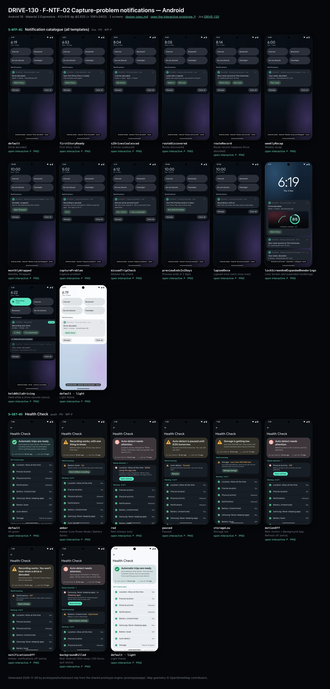
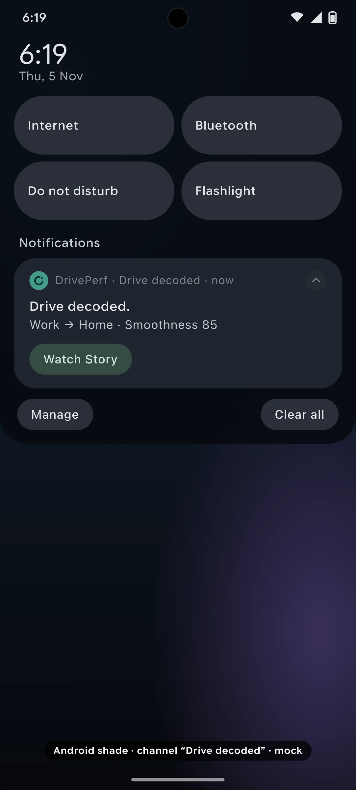
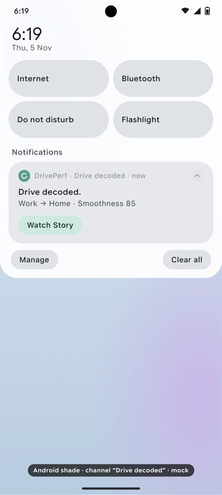
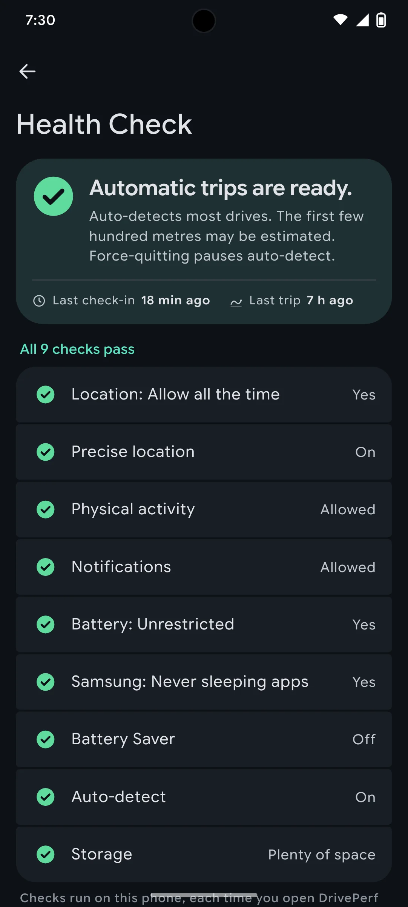
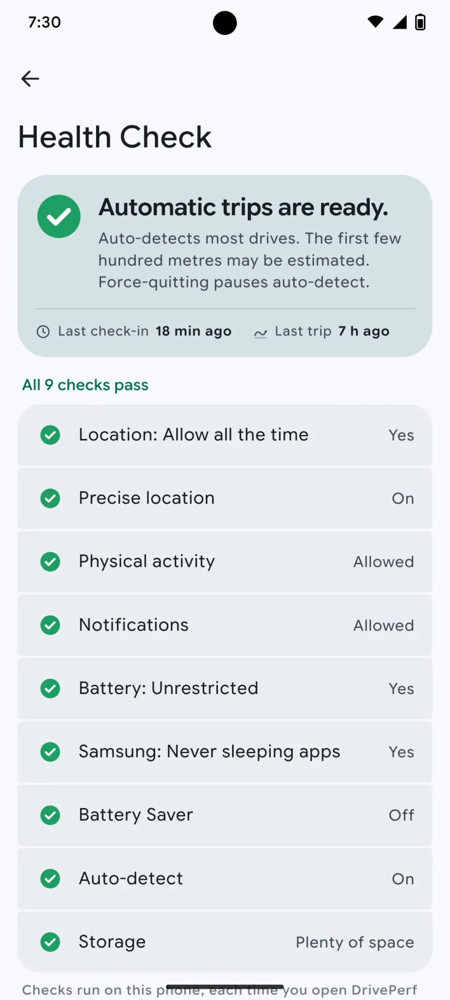

# DRIVE-130 · F-NTF-02 Capture-problem notifications — Android design spec

> Generated by `prototypes/tools/export.mjs` on 2026-11-07 from the shared prototype engine. **Do not edit by hand:** change the screen's `spec` in `prototypes/app/screens/wp-*.js` (see `prototypes/app/AUTHORING.md`) and re-export.

- **Jira story:** [DRIVE-130](https://thekeval.atlassian.net/browse/DRIVE-130) · F-NTF-02 · P0
- **Platform:** Android 16 · Material 3 Expressive · 412×915 dp @2.625 (≈ 1081×2402)
- **Interactive prototype:** [../../../../prototypes/android/index.html#S-NTF-01](../../../../prototypes/android/index.html#S-NTF-01) (catalog panel: every screen and state; deep links `#S-ID/state?trip=…&ent=…&theme=light&text=xl&rm=1`)
- **Contact sheet:** [mockup.html](mockup.html) · 
- **Design system (source of truth for values):** [brand](../../system/brand.md) · [components](../../system/components.md) · [motion](../../system/motion.md) · [accessibility](../../system/accessibility.md) · [screen map](../../system/screen-map.md) · [fixtures](../../system/fixtures.md) · tokens `prototypes/shared/tokens.css`

## Screens in this story

| Screen | Name | Presentation | Priority | States | Status |
|---|---|---|---|---|---|
| `S-NTF-01` | Notification catalogue (all templates) | Live (notification catalogue) | P0 | 13 | Prototyped |
| `S-SET-05` | Health Check | Push (or sheet from S-HOME-02) | P0 | 8 | Prototyped |

## Tokens used on this platform

Values resolved from `prototypes/shared/tokens.css` inside the Android device (`[data-platform="android"]`). Use the token names in code; the hex values are for reference.

| Token | Dark | Light |
|---|---|---|
| `--app-bg` | `#0D1117` | `#F7F9FC` |
| `--card-bg` | `#191E25` | `#EBEEF2` |
| `--dp-bg-grouped` | `#0D1117` | `#F7F9FC` |
| `--dp-surface` | `#191E25` | `#EBEEF2` |
| `--dp-surface-2` | `#1F252D` | `#E5E8EC` |
| `--dp-surface-3` | `#2A3038` | `#DFE2E6` |
| `--dp-fill` | `#2A3038` | `#DFE2E6` |
| `--dp-fill-strong` | `#353B44` | `#D3D7DC` |
| `--dp-text` | `#E1E3E8` | `#181C20` |
| `--dp-text-2` | `#C0C7CF` | `#40474F` |
| `--dp-text-3` | `#8A929B` | `#707881` |
| `--dp-separator` | `#40474F` | `#C0C7CF` |
| `--dp-accent` | `#5BE7C4` | `#006B53` |
| `--dp-accent-text` | `#5BE7C4` | `#006B53` |
| `--dp-on-accent` | `#00382B` | `#FFFFFF` |
| `--dp-accent-container` | `#00513F` | `#91F1D8` |
| `--dp-record` | `#FFC24B` | `#7A5900` |
| `--dp-positive` | `#5BE7C4` | `#006B53` |
| `--dp-change-down` | `#C0C7CF` | `#40474F` |
| `--dp-warning` | `#F5B648` | `#7A5900` |
| `--dp-critical` | `#FFB4AB` | `#BA1A1A` |
| `--dp-glass-fill` | `#1F252DF2` | `#E5E8ECF2` |
| `--dp-glass-fill-strong` | `#2A3038` | `#DFE2E6` |
| `--dp-glass-stroke` | `#FFFFFF0F` | `#0000000A` |
| `--md-sys-color-primary` | `#5BE7C4` | `#006B53` |
| `--md-sys-color-on-primary` | `#00382B` | `#FFFFFF` |
| `--md-sys-color-primary-container` | `#00513F` | `#91F1D8` |
| `--md-sys-color-on-primary-container` | `#91F1D8` | `#002118` |
| `--md-sys-color-secondary-container` | `#344C44` | `#CEE9DF` |
| `--md-sys-color-surface` | `#0D1117` | `#F7F9FC` |
| `--md-sys-color-surface-container` | `#191E25` | `#EBEEF2` |
| `--md-sys-color-surface-container-high` | `#1F252D` | `#E5E8EC` |
| `--md-sys-color-on-surface-variant` | `#C0C7CF` | `#40474F` |
| `--dp-data-route` | `#5BE7C4` | `#079777` |
| `--dp-data-event-brake` | `#FF7A66` | `#A21F16` |
| `--dp-data-event-accel` | `#E58BD0` | `#A33A8C` |
| `--dp-data-event-corner` | `#EAD54E` | `#9A8A00` |
| `--dp-data-quality-good` | `#5FDB9C` | `#1E9E62` |
| `--dp-data-speed` | `#D6DCE4` | `#404A58` |
| `--dp-data-long-g` | `#5AB8F5` | `#0A6AB8` |
| `--dp-data-lat-g` | `#F5A142` | `#B25A00` |

| Type / layout token | Value |
|---|---|
| `--dp-font-screen-title` | `600 32px / 40px "Google Sans Flex", "Google Sans Display", "Roboto Flex", Roboto, system-ui, sans-serif` |
| `--dp-font-sheet-title` | `400 24px / 32px "Google Sans Flex", "Google Sans Display", "Roboto Flex", Roboto, system-ui, sans-serif` |
| `--dp-font-section-title` | `600 22px / 28px "Google Sans Flex", "Google Sans Display", "Roboto Flex", Roboto, system-ui, sans-serif` |
| `--dp-font-card-title` | `700 16px / 24px "Google Sans Flex", "Google Sans Text", "Roboto Flex", Roboto, system-ui, sans-serif` |
| `--dp-font-body` | `400 16px / 24px "Google Sans Flex", "Google Sans Text", "Roboto Flex", Roboto, system-ui, sans-serif` |
| `--dp-font-body-secondary` | `400 14px / 20px "Google Sans Flex", "Google Sans Text", "Roboto Flex", Roboto, system-ui, sans-serif` |
| `--dp-font-meta` | `400 12px / 16px "Google Sans Flex", "Google Sans Text", "Roboto Flex", Roboto, system-ui, sans-serif` |
| `--dp-font-caption` | `500 12px / 16px "Google Sans Flex", "Google Sans Text", "Roboto Flex", Roboto, system-ui, sans-serif` |
| `--dp-font-button` | `700 14px / 20px "Google Sans Flex", "Google Sans Text", "Roboto Flex", Roboto, system-ui, sans-serif` |
| `--dp-num-hero` | `600 72px / 72px "Google Sans Flex", "Roboto Flex", Roboto, system-ui, sans-serif` |
| `--dp-num-xl` | `600 48px / 52px "Google Sans Flex", "Roboto Flex", Roboto, system-ui, sans-serif` |
| `--dp-num-l` | `600 34px / 38px "Google Sans Flex", "Roboto Flex", Roboto, system-ui, sans-serif` |
| `--dp-num-m` | `600 24px / 28px "Google Sans Flex", "Roboto Flex", Roboto, system-ui, sans-serif` |
| `--dp-num-s` | `600 17px / 22px "Google Sans Flex", "Roboto Flex", Roboto, system-ui, sans-serif` |
| `--dp-num-xs` | `600 13px / 16px "Google Sans Flex", "Roboto Flex", Roboto, system-ui, sans-serif` |
| `--dp-screen-margin` | `16px` |
| `--dp-radius-card` | `16px` |
| `--dp-radius-card-hero` | `28px` |
| `--dp-radius-sheet` | `28px` |
| `--dp-radius-chip` | `8px` |
| `--dp-radius-button` | `999px` |
| `--dp-layout-list-row-min` | `56px` |
| `--dp-layout-touch-min` | `48px` |
| `--safe-top` | `40px` |
| `--safe-bottom` | `24px` |

Text sizes scale with `--dp-text-scale` (XL = 2.0×) and numerals with `--dp-num-scale` (XL = 1.3×). DP Numerals: Google Sans Flex wdth 120 wght 600, tabular.

---

## S-NTF-01 · Notification catalogue (all templates)

 

- **Presentation:** live — screen map: “Live (notification catalogue)”
- **Entry points:** OS notification centre
- **Leads to:** Drive decoded → S-STY-01 · route → S-RTE-03/S-RTE-02 · recap → S-RCP-01 · Wrapped → S-WRP-01 · capture → S-SET-05 · missed trip → S-NTF-02 · preview → S-SUB-01 (all via the D1 gate)
- **PRD features:** F-NTF-01, F-NTF-02, F-NTF-03, F-NTF-04, F-NTF-06, F-STY-02, F-RTE-01, F-RTE-03 · **Priority:** P0 · **WP:** F
- **Interactive:** [S-NTF-01](../../../../prototypes/android/index.html#S-NTF-01)

**Purpose.** Every local notification DrivePerf sends, rendered on the real OS surface (iOS Lock Screen, Android notification shade / Lock Screen) with fixture copy, so native developers can match title, body, category/channel, actions and tap targets. All are local (no push server) and none arrives while a driver trip records (F-NTF-01).

### States

| State | PRD label | Fixture params | Screenshot |
|---|---|---|---|
| `default` | Drive decoded | — | [S-NTF-01.png](../../screens/android/S-NTF-01.webp) · [open](../../../../prototypes/android/index.html#S-NTF-01) |
| `firstStoryReady` | First Story ready | — | [S-NTF-01--firstStoryReady.png](../../screens/android/S-NTF-01--firstStoryReady.webp) · [open](../../../../prototypes/android/index.html#S-NTF-01/firstStoryReady) |
| `s2DrivesCoalesced` | 2 drives coalesced | — | [S-NTF-01--s2DrivesCoalesced.png](../../screens/android/S-NTF-01--s2DrivesCoalesced.webp) · [open](../../../../prototypes/android/index.html#S-NTF-01/s2DrivesCoalesced) |
| `routeDiscovered` | Route discovered | — | [S-NTF-01--routeDiscovered.png](../../screens/android/S-NTF-01--routeDiscovered.webp) · [open](../../../../prototypes/android/index.html#S-NTF-01/routeDiscovered) |
| `routeRecord` | Route record (replaces Drive decoded) | — | [S-NTF-01--routeRecord.png](../../screens/android/S-NTF-01--routeRecord.webp) · [open](../../../../prototypes/android/index.html#S-NTF-01/routeRecord) |
| `weeklyRecap` | Weekly recap | — | [S-NTF-01--weeklyRecap.png](../../screens/android/S-NTF-01--weeklyRecap.webp) · [open](../../../../prototypes/android/index.html#S-NTF-01/weeklyRecap) |
| `monthlyWrapped` | Monthly Wrapped | — | [S-NTF-01--monthlyWrapped.png](../../screens/android/S-NTF-01--monthlyWrapped.webp) · [open](../../../../prototypes/android/index.html#S-NTF-01/monthlyWrapped) |
| `captureProblem` | Capture problem | — | [S-NTF-01--captureProblem.png](../../screens/android/S-NTF-01--captureProblem.webp) · [open](../../../../prototypes/android/index.html#S-NTF-01/captureProblem) |
| `missedTripCheck` | Missed-trip check | — | [S-NTF-01--missedTripCheck.png](../../screens/android/S-NTF-01--missedTripCheck.webp) · [open](../../../../prototypes/android/index.html#S-NTF-01/missedTripCheck) |
| `previewEndsIn2Days` | Preview ends in 2 days | — | [S-NTF-01--previewEndsIn2Days.png](../../screens/android/S-NTF-01--previewEndsIn2Days.webp) · [open](../../../../prototypes/android/index.html#S-NTF-01/previewEndsIn2Days) |
| `lapsedOnce` | Lapsed once (sent once ever) | — | [S-NTF-01--lapsedOnce.png](../../screens/android/S-NTF-01--lapsedOnce.webp) · [open](../../../../prototypes/android/index.html#S-NTF-01/lapsedOnce) |
| `lockScreenAndExpandedRenderings` | Lock Screen and expanded renderings | — | [S-NTF-01--lockScreenAndExpandedRenderings.png](../../screens/android/S-NTF-01--lockScreenAndExpandedRenderings.webp) · [open](../../../../prototypes/android/index.html#S-NTF-01/lockScreenAndExpandedRenderings) |
| `heldWhileDriving` | Held while a drive records (extra) | — | [S-NTF-01--heldWhileDriving.png](../../screens/android/S-NTF-01--heldWhileDriving.webp) · [open](../../../../prototypes/android/index.html#S-NTF-01/heldWhileDriving) |
| default · light | Light theme | `theme=light` | [S-NTF-01--light.png](../../screens/android/S-NTF-01--light.webp) |

Every state also renders in light/dark (`theme=light`), XL text (`text=xl`) and reduced motion (`rm=1`).

### Layout

- iOS: Lock Screen mock (wallpaper, date, 104 pt clock, flashlight/camera). The notification sits at the bottom of the stack: 38 pt app icon (The Loop on night), bold title (sentence case, full stop), body, relative time. Long-press expanded rendering = dimmed, blurred Lock Screen + the expanded platter with a rich preview (share-safe route glyph + Smoothness ring, part of day · car) and action buttons.
- Android: notification shade mock (clock + date, Quick Settings tiles, “Notifications” header, Manage / Clear all). Each notification: small mono Loop icon · “DrivePerf · {channel} · now” · expand chevron, title (Title Medium), body (Body Medium), action buttons as tonal pills when expanded.
- Android Lock Screen rendering: the expanded Drive decoded card on top, then collapsed Route record and Weekly recap cards.
- Held while driving (extra state): the recording surface (iOS Live Activity · Android ongoing “Recording your drive” notification with the minutes chip and the QS tile in “Recording”) plus a ghosted card “Held until you’ve parked” showing what will be delivered after the trip.
- A small black “· mock” tag marks every frame as a non-interactive OS surface (only the notification itself and its actions are tappable in the prototype).

### Components & tokens

| Component | Tokens / spec |
|---|---|
| `lockScreen` | see components.md |
| `notification` | components.md §20.6 |
| `shade` | see components.md |
| `qsTile` | see components.md |
| `liveActivity` | background black 55% · Glide accent · components.md §20 |
| `ring` | track --dp-fill-strong · arc --dp-gradient-ring (glide-400 → accent → glide-100) · baseline notch --dp-text-2 · record notch --dp-record · Android container Cookie9Sided --md-sys-color-primary-container 42% · components.md §3 |
| `glyph` | see components.md |

### Interactions & navigation

- Every tap goes through the D1 gate (screen-map §2.2): with a driver trip active it lands on S-DRV-01; with moving=1, Story/Recap/Wrapped/Paywall targets wait on S-DRV-05.
- Drive decoded → S-STY-01 (trip). First Story ready → S-STY-01/firstDrive. 2 drives decoded → S-HOME-01 (both new Story cards). Looks like a regular → S-RTE-03 (route candidate) · action “Not now” dismisses. New route record → S-STY-01/newRouteRecord · action “See route” → S-RTE-02.
- Your week, decoded. → S-RCP-01 (recap w2026-10-26). October, wrapped. → S-WRP-01. Recording is paused. → S-SET-05/red (Always lost). Did you drive around 5 pm? → S-NTF-02 (actions: Yes, I drove · I was a passenger → S-NTF-02/iWasAPassenger). Pro Preview ends in 2 days → S-SUB-01/day13. Recording is still on. → opens the app (S-HOME-01).
- iOS: tap = open, long-press = expanded with actions, swipe left = Options/Clear. Android: tap = open, chevron = expand, swipe = dismiss; channel settings from long-press.

### Motion

- Arrival: iOS platter drops 14 pt and scales 0.96 → 1 (spring.default); Android card slides down 10 dp and fades in (spring.default). The expanded preview scales 0.92 → 1 from the stack. The ring in the rich preview runs the ring reveal without haptics.
- No haptics are ever attached to notifications (motion.md §6). RM: notifications appear in place (220 ms cross-fade).

### Accessibility

- Each notification is one element read as “DrivePerf notification. Drive decoded. Work → Home · Smoothness 85.”; actions are separate buttons.
- Rich preview ring: “Smoothness 85”. Glyph is decorative (aria-hidden).
- Copy never relies on colour; titles are short and complete sentences so they survive truncation at the largest text sizes (the OS truncates the body, never the title).
- Held notifications are never announced during a trip.

### Platform notes

- **Android (this spec):** One NotificationChannel per type: Drive decoded · Routes and records · Weekly recap and Wrapped · Capture problems · Account and plan (default importance) · Recording (low, ongoing, Live Update). Actions via NotificationCompat.Action; expanded rich preview via a custom BigPicture-style layout; capture problems use CATEGORY_ERROR, recording CATEGORY_PROGRESS.
- *iOS (for reference):* UNNotificationCategory per type with UNNotificationAction buttons; interruption level: Drive decoded / First Story / Route record = active, Capture problem = timeSensitive (only if the user lets capture problems through quiet hours), the rest passive; threadIdentifier groups DrivePerf notifications; a Notification Content Extension draws the rich preview (glyph + ring, never a map).

### Analytics

- `notification_sent {type}`
- `notification_held {type, reason: trip_active|quiet_hours}`
- `notification_opened {type, action}`
- `notification_dismissed {type}`

### Copy

| Key | Text |
|---|---|
| Drive decoded | Drive decoded. · {route label} · Smoothness {n}  (e.g. “Work → Home · Smoothness 85”) |
| First Story | Your first Drive Story is ready. · Two minutes well spent. |
| Coalesced | 2 drives decoded. · Home → Gym · Gym → Home |
| Route discovered | Looks like a regular. · Name the route you’ve now driven 3 times? |
| Route record | New route record on The Commute. · 91, beating 89 from 14 Oct. |
| Weekly recap | Your week, decoded. · 5 drives · Smoothness 87 (+2) |
| Monthly Wrapped | October, wrapped. · You’re The Metronome this month. |
| Capture problem | Recording is paused. · Location access changed to “While Using” (Android: “While using the app”). Two taps to fix it. |
| Missed trip | Did you drive around 5 pm? · We may have missed it. Tell us and we’ll tune detection. |
| Preview ending | Your Pro Preview ends in 2 days. · Your trips stay yours either way. |
| Lapsed | Recording is still on. · We’ll tell you when the next drive is decoded. |
| Held | Held until you’ve parked |
| Actions | Watch Story · See drives · Name it · Not now · See route · Play recap · Open Wrapped · Fix it · Yes, I drove · I was a passenger · See what Pro keeps |

### Free / Pro

All notifications are Free. The Preview-ending notice is the only one that mentions the plan, and it never shows a price. No notification links to a paywall except Preview ending → S-SUB-01 (status sheet, not a paywall).

### Data & fixtures

Copy from DP_DATA.notifications (n_first, n_coalesced, n_route, n_record, n_week, n_wrapped, n_capture, n_missed, n_preview, n_lapsed, n_recording). Default Drive decoded is filled from t20261105-1745 with the F-STY-02 template, because t20261105-0742 set a record and its decoded notice is replaced by the record notice (F-NTF-06.2). Scene times are derived from trip end times (5 Nov 18:18 → 6:19; 28 Sep 18:52 → 6:53; 4 Nov 08:03 → 8:04; 5 Nov 08:13 → 8:14), recap deliveredAt (Sun 18:00), Preview day 13 (10 Oct). Monthly Wrapped is shown at 10:00 per F-NTF-04 (fixture wrapped.monthly.deliveredAt says 09:00). The lapsed date (27 Nov) is illustrative: 21 days without opening. Held state uses liveTrip.states.auto (21 min · 17.2 km · GTI).

### Assets

[icon-pause.svg](assets/icon-pause.svg) · [icon-stop.svg](assets/icon-stop.svg) · [icon-up.svg](assets/icon-up.svg) · [icon-down.svg](assets/icon-down.svg) · [logo-a-loop.svg](assets/logo-a-loop.svg)

UI glyphs may be swapped for SF Symbols / Material Symbols Rounded equivalents; event-pin, quality and provenance glyphs must not be (components.md global rules).

### Checklist (accessibility.md §9)

- [ ] Light and dark both render, and contrast passes.
- [ ] The XL text state reflows with no truncation.
- [ ] The RM state is defined.
- [ ] Every control has a label; every chart and map has a summary sentence.
- [ ] Every target ≥ 44 pt / 48 dp (≥ 64 in-drive).
- [ ] No meaning by colour alone.
- [ ] Speed is neutral wherever it appears and absent from social or live surfaces.
- [ ] No streak, leaderboard, speed or “beat your time” language.
- [ ] Behaviour is defined while a trip is active (D1 gate).
- [ ] Haptics come from motion.md §6 only.

---

## S-SET-05 · Health Check

 

- **Presentation:** push · tab: profile — screen map: “Push (or sheet from S-HOME-02)”
- **Entry points:** S-SET-01 · S-HOME-01 "needs attention" · S-HOME-02 · S-LIVE-10 · S-NTF-01 capture problem
- **Leads to:** System Settings deep links · S-SET-06 · S-ONB-11 · S-NTF-02 · S-SET-07
- **PRD features:** F-SET-02, F-CAP-14, F-CAP-16, F-DQ-07, F-NTF-02 · **Priority:** P0 · **WP:** F
- **Interactive:** [S-SET-05](../../../../prototypes/android/index.html#S-SET-05)

**Purpose.** One screen that says whether automatic capture will work and how to fix it, with green/amber/red items and a fix action each (F-SET-02, F-NTF-02, F-CAP-14, F-CAP-16, F-DQ-07).

### States

| State | PRD label | Fixture params | Screenshot |
|---|---|---|---|
| `default` | All green | — | [S-SET-05.png](../../screens/android/S-SET-05.webp) · [open](../../../../prototypes/android/index.html#S-SET-05) |
| `amber` | Amber (Low Power Mode / Battery Saver) | `health=lowPower` | [S-SET-05--amber.png](../../screens/android/S-SET-05--amber.webp) · [open](../../../../prototypes/android/index.html#S-SET-05/amber) |
| `red` | Red (Always lost) | `health=alwaysLost` | [S-SET-05--red.png](../../screens/android/S-SET-05--red.webp) · [open](../../../../prototypes/android/index.html#S-SET-05/red) |
| `paused` | Paused | `health=paused` | [S-SET-05--paused.png](../../screens/android/S-SET-05--paused.webp) · [open](../../../../prototypes/android/index.html#S-SET-05/paused) |
| `storageLow` | Storage low | `health=storageLow` | [S-SET-05--storageLow.png](../../screens/android/S-SET-05--storageLow.webp) · [open](../../../../prototypes/android/index.html#S-SET-05/storageLow) |
| `motionOff` | Red: motion + Background App Refresh off (extra) | `health=motionOff` | [S-SET-05--motionOff.png](../../screens/android/S-SET-05--motionOff.webp) · [open](../../../../prototypes/android/index.html#S-SET-05/motionOff) |
| `notificationsOff` | Amber: notifications off (extra) | `health=notificationsOff` | [S-SET-05--notificationsOff.png](../../screens/android/S-SET-05--notificationsOff.webp) · [open](../../../../prototypes/android/index.html#S-SET-05/notificationsOff) |
| `backgroundKilled` | Red: Android OEM sleep / iOS force-quit (extra) | `health=backgroundKilled` | [S-SET-05--backgroundKilled.png](../../screens/android/S-SET-05--backgroundKilled.webp) · [open](../../../../prototypes/android/index.html#S-SET-05/backgroundKilled) |
| default · light | Light theme | `theme=light` | [S-SET-05--light.png](../../screens/android/S-SET-05--light.webp) |

Every state also renders in light/dark (`theme=light`), XL text (`text=xl`) and reduced motion (`rm=1`).

### Layout

- Summary header card: large status glyph (44, shape = state) + summary (“Automatic trips are ready.” / “Recording works, with one thing to know.” / “Auto-detect needs attention.” / “Auto-detect is paused until 8:00 tomorrow.” / “Storage is getting low.”) + one line (the honest capture promise when green, else the worst item’s detail) + meta row “Last check-in 18 min ago · Last trip 7 h ago”. Tint: critical container (red), warning container (amber), surface (green).
- “Needs attention · n” (red) then “Worth knowing” (amber): rows with glyph · label · state (“Location: Always · While Using only”) · detail line · fix button (filled for red, tonal for amber).
- “Working · n of 9” / “All 9 checks pass”: green rows with glyph · label · state value. Footer: where checks run.
- Help: Report a missed drive → S-NTF-02 · Reliability guide → S-SET-06 · Test my setup → S-SET-06/testMySetupPassFail.
- iOS items: Location: Always · Precise Location · Motion & Fitness · Notifications · Background App Refresh · Low Power Mode · Live Activities · Auto-detect · Storage. Android: Location: Allow all the time · Precise location · Physical activity · Notifications · Battery: Unrestricted · Samsung: Never sleeping apps · Battery Saver · Auto-detect · Storage (DP_DATA.health.{ios,android}.items).

### Components & tokens

| Component | Tokens / spec |
|---|---|
| `navBar` | --dp-font-card-title · --dp-font-meta · glass: --dp-glass-fill + --dp-glass-blur · components.md §2 |
| `list` | iOS inset grouped radius --dp-radius-card, rows 52 pt, separators --dp-separator inset 16 · Android ListItem 56/72 dp in --md-sys-color-surface-container |
| `row` | --dp-font-body · --dp-font-meta (supporting) · --dp-layout-list-row-min |
| `button` | --dp-accent / --dp-on-accent (filled) · --dp-fill-strong · --md-sys-color-secondary-container (tonal) · --dp-radius-button · height iOS 50/44/34 · Android 56/40/32 · --dp-font-button · components.md §0 |
| `section` | --dp-font-section-title · --dp-layout-section-gap 28 |
| `sysSettings` | see components.md |

### Interactions & navigation

- Location / Motion / Notifications / Background App Refresh / Live Activities / Battery → system Settings deep link (prototype: OS Settings mock with the target row highlighted; tap to return, the check re-runs and turns green within 1 s, F-SET-02.4).
- Precise location → S-ONB-11 · Low Power Mode / Battery Saver “How it affects recording” → S-SET-06 · OEM sleep “Show me how” → S-SET-06 (Samsung) · Storage → S-SET-07/lowStorage · Auto-detect paused → Resume (toast) · iOS no check-in (force-quit) → “Switch back on” re-arms (toast).
- Entry points: S-SET-01 · Home “needs attention” banner/chip · S-HOME-02 · S-LIVE-10 · the capture-problem notification (S-NTF-01). The Settings deep link from a red notification is the only thing allowed after a driver trip ends while still in the car (it opens after the trip, screen-map §2.2).

### Motion

- Header glyph pops in (scale 0.6 → 1, −20° → 0°, spring.bouncy); groups rise 8 px, 30 ms stagger. Haptic `warning` once when a red item is found. RM: no pop or rise (haptic kept).

### Accessibility

- Header is one element: “Auto-detect needs attention. Location access changed to While Using. Automatic trips are paused. Two taps to fix it. Last check-in 18 min ago. Last trip 7 h ago.”
- Each row: glyph label (“Needs attention” / “Worth knowing” / “OK”) + label + state + detail; the fix button reads “Open Settings: Location: Always”.
- State is carried by shape and words (octagon ! / triangle / check disc), never colour alone.
- XL text: rows grow to two or more lines and trailing values move under the title; nothing truncates. Every row is ≥ 52 pt (iOS) / 56 dp (Android).

### Platform notes

- **Android (this spec):** Checks: ACCESS_BACKGROUND_LOCATION, ACCESS_FINE_LOCATION, ACTIVITY_RECOGNITION, POST_NOTIFICATIONS / channel state, isIgnoringBatteryOptimizations, OEM sleeping-apps heuristic (Samsung), isPowerSaveMode, transition registration, free disk. Fix = ACTION_APPLICATION_DETAILS_SETTINGS / ACTION_REQUEST_IGNORE_BATTERY_OPTIMIZATIONS.
- *iOS (for reference):* Checks: CLAuthorizationStatus .authorizedAlways, accuracyAuthorization, CMMotionActivityManager authorization, UNAuthorizationStatus, backgroundRefreshStatus, isLowPowerModeEnabled, ActivityAuthorizationInfo().areActivitiesEnabled, watchdog check-in, free disk. Fix = UIApplication.openSettingsURLString.

### Analytics

- `health_check_opened {source, reds, ambers}`
- `health_fix_tapped {item}`
- `capture_problem_fixed {problem, hours_bucket}`

### Copy

| Key | Text |
|---|---|
| Green | Automatic trips are ready. · Auto-detects most drives. The first few hundred metres may be estimated. Force-quitting pauses auto-detect. |
| Amber | Recording works, with one thing to know. · Low Power Mode is on. Drives may start a little later. |
| Red | Auto-detect needs attention. · Location access changed to “While Using”. Automatic trips are paused. Two taps to fix it. |
| Paused | Auto-detect is paused until 8:00 tomorrow. · Paused until 8:00 tomorrow. You can still tap Start. · Resume |
| Storage low | Storage is getting low. · Less than 500 MB free. New drives still record; detailed data may be trimmed. · Manage storage |
| iOS force-quit | Auto-detect may be paused. · DrivePerf hasn’t checked in for 24 h, usually after a force-quit. Open it once to switch auto-detect back on. |
| Android OEM | Samsung put DrivePerf in “Sleeping apps”. Drives won’t start on their own. · Show me how |
| Fixes | Open Settings · Fix · How it affects recording · Open battery settings · Show me how · Resume · Switch back on · Manage storage |

### Free / Pro

Free. No upsell on this screen.

### Data & fixtures

DP_DATA.health.{ios,android}.items + presets: allGood (default), lowPower (amber), alwaysLost (red), paused, storageLow, motionOff, notificationsOff, oemKiller (Android). iOS “backgroundKilled” has no preset: it is built from allGood + the watchdog copy (n_watchdog, F-CAP-14) with autoDetect red and last check-in 5 Nov 18:20. Detail lines for amber items without fixture detail come from components.md §17 copy. Last check-in / last trip are relative to today 19:30.

### Assets

[icon-clock.svg](assets/icon-clock.svg) · [icon-drives.svg](assets/icon-drives.svg) · [icon-battery.svg](assets/icon-battery.svg) · [icon-check.svg](assets/icon-check.svg) · [icon-chevronRight.svg](assets/icon-chevronRight.svg)

UI glyphs may be swapped for SF Symbols / Material Symbols Rounded equivalents; event-pin, quality and provenance glyphs must not be (components.md global rules).

### Checklist (accessibility.md §9)

- [ ] Light and dark both render, and contrast passes.
- [ ] The XL text state reflows with no truncation.
- [ ] The RM state is defined.
- [ ] Every control has a label; every chart and map has a summary sentence.
- [ ] Every target ≥ 44 pt / 48 dp (≥ 64 in-drive).
- [ ] No meaning by colour alone.
- [ ] Speed is neutral wherever it appears and absent from social or live surfaces.
- [ ] No streak, leaderboard, speed or “beat your time” language.
- [ ] Behaviour is defined while a trip is active (D1 gate).
- [ ] Haptics come from motion.md §6 only.

---

Map geometry in the prototype: © OpenStreetMap contributors (ODbL). Speed and G are simulated fixtures (fixtures.md).
