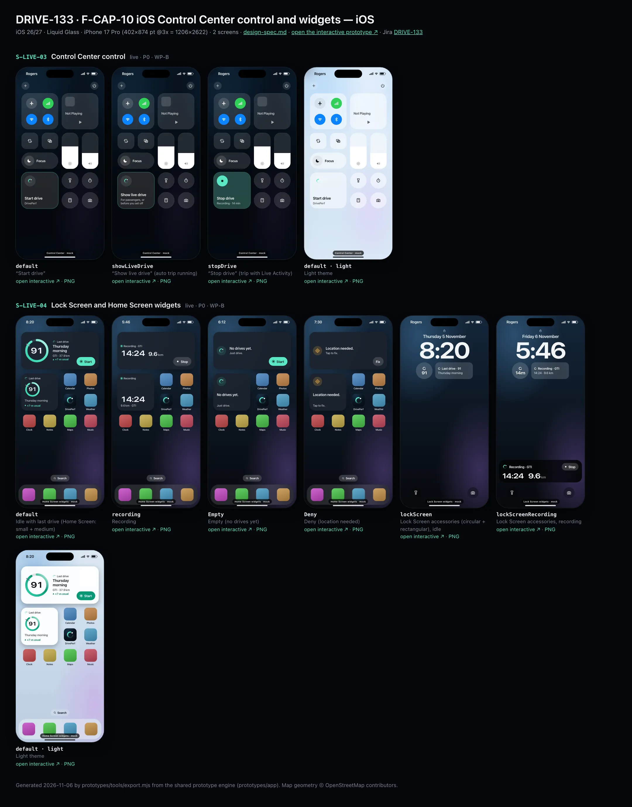
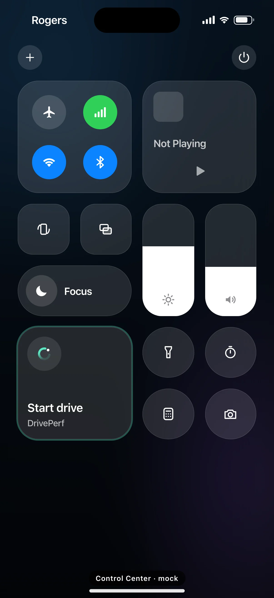
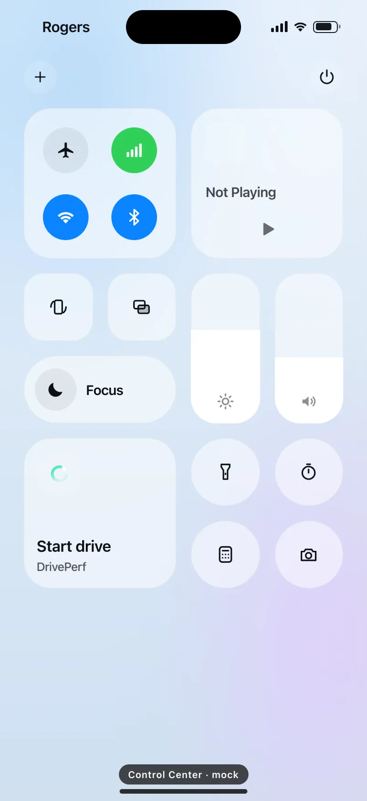
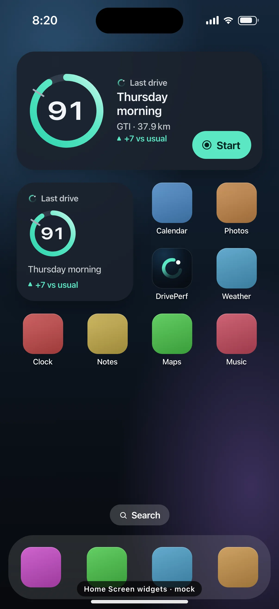
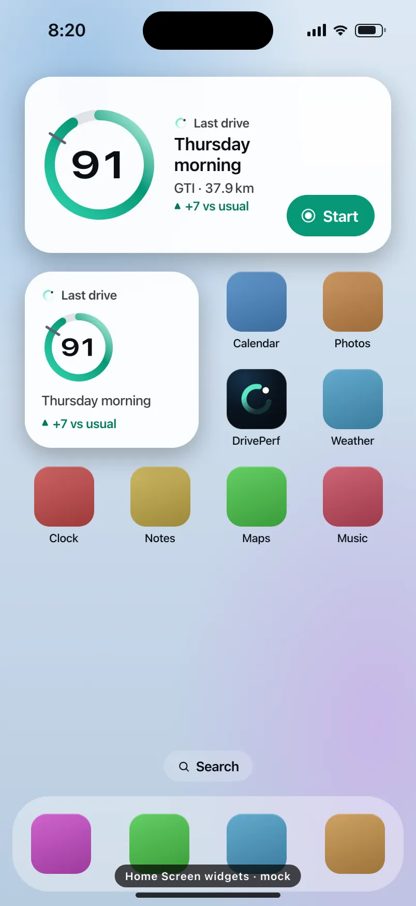

# DRIVE-133 · F-CAP-10 iOS Control Center control and widgets — iOS design spec

> Generated by `prototypes/tools/export.mjs` on 2026-11-06 from the shared prototype engine. **Do not edit by hand:** change the screen's `spec` in `prototypes/app/screens/wp-*.js` (see `prototypes/app/AUTHORING.md`) and re-export.

- **Jira story:** [DRIVE-133](https://thekeval.atlassian.net/browse/DRIVE-133) · F-CAP-10 · P0
- **Platform:** iOS 26/27 · Liquid Glass · iPhone 17 Pro (402×874 pt @3x = 1206×2622)
- **Interactive prototype:** [../../../../prototypes/ios/index.html#S-LIVE-03](../../../../prototypes/ios/index.html#S-LIVE-03) (catalog panel: every screen and state; deep links `#S-ID/state?trip=…&ent=…&theme=light&text=xl&rm=1`)
- **Contact sheet:** [mockup.html](mockup.html) · 
- **Design system (source of truth for values):** [brand](../../system/brand.md) · [components](../../system/components.md) · [motion](../../system/motion.md) · [accessibility](../../system/accessibility.md) · [screen map](../../system/screen-map.md) · [fixtures](../../system/fixtures.md) · tokens `prototypes/shared/tokens.css`

## Screens in this story

| Screen | Name | Presentation | Priority | States | Status |
|---|---|---|---|---|---|
| `S-LIVE-03` | Control Center control | Live (iOS Control Center) | P0 | 3 | Prototyped |
| `S-LIVE-04` | Lock Screen and Home Screen widgets | Live (iOS widgets) | P0 | 6 | Prototyped |

## Tokens used on this platform

Values resolved from `prototypes/shared/tokens.css` inside the iOS device (`[data-platform="ios"]`). Use the token names in code; the hex values are for reference.

| Token | Dark | Light |
|---|---|---|
| `--app-bg` | `#080B10` | `#F2F3F6` |
| `--card-bg` | `#131822` | `#FFFFFF` |
| `--dp-bg-grouped` | `#080B10` | `#F2F3F6` |
| `--dp-surface` | `#131822` | `#FFFFFF` |
| `--dp-surface-2` | `#1B222D` | `#F2F3F6` |
| `--dp-surface-3` | `#262E3B` | `#E4E7EC` |
| `--dp-fill` | `#7880961F` | `#7880961F` |
| `--dp-fill-strong` | `#7880963D` | `#78809633` |
| `--dp-text` | `#F2F4F7` | `#0B0E13` |
| `--dp-text-2` | `#A3AAB6` | `#5A6271` |
| `--dp-text-3` | `#6E7787` | `#8A919D` |
| `--dp-separator` | `#96A0B429` | `#3C435024` |
| `--dp-accent` | `#5BE7C4` | `#079777` |
| `--dp-accent-text` | `#5BE7C4` | `#06775E` |
| `--dp-on-accent` | `#04241D` | `#FFFFFF` |
| `--dp-accent-container` | `#0A4439` | `#C6F8EA` |
| `--dp-record` | `#FFC24B` | `#9A6300` |
| `--dp-positive` | `#5BE7C4` | `#06775E` |
| `--dp-change-down` | `#A3AAB6` | `#5A6271` |
| `--dp-warning` | `#F5B648` | `#9A5F00` |
| `--dp-critical` | `#FF6B6B` | `#C62828` |
| `--dp-glass-fill` | `#1C222C6B` | `#FFFFFF8C` |
| `--dp-glass-fill-strong` | `#1C222CB8` | `#FFFFFFD1` |
| `--dp-glass-stroke` | `#FFFFFF24` | `#FFFFFF99` |
| `--dp-data-route` | `#5BE7C4` | `#079777` |
| `--dp-data-event-brake` | `#FF7A66` | `#A21F16` |
| `--dp-data-event-accel` | `#E58BD0` | `#A33A8C` |
| `--dp-data-event-corner` | `#EAD54E` | `#9A8A00` |
| `--dp-data-quality-good` | `#5FDB9C` | `#1E9E62` |
| `--dp-data-speed` | `#D6DCE4` | `#404A58` |
| `--dp-data-long-g` | `#5AB8F5` | `#0A6AB8` |
| `--dp-data-lat-g` | `#F5A142` | `#B25A00` |

| Type / layout token | Value |
|---|---|
| `--dp-font-screen-title` | `700 34px / 41px -apple-system, BlinkMacSystemFont, "SF Pro Display", system-ui, sans-serif` |
| `--dp-font-sheet-title` | `700 22px / 28px -apple-system, BlinkMacSystemFont, "SF Pro Display", system-ui, sans-serif` |
| `--dp-font-section-title` | `600 20px / 25px -apple-system, BlinkMacSystemFont, "SF Pro Display", system-ui, sans-serif` |
| `--dp-font-card-title` | `600 17px / 22px -apple-system, BlinkMacSystemFont, "SF Pro Text", system-ui, sans-serif` |
| `--dp-font-body` | `400 17px / 22px -apple-system, BlinkMacSystemFont, "SF Pro Text", system-ui, sans-serif` |
| `--dp-font-body-secondary` | `400 15px / 20px -apple-system, BlinkMacSystemFont, "SF Pro Text", system-ui, sans-serif` |
| `--dp-font-meta` | `400 13px / 18px -apple-system, BlinkMacSystemFont, "SF Pro Text", system-ui, sans-serif` |
| `--dp-font-caption` | `400 12px / 16px -apple-system, BlinkMacSystemFont, "SF Pro Text", system-ui, sans-serif` |
| `--dp-font-button` | `600 17px / 22px -apple-system, BlinkMacSystemFont, "SF Pro Text", system-ui, sans-serif` |
| `--dp-num-hero` | `600 72px / 72px -apple-system, BlinkMacSystemFont, "SF Pro Display", system-ui, sans-serif` |
| `--dp-num-xl` | `600 48px / 52px -apple-system, BlinkMacSystemFont, "SF Pro Display", system-ui, sans-serif` |
| `--dp-num-l` | `600 34px / 38px -apple-system, BlinkMacSystemFont, "SF Pro Display", system-ui, sans-serif` |
| `--dp-num-m` | `600 24px / 28px -apple-system, BlinkMacSystemFont, "SF Pro Display", system-ui, sans-serif` |
| `--dp-num-s` | `600 17px / 22px -apple-system, BlinkMacSystemFont, "SF Pro Display", system-ui, sans-serif` |
| `--dp-num-xs` | `600 13px / 16px -apple-system, BlinkMacSystemFont, "SF Pro Display", system-ui, sans-serif` |
| `--dp-screen-margin` | `16px` |
| `--dp-radius-card` | `24px` |
| `--dp-radius-card-hero` | `32px` |
| `--dp-radius-sheet` | `38px` |
| `--dp-radius-chip` | `999px` |
| `--dp-radius-button` | `999px` |
| `--dp-layout-list-row-min` | `52px` |
| `--dp-layout-touch-min` | `44px` |
| `--safe-top` | `62px` |
| `--safe-bottom` | `34px` |

Text sizes scale with `--dp-text-scale` (XL = 2.0×) and numerals with `--dp-num-scale` (XL = 1.3×). DP Numerals: SF Pro Expanded Semibold, tabular.

---

## S-LIVE-03 · Control Center control

 

- **Presentation:** live — screen map: “Live (iOS Control Center)”
- **Entry points:** Control Center
- **Leads to:** Start → S-LIVE-01 (no app open) · Show live drive · Stop
- **PRD features:** F-CAP-10 · **Priority:** P0 · **WP:** B
- **Interactive:** [S-LIVE-03](../../../../prototypes/ios/index.html#S-LIVE-03)

**Purpose.** One tap to start a recorded drive with its Live Activity before setting off, without opening the app (F-CAP-10). With an auto trip already running it offers “Show live drive” for passengers and pre-departure; during a trip it becomes “Stop drive”.

### States

| State | PRD label | Fixture params | Screenshot |
|---|---|---|---|
| `default` | “Start drive” | — | [S-LIVE-03.png](../../screens/ios/S-LIVE-03.webp) · [open](../../../../prototypes/ios/index.html#S-LIVE-03) |
| `showLiveDrive` | “Show live drive” (auto trip running) | `live=auto` | [S-LIVE-03--showLiveDrive.png](../../screens/ios/S-LIVE-03--showLiveDrive.webp) · [open](../../../../prototypes/ios/index.html#S-LIVE-03/showLiveDrive) |
| `stopDrive` | “Stop drive” (trip with Live Activity) | `live=manual` | [S-LIVE-03--stopDrive.png](../../screens/ios/S-LIVE-03--stopDrive.webp) · [open](../../../../prototypes/ios/index.html#S-LIVE-03/stopDrive) |
| default · light | Light theme | `theme=light` | [S-LIVE-03--light.png](../../screens/ios/S-LIVE-03--light.webp) |

Every state also renders in light/dark (`theme=light`), XL text (`text=xl`) and reduced motion (`rm=1`).

### Layout

- iOS Control Center mock: blurred, dimmed wallpaper; connectivity 2×2, Now Playing 2×2, orientation + screen mirroring, brightness + volume sliders (1×2), Focus 2×1, flashlight · timer · calculator · camera (1×1 circles).
- DrivePerf control, medium size (2×1, 166×74, radius 26, glass #ffffff26): leading 46 circle with the symbol (the Loop in Glide; Stop glyph when active) + title (600 15) + subtitle (13, 60%). Active (stopDrive): circle filled Glide with a black stop glyph, tile tinted Glide 22%.
- Small (1×1) variant uses the symbol only, with the title as its accessibility label.

### Components & tokens

| Component | Tokens / spec |
|---|---|
| `ControlWidgetButton (local mock)` | see components.md |
| `controlCenter (local ccPanel)` | see components.md |

### Interactions & navigation

- Start drive → LiveActivityIntent starts a manual trip and S-LIVE-01 without opening the app; with no location permission the intent opens S-ONB-16 instead (EC-PERM).
- Show live drive (auto trip running) → attaches a Live Activity to the running trip (S-LIVE-01 with the auto trip’s numbers). Copy never invites use while driving (D13).
- Stop drive → ends the trip (S-DRV-04 on next open; the control returns to Start drive). Haptics: confirm on Start/Stop (system).

### Motion

- System Control Center motion only (the control’s symbol uses .contentTransition(.symbolEffect) on state change). Prototype: the control pops in once. RM: none.

### Accessibility

- Labels: “Start drive, DrivePerf” · “Show live drive. For passengers, or before you set off.” · “Stop drive. Recording, 14 minutes.”
- The value text never updates more than once a minute (no timer in Control Center).

### Platform notes

- **iOS (this spec):** ControlWidget (ControlWidgetButton + App Intent / LiveActivityIntent), kind com.driveperf.control.drive; ControlValueProvider supplies idle / autoRunning / recording.
- *Android (for reference):* n/a (iOS only). Android equivalent: S-LIVE-07 Quick Settings tile.

### Analytics

- `control_tapped {action: start|show_live|stop}`
- `trip_started {mode: manual, trigger: control}`

### Copy

| Key | Text |
|---|---|
| Start | Start drive · DrivePerf |
| Show live | Show live drive · For passengers, or before you set off |
| Stop | Stop drive · Recording · {14} min |

### Free / Pro

Same for every plan.

### Data & fixtures

stopDrive uses liveTrip.states.manual (14 min); showLiveDrive reflects liveTrip.states.auto running in the background. No speed or score.

### Assets

[icon-stop.svg](assets/icon-stop.svg) · [icon-plus.svg](assets/icon-plus.svg) · [icon-play.svg](assets/icon-play.svg) · [logo-a-loop.svg](assets/logo-a-loop.svg)

UI glyphs may be swapped for SF Symbols / Material Symbols Rounded equivalents; event-pin, quality and provenance glyphs must not be (components.md global rules).

### Checklist (accessibility.md §9)

- [ ] Light and dark both render, and contrast passes.
- [ ] The XL text state reflows with no truncation.
- [ ] The RM state is defined.
- [ ] Every control has a label; every chart and map has a summary sentence.
- [ ] Every target ≥ 44 pt / 48 dp (≥ 64 in-drive).
- [ ] No meaning by colour alone.
- [ ] Speed is neutral wherever it appears and absent from social or live surfaces.
- [ ] No streak, leaderboard, speed or “beat your time” language.
- [ ] Behaviour is defined while a trip is active (D1 gate).
- [ ] Haptics come from motion.md §6 only.

---

## S-LIVE-04 · Lock Screen and Home Screen widgets

 

- **Presentation:** live — screen map: “Live (iOS widgets)”
- **Entry points:** Lock/Home Screen
- **Leads to:** Start → S-LIVE-01 · tap last drive → S-STY-01 / S-TRP-01 (via D1 gate) · Deny → S-ONB-16
- **PRD features:** F-CAP-10 · **Priority:** P0 · **WP:** B
- **Interactive:** [S-LIVE-04](../../../../prototypes/ios/index.html#S-LIVE-04)

**Purpose.** Start a drive in one tap and see the last drive at a glance from the Home Screen and Lock Screen (F-CAP-10). While a trip records they switch to status only (timer, distance, car).

### States

| State | PRD label | Fixture params | Screenshot |
|---|---|---|---|
| `default` | Idle with last drive (Home Screen: small + medium) | — | [S-LIVE-04.png](../../screens/ios/S-LIVE-04.webp) · [open](../../../../prototypes/ios/index.html#S-LIVE-04) |
| `recording` | Recording | `live=manual` | [S-LIVE-04--recording.png](../../screens/ios/S-LIVE-04--recording.webp) · [open](../../../../prototypes/ios/index.html#S-LIVE-04/recording) |
| `Empty` | Empty (no drives yet) | — | [S-LIVE-04--Empty.png](../../screens/ios/S-LIVE-04--Empty.webp) · [open](../../../../prototypes/ios/index.html#S-LIVE-04/Empty) |
| `Deny` | Deny (location needed) | — | [S-LIVE-04--Deny.png](../../screens/ios/S-LIVE-04--Deny.webp) · [open](../../../../prototypes/ios/index.html#S-LIVE-04/Deny) |
| `lockScreen` | Lock Screen accessories (circular + rectangular), idle | — | [S-LIVE-04--lockScreen.png](../../screens/ios/S-LIVE-04--lockScreen.webp) · [open](../../../../prototypes/ios/index.html#S-LIVE-04/lockScreen) |
| `lockScreenRecording` | Lock Screen accessories, recording | `live=manual` | [S-LIVE-04--lockScreenRecording.png](../../screens/ios/S-LIVE-04--lockScreenRecording.webp) · [open](../../../../prototypes/ios/index.html#S-LIVE-04/lockScreenRecording) |
| default · light | Light theme | `theme=light` | [S-LIVE-04--light.png](../../screens/ios/S-LIVE-04--light.webp) |

Every state also renders in light/dark (`theme=light`), XL text (`text=xl`) and reduced motion (`rm=1`).

### Layout

- Home Screen mock: widgets first (medium spans the row, small 2×2 beside four labelled app icons incl. DrivePerf), search pill, glass dock.
- Medium (idle): 112 Smoothness ring (no label, baseline notch) · kicker “Last drive” with the Loop · “Thursday morning” (600 17) · “GTI · 37.9 km” · “▲ +7 vs usual” (Glide) · trailing Start capsule (Glide filled, record glyph, 40 tall). No route name and no map (privacy, F-CAP-10).
- Small (idle): kicker, 82 ring, part of day, delta. Recording: live dot + “Recording”, timer 34 DP Numerals, “9.6 km · GTI” (medium adds a Stop capsule). Empty: Loop + “No drives yet. Just drive.” + Start. Deny: GPS glyph in warning tint + “Location needed. Tap to fix.” + Fix.
- Lock Screen accessories under the clock: circular (Loop + last score “91”, or “14m” while recording) and rectangular (“Last drive · 91 / Thursday morning”, or “Recording · GTI / 14:24 · 9.6 km”), rendered in the system’s vibrant monochrome. Recording also shows the Live Activity.

### Components & tokens

| Component | Tokens / spec |
|---|---|
| `widget` | see components.md |
| `ring` | track --dp-fill-strong · arc --dp-gradient-ring (glide-400 → accent → glide-100) · baseline notch --dp-text-2 · record notch --dp-record · Android container Cookie9Sided --md-sys-color-primary-container 42% · components.md §3 |
| `homeScreen` | see components.md |
| `lockScreen` | see components.md |
| `liveActivity` | background black 55% · Glide accent · components.md §20 |

### Interactions & navigation

- Start (medium, Empty) → LiveActivityIntent: starts a manual trip + S-LIVE-01 without opening the app. Stop (recording) → ends the trip.
- Last drive area → S-STY-01 for that trip if its Story is unwatched, else S-TRP-01 — through the D1 gate (S-DRV-05 while moving). Recording area → S-DRV-01.
- Empty body → S-HOME-01 first run. Deny → S-ONB-16 (manual mode sheet with the Settings deep link).

### Motion

- WidgetKit timeline reloads only; .contentTransition(.numericText()) for the score/timer; no custom animation. Prototype: ring reveal on load (no haptics). RM: static.

### Accessibility

- Each widget is one element plus its button: “Last drive, Thursday morning, GTI. Smoothness 91, 7 above your usual.” + “Start drive”.
- Recording: “DrivePerf, recording, GTI. 14 minutes, 9.6 kilometres.”
- Accessory widgets render with .widgetAccentable() so they stay legible in every Lock Screen tint.

### Platform notes

- **iOS (this spec):** WidgetKit: systemSmall, systemMedium, accessoryCircular, accessoryRectangular; Button(intent:) for Start/Stop (LiveActivityIntent); containerBackground for Liquid Glass / tinted Home Screens.
- *Android (for reference):* n/a (iOS only). Android equivalent: S-LIVE-08 Glance widget.

### Analytics

- `widget_tapped {action: start|stop|open_last|fix, family: small|medium|circular|rectangular}`
- `trip_started {mode: manual, trigger: widget}`

### Copy

| Key | Text |
|---|---|
| Idle | Last drive · {Thursday morning} · {GTI} · {37.9} km · ▲ +7 vs usual · Start |
| Rectangular | Last drive · {91} / {Thursday morning} |
| Recording | Recording · {GTI} · {14:24} · {9.6} km · Stop |
| Empty | No drives yet. Just drive. · Start |
| Deny | Location needed. Tap to fix. · Fix |

### Free / Pro

Same for every plan.

### Data & fixtures

Idle widgets show t20261105-0742 (Thursday morning, 91, +7) with the scene set at Thu 5 Nov 8:20 so it is the last drive (at today 19:30 the newest trip is unscorable and the widget would show “Not scored · Friday midday”). Recording: liveTrip.states.manual. Empty uses the install date (28 Sep). The widget always switches to the recording layout while any trip is active, so a score is never on screen during a drive.

### Assets

[icon-record.svg](assets/icon-record.svg) · [icon-stop.svg](assets/icon-stop.svg) · [icon-gps.svg](assets/icon-gps.svg) · [icon-lock.svg](assets/icon-lock.svg) · [logo-a-loop.svg](assets/logo-a-loop.svg)

UI glyphs may be swapped for SF Symbols / Material Symbols Rounded equivalents; event-pin, quality and provenance glyphs must not be (components.md global rules).

### Checklist (accessibility.md §9)

- [ ] Light and dark both render, and contrast passes.
- [ ] The XL text state reflows with no truncation.
- [ ] The RM state is defined.
- [ ] Every control has a label; every chart and map has a summary sentence.
- [ ] Every target ≥ 44 pt / 48 dp (≥ 64 in-drive).
- [ ] No meaning by colour alone.
- [ ] Speed is neutral wherever it appears and absent from social or live surfaces.
- [ ] No streak, leaderboard, speed or “beat your time” language.
- [ ] Behaviour is defined while a trip is active (D1 gate).
- [ ] Haptics come from motion.md §6 only.

---

Map geometry in the prototype: © OpenStreetMap contributors (ODbL). Speed and G are simulated fixtures (fixtures.md).
