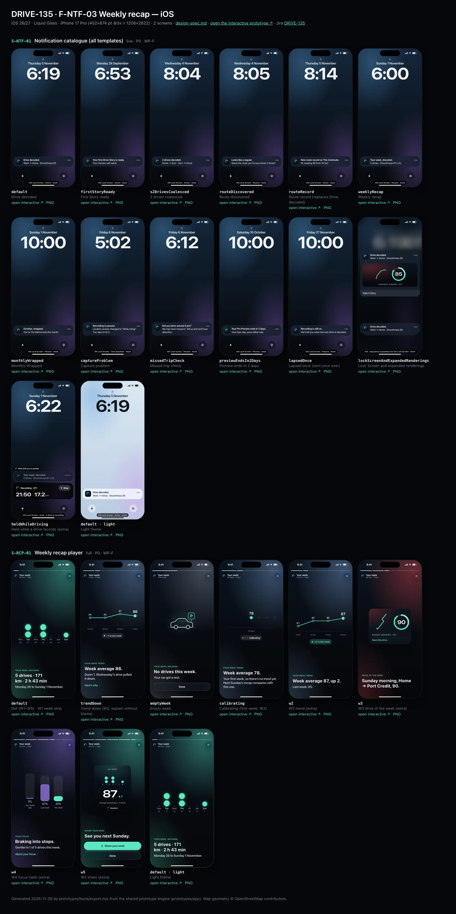
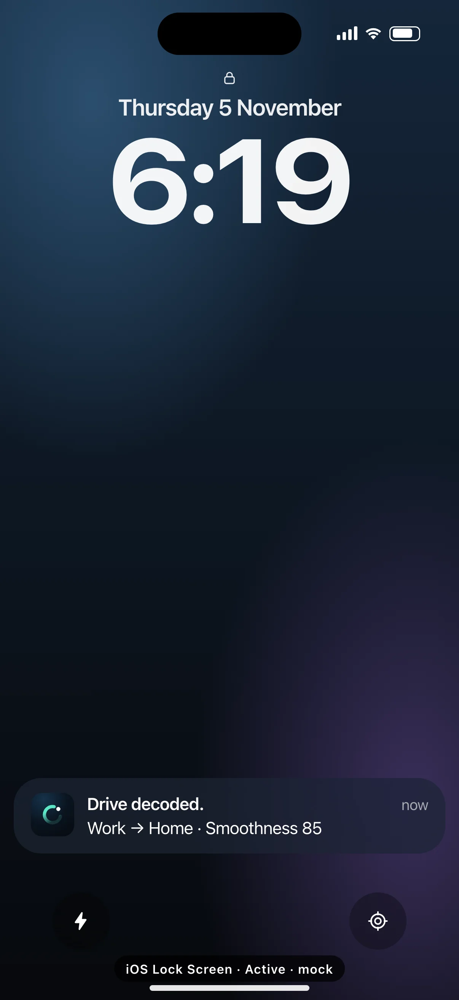
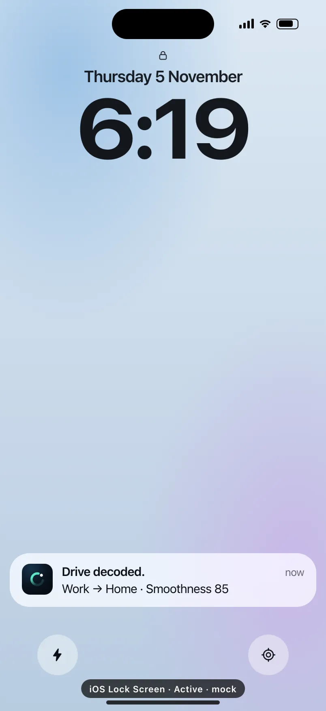
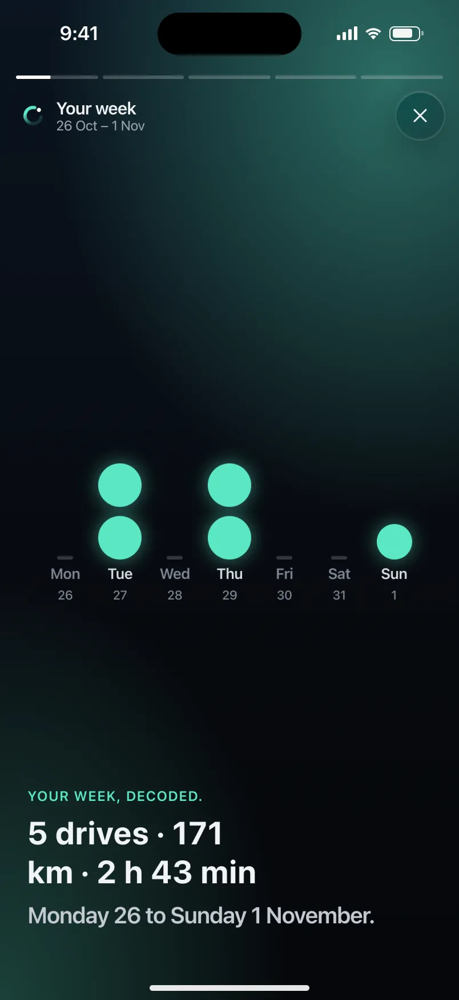

# DRIVE-135 · F-NTF-03 Weekly recap — iOS design spec

> Generated by `prototypes/tools/export.mjs` on 2026-11-07 from the shared prototype engine. **Do not edit by hand:** change the screen's `spec` in `prototypes/app/screens/wp-*.js` (see `prototypes/app/AUTHORING.md`) and re-export.

- **Jira story:** [DRIVE-135](https://thekeval.atlassian.net/browse/DRIVE-135) · F-NTF-03 · P0
- **Platform:** iOS 26/27 · Liquid Glass · iPhone 17 Pro (402×874 pt @3x = 1206×2622)
- **Interactive prototype:** [../../../../prototypes/ios/index.html#S-NTF-01](../../../../prototypes/ios/index.html#S-NTF-01) (catalog panel: every screen and state; deep links `#S-ID/state?trip=…&ent=…&theme=light&text=xl&rm=1`)
- **Contact sheet:** [mockup.html](mockup.html) · 
- **Design system (source of truth for values):** [brand](../../system/brand.md) · [components](../../system/components.md) · [motion](../../system/motion.md) · [accessibility](../../system/accessibility.md) · [screen map](../../system/screen-map.md) · [fixtures](../../system/fixtures.md) · tokens `prototypes/shared/tokens.css`

## Screens in this story

| Screen | Name | Presentation | Priority | States | Status |
|---|---|---|---|---|---|
| `S-NTF-01` | Notification catalogue (all templates) | Live (notification catalogue) | P0 | 13 | Prototyped |
| `S-RCP-01` | Weekly recap player | Full (player) | P0 | 8 | Prototyped |

## Tokens used on this platform

Values resolved from `prototypes/shared/tokens.css` inside the iOS device (`[data-platform="ios"]`). Use the token names in code; the hex values are for reference.

| Token | Dark | Light |
|---|---|---|
| `--app-bg` | `#080B10` | `#F2F3F6` |
| `--card-bg` | `#131822` | `#FFFFFF` |
| `--dp-bg-grouped` | `#080B10` | `#F2F3F6` |
| `--dp-surface` | `#131822` | `#FFFFFF` |
| `--dp-surface-2` | `#1B222D` | `#F2F3F6` |
| `--dp-surface-3` | `#262E3B` | `#E4E7EC` |
| `--dp-fill` | `#7880961F` | `#7880961F` |
| `--dp-fill-strong` | `#7880963D` | `#78809633` |
| `--dp-text` | `#F2F4F7` | `#0B0E13` |
| `--dp-text-2` | `#A3AAB6` | `#5A6271` |
| `--dp-text-3` | `#6E7787` | `#8A919D` |
| `--dp-separator` | `#96A0B429` | `#3C435024` |
| `--dp-accent` | `#5BE7C4` | `#079777` |
| `--dp-accent-text` | `#5BE7C4` | `#06775E` |
| `--dp-on-accent` | `#04241D` | `#FFFFFF` |
| `--dp-accent-container` | `#0A4439` | `#C6F8EA` |
| `--dp-record` | `#FFC24B` | `#9A6300` |
| `--dp-positive` | `#5BE7C4` | `#06775E` |
| `--dp-change-down` | `#A3AAB6` | `#5A6271` |
| `--dp-warning` | `#F5B648` | `#9A5F00` |
| `--dp-critical` | `#FF6B6B` | `#C62828` |
| `--dp-glass-fill` | `#1C222C6B` | `#FFFFFF8C` |
| `--dp-glass-fill-strong` | `#1C222CB8` | `#FFFFFFD1` |
| `--dp-glass-stroke` | `#FFFFFF24` | `#FFFFFF99` |
| `--dp-data-route` | `#5BE7C4` | `#079777` |
| `--dp-data-event-brake` | `#FF7A66` | `#A21F16` |
| `--dp-data-event-accel` | `#E58BD0` | `#A33A8C` |
| `--dp-data-event-corner` | `#EAD54E` | `#9A8A00` |
| `--dp-data-quality-good` | `#5FDB9C` | `#1E9E62` |
| `--dp-data-speed` | `#D6DCE4` | `#404A58` |
| `--dp-data-long-g` | `#5AB8F5` | `#0A6AB8` |
| `--dp-data-lat-g` | `#F5A142` | `#B25A00` |

| Type / layout token | Value |
|---|---|
| `--dp-font-screen-title` | `700 34px / 41px -apple-system, BlinkMacSystemFont, "SF Pro Display", system-ui, sans-serif` |
| `--dp-font-sheet-title` | `700 22px / 28px -apple-system, BlinkMacSystemFont, "SF Pro Display", system-ui, sans-serif` |
| `--dp-font-section-title` | `600 20px / 25px -apple-system, BlinkMacSystemFont, "SF Pro Display", system-ui, sans-serif` |
| `--dp-font-card-title` | `600 17px / 22px -apple-system, BlinkMacSystemFont, "SF Pro Text", system-ui, sans-serif` |
| `--dp-font-body` | `400 17px / 22px -apple-system, BlinkMacSystemFont, "SF Pro Text", system-ui, sans-serif` |
| `--dp-font-body-secondary` | `400 15px / 20px -apple-system, BlinkMacSystemFont, "SF Pro Text", system-ui, sans-serif` |
| `--dp-font-meta` | `400 13px / 18px -apple-system, BlinkMacSystemFont, "SF Pro Text", system-ui, sans-serif` |
| `--dp-font-caption` | `400 12px / 16px -apple-system, BlinkMacSystemFont, "SF Pro Text", system-ui, sans-serif` |
| `--dp-font-button` | `600 17px / 22px -apple-system, BlinkMacSystemFont, "SF Pro Text", system-ui, sans-serif` |
| `--dp-num-hero` | `600 72px / 72px -apple-system, BlinkMacSystemFont, "SF Pro Display", system-ui, sans-serif` |
| `--dp-num-xl` | `600 48px / 52px -apple-system, BlinkMacSystemFont, "SF Pro Display", system-ui, sans-serif` |
| `--dp-num-l` | `600 34px / 38px -apple-system, BlinkMacSystemFont, "SF Pro Display", system-ui, sans-serif` |
| `--dp-num-m` | `600 24px / 28px -apple-system, BlinkMacSystemFont, "SF Pro Display", system-ui, sans-serif` |
| `--dp-num-s` | `600 17px / 22px -apple-system, BlinkMacSystemFont, "SF Pro Display", system-ui, sans-serif` |
| `--dp-num-xs` | `600 13px / 16px -apple-system, BlinkMacSystemFont, "SF Pro Display", system-ui, sans-serif` |
| `--dp-screen-margin` | `16px` |
| `--dp-radius-card` | `24px` |
| `--dp-radius-card-hero` | `32px` |
| `--dp-radius-sheet` | `38px` |
| `--dp-radius-chip` | `999px` |
| `--dp-radius-button` | `999px` |
| `--dp-layout-list-row-min` | `52px` |
| `--dp-layout-touch-min` | `44px` |
| `--safe-top` | `62px` |
| `--safe-bottom` | `34px` |

Text sizes scale with `--dp-text-scale` (XL = 2.0×) and numerals with `--dp-num-scale` (XL = 1.3×). DP Numerals: SF Pro Expanded Semibold, tabular.

---

## S-NTF-01 · Notification catalogue (all templates)

 

- **Presentation:** live — screen map: “Live (notification catalogue)”
- **Entry points:** OS notification centre
- **Leads to:** Drive decoded → S-STY-01 · route → S-RTE-03/S-RTE-02 · recap → S-RCP-01 · Wrapped → S-WRP-01 · capture → S-SET-05 · missed trip → S-NTF-02 · preview → S-SUB-01 (all via the D1 gate)
- **PRD features:** F-NTF-01, F-NTF-02, F-NTF-03, F-NTF-04, F-NTF-06, F-STY-02, F-RTE-01, F-RTE-03 · **Priority:** P0 · **WP:** F
- **Interactive:** [S-NTF-01](../../../../prototypes/ios/index.html#S-NTF-01)

**Purpose.** Every local notification DrivePerf sends, rendered on the real OS surface (iOS Lock Screen, Android notification shade / Lock Screen) with fixture copy, so native developers can match title, body, category/channel, actions and tap targets. All are local (no push server) and none arrives while a driver trip records (F-NTF-01).

### States

| State | PRD label | Fixture params | Screenshot |
|---|---|---|---|
| `default` | Drive decoded | — | [S-NTF-01.png](../../screens/ios/S-NTF-01.webp) · [open](../../../../prototypes/ios/index.html#S-NTF-01) |
| `firstStoryReady` | First Story ready | — | [S-NTF-01--firstStoryReady.png](../../screens/ios/S-NTF-01--firstStoryReady.webp) · [open](../../../../prototypes/ios/index.html#S-NTF-01/firstStoryReady) |
| `s2DrivesCoalesced` | 2 drives coalesced | — | [S-NTF-01--s2DrivesCoalesced.png](../../screens/ios/S-NTF-01--s2DrivesCoalesced.webp) · [open](../../../../prototypes/ios/index.html#S-NTF-01/s2DrivesCoalesced) |
| `routeDiscovered` | Route discovered | — | [S-NTF-01--routeDiscovered.png](../../screens/ios/S-NTF-01--routeDiscovered.webp) · [open](../../../../prototypes/ios/index.html#S-NTF-01/routeDiscovered) |
| `routeRecord` | Route record (replaces Drive decoded) | — | [S-NTF-01--routeRecord.png](../../screens/ios/S-NTF-01--routeRecord.webp) · [open](../../../../prototypes/ios/index.html#S-NTF-01/routeRecord) |
| `weeklyRecap` | Weekly recap | — | [S-NTF-01--weeklyRecap.png](../../screens/ios/S-NTF-01--weeklyRecap.webp) · [open](../../../../prototypes/ios/index.html#S-NTF-01/weeklyRecap) |
| `monthlyWrapped` | Monthly Wrapped | — | [S-NTF-01--monthlyWrapped.png](../../screens/ios/S-NTF-01--monthlyWrapped.webp) · [open](../../../../prototypes/ios/index.html#S-NTF-01/monthlyWrapped) |
| `captureProblem` | Capture problem | — | [S-NTF-01--captureProblem.png](../../screens/ios/S-NTF-01--captureProblem.webp) · [open](../../../../prototypes/ios/index.html#S-NTF-01/captureProblem) |
| `missedTripCheck` | Missed-trip check | — | [S-NTF-01--missedTripCheck.png](../../screens/ios/S-NTF-01--missedTripCheck.webp) · [open](../../../../prototypes/ios/index.html#S-NTF-01/missedTripCheck) |
| `previewEndsIn2Days` | Preview ends in 2 days | — | [S-NTF-01--previewEndsIn2Days.png](../../screens/ios/S-NTF-01--previewEndsIn2Days.webp) · [open](../../../../prototypes/ios/index.html#S-NTF-01/previewEndsIn2Days) |
| `lapsedOnce` | Lapsed once (sent once ever) | — | [S-NTF-01--lapsedOnce.png](../../screens/ios/S-NTF-01--lapsedOnce.webp) · [open](../../../../prototypes/ios/index.html#S-NTF-01/lapsedOnce) |
| `lockScreenAndExpandedRenderings` | Lock Screen and expanded renderings | — | [S-NTF-01--lockScreenAndExpandedRenderings.png](../../screens/ios/S-NTF-01--lockScreenAndExpandedRenderings.webp) · [open](../../../../prototypes/ios/index.html#S-NTF-01/lockScreenAndExpandedRenderings) |
| `heldWhileDriving` | Held while a drive records (extra) | — | [S-NTF-01--heldWhileDriving.png](../../screens/ios/S-NTF-01--heldWhileDriving.webp) · [open](../../../../prototypes/ios/index.html#S-NTF-01/heldWhileDriving) |
| default · light | Light theme | `theme=light` | [S-NTF-01--light.png](../../screens/ios/S-NTF-01--light.webp) |

Every state also renders in light/dark (`theme=light`), XL text (`text=xl`) and reduced motion (`rm=1`).

### Layout

- iOS: Lock Screen mock (wallpaper, date, 104 pt clock, flashlight/camera). The notification sits at the bottom of the stack: 38 pt app icon (The Loop on night), bold title (sentence case, full stop), body, relative time. Long-press expanded rendering = dimmed, blurred Lock Screen + the expanded platter with a rich preview (share-safe route glyph + Smoothness ring, part of day · car) and action buttons.
- Android: notification shade mock (clock + date, Quick Settings tiles, “Notifications” header, Manage / Clear all). Each notification: small mono Loop icon · “DrivePerf · {channel} · now” · expand chevron, title (Title Medium), body (Body Medium), action buttons as tonal pills when expanded.
- Android Lock Screen rendering: the expanded Drive decoded card on top, then collapsed Route record and Weekly recap cards.
- Held while driving (extra state): the recording surface (iOS Live Activity · Android ongoing “Recording your drive” notification with the minutes chip and the QS tile in “Recording”) plus a ghosted card “Held until you’ve parked” showing what will be delivered after the trip.
- A small black “· mock” tag marks every frame as a non-interactive OS surface (only the notification itself and its actions are tappable in the prototype).

### Components & tokens

| Component | Tokens / spec |
|---|---|
| `lockScreen` | see components.md |
| `notification` | components.md §20.6 |
| `shade` | see components.md |
| `qsTile` | see components.md |
| `liveActivity` | background black 55% · Glide accent · components.md §20 |
| `ring` | track --dp-fill-strong · arc --dp-gradient-ring (glide-400 → accent → glide-100) · baseline notch --dp-text-2 · record notch --dp-record · Android container Cookie9Sided --md-sys-color-primary-container 42% · components.md §3 |
| `glyph` | see components.md |

### Interactions & navigation

- Every tap goes through the D1 gate (screen-map §2.2): with a driver trip active it lands on S-DRV-01; with moving=1, Story/Recap/Wrapped/Paywall targets wait on S-DRV-05.
- Drive decoded → S-STY-01 (trip). First Story ready → S-STY-01/firstDrive. 2 drives decoded → S-HOME-01 (both new Story cards). Looks like a regular → S-RTE-03 (route candidate) · action “Not now” dismisses. New route record → S-STY-01/newRouteRecord · action “See route” → S-RTE-02.
- Your week, decoded. → S-RCP-01 (recap w2026-10-26). October, wrapped. → S-WRP-01. Recording is paused. → S-SET-05/red (Always lost). Did you drive around 5 pm? → S-NTF-02 (actions: Yes, I drove · I was a passenger → S-NTF-02/iWasAPassenger). Pro Preview ends in 2 days → S-SUB-01/day13. Recording is still on. → opens the app (S-HOME-01).
- iOS: tap = open, long-press = expanded with actions, swipe left = Options/Clear. Android: tap = open, chevron = expand, swipe = dismiss; channel settings from long-press.

### Motion

- Arrival: iOS platter drops 14 pt and scales 0.96 → 1 (spring.default); Android card slides down 10 dp and fades in (spring.default). The expanded preview scales 0.92 → 1 from the stack. The ring in the rich preview runs the ring reveal without haptics.
- No haptics are ever attached to notifications (motion.md §6). RM: notifications appear in place (220 ms cross-fade).

### Accessibility

- Each notification is one element read as “DrivePerf notification. Drive decoded. Work → Home · Smoothness 85.”; actions are separate buttons.
- Rich preview ring: “Smoothness 85”. Glyph is decorative (aria-hidden).
- Copy never relies on colour; titles are short and complete sentences so they survive truncation at the largest text sizes (the OS truncates the body, never the title).
- Held notifications are never announced during a trip.

### Platform notes

- **iOS (this spec):** UNNotificationCategory per type with UNNotificationAction buttons; interruption level: Drive decoded / First Story / Route record = active, Capture problem = timeSensitive (only if the user lets capture problems through quiet hours), the rest passive; threadIdentifier groups DrivePerf notifications; a Notification Content Extension draws the rich preview (glyph + ring, never a map).
- *Android (for reference):* One NotificationChannel per type: Drive decoded · Routes and records · Weekly recap and Wrapped · Capture problems · Account and plan (default importance) · Recording (low, ongoing, Live Update). Actions via NotificationCompat.Action; expanded rich preview via a custom BigPicture-style layout; capture problems use CATEGORY_ERROR, recording CATEGORY_PROGRESS.

### Analytics

- `notification_sent {type}`
- `notification_held {type, reason: trip_active|quiet_hours}`
- `notification_opened {type, action}`
- `notification_dismissed {type}`

### Copy

| Key | Text |
|---|---|
| Drive decoded | Drive decoded. · {route label} · Smoothness {n}  (e.g. “Work → Home · Smoothness 85”) |
| First Story | Your first Drive Story is ready. · Two minutes well spent. |
| Coalesced | 2 drives decoded. · Home → Gym · Gym → Home |
| Route discovered | Looks like a regular. · Name the route you’ve now driven 3 times? |
| Route record | New route record on The Commute. · 91, beating 89 from 14 Oct. |
| Weekly recap | Your week, decoded. · 5 drives · Smoothness 87 (+2) |
| Monthly Wrapped | October, wrapped. · You’re The Metronome this month. |
| Capture problem | Recording is paused. · Location access changed to “While Using” (Android: “While using the app”). Two taps to fix it. |
| Missed trip | Did you drive around 5 pm? · We may have missed it. Tell us and we’ll tune detection. |
| Preview ending | Your Pro Preview ends in 2 days. · Your trips stay yours either way. |
| Lapsed | Recording is still on. · We’ll tell you when the next drive is decoded. |
| Held | Held until you’ve parked |
| Actions | Watch Story · See drives · Name it · Not now · See route · Play recap · Open Wrapped · Fix it · Yes, I drove · I was a passenger · See what Pro keeps |

### Free / Pro

All notifications are Free. The Preview-ending notice is the only one that mentions the plan, and it never shows a price. No notification links to a paywall except Preview ending → S-SUB-01 (status sheet, not a paywall).

### Data & fixtures

Copy from DP_DATA.notifications (n_first, n_coalesced, n_route, n_record, n_week, n_wrapped, n_capture, n_missed, n_preview, n_lapsed, n_recording). Default Drive decoded is filled from t20261105-1745 with the F-STY-02 template, because t20261105-0742 set a record and its decoded notice is replaced by the record notice (F-NTF-06.2). Scene times are derived from trip end times (5 Nov 18:18 → 6:19; 28 Sep 18:52 → 6:53; 4 Nov 08:03 → 8:04; 5 Nov 08:13 → 8:14), recap deliveredAt (Sun 18:00), Preview day 13 (10 Oct). Monthly Wrapped is shown at 10:00 per F-NTF-04 (fixture wrapped.monthly.deliveredAt says 09:00). The lapsed date (27 Nov) is illustrative: 21 days without opening. Held state uses liveTrip.states.auto (21 min · 17.2 km · GTI).

### Assets

[icon-pause.svg](assets/icon-pause.svg) · [icon-stop.svg](assets/icon-stop.svg) · [icon-up.svg](assets/icon-up.svg) · [icon-down.svg](assets/icon-down.svg) · [logo-a-loop.svg](assets/logo-a-loop.svg)

UI glyphs may be swapped for SF Symbols / Material Symbols Rounded equivalents; event-pin, quality and provenance glyphs must not be (components.md global rules).

### Checklist (accessibility.md §9)

- [ ] Light and dark both render, and contrast passes.
- [ ] The XL text state reflows with no truncation.
- [ ] The RM state is defined.
- [ ] Every control has a label; every chart and map has a summary sentence.
- [ ] Every target ≥ 44 pt / 48 dp (≥ 64 in-drive).
- [ ] No meaning by colour alone.
- [ ] Speed is neutral wherever it appears and absent from social or live surfaces.
- [ ] No streak, leaderboard, speed or “beat your time” language.
- [ ] Behaviour is defined while a trip is active (D1 gate).
- [ ] Haptics come from motion.md §6 only.

---

## S-RCP-01 · Weekly recap player

 

- **Presentation:** full · tab: insights — screen map: “Full (player)”
- **Entry points:** Weekly recap notification · S-STA-01 card
- **Leads to:** S-SHR-01 (W5) · S-TRP-01 (drive of week) · S-SCO-05
- **PRD features:** F-NTF-03, F-SCO-10, F-SHR-04, F-STY-06 · **Priority:** P0 · **WP:** F
- **Interactive:** [S-RCP-01](../../../../prototypes/ios/index.html#S-RCP-01)

**Purpose.** A short weekly recap every Sunday at 18:00 (≈ 20 s): week strip, 4-week trend, drive of the week, one focus habit and a share card, generated on the device (F-NTF-03, F-SCO-10, F-SHR-04, A2 §3.3).

### States

| State | PRD label | Fixture params | Screenshot |
|---|---|---|---|
| `default` | Def (W1–W5) · W1 week strip | — | [S-RCP-01.png](../../screens/ios/S-RCP-01.webp) · [open](../../../../prototypes/ios/index.html#S-RCP-01) |
| `trendDown` | Trend down (W2, explain without blame) | — | [S-RCP-01--trendDown.png](../../screens/ios/S-RCP-01--trendDown.webp) · [open](../../../../prototypes/ios/index.html#S-RCP-01/trendDown) |
| `emptyWeek` | Empty week | — | [S-RCP-01--emptyWeek.png](../../screens/ios/S-RCP-01--emptyWeek.webp) · [open](../../../../prototypes/ios/index.html#S-RCP-01/emptyWeek) |
| `calibrating` | Calibrating (first week, W2) | — | [S-RCP-01--calibrating.png](../../screens/ios/S-RCP-01--calibrating.webp) · [open](../../../../prototypes/ios/index.html#S-RCP-01/calibrating) |
| `w2` | W2 trend (extra) | — | [S-RCP-01--w2.png](../../screens/ios/S-RCP-01--w2.webp) · [open](../../../../prototypes/ios/index.html#S-RCP-01/w2) |
| `w3` | W3 drive of the week (extra) | — | [S-RCP-01--w3.png](../../screens/ios/S-RCP-01--w3.webp) · [open](../../../../prototypes/ios/index.html#S-RCP-01/w3) |
| `w4` | W4 focus habit (extra) | — | [S-RCP-01--w4.png](../../screens/ios/S-RCP-01--w4.webp) · [open](../../../../prototypes/ios/index.html#S-RCP-01/w4) |
| `w5` | W5 share (extra) | — | [S-RCP-01--w5.png](../../screens/ios/S-RCP-01--w5.webp) · [open](../../../../prototypes/ios/index.html#S-RCP-01/w5) |
| default · light | Light theme | `theme=light` | [S-RCP-01--light.png](../../screens/ios/S-RCP-01--light.webp) |

Every state also renders in light/dark (`theme=light`), XL text (`text=xl`) and reduced motion (`rm=1`).

### Layout

- Full-screen player, always night (gradient night sky + a 30–40% wash per frame: Glide W1/W5, Lucid W2, the car colour W3, Violet W4). Status bar light.
- Top: segment progress (3 px bars, 4 gap, one per frame; done = white 90%, current fills linearly) · header row: Loop + “Your week” + range (“26 Oct – 1 Nov”) · close (glass circle iOS / icon button Android).
- Stage: hero art centred in the upper 55%, copy block bottom-left (kicker caption caps · storyHeadline 28/34 · storyBody 20/25, max 3 + 2 lines; XL: copy grows upward, art shrinks to 40%).
- W1: 7 day columns (Mon–Sun + date), one Glide dot per drive sized by distance; empty days show a dashed stub. Copy: “5 drives · 171.2 km · 2 h 43 min”.
- W2: 4-week line with values, this week’s point larger and Glide; delta capsule (▲ +2 vs last week · ▼ −1 neutral · ● Level · calibrating dots). Down: “Week average 86.” + “Down 1. Wednesday’s drive pulled it down.” + “Here’s why ›” → that drive.
- W3: drive card (share-safe glyph, ring, part of day · car, “Open this drive ›”) that flips in. Copy: “Sunday morning, Home → Port Credit, 90.”
- W4 (≥ 5 scorable drives only): 3-week meter (bars + %), “Your focus: braking into stops.” + “Gentler in 1 of 5 drives this week.” + “About your focus ›” → S-SCO-05. No streak language.
- W5: week share card (4:5, night): “My week”, mini strip, average + ▲/▼ delta, “Average Smoothness · 5 drives”, Loop mark. Buttons: Share your week (filled) → S-SHR-01/weekStrip · Done (glass).
- Empty week: parked-car line art, “No drives this week. Your car got a rest.”, Done. No notification is sent for an empty week.

### Components & tokens

| Component | Tokens / spec |
|---|---|
| `iconButton` | see components.md |
| `button` | --dp-accent / --dp-on-accent (filled) · --dp-fill-strong · --md-sys-color-secondary-container (tonal) · --dp-radius-button · height iOS 50/44/34 · Android 56/40/32 · --dp-font-button · components.md §0 |
| `ring` | track --dp-fill-strong · arc --dp-gradient-ring (glide-400 → accent → glide-100) · baseline notch --dp-text-2 · record notch --dp-record · Android container Cookie9Sided --md-sys-color-primary-container 42% · components.md §3 |
| `glyph` | see components.md |
| `num` | see components.md |

### Interactions & navigation

- Tap right two-thirds = next, left third = previous, press and hold = pause, arrow keys on hardware keyboards; close / Done = dismiss (back to S-STA-01 or the notification origin). Swipe down to exit natively (interactive scale 0.9 + corner radius; gestureEnd haptic).
- Auto-advance every 4.2 s; stops on the last frame; pauses on hold and whenever VoiceOver/TalkBack focuses the frame (F-STY-06.1).
- “Here’s why ›” → S-TRP-01 (the lowest-scoring drive on the named day). Drive card → S-TRP-01. “About your focus ›” → S-SCO-05. Share → S-SHR-01/weekStrip (recap param).
- D1 gate: opened from the notification while moving → S-DRV-05, which opens the recap once parked.

### Motion

- Frame change (motion.md §3.8): wash morphs (spring.effects), art rises 12 px (spring.slow), copy lines rise 12 px with a 60 ms stagger (spring.default).
- W1 dots land day by day (drop 28 px + scale, spring.bouncy, 110 ms per day). W2 line redraws (900 ms ease.drawOn) and this week’s point drops in last (spring.bouncy). W3 card flips in (rotateY 100° → 0, spring.bouncy) with the ring reveal. W4 bars fill upward (spring.slow, 160 ms stagger). W5 card pieces fly into their slots (spring.slow, 90 ms stagger; motion.md §3.7), success haptic when ready.
- RM: 220 ms cross-fades, final values, no flips. Haptics kept (no ring ticks).

### Accessibility

- Each frame is one focusable element whose label is the full copy, e.g. “Your week. Frame 2 of 5. Four-week trend. Week average 87, up 2. Last week: 85.”; focus pauses auto-advance.
- Hidden “Previous frame” / “Next frame” buttons for switch control and screen readers; charts have text summaries (“Drives by day, dot size by distance: Tue 2, Thu 2, Sun 1”).
- Delta uses ▲/▼/● glyph + words; down is neutral grey, never red.
- XL: copy reflows (no truncation), art scales down; the share buttons stack.

### Platform notes

- **iOS (this spec):** fullScreenCover with a TabView(.page) or custom pager; glass close button; Share uses the system share sheet via S-SHR-01.
- *Android (for reference):* Full-screen destination (edge-to-edge, light status icons); HorizontalPager; M3 icon button close; predictive back = dismiss.

### Analytics

- `recap_opened {source: notification|insights}`
- `recap_frame_viewed {frame}`
- `recap_completed`
- `recap_shared`

### Copy

| Key | Text |
|---|---|
| W1 | {n} drives · {km} km · {duration}  (5 drives · 171.2 km · 2 h 43 min) |
| W2 up | Week average 87, up 2. · Last week: 85. |
| W2 down | Week average 86. · Down 1. Wednesday’s drive pulled it down. · Here’s why |
| W2 level | Week average 85, level with last week. · Steady. |
| W2 calibrating | Week average 78. · Your first week, so there’s no trend yet. Next Sunday’s recap compares with this one. |
| W3 | Drive of the week · {part of day}, {route name or label}, {score}. |
| W4 | Your focus · Braking into stops. · Gentler in {x} of {y} drives this week. |
| W5 | Share your week · See you next Sunday. · Share your week · Done |
| Empty | No drives this week. · Your car got a rest. |

### Free / Pro

Free (the weekly recap and its share card are free forever). Pro adds card styles in S-SHR-01 only. No paywall in the recap.

### Data & fixtures

Default + W2–W5: recaps w2026-10-26 (latest complete, matches the n_week notification). trendDown: w2026-11-02 (the current week as it will be delivered on Sun 8 Nov; down 1, “Wednesday’s drive”; Here’s why → t20261104-0650, the lower of Wednesday’s two drives). calibrating: w2026-09-28 (no delta, no focus, so 4 frames). Empty: recapExamples.emptyWeek. Dot size = 11 + 2.6·√km px (cap 30).

### Assets

[icon-close.svg](assets/icon-close.svg) · [icon-share.svg](assets/icon-share.svg) · [icon-chevronRight.svg](assets/icon-chevronRight.svg) · [icon-rosette.svg](assets/icon-rosette.svg) · [logo-a-loop.svg](assets/logo-a-loop.svg)

UI glyphs may be swapped for SF Symbols / Material Symbols Rounded equivalents; event-pin, quality and provenance glyphs must not be (components.md global rules).

### Checklist (accessibility.md §9)

- [ ] Light and dark both render, and contrast passes.
- [ ] The XL text state reflows with no truncation.
- [ ] The RM state is defined.
- [ ] Every control has a label; every chart and map has a summary sentence.
- [ ] Every target ≥ 44 pt / 48 dp (≥ 64 in-drive).
- [ ] No meaning by colour alone.
- [ ] Speed is neutral wherever it appears and absent from social or live surfaces.
- [ ] No streak, leaderboard, speed or “beat your time” language.
- [ ] Behaviour is defined while a trip is active (D1 gate).
- [ ] Haptics come from motion.md §6 only.

---

Map geometry in the prototype: © OpenStreetMap contributors (ODbL). Speed and G are simulated fixtures (fixtures.md).
