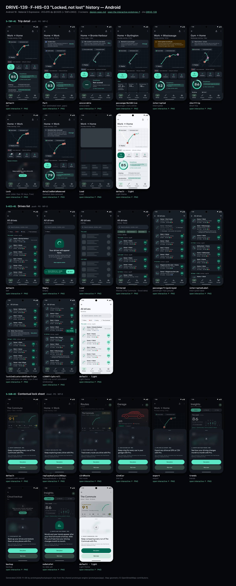
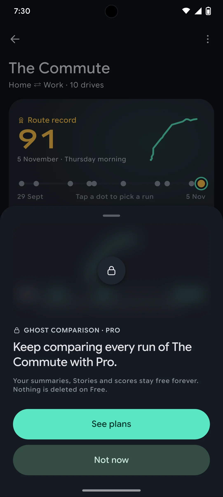
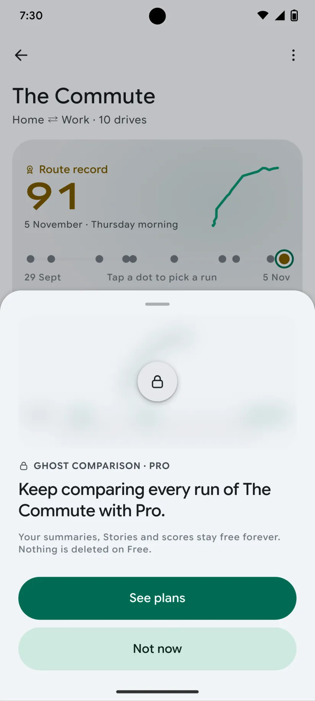

# DRIVE-139 · F-HIS-03 "Locked, not lost" history — Android design spec

> Generated by `prototypes/tools/export.mjs` on 2026-11-07 from the shared prototype engine. **Do not edit by hand:** change the screen's `spec` in `prototypes/app/screens/wp-*.js` (see `prototypes/app/AUTHORING.md`) and re-export.

- **Jira story:** [DRIVE-139](https://thekeval.atlassian.net/browse/DRIVE-139) · F-HIS-03 · P0
- **Platform:** Android 16 · Material 3 Expressive · 412×915 dp @2.625 (≈ 1081×2402)
- **Interactive prototype:** [../../../../prototypes/android/index.html#S-TRP-01](../../../../prototypes/android/index.html#S-TRP-01) (catalog panel: every screen and state; deep links `#S-ID/state?trip=…&ent=…&theme=light&text=xl&rm=1`)
- **Contact sheet:** [mockup.html](mockup.html) · 
- **Design system (source of truth for values):** [brand](../../system/brand.md) · [components](../../system/components.md) · [motion](../../system/motion.md) · [accessibility](../../system/accessibility.md) · [screen map](../../system/screen-map.md) · [fixtures](../../system/fixtures.md) · tokens `prototypes/shared/tokens.css`

## Screens in this story

| Screen | Name | Presentation | Priority | States | Status |
|---|---|---|---|---|---|
| `S-TRP-01` | Trip detail | Push | P0 | 9 | Prototyped |
| `S-HIS-01` | Drives list | Push (from Drives tab) | P0 | 8 | Prototyped |
| `S-SUB-03` | Contextual lock sheet | Sheet (medium) | P0 | 8 | Prototyped |

## Tokens used on this platform

Values resolved from `prototypes/shared/tokens.css` inside the Android device (`[data-platform="android"]`). Use the token names in code; the hex values are for reference.

| Token | Dark | Light |
|---|---|---|
| `--app-bg` | `#0D1117` | `#F7F9FC` |
| `--card-bg` | `#191E25` | `#EBEEF2` |
| `--dp-bg-grouped` | `#0D1117` | `#F7F9FC` |
| `--dp-surface` | `#191E25` | `#EBEEF2` |
| `--dp-surface-2` | `#1F252D` | `#E5E8EC` |
| `--dp-surface-3` | `#2A3038` | `#DFE2E6` |
| `--dp-fill` | `#2A3038` | `#DFE2E6` |
| `--dp-fill-strong` | `#353B44` | `#D3D7DC` |
| `--dp-text` | `#E1E3E8` | `#181C20` |
| `--dp-text-2` | `#C0C7CF` | `#40474F` |
| `--dp-text-3` | `#8A929B` | `#707881` |
| `--dp-separator` | `#40474F` | `#C0C7CF` |
| `--dp-accent` | `#5BE7C4` | `#006B53` |
| `--dp-accent-text` | `#5BE7C4` | `#006B53` |
| `--dp-on-accent` | `#00382B` | `#FFFFFF` |
| `--dp-accent-container` | `#00513F` | `#91F1D8` |
| `--dp-record` | `#FFC24B` | `#7A5900` |
| `--dp-positive` | `#5BE7C4` | `#006B53` |
| `--dp-change-down` | `#C0C7CF` | `#40474F` |
| `--dp-warning` | `#F5B648` | `#7A5900` |
| `--dp-critical` | `#FFB4AB` | `#BA1A1A` |
| `--dp-glass-fill` | `#1F252DF2` | `#E5E8ECF2` |
| `--dp-glass-fill-strong` | `#2A3038` | `#DFE2E6` |
| `--dp-glass-stroke` | `#FFFFFF0F` | `#0000000A` |
| `--md-sys-color-primary` | `#5BE7C4` | `#006B53` |
| `--md-sys-color-on-primary` | `#00382B` | `#FFFFFF` |
| `--md-sys-color-primary-container` | `#00513F` | `#91F1D8` |
| `--md-sys-color-on-primary-container` | `#91F1D8` | `#002118` |
| `--md-sys-color-secondary-container` | `#344C44` | `#CEE9DF` |
| `--md-sys-color-surface` | `#0D1117` | `#F7F9FC` |
| `--md-sys-color-surface-container` | `#191E25` | `#EBEEF2` |
| `--md-sys-color-surface-container-high` | `#1F252D` | `#E5E8EC` |
| `--md-sys-color-on-surface-variant` | `#C0C7CF` | `#40474F` |
| `--dp-data-route` | `#5BE7C4` | `#079777` |
| `--dp-data-event-brake` | `#FF7A66` | `#A21F16` |
| `--dp-data-event-accel` | `#E58BD0` | `#A33A8C` |
| `--dp-data-event-corner` | `#EAD54E` | `#9A8A00` |
| `--dp-data-quality-good` | `#5FDB9C` | `#1E9E62` |
| `--dp-data-speed` | `#D6DCE4` | `#404A58` |
| `--dp-data-long-g` | `#5AB8F5` | `#0A6AB8` |
| `--dp-data-lat-g` | `#F5A142` | `#B25A00` |

| Type / layout token | Value |
|---|---|
| `--dp-font-screen-title` | `600 32px / 40px "Google Sans Flex", "Google Sans Display", "Roboto Flex", Roboto, system-ui, sans-serif` |
| `--dp-font-sheet-title` | `400 24px / 32px "Google Sans Flex", "Google Sans Display", "Roboto Flex", Roboto, system-ui, sans-serif` |
| `--dp-font-section-title` | `600 22px / 28px "Google Sans Flex", "Google Sans Display", "Roboto Flex", Roboto, system-ui, sans-serif` |
| `--dp-font-card-title` | `700 16px / 24px "Google Sans Flex", "Google Sans Text", "Roboto Flex", Roboto, system-ui, sans-serif` |
| `--dp-font-body` | `400 16px / 24px "Google Sans Flex", "Google Sans Text", "Roboto Flex", Roboto, system-ui, sans-serif` |
| `--dp-font-body-secondary` | `400 14px / 20px "Google Sans Flex", "Google Sans Text", "Roboto Flex", Roboto, system-ui, sans-serif` |
| `--dp-font-meta` | `400 12px / 16px "Google Sans Flex", "Google Sans Text", "Roboto Flex", Roboto, system-ui, sans-serif` |
| `--dp-font-caption` | `500 12px / 16px "Google Sans Flex", "Google Sans Text", "Roboto Flex", Roboto, system-ui, sans-serif` |
| `--dp-font-button` | `700 14px / 20px "Google Sans Flex", "Google Sans Text", "Roboto Flex", Roboto, system-ui, sans-serif` |
| `--dp-num-hero` | `600 72px / 72px "Google Sans Flex", "Roboto Flex", Roboto, system-ui, sans-serif` |
| `--dp-num-xl` | `600 48px / 52px "Google Sans Flex", "Roboto Flex", Roboto, system-ui, sans-serif` |
| `--dp-num-l` | `600 34px / 38px "Google Sans Flex", "Roboto Flex", Roboto, system-ui, sans-serif` |
| `--dp-num-m` | `600 24px / 28px "Google Sans Flex", "Roboto Flex", Roboto, system-ui, sans-serif` |
| `--dp-num-s` | `600 17px / 22px "Google Sans Flex", "Roboto Flex", Roboto, system-ui, sans-serif` |
| `--dp-num-xs` | `600 13px / 16px "Google Sans Flex", "Roboto Flex", Roboto, system-ui, sans-serif` |
| `--dp-screen-margin` | `16px` |
| `--dp-radius-card` | `16px` |
| `--dp-radius-card-hero` | `28px` |
| `--dp-radius-sheet` | `28px` |
| `--dp-radius-chip` | `8px` |
| `--dp-radius-button` | `999px` |
| `--dp-layout-list-row-min` | `56px` |
| `--dp-layout-touch-min` | `48px` |
| `--safe-top` | `40px` |
| `--safe-bottom` | `24px` |

Text sizes scale with `--dp-text-scale` (XL = 2.0×) and numerals with `--dp-num-scale` (XL = 1.3×). DP Numerals: Google Sans Flex wdth 120 wght 600, tabular.

---

## S-TRP-01 · Trip detail

- **Presentation:** push · tab: drives — screen map: “Push”
- **Entry points:** S-HOME-01 · S-HIS-01 · S-RTE-02 runs · S-GAR-02 · S-RCP-01 drive of week
- **Leads to:** S-RPL-01 · S-ANL-01 · S-STY-01 · S-SHR-01 · S-PRV-04 (Export, Pro) · S-TRP-02 · S-DQ-01 · S-SCO-01 · S-SCO-04 · S-SUB-03 (Lock)
- **PRD features:** F-RPL-07, F-CAP-04, F-CAP-05, F-CAP-06, F-CAP-17, F-DQ-04, F-DQ-05, F-HIS-03, F-SCO-01, F-SCO-04, F-SCO-06, F-SCO-09, F-SHR-01, F-PRV-03, F-RPL-01 · **Priority:** P0 · **WP:** C
- **Interactive:** [S-TRP-01](../../../../prototypes/android/index.html#S-TRP-01)

**Purpose.** One place with a drive’s summary, scores, events and actions, so the user can decide where to dig in (F-RPL-07). The summary is Free forever; Replay/Analysis older than 30 days are Pro and shown locked with this trip’s own data blurred (F-HIS-03).

### States

| State | PRD label | Fixture params | Screenshot |
|---|---|---|---|
| `default` | Def | `trip=t20261105-1745` | — · [open](../../../../prototypes/android/index.html#S-TRP-01) |
| `Part` | Part (estimated start, gaps) | `trip=t20261020-0740` | — · [open](../../../../prototypes/android/index.html#S-TRP-01/Part) |
| `unscorable` | Unscorable | `trip=t20261106-1210` | — · [open](../../../../prototypes/android/index.html#S-TRP-01/unscorable) |
| `passengerNotADrive` | Passenger / not a drive | `trip=t20261031-1905` | — · [open](../../../../prototypes/android/index.html#S-TRP-01/passengerNotADrive) |
| `interrupted` | Interrupted | `trip=t20261013-1742` | — · [open](../../../../prototypes/android/index.html#S-TRP-01/interrupted) |
| `shortTrip` | Short trip | `trip=t20261104-0755` | — · [open](../../../../prototypes/android/index.html#S-TRP-01/shortTrip) |
| `Lock` | Lock (older than 30 days, Free) | `trip=t20261002-0745` `ent=free` | — · [open](../../../../prototypes/android/index.html#S-TRP-01/Lock) |
| `detailedDataRemoved` | Detailed data removed | `trip=t20261002-0745` | — · [open](../../../../prototypes/android/index.html#S-TRP-01/detailedDataRemoved) |
| `Load` | Load | `trip=t20261105-1745` | — · [open](../../../../prototypes/android/index.html#S-TRP-01/Load) |

Every state also renders in light/dark (`theme=light`), XL text (`text=xl`) and reduced motion (`rm=1`).

### Layout

- Top bar: iOS inline title (route label) + subtitle (part of day · date) with glass back, Share and “…” menu (Edit trip, Export GPX/CSV, Data quality, Delete) · Android MediumFlexibleTopAppBar (back, Share, overflow) with the title block in content that collapses into the bar on scroll.
- State banners (passenger, interrupted, unscorable, short trip, Part data, detailed data removed) directly under the bar.
- Map hero, full width minus 16 margins, 232 tall, radius = card (24 iOS / 16 Android): route in Glide over the plain-canvas map, estimated start dashed, GPS gap dotted, stop capsules, neutral max-speed triangle, event pins by shape; quality badge and “Estimated start” chips top-left (glass on iOS); “Replay” glass capsule bottom-left (“Replay in Pro” + lock when locked); “© OpenStreetMap contributors” bottom-right.
- Meta row: car chip (tap → car picker) · source (Auto-detected / Started from Widget, Control Center) · start–end time.
- Smoothness card: ring 124 (baseline notch, record notch) + comparison chip, record line (rosette, gold), “Score based on n of m min” when excluded, “How scores work”; four contributor rows (label · band chip ▲/●/▼ · reason); “Smoothness breakdown ›” → S-SCO-01.
- Action row directly under the meta row (4 equal buttons, 68 tall): Replay (primary) · Analysis · Story · Share. Locked: lock badges, both open S-SUB-03. Passenger: Replay · Analysis · Edit.
- Locked (Free > 30 days): “Replay & Analysis” lock panel — this trip’s synced timeline blurred 14 px + “Keep exploring every drive with Pro.” + See plans.
- Stats 3×3 tiles in PRD order: distance, duration, moving time, stopped, stops, avg moving speed, max speed (neutral, never first), climb, descent — each with its provenance glyph.
- Events · n: count chips by type (pin glyph + count) and event rows (pin 28 · “Hard braking” · place · time of day · 0.42 g · 1.4 s); “No abrupt inputs on this drive.” when there are none.
- Highlights: positive card first (“Cleanest stretch: …”), then the tip card (“One thing for next time”, long-G sparkline, “See the moment ›”).
- Details list: data quality (badge + detail) → S-DQ-01 · efficiency habits (≈ estimated) → S-SCO-06 · route (runs, record) → S-RTE-02. Manage list: Edit trip · Export GPX/CSV (Pro) · Delete drive (destructive).

### Components & tokens

| Component | Tokens / spec |
|---|---|
| `navBar` | --dp-font-card-title · --dp-font-meta · glass: --dp-glass-fill + --dp-glass-blur · components.md §2 |
| `menu` | iOS glass Menu: --dp-glass-fill-strong, radius 26 · Android DropdownMenu: --md-sys-color-surface-container, radius 16 |
| `banner` | radius 12 (--dp-radius-sm+) · info --dp-fill · attention --dp-warning-container · critical --dp-critical-container · components.md §22 |
| `map` | --dp-data-map-land/road/grid · route --dp-data-route 3.8 + casing --dp-data-route-casing 7.5 · estimated dashed 4/4 at 60% · gap --dp-data-gap-stroke dotted 1/6 · pins DP_ICONS.pin 26 · attribution “© OpenStreetMap contributors” |
| `qualityBadge` | --dp-data-quality-{good\|usable\|limited\|unscorable} · components.md §10 |
| `chip` | --dp-radius-chip (iOS capsule · Android 8) · height 28 · --dp-font-caption |
| `card` | --dp-surface / --md-sys-color-surface-container · --dp-radius-card (24 iOS · 16 Android) · hero: --dp-radius-card-hero (32 · 28) · light iOS: --dp-elev-1 |
| `ring` | track --dp-fill-strong · arc --dp-gradient-ring (glide-400 → accent → glide-100) · baseline notch --dp-text-2 · record notch --dp-record · Android container Cookie9Sided --md-sys-color-primary-container 42% · components.md §3 |
| `deltaChip` | better: --dp-accent-text on --dp-accent 18% · lower: --dp-text-2 on --dp-fill (never red) · record: --dp-record on --dp-record 18% · components.md §4 |
| `actionButton` | --dp-surface-2 · --md-sys-color-surface-container-high · --dp-radius-lg · min 44 pt / 48 dp |
| `lockPanel` | blur --dp-opacity-locked-blur 14px · dim --dp-opacity-locked-dim 35% · components.md §15.2 |
| `timeline` | --dp-data-speed · --dp-data-long-g · --dp-data-lat-g (dashed 6/3) · cursor --dp-data-cursor · components.md §7 |
| `stats` | --dp-surface-2 / --md-sys-color-surface-container-high · radius 14 iOS / 12 Android · value --dp-num-m (DP Numerals) · components.md §5 |
| `eventRow` | pin 28 (shape = meaning) · meta --dp-num-xs · min height 44 · components.md §9.2 |
| `tipCard` | --dp-accent 10% over --dp-surface · sparkline --dp-data-long-g · components.md §18 |
| `sparkline` | see components.md |
| `list` | iOS inset grouped radius --dp-radius-card, rows 52 pt, separators --dp-separator inset 16 · Android ListItem 56/72 dp in --md-sys-color-surface-container |
| `row` | --dp-font-body · --dp-font-meta (supporting) · --dp-layout-list-row-min |
| `section` | --dp-font-section-title · --dp-layout-section-gap 28 |
| `skeleton` | --dp-fill-strong, breathe 1.2 s (dp-skeleton) |

### Interactions & navigation

- Map / Replay → S-RPL-01 (Lock → S-SUB-03 replayAnalysis30Days). Analysis → S-ANL-01. Story → S-STY-01. Share (button or bar) → S-SHR-01. (Story/Replay/Analysis/Share pass the D1 gate → S-DRV-05 while moving.)
- Quality badge / Data quality row → S-DQ-01 · Smoothness card → S-SCO-01 · “How scores work” → S-SCO-02 · Event row → S-RPL-02 (event param) · Tip “See the moment” → S-RPL-02.
- Car chip → S-TRP-02/carPicker · Passenger “Change” → S-TRP-02/typePicker · Edit → S-TRP-02 · Export → S-PRV-04 (Pro) or S-SUB-03/export (Free) · Delete → S-TRP-03 dialog · Route row → S-RTE-02 · Efficiency → S-SCO-06.
- “…” opens a glass Menu (iOS) / DropdownMenu (Android). Long-press any stat tile → provenance popover (prototype: toast) with the glyph meaning, haptic longPress.

### Motion

- Enter from a trip card: iOS zoom transition from the card, Android container transform (spring.slow).
- Map: route draw-on 1800 ms ease.drawOn; estimated/gap overlays, stops and max pin fade in at 1500 ms; event pins pop in time order from 1600 ms, 40 ms stagger, shared.pinPop. RM: the complete route fades in (220 ms), pins appear in place.
- Smoothness ring reveal (motion.md §3.4): 1400 ms count-up locked to the arc, baseline notch scales in, landing tap haptic; Android Cookie9Sided container rotates as the count runs. RM: final ring, static number.
- Sections rise 8 px, 30 ms stagger, spring.default. Menu scales in from the top-trailing corner (spring.fast).

### Accessibility

- Score card is one element: “Smoothness 85. 2 above your usual on The Commute home.” (+ “New route record, beating 89 from 14 October.”).
- Map label: “Map of your drive, 39 kilometres from Work to Home. 2 events, 2 stops.” Event pins are a time-ordered list; each event row reads “Hard braking at the Gardiner. Peak 0.4 g.”
- Stat tiles: “Distance, 39.0 kilometres. Derived.” with the long-press action “Show how this was measured”; ⓘ footer explains long-press.
- Speed tiles use the same neutral component (no colour, no emphasis, never first). Deltas use ▲/▼/● and “above/below your usual”, never red.
- XL: tiles go to 2 columns, the action row to 2×2, contributor reasons wrap; nothing truncates.

### Platform notes

- **Android (this spec):** MediumFlexibleTopAppBar (title in content, collapses on scroll), overflow DropdownMenu; quality badge as AssistChip; ring on a Cookie9Sided primaryContainer shape; actions: filled primary (radius 28) + tonal surfaceContainerHigh buttons; list sections as M3E segmented ListItems; container transform from the card.
- *iOS (for reference):* Inline title + .navigationSubtitle, glass back/Share/“…” toolbar buttons, Menu for overflow; map chips and Replay capsule are glass; ring on content; zoom transition from the source card.

### Analytics

- `trip_detail_opened {source, age_bucket}`
- `locked_content_viewed {type: replay|analysis, age_bucket}`
- `trip_action_tapped {action: replay|analysis|story|share|export|edit|delete}`
- `provenance_viewed {metric}`

### Copy

| Key | Text |
|---|---|
| Passenger | Marked as passenger. It isn’t scored and doesn’t count toward your baseline, routes or recaps. · Change |
| Interrupted | Interrupted at {time}. {iOS ended DrivePerf in the background \| Android stopped DrivePerf in the background}. Everything before then is saved. The missing part is shown as a gap, never scored. |
| Unscorable | We couldn’t score this one fairly. {quality.reason}. Here’s the route and the stats anyway. |
| Part | {badge} data. {41} s without GPS downtown (dotted on the map) · the first ≈ 0.4 km is estimated (dashed). |
| Short trip | Short drive · {km} km. Short drives give the score less to work with, so expect it to move more from drive to drive. |
| Detailed data removed | You removed the raw sensor data to save space. The summary, route and score stay; Analysis and event traces are no longer available. |
| Lock | Keep exploring every drive with Pro. (entitlement.lockSheets.oldAnalysis) · Your summary, score and Story stay free forever. Nothing is deleted because of your plan. |
| No events | No abrupt inputs on this drive. Nothing crossed the braking, acceleration or cornering thresholds. |

### Free / Pro

Free: everything on this screen is visible for every trip of any age. For trips older than 30 days Replay and Analysis show lock badges and open S-SUB-03 (replayAnalysis30Days) over a blurred render of this trip; Export shows a PRO badge and opens S-SUB-03/export. Pro/Preview/Ride-along: no locks.

### Data & fixtures

Fixtures: default t20261105-1745 · Part t20261020-0740 (41 s gap, needed brake at Spadina & King) · unscorable t20261106-1210 · passenger t20261031-1905 · interrupted t20261013-1742 · short trip t20261104-0755 · Lock / detailed data removed t20261002-0745. Event time of day = trip.start + event.t (derived).

### Assets

[icon-replay.svg](assets/icon-replay.svg) · [icon-analysis.svg](assets/icon-analysis.svg) · [icon-story.svg](assets/icon-story.svg) · [icon-share.svg](assets/icon-share.svg) · [icon-more.svg](assets/icon-more.svg) · [icon-edit.svg](assets/icon-edit.svg) · [icon-export.svg](assets/icon-export.svg) · [icon-trash.svg](assets/icon-trash.svg) · [icon-lock.svg](assets/icon-lock.svg) · [icon-info.svg](assets/icon-info.svg) · [icon-routes.svg](assets/icon-routes.svg) · [icon-car.svg](assets/icon-car.svg) · [icon-bolt.svg](assets/icon-bolt.svg) · [icon-sparkle.svg](assets/icon-sparkle.svg) · [icon-passenger.svg](assets/icon-passenger.svg) · [icon-shield.svg](assets/icon-shield.svg) · [icon-check.svg](assets/icon-check.svg) · [icon-chevronRight.svg](assets/icon-chevronRight.svg) · [icon-rosette.svg](assets/icon-rosette.svg)

UI glyphs may be swapped for SF Symbols / Material Symbols Rounded equivalents; event-pin, quality and provenance glyphs must not be (components.md global rules).

### Checklist (accessibility.md §9)

- [ ] Light and dark both render, and contrast passes.
- [ ] The XL text state reflows with no truncation.
- [ ] The RM state is defined.
- [ ] Every control has a label; every chart and map has a summary sentence.
- [ ] Every target ≥ 44 pt / 48 dp (≥ 64 in-drive).
- [ ] No meaning by colour alone.
- [ ] Speed is neutral wherever it appears and absent from social or live surfaces.
- [ ] No streak, leaderboard, speed or “beat your time” language.
- [ ] Behaviour is defined while a trip is active (D1 gate).
- [ ] Haptics come from motion.md §6 only.

---

## S-HIS-01 · Drives list

- **Presentation:** push · tab: drives — screen map: “Push (from Drives tab)”
- **Entry points:** S-HOME-01 "All drives"
- **Leads to:** S-TRP-01 · S-HIS-02 · S-SUB-03 (locked older trip actions)
- **PRD features:** F-HIS-01, F-HIS-03 · **Priority:** P0 · **WP:** D
- **Interactive:** [S-HIS-01](../../../../prototypes/android/index.html#S-HIS-01)

**Purpose.** Every drive in one scrollable list, newest first and grouped by week, so the user can find any trip (F-HIS-01). Summaries are free forever; on Free, drives older than 30 days keep their full summary and only show a small lock for Replay & Analysis (F-HIS-03 “locked, not lost”).

### States

| State | PRD label | Fixture params | Screenshot |
|---|---|---|---|
| `default` | Def | — | — · [open](../../../../prototypes/android/index.html#S-HIS-01) |
| `Empty` | Empty | — | — · [open](../../../../prototypes/android/index.html#S-HIS-01/Empty) |
| `Load` | Load | — | — · [open](../../../../prototypes/android/index.html#S-HIS-01/Load) |
| `filtered` | filtered (The Commute · Good data) | — | — · [open](../../../../prototypes/android/index.html#S-HIS-01/filtered) |
| `passengerTripsGreyed` | passenger trips greyed | — | — · [open](../../../../prototypes/android/index.html#S-HIS-01/passengerTripsGreyed) |
| `interruptedLabel` | interrupted label | — | — · [open](../../../../prototypes/android/index.html#S-HIS-01/interruptedLabel) |
| `lockIndicatorsOnOlderTrips` | Lock indicators on older trips (Free) | `ent=free` | — · [open](../../../../prototypes/android/index.html#S-HIS-01/lockIndicatorsOnOlderTrips) |
| `s1000TripScroll` | 1,000-trip scroll (simulated windowing) | — | — · [open](../../../../prototypes/android/index.html#S-HIS-01/s1000TripScroll) |

Every state also renders in light/dark (`theme=light`), XL text (`text=xl`) and reduced motion (`rm=1`).

### Layout

- Top bar: iOS inline title “All drives” + subtitle “{n} drives” (· filtered) with glass back and a glass Filter button (badge dot when filters are applied) · Android MediumFlexibleTopAppBar (title in content, collapses on scroll), back arrow, filter icon.
- Search: iOS glass search field (radius 18, 44 tall) / Android M3 SearchBar (56 dp, surface-container-high, full radius) “Search places, routes, cars”. Tapping shows “Try” suggestion chips (Gardiner · Niagara · Ioniq · Gym · Passenger); a query shows “{n} drives match “{q}” · {km} km”.
- Filter chip row (horizontal scroll, 16 margins): “Filters” chip (→ S-HIS-02) then quick filters (GTI · Ioniq · The Commute · Passenger). Applied filters become selected chips with × plus “Clear”.
- Week sections, newest first: caption header “This week” / “Last week” / “19–25 Oct” with meta “{n} drives · avg {score}” (driver drives only), then one card (radius 24 iOS / 16 Android) of trip cards (components.md §12) separated by 0.5 px separators (iOS) or 2 dp gaps (Android).
- Trip card: route glyph 48 · label · part of day · date · km · min · quality glyph · car dot (more than one car) · score badge (mini ring iOS / Cookie9Sided Android) · lock glyph after the badge for locked older trips. Interrupted and passenger rows add a one-line note under the card.
- Free: an info banner “Older than 30 days” precedes the first week with locked drives (See plans → S-SUB-03 replayAnalysis30Days). Summaries are never blurred.
- Footer caption “That’s every drive since 28 September.” · iOS capture accessory + floating tab bar remain (Drives tab).
- 1,000 drives: list is windowed (rows outside the viewport render as skeleton rows), with a fast-scroll thumb and a month bubble on the trailing edge (iOS section index scrubber · Android fast scroller).

### Components & tokens

| Component | Tokens / spec |
|---|---|
| `page` | --dp-bg-grouped (iOS) / --md-sys-color-surface (Android) · --dp-screen-margin 16 |
| `navBar` | --dp-font-card-title · --dp-font-meta · glass: --dp-glass-fill + --dp-glass-blur · components.md §2 |
| `iconButton` | see components.md |
| `chip` | --dp-radius-chip (iOS capsule · Android 8) · height 28 · --dp-font-caption |
| `carDot` | see components.md |
| `section` | --dp-font-section-title · --dp-layout-section-gap 28 |
| `card` | --dp-surface / --md-sys-color-surface-container · --dp-radius-card (24 iOS · 16 Android) · hero: --dp-radius-card-hero (32 · 28) · light iOS: --dp-elev-1 |
| `tripRow` | glyph 40 on --dp-surface-2 · --dp-font-card-title · --dp-font-meta · components.md §12 |
| `scoreBadge` | iOS mini ring 46 · Android Cookie9Sided 46 · --dp-num-s |
| `qualityBadge` | --dp-data-quality-{good\|usable\|limited\|unscorable} · components.md §10 |
| `banner` | radius 12 (--dp-radius-sm+) · info --dp-fill · attention --dp-warning-container · critical --dp-critical-container · components.md §22 |
| `menu` | iOS glass Menu: --dp-glass-fill-strong, radius 26 · Android DropdownMenu: --md-sys-color-surface-container, radius 16 |
| `empty` | illustration 120 in --dp-accent · --dp-font-section-title · components.md §21 |
| `skeleton` | --dp-fill-strong, breathe 1.2 s (dp-skeleton) |

### Interactions & navigation

- Trip card → S-TRP-01 (iOS zoom / Android container transform from the card). Locked older trips still open S-TRP-01 (summary); Replay/Analysis there open S-SUB-03.
- Long-press a trip card (Android M3E long-press · iOS context menu; iOS swipe: leading Share, trailing Delete) → Share (S-SHR-01) · Replay (S-RPL-01, or S-SUB-03/replayAnalysis30Days when locked) · Edit trip (S-TRP-02) · Delete drive (S-TRP-03).
- Filter button / “Filters” chip → S-HIS-02 (medium sheet); “Show n drives” returns here with the filter applied as chips. Quick chips toggle a filter in place; chip × removes it; “Clear” resets.
- Search field → suggestions; a suggestion runs the search over route label, places, roads, route and car names. × clears.
- Empty: “How capture works” → S-HOME-02; Android shows the capture row inline with Start (iOS uses the accessory).
- Share/Replay from the long-press menu pass the D1 gate (held on S-DRV-05 while moving).

### Motion

- Push in from Home “All drives”: iOS push (spring.default), Android shared axis X.
- Hero motion: week sections rise 8 px and fade in, 30 ms stagger (spring.default). RM: 220 ms cross-fade, no rise.
- Filter change: list cross-fades (180 ms); chip selection uses spring.fast + selection haptic. Long-press menu scales in from the card (spring.fast) with the longPress haptic.

### Accessibility

- Trip card is one button: “Home to Work, Thursday morning, 5 November. 37.9 kilometres, 30 minutes. Smoothness 91. Good data.” + “Replay and Analysis in Pro.” when locked. Custom actions: Share, Replay, Edit, Delete.
- Week headers are headings (“This week, 6 drives, average 86”). Filter chips are a toolbar; selected chips announce “Remove filter The Commute”.
- Result count is a status region (“8 drives match Gardiner”). The filter button announces “Filters, 2 applied”.
- XL: trip cards stack the glyph above the text; meta wraps to two lines; chips wrap onto multiple rows; nothing truncates.
- Passenger rows are dimmed to 55% but keep 4.5:1 for their label; the note “Passenger · not scored, not counted” carries the meaning in text.

### Platform notes

- **Android (this spec):** MediumFlexibleTopAppBar + M3 SearchBar; LazyColumn with sticky week headers and segmented ListItems; combinedClickable long-press → DropdownMenu; FilterChips (selected = secondaryContainer); fast scroller thumb with a month bubble; NavigationBar stays (no capture toolbar on non-root tabs).
- *iOS (for reference):* NavigationStack push; .searchable(placement: .navigationBarDrawer) glass field; trip cards in an inset-grouped List section per week; swipe actions (leading Share, trailing Delete) and .contextMenu; floating glass tab bar + capture accessory stay visible; fast scroll via the section index scrubber.

### Analytics

- `history_opened {source: home|car_detail}`
- `history_filtered {filter: car|route|quality|type, count_bucket}`
- `history_searched {result_bucket}`
- `trip_context_action {action: share|replay|edit|delete, locked}`

### Copy

| Key | Text |
|---|---|
| Title | All drives |
| Search placeholder | Search places, routes, cars |
| Week meta | {n} drives · avg {score} |
| Lock divider | Older than 30 days. Summaries, scores and Stories stay free forever. Replay and Analysis for these drives are in Pro. · See plans |
| Interrupted note | {iOS ended DrivePerf in the background \| Android stopped DrivePerf in the background}. Saved up to {time}. |
| Passenger note | Passenger · not scored, not counted |
| Empty | Your drives will appear here. Just drive. DrivePerf notices when you set off and decodes each drive when you park. |
| No match | No drives match. Try fewer filters, or a different place or car. · Clear filters |
| Footer | That’s every drive since {install date}. |

### Free / Pro

Free: every summary of every age is visible; the 4 drives older than 30 days show a lock glyph after the score and the “Older than 30 days” banner; their Replay/Analysis (long-press menu or trip detail) open S-SUB-03 replayAnalysis30Days. Pro / Preview / Ride-along: no locks.

### Data & fixtures

All 30 DP_DATA.trips, newest first, grouped by DP_DATA.util.weekOf (recap weeks). Week meta is derived (driver drives; average of scored drives). Filtered = route r_commute + Good data (9 drives). Passenger row t20261031-1905; interrupted row t20261013-1742 (the states scroll to them). Lock state = ent free (t20261002-0745, t20260929-*, t20260928-1842 locked). 1,000-trip scroll is simulated: the fixture has 30 drives, older weeks render as skeleton (windowed) rows. Delete from S-TRP-03 returns here with ?deleted=<trip> (the row is removed).

### Assets

[icon-search.svg](assets/icon-search.svg) · [icon-filter.svg](assets/icon-filter.svg) · [icon-close.svg](assets/icon-close.svg) · [icon-routes.svg](assets/icon-routes.svg) · [icon-passenger.svg](assets/icon-passenger.svg) · [icon-shield.svg](assets/icon-shield.svg) · [icon-lock.svg](assets/icon-lock.svg) · [icon-share.svg](assets/icon-share.svg) · [icon-replay.svg](assets/icon-replay.svg) · [icon-edit.svg](assets/icon-edit.svg) · [icon-trash.svg](assets/icon-trash.svg) · [icon-record.svg](assets/icon-record.svg) · [icon-drives.svg](assets/icon-drives.svg) · [logo-a-loop.svg](assets/logo-a-loop.svg)

UI glyphs may be swapped for SF Symbols / Material Symbols Rounded equivalents; event-pin, quality and provenance glyphs must not be (components.md global rules).

### Checklist (accessibility.md §9)

- [ ] Light and dark both render, and contrast passes.
- [ ] The XL text state reflows with no truncation.
- [ ] The RM state is defined.
- [ ] Every control has a label; every chart and map has a summary sentence.
- [ ] Every target ≥ 44 pt / 48 dp (≥ 64 in-drive).
- [ ] No meaning by colour alone.
- [ ] Speed is neutral wherever it appears and absent from social or live surfaces.
- [ ] No streak, leaderboard, speed or “beat your time” language.
- [ ] Behaviour is defined while a trip is active (D1 gate).
- [ ] Haptics come from motion.md §6 only.

---

## S-SUB-03 · Contextual lock sheet

 

- **Presentation:** sheet · tab: profile · detent: auto — screen map: “Sheet (medium)”
- **Entry points:** Any Pro gate (compare, > 30-day Replay/Analysis, 3rd route, 2nd car, export, trends, backup)
- **Leads to:** S-SUB-04 · "Not now" → exactly where the user was
- **PRD features:** F-SUB-04, F-HIS-03, F-RTE-04, F-RTE-05, F-ACC-03, F-RPL-01, F-SUB-08 · **Priority:** P0 · **WP:** E
- **Interactive:** [S-SUB-03](../../../../prototypes/android/index.html#S-SUB-03)

**Purpose.** When a Free user taps a Pro feature, show what Pro would show on their own data — blurred, never a stock screenshot — with one sentence of value, “See plans” and “Not now” (F-SUB-04, F-HIS-03 “locked, not lost”). Not now returns exactly where they were.

### States

| State | PRD label | Fixture params | Screenshot |
|---|---|---|---|
| `default` | compare with record | `ent=free` | [S-SUB-03.png](../../screens/android/S-SUB-03.webp) · [open](../../../../prototypes/android/index.html#S-SUB-03) |
| `replayAnalysis30Days` | Replay/Analysis > 30 days | `ent=free` | [S-SUB-03--replayAnalysis30Days.png](../../screens/android/S-SUB-03--replayAnalysis30Days.webp) · [open](../../../../prototypes/android/index.html#S-SUB-03/replayAnalysis30Days) |
| `s3rdRoute` | 3rd route | `ent=free` | [S-SUB-03--s3rdRoute.png](../../screens/android/S-SUB-03--s3rdRoute.webp) · [open](../../../../prototypes/android/index.html#S-SUB-03/s3rdRoute) |
| `s2ndCar` | 2nd car | `ent=free` | [S-SUB-03--s2ndCar.png](../../screens/android/S-SUB-03--s2ndCar.webp) · [open](../../../../prototypes/android/index.html#S-SUB-03/s2ndCar) |
| `export` | export | `ent=free` | [S-SUB-03--export.png](../../screens/android/S-SUB-03--export.webp) · [open](../../../../prototypes/android/index.html#S-SUB-03/export) |
| `trends` | trends | `ent=free` | [S-SUB-03--trends.png](../../screens/android/S-SUB-03--trends.webp) · [open](../../../../prototypes/android/index.html#S-SUB-03/trends) |
| `backup` | backup | `ent=free` | [S-SUB-03--backup.png](../../screens/android/S-SUB-03--backup.webp) · [open](../../../../prototypes/android/index.html#S-SUB-03/backup) |
| `noDataYet` | no data yet | `ent=free` | [S-SUB-03--noDataYet.png](../../screens/android/S-SUB-03--noDataYet.webp) · [open](../../../../prototypes/android/index.html#S-SUB-03/noDataYet) |
| default · light | Light theme | `theme=light` | [S-SUB-03--light.png](../../screens/android/S-SUB-03--light.webp) |

Every state also renders in light/dark (`theme=light`), XL text (`text=xl`) and reduced motion (`rm=1`).

### Layout

- Sheet fitted to content (spec: medium). Top: the user’s own content for that feature, blurred 14 px + 35% dim, radius 20, with a 52 lock disc centred (iOS glass, Android tonal).
- Variants (own data): compare = The Commute ghost vs record + 12 gained/lost segments · Replay/Analysis > 30 days = that trip’s map + synced timeline · 3rd route = Gym card (glyph, 2 drives, record 84, run dots) · 2nd car = Ioniq silhouette + drives/average/km tiles · export = that drive’s CSV rows · trends = October trend sparkline + Month/Year/Per car/Per route tabs · backup = backup status · no data yet = illustration instead of a blur.
- Kicker “🔒 Ghost comparison · Pro”, then the value sentence (sheetTitle-size, 20/26 semibold): entitlement.lockSheets.*, footnote “Your summaries, Stories and scores stay free forever. Nothing is deleted on Free.”
- Stacked large buttons: “See plans” (filled) · “Not now” (tonal).

### Components & tokens

| Component | Tokens / spec |
|---|---|
| `sheet` | iOS glass --dp-glass-fill-strong + --dp-glass-prominent-blur, radius --dp-radius-sheet 38 · Android ModalBottomSheet --md-sys-color-surface-container-low, top radius 28, drag handle 32×4 · motion spring.sheet |
| `lockPanel` | blur --dp-opacity-locked-blur 14px · dim --dp-opacity-locked-dim 35% · components.md §15.2 |
| `map` | --dp-data-map-land/road/grid · route --dp-data-route 3.8 + casing --dp-data-route-casing 7.5 · estimated dashed 4/4 at 60% · gap --dp-data-gap-stroke dotted 1/6 · pins DP_ICONS.pin 26 · attribution “© OpenStreetMap contributors” |
| `timeline` | --dp-data-speed · --dp-data-long-g · --dp-data-lat-g (dashed 6/3) · cursor --dp-data-cursor · components.md §7 |
| `glyph` | see components.md |
| `stats` | --dp-surface-2 / --md-sys-color-surface-container-high · radius 14 iOS / 12 Android · value --dp-num-m (DP Numerals) · components.md §5 |
| `sparkline` | see components.md |
| `scoreBadge` | iOS mini ring 46 · Android Cookie9Sided 46 · --dp-num-s |
| `button` | --dp-accent / --dp-on-accent (filled) · --dp-fill-strong · --md-sys-color-secondary-container (tonal) · --dp-radius-button · height iOS 50/44/34 · Android 56/40/32 · --dp-font-button · components.md §0 |

### Interactions & navigation

- See plans → S-SUB-04 (from = feature). Not now / drag / scrim → back to exactly where the user was (scroll position kept).
- Gate: never during a trip or on a worse-than-usual Story’s end card (F-SUB-08.3); the D1 gate holds it while moving.

### Motion

- The user’s content blurs from 0 → 14 px over 320 ms (spring.effects) while the sheet rises at the medium detent; the lock disc pops at 360 ms. RM: shown already blurred, fade.

### Accessibility

- The blurred preview is hidden from screen readers; the sheet reads “Ghost comparison, Pro. Keep comparing every run of The Commute with Pro.” then the buttons. XL: opens large; the preview keeps its height.

### Platform notes

- **Android (this spec):** ModalBottomSheet; lock disc on surfaceContainerHigh; RenderEffect blur (API 31+) or a pre-blurred bitmap.
- *iOS (for reference):* Glass sheet at a partial detent; lock disc in glass.

### Analytics

- `lock_viewed {feature}`
- `lock_cta {see_plans|not_now}`

### Copy

| Key | Text |
|---|---|
| compare | Keep comparing every run of The Commute with Pro. |
| oldAnalysis | Keep exploring every drive with Pro. |
| thirdRoute | Track every route you drive with Pro. |
| secondCar | Keep a log for every car in your garage with Pro. |
| export | Export any drive as GPX or CSV with Pro. |
| trends | See how your driving changes month to month with Pro. |
| backup | Back up your drives and restore them on any phone with Pro. |
| noDataYet | Month and year trends appear after your first full month of drives. With Pro, you’ll see how your driving changes month to month. |
| Footnote | Your summaries, Stories and scores stay free forever. Nothing is deleted on Free. |

### Free / Pro

Free users only (ent = free). Preview/Ride-along/Pro never see it.

### Data & fixtures

compare: route r_commute + ghost (91 vs 89) · replay: t20261002-0745 · 3rd route: r_gym · 2nd car: Ioniq (derived: its scored trips, average and km) · export: t20261105-1745 · trends: wrapped.monthly trend weeks [81, 85, 85, 87] · backup: privacy.dataSize. Parent screens rendered underneath on a deep link follow the variant (S-RTE-02, S-TRP-01 Lock, S-RTE-01, S-GAR-01, S-STA-01, S-ACC-04 Lock).

### Assets

[icon-lock.svg](assets/icon-lock.svg) · [icon-insights.svg](assets/icon-insights.svg) · [icon-cloud.svg](assets/icon-cloud.svg)

UI glyphs may be swapped for SF Symbols / Material Symbols Rounded equivalents; event-pin, quality and provenance glyphs must not be (components.md global rules).

### Checklist (accessibility.md §9)

- [ ] Light and dark both render, and contrast passes.
- [ ] The XL text state reflows with no truncation.
- [ ] The RM state is defined.
- [ ] Every control has a label; every chart and map has a summary sentence.
- [ ] Every target ≥ 44 pt / 48 dp (≥ 64 in-drive).
- [ ] No meaning by colour alone.
- [ ] Speed is neutral wherever it appears and absent from social or live surfaces.
- [ ] No streak, leaderboard, speed or “beat your time” language.
- [ ] Behaviour is defined while a trip is active (D1 gate).
- [ ] Haptics come from motion.md §6 only.

---

Map geometry in the prototype: © OpenStreetMap contributors (ODbL). Speed and G are simulated fixtures (fixtures.md).
