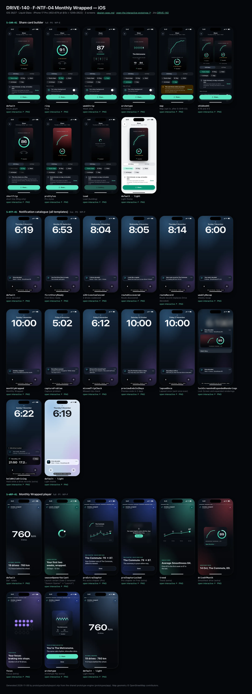
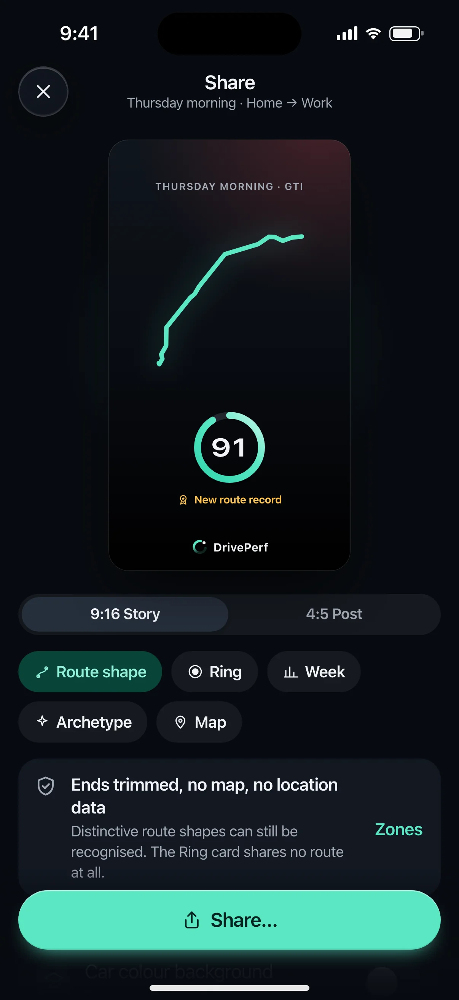
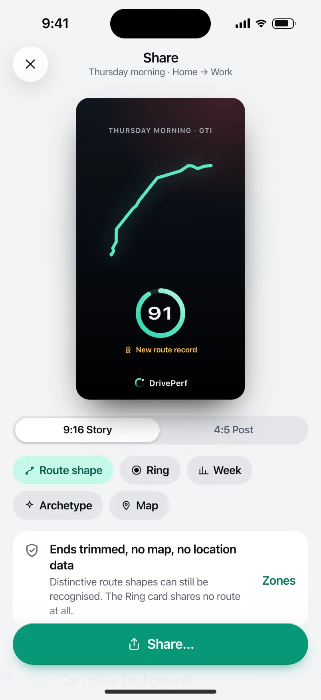
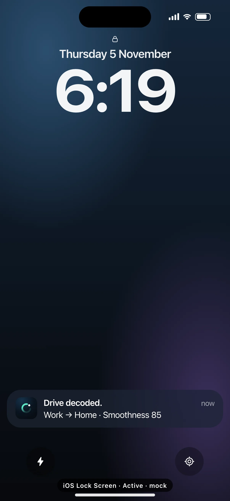
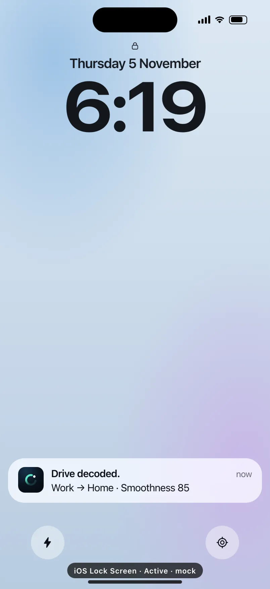
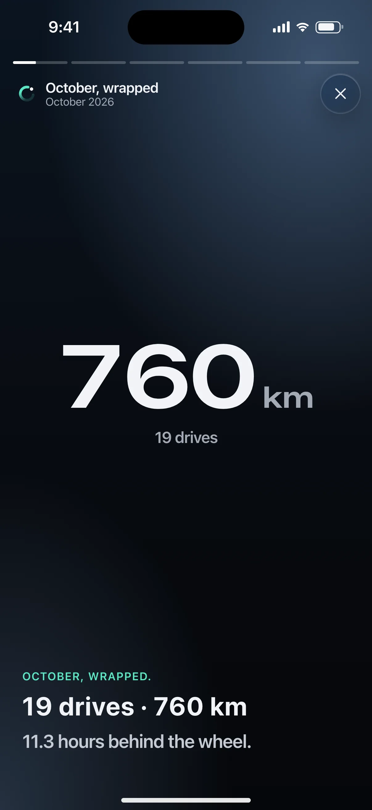
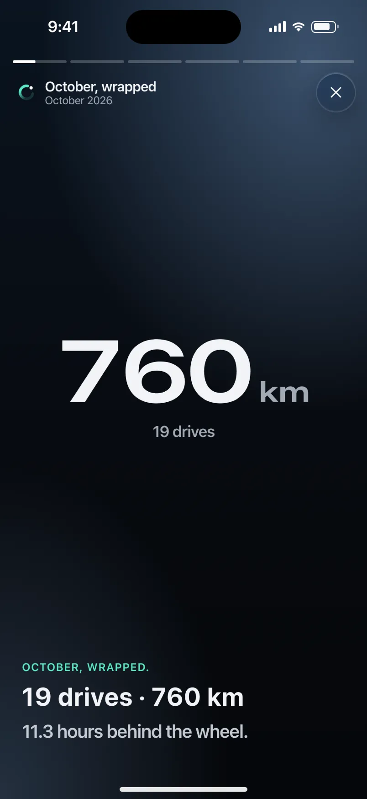

# DRIVE-140 · F-NTF-04 Monthly Wrapped — iOS design spec

> Generated by `prototypes/tools/export.mjs` on 2026-11-07 from the shared prototype engine. **Do not edit by hand:** change the screen's `spec` in `prototypes/app/screens/wp-*.js` (see `prototypes/app/AUTHORING.md`) and re-export.

- **Jira story:** [DRIVE-140](https://thekeval.atlassian.net/browse/DRIVE-140) · F-NTF-04 · P1
- **Platform:** iOS 26/27 · Liquid Glass · iPhone 17 Pro (402×874 pt @3x = 1206×2622)
- **Interactive prototype:** [../../../../prototypes/ios/index.html#S-SHR-01](../../../../prototypes/ios/index.html#S-SHR-01) (catalog panel: every screen and state; deep links `#S-ID/state?trip=…&ent=…&theme=light&text=xl&rm=1`)
- **Contact sheet:** [mockup.html](mockup.html) · 
- **Design system (source of truth for values):** [brand](../../system/brand.md) · [components](../../system/components.md) · [motion](../../system/motion.md) · [accessibility](../../system/accessibility.md) · [screen map](../../system/screen-map.md) · [fixtures](../../system/fixtures.md) · tokens `prototypes/shared/tokens.css`

## Screens in this story

| Screen | Name | Presentation | Priority | States | Status |
|---|---|---|---|---|---|
| `S-SHR-01` | Share card builder | Full (builder) → system share sheet | P0 | 9 | Prototyped |
| `S-NTF-01` | Notification catalogue (all templates) | Live (notification catalogue) | P0 | 13 | Prototyped |
| `S-WRP-01` | Monthly Wrapped player | Full (player) | P1 | 8 | Prototyped |

## Tokens used on this platform

Values resolved from `prototypes/shared/tokens.css` inside the iOS device (`[data-platform="ios"]`). Use the token names in code; the hex values are for reference.

| Token | Dark | Light |
|---|---|---|
| `--app-bg` | `#080B10` | `#F2F3F6` |
| `--card-bg` | `#131822` | `#FFFFFF` |
| `--dp-bg-grouped` | `#080B10` | `#F2F3F6` |
| `--dp-surface` | `#131822` | `#FFFFFF` |
| `--dp-surface-2` | `#1B222D` | `#F2F3F6` |
| `--dp-surface-3` | `#262E3B` | `#E4E7EC` |
| `--dp-fill` | `#7880961F` | `#7880961F` |
| `--dp-fill-strong` | `#7880963D` | `#78809633` |
| `--dp-text` | `#F2F4F7` | `#0B0E13` |
| `--dp-text-2` | `#A3AAB6` | `#5A6271` |
| `--dp-text-3` | `#6E7787` | `#8A919D` |
| `--dp-separator` | `#96A0B429` | `#3C435024` |
| `--dp-accent` | `#5BE7C4` | `#079777` |
| `--dp-accent-text` | `#5BE7C4` | `#06775E` |
| `--dp-on-accent` | `#04241D` | `#FFFFFF` |
| `--dp-accent-container` | `#0A4439` | `#C6F8EA` |
| `--dp-record` | `#FFC24B` | `#9A6300` |
| `--dp-positive` | `#5BE7C4` | `#06775E` |
| `--dp-change-down` | `#A3AAB6` | `#5A6271` |
| `--dp-warning` | `#F5B648` | `#9A5F00` |
| `--dp-critical` | `#FF6B6B` | `#C62828` |
| `--dp-glass-fill` | `#1C222C6B` | `#FFFFFF8C` |
| `--dp-glass-fill-strong` | `#1C222CB8` | `#FFFFFFD1` |
| `--dp-glass-stroke` | `#FFFFFF24` | `#FFFFFF99` |
| `--dp-data-route` | `#5BE7C4` | `#079777` |
| `--dp-data-event-brake` | `#FF7A66` | `#A21F16` |
| `--dp-data-event-accel` | `#E58BD0` | `#A33A8C` |
| `--dp-data-event-corner` | `#EAD54E` | `#9A8A00` |
| `--dp-data-quality-good` | `#5FDB9C` | `#1E9E62` |
| `--dp-data-speed` | `#D6DCE4` | `#404A58` |
| `--dp-data-long-g` | `#5AB8F5` | `#0A6AB8` |
| `--dp-data-lat-g` | `#F5A142` | `#B25A00` |

| Type / layout token | Value |
|---|---|
| `--dp-font-screen-title` | `700 34px / 41px -apple-system, BlinkMacSystemFont, "SF Pro Display", system-ui, sans-serif` |
| `--dp-font-sheet-title` | `700 22px / 28px -apple-system, BlinkMacSystemFont, "SF Pro Display", system-ui, sans-serif` |
| `--dp-font-section-title` | `600 20px / 25px -apple-system, BlinkMacSystemFont, "SF Pro Display", system-ui, sans-serif` |
| `--dp-font-card-title` | `600 17px / 22px -apple-system, BlinkMacSystemFont, "SF Pro Text", system-ui, sans-serif` |
| `--dp-font-body` | `400 17px / 22px -apple-system, BlinkMacSystemFont, "SF Pro Text", system-ui, sans-serif` |
| `--dp-font-body-secondary` | `400 15px / 20px -apple-system, BlinkMacSystemFont, "SF Pro Text", system-ui, sans-serif` |
| `--dp-font-meta` | `400 13px / 18px -apple-system, BlinkMacSystemFont, "SF Pro Text", system-ui, sans-serif` |
| `--dp-font-caption` | `400 12px / 16px -apple-system, BlinkMacSystemFont, "SF Pro Text", system-ui, sans-serif` |
| `--dp-font-button` | `600 17px / 22px -apple-system, BlinkMacSystemFont, "SF Pro Text", system-ui, sans-serif` |
| `--dp-num-hero` | `600 72px / 72px -apple-system, BlinkMacSystemFont, "SF Pro Display", system-ui, sans-serif` |
| `--dp-num-xl` | `600 48px / 52px -apple-system, BlinkMacSystemFont, "SF Pro Display", system-ui, sans-serif` |
| `--dp-num-l` | `600 34px / 38px -apple-system, BlinkMacSystemFont, "SF Pro Display", system-ui, sans-serif` |
| `--dp-num-m` | `600 24px / 28px -apple-system, BlinkMacSystemFont, "SF Pro Display", system-ui, sans-serif` |
| `--dp-num-s` | `600 17px / 22px -apple-system, BlinkMacSystemFont, "SF Pro Display", system-ui, sans-serif` |
| `--dp-num-xs` | `600 13px / 16px -apple-system, BlinkMacSystemFont, "SF Pro Display", system-ui, sans-serif` |
| `--dp-screen-margin` | `16px` |
| `--dp-radius-card` | `24px` |
| `--dp-radius-card-hero` | `32px` |
| `--dp-radius-sheet` | `38px` |
| `--dp-radius-chip` | `999px` |
| `--dp-radius-button` | `999px` |
| `--dp-layout-list-row-min` | `52px` |
| `--dp-layout-touch-min` | `44px` |
| `--safe-top` | `62px` |
| `--safe-bottom` | `34px` |

Text sizes scale with `--dp-text-scale` (XL = 2.0×) and numerals with `--dp-num-scale` (XL = 1.3×). DP Numerals: SF Pro Expanded Semibold, tabular.

---

## S-SHR-01 · Share card builder

 

- **Presentation:** full · tab: profile — screen map: “Full (builder) → system share sheet”
- **Entry points:** S-STY-01 f7 · S-TRP-01 · S-RCP-01 W5 · S-WRP-* last frame
- **Leads to:** S-SHR-02 (Map style) · system share sheet · S-SHR-03 (from card footer)
- **PRD features:** F-SHR-01, F-SHR-02, F-SHR-03, F-SHR-04, F-PRV-07, F-NTF-04, F-NTF-05 · **Priority:** P0 · **WP:** E
- **Interactive:** [S-SHR-01](../../../../prototypes/ios/index.html#S-SHR-01)

**Purpose.** Make a beautiful, privacy-safe image of a drive, a week or a month to post anywhere, without exposing where the user lives (F-SHR-01…04, F-PRV-07). The card is generated on the device and shows only the route shape (ends trimmed 400–800 m, privacy zones removed), the Smoothness ring and the car. Never speed, G, duration, times, dates finer than part of day, start/end points or place names.

### States

| State | PRD label | Fixture params | Screenshot |
|---|---|---|---|
| `default` | Route glyph | `trip=t20261105-0742` | [S-SHR-01.png](../../screens/ios/S-SHR-01.webp) · [open](../../../../prototypes/ios/index.html#S-SHR-01) |
| `ring` | Ring | `trip=t20261105-0742` | [S-SHR-01--ring.png](../../screens/ios/S-SHR-01--ring.webp) · [open](../../../../prototypes/ios/index.html#S-SHR-01/ring) |
| `weekStrip` | Week strip | — | [S-SHR-01--weekStrip.png](../../screens/ios/S-SHR-01--weekStrip.webp) · [open](../../../../prototypes/ios/index.html#S-SHR-01/weekStrip) |
| `archetype` | Archetype | — | [S-SHR-01--archetype.png](../../screens/ios/S-SHR-01--archetype.webp) · [open](../../../../prototypes/ios/index.html#S-SHR-01/archetype) |
| `map` | Map (opt-in, after S-SHR-02) | `trip=t20261105-0742` | [S-SHR-01--map.png](../../screens/ios/S-SHR-01--map.webp) · [open](../../../../prototypes/ios/index.html#S-SHR-01/map) |
| `s916And45` | 9:16 and 4:5 | — | [S-SHR-01--s916And45.png](../../screens/ios/S-SHR-01--s916And45.webp) · [open](../../../../prototypes/ios/index.html#S-SHR-01/s916And45) |
| `shortTrip` | short trip (Ring only) | `trip=t20261104-0755` | [S-SHR-01--shortTrip.png](../../screens/ios/S-SHR-01--shortTrip.webp) · [open](../../../../prototypes/ios/index.html#S-SHR-01/shortTrip) |
| `proStyles` | Pro styles | `trip=t20261105-0742` | [S-SHR-01--proStyles.png](../../screens/ios/S-SHR-01--proStyles.webp) · [open](../../../../prototypes/ios/index.html#S-SHR-01/proStyles) |
| `Load` | Load (building) | — | [S-SHR-01--Load.png](../../screens/ios/S-SHR-01--Load.webp) · [open](../../../../prototypes/ios/index.html#S-SHR-01/Load) |
| default · light | Light theme | `theme=light` | [S-SHR-01--light.png](../../screens/ios/S-SHR-01--light.webp) |

Every state also renders in light/dark (`theme=light`), XL text (`text=xl`) and reduced motion (`rm=1`).

### Layout

- Full-screen builder. Top bar: close (X) + “Share” + subtitle (part of day · route label, or “Your week” / “October, wrapped”). iOS inline glass bar; Android full-screen dialog bar (close leading).
- Stage: the card preview scaled to fit, centred on a soft Glide halo (9:16 → 212 × 377 pt; 4:5 → 250 × 313 pt). 9:16 and 4:5 state shows both side by side with captions “9:16 · Stories” / “4:5 · Feed posts”.
- Card art (export 1080 × 1920 / 1080 × 1350, always the dark night theme): night gradient + car-colour wash 12% (Pro “Car colour background”: 30%); kicker “THURSDAY MORNING · GTI”; style body; bottom-centre mark: Loop + “DrivePerf” wordmark (Pro minimal: Loop only, smaller; never none). All card type is fixed to the card size (it is an image, it does not follow Dynamic Type).
- Style bodies: Route shape = trimmed glyph (74% width) + ring 32% + gold rosette “New route record” · Ring = ring 62% + rosette + generic car silhouette (hatch/crossover, no logos) · Week = average Smoothness (DP Numerals), “▲ +2 vs last week”, 7-day dot strip M–S, “5 drives · 171 km” · Archetype = line-study art, “The Metronome”, its line, two stats (drives, avg Smoothness) · Map = label-free stylised basemap (56% height) with the trimmed route, “© OpenStreetMap contributors”, ring 36%.
- Controls under the stage: format segmented control (iOS glass segmented / Android connected button group) “9:16 Story · 4:5 Post”; style chips (filter chips, wrap): Route shape · Ring · Week · Archetype · Map; context banner (privacy note / map warning / short-trip note); “Pro styles” list (Car colour background, Minimal mark: toggles for Pro, PRO + lock for Free); Alt text card with Copy; Ride-along row (→ S-SHR-03).
- Bottom dock (fixed, 16 margins, 12 above the home indicator): large filled “Share…” (iOS ShareLink) / “Share” (Android share intent) button, full width.
- Load: the card shows the Loop loader + “Building your card…” + two skeleton lines; Share is disabled (“Building…”).

### Components & tokens

| Component | Tokens / spec |
|---|---|
| `page` | --dp-bg-grouped (iOS) / --md-sys-color-surface (Android) · --dp-screen-margin 16 |
| `navBar` | --dp-font-card-title · --dp-font-meta · glass: --dp-glass-fill + --dp-glass-blur · components.md §2 |
| `segmented` | see components.md |
| `chip` | --dp-radius-chip (iOS capsule · Android 8) · height 28 · --dp-font-caption |
| `banner` | radius 12 (--dp-radius-sm+) · info --dp-fill · attention --dp-warning-container · critical --dp-critical-container · components.md §22 |
| `list` | iOS inset grouped radius --dp-radius-card, rows 52 pt, separators --dp-separator inset 16 · Android ListItem 56/72 dp in --md-sys-color-surface-container |
| `row` | --dp-font-body · --dp-font-meta (supporting) · --dp-layout-list-row-min |
| `toggle` | iOS 51×31 tint --dp-accent · Android M3 Switch 52×32 --md-sys-color-primary |
| `section` | --dp-font-section-title · --dp-layout-section-gap 28 |
| `ring` | track --dp-fill-strong · arc --dp-gradient-ring (glide-400 → accent → glide-100) · baseline notch --dp-text-2 · record notch --dp-record · Android container Cookie9Sided --md-sys-color-primary-container 42% · components.md §3 |
| `glyph` | see components.md |
| `button` | --dp-accent / --dp-on-accent (filled) · --dp-fill-strong · --md-sys-color-secondary-container (tonal) · --dp-radius-button · height iOS 50/44/34 · Android 56/40/32 · --dp-font-button · components.md §0 |
| `loader` | see components.md |
| `empty` | illustration 120 in --dp-accent · --dp-font-section-title · components.md §21 |

### Interactions & navigation

- Style chip → that style (cross-fade + ±6° tilt, haptic selection). Map chip → S-SHR-02 warning sheet **every time**; “Use map card” there → map state. Banner “Change” on the map state → Route shape.
- Format control → re-lays out the card inside a morphing container (spring.default). On the “9:16 and 4:5” state, choosing a format returns to a single preview.
- Pro styles toggles (Pro/Preview/Ride-along) update the card live. Free: the rows show PRO + lock and open S-SUB-04 (from = share). Not a paywall moment after a worse-than-usual Story: the builder never opens a paywall by itself.
- Alt text card → copies the generated alt text (toast “Alt text copied”).
- Share → system share sheet (iOS ShareLink with the PNG + alt text; Android ACTION_SEND image/png with EXTRA_TEXT alt text). The PNG has no EXIF/XMP/GPS metadata (F-SHR-02.3). Destination is not collected. Prototype: tap the mocked sheet to close (toast).
- Ride-along row → S-SHR-03. Close (X) → back to the source (Story f7, trip detail, recap W5, Wrapped last frame).
- Gate: S-SHR-* is “content” for the D1 gate. During a driver trip the app shows S-DRV-01; while still moving after a trip the request waits on S-DRV-05 (F-SHR-01.4).

### Motion

- Card build (motion.md §3.7, total ≈ 900 ms “shareBuild”): 0 ms surface scales 0.94 → 1 + fade (spring.default) · 90 ms glyph/route draws on (600 ms ease.drawOn) or the ring sweeps · 180 ms kicker, record and car rise 8 px (40 ms stagger) · 270 ms score counts up · 360 ms the mark fades in (spring.effects) · haptic success when ready.
- Controls rise 8 px, 30 ms stagger. Style switch: cross-dissolve + ±6° rotateY; format switch: container aspect morph (spring.default).
- RM: cross-fades only; the card renders complete. Load: the Loop loader spins (static in RM).

### Accessibility

- Card preview is one image with the generated alt text, e.g. “Route shape of a thursday morning drive in my GTI. Smoothness 91. New route record.” (the same text is offered for copy).
- Style chips: “Route shape style, selected” / “Map style, unavailable for this drive”. Format control is a tablist: “9:16 Story, tab, 1 of 2, selected”.
- Focus order: close → title → card → format → styles → note → Pro styles → alt text → Ride-along → Share.
- XL: controls reflow; the card keeps its size (it is an image); chips wrap; the dock button grows in height.
- No meaning by colour: the record uses the rosette + text, deltas on the week card use ▲/▼/● + signed numbers.

### Platform notes

- **iOS (this spec):** Full-screen cover; inline glass top bar; glass segmented control; filter chips as glass-tinted capsules; ShareLink presents the system share sheet with the image preview and alt text; the dock sits on a glass gradient.
- *Android (for reference):* Full-screen dialog (close leading, title in the bar); connected button group for the format; M3 FilterChips with secondaryContainer selection; Sharesheet (ACTION_SEND, image/png, ClipData preview); the dock is a surface bar with the filled button (radius full → morph on press).

### Analytics

- `share_opened {source: story|trip|recap|wrapped}`
- `share_style_selected {style: glyph|ring|week|archetype|map}`
- `share_map_confirmed`
- `share_completed {style, format} (destination not collected)`

### Copy

| Key | Text |
|---|---|
| Title | Share |
| Privacy note | Ends trimmed, no map, no location data. Distinctive route shapes can still be recognised. The Ring card shares no route at all. |
| Map warning | This card shows where you drove. Place labels are off and both ends are trimmed. People who know the area may still recognise the roads. |
| Short trip | This drive shares as a Ring. It’s too short to share its shape: trimming the ends would leave almost nothing. The Ring card shares no route at all. |
| Pro styles | Car colour background · Minimal mark (Just the Loop, smaller. Never no mark.) |
| Alt text | Route shape of a {part of day} drive in my {car}. Smoothness {n}. [New route record.] |
| Load | Building your card… |
| Passenger | Passenger trips aren’t shared. This drive is marked as passenger, so it has no score and no card. |
| Ride-along | Give a friend 30 days of Pro · Send a Ride-along pass with your card |

### Free / Pro

All privacy-safe styles (Route shape, Ring, Week, Archetype, Map) are Free. Pro (and Preview / Ride-along) adds the extra card styles (car-colour background) and the minimal mark. Free users see the Pro rows with PRO + lock → S-SUB-04.

### Data & fixtures

Fixtures: default/ring/map/proStyles t20261105-0742 (GTI, Thursday morning, 91, new route record) · shortTrip t20261104-0755 · week = latest complete recap w2026-10-26 (5 drives, 171 km, 87, +2) · archetype = wrapped.monthly (The Metronome, 19 drives, average 84). Card fields are limited to fixtures.md §8 (glyph, score, record flag, car nickname/colour/silhouette, part of day). Map card trims are deterministic per trip for the prototype (400–800 m, the app re-rolls per share) and the Home privacy zone (400 m) is removed. No fixture trip is under 2 km, so the shortTrip state forces the short-trip rule on the shortest trip (3.6 km) for illustration.

### Assets

[icon-routes.svg](assets/icon-routes.svg) · [icon-record.svg](assets/icon-record.svg) · [icon-insights.svg](assets/icon-insights.svg) · [icon-sparkle.svg](assets/icon-sparkle.svg) · [icon-pin.svg](assets/icon-pin.svg) · [icon-layers.svg](assets/icon-layers.svg) · [icon-share.svg](assets/icon-share.svg) · [icon-shield.svg](assets/icon-shield.svg) · [icon-heart.svg](assets/icon-heart.svg) · [icon-rosette.svg](assets/icon-rosette.svg) · [icon-lock.svg](assets/icon-lock.svg) · [icon-close.svg](assets/icon-close.svg) · [icon-passenger.svg](assets/icon-passenger.svg) · [logo-a-loop.svg](assets/logo-a-loop.svg) · [wordmark.svg](assets/wordmark.svg)

UI glyphs may be swapped for SF Symbols / Material Symbols Rounded equivalents; event-pin, quality and provenance glyphs must not be (components.md global rules).

### Checklist (accessibility.md §9)

- [ ] Light and dark both render, and contrast passes.
- [ ] The XL text state reflows with no truncation.
- [ ] The RM state is defined.
- [ ] Every control has a label; every chart and map has a summary sentence.
- [ ] Every target ≥ 44 pt / 48 dp (≥ 64 in-drive).
- [ ] No meaning by colour alone.
- [ ] Speed is neutral wherever it appears and absent from social or live surfaces.
- [ ] No streak, leaderboard, speed or “beat your time” language.
- [ ] Behaviour is defined while a trip is active (D1 gate).
- [ ] Haptics come from motion.md §6 only.

---

## S-NTF-01 · Notification catalogue (all templates)

 

- **Presentation:** live — screen map: “Live (notification catalogue)”
- **Entry points:** OS notification centre
- **Leads to:** Drive decoded → S-STY-01 · route → S-RTE-03/S-RTE-02 · recap → S-RCP-01 · Wrapped → S-WRP-01 · capture → S-SET-05 · missed trip → S-NTF-02 · preview → S-SUB-01 (all via the D1 gate)
- **PRD features:** F-NTF-01, F-NTF-02, F-NTF-03, F-NTF-04, F-NTF-06, F-STY-02, F-RTE-01, F-RTE-03 · **Priority:** P0 · **WP:** F
- **Interactive:** [S-NTF-01](../../../../prototypes/ios/index.html#S-NTF-01)

**Purpose.** Every local notification DrivePerf sends, rendered on the real OS surface (iOS Lock Screen, Android notification shade / Lock Screen) with fixture copy, so native developers can match title, body, category/channel, actions and tap targets. All are local (no push server) and none arrives while a driver trip records (F-NTF-01).

### States

| State | PRD label | Fixture params | Screenshot |
|---|---|---|---|
| `default` | Drive decoded | — | [S-NTF-01.png](../../screens/ios/S-NTF-01.webp) · [open](../../../../prototypes/ios/index.html#S-NTF-01) |
| `firstStoryReady` | First Story ready | — | [S-NTF-01--firstStoryReady.png](../../screens/ios/S-NTF-01--firstStoryReady.webp) · [open](../../../../prototypes/ios/index.html#S-NTF-01/firstStoryReady) |
| `s2DrivesCoalesced` | 2 drives coalesced | — | [S-NTF-01--s2DrivesCoalesced.png](../../screens/ios/S-NTF-01--s2DrivesCoalesced.webp) · [open](../../../../prototypes/ios/index.html#S-NTF-01/s2DrivesCoalesced) |
| `routeDiscovered` | Route discovered | — | [S-NTF-01--routeDiscovered.png](../../screens/ios/S-NTF-01--routeDiscovered.webp) · [open](../../../../prototypes/ios/index.html#S-NTF-01/routeDiscovered) |
| `routeRecord` | Route record (replaces Drive decoded) | — | [S-NTF-01--routeRecord.png](../../screens/ios/S-NTF-01--routeRecord.webp) · [open](../../../../prototypes/ios/index.html#S-NTF-01/routeRecord) |
| `weeklyRecap` | Weekly recap | — | [S-NTF-01--weeklyRecap.png](../../screens/ios/S-NTF-01--weeklyRecap.webp) · [open](../../../../prototypes/ios/index.html#S-NTF-01/weeklyRecap) |
| `monthlyWrapped` | Monthly Wrapped | — | [S-NTF-01--monthlyWrapped.png](../../screens/ios/S-NTF-01--monthlyWrapped.webp) · [open](../../../../prototypes/ios/index.html#S-NTF-01/monthlyWrapped) |
| `captureProblem` | Capture problem | — | [S-NTF-01--captureProblem.png](../../screens/ios/S-NTF-01--captureProblem.webp) · [open](../../../../prototypes/ios/index.html#S-NTF-01/captureProblem) |
| `missedTripCheck` | Missed-trip check | — | [S-NTF-01--missedTripCheck.png](../../screens/ios/S-NTF-01--missedTripCheck.webp) · [open](../../../../prototypes/ios/index.html#S-NTF-01/missedTripCheck) |
| `previewEndsIn2Days` | Preview ends in 2 days | — | [S-NTF-01--previewEndsIn2Days.png](../../screens/ios/S-NTF-01--previewEndsIn2Days.webp) · [open](../../../../prototypes/ios/index.html#S-NTF-01/previewEndsIn2Days) |
| `lapsedOnce` | Lapsed once (sent once ever) | — | [S-NTF-01--lapsedOnce.png](../../screens/ios/S-NTF-01--lapsedOnce.webp) · [open](../../../../prototypes/ios/index.html#S-NTF-01/lapsedOnce) |
| `lockScreenAndExpandedRenderings` | Lock Screen and expanded renderings | — | [S-NTF-01--lockScreenAndExpandedRenderings.png](../../screens/ios/S-NTF-01--lockScreenAndExpandedRenderings.webp) · [open](../../../../prototypes/ios/index.html#S-NTF-01/lockScreenAndExpandedRenderings) |
| `heldWhileDriving` | Held while a drive records (extra) | — | [S-NTF-01--heldWhileDriving.png](../../screens/ios/S-NTF-01--heldWhileDriving.webp) · [open](../../../../prototypes/ios/index.html#S-NTF-01/heldWhileDriving) |
| default · light | Light theme | `theme=light` | [S-NTF-01--light.png](../../screens/ios/S-NTF-01--light.webp) |

Every state also renders in light/dark (`theme=light`), XL text (`text=xl`) and reduced motion (`rm=1`).

### Layout

- iOS: Lock Screen mock (wallpaper, date, 104 pt clock, flashlight/camera). The notification sits at the bottom of the stack: 38 pt app icon (The Loop on night), bold title (sentence case, full stop), body, relative time. Long-press expanded rendering = dimmed, blurred Lock Screen + the expanded platter with a rich preview (share-safe route glyph + Smoothness ring, part of day · car) and action buttons.
- Android: notification shade mock (clock + date, Quick Settings tiles, “Notifications” header, Manage / Clear all). Each notification: small mono Loop icon · “DrivePerf · {channel} · now” · expand chevron, title (Title Medium), body (Body Medium), action buttons as tonal pills when expanded.
- Android Lock Screen rendering: the expanded Drive decoded card on top, then collapsed Route record and Weekly recap cards.
- Held while driving (extra state): the recording surface (iOS Live Activity · Android ongoing “Recording your drive” notification with the minutes chip and the QS tile in “Recording”) plus a ghosted card “Held until you’ve parked” showing what will be delivered after the trip.
- A small black “· mock” tag marks every frame as a non-interactive OS surface (only the notification itself and its actions are tappable in the prototype).

### Components & tokens

| Component | Tokens / spec |
|---|---|
| `lockScreen` | see components.md |
| `notification` | components.md §20.6 |
| `shade` | see components.md |
| `qsTile` | see components.md |
| `liveActivity` | background black 55% · Glide accent · components.md §20 |
| `ring` | track --dp-fill-strong · arc --dp-gradient-ring (glide-400 → accent → glide-100) · baseline notch --dp-text-2 · record notch --dp-record · Android container Cookie9Sided --md-sys-color-primary-container 42% · components.md §3 |
| `glyph` | see components.md |

### Interactions & navigation

- Every tap goes through the D1 gate (screen-map §2.2): with a driver trip active it lands on S-DRV-01; with moving=1, Story/Recap/Wrapped/Paywall targets wait on S-DRV-05.
- Drive decoded → S-STY-01 (trip). First Story ready → S-STY-01/firstDrive. 2 drives decoded → S-HOME-01 (both new Story cards). Looks like a regular → S-RTE-03 (route candidate) · action “Not now” dismisses. New route record → S-STY-01/newRouteRecord · action “See route” → S-RTE-02.
- Your week, decoded. → S-RCP-01 (recap w2026-10-26). October, wrapped. → S-WRP-01. Recording is paused. → S-SET-05/red (Always lost). Did you drive around 5 pm? → S-NTF-02 (actions: Yes, I drove · I was a passenger → S-NTF-02/iWasAPassenger). Pro Preview ends in 2 days → S-SUB-01/day13. Recording is still on. → opens the app (S-HOME-01).
- iOS: tap = open, long-press = expanded with actions, swipe left = Options/Clear. Android: tap = open, chevron = expand, swipe = dismiss; channel settings from long-press.

### Motion

- Arrival: iOS platter drops 14 pt and scales 0.96 → 1 (spring.default); Android card slides down 10 dp and fades in (spring.default). The expanded preview scales 0.92 → 1 from the stack. The ring in the rich preview runs the ring reveal without haptics.
- No haptics are ever attached to notifications (motion.md §6). RM: notifications appear in place (220 ms cross-fade).

### Accessibility

- Each notification is one element read as “DrivePerf notification. Drive decoded. Work → Home · Smoothness 85.”; actions are separate buttons.
- Rich preview ring: “Smoothness 85”. Glyph is decorative (aria-hidden).
- Copy never relies on colour; titles are short and complete sentences so they survive truncation at the largest text sizes (the OS truncates the body, never the title).
- Held notifications are never announced during a trip.

### Platform notes

- **iOS (this spec):** UNNotificationCategory per type with UNNotificationAction buttons; interruption level: Drive decoded / First Story / Route record = active, Capture problem = timeSensitive (only if the user lets capture problems through quiet hours), the rest passive; threadIdentifier groups DrivePerf notifications; a Notification Content Extension draws the rich preview (glyph + ring, never a map).
- *Android (for reference):* One NotificationChannel per type: Drive decoded · Routes and records · Weekly recap and Wrapped · Capture problems · Account and plan (default importance) · Recording (low, ongoing, Live Update). Actions via NotificationCompat.Action; expanded rich preview via a custom BigPicture-style layout; capture problems use CATEGORY_ERROR, recording CATEGORY_PROGRESS.

### Analytics

- `notification_sent {type}`
- `notification_held {type, reason: trip_active|quiet_hours}`
- `notification_opened {type, action}`
- `notification_dismissed {type}`

### Copy

| Key | Text |
|---|---|
| Drive decoded | Drive decoded. · {route label} · Smoothness {n}  (e.g. “Work → Home · Smoothness 85”) |
| First Story | Your first Drive Story is ready. · Two minutes well spent. |
| Coalesced | 2 drives decoded. · Home → Gym · Gym → Home |
| Route discovered | Looks like a regular. · Name the route you’ve now driven 3 times? |
| Route record | New route record on The Commute. · 91, beating 89 from 14 Oct. |
| Weekly recap | Your week, decoded. · 5 drives · Smoothness 87 (+2) |
| Monthly Wrapped | October, wrapped. · You’re The Metronome this month. |
| Capture problem | Recording is paused. · Location access changed to “While Using” (Android: “While using the app”). Two taps to fix it. |
| Missed trip | Did you drive around 5 pm? · We may have missed it. Tell us and we’ll tune detection. |
| Preview ending | Your Pro Preview ends in 2 days. · Your trips stay yours either way. |
| Lapsed | Recording is still on. · We’ll tell you when the next drive is decoded. |
| Held | Held until you’ve parked |
| Actions | Watch Story · See drives · Name it · Not now · See route · Play recap · Open Wrapped · Fix it · Yes, I drove · I was a passenger · See what Pro keeps |

### Free / Pro

All notifications are Free. The Preview-ending notice is the only one that mentions the plan, and it never shows a price. No notification links to a paywall except Preview ending → S-SUB-01 (status sheet, not a paywall).

### Data & fixtures

Copy from DP_DATA.notifications (n_first, n_coalesced, n_route, n_record, n_week, n_wrapped, n_capture, n_missed, n_preview, n_lapsed, n_recording). Default Drive decoded is filled from t20261105-1745 with the F-STY-02 template, because t20261105-0742 set a record and its decoded notice is replaced by the record notice (F-NTF-06.2). Scene times are derived from trip end times (5 Nov 18:18 → 6:19; 28 Sep 18:52 → 6:53; 4 Nov 08:03 → 8:04; 5 Nov 08:13 → 8:14), recap deliveredAt (Sun 18:00), Preview day 13 (10 Oct). Monthly Wrapped is shown at 10:00 per F-NTF-04 (fixture wrapped.monthly.deliveredAt says 09:00). The lapsed date (27 Nov) is illustrative: 21 days without opening. Held state uses liveTrip.states.auto (21 min · 17.2 km · GTI).

### Assets

[icon-pause.svg](assets/icon-pause.svg) · [icon-stop.svg](assets/icon-stop.svg) · [icon-up.svg](assets/icon-up.svg) · [icon-down.svg](assets/icon-down.svg) · [logo-a-loop.svg](assets/logo-a-loop.svg)

UI glyphs may be swapped for SF Symbols / Material Symbols Rounded equivalents; event-pin, quality and provenance glyphs must not be (components.md global rules).

### Checklist (accessibility.md §9)

- [ ] Light and dark both render, and contrast passes.
- [ ] The XL text state reflows with no truncation.
- [ ] The RM state is defined.
- [ ] Every control has a label; every chart and map has a summary sentence.
- [ ] Every target ≥ 44 pt / 48 dp (≥ 64 in-drive).
- [ ] No meaning by colour alone.
- [ ] Speed is neutral wherever it appears and absent from social or live surfaces.
- [ ] No streak, leaderboard, speed or “beat your time” language.
- [ ] Behaviour is defined while a trip is active (D1 gate).
- [ ] Haptics come from motion.md §6 only.

---

## S-WRP-01 · Monthly Wrapped player

 

- **Presentation:** full · tab: insights — screen map: “Full (player)”
- **Entry points:** Monthly Wrapped notification (1st of month) · S-STA-01 card
- **Leads to:** S-SHR-01 · S-SUB-03 (Pro chapter on Free)
- **PRD features:** F-NTF-04, F-SHR-04, F-STY-06 · **Priority:** P1 · **WP:** F
- **Interactive:** [S-WRP-01](../../../../prototypes/ios/index.html#S-WRP-01)

**Purpose.** A monthly mini-Wrapped on the 1st (10:00 local, ≥ 4 driver trips): totals, trend, best drive, focus and an archetype, a share moment before December (F-NTF-04, F-SHR-04). Core is Free; Pro adds a per-route chapter.

### States

| State | PRD label | Fixture params | Screenshot |
|---|---|---|---|
| `default` | Def · totals | — | [S-WRP-01.png](../../screens/ios/S-WRP-01.webp) · [open](../../../../prototypes/ios/index.html#S-WRP-01) |
| `seasonOpenerVariant` | Launch variant (Gate 2 renamed “Season Opener” → “Launch”) | — | [S-WRP-01--seasonOpenerVariant.png](../../screens/ios/S-WRP-01--seasonOpenerVariant.webp) · [open](../../../../prototypes/ios/index.html#S-WRP-01/seasonOpenerVariant) |
| `proExtraChapter` | Pro extra chapter (Pro) | — | [S-WRP-01--proExtraChapter.png](../../screens/ios/S-WRP-01--proExtraChapter.webp) · [open](../../../../prototypes/ios/index.html#S-WRP-01/proExtraChapter) |
| `proChapterLocked` | Pro chapter on Free (extra) | `ent=free` | [S-WRP-01--proChapterLocked.png](../../screens/ios/S-WRP-01--proChapterLocked.webp) · [open](../../../../prototypes/ios/index.html#S-WRP-01/proChapterLocked) |
| `trend` | Trend (extra) | — | [S-WRP-01--trend.png](../../screens/ios/S-WRP-01--trend.webp) · [open](../../../../prototypes/ios/index.html#S-WRP-01/trend) |
| `driveOfMonth` | Smoothest drive (extra) | — | [S-WRP-01--driveOfMonth.png](../../screens/ios/S-WRP-01--driveOfMonth.webp) · [open](../../../../prototypes/ios/index.html#S-WRP-01/driveOfMonth) |
| `focus` | Focus (extra) | — | [S-WRP-01--focus.png](../../screens/ios/S-WRP-01--focus.webp) · [open](../../../../prototypes/ios/index.html#S-WRP-01/focus) |
| `archetype` | Archetype flip (extra) | — | [S-WRP-01--archetype.png](../../screens/ios/S-WRP-01--archetype.webp) · [open](../../../../prototypes/ios/index.html#S-WRP-01/archetype) |
| default · light | Light theme | `theme=light` | [S-WRP-01--light.png](../../screens/ios/S-WRP-01--light.webp) |

Every state also renders in light/dark (`theme=light`), XL text (`text=xl`) and reduced motion (`rm=1`).

### Layout

- Same player frame as the recap (components.md §23): segments, Loop + “October, wrapped” + “October 2026”, close; night stage with a per-chapter wash (Lucid · Glide · car colour · Violet · Cobalt).
- Totals: odometer “760 km” (DP Numerals 72, tabular columns) + “19 drives” · copy “19 drives · 760 km” / “11.3 hours behind the wheel.” (neutral about volume).
- Trend: 4 weekly points (81, 85, 85, 87) with week labels · “Average Smoothness 84.” / “From 81 in the first week to 87 in the last.”
- Smoothest drive: flip card (glyph, ring 89, part of day · car) · “14 Oct, The Commute, 89.” (user-named route only).
- Focus: 19 dots, 9 filled · “Your focus: braking into stops.” / “Gentler in 9 of 19 drives.”
- Archetype (share hero): card that flips in — archetype line art, “The Metronome”, two stats (19 drives · 84 avg Smoothness), Loop mark · copy “You’re The Metronome.” / “The same calm rhythm, drive after drive.” · Share (filled) → S-SHR-01/archetype · Done.
- Pro chapter: route deep dive (The Commute glyph + October runs line) · “The Commute: 79 → 87.” On Free: the same chapter blurred 14 px with lock + “Per-route chapters come with Pro. Your Wrapped stays free.” + See plans → S-SUB-03.
- Launch variant (once, 14 days after install in the launch month): “Your first two weeks, wrapped.” · 8 drives · 316.2 km · smoothest drive (Saturday midday, 84) · 2 routes found (The Commute and The Commute home) · “See you on the 1st.”

### Components & tokens

| Component | Tokens / spec |
|---|---|
| `iconButton` | see components.md |
| `button` | --dp-accent / --dp-on-accent (filled) · --dp-fill-strong · --md-sys-color-secondary-container (tonal) · --dp-radius-button · height iOS 50/44/34 · Android 56/40/32 · --dp-font-button · components.md §0 |
| `ring` | track --dp-fill-strong · arc --dp-gradient-ring (glide-400 → accent → glide-100) · baseline notch --dp-text-2 · record notch --dp-record · Android container Cookie9Sided --md-sys-color-primary-container 42% · components.md §3 |
| `glyph` | see components.md |
| `num` | see components.md |
| `lockPanel` | blur --dp-opacity-locked-blur 14px · dim --dp-opacity-locked-dim 35% · components.md §15.2 |

### Interactions & navigation

- Tap right/left, hold to pause, auto-advance 5.2 s (pauses on screen-reader focus), close/Done → back. Drive card → S-TRP-01. Share → S-SHR-01/archetype (Archetype card, no places). Pro chapter lock → S-SUB-03/trends (never during a trip: D1 gate).

### Motion

- Chapter change (650 ms, motion.md §3.8): incoming chapter rises 24 px → 0 (spring.slow) while the wash morphs (spring.effects); copy lines rise 12 px, 60 ms stagger.
- Odometer roll: each digit column rolls 0 → value, right to left, 40 ms stagger (spring.slow). Trend line redraws (900 ms). Smoothest drive: card flip + ring reveal. Focus dots pop in order (spring.bouncy, 55 ms). Archetype card flip (rotateY 100° → 0, spring.bouncy) + success haptic.
- RM: 220 ms cross-fades, final numbers, no flips or rolls.

### Accessibility

- Each chapter is one element: “October, wrapped. Frame 5 of 6. Your October archetype. You’re The Metronome. The same calm rhythm, drive after drive.”
- Odometer reads “760 kilometres”; focus dots read “9 of 19 drives had gentler stops”.
- XL: copy grows upward and art shrinks; nothing truncates.

### Platform notes

- **iOS (this spec):** fullScreenCover pager; glass close and Done; numerals SF Pro Expanded.
- *Android (for reference):* Full-screen destination; HorizontalPager; Google Sans Flex wdth 120 numerals; tonal Done.

### Analytics

- `wrapped_opened {type: monthly, variant: default|launch}`
- `wrapped_frame_viewed {frame}`
- `wrapped_completed`
- `wrapped_shared {card: archetype}`
- `locked_content_viewed {type: wrapped_pro_chapter}`

### Copy

| Key | Text |
|---|---|
| Notification | October, wrapped. · You’re The Metronome this month. |
| totals | 19 drives · 760 km · 11.3 hours behind the wheel |
| trend | Average Smoothness 84 |
| driveOfMonth | Smoothest drive: 14 Oct, The Commute, 89 |
| focus | Your focus: braking into stops. · Gentler in 9 of 19 drives. |
| archetype | You're The Metronome. · The same calm rhythm, drive after drive. |
| proRoutes | The Commute: 79 → 87 · Per-route deep dive (Pro chapter) |
| Free lock | Per-route chapters come with Pro. Your Wrapped stays free. |
| Launch | Your first two weeks, wrapped. · 8 drives · 316.2 km · 2 routes found. · See you on the 1st. Your first full month comes with an archetype. |

### Free / Pro

Free: chapters 1–5 and the Archetype share card. Pro/Preview: + the per-route chapter (and Pro card styles in S-SHR-01). Free sees the Pro chapter locked with its own data blurred (proChapterLocked).

### Data & fixtures

wrapped.monthly (October 2026: chapters totals, trend, driveOfMonth t20261014-0744, focus, archetype metronome, proRoutes). Week labels from recaps weekStart in October. Pro chapter line from routes r_commute.trend (October runs). Launch variant from previewRecap (8 drives, 316.2 km, smoothest t20261010-1340, routesFound 2) — Gate 2 renamed the “Season Opener” to “Launch”.

### Assets

[icon-close.svg](assets/icon-close.svg) · [icon-share.svg](assets/icon-share.svg) · [icon-lock.svg](assets/icon-lock.svg) · [icon-chevronRight.svg](assets/icon-chevronRight.svg) · [logo-a-loop.svg](assets/logo-a-loop.svg)

UI glyphs may be swapped for SF Symbols / Material Symbols Rounded equivalents; event-pin, quality and provenance glyphs must not be (components.md global rules).

### Checklist (accessibility.md §9)

- [ ] Light and dark both render, and contrast passes.
- [ ] The XL text state reflows with no truncation.
- [ ] The RM state is defined.
- [ ] Every control has a label; every chart and map has a summary sentence.
- [ ] Every target ≥ 44 pt / 48 dp (≥ 64 in-drive).
- [ ] No meaning by colour alone.
- [ ] Speed is neutral wherever it appears and absent from social or live surfaces.
- [ ] No streak, leaderboard, speed or “beat your time” language.
- [ ] Behaviour is defined while a trip is active (D1 gate).
- [ ] Haptics come from motion.md §6 only.

---

Map geometry in the prototype: © OpenStreetMap contributors (ODbL). Speed and G are simulated fixtures (fixtures.md).
