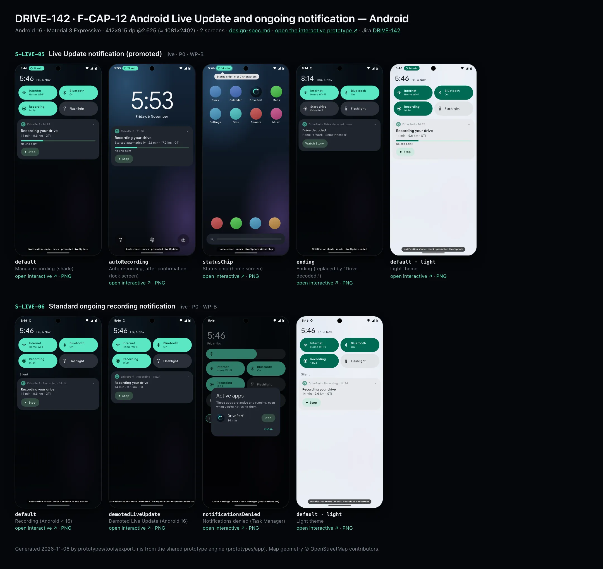
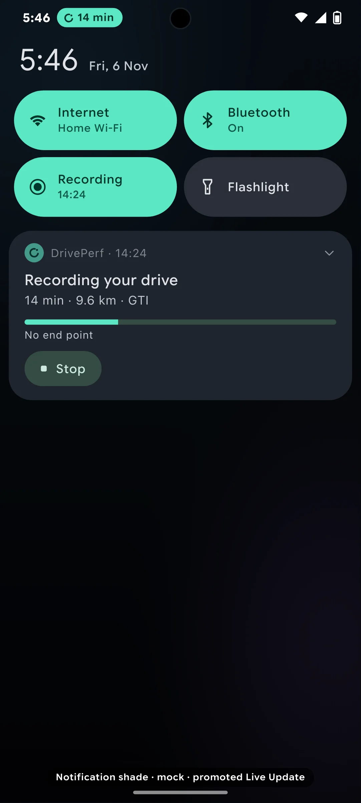
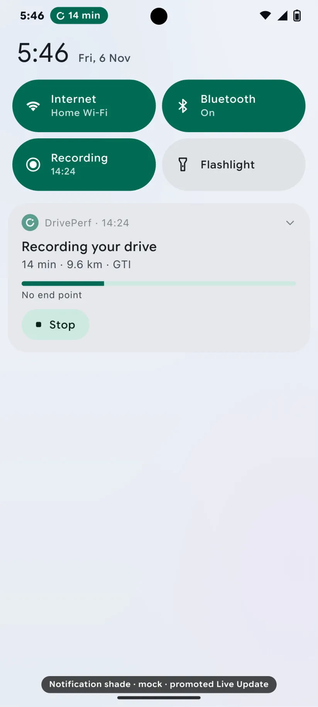
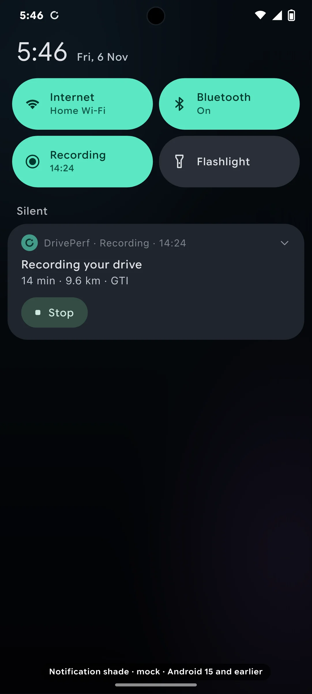
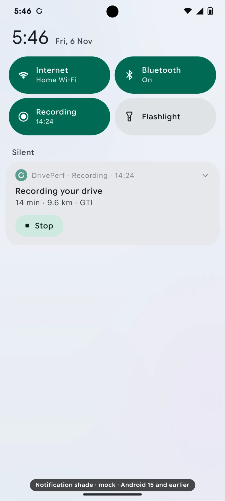

# DRIVE-142 · F-CAP-12 Android Live Update and ongoing notification — Android design spec

> Generated by `prototypes/tools/export.mjs` on 2026-11-06 from the shared prototype engine. **Do not edit by hand:** change the screen's `spec` in `prototypes/app/screens/wp-*.js` (see `prototypes/app/AUTHORING.md`) and re-export.

- **Jira story:** [DRIVE-142](https://thekeval.atlassian.net/browse/DRIVE-142) · F-CAP-12 · P0
- **Platform:** Android 16 · Material 3 Expressive · 412×915 dp @2.625 (≈ 1081×2402)
- **Interactive prototype:** [../../../../prototypes/android/index.html#S-LIVE-05](../../../../prototypes/android/index.html#S-LIVE-05) (catalog panel: every screen and state; deep links `#S-ID/state?trip=…&ent=…&theme=light&text=xl&rm=1`)
- **Contact sheet:** [mockup.html](mockup.html) · 
- **Design system (source of truth for values):** [brand](../../system/brand.md) · [components](../../system/components.md) · [motion](../../system/motion.md) · [accessibility](../../system/accessibility.md) · [screen map](../../system/screen-map.md) · [fixtures](../../system/fixtures.md) · tokens `prototypes/shared/tokens.css`

## Screens in this story

| Screen | Name | Presentation | Priority | States | Status |
|---|---|---|---|---|---|
| `S-LIVE-05` | Live Update notification (promoted) | Live (Android 16 promoted notification) | P0 | 4 | Prototyped |
| `S-LIVE-06` | Standard ongoing recording notification | Live (Android ongoing notification) | P0 | 3 | Prototyped |

## Tokens used on this platform

Values resolved from `prototypes/shared/tokens.css` inside the Android device (`[data-platform="android"]`). Use the token names in code; the hex values are for reference.

| Token | Dark | Light |
|---|---|---|
| `--app-bg` | `#0D1117` | `#F7F9FC` |
| `--card-bg` | `#191E25` | `#EBEEF2` |
| `--dp-bg-grouped` | `#0D1117` | `#F7F9FC` |
| `--dp-surface` | `#191E25` | `#EBEEF2` |
| `--dp-surface-2` | `#1F252D` | `#E5E8EC` |
| `--dp-surface-3` | `#2A3038` | `#DFE2E6` |
| `--dp-fill` | `#2A3038` | `#DFE2E6` |
| `--dp-fill-strong` | `#353B44` | `#D3D7DC` |
| `--dp-text` | `#E1E3E8` | `#181C20` |
| `--dp-text-2` | `#C0C7CF` | `#40474F` |
| `--dp-text-3` | `#8A929B` | `#707881` |
| `--dp-separator` | `#40474F` | `#C0C7CF` |
| `--dp-accent` | `#5BE7C4` | `#006B53` |
| `--dp-accent-text` | `#5BE7C4` | `#006B53` |
| `--dp-on-accent` | `#00382B` | `#FFFFFF` |
| `--dp-accent-container` | `#00513F` | `#91F1D8` |
| `--dp-record` | `#FFC24B` | `#7A5900` |
| `--dp-positive` | `#5BE7C4` | `#006B53` |
| `--dp-change-down` | `#C0C7CF` | `#40474F` |
| `--dp-warning` | `#F5B648` | `#7A5900` |
| `--dp-critical` | `#FFB4AB` | `#BA1A1A` |
| `--dp-glass-fill` | `#1F252DF2` | `#E5E8ECF2` |
| `--dp-glass-fill-strong` | `#2A3038` | `#DFE2E6` |
| `--dp-glass-stroke` | `#FFFFFF0F` | `#0000000A` |
| `--md-sys-color-primary` | `#5BE7C4` | `#006B53` |
| `--md-sys-color-on-primary` | `#00382B` | `#FFFFFF` |
| `--md-sys-color-primary-container` | `#00513F` | `#91F1D8` |
| `--md-sys-color-on-primary-container` | `#91F1D8` | `#002118` |
| `--md-sys-color-secondary-container` | `#344C44` | `#CEE9DF` |
| `--md-sys-color-surface` | `#0D1117` | `#F7F9FC` |
| `--md-sys-color-surface-container` | `#191E25` | `#EBEEF2` |
| `--md-sys-color-surface-container-high` | `#1F252D` | `#E5E8EC` |
| `--md-sys-color-on-surface-variant` | `#C0C7CF` | `#40474F` |
| `--dp-data-route` | `#5BE7C4` | `#079777` |
| `--dp-data-event-brake` | `#FF7A66` | `#A21F16` |
| `--dp-data-event-accel` | `#E58BD0` | `#A33A8C` |
| `--dp-data-event-corner` | `#EAD54E` | `#9A8A00` |
| `--dp-data-quality-good` | `#5FDB9C` | `#1E9E62` |
| `--dp-data-speed` | `#D6DCE4` | `#404A58` |
| `--dp-data-long-g` | `#5AB8F5` | `#0A6AB8` |
| `--dp-data-lat-g` | `#F5A142` | `#B25A00` |

| Type / layout token | Value |
|---|---|
| `--dp-font-screen-title` | `600 32px / 40px "Google Sans Flex", "Google Sans Display", "Roboto Flex", Roboto, system-ui, sans-serif` |
| `--dp-font-sheet-title` | `400 24px / 32px "Google Sans Flex", "Google Sans Display", "Roboto Flex", Roboto, system-ui, sans-serif` |
| `--dp-font-section-title` | `600 22px / 28px "Google Sans Flex", "Google Sans Display", "Roboto Flex", Roboto, system-ui, sans-serif` |
| `--dp-font-card-title` | `700 16px / 24px "Google Sans Flex", "Google Sans Text", "Roboto Flex", Roboto, system-ui, sans-serif` |
| `--dp-font-body` | `400 16px / 24px "Google Sans Flex", "Google Sans Text", "Roboto Flex", Roboto, system-ui, sans-serif` |
| `--dp-font-body-secondary` | `400 14px / 20px "Google Sans Flex", "Google Sans Text", "Roboto Flex", Roboto, system-ui, sans-serif` |
| `--dp-font-meta` | `400 12px / 16px "Google Sans Flex", "Google Sans Text", "Roboto Flex", Roboto, system-ui, sans-serif` |
| `--dp-font-caption` | `500 12px / 16px "Google Sans Flex", "Google Sans Text", "Roboto Flex", Roboto, system-ui, sans-serif` |
| `--dp-font-button` | `700 14px / 20px "Google Sans Flex", "Google Sans Text", "Roboto Flex", Roboto, system-ui, sans-serif` |
| `--dp-num-hero` | `600 72px / 72px "Google Sans Flex", "Roboto Flex", Roboto, system-ui, sans-serif` |
| `--dp-num-xl` | `600 48px / 52px "Google Sans Flex", "Roboto Flex", Roboto, system-ui, sans-serif` |
| `--dp-num-l` | `600 34px / 38px "Google Sans Flex", "Roboto Flex", Roboto, system-ui, sans-serif` |
| `--dp-num-m` | `600 24px / 28px "Google Sans Flex", "Roboto Flex", Roboto, system-ui, sans-serif` |
| `--dp-num-s` | `600 17px / 22px "Google Sans Flex", "Roboto Flex", Roboto, system-ui, sans-serif` |
| `--dp-num-xs` | `600 13px / 16px "Google Sans Flex", "Roboto Flex", Roboto, system-ui, sans-serif` |
| `--dp-screen-margin` | `16px` |
| `--dp-radius-card` | `16px` |
| `--dp-radius-card-hero` | `28px` |
| `--dp-radius-sheet` | `28px` |
| `--dp-radius-chip` | `8px` |
| `--dp-radius-button` | `999px` |
| `--dp-layout-list-row-min` | `56px` |
| `--dp-layout-touch-min` | `48px` |
| `--safe-top` | `40px` |
| `--safe-bottom` | `24px` |

Text sizes scale with `--dp-text-scale` (XL = 2.0×) and numerals with `--dp-num-scale` (XL = 1.3×). DP Numerals: Google Sans Flex wdth 120 wght 600, tabular.

---

## S-LIVE-05 · Live Update notification (promoted)

 

- **Presentation:** live — screen map: “Live (Android 16 promoted notification)”
- **Entry points:** Manual start; confirmed auto trip
- **Leads to:** Tap → S-DRV-01 · Stop action
- **PRD features:** F-CAP-01, F-CAP-12 · **Priority:** P0 · **WP:** B
- **Interactive:** [S-LIVE-05](../../../../prototypes/android/index.html#S-LIVE-05)

**Purpose.** Android 16’s promoted ongoing notification gives Android users the same glanceable recording status as the iPhone Live Activity: a status-bar chip, a pinned card in the shade and on the lock screen, and Stop (F-CAP-12).

### States

| State | PRD label | Fixture params | Screenshot |
|---|---|---|---|
| `default` | Manual recording (shade) | `live=manual` | [S-LIVE-05.png](../../screens/android/S-LIVE-05.webp) · [open](../../../../prototypes/android/index.html#S-LIVE-05) |
| `autoRecording` | Auto recording, after confirmation (lock screen) | `live=auto` | [S-LIVE-05--autoRecording.png](../../screens/android/S-LIVE-05--autoRecording.webp) · [open](../../../../prototypes/android/index.html#S-LIVE-05/autoRecording) |
| `statusChip` | Status chip (home screen) | `live=manual` | [S-LIVE-05--statusChip.png](../../screens/android/S-LIVE-05--statusChip.webp) · [open](../../../../prototypes/android/index.html#S-LIVE-05/statusChip) |
| `ending` | Ending (replaced by “Drive decoded.”) | — | [S-LIVE-05--ending.png](../../screens/android/S-LIVE-05--ending.webp) · [open](../../../../prototypes/android/index.html#S-LIVE-05/ending) |
| default · light | Light theme | `theme=light` | [S-LIVE-05--light.png](../../screens/android/S-LIVE-05--light.webp) |

Every state also renders in light/dark (`theme=light`), XL text (`text=xl`) and reduced motion (`rm=1`).

### Layout

- Shade (default): Android 16 QS header (time, date), four large tiles (DrivePerf tile shows “Recording · 14:24”), then the Live Update pinned first: app icon + “DrivePerf · 14:24” (chronometer) · title “Recording your drive” (500 16) · “14 min · 9.6 km · GTI” · indeterminate ProgressStyle track (“No end point”) · Stop action (tonal pill, stop glyph).
- Status chip: primary pill in the status bar, ≤ 7 characters: “14 min” (Loop mono glyph + text). Shown in every state except ending.
- Auto recording: the same card on the lock screen, body prefixed “Started automatically · ”; only promoted after the trip is confirmed.
- Ending: chip gone; the card is replaced by the “Drive decoded.” notification (Drive decoded channel) with a Watch Story action.
- Not colourised, no custom RemoteViews (promotion rules); small icon = icon-android-notification.svg.

### Components & tokens

| Component | Tokens / spec |
|---|---|
| `notification` | components.md §20.6 |
| `shade` | see components.md |
| `qsTile` | see components.md |
| `lockScreen` | see components.md |

### Interactions & navigation

- Tap the card or the chip → DrivePerf on S-DRV-01 (D1: never content). Stop → ends the trip (prototype → ending); the next open shows S-DRV-04 / the Story.
- Ending card / Watch Story → S-STY-01 through the gate. If the user dismisses or demotes the Live Update it is never re-promoted for that trip (falls back to S-LIVE-06).

### Motion

- System only (chronometer ticks itself; updates rate-limited to ≥ 5 s apart). No animation in the chip (motion.md §3.2). Prototype: the card rises on load. RM: none.

### Accessibility

- Live surfaces never announce the timer as it changes; each surface has one summary label (“DrivePerf, recording, GTI. 14 minutes, 9.6 kilometres.”) and a separate “Stop drive” button.
- Chip content description: “DrivePerf recording, 14 minutes”. Stop action label “Stop drive”.

### Platform notes

- **Android (this spec):** Notification.ProgressStyle (indeterminate, no end point) or MetricStyle; setRequestPromotedOngoing(true), POST_PROMOTED_NOTIFICATIONS, setShortCriticalText("14 min"), setUsesChronometer(true) with when = startedAt; FGS type location; channel “Recording” (low importance).
- *iOS (for reference):* n/a (Android only). iOS equivalent: S-LIVE-01/02.

### Analytics

- `live_update_shown {promoted: true, mode: manual|auto}`
- `live_update_stop_tapped`
- `live_update_demoted`
- `live_update_chip_tapped`

### Copy

| Key | Text |
|---|---|
| Title | Recording your drive |
| Body | {14} min · {9.6} km · {GTI} |
| Auto | Started automatically · {21} min · {17.2} km · {GTI} |
| Chip | {14} min (≤ 7 characters) |
| Action | Stop |
| Ending | Drive decoded. · Home → Work · Smoothness 91 · Watch Story |

### Free / Pro

Same for every plan.

### Data & fixtures

liveTrip.states.manual (default, statusChip) and auto (autoRecording). Clock = startedAt + elapsedS (5:46 / 5:53). Ending uses DP_DATA.notifications n_decoded (t20261105-0742, scene Thu 8:14) — the decoded notification may name the route and score because it is posted only after parking (held until parked, D4).

### Assets

[icon-stop.svg](assets/icon-stop.svg) · [icon-record.svg](assets/icon-record.svg) · [icon-chevronDown.svg](assets/icon-chevronDown.svg) · [logo-a-loop.svg](assets/logo-a-loop.svg) · [icon-android-notification.svg](assets/icon-android-notification.svg)

UI glyphs may be swapped for SF Symbols / Material Symbols Rounded equivalents; event-pin, quality and provenance glyphs must not be (components.md global rules).

### Checklist (accessibility.md §9)

- [ ] Light and dark both render, and contrast passes.
- [ ] The XL text state reflows with no truncation.
- [ ] The RM state is defined.
- [ ] Every control has a label; every chart and map has a summary sentence.
- [ ] Every target ≥ 44 pt / 48 dp (≥ 64 in-drive).
- [ ] No meaning by colour alone.
- [ ] Speed is neutral wherever it appears and absent from social or live surfaces.
- [ ] No streak, leaderboard, speed or “beat your time” language.
- [ ] Behaviour is defined while a trip is active (D1 gate).
- [ ] Haptics come from motion.md §6 only.

---

## S-LIVE-06 · Standard ongoing recording notification

 

- **Presentation:** live — screen map: “Live (Android ongoing notification)”
- **Entry points:** Recording on Android < 16 or demoted
- **Leads to:** Tap → S-DRV-01 · Stop action
- **PRD features:** F-CAP-01, F-CAP-11, F-CAP-12 · **Priority:** P0 · **WP:** B
- **Interactive:** [S-LIVE-06](../../../../prototypes/android/index.html#S-LIVE-06)

**Purpose.** The foreground-service notification that must exist while Android records (F-CAP-11/12): the same status as the Live Update in a quiet, low-importance notification, used below Android 16, when promotion is unavailable or after the user demotes it. With notifications denied, Android still lists the service in the Task Manager.

### States

| State | PRD label | Fixture params | Screenshot |
|---|---|---|---|
| `default` | Recording (Android < 16) | `live=manual` | [S-LIVE-06.png](../../screens/android/S-LIVE-06.webp) · [open](../../../../prototypes/android/index.html#S-LIVE-06) |
| `demotedLiveUpdate` | Demoted Live Update (Android 16) | `live=manual` | [S-LIVE-06--demotedLiveUpdate.png](../../screens/android/S-LIVE-06--demotedLiveUpdate.webp) · [open](../../../../prototypes/android/index.html#S-LIVE-06/demotedLiveUpdate) |
| `notificationsDenied` | Notifications denied (Task Manager) | `live=manual` | [S-LIVE-06--notificationsDenied.png](../../screens/android/S-LIVE-06--notificationsDenied.webp) · [open](../../../../prototypes/android/index.html#S-LIVE-06/notificationsDenied) |
| default · light | Light theme | `theme=light` | [S-LIVE-06--light.png](../../screens/android/S-LIVE-06--light.webp) |

Every state also renders in light/dark (`theme=light`), XL text (`text=xl`) and reduced motion (`rm=1`).

### Layout

- Shade: QS header + 4 tiles (DrivePerf tile “Recording · 14:24”), then the “Silent” section (Android ≤ 15) holding the notification; demoted on 16 it sits in the normal list. Status bar: the small Loop icon after the clock, no chip.
- Card (surfaceContainerHigh, radius 26): app icon + “DrivePerf · Recording · 14:24” (chronometer) · “Recording your drive” · “14 min · 9.6 km · GTI” · Stop action. Small icon icon-android-notification.svg; not colourised.
- Notifications denied: full Quick Settings with the footer chip “1 app is active” highlighted, and the system Active apps dialog: DrivePerf (app icon) · “14 min” · Stop.

### Components & tokens

| Component | Tokens / spec |
|---|---|
| `notification` | components.md §20.6 |
| `shade` | see components.md |
| `qsTile` | see components.md |
| `activeAppsDialog (local mock)` | see components.md |

### Interactions & navigation

- Tap → S-DRV-01. Stop (notification or Task Manager) → stops the FGS and ends the trip (prototype → S-HOME-01 + toast; the real app finalises in the service first, F-CAP-03).
- A demoted Live Update is never re-promoted for this trip (F-CAP-12 AC2).

### Motion

- System only; updates ≥ 5 s apart; chronometer ticks itself. RM: n/a.

### Accessibility

- Live surfaces never announce the timer as it changes; each surface has one summary label (“DrivePerf, recording, GTI. 14 minutes, 9.6 kilometres.”) and a separate “Stop drive” button.
- Stop action “Stop drive”. The Task Manager row is the system’s own (“DrivePerf, 14 min, Stop”).

### Platform notes

- **Android (this spec):** NotificationCompat ongoing, foregroundServiceType=location, channel “Recording” IMPORTANCE_LOW, setOnlyAlertOnce, setUsesChronometer, addAction(Stop → PendingIntent to the service). On Android 13+ with POST_NOTIFICATIONS denied the FGS shows only in the Task Manager.
- *iOS (for reference):* n/a (Android only). iOS shows nothing when notifications are denied (blue location indicator only).

### Analytics

- `fgs_notification_shown {promoted: false, reason: os_below_16|demoted|unavailable}`
- `fgs_stop_tapped {from: notification|task_manager}`

### Copy

| Key | Text |
|---|---|
| Header | DrivePerf · Recording · {14:24} |
| Title | Recording your drive |
| Body | {14} min · {9.6} km · {GTI} |
| Action | Stop |
| Task Manager | Active apps · DrivePerf · {14 min} · Stop |
| Toast | Drive ended. Decoding it now. |

### Free / Pro

Same for every plan.

### Data & fixtures

liveTrip.states.manual (14:24 · 9.6 km · GTI); clock 5:46 = startedAt + elapsedS.

### Assets

[icon-stop.svg](assets/icon-stop.svg) · [icon-chevronDown.svg](assets/icon-chevronDown.svg) · [icon-gear.svg](assets/icon-gear.svg) · [logo-a-loop.svg](assets/logo-a-loop.svg) · [icon-android-notification.svg](assets/icon-android-notification.svg)

UI glyphs may be swapped for SF Symbols / Material Symbols Rounded equivalents; event-pin, quality and provenance glyphs must not be (components.md global rules).

### Checklist (accessibility.md §9)

- [ ] Light and dark both render, and contrast passes.
- [ ] The XL text state reflows with no truncation.
- [ ] The RM state is defined.
- [ ] Every control has a label; every chart and map has a summary sentence.
- [ ] Every target ≥ 44 pt / 48 dp (≥ 64 in-drive).
- [ ] No meaning by colour alone.
- [ ] Speed is neutral wherever it appears and absent from social or live surfaces.
- [ ] No streak, leaderboard, speed or “beat your time” language.
- [ ] Behaviour is defined while a trip is active (D1 gate).
- [ ] Haptics come from motion.md §6 only.

---

Map geometry in the prototype: © OpenStreetMap contributors (ODbL). Speed and G are simulated fixtures (fixtures.md).
