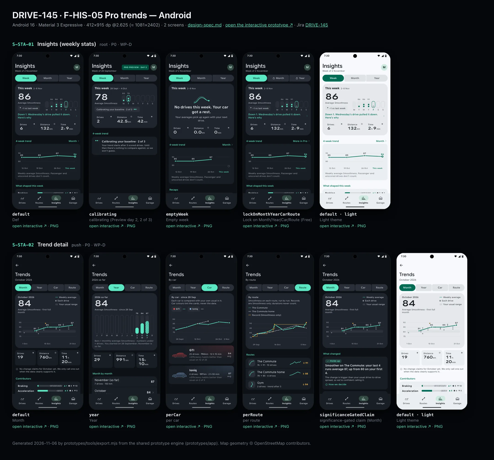
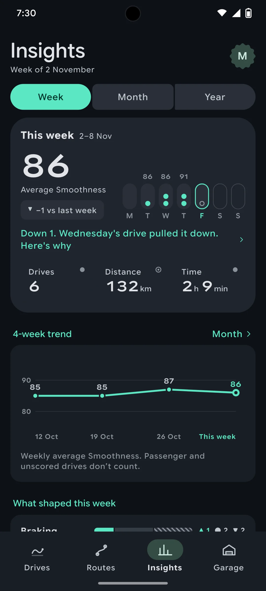
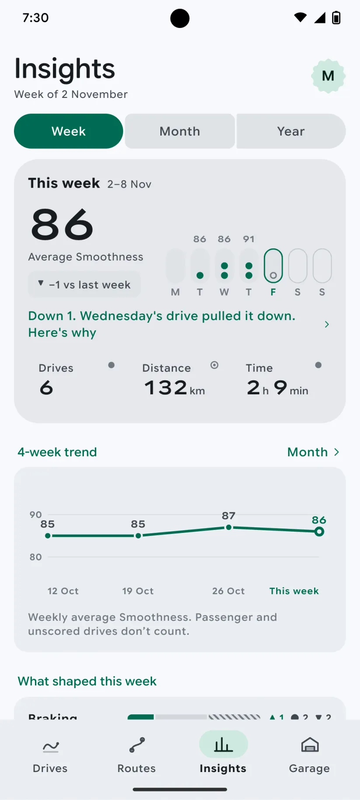
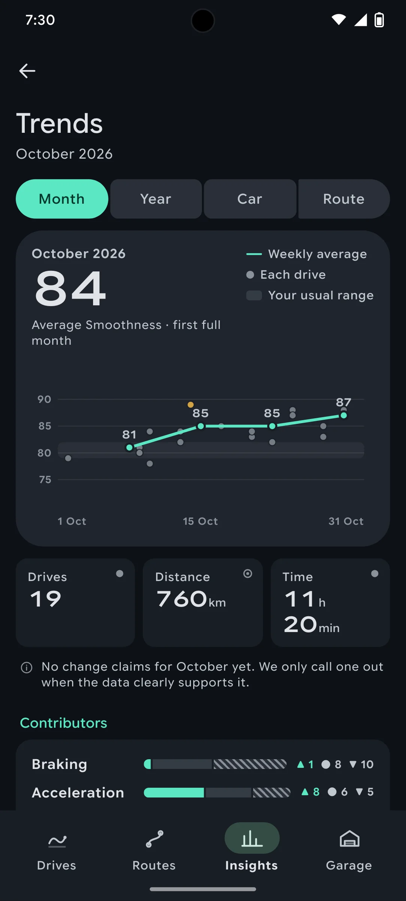
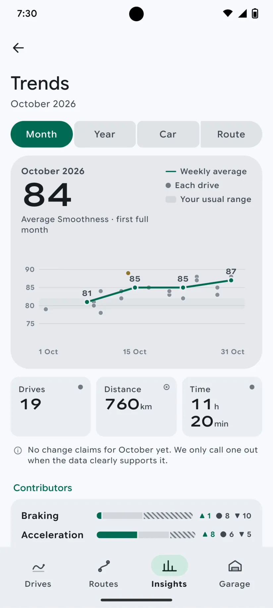

# DRIVE-145 · F-HIS-05 Pro trends — Android design spec

> Generated by `prototypes/tools/export.mjs` on 2026-11-06 from the shared prototype engine. **Do not edit by hand:** change the screen's `spec` in `prototypes/app/screens/wp-*.js` (see `prototypes/app/AUTHORING.md`) and re-export.

- **Jira story:** [DRIVE-145](https://thekeval.atlassian.net/browse/DRIVE-145) · F-HIS-05 · P0
- **Platform:** Android 16 · Material 3 Expressive · 412×915 dp @2.625 (≈ 1081×2402)
- **Interactive prototype:** [../../../../prototypes/android/index.html#S-STA-01](../../../../prototypes/android/index.html#S-STA-01) (catalog panel: every screen and state; deep links `#S-ID/state?trip=…&ent=…&theme=light&text=xl&rm=1`)
- **Contact sheet:** [mockup.html](mockup.html) · 
- **Design system (source of truth for values):** [brand](../../system/brand.md) · [components](../../system/components.md) · [motion](../../system/motion.md) · [accessibility](../../system/accessibility.md) · [screen map](../../system/screen-map.md) · [fixtures](../../system/fixtures.md) · tokens `prototypes/shared/tokens.css`

## Screens in this story

| Screen | Name | Presentation | Priority | States | Status |
|---|---|---|---|---|---|
| `S-STA-01` | Insights (weekly stats) | Root (Insights tab) | P0 | 4 | Prototyped |
| `S-STA-02` | Trend detail | Push | P0 | 5 | Prototyped |

## Tokens used on this platform

Values resolved from `prototypes/shared/tokens.css` inside the Android device (`[data-platform="android"]`). Use the token names in code; the hex values are for reference.

| Token | Dark | Light |
|---|---|---|
| `--app-bg` | `#0D1117` | `#F7F9FC` |
| `--card-bg` | `#191E25` | `#EBEEF2` |
| `--dp-bg-grouped` | `#0D1117` | `#F7F9FC` |
| `--dp-surface` | `#191E25` | `#EBEEF2` |
| `--dp-surface-2` | `#1F252D` | `#E5E8EC` |
| `--dp-surface-3` | `#2A3038` | `#DFE2E6` |
| `--dp-fill` | `#2A3038` | `#DFE2E6` |
| `--dp-fill-strong` | `#353B44` | `#D3D7DC` |
| `--dp-text` | `#E1E3E8` | `#181C20` |
| `--dp-text-2` | `#C0C7CF` | `#40474F` |
| `--dp-text-3` | `#8A929B` | `#707881` |
| `--dp-separator` | `#40474F` | `#C0C7CF` |
| `--dp-accent` | `#5BE7C4` | `#006B53` |
| `--dp-accent-text` | `#5BE7C4` | `#006B53` |
| `--dp-on-accent` | `#00382B` | `#FFFFFF` |
| `--dp-accent-container` | `#00513F` | `#91F1D8` |
| `--dp-record` | `#FFC24B` | `#7A5900` |
| `--dp-positive` | `#5BE7C4` | `#006B53` |
| `--dp-change-down` | `#C0C7CF` | `#40474F` |
| `--dp-warning` | `#F5B648` | `#7A5900` |
| `--dp-critical` | `#FFB4AB` | `#BA1A1A` |
| `--dp-glass-fill` | `#1F252DF2` | `#E5E8ECF2` |
| `--dp-glass-fill-strong` | `#2A3038` | `#DFE2E6` |
| `--dp-glass-stroke` | `#FFFFFF0F` | `#0000000A` |
| `--md-sys-color-primary` | `#5BE7C4` | `#006B53` |
| `--md-sys-color-on-primary` | `#00382B` | `#FFFFFF` |
| `--md-sys-color-primary-container` | `#00513F` | `#91F1D8` |
| `--md-sys-color-on-primary-container` | `#91F1D8` | `#002118` |
| `--md-sys-color-secondary-container` | `#344C44` | `#CEE9DF` |
| `--md-sys-color-surface` | `#0D1117` | `#F7F9FC` |
| `--md-sys-color-surface-container` | `#191E25` | `#EBEEF2` |
| `--md-sys-color-surface-container-high` | `#1F252D` | `#E5E8EC` |
| `--md-sys-color-on-surface-variant` | `#C0C7CF` | `#40474F` |
| `--dp-data-route` | `#5BE7C4` | `#079777` |
| `--dp-data-event-brake` | `#FF7A66` | `#A21F16` |
| `--dp-data-event-accel` | `#E58BD0` | `#A33A8C` |
| `--dp-data-event-corner` | `#EAD54E` | `#9A8A00` |
| `--dp-data-quality-good` | `#5FDB9C` | `#1E9E62` |
| `--dp-data-speed` | `#D6DCE4` | `#404A58` |
| `--dp-data-long-g` | `#5AB8F5` | `#0A6AB8` |
| `--dp-data-lat-g` | `#F5A142` | `#B25A00` |

| Type / layout token | Value |
|---|---|
| `--dp-font-screen-title` | `600 32px / 40px "Google Sans Flex", "Google Sans Display", "Roboto Flex", Roboto, system-ui, sans-serif` |
| `--dp-font-sheet-title` | `400 24px / 32px "Google Sans Flex", "Google Sans Display", "Roboto Flex", Roboto, system-ui, sans-serif` |
| `--dp-font-section-title` | `600 22px / 28px "Google Sans Flex", "Google Sans Display", "Roboto Flex", Roboto, system-ui, sans-serif` |
| `--dp-font-card-title` | `700 16px / 24px "Google Sans Flex", "Google Sans Text", "Roboto Flex", Roboto, system-ui, sans-serif` |
| `--dp-font-body` | `400 16px / 24px "Google Sans Flex", "Google Sans Text", "Roboto Flex", Roboto, system-ui, sans-serif` |
| `--dp-font-body-secondary` | `400 14px / 20px "Google Sans Flex", "Google Sans Text", "Roboto Flex", Roboto, system-ui, sans-serif` |
| `--dp-font-meta` | `400 12px / 16px "Google Sans Flex", "Google Sans Text", "Roboto Flex", Roboto, system-ui, sans-serif` |
| `--dp-font-caption` | `500 12px / 16px "Google Sans Flex", "Google Sans Text", "Roboto Flex", Roboto, system-ui, sans-serif` |
| `--dp-font-button` | `700 14px / 20px "Google Sans Flex", "Google Sans Text", "Roboto Flex", Roboto, system-ui, sans-serif` |
| `--dp-num-hero` | `600 72px / 72px "Google Sans Flex", "Roboto Flex", Roboto, system-ui, sans-serif` |
| `--dp-num-xl` | `600 48px / 52px "Google Sans Flex", "Roboto Flex", Roboto, system-ui, sans-serif` |
| `--dp-num-l` | `600 34px / 38px "Google Sans Flex", "Roboto Flex", Roboto, system-ui, sans-serif` |
| `--dp-num-m` | `600 24px / 28px "Google Sans Flex", "Roboto Flex", Roboto, system-ui, sans-serif` |
| `--dp-num-s` | `600 17px / 22px "Google Sans Flex", "Roboto Flex", Roboto, system-ui, sans-serif` |
| `--dp-num-xs` | `600 13px / 16px "Google Sans Flex", "Roboto Flex", Roboto, system-ui, sans-serif` |
| `--dp-screen-margin` | `16px` |
| `--dp-radius-card` | `16px` |
| `--dp-radius-card-hero` | `28px` |
| `--dp-radius-sheet` | `28px` |
| `--dp-radius-chip` | `8px` |
| `--dp-radius-button` | `999px` |
| `--dp-layout-list-row-min` | `56px` |
| `--dp-layout-touch-min` | `48px` |
| `--safe-top` | `40px` |
| `--safe-bottom` | `24px` |

Text sizes scale with `--dp-text-scale` (XL = 2.0×) and numerals with `--dp-num-scale` (XL = 1.3×). DP Numerals: Google Sans Flex wdth 120 wght 600, tabular.

---

## S-STA-01 · Insights (weekly stats)

 

- **Presentation:** root · tab: insights — screen map: “Root (Insights tab)”
- **Entry points:** Tab
- **Leads to:** S-STA-02 (Pro) or S-SUB-03 (Free) · S-SCO-05 · S-RCP-01 (latest recap card) · S-WRP-01 card
- **PRD features:** F-HIS-04, F-HIS-05, F-SCO-02 · **Priority:** P0 · **WP:** D
- **Interactive:** [S-STA-01](../../../../prototypes/android/index.html#S-STA-01)

**Purpose.** The Insights tab: a calm weekly view of driving and Smoothness — this week vs last, a 4-week line, what shaped the week, the current focus and the recap/Wrapped cards (F-HIS-04). Month, year, per-car and per-route trends are Pro and shown “locked, not lost” on Free (F-HIS-05, Gate 2 OQ-07).

### States

| State | PRD label | Fixture params | Screenshot |
|---|---|---|---|
| `default` | Def | — | [S-STA-01.png](../../screens/android/S-STA-01.webp) · [open](../../../../prototypes/android/index.html#S-STA-01) |
| `calibrating` | calibrating (Preview day 2, 2 of 3) | `ent=preview` | [S-STA-01--calibrating.png](../../screens/android/S-STA-01--calibrating.webp) · [open](../../../../prototypes/android/index.html#S-STA-01/calibrating) |
| `emptyWeek` | Empty week | — | [S-STA-01--emptyWeek.png](../../screens/android/S-STA-01--emptyWeek.webp) · [open](../../../../prototypes/android/index.html#S-STA-01/emptyWeek) |
| `lockOnMonthYearCarRoute` | Lock on Month/Year/Car/Route (Free) | `ent=free` | [S-STA-01--lockOnMonthYearCarRoute.png](../../screens/android/S-STA-01--lockOnMonthYearCarRoute.webp) · [open](../../../../prototypes/android/index.html#S-STA-01/lockOnMonthYearCarRoute) |
| default · light | Light theme | `theme=light` | [S-STA-01--light.png](../../screens/android/S-STA-01--light.webp) |

Every state also renders in light/dark (`theme=light`), XL text (`text=xl`) and reduced motion (`rm=1`).

### Layout

- Large title “Insights” (iOS 34 bold · Android LargeFlexibleTopAppBar with “Week of 2 November” subtitle); trailing Preview badge (when active) + avatar.
- Period selector: Week · Month · Year (iOS glass segmented, 36 tall · Android connected button group, 40 dp). On Free, Month and Year carry a lock glyph.
- Hero card (radius 32 / 28): “This week · 2–8 Nov”; average Smoothness (DP Numerals 48) + “Average Smoothness” + comparison chip (“▼ −1 vs last week”, neutral, never red); 7-day strip (dots per drive, best score above, today outlined, future days hollow); explain-don’t-blame link “Down 1. Wednesday’s drive pulled it down. Here’s why ›”; 3 stat tiles Drives · Distance · Time with provenance glyphs.
- “4-week trend” card: weekly averages as a Glide line with value labels, this week as the ringed last point; caption “Weekly average Smoothness. Passenger and unscored drives don’t count.” Section action “Month ›” (Pro) / “More in Pro ›” (Free).
- “What shaped this week”: four contributor rows (Braking · Acceleration · Cornering · Consistency), each a 3-part bar (▲ smoother / ● usual / ▼ rougher) with counts in text.
- “Your focus” card → S-SCO-05: habit name, “Gentler in 3 of 5 drives this week.”, a 3-week meter (share of gentler drives, not a streak).
- “Recaps”: latest weekly recap card → S-RCP-01 and the October Wrapped card → S-WRP-01.
- “Trends”: Pro = list rows Month · Year · By car · By route → S-STA-02 states. Free = lock panel with the user’s own October trend, car averages and route trend blurred 14 px + “See how your driving changes month to month with Pro.” + See plans, then the same rows with lock + PRO → S-SUB-03 trends.

### Components & tokens

| Component | Tokens / spec |
|---|---|
| `largeTitle` | --dp-font-screen-title (iOS 34/41 bold · Android 32/40) · components.md §2 |
| `avatar` | see components.md |
| `previewBadge` | see components.md |
| `segmented` | see components.md |
| `card` | --dp-surface / --md-sys-color-surface-container · --dp-radius-card (24 iOS · 16 Android) · hero: --dp-radius-card-hero (32 · 28) · light iOS: --dp-elev-1 |
| `chip` | --dp-radius-chip (iOS capsule · Android 8) · height 28 · --dp-font-caption |
| `deltaChip` | better: --dp-accent-text on --dp-accent 18% · lower: --dp-text-2 on --dp-fill (never red) · record: --dp-record on --dp-record 18% · components.md §4 |
| `stats` | --dp-surface-2 / --md-sys-color-surface-container-high · radius 14 iOS / 12 Android · value --dp-num-m (DP Numerals) · components.md §5 |
| `section` | --dp-font-section-title · --dp-layout-section-gap 28 |
| `list` | iOS inset grouped radius --dp-radius-card, rows 52 pt, separators --dp-separator inset 16 · Android ListItem 56/72 dp in --md-sys-color-surface-container |
| `row` | --dp-font-body · --dp-font-meta (supporting) · --dp-layout-list-row-min |
| `lockPanel` | blur --dp-opacity-locked-blur 14px · dim --dp-opacity-locked-dim 35% · components.md §15.2 |
| `artMerge` | see components.md |
| `carDot` | see components.md |

### Interactions & navigation

- Month / Year segment → S-STA-02 (Month) / S-STA-02/year (Pro) · S-SUB-03/trends (Free). Trend rows → S-STA-02 default/year/perCar/perRoute (Pro) or S-SUB-03/trends (Free).
- “Here’s why ›” → S-TRP-01 for the drive that pulled the week down (t20261104-0650). Focus card → S-SCO-05. Recap card → S-RCP-01. Wrapped card → S-WRP-01 (Recap/Wrapped pass the D1 gate).
- Avatar → S-ACC-01; Preview badge → S-SUB-01. No paywall is ever auto-opened here.

### Motion

- Hero motion: the 4-week line draws on (1100 ms, ease.drawOn) and its points pop (shared.pinPop, 60 ms stagger); blocks rise 8 px, 40 ms stagger. RM: line and points appear complete (220 ms fade).
- Segmented change: selection haptic; tab switch cross-fade (iOS) / fade-through (Android).

### Accessibility

- Hero card is one element: “This week, 2–8 Nov: 6 drives, 132.1 kilometres, 2 h 9 min. Average Smoothness 86, 1 down on last week.”
- Trend chart summary: “Four-week trend of your weekly average Smoothness: week of 12 October, 85; … week of 2 November, 86.” (iOS Audio Graph descriptor; Android “View as table”).
- Contributor rows: “Braking: smoother than usual on 2 of 5 drives, usual on 1, rougher on 2.” Glyphs ▲ ● ▼ + text carry meaning, never colour alone.
- XL: hero stacks the number above the day strip; tiles go to 2 columns; segmented labels stay on one line (icons drop); lock panel text wraps.
- No streak or “don’t break it” language anywhere (D7); the focus meter is a share, not a chain.

### Platform notes

- **Android (this spec):** LargeFlexibleTopAppBar with subtitle; connected ButtonGroup with selection morph; hero card surface-container-high radius 28; segmented ListItems; NavigationBar (no capture toolbar on this tab).
- *iOS (for reference):* Large title + glass toolbar avatar; glass segmented Picker; cards opaque --dp-surface (radius 24/32); lists inset-grouped; floating tab bar + capture accessory.

### Analytics

- `insights_opened {state}`
- `insights_period_tapped {period: month|year, locked}`
- `insights_dimension_tapped {dimension: car|route, locked}`
- `locked_content_viewed {type: trends}`

### Copy

| Key | Text |
|---|---|
| Title | Insights |
| Hero | This week · {range} · Average Smoothness · ▼ −1 vs last week |
| Down explanation | Down 1. Wednesday’s drive pulled it down. Here’s why › |
| Trend caption | Weekly average Smoothness. Passenger and unscored drives don’t count. |
| Calibrating | Calibrating your baseline · 2 of 3. Your trend starts after 3 scored drives. Until then there’s nothing to compare against, so we won’t guess. |
| Empty week | No drives this week. Your car got a rest. Your averages pick up again with your next drive. |
| Lock | See how your driving changes month to month with Pro. (entitlement.lockSheets.trends) · Your data is all here. Longer trends are part of Pro. |
| Focus | One habit at a time · Braking into stops · Gentler in 3 of 5 drives this week. |

### Free / Pro

Free: Week view + 4-week trend, contributors, focus, recap and Wrapped cards in full. Month/Year segments, the Trends rows and the section action open S-SUB-03 trends; the Trends panel blurs the user’s own October data. Pro/Preview/Ride-along: everything opens S-STA-02.

### Data & fixtures

Default: recaps[0] (week 2 Nov: 6 drives · 132.1 km · 2 h 9 min · 86, −1 vs recaps[1] 87, trend4w 85/85/87/86, focus 3 of 5); hero numbers via weekSummary (derived, equal to the recap). Contributor counts derived from the 5 scored drives. Calibrating: as of t20260929-0738 (2 of 3), week of 28 Sep, ent preview day 2. Empty week: recapExamples.emptyWeek with this week’s point hollow (simulated). Lock: ent free. Latest recap card = latestCompleteRecap (26 Oct, 87, up 2); Wrapped = wrapped.monthly.

### Assets

[icon-insights.svg](assets/icon-insights.svg) · [icon-lock.svg](assets/icon-lock.svg) · [icon-chevronRight.svg](assets/icon-chevronRight.svg) · [icon-sparkle.svg](assets/icon-sparkle.svg) · [icon-story.svg](assets/icon-story.svg) · [icon-car.svg](assets/icon-car.svg) · [icon-routes.svg](assets/icon-routes.svg) · [icon-clock.svg](assets/icon-clock.svg)

UI glyphs may be swapped for SF Symbols / Material Symbols Rounded equivalents; event-pin, quality and provenance glyphs must not be (components.md global rules).

### Checklist (accessibility.md §9)

- [ ] Light and dark both render, and contrast passes.
- [ ] The XL text state reflows with no truncation.
- [ ] The RM state is defined.
- [ ] Every control has a label; every chart and map has a summary sentence.
- [ ] Every target ≥ 44 pt / 48 dp (≥ 64 in-drive).
- [ ] No meaning by colour alone.
- [ ] Speed is neutral wherever it appears and absent from social or live surfaces.
- [ ] No streak, leaderboard, speed or “beat your time” language.
- [ ] Behaviour is defined while a trip is active (D1 gate).
- [ ] Haptics come from motion.md §6 only.

---

## S-STA-02 · Trend detail

 

- **Presentation:** push · tab: insights — screen map: “Push”
- **Entry points:** S-STA-01 period/car/route
- **Leads to:** Back
- **PRD features:** F-HIS-05 · **Priority:** P0 · **WP:** D
- **Interactive:** [S-STA-02](../../../../prototypes/android/index.html#S-STA-02)

**Purpose.** Long-term change for Pro: monthly, yearly, per-car and per-route Smoothness with contributors, efficiency habits, distance and time over the period and the baseline band; change claims appear only when they pass the significance rule (F-HIS-05).

### States

| State | PRD label | Fixture params | Screenshot |
|---|---|---|---|
| `default` | Month | — | [S-STA-02.png](../../screens/android/S-STA-02.webp) · [open](../../../../prototypes/android/index.html#S-STA-02) |
| `year` | Year | — | [S-STA-02--year.png](../../screens/android/S-STA-02--year.webp) · [open](../../../../prototypes/android/index.html#S-STA-02/year) |
| `perCar` | per car | — | [S-STA-02--perCar.png](../../screens/android/S-STA-02--perCar.webp) · [open](../../../../prototypes/android/index.html#S-STA-02/perCar) |
| `perRoute` | per route | — | [S-STA-02--perRoute.png](../../screens/android/S-STA-02--perRoute.webp) · [open](../../../../prototypes/android/index.html#S-STA-02/perRoute) |
| `significanceGatedClaim` | significance-gated claim (Month) | — | [S-STA-02--significanceGatedClaim.png](../../screens/android/S-STA-02--significanceGatedClaim.webp) · [open](../../../../prototypes/android/index.html#S-STA-02/significanceGatedClaim) |
| default · light | Light theme | `theme=light` | [S-STA-02--light.png](../../screens/android/S-STA-02--light.webp) |

Every state also renders in light/dark (`theme=light`), XL text (`text=xl`) and reduced motion (`rm=1`).

### Layout

- Top bar “Trends” + subtitle (October 2026 / 2026 so far / By car / By route): iOS inline title + glass back · Android MediumFlexibleTopAppBar.
- Dimension selector: Month · Year · Car · Route (iOS glass segmented · Android connected button group).
- Month: hero chart card — “October 2026”, average 84 (DP Numerals 48), legend (weekly average line · each drive dot · your usual range band); chart 338×170: baseline band (IQR of the month’s baselines, --dp-fill), faint per-drive dots, Glide weekly-average line with value labels, the smoothest drive gold. Then Drives · Distance · Time tiles, Contributors card (▲/●/▼ bars), Efficiency habits row (≈ estimated) → S-SCO-06, Smoothest drive trip card.
- Year: 12 monthly bars (Jan–Dec; months before 28 Sep marked empty, December future), average above each bar, drive count below; totals tiles; “Month by month” list.
- Car: chart with one line per car (GTI solid Glide, Ioniq dashed neutral — car colours never colour data), car chips as legend; one tinted card per car (silhouette 92, drives · km · time, ≈ efficiency, average) → S-GAR-02.
- Route: chart with The Commute (solid), The Commute home (dashed) and the record progression as a gold step line; Routes list (glyph, first → latest, sparkline, record) → S-RTE-02.
- Significance-gated claim: “What changed” section under the hero — a “Holds up” claim card (check glyph) and a “Too early to say” card (clock glyph) + footer. Default month shows the quiet “No change claims for October yet” line instead.

### Components & tokens

| Component | Tokens / spec |
|---|---|
| `page` | --dp-bg-grouped (iOS) / --md-sys-color-surface (Android) · --dp-screen-margin 16 |
| `navBar` | --dp-font-card-title · --dp-font-meta · glass: --dp-glass-fill + --dp-glass-blur · components.md §2 |
| `segmented` | see components.md |
| `card` | --dp-surface / --md-sys-color-surface-container · --dp-radius-card (24 iOS · 16 Android) · hero: --dp-radius-card-hero (32 · 28) · light iOS: --dp-elev-1 |
| `stats` | --dp-surface-2 / --md-sys-color-surface-container-high · radius 14 iOS / 12 Android · value --dp-num-m (DP Numerals) · components.md §5 |
| `section` | --dp-font-section-title · --dp-layout-section-gap 28 |
| `list` | iOS inset grouped radius --dp-radius-card, rows 52 pt, separators --dp-separator inset 16 · Android ListItem 56/72 dp in --md-sys-color-surface-container |
| `row` | --dp-font-body · --dp-font-meta (supporting) · --dp-layout-list-row-min |
| `tripRow` | glyph 40 on --dp-surface-2 · --dp-font-card-title · --dp-font-meta · components.md §12 |
| `carChip` | see components.md |
| `sparkline` | see components.md |
| `glyph` | see components.md |
| `lockPanel` | blur --dp-opacity-locked-blur 14px · dim --dp-opacity-locked-dim 35% · components.md §15.2 |

### Interactions & navigation

- Segments switch state in place (cross-fade, selection haptic).
- Efficiency row → S-SCO-06 · Smoothest drive → S-TRP-01 · Car card → S-GAR-02 · Route row → S-RTE-02 · “How we decide” → S-SCO-02.
- Free deep link: content shows as a lock panel (own data blurred) → S-SUB-03 trends.

### Motion

- Hero motion: chart lines draw on (1200 ms ease.drawOn, 120 ms between series); year bars grow from the baseline (spring.default, 30 ms stagger). RM: final chart, 220 ms fade.
- Blocks rise 8 px, 35 ms stagger.

### Accessibility

- Each chart has a summary sentence (e.g. “October 2026: 19 drives, average Smoothness 84. Weekly averages 81, 85, 85, 87. Your usual range is 79 to 82.”) and a data table on Android / Audio Graph on iOS.
- Series differ by dash pattern and label, not colour alone; record points are gold with the rosette meaning stated in the legend.
- Claims read as one element including their status (“Holds up” / “Too early to say”).
- XL: legends wrap; tiles go to 2 columns; the year chart keeps 12 columns with labels below.

### Platform notes

- **Android (this spec):** Vico/Compose Canvas charts; connected ButtonGroup; hero card surface-container-high radius 28; segmented ListItems.
- *iOS (for reference):* Swift Charts (LineMark + PointMark + RectangleMark band); glass segmented Picker; inset-grouped lists.

### Analytics

- `trend_viewed {period: month|year, dimension: none|car|route}`
- `trend_claim_shown {claim, significant}`

### Copy

| Key | Text |
|---|---|
| No claim | No change claims for October yet. We only call one out when the data clearly supports it. |
| Claim (passes) | Holds up · Smoother on The Commute: your last 4 runs average 87, up from 80 on your first 4. The change is bigger than your usual drive-to-drive spread, so we’re confident calling it. |
| Claim (held) | Too early to say · Fewer abrupt stops than in September? September had only 3 drives, so the difference could be chance. We’ll tell you once it’s clear. |
| Claims footer | A change is only called out when it passes the significance check. Nothing here is a guess. |
| Car note | Each car is compared with your own usual in it. Car colours tint the cards, never the data. |
| Efficiency | Better than usual on {n} of {m} drives · ≈ estimated. Smoother habits like these usually help fuel use and range. Check your car’s display for your number. |

### Free / Pro

Pro only (also Preview and Ride-along). Free users reach S-SUB-03 trends from S-STA-01; a direct Free deep link renders the content inside a lock panel (own data blurred).

### Data & fixtures

Month: October driver trips (derived: 19 drives · 760 km · 11.3 h · average 84 = wrapped.monthly), weekly averages from recaps 5–26 Oct, baseline band = IQR of smoothness.baseline. Year: derived per month (Sep 3 drives/78 · Oct 19/84 · Nov 7/87). Car: carStats() per vehicle (GTI 25 drives avg 84 · Ioniq 4 avg 87). Route: routes[].trend + recordHistory. Claim: Welch t-test on r_commute first 4 vs last 4 runs (80 → 87, passes); September vs October abrupt stops held back (3 drives). The significance rule is a placeholder for A12.

### Assets

[icon-info.svg](assets/icon-info.svg) · [icon-check.svg](assets/icon-check.svg) · [icon-clock.svg](assets/icon-clock.svg) · [icon-bolt.svg](assets/icon-bolt.svg) · [icon-rosette.svg](assets/icon-rosette.svg)

UI glyphs may be swapped for SF Symbols / Material Symbols Rounded equivalents; event-pin, quality and provenance glyphs must not be (components.md global rules).

### Checklist (accessibility.md §9)

- [ ] Light and dark both render, and contrast passes.
- [ ] The XL text state reflows with no truncation.
- [ ] The RM state is defined.
- [ ] Every control has a label; every chart and map has a summary sentence.
- [ ] Every target ≥ 44 pt / 48 dp (≥ 64 in-drive).
- [ ] No meaning by colour alone.
- [ ] Speed is neutral wherever it appears and absent from social or live surfaces.
- [ ] No streak, leaderboard, speed or “beat your time” language.
- [ ] Behaviour is defined while a trip is active (D1 gate).
- [ ] Haptics come from motion.md §6 only.

---

Map geometry in the prototype: © OpenStreetMap contributors (ODbL). Speed and G are simulated fixtures (fixtures.md).
