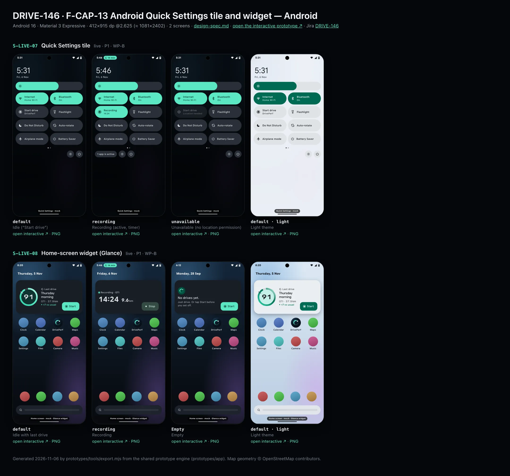
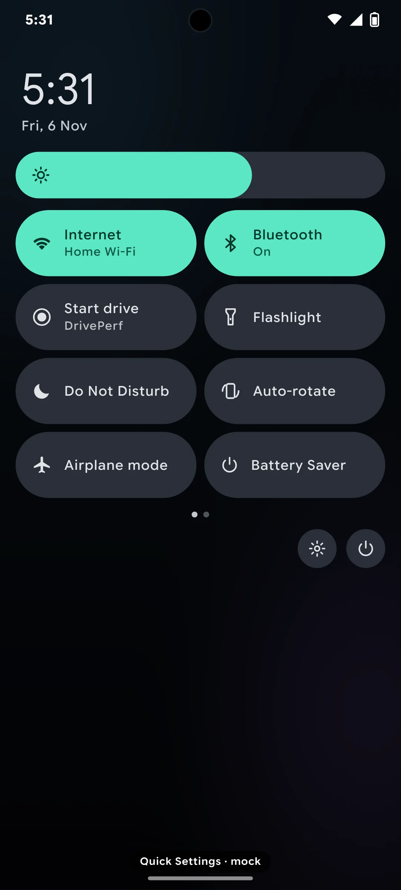
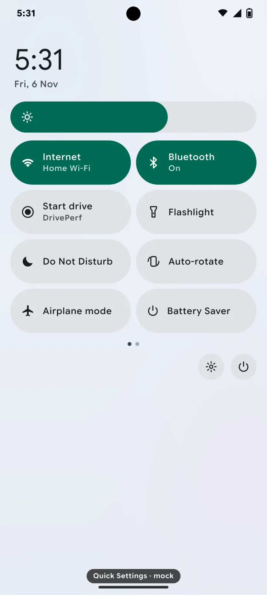
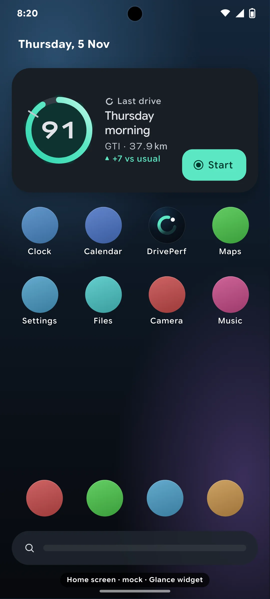
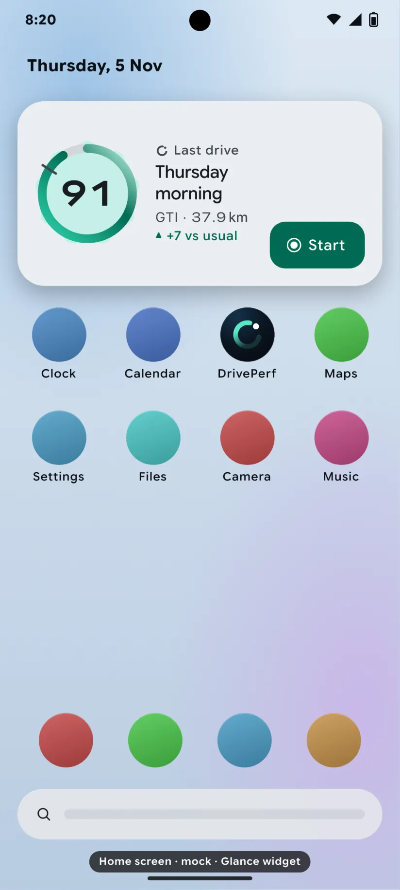

# DRIVE-146 · F-CAP-13 Android Quick Settings tile and widget — Android design spec

> Generated by `prototypes/tools/export.mjs` on 2026-11-06 from the shared prototype engine. **Do not edit by hand:** change the screen's `spec` in `prototypes/app/screens/wp-*.js` (see `prototypes/app/AUTHORING.md`) and re-export.

- **Jira story:** [DRIVE-146](https://thekeval.atlassian.net/browse/DRIVE-146) · F-CAP-13 · P1
- **Platform:** Android 16 · Material 3 Expressive · 412×915 dp @2.625 (≈ 1081×2402)
- **Interactive prototype:** [../../../../prototypes/android/index.html#S-LIVE-07](../../../../prototypes/android/index.html#S-LIVE-07) (catalog panel: every screen and state; deep links `#S-ID/state?trip=…&ent=…&theme=light&text=xl&rm=1`)
- **Contact sheet:** [mockup.html](mockup.html) · 
- **Design system (source of truth for values):** [brand](../../system/brand.md) · [components](../../system/components.md) · [motion](../../system/motion.md) · [accessibility](../../system/accessibility.md) · [screen map](../../system/screen-map.md) · [fixtures](../../system/fixtures.md) · tokens `prototypes/shared/tokens.css`

## Screens in this story

| Screen | Name | Presentation | Priority | States | Status |
|---|---|---|---|---|---|
| `S-LIVE-07` | Quick Settings tile | Live (Android QS tile) | P1 | 3 | Prototyped |
| `S-LIVE-08` | Home-screen widget (Glance) | Live (Android Glance widget) | P1 | 3 | Prototyped |

## Tokens used on this platform

Values resolved from `prototypes/shared/tokens.css` inside the Android device (`[data-platform="android"]`). Use the token names in code; the hex values are for reference.

| Token | Dark | Light |
|---|---|---|
| `--app-bg` | `#0D1117` | `#F7F9FC` |
| `--card-bg` | `#191E25` | `#EBEEF2` |
| `--dp-bg-grouped` | `#0D1117` | `#F7F9FC` |
| `--dp-surface` | `#191E25` | `#EBEEF2` |
| `--dp-surface-2` | `#1F252D` | `#E5E8EC` |
| `--dp-surface-3` | `#2A3038` | `#DFE2E6` |
| `--dp-fill` | `#2A3038` | `#DFE2E6` |
| `--dp-fill-strong` | `#353B44` | `#D3D7DC` |
| `--dp-text` | `#E1E3E8` | `#181C20` |
| `--dp-text-2` | `#C0C7CF` | `#40474F` |
| `--dp-text-3` | `#8A929B` | `#707881` |
| `--dp-separator` | `#40474F` | `#C0C7CF` |
| `--dp-accent` | `#5BE7C4` | `#006B53` |
| `--dp-accent-text` | `#5BE7C4` | `#006B53` |
| `--dp-on-accent` | `#00382B` | `#FFFFFF` |
| `--dp-accent-container` | `#00513F` | `#91F1D8` |
| `--dp-record` | `#FFC24B` | `#7A5900` |
| `--dp-positive` | `#5BE7C4` | `#006B53` |
| `--dp-change-down` | `#C0C7CF` | `#40474F` |
| `--dp-warning` | `#F5B648` | `#7A5900` |
| `--dp-critical` | `#FFB4AB` | `#BA1A1A` |
| `--dp-glass-fill` | `#1F252DF2` | `#E5E8ECF2` |
| `--dp-glass-fill-strong` | `#2A3038` | `#DFE2E6` |
| `--dp-glass-stroke` | `#FFFFFF0F` | `#0000000A` |
| `--md-sys-color-primary` | `#5BE7C4` | `#006B53` |
| `--md-sys-color-on-primary` | `#00382B` | `#FFFFFF` |
| `--md-sys-color-primary-container` | `#00513F` | `#91F1D8` |
| `--md-sys-color-on-primary-container` | `#91F1D8` | `#002118` |
| `--md-sys-color-secondary-container` | `#344C44` | `#CEE9DF` |
| `--md-sys-color-surface` | `#0D1117` | `#F7F9FC` |
| `--md-sys-color-surface-container` | `#191E25` | `#EBEEF2` |
| `--md-sys-color-surface-container-high` | `#1F252D` | `#E5E8EC` |
| `--md-sys-color-on-surface-variant` | `#C0C7CF` | `#40474F` |
| `--dp-data-route` | `#5BE7C4` | `#079777` |
| `--dp-data-event-brake` | `#FF7A66` | `#A21F16` |
| `--dp-data-event-accel` | `#E58BD0` | `#A33A8C` |
| `--dp-data-event-corner` | `#EAD54E` | `#9A8A00` |
| `--dp-data-quality-good` | `#5FDB9C` | `#1E9E62` |
| `--dp-data-speed` | `#D6DCE4` | `#404A58` |
| `--dp-data-long-g` | `#5AB8F5` | `#0A6AB8` |
| `--dp-data-lat-g` | `#F5A142` | `#B25A00` |

| Type / layout token | Value |
|---|---|
| `--dp-font-screen-title` | `600 32px / 40px "Google Sans Flex", "Google Sans Display", "Roboto Flex", Roboto, system-ui, sans-serif` |
| `--dp-font-sheet-title` | `400 24px / 32px "Google Sans Flex", "Google Sans Display", "Roboto Flex", Roboto, system-ui, sans-serif` |
| `--dp-font-section-title` | `600 22px / 28px "Google Sans Flex", "Google Sans Display", "Roboto Flex", Roboto, system-ui, sans-serif` |
| `--dp-font-card-title` | `700 16px / 24px "Google Sans Flex", "Google Sans Text", "Roboto Flex", Roboto, system-ui, sans-serif` |
| `--dp-font-body` | `400 16px / 24px "Google Sans Flex", "Google Sans Text", "Roboto Flex", Roboto, system-ui, sans-serif` |
| `--dp-font-body-secondary` | `400 14px / 20px "Google Sans Flex", "Google Sans Text", "Roboto Flex", Roboto, system-ui, sans-serif` |
| `--dp-font-meta` | `400 12px / 16px "Google Sans Flex", "Google Sans Text", "Roboto Flex", Roboto, system-ui, sans-serif` |
| `--dp-font-caption` | `500 12px / 16px "Google Sans Flex", "Google Sans Text", "Roboto Flex", Roboto, system-ui, sans-serif` |
| `--dp-font-button` | `700 14px / 20px "Google Sans Flex", "Google Sans Text", "Roboto Flex", Roboto, system-ui, sans-serif` |
| `--dp-num-hero` | `600 72px / 72px "Google Sans Flex", "Roboto Flex", Roboto, system-ui, sans-serif` |
| `--dp-num-xl` | `600 48px / 52px "Google Sans Flex", "Roboto Flex", Roboto, system-ui, sans-serif` |
| `--dp-num-l` | `600 34px / 38px "Google Sans Flex", "Roboto Flex", Roboto, system-ui, sans-serif` |
| `--dp-num-m` | `600 24px / 28px "Google Sans Flex", "Roboto Flex", Roboto, system-ui, sans-serif` |
| `--dp-num-s` | `600 17px / 22px "Google Sans Flex", "Roboto Flex", Roboto, system-ui, sans-serif` |
| `--dp-num-xs` | `600 13px / 16px "Google Sans Flex", "Roboto Flex", Roboto, system-ui, sans-serif` |
| `--dp-screen-margin` | `16px` |
| `--dp-radius-card` | `16px` |
| `--dp-radius-card-hero` | `28px` |
| `--dp-radius-sheet` | `28px` |
| `--dp-radius-chip` | `8px` |
| `--dp-radius-button` | `999px` |
| `--dp-layout-list-row-min` | `56px` |
| `--dp-layout-touch-min` | `48px` |
| `--safe-top` | `40px` |
| `--safe-bottom` | `24px` |

Text sizes scale with `--dp-text-scale` (XL = 2.0×) and numerals with `--dp-num-scale` (XL = 1.3×). DP Numerals: Google Sans Flex wdth 120 wght 600, tabular.

---

## S-LIVE-07 · Quick Settings tile

 

- **Presentation:** live — screen map: “Live (Android QS tile)”
- **Entry points:** Quick Settings
- **Leads to:** Start / Stop · unavailable → S-ONB-16
- **PRD features:** F-CAP-13 · **Priority:** P1 · **WP:** B
- **Interactive:** [S-LIVE-07](../../../../prototypes/android/index.html#S-LIVE-07)

**Purpose.** One tap from Quick Settings to start or stop a drive before setting off, without opening the app (F-CAP-13).

### States

| State | PRD label | Fixture params | Screenshot |
|---|---|---|---|
| `default` | Idle (“Start drive”) | — | [S-LIVE-07.png](../../screens/android/S-LIVE-07.webp) · [open](../../../../prototypes/android/index.html#S-LIVE-07) |
| `recording` | Recording (active, timer) | `live=manual` | [S-LIVE-07--recording.png](../../screens/android/S-LIVE-07--recording.webp) · [open](../../../../prototypes/android/index.html#S-LIVE-07/recording) |
| `unavailable` | Unavailable (no location permission) | — | [S-LIVE-07--unavailable.png](../../screens/android/S-LIVE-07--unavailable.webp) · [open](../../../../prototypes/android/index.html#S-LIVE-07/unavailable) |
| default · light | Light theme | `theme=light` | [S-LIVE-07--light.png](../../screens/android/S-LIVE-07--light.webp) |

Every state also renders in light/dark (`theme=light`), XL text (`text=xl`) and reduced motion (`rm=1`).

### Layout

- Android 16 Quick Settings mock (expanded): clock + date, brightness slider, 2-column large tiles (Internet, Bluetooth, DrivePerf, Flashlight, Do Not Disturb, Auto-rotate, Airplane mode, Battery Saver), page dots, footer (active apps · settings · power).
- DrivePerf tile (large, 68 tall, full radius): record glyph + “Start drive / DrivePerf” (inactive: surfaceContainerHighest) → “Recording / 14:24” (active: primary, on-primary text) → “Start drive / Location needed” (unavailable, 50% opacity).

### Components & tokens

| Component | Tokens / spec |
|---|---|
| `qsTile` | see components.md |
| `shade` | see components.md |

### Interactions & navigation

- Idle tap → starts a manual trip (FGS from a user action), the tile turns active, the Live Update starts (S-LIVE-05). Recording tap → stops (S-DRV-04 on next open). Unavailable tap → opens DrivePerf on S-ONB-16 (manual-mode sheet with the Settings link).
- Long-press → DrivePerf Recording settings (S-SET-03) via ACTION_QS_TILE_PREFERENCES.

### Motion

- System tile state transition only (shape/colour). RM: n/a.

### Accessibility

- Tile label/state: “Start drive, DrivePerf, off” · “Recording, 14 minutes, on” · “Start drive, unavailable, Location needed”. Subtitle updates at most once a minute for screen readers.

### Platform notes

- **Android (this spec):** TileService with Tile.STATE_INACTIVE / STATE_ACTIVE / STATE_UNAVAILABLE, subtitle via Tile.setSubtitle; requestListeningState on trip changes; startForegroundService from onClick (user action).
- *iOS (for reference):* n/a (Android only). iOS equivalent: S-LIVE-03 Control Center control.

### Analytics

- `tile_tapped {action: start|stop|unavailable}`
- `trip_started {mode: manual, trigger: tile}`

### Copy

| Key | Text |
|---|---|
| Idle | Start drive · DrivePerf |
| Recording | Recording · {14:24} |
| Unavailable | Start drive · Location needed |

### Free / Pro

Same for every plan.

### Data & fixtures

Recording uses liveTrip.states.manual (subtitle = elapsed time, status chip 14 min).

### Assets

[icon-record.svg](assets/icon-record.svg) · [icon-gps.svg](assets/icon-gps.svg) · [icon-gear.svg](assets/icon-gear.svg)

UI glyphs may be swapped for SF Symbols / Material Symbols Rounded equivalents; event-pin, quality and provenance glyphs must not be (components.md global rules).

### Checklist (accessibility.md §9)

- [ ] Light and dark both render, and contrast passes.
- [ ] The XL text state reflows with no truncation.
- [ ] The RM state is defined.
- [ ] Every control has a label; every chart and map has a summary sentence.
- [ ] Every target ≥ 44 pt / 48 dp (≥ 64 in-drive).
- [ ] No meaning by colour alone.
- [ ] Speed is neutral wherever it appears and absent from social or live surfaces.
- [ ] No streak, leaderboard, speed or “beat your time” language.
- [ ] Behaviour is defined while a trip is active (D1 gate).
- [ ] Haptics come from motion.md §6 only.

---

## S-LIVE-08 · Home-screen widget (Glance)

 

- **Presentation:** live — screen map: “Live (Android Glance widget)”
- **Entry points:** Home screen
- **Leads to:** Start · tap last drive → S-STY-01 (D1 gate)
- **PRD features:** F-CAP-13 · **Priority:** P1 · **WP:** B
- **Interactive:** [S-LIVE-08](../../../../prototypes/android/index.html#S-LIVE-08)

**Purpose.** The Android home-screen widget: the last drive at a glance and a one-tap Start; status only while recording (F-CAP-13).

### States

| State | PRD label | Fixture params | Screenshot |
|---|---|---|---|
| `default` | Idle with last drive | — | [S-LIVE-08.png](../../screens/android/S-LIVE-08.webp) · [open](../../../../prototypes/android/index.html#S-LIVE-08) |
| `recording` | Recording | `live=manual` | [S-LIVE-08--recording.png](../../screens/android/S-LIVE-08--recording.webp) · [open](../../../../prototypes/android/index.html#S-LIVE-08/recording) |
| `Empty` | Empty | — | [S-LIVE-08--Empty.png](../../screens/android/S-LIVE-08--Empty.webp) · [open](../../../../prototypes/android/index.html#S-LIVE-08/Empty) |
| default · light | Light theme | `theme=light` | [S-LIVE-08--light.png](../../screens/android/S-LIVE-08--light.webp) |

Every state also renders in light/dark (`theme=light`), XL text (`text=xl`) and reduced motion (`rm=1`).

### Layout

- Pixel launcher mock: At a Glance date, the 4×2 Glance widget, labelled round app icons (incl. DrivePerf), dock, search bar.
- Widget (radius 28, surfaceContainer — the only DrivePerf surface allowed to follow dynamic colour; data colours stay fixed): 108 ring on the Cookie9Sided container (baseline notch) · “Last drive” kicker · “Thursday morning” (500 18) · “GTI · 37.9 km” · “▲ +7 vs usual” · Start (filled primary, 48 dp, record glyph) at the bottom right.
- Recording: “● Recording · GTI”, timer 40 + 9.6 km (DP Numerals), Stop (tonal). Empty: Loop 30 + “No drives yet.” + “Just drive. Or tap Start before you set off.” + Start.

### Components & tokens

| Component | Tokens / spec |
|---|---|
| `widget` | see components.md |
| `ring` | track --dp-fill-strong · arc --dp-gradient-ring (glide-400 → accent → glide-100) · baseline notch --dp-text-2 · record notch --dp-record · Android container Cookie9Sided --md-sys-color-primary-container 42% · components.md §3 |
| `homeScreen` | see components.md |

### Interactions & navigation

- Start → manual trip from a user action (FGS) + the Live Update (S-LIVE-05). Stop → ends the trip.
- Last drive area → S-STY-01 (unwatched) or S-TRP-01 through the D1 gate (S-DRV-05 while moving). Recording area → S-DRV-01. Empty → S-HOME-01 first run.

### Motion

- Glance updates only (no custom animation); the timer uses a Chronometer-backed text updated ≥ 60 s apart in the widget (the Live Update owns per-second time). Prototype: ring reveal on load. RM: static.

### Accessibility

- Content descriptions: “Last drive, Thursday morning, GTI. Smoothness 91, 7 above your usual.” + “Start drive”. Recording: “DrivePerf, recording, GTI. 14 minutes, 9.6 kilometres.” + “Stop drive”.
- Responsive sizes: 2×2 drops the car line; 4×1 shows ring + Start only.

### Platform notes

- **Android (this spec):** Jetpack Glance (GlanceAppWidget, SizeMode.Responsive), GlanceTheme with dynamic colour for the surface, actionRunCallback for Start/Stop, actionStartActivity for the deep link (gated in-app).
- *iOS (for reference):* n/a (Android only). iOS equivalent: S-LIVE-04.

### Analytics

- `widget_tapped {action: start|stop|open_last, size}`
- `trip_started {mode: manual, trigger: widget}`

### Copy

| Key | Text |
|---|---|
| Idle | Last drive · {Thursday morning} · {GTI} · {37.9} km · ▲ +7 vs usual · Start |
| Recording | Recording · {GTI} · {14:24} · {9.6} km · Stop |
| Empty | No drives yet. · Just drive. Or tap Start before you set off. · Start |

### Free / Pro

Same for every plan.

### Data & fixtures

Idle: t20261105-0742 with the scene at Thu 5 Nov 8:20 (see S-LIVE-04). Recording: liveTrip.states.manual. Empty: install date 28 Sep.

### Assets

[icon-record.svg](assets/icon-record.svg) · [icon-stop.svg](assets/icon-stop.svg) · [logo-a-loop.svg](assets/logo-a-loop.svg)

UI glyphs may be swapped for SF Symbols / Material Symbols Rounded equivalents; event-pin, quality and provenance glyphs must not be (components.md global rules).

### Checklist (accessibility.md §9)

- [ ] Light and dark both render, and contrast passes.
- [ ] The XL text state reflows with no truncation.
- [ ] The RM state is defined.
- [ ] Every control has a label; every chart and map has a summary sentence.
- [ ] Every target ≥ 44 pt / 48 dp (≥ 64 in-drive).
- [ ] No meaning by colour alone.
- [ ] Speed is neutral wherever it appears and absent from social or live surfaces.
- [ ] No streak, leaderboard, speed or “beat your time” language.
- [ ] Behaviour is defined while a trip is active (D1 gate).
- [ ] Haptics come from motion.md §6 only.

---

Map geometry in the prototype: © OpenStreetMap contributors (ODbL). Speed and G are simulated fixtures (fixtures.md).
