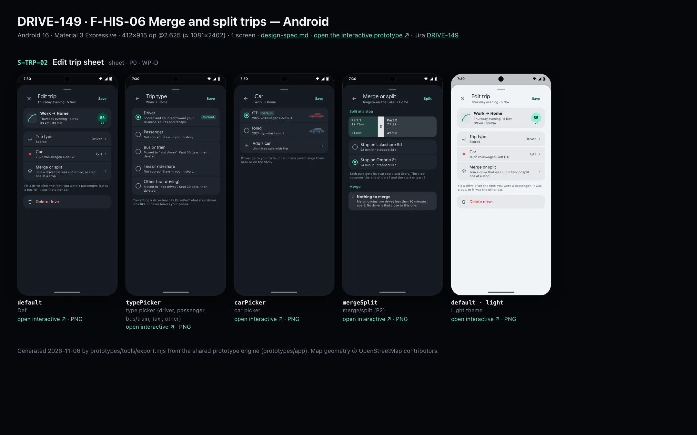
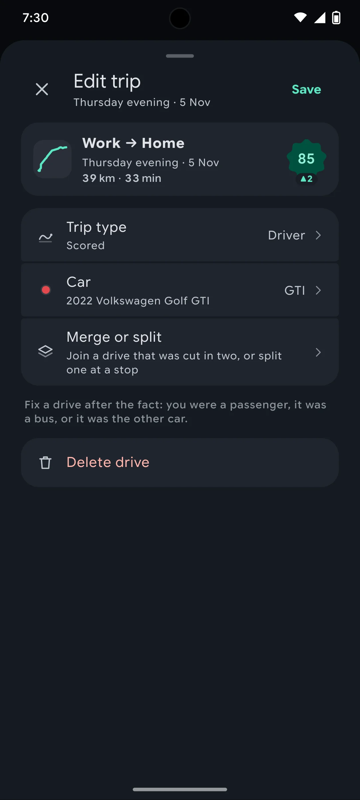
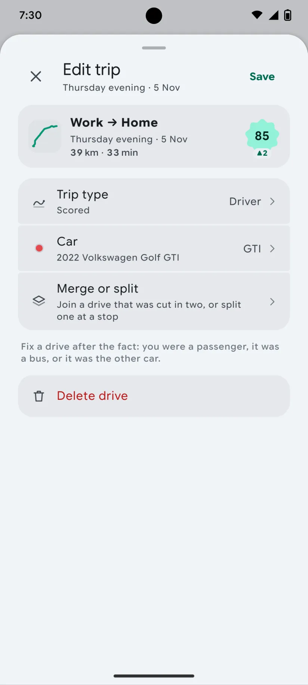

# DRIVE-149 · F-HIS-06 Merge and split trips — Android design spec

> Generated by `prototypes/tools/export.mjs` on 2026-11-06 from the shared prototype engine. **Do not edit by hand:** change the screen's `spec` in `prototypes/app/screens/wp-*.js` (see `prototypes/app/AUTHORING.md`) and re-export.

- **Jira story:** [DRIVE-149](https://thekeval.atlassian.net/browse/DRIVE-149) · F-HIS-06 · P2
- **Platform:** Android 16 · Material 3 Expressive · 412×915 dp @2.625 (≈ 1081×2402)
- **Interactive prototype:** [../../../../prototypes/android/index.html#S-TRP-02](../../../../prototypes/android/index.html#S-TRP-02) (catalog panel: every screen and state; deep links `#S-ID/state?trip=…&ent=…&theme=light&text=xl&rm=1`)
- **Contact sheet:** [mockup.html](mockup.html) · 
- **Design system (source of truth for values):** [brand](../../system/brand.md) · [components](../../system/components.md) · [motion](../../system/motion.md) · [accessibility](../../system/accessibility.md) · [screen map](../../system/screen-map.md) · [fixtures](../../system/fixtures.md) · tokens `prototypes/shared/tokens.css`

## Screens in this story

| Screen | Name | Presentation | Priority | States | Status |
|---|---|---|---|---|---|
| `S-TRP-02` | Edit trip sheet | Sheet (large) | P0 | 4 | Prototyped |

## Tokens used on this platform

Values resolved from `prototypes/shared/tokens.css` inside the Android device (`[data-platform="android"]`). Use the token names in code; the hex values are for reference.

| Token | Dark | Light |
|---|---|---|
| `--app-bg` | `#0D1117` | `#F7F9FC` |
| `--card-bg` | `#191E25` | `#EBEEF2` |
| `--dp-bg-grouped` | `#0D1117` | `#F7F9FC` |
| `--dp-surface` | `#191E25` | `#EBEEF2` |
| `--dp-surface-2` | `#1F252D` | `#E5E8EC` |
| `--dp-surface-3` | `#2A3038` | `#DFE2E6` |
| `--dp-fill` | `#2A3038` | `#DFE2E6` |
| `--dp-fill-strong` | `#353B44` | `#D3D7DC` |
| `--dp-text` | `#E1E3E8` | `#181C20` |
| `--dp-text-2` | `#C0C7CF` | `#40474F` |
| `--dp-text-3` | `#8A929B` | `#707881` |
| `--dp-separator` | `#40474F` | `#C0C7CF` |
| `--dp-accent` | `#5BE7C4` | `#006B53` |
| `--dp-accent-text` | `#5BE7C4` | `#006B53` |
| `--dp-on-accent` | `#00382B` | `#FFFFFF` |
| `--dp-accent-container` | `#00513F` | `#91F1D8` |
| `--dp-record` | `#FFC24B` | `#7A5900` |
| `--dp-positive` | `#5BE7C4` | `#006B53` |
| `--dp-change-down` | `#C0C7CF` | `#40474F` |
| `--dp-warning` | `#F5B648` | `#7A5900` |
| `--dp-critical` | `#FFB4AB` | `#BA1A1A` |
| `--dp-glass-fill` | `#1F252DF2` | `#E5E8ECF2` |
| `--dp-glass-fill-strong` | `#2A3038` | `#DFE2E6` |
| `--dp-glass-stroke` | `#FFFFFF0F` | `#0000000A` |
| `--md-sys-color-primary` | `#5BE7C4` | `#006B53` |
| `--md-sys-color-on-primary` | `#00382B` | `#FFFFFF` |
| `--md-sys-color-primary-container` | `#00513F` | `#91F1D8` |
| `--md-sys-color-on-primary-container` | `#91F1D8` | `#002118` |
| `--md-sys-color-secondary-container` | `#344C44` | `#CEE9DF` |
| `--md-sys-color-surface` | `#0D1117` | `#F7F9FC` |
| `--md-sys-color-surface-container` | `#191E25` | `#EBEEF2` |
| `--md-sys-color-surface-container-high` | `#1F252D` | `#E5E8EC` |
| `--md-sys-color-on-surface-variant` | `#C0C7CF` | `#40474F` |
| `--dp-data-route` | `#5BE7C4` | `#079777` |
| `--dp-data-event-brake` | `#FF7A66` | `#A21F16` |
| `--dp-data-event-accel` | `#E58BD0` | `#A33A8C` |
| `--dp-data-event-corner` | `#EAD54E` | `#9A8A00` |
| `--dp-data-quality-good` | `#5FDB9C` | `#1E9E62` |
| `--dp-data-speed` | `#D6DCE4` | `#404A58` |
| `--dp-data-long-g` | `#5AB8F5` | `#0A6AB8` |
| `--dp-data-lat-g` | `#F5A142` | `#B25A00` |

| Type / layout token | Value |
|---|---|
| `--dp-font-screen-title` | `600 32px / 40px "Google Sans Flex", "Google Sans Display", "Roboto Flex", Roboto, system-ui, sans-serif` |
| `--dp-font-sheet-title` | `400 24px / 32px "Google Sans Flex", "Google Sans Display", "Roboto Flex", Roboto, system-ui, sans-serif` |
| `--dp-font-section-title` | `600 22px / 28px "Google Sans Flex", "Google Sans Display", "Roboto Flex", Roboto, system-ui, sans-serif` |
| `--dp-font-card-title` | `700 16px / 24px "Google Sans Flex", "Google Sans Text", "Roboto Flex", Roboto, system-ui, sans-serif` |
| `--dp-font-body` | `400 16px / 24px "Google Sans Flex", "Google Sans Text", "Roboto Flex", Roboto, system-ui, sans-serif` |
| `--dp-font-body-secondary` | `400 14px / 20px "Google Sans Flex", "Google Sans Text", "Roboto Flex", Roboto, system-ui, sans-serif` |
| `--dp-font-meta` | `400 12px / 16px "Google Sans Flex", "Google Sans Text", "Roboto Flex", Roboto, system-ui, sans-serif` |
| `--dp-font-caption` | `500 12px / 16px "Google Sans Flex", "Google Sans Text", "Roboto Flex", Roboto, system-ui, sans-serif` |
| `--dp-font-button` | `700 14px / 20px "Google Sans Flex", "Google Sans Text", "Roboto Flex", Roboto, system-ui, sans-serif` |
| `--dp-num-hero` | `600 72px / 72px "Google Sans Flex", "Roboto Flex", Roboto, system-ui, sans-serif` |
| `--dp-num-xl` | `600 48px / 52px "Google Sans Flex", "Roboto Flex", Roboto, system-ui, sans-serif` |
| `--dp-num-l` | `600 34px / 38px "Google Sans Flex", "Roboto Flex", Roboto, system-ui, sans-serif` |
| `--dp-num-m` | `600 24px / 28px "Google Sans Flex", "Roboto Flex", Roboto, system-ui, sans-serif` |
| `--dp-num-s` | `600 17px / 22px "Google Sans Flex", "Roboto Flex", Roboto, system-ui, sans-serif` |
| `--dp-num-xs` | `600 13px / 16px "Google Sans Flex", "Roboto Flex", Roboto, system-ui, sans-serif` |
| `--dp-screen-margin` | `16px` |
| `--dp-radius-card` | `16px` |
| `--dp-radius-card-hero` | `28px` |
| `--dp-radius-sheet` | `28px` |
| `--dp-radius-chip` | `8px` |
| `--dp-radius-button` | `999px` |
| `--dp-layout-list-row-min` | `56px` |
| `--dp-layout-touch-min` | `48px` |
| `--safe-top` | `40px` |
| `--safe-bottom` | `24px` |

Text sizes scale with `--dp-text-scale` (XL = 2.0×) and numerals with `--dp-num-scale` (XL = 1.3×). DP Numerals: Google Sans Flex wdth 120 wght 600, tabular.

---

## S-TRP-02 · Edit trip sheet

 

- **Presentation:** sheet · tab: drives · detent: large — screen map: “Sheet (large)”
- **Entry points:** S-TRP-01 Edit · Story f1 chips
- **Leads to:** S-TRP-03 · Save → caller
- **PRD features:** F-HIS-02, F-GAR-02, F-CAP-04, F-HIS-06 · **Priority:** P0 · **WP:** D
- **Interactive:** [S-TRP-02](../../../../prototypes/android/index.html#S-TRP-02)

**Purpose.** Fix a drive after the fact — I was a passenger, it was a bus, wrong car — or delete it, so history and scores stay accurate (F-HIS-02, F-GAR-02, F-CAP-04). From the Story chips it takes ≤ 2 taps (Q8).

### States

| State | PRD label | Fixture params | Screenshot |
|---|---|---|---|
| `default` | Def | `trip=t20261105-1745` | [S-TRP-02.png](../../screens/android/S-TRP-02.webp) · [open](../../../../prototypes/android/index.html#S-TRP-02) |
| `typePicker` | type picker (driver, passenger, bus/train, taxi, other) | `trip=t20261105-1745` | [S-TRP-02--typePicker.png](../../screens/android/S-TRP-02--typePicker.webp) · [open](../../../../prototypes/android/index.html#S-TRP-02/typePicker) |
| `carPicker` | car picker | `trip=t20261105-1745` | [S-TRP-02--carPicker.png](../../screens/android/S-TRP-02--carPicker.webp) · [open](../../../../prototypes/android/index.html#S-TRP-02/carPicker) |
| `mergeSplit` | merge/split (P2) | `trip=t20261024-1610` | [S-TRP-02--mergeSplit.png](../../screens/android/S-TRP-02--mergeSplit.webp) · [open](../../../../prototypes/android/index.html#S-TRP-02/mergeSplit) |
| default · light | Light theme | `theme=light` | [S-TRP-02--light.png](../../screens/android/S-TRP-02--light.webp) |

Every state also renders in light/dark (`theme=light`), XL text (`text=xl`) and reduced motion (`rm=1`).

### Layout

- Large sheet (iOS full-height sheet with its own navigation: glass × leading, title + sub centred, glass-prominent ✓ trailing · Android ModalBottomSheet at full height with × leading and a “Save” text button trailing).
- Default: trip summary row (glyph 44, label, part of day · date · km · min, score badge) · grouped list: Trip type (value “Driver”, sub Scored/Not scored) › · Car (car dot, value nickname, sub year make model) › · Merge or split › · caption “Fix a drive after the fact…” · separate list with destructive “Delete drive”.
- Type picker (pushed inside the sheet, back chevron): 5 radio rows — Driver · Passenger · Bus or train · Taxi or rideshare · Other (not driving) — each with its consequence as supporting text; “Current” tag on the saved type. Choosing a non-driver type shows the passenger banner “not a drive you made… recompute within 2 seconds”.
- Car picker: radio rows per car (dot + nickname, Default tag, year make model, 64-wide silhouette in its colour) + “Add a car” (Pro: S-GAR-03 · Free: lock + PRO → S-SUB-03 s2ndCar).
- Merge or split (P2): split bar (part 1 / part 2 with km · min, stop pin between) · radio list of the 3 longest stops · caption; Merge section shows candidates < 30 min apart or the “Nothing to merge” note.

### Components & tokens

| Component | Tokens / spec |
|---|---|
| `sheetHeader` | see components.md |
| `iconButton` | see components.md |
| `button` | --dp-accent / --dp-on-accent (filled) · --dp-fill-strong · --md-sys-color-secondary-container (tonal) · --dp-radius-button · height iOS 50/44/34 · Android 56/40/32 · --dp-font-button · components.md §0 |
| `list` | iOS inset grouped radius --dp-radius-card, rows 52 pt, separators --dp-separator inset 16 · Android ListItem 56/72 dp in --md-sys-color-surface-container |
| `row` | --dp-font-body · --dp-font-meta (supporting) · --dp-layout-list-row-min |
| `radios` | see components.md |
| `glyph` | see components.md |
| `scoreBadge` | iOS mini ring 46 · Android Cookie9Sided 46 · --dp-num-s |
| `carDot` | see components.md |
| `banner` | radius 12 (--dp-radius-sm+) · info --dp-fill · attention --dp-warning-container · critical --dp-critical-container · components.md §22 |
| `toast` | see components.md |

### Interactions & navigation

- Trip type / Car / Merge or split rows → in-sheet sub-pages (states typePicker / carPicker / mergeSplit); back chevron returns to the main page.
- Radio rows select (selection haptic). ✓ / Save → dismiss to the caller (S-TRP-01, S-STY-01 f1, S-HIS-01) with a toast “Marked as passenger · scores updated · Undo” (confirm haptic). × / drag down discards.
- Delete drive → S-TRP-03 dialog. Add a car → S-GAR-03 (Pro) / S-SUB-03 s2ndCar (Free). Split ✓ → toast “Split into 2 drives”.
- Story f1 chip entry (S-STY-01) deep-links straight to typePicker or carPicker.

### Motion

- Sheet: spring.sheet; iOS large detent recedes the parent. Sub-pages push inside the sheet (spring.default / shared axis X).
- Hero motion: rows rise 8 px, 30 ms stagger. Radio fill: spring.fast. RM: cross-fades.

### Accessibility

- Radio rows are single-choice buttons: “Passenger. Not scored. Stays in your history. Not selected.”
- Save announces the toast text. Focus returns to the invoking control (Edit button / car chip) on close.
- XL: sub text wraps under titles; the car silhouette hides below 320 pt of text width; split bar labels stack.
- Meaning never by colour: the passenger banner has the glyph and text; the destructive row is labelled “Delete drive”.

### Platform notes

- **Android (this spec):** ModalBottomSheet (skipPartiallyExpanded) with top row: close IconButton, title, TextButton “Save”; RadioButton ListItems; sub-pages use shared axis X inside the sheet.
- *iOS (for reference):* Sheet with NavigationStack; toolbar ✕ (cancellationAction) and ✓ (confirmationAction, glassProminent); Picker rows as inset-grouped list with checkmark-style radios.

### Analytics

- `trip_corrected {to: passenger|transit|taxi|other|driver, source: trip_detail|story|history}`
- `trip_car_changed {source}`
- `trip_split`
- `trips_merged`

### Copy

| Key | Text |
|---|---|
| Title | Edit trip |
| Types | Driver · Passenger · Bus or train · Taxi or rideshare · Other (not driving) |
| Non-driver banner | {type}: not a drive you made. Your scores, baseline, route records and recaps recompute without it, within 2 seconds. |
| Transit sub | Moved to “Not drives”. Kept 30 days, then deleted. |
| Car note | Moves this drive to the {car}. Per-car stats and the Story tint update. |
| Toast | Marked as passenger · scores updated · Undo |
| Nothing to merge | Merging joins two drives less than 30 minutes apart. No drive is that close to this one. |

### Free / Pro

Editing is Free. Adding a car from the car picker on Free (1 car) opens S-SUB-03 s2ndCar; cars kept from the Preview stay selectable.

### Data & fixtures

Default trip t20261105-1745 (Work → Home, GTI, 85); mergeSplit uses t20261024-1610 (Niagara-on-the-Lake → Home, 73 min, Ioniq). Split candidates = the 3 longest stops in the middle 70% of that trip (default = the one nearest the middle); part distances are derived from the track (haversine). Merge candidates = trips starting/ending within 30 min of this one (none in the fixture).

### Assets

[icon-close.svg](assets/icon-close.svg) · [icon-check.svg](assets/icon-check.svg) · [icon-chevronLeft.svg](assets/icon-chevronLeft.svg) · [icon-drives.svg](assets/icon-drives.svg) · [icon-passenger.svg](assets/icon-passenger.svg) · [icon-layers.svg](assets/icon-layers.svg) · [icon-trash.svg](assets/icon-trash.svg) · [icon-plus.svg](assets/icon-plus.svg) · [icon-lock.svg](assets/icon-lock.svg) · [icon-pin.svg](assets/icon-pin.svg) · [icon-info.svg](assets/icon-info.svg)

UI glyphs may be swapped for SF Symbols / Material Symbols Rounded equivalents; event-pin, quality and provenance glyphs must not be (components.md global rules).

### Checklist (accessibility.md §9)

- [ ] Light and dark both render, and contrast passes.
- [ ] The XL text state reflows with no truncation.
- [ ] The RM state is defined.
- [ ] Every control has a label; every chart and map has a summary sentence.
- [ ] Every target ≥ 44 pt / 48 dp (≥ 64 in-drive).
- [ ] No meaning by colour alone.
- [ ] Speed is neutral wherever it appears and absent from social or live surfaces.
- [ ] No streak, leaderboard, speed or “beat your time” language.
- [ ] Behaviour is defined while a trip is active (D1 gate).
- [ ] Haptics come from motion.md §6 only.

---

Map geometry in the prototype: © OpenStreetMap contributors (ODbL). Speed and G are simulated fixtures (fixtures.md).
