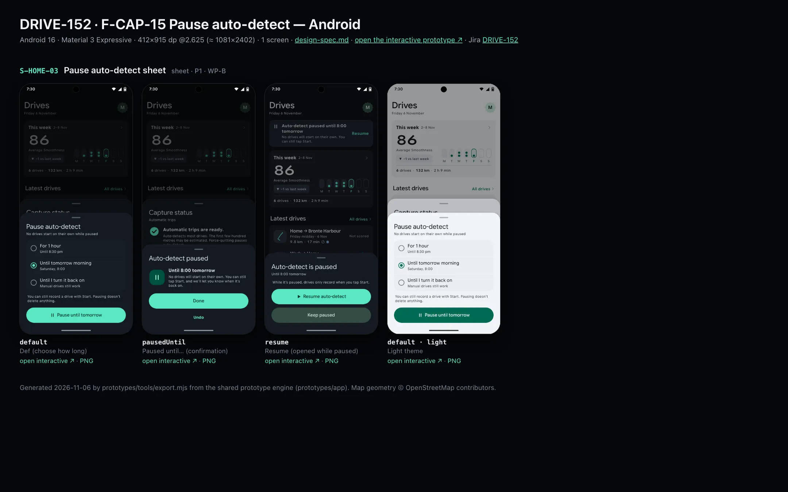
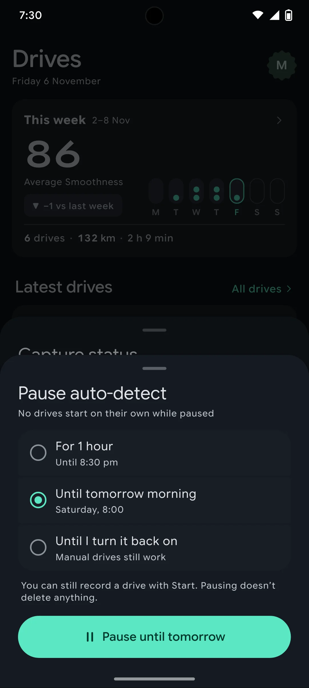
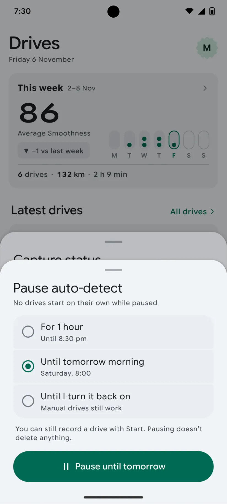

# DRIVE-152 · F-CAP-15 Pause auto-detect — Android design spec

> Generated by `prototypes/tools/export.mjs` on 2026-11-06 from the shared prototype engine. **Do not edit by hand:** change the screen's `spec` in `prototypes/app/screens/wp-*.js` (see `prototypes/app/AUTHORING.md`) and re-export.

- **Jira story:** [DRIVE-152](https://thekeval.atlassian.net/browse/DRIVE-152) · F-CAP-15 · P1
- **Platform:** Android 16 · Material 3 Expressive · 412×915 dp @2.625 (≈ 1081×2402)
- **Interactive prototype:** [../../../../prototypes/android/index.html#S-HOME-03](../../../../prototypes/android/index.html#S-HOME-03) (catalog panel: every screen and state; deep links `#S-ID/state?trip=…&ent=…&theme=light&text=xl&rm=1`)
- **Contact sheet:** [mockup.html](mockup.html) · 
- **Design system (source of truth for values):** [brand](../../system/brand.md) · [components](../../system/components.md) · [motion](../../system/motion.md) · [accessibility](../../system/accessibility.md) · [screen map](../../system/screen-map.md) · [fixtures](../../system/fixtures.md) · tokens `prototypes/shared/tokens.css`

## Screens in this story

| Screen | Name | Presentation | Priority | States | Status |
|---|---|---|---|---|---|
| `S-HOME-03` | Pause auto-detect sheet | Sheet (small) | P1 | 3 | Prototyped |

## Tokens used on this platform

Values resolved from `prototypes/shared/tokens.css` inside the Android device (`[data-platform="android"]`). Use the token names in code; the hex values are for reference.

| Token | Dark | Light |
|---|---|---|
| `--app-bg` | `#0D1117` | `#F7F9FC` |
| `--card-bg` | `#191E25` | `#EBEEF2` |
| `--dp-bg-grouped` | `#0D1117` | `#F7F9FC` |
| `--dp-surface` | `#191E25` | `#EBEEF2` |
| `--dp-surface-2` | `#1F252D` | `#E5E8EC` |
| `--dp-surface-3` | `#2A3038` | `#DFE2E6` |
| `--dp-fill` | `#2A3038` | `#DFE2E6` |
| `--dp-fill-strong` | `#353B44` | `#D3D7DC` |
| `--dp-text` | `#E1E3E8` | `#181C20` |
| `--dp-text-2` | `#C0C7CF` | `#40474F` |
| `--dp-text-3` | `#8A929B` | `#707881` |
| `--dp-separator` | `#40474F` | `#C0C7CF` |
| `--dp-accent` | `#5BE7C4` | `#006B53` |
| `--dp-accent-text` | `#5BE7C4` | `#006B53` |
| `--dp-on-accent` | `#00382B` | `#FFFFFF` |
| `--dp-accent-container` | `#00513F` | `#91F1D8` |
| `--dp-record` | `#FFC24B` | `#7A5900` |
| `--dp-positive` | `#5BE7C4` | `#006B53` |
| `--dp-change-down` | `#C0C7CF` | `#40474F` |
| `--dp-warning` | `#F5B648` | `#7A5900` |
| `--dp-critical` | `#FFB4AB` | `#BA1A1A` |
| `--dp-glass-fill` | `#1F252DF2` | `#E5E8ECF2` |
| `--dp-glass-fill-strong` | `#2A3038` | `#DFE2E6` |
| `--dp-glass-stroke` | `#FFFFFF0F` | `#0000000A` |
| `--md-sys-color-primary` | `#5BE7C4` | `#006B53` |
| `--md-sys-color-on-primary` | `#00382B` | `#FFFFFF` |
| `--md-sys-color-primary-container` | `#00513F` | `#91F1D8` |
| `--md-sys-color-on-primary-container` | `#91F1D8` | `#002118` |
| `--md-sys-color-secondary-container` | `#344C44` | `#CEE9DF` |
| `--md-sys-color-surface` | `#0D1117` | `#F7F9FC` |
| `--md-sys-color-surface-container` | `#191E25` | `#EBEEF2` |
| `--md-sys-color-surface-container-high` | `#1F252D` | `#E5E8EC` |
| `--md-sys-color-on-surface-variant` | `#C0C7CF` | `#40474F` |
| `--dp-data-route` | `#5BE7C4` | `#079777` |
| `--dp-data-event-brake` | `#FF7A66` | `#A21F16` |
| `--dp-data-event-accel` | `#E58BD0` | `#A33A8C` |
| `--dp-data-event-corner` | `#EAD54E` | `#9A8A00` |
| `--dp-data-quality-good` | `#5FDB9C` | `#1E9E62` |
| `--dp-data-speed` | `#D6DCE4` | `#404A58` |
| `--dp-data-long-g` | `#5AB8F5` | `#0A6AB8` |
| `--dp-data-lat-g` | `#F5A142` | `#B25A00` |

| Type / layout token | Value |
|---|---|
| `--dp-font-screen-title` | `600 32px / 40px "Google Sans Flex", "Google Sans Display", "Roboto Flex", Roboto, system-ui, sans-serif` |
| `--dp-font-sheet-title` | `400 24px / 32px "Google Sans Flex", "Google Sans Display", "Roboto Flex", Roboto, system-ui, sans-serif` |
| `--dp-font-section-title` | `600 22px / 28px "Google Sans Flex", "Google Sans Display", "Roboto Flex", Roboto, system-ui, sans-serif` |
| `--dp-font-card-title` | `700 16px / 24px "Google Sans Flex", "Google Sans Text", "Roboto Flex", Roboto, system-ui, sans-serif` |
| `--dp-font-body` | `400 16px / 24px "Google Sans Flex", "Google Sans Text", "Roboto Flex", Roboto, system-ui, sans-serif` |
| `--dp-font-body-secondary` | `400 14px / 20px "Google Sans Flex", "Google Sans Text", "Roboto Flex", Roboto, system-ui, sans-serif` |
| `--dp-font-meta` | `400 12px / 16px "Google Sans Flex", "Google Sans Text", "Roboto Flex", Roboto, system-ui, sans-serif` |
| `--dp-font-caption` | `500 12px / 16px "Google Sans Flex", "Google Sans Text", "Roboto Flex", Roboto, system-ui, sans-serif` |
| `--dp-font-button` | `700 14px / 20px "Google Sans Flex", "Google Sans Text", "Roboto Flex", Roboto, system-ui, sans-serif` |
| `--dp-num-hero` | `600 72px / 72px "Google Sans Flex", "Roboto Flex", Roboto, system-ui, sans-serif` |
| `--dp-num-xl` | `600 48px / 52px "Google Sans Flex", "Roboto Flex", Roboto, system-ui, sans-serif` |
| `--dp-num-l` | `600 34px / 38px "Google Sans Flex", "Roboto Flex", Roboto, system-ui, sans-serif` |
| `--dp-num-m` | `600 24px / 28px "Google Sans Flex", "Roboto Flex", Roboto, system-ui, sans-serif` |
| `--dp-num-s` | `600 17px / 22px "Google Sans Flex", "Roboto Flex", Roboto, system-ui, sans-serif` |
| `--dp-num-xs` | `600 13px / 16px "Google Sans Flex", "Roboto Flex", Roboto, system-ui, sans-serif` |
| `--dp-screen-margin` | `16px` |
| `--dp-radius-card` | `16px` |
| `--dp-radius-card-hero` | `28px` |
| `--dp-radius-sheet` | `28px` |
| `--dp-radius-chip` | `8px` |
| `--dp-radius-button` | `999px` |
| `--dp-layout-list-row-min` | `56px` |
| `--dp-layout-touch-min` | `48px` |
| `--safe-top` | `40px` |
| `--safe-bottom` | `24px` |

Text sizes scale with `--dp-text-scale` (XL = 2.0×) and numerals with `--dp-num-scale` (XL = 1.3×). DP Numerals: Google Sans Flex wdth 120 wght 600, tabular.

---

## S-HOME-03 · Pause auto-detect sheet

 

- **Presentation:** sheet · tab: drives · detent: auto — screen map: “Sheet (small)”
- **Entry points:** S-HOME-02 · Android FAB menu · long-press accessory
- **Leads to:** Back (paused until…)
- **PRD features:** F-CAP-15 · **Priority:** P1 · **WP:** B
- **Interactive:** [S-HOME-03](../../../../prototypes/android/index.html#S-HOME-03)

**Purpose.** Lets someone lending their phone, or wanting privacy, stop automatic trips for a while without turning them off (F-CAP-15). Manual Start keeps working.

### States

| State | PRD label | Fixture params | Screenshot |
|---|---|---|---|
| `default` | Def (choose how long) | — | [S-HOME-03.png](../../screens/android/S-HOME-03.webp) · [open](../../../../prototypes/android/index.html#S-HOME-03) |
| `pausedUntil` | Paused until… (confirmation) | — | [S-HOME-03--pausedUntil.png](../../screens/android/S-HOME-03--pausedUntil.webp) · [open](../../../../prototypes/android/index.html#S-HOME-03/pausedUntil) |
| `resume` | Resume (opened while paused) | — | [S-HOME-03--resume.png](../../screens/android/S-HOME-03--resume.webp) · [open](../../../../prototypes/android/index.html#S-HOME-03/resume) |
| default · light | Light theme | `theme=light` | [S-HOME-03--light.png](../../screens/android/S-HOME-03--light.webp) |

Every state also renders in light/dark (`theme=light`), XL text (`text=xl`) and reduced motion (`rm=1`).

### Layout

- Sheet that fits its content (≈ the small detent: iOS .presentationDetents([.height(…)]) glass · Android ModalBottomSheet). Header “Pause auto-detect” + subtitle.
- Three radio rows (iOS inset list 52 pt · Android M3 radio ListItems 56 dp): For 1 hour (Until 8:30 pm) · Until tomorrow morning (Saturday, 8:00) · Until I turn it back on (Manual drives still work). Default selection: until tomorrow morning.
- Reassurance line (meta, text2): “You can still record a drive with Start. Pausing doesn’t delete anything.”
- Primary full-width filled button whose label follows the choice: “Pause until tomorrow” / “Pause for 1 hour” / “Pause auto-detect” (52 iOS / 56 Android).
- pausedUntil: pause glyph in a 56 tonal disc + “Until 8:00 tomorrow” + one line; Done (filled) + Undo (text).
- resume (opened from the paused accessory, the Home banner or a long-press): “Auto-detect is paused · Until 8:00 tomorrow”, Resume auto-detect (filled, play icon) + Keep paused (tonal).

### Components & tokens

| Component | Tokens / spec |
|---|---|
| `sheet` | iOS glass --dp-glass-fill-strong + --dp-glass-prominent-blur, radius --dp-radius-sheet 38 · Android ModalBottomSheet --md-sys-color-surface-container-low, top radius 28, drag handle 32×4 · motion spring.sheet |
| `sheetHeader` | see components.md |
| `radios` | see components.md |
| `button` | --dp-accent / --dp-on-accent (filled) · --dp-fill-strong · --md-sys-color-secondary-container (tonal) · --dp-radius-button · height iOS 50/44/34 · Android 56/40/32 · --dp-font-button · components.md §0 |

### Interactions & navigation

- Radio row → selects (selection haptic) and relabels the button. Pause → pausedUntil (confirm haptic). Undo → back to the picker.
- Done → S-HOME-01/autoPaused with capture=paused (accessory: “Auto-detect paused · Until 8:00 tomorrow · Resume”; Android toolbar the same).
- Resume auto-detect → S-HOME-01 (capture cleared) + toast “Auto-detect resumed”. Keep paused → dismiss.
- Entry points: S-HOME-02 “Pause auto-detect” row · long-press on the iOS accessory / Android floating toolbar (520 ms, longPress haptic) · Android toolbar overflow. Not reachable during a driver trip (D1).

### Motion

- Sheet spring.sheet; radio selection spring.fast; the confirmation glyph pops (scale .86 → 1, spring.default). RM: cross-fades only.
- Haptics: selection on radio change, confirm on Pause/Resume.

### Accessibility

- Radio group label “Pause auto-detect”; rows read “For 1 hour, until 8:30 pm, radio button, 1 of 3”.
- Button label repeats the choice (“Pause until tomorrow”). Confirmation is a status element.
- XL: the sheet grows to its content (large detent when needed); subtitles wrap.

### Platform notes

- **Android (this spec):** ModalBottomSheet with drag handle, M3 RadioButton ListItems, filled button with shape morph; Undo is a TextButton.
- *iOS (for reference):* Glass sheet, inset-grouped radio rows with checkmark-style radios, glassProminent primary.

### Analytics

- `auto_paused {duration: 1h|until_morning|indefinite, source}`
- `auto_pause_undone`
- `auto_resumed {by: user|timer}`

### Copy

| Key | Text |
|---|---|
| Title | Pause auto-detect · No drives start on their own while paused |
| Options | For 1 hour (Until 8:30 pm) · Until tomorrow morning (Saturday, 8:00) · Until I turn it back on (Manual drives still work) |
| Reassurance | You can still record a drive with Start. Pausing doesn’t delete anything. |
| Confirmation | Until 8:00 tomorrow. No drives will start on their own. You can still tap Start, and we’ll let you know when it’s back on. |
| Resume | Auto-detect is paused · Until 8:00 tomorrow · While it’s paused, drives only record when you tap Start. · Resume auto-detect · Keep paused |
| Toast | Auto-detect resumed |

### Free / Pro

Same on every plan.

### Data & fixtures

“Until 8:00 tomorrow” = DP_DATA.health.presets.paused.pausedUntil (2026-11-07 08:00); 1 hour = today 19:30 + 60 min. Deviation: PRD F-CAP-15 lists “until tomorrow 06:00”; the prototype uses the fixture’s 8:00 so the sheet, Home banner, accessory and Health Check agree.

### Assets

[icon-pause.svg](assets/icon-pause.svg) · [icon-play.svg](assets/icon-play.svg) · [icon-check.svg](assets/icon-check.svg) · [icon-close.svg](assets/icon-close.svg)

UI glyphs may be swapped for SF Symbols / Material Symbols Rounded equivalents; event-pin, quality and provenance glyphs must not be (components.md global rules).

### Checklist (accessibility.md §9)

- [ ] Light and dark both render, and contrast passes.
- [ ] The XL text state reflows with no truncation.
- [ ] The RM state is defined.
- [ ] Every control has a label; every chart and map has a summary sentence.
- [ ] Every target ≥ 44 pt / 48 dp (≥ 64 in-drive).
- [ ] No meaning by colour alone.
- [ ] Speed is neutral wherever it appears and absent from social or live surfaces.
- [ ] No streak, leaderboard, speed or “beat your time” language.
- [ ] Behaviour is defined while a trip is active (D1 gate).
- [ ] Haptics come from motion.md §6 only.

---

Map geometry in the prototype: © OpenStreetMap contributors (ODbL). Speed and G are simulated fixtures (fixtures.md).
