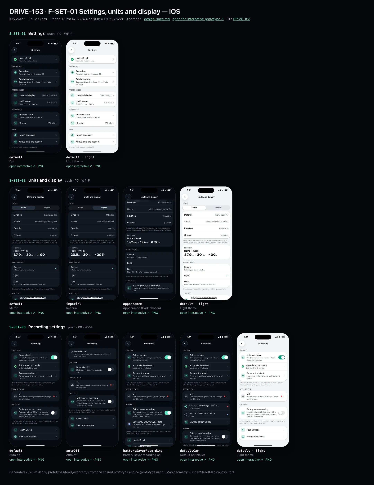
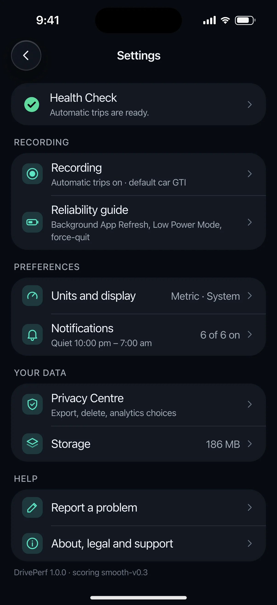
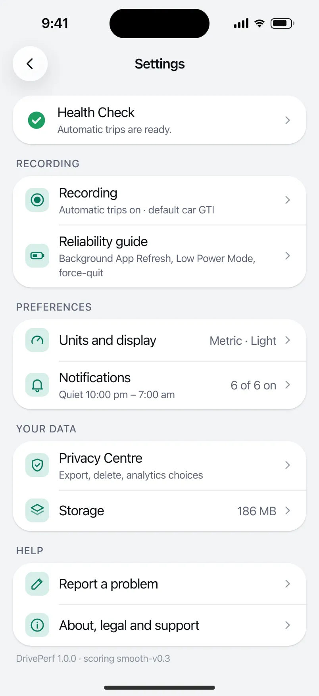
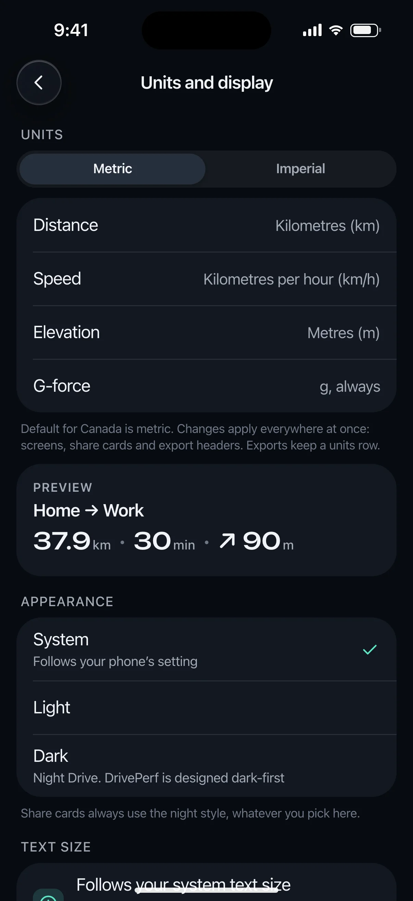
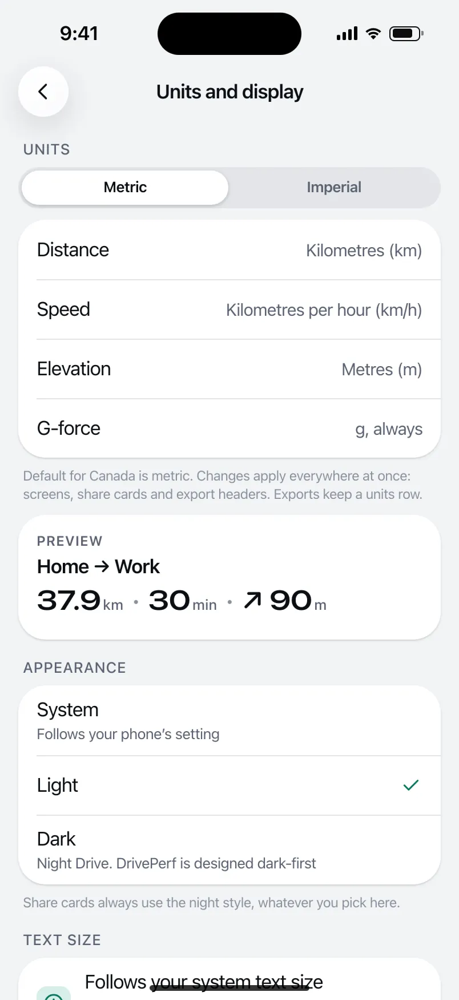
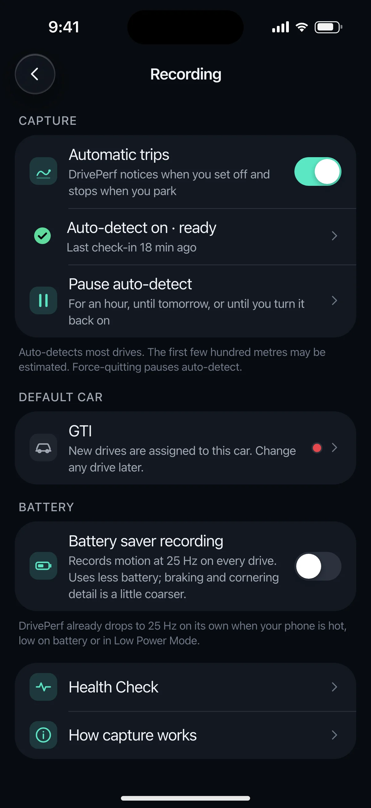
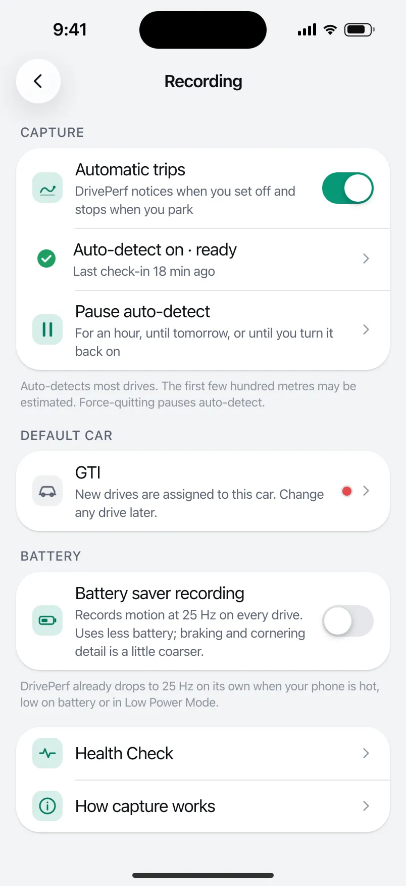

# DRIVE-153 · F-SET-01 Settings, units and display — iOS design spec

> Generated by `prototypes/tools/export.mjs` on 2026-11-06 from the shared prototype engine. **Do not edit by hand:** change the screen's `spec` in `prototypes/app/screens/wp-*.js` (see `prototypes/app/AUTHORING.md`) and re-export.

- **Jira story:** [DRIVE-153](https://thekeval.atlassian.net/browse/DRIVE-153) · F-SET-01 · P0
- **Platform:** iOS 26/27 · Liquid Glass · iPhone 17 Pro (402×874 pt @3x = 1206×2622)
- **Interactive prototype:** [../../../../prototypes/ios/index.html#S-SET-01](../../../../prototypes/ios/index.html#S-SET-01) (catalog panel: every screen and state; deep links `#S-ID/state?trip=…&ent=…&theme=light&text=xl&rm=1`)
- **Contact sheet:** [mockup.html](mockup.html) · 
- **Design system (source of truth for values):** [brand](../../system/brand.md) · [components](../../system/components.md) · [motion](../../system/motion.md) · [accessibility](../../system/accessibility.md) · [screen map](../../system/screen-map.md) · [fixtures](../../system/fixtures.md) · tokens `prototypes/shared/tokens.css`

## Screens in this story

| Screen | Name | Presentation | Priority | States | Status |
|---|---|---|---|---|---|
| `S-SET-01` | Settings | Push | P0 | 1 | Prototyped |
| `S-SET-02` | Units and display | Push | P0 | 3 | Prototyped |
| `S-SET-03` | Recording settings | Push | P0 | 4 | Prototyped |

## Tokens used on this platform

Values resolved from `prototypes/shared/tokens.css` inside the iOS device (`[data-platform="ios"]`). Use the token names in code; the hex values are for reference.

| Token | Dark | Light |
|---|---|---|
| `--app-bg` | `#080B10` | `#F2F3F6` |
| `--card-bg` | `#131822` | `#FFFFFF` |
| `--dp-bg-grouped` | `#080B10` | `#F2F3F6` |
| `--dp-surface` | `#131822` | `#FFFFFF` |
| `--dp-surface-2` | `#1B222D` | `#F2F3F6` |
| `--dp-surface-3` | `#262E3B` | `#E4E7EC` |
| `--dp-fill` | `#7880961F` | `#7880961F` |
| `--dp-fill-strong` | `#7880963D` | `#78809633` |
| `--dp-text` | `#F2F4F7` | `#0B0E13` |
| `--dp-text-2` | `#A3AAB6` | `#5A6271` |
| `--dp-text-3` | `#6E7787` | `#8A919D` |
| `--dp-separator` | `#96A0B429` | `#3C435024` |
| `--dp-accent` | `#5BE7C4` | `#079777` |
| `--dp-accent-text` | `#5BE7C4` | `#06775E` |
| `--dp-on-accent` | `#04241D` | `#FFFFFF` |
| `--dp-accent-container` | `#0A4439` | `#C6F8EA` |
| `--dp-record` | `#FFC24B` | `#9A6300` |
| `--dp-positive` | `#5BE7C4` | `#06775E` |
| `--dp-change-down` | `#A3AAB6` | `#5A6271` |
| `--dp-warning` | `#F5B648` | `#9A5F00` |
| `--dp-critical` | `#FF6B6B` | `#C62828` |
| `--dp-glass-fill` | `#1C222C6B` | `#FFFFFF8C` |
| `--dp-glass-fill-strong` | `#1C222CB8` | `#FFFFFFD1` |
| `--dp-glass-stroke` | `#FFFFFF24` | `#FFFFFF99` |
| `--dp-data-route` | `#5BE7C4` | `#079777` |
| `--dp-data-event-brake` | `#FF7A66` | `#A21F16` |
| `--dp-data-event-accel` | `#E58BD0` | `#A33A8C` |
| `--dp-data-event-corner` | `#EAD54E` | `#9A8A00` |
| `--dp-data-quality-good` | `#5FDB9C` | `#1E9E62` |
| `--dp-data-speed` | `#D6DCE4` | `#404A58` |
| `--dp-data-long-g` | `#5AB8F5` | `#0A6AB8` |
| `--dp-data-lat-g` | `#F5A142` | `#B25A00` |

| Type / layout token | Value |
|---|---|
| `--dp-font-screen-title` | `700 34px / 41px -apple-system, BlinkMacSystemFont, "SF Pro Display", system-ui, sans-serif` |
| `--dp-font-sheet-title` | `700 22px / 28px -apple-system, BlinkMacSystemFont, "SF Pro Display", system-ui, sans-serif` |
| `--dp-font-section-title` | `600 20px / 25px -apple-system, BlinkMacSystemFont, "SF Pro Display", system-ui, sans-serif` |
| `--dp-font-card-title` | `600 17px / 22px -apple-system, BlinkMacSystemFont, "SF Pro Text", system-ui, sans-serif` |
| `--dp-font-body` | `400 17px / 22px -apple-system, BlinkMacSystemFont, "SF Pro Text", system-ui, sans-serif` |
| `--dp-font-body-secondary` | `400 15px / 20px -apple-system, BlinkMacSystemFont, "SF Pro Text", system-ui, sans-serif` |
| `--dp-font-meta` | `400 13px / 18px -apple-system, BlinkMacSystemFont, "SF Pro Text", system-ui, sans-serif` |
| `--dp-font-caption` | `400 12px / 16px -apple-system, BlinkMacSystemFont, "SF Pro Text", system-ui, sans-serif` |
| `--dp-font-button` | `600 17px / 22px -apple-system, BlinkMacSystemFont, "SF Pro Text", system-ui, sans-serif` |
| `--dp-num-hero` | `600 72px / 72px -apple-system, BlinkMacSystemFont, "SF Pro Display", system-ui, sans-serif` |
| `--dp-num-xl` | `600 48px / 52px -apple-system, BlinkMacSystemFont, "SF Pro Display", system-ui, sans-serif` |
| `--dp-num-l` | `600 34px / 38px -apple-system, BlinkMacSystemFont, "SF Pro Display", system-ui, sans-serif` |
| `--dp-num-m` | `600 24px / 28px -apple-system, BlinkMacSystemFont, "SF Pro Display", system-ui, sans-serif` |
| `--dp-num-s` | `600 17px / 22px -apple-system, BlinkMacSystemFont, "SF Pro Display", system-ui, sans-serif` |
| `--dp-num-xs` | `600 13px / 16px -apple-system, BlinkMacSystemFont, "SF Pro Display", system-ui, sans-serif` |
| `--dp-screen-margin` | `16px` |
| `--dp-radius-card` | `24px` |
| `--dp-radius-card-hero` | `32px` |
| `--dp-radius-sheet` | `38px` |
| `--dp-radius-chip` | `999px` |
| `--dp-radius-button` | `999px` |
| `--dp-layout-list-row-min` | `52px` |
| `--dp-layout-touch-min` | `44px` |
| `--safe-top` | `62px` |
| `--safe-bottom` | `34px` |

Text sizes scale with `--dp-text-scale` (XL = 2.0×) and numerals with `--dp-num-scale` (XL = 1.3×). DP Numerals: SF Pro Expanded Semibold, tabular.

---

## S-SET-01 · Settings

 

- **Presentation:** push · tab: profile — screen map: “Push”
- **Entry points:** S-ACC-01
- **Leads to:** S-SET-02 · S-SET-03 · S-SET-04 · S-SET-05 · S-SET-06 · S-SET-07 · S-SET-08 · S-SET-09 · S-PRV-01
- **PRD features:** F-SET-01 · **Priority:** P0 · **WP:** F
- **Interactive:** [S-SET-01](../../../../prototypes/ios/index.html#S-SET-01)

**Purpose.** One place for capture, units, notifications, data and help (F-SET-01). Health Check sits on top, so capture problems are never more than one tap away.

### States

| State | PRD label | Fixture params | Screenshot |
|---|---|---|---|
| `default` | Def | — | [S-SET-01.png](../../screens/ios/S-SET-01.webp) · [open](../../../../prototypes/ios/index.html#S-SET-01) |
| default · light | Light theme | `theme=light` | [S-SET-01--light.png](../../screens/ios/S-SET-01--light.webp) |

Every state also renders in light/dark (`theme=light`), XL text (`text=xl`) and reduced motion (`rm=1`).

### Layout

- Top bar: iOS inline title “Settings” with glass back (to Profile) · Android MediumFlexibleTopAppBar “Settings” with the title block in content.
- Health Check row first (its own group): status glyph (shape = state) + “Health Check” + the summary line (“Automatic trips are ready.” / “Auto-detect needs attention.”).
- Recording: Recording (auto/manual + default car) → S-SET-03 · Reliability guide → S-SET-06.
- Preferences: Units and display (value “Metric · System”) → S-SET-02 · Notifications (value “6 of 6 on”, quiet hours line) → S-SET-04.
- Your data: Privacy Centre → S-PRV-01 · Storage (value “186 MB”) → S-SET-07.
- Help: Report a problem → S-SET-09 · About, legal and support → S-SET-08. Footer: “DrivePerf 1.0.0 · scoring smooth-v0.3”.
- iOS: inset-grouped lists (radius 24 container, 52 pt rows, 16 margins, caption headers). Android: M3E segmented ListItems on surfaceContainer, 56/72 dp rows, 28 dp section gaps.

### Components & tokens

| Component | Tokens / spec |
|---|---|
| `navBar` | --dp-font-card-title · --dp-font-meta · glass: --dp-glass-fill + --dp-glass-blur · components.md §2 |
| `list` | iOS inset grouped radius --dp-radius-card, rows 52 pt, separators --dp-separator inset 16 · Android ListItem 56/72 dp in --md-sys-color-surface-container |
| `row` | --dp-font-body · --dp-font-meta (supporting) · --dp-layout-list-row-min |
| `section` | --dp-font-section-title · --dp-layout-section-gap 28 |

### Interactions & navigation

- Each row pushes its screen (iOS push slide · Android shared axis X). Back → Profile (S-ACC-01). Health Check row → S-SET-05; it turns into the red octagon + “Auto-detect needs attention.” when any check is red.

### Motion

- Groups rise 8 px with a 30 ms stagger (spring.default). RM: no rise.

### Accessibility

- Health Check row: “Health Check. Automatic trips are ready.” (the glyph has its own label: OK / Worth knowing / Needs attention).
- Rows with values read “Units and display, Metric · System”.
- XL text: rows grow to two or more lines and trailing values move under the title; nothing truncates. Every row is ≥ 52 pt (iOS) / 56 dp (Android).

### Platform notes

- **iOS (this spec):** NavigationStack inside the Profile sheet; List(.insetGrouped) with SF-style row icons.
- *Android (for reference):* Full-screen destination with MediumFlexibleTopAppBar and predictive back; ListItem groups with 4 dp inner / 28 dp outer corners (M3E segmented lists).

### Analytics

- `settings_opened {source}`
- `setting_section_opened {section}`

### Copy

| Key | Text |
|---|---|
| Title | Settings |
| Health Check sub | {health summary} |
| Recording | Automatic trips on · default car GTI \| Manual only · tap Start when you set off |
| Footer | DrivePerf 1.0.0 · scoring smooth-v0.3 |

### Free / Pro

Identical on every plan. No Pro upsell in Settings.

### Data & fixtures

Health summary from DP_DATA.health presets (global health param). Units from user.units, appearance from user.appearance / theme param, notification count from user.notifications, storage from privacy.dataSize.mb, version from meta.version, algorithm from trips[].smoothness.algorithm.

### Assets

[icon-record.svg](assets/icon-record.svg) · [icon-battery.svg](assets/icon-battery.svg) · [icon-speed.svg](assets/icon-speed.svg) · [icon-bell.svg](assets/icon-bell.svg) · [icon-shield.svg](assets/icon-shield.svg) · [icon-layers.svg](assets/icon-layers.svg) · [icon-edit.svg](assets/icon-edit.svg) · [icon-info.svg](assets/icon-info.svg) · [icon-chevronRight.svg](assets/icon-chevronRight.svg)

UI glyphs may be swapped for SF Symbols / Material Symbols Rounded equivalents; event-pin, quality and provenance glyphs must not be (components.md global rules).

### Checklist (accessibility.md §9)

- [ ] Light and dark both render, and contrast passes.
- [ ] The XL text state reflows with no truncation.
- [ ] The RM state is defined.
- [ ] Every control has a label; every chart and map has a summary sentence.
- [ ] Every target ≥ 44 pt / 48 dp (≥ 64 in-drive).
- [ ] No meaning by colour alone.
- [ ] Speed is neutral wherever it appears and absent from social or live surfaces.
- [ ] No streak, leaderboard, speed or “beat your time” language.
- [ ] Behaviour is defined while a trip is active (D1 gate).
- [ ] Haptics come from motion.md §6 only.

---

## S-SET-02 · Units and display

 

- **Presentation:** push · tab: profile — screen map: “Push”
- **Entry points:** S-SET-01
- **Leads to:** Back
- **PRD features:** F-SET-01 · **Priority:** P0 · **WP:** F
- **Interactive:** [S-SET-02](../../../../prototypes/ios/index.html#S-SET-02)

**Purpose.** Units (metric/imperial, G always in g) and appearance (System/Light/Dark), applied immediately everywhere (F-SET-01.1, .2, .4).

### States

| State | PRD label | Fixture params | Screenshot |
|---|---|---|---|
| `default` | Metric | — | [S-SET-02.png](../../screens/ios/S-SET-02.webp) · [open](../../../../prototypes/ios/index.html#S-SET-02) |
| `imperial` | Imperial | — | [S-SET-02--imperial.png](../../screens/ios/S-SET-02--imperial.webp) · [open](../../../../prototypes/ios/index.html#S-SET-02/imperial) |
| `appearance` | Appearance (Dark chosen) | — | [S-SET-02--appearance.png](../../screens/ios/S-SET-02--appearance.webp) · [open](../../../../prototypes/ios/index.html#S-SET-02/appearance) |
| default · light | Light theme | `theme=light` | [S-SET-02--light.png](../../screens/ios/S-SET-02--light.webp) |

Every state also renders in light/dark (`theme=light`), XL text (`text=xl`) and reduced motion (`rm=1`).

### Layout

- Units: segmented control (iOS glass Picker(.segmented) · Android connected ButtonGroup) Metric | Imperial, then a read-only list: Distance · Speed · Elevation · G-force (“g, always”). Footer: regional default + “applies everywhere”.
- Preview card: a real drive (Home → Work) in the chosen units: 37.9 km · 30 min · ↗ climb in m, or 23.5 mi · 30 min · ↗ ft.
- Appearance: iOS list with a trailing checkmark · Android RadioButton list: System (“Follows your phone’s setting”) · Light · Dark (“Night Drive. DrivePerf is designed dark-first”). Footer: share cards always use the night style.
- Android only: “Use wallpaper colours” switch (dynamic colour, brand.md §5.4).
- Text size: info row pointing to the system setting (no in-app text-size slider; Dynamic Type / font scale up to 200%).

### Components & tokens

| Component | Tokens / spec |
|---|---|
| `navBar` | --dp-font-card-title · --dp-font-meta · glass: --dp-glass-fill + --dp-glass-blur · components.md §2 |
| `segmented` | see components.md |
| `list` | iOS inset grouped radius --dp-radius-card, rows 52 pt, separators --dp-separator inset 16 · Android ListItem 56/72 dp in --md-sys-color-surface-container |
| `row` | --dp-font-body · --dp-font-meta (supporting) · --dp-layout-list-row-min |
| `radios` | see components.md |
| `toggle` | iOS 51×31 tint --dp-accent · Android M3 Switch 52×32 --md-sys-color-primary |
| `card` | --dp-surface / --md-sys-color-surface-container · --dp-radius-card (24 iOS · 16 Android) · hero: --dp-radius-card-hero (32 · 28) · light iOS: --dp-elev-1 |
| `num` | see components.md |
| `section` | --dp-font-section-title · --dp-layout-section-gap 28 |

### Interactions & navigation

- Metric/Imperial → instant re-render + toast “Units: imperial (mi, mph, ft)”; selection haptic.
- Appearance option → applies at once (the prototype sets the global theme; System clears it). Selection haptic.
- Wallpaper colours switch (Android) → toggleOn/toggleOff haptic.
- Back → S-SET-01.

### Motion

- Preview numbers rise 6 px and fade in when units change (spring.default). Appearance change: whole app cross-fades (220 ms, system behaviour). RM: instant.

### Accessibility

- Segmented control is a tablist: “Metric, tab, 1 of 2, selected”.
- Preview card is one element: “Preview: Home → Work, 37.9 kilometres, climb 41 metres”.
- Appearance options announce “Dark, selected”.
- XL text: rows grow to two or more lines and trailing values move under the title; nothing truncates. Every row is ≥ 52 pt (iOS) / 56 dp (Android).

### Platform notes

- **iOS (this spec):** Picker(.segmented) in glass; appearance as a checkmark list; no wallpaper-colour option.
- *Android (for reference):* SingleChoiceSegmentedButtonRow → M3E connected ButtonGroup; RadioButton rows; “Use wallpaper colours” Switch with thumb icon.

### Analytics

- `setting_changed {key: units|appearance|dynamic_colour}`

### Copy

| Key | Text |
|---|---|
| Footer | Default for Canada is metric. Changes apply everywhere at once: screens, share cards and export headers. Exports keep a units row. |
| G-force | g, always |
| Dark | Night Drive. DrivePerf is designed dark-first |
| Appearance footer | Share cards always use the night style, whatever you pick here. |

### Free / Pro

Free.

### Data & fixtures

Defaults from user.units (km, km/h, m) and user.appearance (system). Preview uses t20261105-0742 (37.9 km, 30 min, elevGainM); imperial values are converted in the prototype (× 0.621371, × 3.28084).

### Assets

[icon-check.svg](assets/icon-check.svg) · [icon-sparkle.svg](assets/icon-sparkle.svg) · [icon-info.svg](assets/icon-info.svg)

UI glyphs may be swapped for SF Symbols / Material Symbols Rounded equivalents; event-pin, quality and provenance glyphs must not be (components.md global rules).

### Checklist (accessibility.md §9)

- [ ] Light and dark both render, and contrast passes.
- [ ] The XL text state reflows with no truncation.
- [ ] The RM state is defined.
- [ ] Every control has a label; every chart and map has a summary sentence.
- [ ] Every target ≥ 44 pt / 48 dp (≥ 64 in-drive).
- [ ] No meaning by colour alone.
- [ ] Speed is neutral wherever it appears and absent from social or live surfaces.
- [ ] No streak, leaderboard, speed or “beat your time” language.
- [ ] Behaviour is defined while a trip is active (D1 gate).
- [ ] Haptics come from motion.md §6 only.

---

## S-SET-03 · Recording settings

 

- **Presentation:** push · tab: profile — screen map: “Push”
- **Entry points:** S-SET-01
- **Leads to:** S-HOME-03 · S-GAR-01 (default car)
- **PRD features:** F-SET-01, F-CAP-16 · **Priority:** P0 · **WP:** F
- **Interactive:** [S-SET-03](../../../../prototypes/ios/index.html#S-SET-03)

**Purpose.** Automatic trips on/off, default car, battery saver recording, and links to Health Check and Pause (F-SET-01.3, F-CAP-16).

### States

| State | PRD label | Fixture params | Screenshot |
|---|---|---|---|
| `default` | Auto on | — | [S-SET-03.png](../../screens/ios/S-SET-03.webp) · [open](../../../../prototypes/ios/index.html#S-SET-03) |
| `autoOff` | Auto off | `capture=manual` | [S-SET-03--autoOff.png](../../screens/ios/S-SET-03--autoOff.webp) · [open](../../../../prototypes/ios/index.html#S-SET-03/autoOff) |
| `batterySaverRecording` | Battery saver recording on | — | [S-SET-03--batterySaverRecording.png](../../screens/ios/S-SET-03--batterySaverRecording.webp) · [open](../../../../prototypes/ios/index.html#S-SET-03/batterySaverRecording) |
| `defaultCar` | Default car picker | — | [S-SET-03--defaultCar.png](../../screens/ios/S-SET-03--defaultCar.webp) · [open](../../../../prototypes/ios/index.html#S-SET-03/defaultCar) |
| default · light | Light theme | `theme=light` | [S-SET-03--light.png](../../screens/ios/S-SET-03--light.webp) |

Every state also renders in light/dark (`theme=light`), XL text (`text=xl`) and reduced motion (`rm=1`).

### Layout

- Manual-mode banner (auto off): “Manual mode. Tap Start in the app, Control Center or the widget when you set off.” (Android: Quick Settings tile).
- Capture: “Automatic trips” switch row with a one-line explanation · when on: status row (health glyph + “Auto-detect on · ready” + last check-in) → S-SET-05 · “Pause auto-detect” → S-HOME-03. Footer: the honest capture promise.
- Default car: row with the car name, colour dot and chevron; expands into a radio list of cars (GTI, Ioniq) + “Manage cars in Garage” → S-GAR-01. On Free, the second car shows PRO + lock and opens S-SUB-03/s2ndCar.
- Battery: “Battery saver recording” switch (IMU 25 Hz always) with its trade-off in plain words; when on, a “Drives may show Usable data” row → S-DQ-02. Footer: automatic 25 Hz back-off (hot, low battery, Low Power Mode).
- Links: Health Check → S-SET-05 · How capture works → S-ONB-05.

### Components & tokens

| Component | Tokens / spec |
|---|---|
| `navBar` | --dp-font-card-title · --dp-font-meta · glass: --dp-glass-fill + --dp-glass-blur · components.md §2 |
| `banner` | radius 12 (--dp-radius-sm+) · info --dp-fill · attention --dp-warning-container · critical --dp-critical-container · components.md §22 |
| `list` | iOS inset grouped radius --dp-radius-card, rows 52 pt, separators --dp-separator inset 16 · Android ListItem 56/72 dp in --md-sys-color-surface-container |
| `row` | --dp-font-body · --dp-font-meta (supporting) · --dp-layout-list-row-min |
| `toggle` | iOS 51×31 tint --dp-accent · Android M3 Switch 52×32 --md-sys-color-primary |
| `carDot` | see components.md |
| `section` | --dp-font-section-title · --dp-layout-section-gap 28 |

### Interactions & navigation

- Automatic trips switch → toggles auto-detect (prototype: sets the global capture=manual so Home and the accessory show Manual mode) + toast + toggle haptic.
- Status row → S-SET-05 · Pause → S-HOME-03 sheet · Default car row → expands/collapses the picker; car radio → sets default + toast; locked car → S-SUB-03/s2ndCar; Manage cars → S-GAR-01.
- Battery saver switch → on/off; “Usable data” row → S-DQ-02.

### Motion

- Groups rise 8 px, 30 ms stagger (spring.default). The car picker expands with spring.default height (native List animation). RM: instant.

### Accessibility

- Switch rows read “Automatic trips, on, switch”. Status row: “Auto-detect on · ready. Last check-in 18 min ago.”
- Car rows: “GTI, default” / “Ioniq, Pro” (lock).
- XL text: rows grow to two or more lines and trailing values move under the title; nothing truncates. Every row is ≥ 52 pt (iOS) / 56 dp (Android).

### Platform notes

- **iOS (this spec):** Toggle rows with Glide tint; “Control Center or the widget” wording.
- *Android (for reference):* M3 Switch with thumb icon; “Quick Settings tile or the widget” wording; RadioButton car picker.

### Analytics

- `setting_changed {key: auto_detect|default_car|battery_saver_recording}`
- `auto_paused {source: settings}`

### Copy

| Key | Text |
|---|---|
| Auto on sub | DrivePerf notices when you set off and stops when you park |
| Auto off sub | Off. Drives record only when you tap Start |
| Battery saver | Records motion at 25 Hz on every drive. Uses less battery; braking and cornering detail is a little coarser. |
| Battery footer | DrivePerf already drops to 25 Hz on its own when your phone is hot, low on battery or in Low Power Mode. |
| Free car footer | On Free, one car is active. Your other car’s drives stay, locked, not lost. |

### Free / Pro

Free: one active car; the second is shown with a PRO lock (S-SUB-03/s2ndCar). Pro/Preview: any car can be the default.

### Data & fixtures

user.capture {autoDetect on, defaultVehicleId gti, batterySaverRecording false}; vehicles[]; health preset for the status row; entitlement.states.free.activeVehicleId = gti.

### Assets

[icon-drives.svg](assets/icon-drives.svg) · [icon-pause.svg](assets/icon-pause.svg) · [icon-car.svg](assets/icon-car.svg) · [icon-garage.svg](assets/icon-garage.svg) · [icon-battery.svg](assets/icon-battery.svg) · [icon-health.svg](assets/icon-health.svg) · [icon-info.svg](assets/icon-info.svg) · [icon-lock.svg](assets/icon-lock.svg) · [icon-chevronRight.svg](assets/icon-chevronRight.svg) · [icon-chevronDown.svg](assets/icon-chevronDown.svg)

UI glyphs may be swapped for SF Symbols / Material Symbols Rounded equivalents; event-pin, quality and provenance glyphs must not be (components.md global rules).

### Checklist (accessibility.md §9)

- [ ] Light and dark both render, and contrast passes.
- [ ] The XL text state reflows with no truncation.
- [ ] The RM state is defined.
- [ ] Every control has a label; every chart and map has a summary sentence.
- [ ] Every target ≥ 44 pt / 48 dp (≥ 64 in-drive).
- [ ] No meaning by colour alone.
- [ ] Speed is neutral wherever it appears and absent from social or live surfaces.
- [ ] No streak, leaderboard, speed or “beat your time” language.
- [ ] Behaviour is defined while a trip is active (D1 gate).
- [ ] Haptics come from motion.md §6 only.

---

Map geometry in the prototype: © OpenStreetMap contributors (ODbL). Speed and G are simulated fixtures (fixtures.md).
