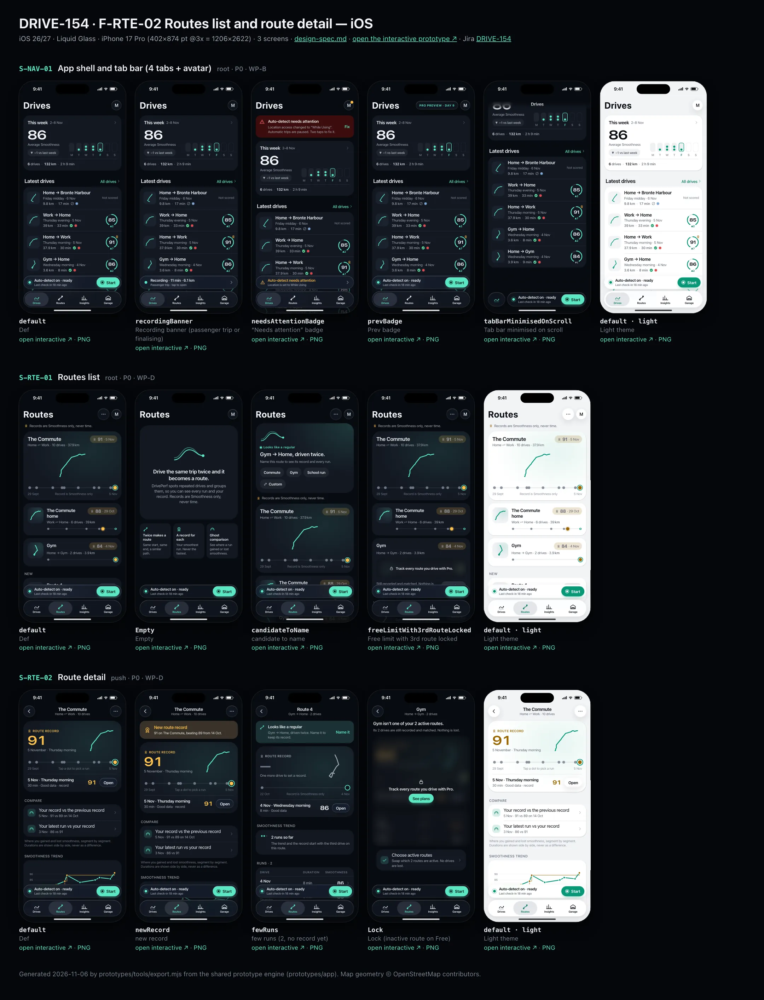
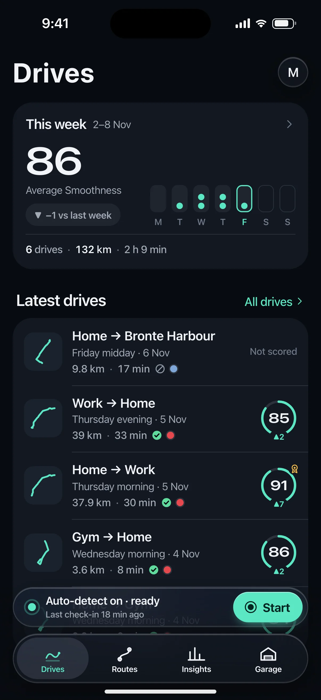
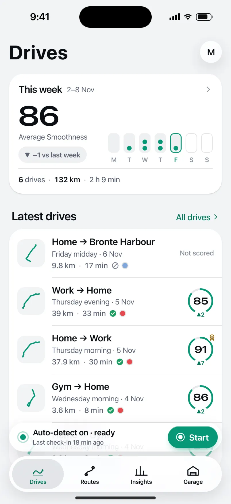
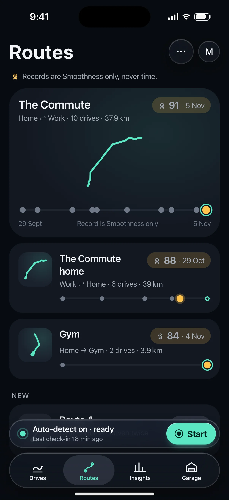
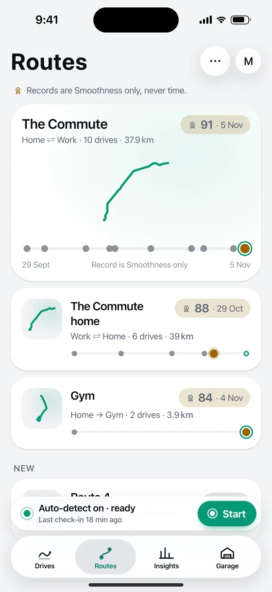
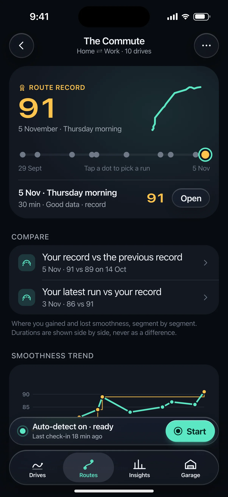
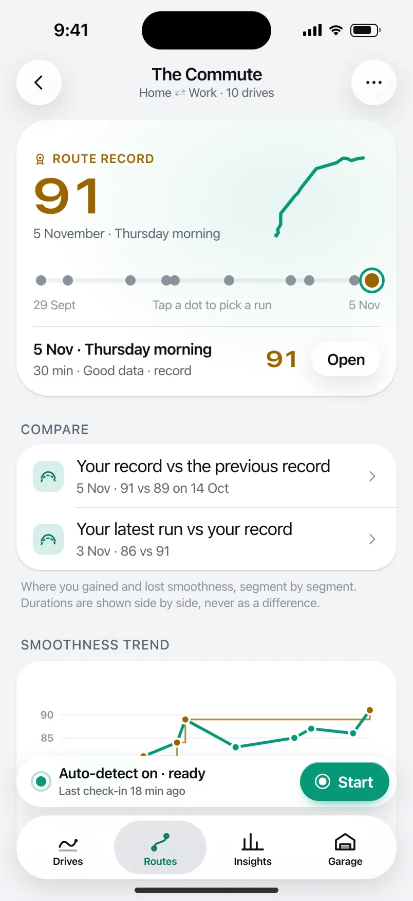

# DRIVE-154 · F-RTE-02 Routes list and route detail — iOS design spec

> Generated by `prototypes/tools/export.mjs` on 2026-11-06 from the shared prototype engine. **Do not edit by hand:** change the screen's `spec` in `prototypes/app/screens/wp-*.js` (see `prototypes/app/AUTHORING.md`) and re-export.

- **Jira story:** [DRIVE-154](https://thekeval.atlassian.net/browse/DRIVE-154) · F-RTE-02 · P0
- **Platform:** iOS 26/27 · Liquid Glass · iPhone 17 Pro (402×874 pt @3x = 1206×2622)
- **Interactive prototype:** [../../../../prototypes/ios/index.html#S-NAV-01](../../../../prototypes/ios/index.html#S-NAV-01) (catalog panel: every screen and state; deep links `#S-ID/state?trip=…&ent=…&theme=light&text=xl&rm=1`)
- **Contact sheet:** [mockup.html](mockup.html) · 
- **Design system (source of truth for values):** [brand](../../system/brand.md) · [components](../../system/components.md) · [motion](../../system/motion.md) · [accessibility](../../system/accessibility.md) · [screen map](../../system/screen-map.md) · [fixtures](../../system/fixtures.md) · tokens `prototypes/shared/tokens.css`

## Screens in this story

| Screen | Name | Presentation | Priority | States | Status |
|---|---|---|---|---|---|
| `S-NAV-01` | App shell and tab bar (4 tabs + avatar) | Shell | P0 | 5 | Prototyped |
| `S-RTE-01` | Routes list | Root (Routes tab) | P0 | 4 | Prototyped |
| `S-RTE-02` | Route detail | Push | P0 | 4 | Prototyped |

## Tokens used on this platform

Values resolved from `prototypes/shared/tokens.css` inside the iOS device (`[data-platform="ios"]`). Use the token names in code; the hex values are for reference.

| Token | Dark | Light |
|---|---|---|
| `--app-bg` | `#080B10` | `#F2F3F6` |
| `--card-bg` | `#131822` | `#FFFFFF` |
| `--dp-bg-grouped` | `#080B10` | `#F2F3F6` |
| `--dp-surface` | `#131822` | `#FFFFFF` |
| `--dp-surface-2` | `#1B222D` | `#F2F3F6` |
| `--dp-surface-3` | `#262E3B` | `#E4E7EC` |
| `--dp-fill` | `#7880961F` | `#7880961F` |
| `--dp-fill-strong` | `#7880963D` | `#78809633` |
| `--dp-text` | `#F2F4F7` | `#0B0E13` |
| `--dp-text-2` | `#A3AAB6` | `#5A6271` |
| `--dp-text-3` | `#6E7787` | `#8A919D` |
| `--dp-separator` | `#96A0B429` | `#3C435024` |
| `--dp-accent` | `#5BE7C4` | `#079777` |
| `--dp-accent-text` | `#5BE7C4` | `#06775E` |
| `--dp-on-accent` | `#04241D` | `#FFFFFF` |
| `--dp-accent-container` | `#0A4439` | `#C6F8EA` |
| `--dp-record` | `#FFC24B` | `#9A6300` |
| `--dp-positive` | `#5BE7C4` | `#06775E` |
| `--dp-change-down` | `#A3AAB6` | `#5A6271` |
| `--dp-warning` | `#F5B648` | `#9A5F00` |
| `--dp-critical` | `#FF6B6B` | `#C62828` |
| `--dp-glass-fill` | `#1C222C6B` | `#FFFFFF8C` |
| `--dp-glass-fill-strong` | `#1C222CB8` | `#FFFFFFD1` |
| `--dp-glass-stroke` | `#FFFFFF24` | `#FFFFFF99` |
| `--dp-data-route` | `#5BE7C4` | `#079777` |
| `--dp-data-event-brake` | `#FF7A66` | `#A21F16` |
| `--dp-data-event-accel` | `#E58BD0` | `#A33A8C` |
| `--dp-data-event-corner` | `#EAD54E` | `#9A8A00` |
| `--dp-data-quality-good` | `#5FDB9C` | `#1E9E62` |
| `--dp-data-speed` | `#D6DCE4` | `#404A58` |
| `--dp-data-long-g` | `#5AB8F5` | `#0A6AB8` |
| `--dp-data-lat-g` | `#F5A142` | `#B25A00` |

| Type / layout token | Value |
|---|---|
| `--dp-font-screen-title` | `700 34px / 41px -apple-system, BlinkMacSystemFont, "SF Pro Display", system-ui, sans-serif` |
| `--dp-font-sheet-title` | `700 22px / 28px -apple-system, BlinkMacSystemFont, "SF Pro Display", system-ui, sans-serif` |
| `--dp-font-section-title` | `600 20px / 25px -apple-system, BlinkMacSystemFont, "SF Pro Display", system-ui, sans-serif` |
| `--dp-font-card-title` | `600 17px / 22px -apple-system, BlinkMacSystemFont, "SF Pro Text", system-ui, sans-serif` |
| `--dp-font-body` | `400 17px / 22px -apple-system, BlinkMacSystemFont, "SF Pro Text", system-ui, sans-serif` |
| `--dp-font-body-secondary` | `400 15px / 20px -apple-system, BlinkMacSystemFont, "SF Pro Text", system-ui, sans-serif` |
| `--dp-font-meta` | `400 13px / 18px -apple-system, BlinkMacSystemFont, "SF Pro Text", system-ui, sans-serif` |
| `--dp-font-caption` | `400 12px / 16px -apple-system, BlinkMacSystemFont, "SF Pro Text", system-ui, sans-serif` |
| `--dp-font-button` | `600 17px / 22px -apple-system, BlinkMacSystemFont, "SF Pro Text", system-ui, sans-serif` |
| `--dp-num-hero` | `600 72px / 72px -apple-system, BlinkMacSystemFont, "SF Pro Display", system-ui, sans-serif` |
| `--dp-num-xl` | `600 48px / 52px -apple-system, BlinkMacSystemFont, "SF Pro Display", system-ui, sans-serif` |
| `--dp-num-l` | `600 34px / 38px -apple-system, BlinkMacSystemFont, "SF Pro Display", system-ui, sans-serif` |
| `--dp-num-m` | `600 24px / 28px -apple-system, BlinkMacSystemFont, "SF Pro Display", system-ui, sans-serif` |
| `--dp-num-s` | `600 17px / 22px -apple-system, BlinkMacSystemFont, "SF Pro Display", system-ui, sans-serif` |
| `--dp-num-xs` | `600 13px / 16px -apple-system, BlinkMacSystemFont, "SF Pro Display", system-ui, sans-serif` |
| `--dp-screen-margin` | `16px` |
| `--dp-radius-card` | `24px` |
| `--dp-radius-card-hero` | `32px` |
| `--dp-radius-sheet` | `38px` |
| `--dp-radius-chip` | `999px` |
| `--dp-radius-button` | `999px` |
| `--dp-layout-list-row-min` | `52px` |
| `--dp-layout-touch-min` | `44px` |
| `--safe-top` | `62px` |
| `--safe-bottom` | `34px` |

Text sizes scale with `--dp-text-scale` (XL = 2.0×) and numerals with `--dp-num-scale` (XL = 1.3×). DP Numerals: SF Pro Expanded Semibold, tabular.

---

## S-NAV-01 · App shell and tab bar (4 tabs + avatar)

 

- **Presentation:** root · tab: drives — screen map: “Shell”
- **Entry points:** App launch (after onboarding)
- **Leads to:** Tab roots S-HOME-01 · S-RTE-01 · S-STA-01 · S-GAR-01; avatar → S-ACC-01; accessory/toolbar → S-DRV-01 (recording) or S-HOME-02
- **PRD features:** F-HIS-01, F-RTE-02, F-GAR-01, F-ACC-01, F-HIS-04 · **Priority:** P0 · **WP:** B
- **Interactive:** [S-NAV-01](../../../../prototypes/ios/index.html#S-NAV-01)

**Purpose.** The app shell (screen-map.md §1, validated): four tabs — Drives · Routes · Insights · Garage — with Profile moved to an avatar in the top-trailing corner of every tab root, and capture status always one glance away. Every other screen mounts inside it.

### States

| State | PRD label | Fixture params | Screenshot |
|---|---|---|---|
| `default` | Def | — | [S-NAV-01.png](../../screens/ios/S-NAV-01.webp) · [open](../../../../prototypes/ios/index.html#S-NAV-01) |
| `recordingBanner` | Recording banner (passenger trip or finalising) | — | [S-NAV-01--recordingBanner.png](../../screens/ios/S-NAV-01--recordingBanner.webp) · [open](../../../../prototypes/ios/index.html#S-NAV-01/recordingBanner) |
| `needsAttentionBadge` | “Needs attention” badge | `health=alwaysLost` | [S-NAV-01--needsAttentionBadge.png](../../screens/ios/S-NAV-01--needsAttentionBadge.webp) · [open](../../../../prototypes/ios/index.html#S-NAV-01/needsAttentionBadge) |
| `prevBadge` | Prev badge | `ent=preview` | [S-NAV-01--prevBadge.png](../../screens/ios/S-NAV-01--prevBadge.webp) · [open](../../../../prototypes/ios/index.html#S-NAV-01/prevBadge) |
| `tabBarMinimisedOnScroll` | Tab bar minimised on scroll | — | [S-NAV-01--tabBarMinimisedOnScroll.png](../../screens/ios/S-NAV-01--tabBarMinimisedOnScroll.webp) · [open](../../../../prototypes/ios/index.html#S-NAV-01/tabBarMinimisedOnScroll) |
| default · light | Light theme | `theme=light` | [S-NAV-01--light.png](../../screens/ios/S-NAV-01--light.webp) |

Every state also renders in light/dark (`theme=light`), XL text (`text=xl`) and reduced motion (`rm=1`).

### Layout

- Tab roots: Drives S-HOME-01 · Routes S-RTE-01 · Insights S-STA-01 · Garage S-GAR-01 (icons DP_ICONS drives/routes/insights/garage).
- iOS: floating Liquid Glass tab bar (inset 16, bottom 21, height 62, selected = Glide icon + label inside a glass lens) + tabViewBottomAccessory capture capsule (50 pt, 8 above the bar) on all tabs.
- Android: NavigationBar (64 dp + 24 dp gesture area, surfaceContainer, indicator 56×32 secondaryContainer, labels always visible) + M3E floating toolbar (64 dp, primaryContainer) docked 16 dp above it on the Drives tab only.
- Avatar top-trailing on every tab root: iOS 38 pt glass circle (initial) · Android 40 dp Cookie12Sided secondaryContainer. Badge dot = needs attention; Preview badge beside it.
- Minimised on scroll (iOS): the bar shrinks to a 54 pt capsule showing only the selected icon; the accessory folds inline to its right. Android: the toolbar slides out on scroll down and back on scroll up; the navigation bar stays.

### Components & tokens

| Component | Tokens / spec |
|---|---|
| `tabBar` | iOS floating glass: inset 16, bottom 21, height 62, lens --dp-fill-strong · Android NavigationBar 64 dp + indicator 56×32 --md-sys-color-secondary-container · components.md §1 |
| `accessory` | iOS tabViewBottomAccessory glass 48 pt, 8 above tab bar · Android floating toolbar 64 dp --md-sys-color-primary-container, 16 above nav bar · Start: --dp-accent |
| `avatar` | see components.md |
| `previewBadge` | see components.md |
| `largeTitle` | --dp-font-screen-title (iOS 34/41 bold · Android 32/40) · components.md §2 |

### Interactions & navigation

- Tab tap → that tab root (iOS cross-fade + lens spring · Android fade-through). Re-tapping the current tab scrolls to top.
- Avatar → S-ACC-01 (iOS sheet, large detent, own NavigationStack · Android full-screen, shared axis X, predictive back).
- Accessory / toolbar → S-HOME-02 (ready), S-DRV-01 (recording), S-SET-05 (attention); Start → S-DRV-01 (trip start).
- Every navigation passes the D1 gate (router → DP.gate): while a driver trip is active only S-DRV-01/02/03 are reachable; content opened while moving waits on S-DRV-05.

### Motion

- Tab lens: spring.default slide between tabs · selection haptic.
- Minimise on scroll: spring.default (iOS) · toolbar 150 ms emphasizedAccelerate out / spring.fast in (Android).
- Recording banner: livePulse 2400 ms breathe on the dot; RM static.
- Trip start: accessory/toolbar expands into S-DRV-01 (container transform, spring.slow).

### Accessibility

- Tabs are a tablist: “Drives, tab, 1 of 4, selected”. Labels always visible on both platforms; iOS large-content viewer on long-press at AX sizes.
- Avatar: “Profile, needs attention” when badged. Preview badge: “Pro Preview, day 9 of 14”.
- The accessory never announces timer updates (no live region).

### Platform notes

- **iOS (this spec):** TabView + Tab, .tabBarMinimizeBehavior(.onScrollDown), .tabViewBottomAccessory { CaptureStatusAccessory() }; Profile is a glass toolbar item → sheet.
- *Android (for reference):* NavigationBar (short) always visible; HorizontalFloatingToolbar on Drives; avatar in the top app bar trailing slot → full-screen destination.

### Analytics

- `tab_selected {tab}`
- `profile_opened {source: avatar}`
- `capture_status_opened {source: accessory|toolbar}`

### Copy

| Key | Text |
|---|---|
| Tabs | Drives · Routes · Insights · Garage |
| Recording banner | Recording · {min} min · {km} km |
| Needs attention | Auto-detect needs attention |

### Free / Pro

Same shell for every plan. Preview: “PRO PREVIEW · DAY n” badge beside the avatar.

### Assets

[icon-drives.svg](assets/icon-drives.svg) · [icon-routes.svg](assets/icon-routes.svg) · [icon-insights.svg](assets/icon-insights.svg) · [icon-garage.svg](assets/icon-garage.svg) · [icon-record.svg](assets/icon-record.svg) · [icon-profile.svg](assets/icon-profile.svg) · [logo-a-loop.svg](assets/logo-a-loop.svg)

UI glyphs may be swapped for SF Symbols / Material Symbols Rounded equivalents; event-pin, quality and provenance glyphs must not be (components.md global rules).

### Checklist (accessibility.md §9)

- [ ] Light and dark both render, and contrast passes.
- [ ] The XL text state reflows with no truncation.
- [ ] The RM state is defined.
- [ ] Every control has a label; every chart and map has a summary sentence.
- [ ] Every target ≥ 44 pt / 48 dp (≥ 64 in-drive).
- [ ] No meaning by colour alone.
- [ ] Speed is neutral wherever it appears and absent from social or live surfaces.
- [ ] No streak, leaderboard, speed or “beat your time” language.
- [ ] Behaviour is defined while a trip is active (D1 gate).
- [ ] Haptics come from motion.md §6 only.

---

## S-RTE-01 · Routes list

 

- **Presentation:** root · tab: routes — screen map: “Root (Routes tab)”
- **Entry points:** Tab
- **Leads to:** S-RTE-02 · S-RTE-03 (candidate) · S-SUB-03 (3rd route) · S-RTE-05
- **PRD features:** F-RTE-02, F-RTE-05 · **Priority:** P0 · **WP:** D
- **Interactive:** [S-RTE-01](../../../../prototypes/ios/index.html#S-RTE-01)

**Purpose.** The Routes tab: every route DrivePerf has grouped from repeated drives, with its record and runs at a glance, new candidates to name, and the Free two-route limit shown “locked, not lost” (F-RTE-02, F-RTE-05).

### States

| State | PRD label | Fixture params | Screenshot |
|---|---|---|---|
| `default` | Def | — | [S-RTE-01.png](../../screens/ios/S-RTE-01.webp) · [open](../../../../prototypes/ios/index.html#S-RTE-01) |
| `Empty` | Empty | — | [S-RTE-01--Empty.png](../../screens/ios/S-RTE-01--Empty.webp) · [open](../../../../prototypes/ios/index.html#S-RTE-01/Empty) |
| `candidateToName` | candidate to name | — | [S-RTE-01--candidateToName.png](../../screens/ios/S-RTE-01--candidateToName.webp) · [open](../../../../prototypes/ios/index.html#S-RTE-01/candidateToName) |
| `freeLimitWith3rdRouteLocked` | Free limit with 3rd route locked | `ent=free` | [S-RTE-01--freeLimitWith3rdRouteLocked.png](../../screens/ios/S-RTE-01--freeLimitWith3rdRouteLocked.webp) · [open](../../../../prototypes/ios/index.html#S-RTE-01/freeLimitWith3rdRouteLocked) |
| default · light | Light theme | `theme=light` | [S-RTE-01--light.png](../../screens/ios/S-RTE-01--light.webp) |

Every state also renders in light/dark (`theme=light`), XL text (`text=xl`) and reduced motion (`rm=1`).

### Layout

- Large title “Routes”; trailing “…” menu (Choose active routes on Free · Rename · Merge · Link directions → S-RTE-05) + Preview badge + avatar. Android subtitle “3 routes”.
- Rule line under the title: gold rosette + “Records are Smoothness only, never time.” (meta, text-2).
- Hero route card (most-driven route, radius 32 / 28, Glide radial wash): name (section title) · “Home ⇄ Work · 10 drives · 37.9 km” · record chip (rosette, “91 · 5 Nov”, --dp-record on 18%) · route glyph 132 in Glide (share-safe trimmed shape) · dot strip (10 px dots on a 4 px track, x = date; record gold 14 px, latest outlined Glide) · axis “29 Sep · Record is Smoothness only · 5 Nov”.
- Route cards (radius 24 / 16): glyph thumbnail 52 on surface-2 · name · direction (⇄ when linked) · drives · km · record chip · mini dot strip.
- Candidate: “New” section with “Route 4 · Gym → Home · driven twice” + tonal “Name it”. Candidate state: hero prompt card with the merge illustration, kicker “● Looks like a regular”, “Gym → Home, driven twice.”, chips Commute · Gym · School run · Custom.
- Free limit: the third route keeps its name, meta and record visible; its glyph and dot strip are blurred 14 px with a lock and “Track every route you drive with Pro.”; footer “Still recorded and matched. Nothing is lost.” + See plans; a “2 of 2 routes active on Free” row → S-RTE-05 chooseActiveRoutes.
- Empty: hero card with the two-lines-merging illustration (artMerge 120), “Drive the same trip twice and it becomes a route.” + 3 how-it-works tiles (Twice makes a route · A record for each · Ghost comparison).

### Components & tokens

| Component | Tokens / spec |
|---|---|
| `largeTitle` | --dp-font-screen-title (iOS 34/41 bold · Android 32/40) · components.md §2 |
| `menu` | iOS glass Menu: --dp-glass-fill-strong, radius 26 · Android DropdownMenu: --md-sys-color-surface-container, radius 16 |
| `iconButton` | see components.md |
| `avatar` | see components.md |
| `card` | --dp-surface / --md-sys-color-surface-container · --dp-radius-card (24 iOS · 16 Android) · hero: --dp-radius-card-hero (32 · 28) · light iOS: --dp-elev-1 |
| `glyph` | see components.md |
| `chip` | --dp-radius-chip (iOS capsule · Android 8) · height 28 · --dp-font-caption |
| `button` | --dp-accent / --dp-on-accent (filled) · --dp-fill-strong · --md-sys-color-secondary-container (tonal) · --dp-radius-button · height iOS 50/44/34 · Android 56/40/32 · --dp-font-button · components.md §0 |
| `lockPanel` | blur --dp-opacity-locked-blur 14px · dim --dp-opacity-locked-dim 35% · components.md §15.2 |
| `list` | iOS inset grouped radius --dp-radius-card, rows 52 pt, separators --dp-separator inset 16 · Android ListItem 56/72 dp in --md-sys-color-surface-container |
| `row` | --dp-font-body · --dp-font-meta (supporting) · --dp-layout-list-row-min |
| `section` | --dp-font-section-title · --dp-layout-section-gap 28 |
| `empty` | illustration 120 in --dp-accent · --dp-font-section-title · components.md §21 |
| `artMerge` | see components.md |

### Interactions & navigation

- Route card → S-RTE-02 (iOS zoom / Android container transform from the card). A locked route’s card opens S-SUB-03 s3rdRoute via the lock; its page is S-RTE-02/Lock.
- “Name it” / prompt chips → S-RTE-03 (preset chip pre-selected; Custom → S-RTE-03/custom).
- “…” menu and the Free row → S-RTE-05 (rename / merge / link / choose active routes).

### Motion

- Hero motion: the hero route glyph draws on (1600 ms, ease.drawOn), then its run dots pop in date order (shared.pinPop, 40 ms stagger); cards rise 8 px, 40 ms stagger. RM: glyph and dots appear complete (220 ms fade).
- Card → detail: zoom / container transform (spring.slow).

### Accessibility

- Route card is one button: “The Commute, Home to Work. 10 drives. Route record 91, 5 November. Linked with The Commute home.”
- Dot strip summary: “10 drives on The Commute. Record 91 on 5 November. Latest 91 on 5 November.” The glyph is decorative inside the labelled card.
- Record meaning: rosette + “record” text, never gold alone. Lock: “Part of Pro on the Free plan.”
- XL: record chips move under the name; dot strips keep full width; how-it-works tiles stack.

### Platform notes

- **iOS (this spec):** Large title + glass toolbar “…” Menu and avatar; hero card --dp-surface with Glide wash; cards with continuous corners; floating tab bar + capture accessory.
- *Android (for reference):* LargeFlexibleTopAppBar with subtitle and overflow DropdownMenu; cards surface-container (hero surface-container-high, 28 dp); tonal “Name it” button; NavigationBar.

### Analytics

- `routes_opened {route_count_bucket}`
- `route_candidate_prompt_tapped {preset|custom}`
- `route_limit_hit`
- `locked_content_viewed {type: route}`

### Copy

| Key | Text |
|---|---|
| Title | Routes |
| Rule | Records are Smoothness only, never time. |
| Candidate | Looks like a regular · {from} → {to}, driven twice. Name this route to see its record and every run. |
| Lock | Track every route you drive with Pro. (lockSheets.thirdRoute) · Still recorded and matched. Nothing is lost. |
| Free row | 2 of 2 routes active on Free · Choose which two get records and comparisons |
| Empty | Drive the same trip twice and it becomes a route. DrivePerf spots repeated drives and groups them, so you can see every run and your record. Records are Smoothness only, never time. |

### Free / Pro

Free: 2 active routes (entitlement.states.free.activeRouteIds = The Commute, The Commute home); Gym is the locked 3rd route — still recorded and matched, its depth blurred → S-SUB-03 s3rdRoute; the candidate can still be named. Pro/Preview: unlimited routes, no locks.

### Data & fixtures

DP_DATA.routes: r_commute (10 runs, record 91 · 5 Nov, linked) · r_commute_home (6, 88 · 29 Oct, linked) · r_gym (2, 84 · 4 Nov; freeLocked) · r_cand_gym_home (candidate “Route 4”, 2 runs). Empty simulates routes: [].

### Assets

[icon-routes.svg](assets/icon-routes.svg) · [icon-rosette.svg](assets/icon-rosette.svg) · [icon-more.svg](assets/icon-more.svg) · [icon-edit.svg](assets/icon-edit.svg) · [icon-layers.svg](assets/icon-layers.svg) · [icon-check.svg](assets/icon-check.svg) · [icon-lock.svg](assets/icon-lock.svg) · [icon-ghost.svg](assets/icon-ghost.svg)

UI glyphs may be swapped for SF Symbols / Material Symbols Rounded equivalents; event-pin, quality and provenance glyphs must not be (components.md global rules).

### Checklist (accessibility.md §9)

- [ ] Light and dark both render, and contrast passes.
- [ ] The XL text state reflows with no truncation.
- [ ] The RM state is defined.
- [ ] Every control has a label; every chart and map has a summary sentence.
- [ ] Every target ≥ 44 pt / 48 dp (≥ 64 in-drive).
- [ ] No meaning by colour alone.
- [ ] Speed is neutral wherever it appears and absent from social or live surfaces.
- [ ] No streak, leaderboard, speed or “beat your time” language.
- [ ] Behaviour is defined while a trip is active (D1 gate).
- [ ] Haptics come from motion.md §6 only.

---

## S-RTE-02 · Route detail

 

- **Presentation:** push · tab: routes — screen map: “Push”
- **Entry points:** S-RTE-01 · S-STY-01 record chip · S-NTF-01 record
- **Leads to:** S-RTE-04 (Compare) · S-TRP-01 (run) · S-RTE-05 · S-SUB-03
- **PRD features:** F-RTE-02, F-RTE-03 · **Priority:** P0 · **WP:** D
- **Interactive:** [S-RTE-02](../../../../prototypes/ios/index.html#S-RTE-02)

**Purpose.** A page per route: every run on a dot strip with the record highlighted, the Smoothness trend for the route, each run’s duration shown neutrally, and the way into the ghost comparison (F-RTE-02, F-RTE-03). Records are Smoothness only — never duration, speed or time.

### States

| State | PRD label | Fixture params | Screenshot |
|---|---|---|---|
| `default` | Def | `route=r_commute` | [S-RTE-02.png](../../screens/ios/S-RTE-02.webp) · [open](../../../../prototypes/ios/index.html#S-RTE-02) |
| `newRecord` | new record | `route=r_commute` | [S-RTE-02--newRecord.png](../../screens/ios/S-RTE-02--newRecord.webp) · [open](../../../../prototypes/ios/index.html#S-RTE-02/newRecord) |
| `fewRuns` | few runs (2, no record yet) | `route=r_cand_gym_home` | [S-RTE-02--fewRuns.png](../../screens/ios/S-RTE-02--fewRuns.webp) · [open](../../../../prototypes/ios/index.html#S-RTE-02/fewRuns) |
| `Lock` | Lock (inactive route on Free) | `route=r_gym` `ent=free` | [S-RTE-02--Lock.png](../../screens/ios/S-RTE-02--Lock.webp) · [open](../../../../prototypes/ios/index.html#S-RTE-02/Lock) |
| default · light | Light theme | `theme=light` | [S-RTE-02--light.png](../../screens/ios/S-RTE-02--light.webp) |

Every state also renders in light/dark (`theme=light`), XL text (`text=xl`) and reduced motion (`rm=1`).

### Layout

- Top bar: route name + “Home → Work · 10 drives” (⇄ when linked); trailing “…” Menu: Rename · Merge with another route · Link directions · Remove route (destructive) → S-RTE-05.
- New record state: gold banner (record container, rosette 26) “New route record · 91 on The Commute, beating 89 from 14 Oct.” with one shimmer.
- Hero card (radius 32 / 28): record block (rosette + “Route record”, DP Numerals 48 in --dp-record, date · part of day) + route glyph 118 · interactive dot strip (record gold, latest outlined, selected Glide ring) with axis labels · selected-run line (date · part of day, duration · quality, score, “Open”).
- “Compare” list (ghost glyph rows): “Your record vs the previous record” and “Your latest run vs your record” → S-RTE-04. Free: lock + PRO, footer “Keep comparing every run of The Commute with Pro.”
- “Smoothness trend” card: runs as a Glide line + dots (records gold), the record progression as a gold step line, legend.
- “Runs · 10” table: Drive (date + weekday, quality when not Good) · Duration (neutral text-2, no deltas, never sortable) · Smoothness (record gold with rosette) · chevron; footer = route.recordRule.
- Linked direction row → the other route. Few runs: “2 runs so far · The trend and the record start with the third drive” with 3-dot progress; candidate banner “Looks like a regular… Name it”.
- Lock (inactive on Free): explanation “Gym isn’t one of your 2 active routes. Its 2 drives are still recorded and matched. Nothing is lost.” · the hero and runs table blurred 14 px in a lock panel “Track every route you drive with Pro.” · “Choose active routes” row.

### Components & tokens

| Component | Tokens / spec |
|---|---|
| `page` | --dp-bg-grouped (iOS) / --md-sys-color-surface (Android) · --dp-screen-margin 16 |
| `navBar` | --dp-font-card-title · --dp-font-meta · glass: --dp-glass-fill + --dp-glass-blur · components.md §2 |
| `menu` | iOS glass Menu: --dp-glass-fill-strong, radius 26 · Android DropdownMenu: --md-sys-color-surface-container, radius 16 |
| `card` | --dp-surface / --md-sys-color-surface-container · --dp-radius-card (24 iOS · 16 Android) · hero: --dp-radius-card-hero (32 · 28) · light iOS: --dp-elev-1 |
| `glyph` | see components.md |
| `chip` | --dp-radius-chip (iOS capsule · Android 8) · height 28 · --dp-font-caption |
| `button` | --dp-accent / --dp-on-accent (filled) · --dp-fill-strong · --md-sys-color-secondary-container (tonal) · --dp-radius-button · height iOS 50/44/34 · Android 56/40/32 · --dp-font-button · components.md §0 |
| `list` | iOS inset grouped radius --dp-radius-card, rows 52 pt, separators --dp-separator inset 16 · Android ListItem 56/72 dp in --md-sys-color-surface-container |
| `row` | --dp-font-body · --dp-font-meta (supporting) · --dp-layout-list-row-min |
| `section` | --dp-font-section-title · --dp-layout-section-gap 28 |
| `banner` | radius 12 (--dp-radius-sm+) · info --dp-fill · attention --dp-warning-container · critical --dp-critical-container · components.md §22 |
| `lockPanel` | blur --dp-opacity-locked-blur 14px · dim --dp-opacity-locked-dim 35% · components.md §15.2 |

### Interactions & navigation

- Dot tap → selects that run (selection haptic) and updates the run line; “Open” / runs table row → S-TRP-01.
- Compare rows → S-RTE-04 (cmp=record → default; cmp=latest → whereYouGainedLost). Free → S-SUB-03 (compare variant, own overlay blurred).
- “…” items → S-RTE-05 states. Linked row → S-RTE-02 for the other direction. Candidate “Name it” → S-RTE-03. Lock → S-SUB-03 s3rdRoute; “Choose active routes” → S-RTE-05/chooseActiveRoutes.
- Entry points: S-RTE-01 card (zoom), Story record chip, “New route record” notification (S-NTF-01).

### Motion

- Hero motion: run dots pop in date order (shared.pinPop, 45 ms stagger); trend lines draw on (1200 ms). New record: the banner shimmers once and the rosette springs in (spring.bouncy) with the doubleSuccess haptic — no confetti (F-RTE-03.1). RM: no shimmer, rosette static, haptic kept.

### Accessibility

- Dot strip is one adjustable element natively: “10 drives on The Commute. Record 91 on 5 November. Latest 91 on 5 November.” Swipe up/down moves between runs (“3 November, Tuesday morning. Smoothness 86.”).
- Runs table rows: “3 November, Tuesday morning. 32 min. Smoothness 86.” — duration is read as a plain fact, never compared.
- Record = rosette + “record” text; gold never carries meaning alone.
- XL: the record block stacks above the glyph; table columns reflow to two lines per run.

### Platform notes

- **iOS (this spec):** Inline title + subtitle, glass back and “…” Menu; zoom transition from the route card; inset-grouped lists.
- *Android (for reference):* MediumFlexibleTopAppBar + overflow DropdownMenu; container transform; hero card surface-container-high (28 dp); segmented ListItems; tonal “Open”.

### Analytics

- `route_detail_opened {source: list|story|notification, runs_bucket}`
- `route_run_selected`
- `ghost_compare_opened {source: route_detail, cmp: record|latest, locked}`

### Copy

| Key | Text |
|---|---|
| New record | New route record · {n} on {route}, beating {m} from {date}. |
| No record | One more drive to set a record. |
| Few runs | {n} runs so far · The trend and the record start with the third drive on this route. |
| Record rule | Smoothness only. Never duration. Runs outside your typical pace band cannot set a record. |
| Compare footer | Where you gained and lost smoothness, segment by segment. Durations are shown side by side, never as a difference. |
| Lock | {route} isn’t one of your 2 active routes. Its {n} drives are still recorded and matched. Nothing is lost. · Track every route you drive with Pro. |

### Free / Pro

Free: active routes are fully visible; Compare rows show lock + PRO → S-SUB-03 (compare). Inactive routes (Gym on Free) render the Lock state with their own data blurred. Pro/Preview: everything open.

### Data & fixtures

default / newRecord: r_commute (10 runs, record 91 t20261105-0742 beating 89 from 14 Oct; trend + recordHistory). fewRuns: r_cand_gym_home (2 runs, record null). Lock: r_gym with ent free. Compare uses DP_DATA.ghost (record vs previous) and ghostLatest (3 Nov vs record).

### Assets

[icon-rosette.svg](assets/icon-rosette.svg) · [icon-ghost.svg](assets/icon-ghost.svg) · [icon-more.svg](assets/icon-more.svg) · [icon-edit.svg](assets/icon-edit.svg) · [icon-layers.svg](assets/icon-layers.svg) · [icon-routes.svg](assets/icon-routes.svg) · [icon-trash.svg](assets/icon-trash.svg) · [icon-lock.svg](assets/icon-lock.svg) · [icon-check.svg](assets/icon-check.svg) · [icon-chevronRight.svg](assets/icon-chevronRight.svg)

UI glyphs may be swapped for SF Symbols / Material Symbols Rounded equivalents; event-pin, quality and provenance glyphs must not be (components.md global rules).

### Checklist (accessibility.md §9)

- [ ] Light and dark both render, and contrast passes.
- [ ] The XL text state reflows with no truncation.
- [ ] The RM state is defined.
- [ ] Every control has a label; every chart and map has a summary sentence.
- [ ] Every target ≥ 44 pt / 48 dp (≥ 64 in-drive).
- [ ] No meaning by colour alone.
- [ ] Speed is neutral wherever it appears and absent from social or live surfaces.
- [ ] No streak, leaderboard, speed or “beat your time” language.
- [ ] Behaviour is defined while a trip is active (D1 gate).
- [ ] Haptics come from motion.md §6 only.

---

Map geometry in the prototype: © OpenStreetMap contributors (ODbL). Speed and G are simulated fixtures (fixtures.md).
