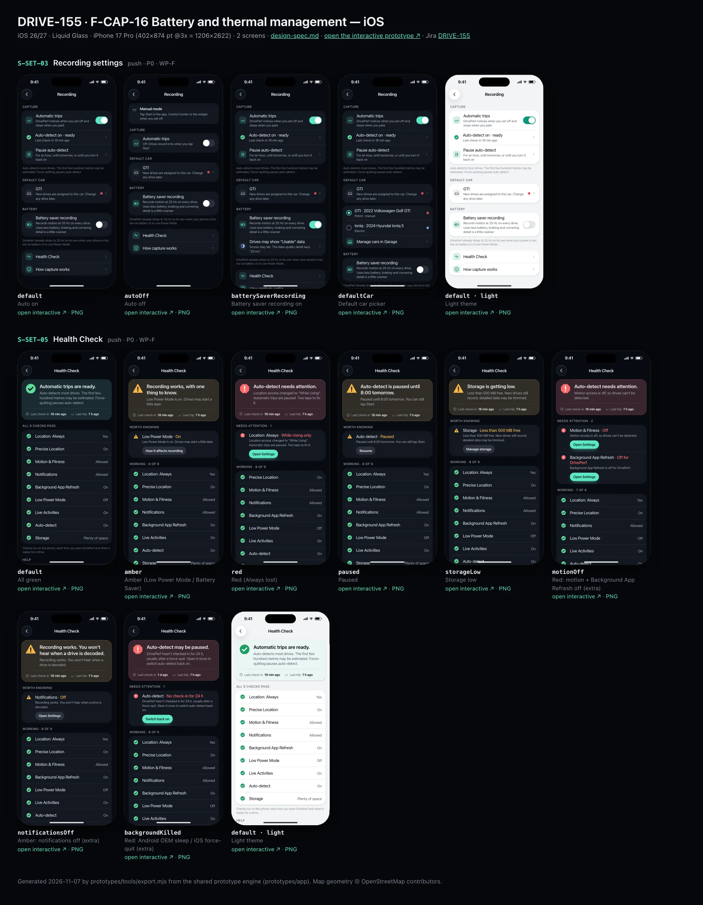
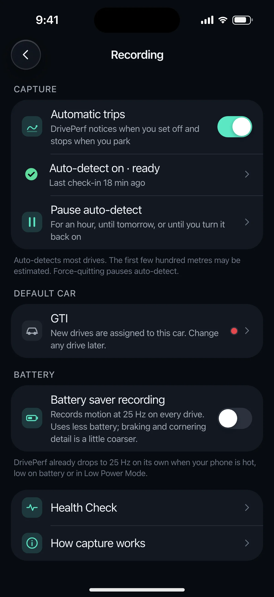
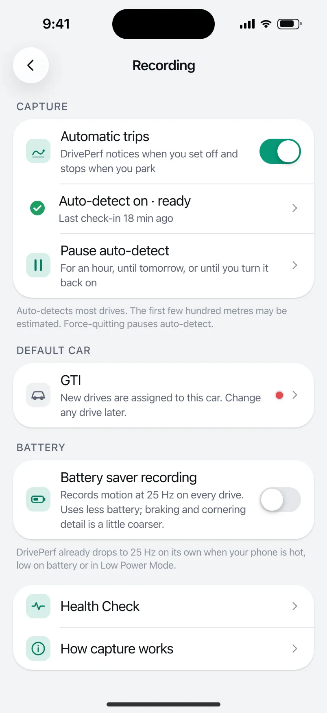
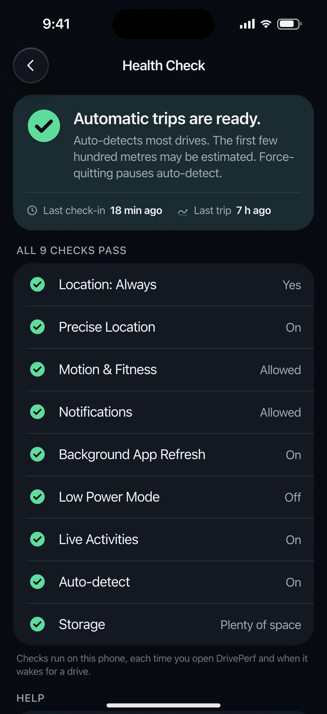
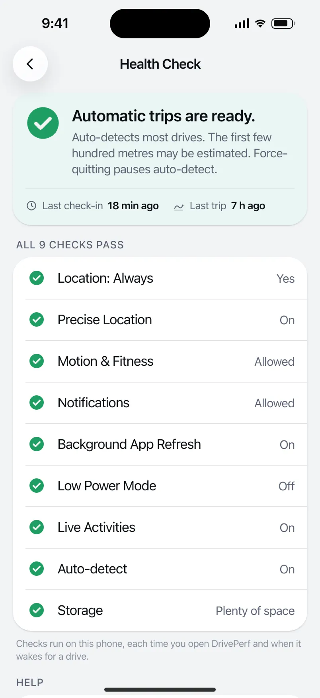

# DRIVE-155 · F-CAP-16 Battery and thermal management — iOS design spec

> Generated by `prototypes/tools/export.mjs` on 2026-11-07 from the shared prototype engine. **Do not edit by hand:** change the screen's `spec` in `prototypes/app/screens/wp-*.js` (see `prototypes/app/AUTHORING.md`) and re-export.

- **Jira story:** [DRIVE-155](https://thekeval.atlassian.net/browse/DRIVE-155) · F-CAP-16 · P0
- **Platform:** iOS 26/27 · Liquid Glass · iPhone 17 Pro (402×874 pt @3x = 1206×2622)
- **Interactive prototype:** [../../../../prototypes/ios/index.html#S-SET-03](../../../../prototypes/ios/index.html#S-SET-03) (catalog panel: every screen and state; deep links `#S-ID/state?trip=…&ent=…&theme=light&text=xl&rm=1`)
- **Contact sheet:** [mockup.html](mockup.html) · 
- **Design system (source of truth for values):** [brand](../../system/brand.md) · [components](../../system/components.md) · [motion](../../system/motion.md) · [accessibility](../../system/accessibility.md) · [screen map](../../system/screen-map.md) · [fixtures](../../system/fixtures.md) · tokens `prototypes/shared/tokens.css`

## Screens in this story

| Screen | Name | Presentation | Priority | States | Status |
|---|---|---|---|---|---|
| `S-SET-03` | Recording settings | Push | P0 | 4 | Prototyped |
| `S-SET-05` | Health Check | Push (or sheet from S-HOME-02) | P0 | 8 | Prototyped |

## Tokens used on this platform

Values resolved from `prototypes/shared/tokens.css` inside the iOS device (`[data-platform="ios"]`). Use the token names in code; the hex values are for reference.

| Token | Dark | Light |
|---|---|---|
| `--app-bg` | `#080B10` | `#F2F3F6` |
| `--card-bg` | `#131822` | `#FFFFFF` |
| `--dp-bg-grouped` | `#080B10` | `#F2F3F6` |
| `--dp-surface` | `#131822` | `#FFFFFF` |
| `--dp-surface-2` | `#1B222D` | `#F2F3F6` |
| `--dp-surface-3` | `#262E3B` | `#E4E7EC` |
| `--dp-fill` | `#7880961F` | `#7880961F` |
| `--dp-fill-strong` | `#7880963D` | `#78809633` |
| `--dp-text` | `#F2F4F7` | `#0B0E13` |
| `--dp-text-2` | `#A3AAB6` | `#5A6271` |
| `--dp-text-3` | `#6E7787` | `#8A919D` |
| `--dp-separator` | `#96A0B429` | `#3C435024` |
| `--dp-accent` | `#5BE7C4` | `#079777` |
| `--dp-accent-text` | `#5BE7C4` | `#06775E` |
| `--dp-on-accent` | `#04241D` | `#FFFFFF` |
| `--dp-accent-container` | `#0A4439` | `#C6F8EA` |
| `--dp-record` | `#FFC24B` | `#9A6300` |
| `--dp-positive` | `#5BE7C4` | `#06775E` |
| `--dp-change-down` | `#A3AAB6` | `#5A6271` |
| `--dp-warning` | `#F5B648` | `#9A5F00` |
| `--dp-critical` | `#FF6B6B` | `#C62828` |
| `--dp-glass-fill` | `#1C222C6B` | `#FFFFFF8C` |
| `--dp-glass-fill-strong` | `#1C222CB8` | `#FFFFFFD1` |
| `--dp-glass-stroke` | `#FFFFFF24` | `#FFFFFF99` |
| `--dp-data-route` | `#5BE7C4` | `#079777` |
| `--dp-data-event-brake` | `#FF7A66` | `#A21F16` |
| `--dp-data-event-accel` | `#E58BD0` | `#A33A8C` |
| `--dp-data-event-corner` | `#EAD54E` | `#9A8A00` |
| `--dp-data-quality-good` | `#5FDB9C` | `#1E9E62` |
| `--dp-data-speed` | `#D6DCE4` | `#404A58` |
| `--dp-data-long-g` | `#5AB8F5` | `#0A6AB8` |
| `--dp-data-lat-g` | `#F5A142` | `#B25A00` |

| Type / layout token | Value |
|---|---|
| `--dp-font-screen-title` | `700 34px / 41px -apple-system, BlinkMacSystemFont, "SF Pro Display", system-ui, sans-serif` |
| `--dp-font-sheet-title` | `700 22px / 28px -apple-system, BlinkMacSystemFont, "SF Pro Display", system-ui, sans-serif` |
| `--dp-font-section-title` | `600 20px / 25px -apple-system, BlinkMacSystemFont, "SF Pro Display", system-ui, sans-serif` |
| `--dp-font-card-title` | `600 17px / 22px -apple-system, BlinkMacSystemFont, "SF Pro Text", system-ui, sans-serif` |
| `--dp-font-body` | `400 17px / 22px -apple-system, BlinkMacSystemFont, "SF Pro Text", system-ui, sans-serif` |
| `--dp-font-body-secondary` | `400 15px / 20px -apple-system, BlinkMacSystemFont, "SF Pro Text", system-ui, sans-serif` |
| `--dp-font-meta` | `400 13px / 18px -apple-system, BlinkMacSystemFont, "SF Pro Text", system-ui, sans-serif` |
| `--dp-font-caption` | `400 12px / 16px -apple-system, BlinkMacSystemFont, "SF Pro Text", system-ui, sans-serif` |
| `--dp-font-button` | `600 17px / 22px -apple-system, BlinkMacSystemFont, "SF Pro Text", system-ui, sans-serif` |
| `--dp-num-hero` | `600 72px / 72px -apple-system, BlinkMacSystemFont, "SF Pro Display", system-ui, sans-serif` |
| `--dp-num-xl` | `600 48px / 52px -apple-system, BlinkMacSystemFont, "SF Pro Display", system-ui, sans-serif` |
| `--dp-num-l` | `600 34px / 38px -apple-system, BlinkMacSystemFont, "SF Pro Display", system-ui, sans-serif` |
| `--dp-num-m` | `600 24px / 28px -apple-system, BlinkMacSystemFont, "SF Pro Display", system-ui, sans-serif` |
| `--dp-num-s` | `600 17px / 22px -apple-system, BlinkMacSystemFont, "SF Pro Display", system-ui, sans-serif` |
| `--dp-num-xs` | `600 13px / 16px -apple-system, BlinkMacSystemFont, "SF Pro Display", system-ui, sans-serif` |
| `--dp-screen-margin` | `16px` |
| `--dp-radius-card` | `24px` |
| `--dp-radius-card-hero` | `32px` |
| `--dp-radius-sheet` | `38px` |
| `--dp-radius-chip` | `999px` |
| `--dp-radius-button` | `999px` |
| `--dp-layout-list-row-min` | `52px` |
| `--dp-layout-touch-min` | `44px` |
| `--safe-top` | `62px` |
| `--safe-bottom` | `34px` |

Text sizes scale with `--dp-text-scale` (XL = 2.0×) and numerals with `--dp-num-scale` (XL = 1.3×). DP Numerals: SF Pro Expanded Semibold, tabular.

---

## S-SET-03 · Recording settings

 

- **Presentation:** push · tab: profile — screen map: “Push”
- **Entry points:** S-SET-01
- **Leads to:** S-HOME-03 · S-GAR-01 (default car)
- **PRD features:** F-SET-01, F-CAP-16 · **Priority:** P0 · **WP:** F
- **Interactive:** [S-SET-03](../../../../prototypes/ios/index.html#S-SET-03)

**Purpose.** Automatic trips on/off, default car, battery saver recording, and links to Health Check and Pause (F-SET-01.3, F-CAP-16).

### States

| State | PRD label | Fixture params | Screenshot |
|---|---|---|---|
| `default` | Auto on | — | [S-SET-03.png](../../screens/ios/S-SET-03.webp) · [open](../../../../prototypes/ios/index.html#S-SET-03) |
| `autoOff` | Auto off | `capture=manual` | [S-SET-03--autoOff.png](../../screens/ios/S-SET-03--autoOff.webp) · [open](../../../../prototypes/ios/index.html#S-SET-03/autoOff) |
| `batterySaverRecording` | Battery saver recording on | — | [S-SET-03--batterySaverRecording.png](../../screens/ios/S-SET-03--batterySaverRecording.webp) · [open](../../../../prototypes/ios/index.html#S-SET-03/batterySaverRecording) |
| `defaultCar` | Default car picker | — | [S-SET-03--defaultCar.png](../../screens/ios/S-SET-03--defaultCar.webp) · [open](../../../../prototypes/ios/index.html#S-SET-03/defaultCar) |
| default · light | Light theme | `theme=light` | [S-SET-03--light.png](../../screens/ios/S-SET-03--light.webp) |

Every state also renders in light/dark (`theme=light`), XL text (`text=xl`) and reduced motion (`rm=1`).

### Layout

- Manual-mode banner (auto off): “Manual mode. Tap Start in the app, Control Center or the widget when you set off.” (Android: Quick Settings tile).
- Capture: “Automatic trips” switch row with a one-line explanation · when on: status row (health glyph + “Auto-detect on · ready” + last check-in) → S-SET-05 · “Pause auto-detect” → S-HOME-03. Footer: the honest capture promise.
- Default car: row with the car name, colour dot and chevron; expands into a radio list of cars (GTI, Ioniq) + “Manage cars in Garage” → S-GAR-01. On Free, the second car shows PRO + lock and opens S-SUB-03/s2ndCar.
- Battery: “Battery saver recording” switch (IMU 25 Hz always) with its trade-off in plain words; when on, a “Drives may show Usable data” row → S-DQ-02. Footer: automatic 25 Hz back-off (hot, low battery, Low Power Mode).
- Links: Health Check → S-SET-05 · How capture works → S-ONB-05.

### Components & tokens

| Component | Tokens / spec |
|---|---|
| `navBar` | --dp-font-card-title · --dp-font-meta · glass: --dp-glass-fill + --dp-glass-blur · components.md §2 |
| `banner` | radius 12 (--dp-radius-sm+) · info --dp-fill · attention --dp-warning-container · critical --dp-critical-container · components.md §22 |
| `list` | iOS inset grouped radius --dp-radius-card, rows 52 pt, separators --dp-separator inset 16 · Android ListItem 56/72 dp in --md-sys-color-surface-container |
| `row` | --dp-font-body · --dp-font-meta (supporting) · --dp-layout-list-row-min |
| `toggle` | iOS 51×31 tint --dp-accent · Android M3 Switch 52×32 --md-sys-color-primary |
| `carDot` | see components.md |
| `section` | --dp-font-section-title · --dp-layout-section-gap 28 |

### Interactions & navigation

- Automatic trips switch → toggles auto-detect (prototype: sets the global capture=manual so Home and the accessory show Manual mode) + toast + toggle haptic.
- Status row → S-SET-05 · Pause → S-HOME-03 sheet · Default car row → expands/collapses the picker; car radio → sets default + toast; locked car → S-SUB-03/s2ndCar; Manage cars → S-GAR-01.
- Battery saver switch → on/off; “Usable data” row → S-DQ-02.

### Motion

- Groups rise 8 px, 30 ms stagger (spring.default). The car picker expands with spring.default height (native List animation). RM: instant.

### Accessibility

- Switch rows read “Automatic trips, on, switch”. Status row: “Auto-detect on · ready. Last check-in 18 min ago.”
- Car rows: “GTI, default” / “Ioniq, Pro” (lock).
- XL text: rows grow to two or more lines and trailing values move under the title; nothing truncates. Every row is ≥ 52 pt (iOS) / 56 dp (Android).

### Platform notes

- **iOS (this spec):** Toggle rows with Glide tint; “Control Center or the widget” wording.
- *Android (for reference):* M3 Switch with thumb icon; “Quick Settings tile or the widget” wording; RadioButton car picker.

### Analytics

- `setting_changed {key: auto_detect|default_car|battery_saver_recording}`
- `auto_paused {source: settings}`

### Copy

| Key | Text |
|---|---|
| Auto on sub | DrivePerf notices when you set off and stops when you park |
| Auto off sub | Off. Drives record only when you tap Start |
| Battery saver | Records motion at 25 Hz on every drive. Uses less battery; braking and cornering detail is a little coarser. |
| Battery footer | DrivePerf already drops to 25 Hz on its own when your phone is hot, low on battery or in Low Power Mode. |
| Free car footer | On Free, one car is active. Your other car’s drives stay, locked, not lost. |

### Free / Pro

Free: one active car; the second is shown with a PRO lock (S-SUB-03/s2ndCar). Pro/Preview: any car can be the default.

### Data & fixtures

user.capture {autoDetect on, defaultVehicleId gti, batterySaverRecording false}; vehicles[]; health preset for the status row; entitlement.states.free.activeVehicleId = gti.

### Assets

[icon-drives.svg](assets/icon-drives.svg) · [icon-pause.svg](assets/icon-pause.svg) · [icon-car.svg](assets/icon-car.svg) · [icon-garage.svg](assets/icon-garage.svg) · [icon-battery.svg](assets/icon-battery.svg) · [icon-health.svg](assets/icon-health.svg) · [icon-info.svg](assets/icon-info.svg) · [icon-lock.svg](assets/icon-lock.svg) · [icon-chevronRight.svg](assets/icon-chevronRight.svg) · [icon-chevronDown.svg](assets/icon-chevronDown.svg)

UI glyphs may be swapped for SF Symbols / Material Symbols Rounded equivalents; event-pin, quality and provenance glyphs must not be (components.md global rules).

### Checklist (accessibility.md §9)

- [ ] Light and dark both render, and contrast passes.
- [ ] The XL text state reflows with no truncation.
- [ ] The RM state is defined.
- [ ] Every control has a label; every chart and map has a summary sentence.
- [ ] Every target ≥ 44 pt / 48 dp (≥ 64 in-drive).
- [ ] No meaning by colour alone.
- [ ] Speed is neutral wherever it appears and absent from social or live surfaces.
- [ ] No streak, leaderboard, speed or “beat your time” language.
- [ ] Behaviour is defined while a trip is active (D1 gate).
- [ ] Haptics come from motion.md §6 only.

---

## S-SET-05 · Health Check

 

- **Presentation:** push · tab: profile — screen map: “Push (or sheet from S-HOME-02)”
- **Entry points:** S-SET-01 · S-HOME-01 "needs attention" · S-HOME-02 · S-LIVE-10 · S-NTF-01 capture problem
- **Leads to:** System Settings deep links · S-SET-06 · S-ONB-11 · S-NTF-02 · S-SET-07
- **PRD features:** F-SET-02, F-CAP-14, F-CAP-16, F-DQ-07, F-NTF-02 · **Priority:** P0 · **WP:** F
- **Interactive:** [S-SET-05](../../../../prototypes/ios/index.html#S-SET-05)

**Purpose.** One screen that says whether automatic capture will work and how to fix it, with green/amber/red items and a fix action each (F-SET-02, F-NTF-02, F-CAP-14, F-CAP-16, F-DQ-07).

### States

| State | PRD label | Fixture params | Screenshot |
|---|---|---|---|
| `default` | All green | — | [S-SET-05.png](../../screens/ios/S-SET-05.webp) · [open](../../../../prototypes/ios/index.html#S-SET-05) |
| `amber` | Amber (Low Power Mode / Battery Saver) | `health=lowPower` | [S-SET-05--amber.png](../../screens/ios/S-SET-05--amber.webp) · [open](../../../../prototypes/ios/index.html#S-SET-05/amber) |
| `red` | Red (Always lost) | `health=alwaysLost` | [S-SET-05--red.png](../../screens/ios/S-SET-05--red.webp) · [open](../../../../prototypes/ios/index.html#S-SET-05/red) |
| `paused` | Paused | `health=paused` | [S-SET-05--paused.png](../../screens/ios/S-SET-05--paused.webp) · [open](../../../../prototypes/ios/index.html#S-SET-05/paused) |
| `storageLow` | Storage low | `health=storageLow` | [S-SET-05--storageLow.png](../../screens/ios/S-SET-05--storageLow.webp) · [open](../../../../prototypes/ios/index.html#S-SET-05/storageLow) |
| `motionOff` | Red: motion + Background App Refresh off (extra) | `health=motionOff` | [S-SET-05--motionOff.png](../../screens/ios/S-SET-05--motionOff.webp) · [open](../../../../prototypes/ios/index.html#S-SET-05/motionOff) |
| `notificationsOff` | Amber: notifications off (extra) | `health=notificationsOff` | [S-SET-05--notificationsOff.png](../../screens/ios/S-SET-05--notificationsOff.webp) · [open](../../../../prototypes/ios/index.html#S-SET-05/notificationsOff) |
| `backgroundKilled` | Red: Android OEM sleep / iOS force-quit (extra) | `health=backgroundKilled` | [S-SET-05--backgroundKilled.png](../../screens/ios/S-SET-05--backgroundKilled.webp) · [open](../../../../prototypes/ios/index.html#S-SET-05/backgroundKilled) |
| default · light | Light theme | `theme=light` | [S-SET-05--light.png](../../screens/ios/S-SET-05--light.webp) |

Every state also renders in light/dark (`theme=light`), XL text (`text=xl`) and reduced motion (`rm=1`).

### Layout

- Summary header card: large status glyph (44, shape = state) + summary (“Automatic trips are ready.” / “Recording works, with one thing to know.” / “Auto-detect needs attention.” / “Auto-detect is paused until 8:00 tomorrow.” / “Storage is getting low.”) + one line (the honest capture promise when green, else the worst item’s detail) + meta row “Last check-in 18 min ago · Last trip 7 h ago”. Tint: critical container (red), warning container (amber), surface (green).
- “Needs attention · n” (red) then “Worth knowing” (amber): rows with glyph · label · state (“Location: Always · While Using only”) · detail line · fix button (filled for red, tonal for amber).
- “Working · n of 9” / “All 9 checks pass”: green rows with glyph · label · state value. Footer: where checks run.
- Help: Report a missed drive → S-NTF-02 · Reliability guide → S-SET-06 · Test my setup → S-SET-06/testMySetupPassFail.
- iOS items: Location: Always · Precise Location · Motion & Fitness · Notifications · Background App Refresh · Low Power Mode · Live Activities · Auto-detect · Storage. Android: Location: Allow all the time · Precise location · Physical activity · Notifications · Battery: Unrestricted · Samsung: Never sleeping apps · Battery Saver · Auto-detect · Storage (DP_DATA.health.{ios,android}.items).

### Components & tokens

| Component | Tokens / spec |
|---|---|
| `navBar` | --dp-font-card-title · --dp-font-meta · glass: --dp-glass-fill + --dp-glass-blur · components.md §2 |
| `list` | iOS inset grouped radius --dp-radius-card, rows 52 pt, separators --dp-separator inset 16 · Android ListItem 56/72 dp in --md-sys-color-surface-container |
| `row` | --dp-font-body · --dp-font-meta (supporting) · --dp-layout-list-row-min |
| `button` | --dp-accent / --dp-on-accent (filled) · --dp-fill-strong · --md-sys-color-secondary-container (tonal) · --dp-radius-button · height iOS 50/44/34 · Android 56/40/32 · --dp-font-button · components.md §0 |
| `section` | --dp-font-section-title · --dp-layout-section-gap 28 |
| `sysSettings` | see components.md |

### Interactions & navigation

- Location / Motion / Notifications / Background App Refresh / Live Activities / Battery → system Settings deep link (prototype: OS Settings mock with the target row highlighted; tap to return, the check re-runs and turns green within 1 s, F-SET-02.4).
- Precise location → S-ONB-11 · Low Power Mode / Battery Saver “How it affects recording” → S-SET-06 · OEM sleep “Show me how” → S-SET-06 (Samsung) · Storage → S-SET-07/lowStorage · Auto-detect paused → Resume (toast) · iOS no check-in (force-quit) → “Switch back on” re-arms (toast).
- Entry points: S-SET-01 · Home “needs attention” banner/chip · S-HOME-02 · S-LIVE-10 · the capture-problem notification (S-NTF-01). The Settings deep link from a red notification is the only thing allowed after a driver trip ends while still in the car (it opens after the trip, screen-map §2.2).

### Motion

- Header glyph pops in (scale 0.6 → 1, −20° → 0°, spring.bouncy); groups rise 8 px, 30 ms stagger. Haptic `warning` once when a red item is found. RM: no pop or rise (haptic kept).

### Accessibility

- Header is one element: “Auto-detect needs attention. Location access changed to While Using. Automatic trips are paused. Two taps to fix it. Last check-in 18 min ago. Last trip 7 h ago.”
- Each row: glyph label (“Needs attention” / “Worth knowing” / “OK”) + label + state + detail; the fix button reads “Open Settings: Location: Always”.
- State is carried by shape and words (octagon ! / triangle / check disc), never colour alone.
- XL text: rows grow to two or more lines and trailing values move under the title; nothing truncates. Every row is ≥ 52 pt (iOS) / 56 dp (Android).

### Platform notes

- **iOS (this spec):** Checks: CLAuthorizationStatus .authorizedAlways, accuracyAuthorization, CMMotionActivityManager authorization, UNAuthorizationStatus, backgroundRefreshStatus, isLowPowerModeEnabled, ActivityAuthorizationInfo().areActivitiesEnabled, watchdog check-in, free disk. Fix = UIApplication.openSettingsURLString.
- *Android (for reference):* Checks: ACCESS_BACKGROUND_LOCATION, ACCESS_FINE_LOCATION, ACTIVITY_RECOGNITION, POST_NOTIFICATIONS / channel state, isIgnoringBatteryOptimizations, OEM sleeping-apps heuristic (Samsung), isPowerSaveMode, transition registration, free disk. Fix = ACTION_APPLICATION_DETAILS_SETTINGS / ACTION_REQUEST_IGNORE_BATTERY_OPTIMIZATIONS.

### Analytics

- `health_check_opened {source, reds, ambers}`
- `health_fix_tapped {item}`
- `capture_problem_fixed {problem, hours_bucket}`

### Copy

| Key | Text |
|---|---|
| Green | Automatic trips are ready. · Auto-detects most drives. The first few hundred metres may be estimated. Force-quitting pauses auto-detect. |
| Amber | Recording works, with one thing to know. · Low Power Mode is on. Drives may start a little later. |
| Red | Auto-detect needs attention. · Location access changed to “While Using”. Automatic trips are paused. Two taps to fix it. |
| Paused | Auto-detect is paused until 8:00 tomorrow. · Paused until 8:00 tomorrow. You can still tap Start. · Resume |
| Storage low | Storage is getting low. · Less than 500 MB free. New drives still record; detailed data may be trimmed. · Manage storage |
| iOS force-quit | Auto-detect may be paused. · DrivePerf hasn’t checked in for 24 h, usually after a force-quit. Open it once to switch auto-detect back on. |
| Android OEM | Samsung put DrivePerf in “Sleeping apps”. Drives won’t start on their own. · Show me how |
| Fixes | Open Settings · Fix · How it affects recording · Open battery settings · Show me how · Resume · Switch back on · Manage storage |

### Free / Pro

Free. No upsell on this screen.

### Data & fixtures

DP_DATA.health.{ios,android}.items + presets: allGood (default), lowPower (amber), alwaysLost (red), paused, storageLow, motionOff, notificationsOff, oemKiller (Android). iOS “backgroundKilled” has no preset: it is built from allGood + the watchdog copy (n_watchdog, F-CAP-14) with autoDetect red and last check-in 5 Nov 18:20. Detail lines for amber items without fixture detail come from components.md §17 copy. Last check-in / last trip are relative to today 19:30.

### Assets

[icon-clock.svg](assets/icon-clock.svg) · [icon-drives.svg](assets/icon-drives.svg) · [icon-battery.svg](assets/icon-battery.svg) · [icon-check.svg](assets/icon-check.svg) · [icon-chevronRight.svg](assets/icon-chevronRight.svg)

UI glyphs may be swapped for SF Symbols / Material Symbols Rounded equivalents; event-pin, quality and provenance glyphs must not be (components.md global rules).

### Checklist (accessibility.md §9)

- [ ] Light and dark both render, and contrast passes.
- [ ] The XL text state reflows with no truncation.
- [ ] The RM state is defined.
- [ ] Every control has a label; every chart and map has a summary sentence.
- [ ] Every target ≥ 44 pt / 48 dp (≥ 64 in-drive).
- [ ] No meaning by colour alone.
- [ ] Speed is neutral wherever it appears and absent from social or live surfaces.
- [ ] No streak, leaderboard, speed or “beat your time” language.
- [ ] Behaviour is defined while a trip is active (D1 gate).
- [ ] Haptics come from motion.md §6 only.

---

Map geometry in the prototype: © OpenStreetMap contributors (ODbL). Speed and G are simulated fixtures (fixtures.md).
