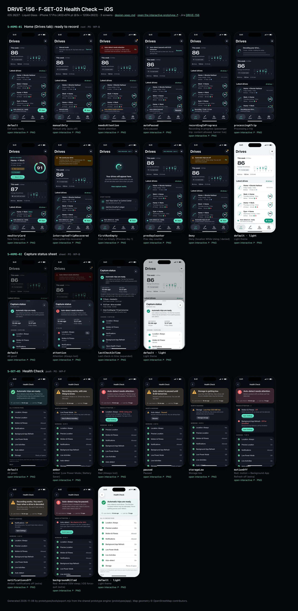
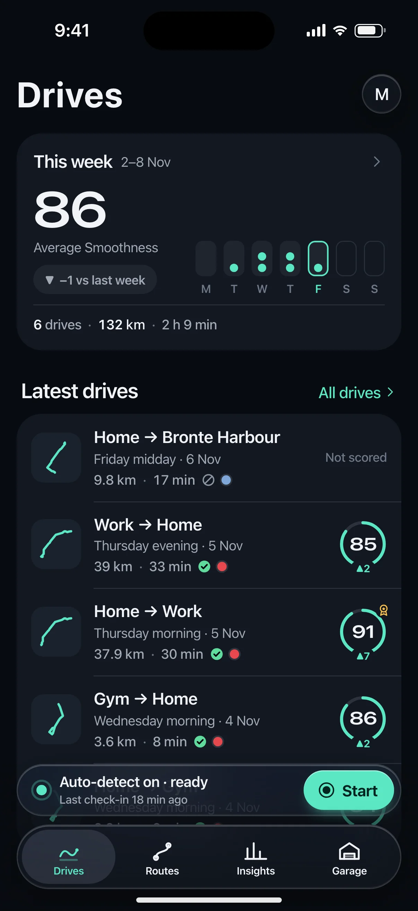
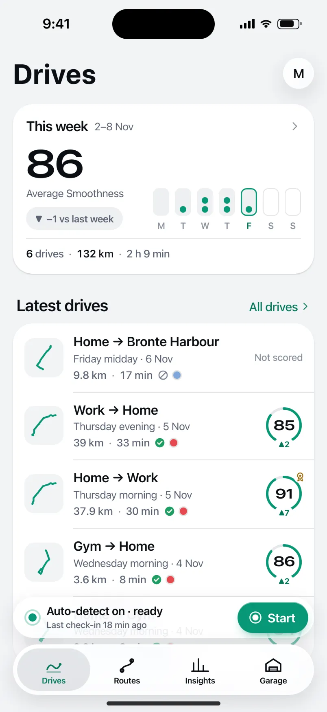
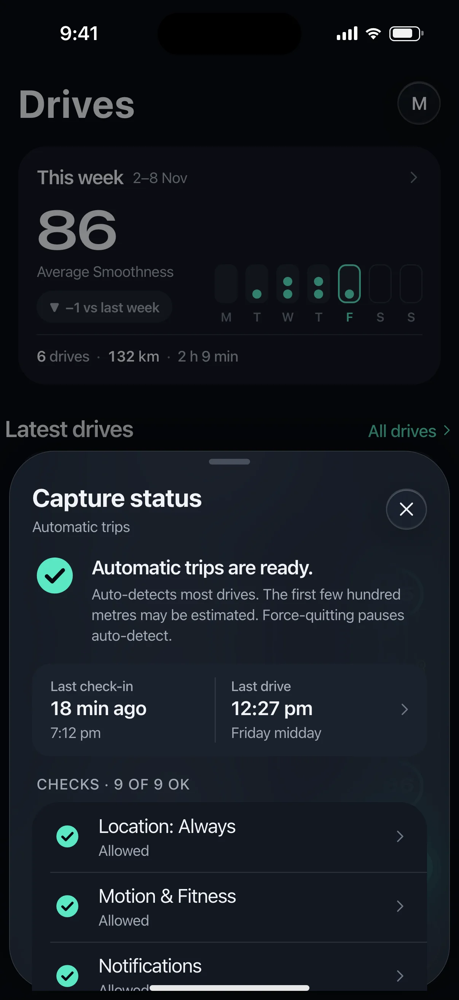
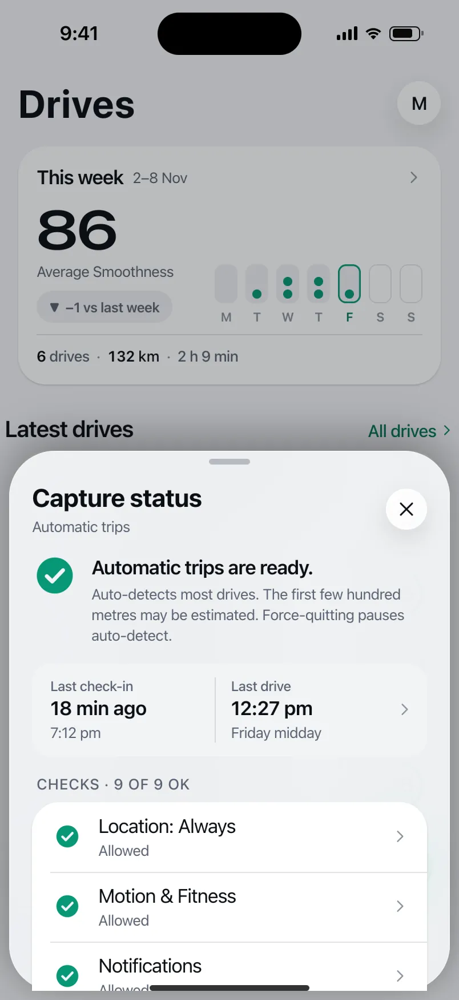
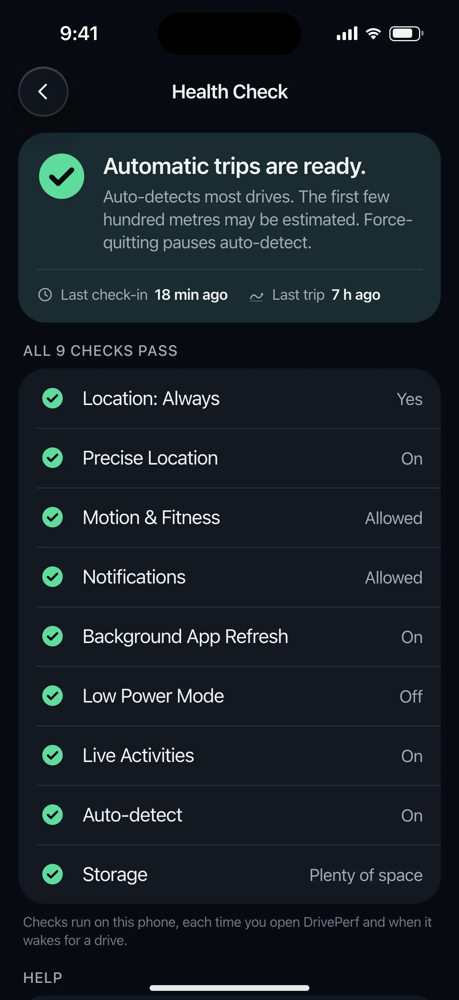
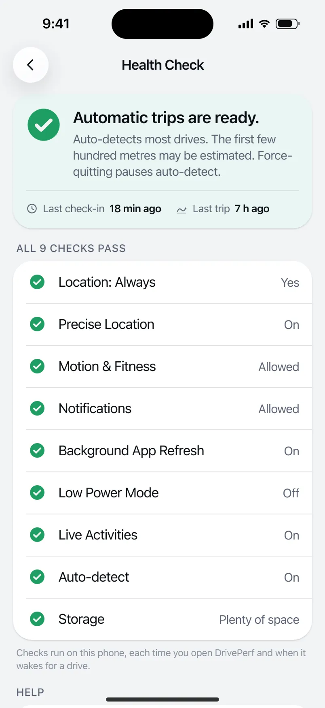

# DRIVE-156 · F-SET-02 Health Check — iOS design spec

> Generated by `prototypes/tools/export.mjs` on 2026-11-06 from the shared prototype engine. **Do not edit by hand:** change the screen's `spec` in `prototypes/app/screens/wp-*.js` (see `prototypes/app/AUTHORING.md`) and re-export.

- **Jira story:** [DRIVE-156](https://thekeval.atlassian.net/browse/DRIVE-156) · F-SET-02 · P0
- **Platform:** iOS 26/27 · Liquid Glass · iPhone 17 Pro (402×874 pt @3x = 1206×2622)
- **Interactive prototype:** [../../../../prototypes/ios/index.html#S-HOME-01](../../../../prototypes/ios/index.html#S-HOME-01) (catalog panel: every screen and state; deep links `#S-ID/state?trip=…&ent=…&theme=light&text=xl&rm=1`)
- **Contact sheet:** [mockup.html](mockup.html) · 
- **Design system (source of truth for values):** [brand](../../system/brand.md) · [components](../../system/components.md) · [motion](../../system/motion.md) · [accessibility](../../system/accessibility.md) · [screen map](../../system/screen-map.md) · [fixtures](../../system/fixtures.md) · tokens `prototypes/shared/tokens.css`

## Screens in this story

| Screen | Name | Presentation | Priority | States | Status |
|---|---|---|---|---|---|
| `S-HOME-01` | Home (Drives tab): ready to record | Root (Drives tab) | P0 | 11 | Prototyped |
| `S-HOME-02` | Capture status sheet | Sheet (medium) | P0 | 3 | Prototyped |
| `S-SET-05` | Health Check | Push (or sheet from S-HOME-02) | P0 | 8 | Prototyped |

## Tokens used on this platform

Values resolved from `prototypes/shared/tokens.css` inside the iOS device (`[data-platform="ios"]`). Use the token names in code; the hex values are for reference.

| Token | Dark | Light |
|---|---|---|
| `--app-bg` | `#080B10` | `#F2F3F6` |
| `--card-bg` | `#131822` | `#FFFFFF` |
| `--dp-bg-grouped` | `#080B10` | `#F2F3F6` |
| `--dp-surface` | `#131822` | `#FFFFFF` |
| `--dp-surface-2` | `#1B222D` | `#F2F3F6` |
| `--dp-surface-3` | `#262E3B` | `#E4E7EC` |
| `--dp-fill` | `#7880961F` | `#7880961F` |
| `--dp-fill-strong` | `#7880963D` | `#78809633` |
| `--dp-text` | `#F2F4F7` | `#0B0E13` |
| `--dp-text-2` | `#A3AAB6` | `#5A6271` |
| `--dp-text-3` | `#6E7787` | `#8A919D` |
| `--dp-separator` | `#96A0B429` | `#3C435024` |
| `--dp-accent` | `#5BE7C4` | `#079777` |
| `--dp-accent-text` | `#5BE7C4` | `#06775E` |
| `--dp-on-accent` | `#04241D` | `#FFFFFF` |
| `--dp-accent-container` | `#0A4439` | `#C6F8EA` |
| `--dp-record` | `#FFC24B` | `#9A6300` |
| `--dp-positive` | `#5BE7C4` | `#06775E` |
| `--dp-change-down` | `#A3AAB6` | `#5A6271` |
| `--dp-warning` | `#F5B648` | `#9A5F00` |
| `--dp-critical` | `#FF6B6B` | `#C62828` |
| `--dp-glass-fill` | `#1C222C6B` | `#FFFFFF8C` |
| `--dp-glass-fill-strong` | `#1C222CB8` | `#FFFFFFD1` |
| `--dp-glass-stroke` | `#FFFFFF24` | `#FFFFFF99` |
| `--dp-data-route` | `#5BE7C4` | `#079777` |
| `--dp-data-event-brake` | `#FF7A66` | `#A21F16` |
| `--dp-data-event-accel` | `#E58BD0` | `#A33A8C` |
| `--dp-data-event-corner` | `#EAD54E` | `#9A8A00` |
| `--dp-data-quality-good` | `#5FDB9C` | `#1E9E62` |
| `--dp-data-speed` | `#D6DCE4` | `#404A58` |
| `--dp-data-long-g` | `#5AB8F5` | `#0A6AB8` |
| `--dp-data-lat-g` | `#F5A142` | `#B25A00` |

| Type / layout token | Value |
|---|---|
| `--dp-font-screen-title` | `700 34px / 41px -apple-system, BlinkMacSystemFont, "SF Pro Display", system-ui, sans-serif` |
| `--dp-font-sheet-title` | `700 22px / 28px -apple-system, BlinkMacSystemFont, "SF Pro Display", system-ui, sans-serif` |
| `--dp-font-section-title` | `600 20px / 25px -apple-system, BlinkMacSystemFont, "SF Pro Display", system-ui, sans-serif` |
| `--dp-font-card-title` | `600 17px / 22px -apple-system, BlinkMacSystemFont, "SF Pro Text", system-ui, sans-serif` |
| `--dp-font-body` | `400 17px / 22px -apple-system, BlinkMacSystemFont, "SF Pro Text", system-ui, sans-serif` |
| `--dp-font-body-secondary` | `400 15px / 20px -apple-system, BlinkMacSystemFont, "SF Pro Text", system-ui, sans-serif` |
| `--dp-font-meta` | `400 13px / 18px -apple-system, BlinkMacSystemFont, "SF Pro Text", system-ui, sans-serif` |
| `--dp-font-caption` | `400 12px / 16px -apple-system, BlinkMacSystemFont, "SF Pro Text", system-ui, sans-serif` |
| `--dp-font-button` | `600 17px / 22px -apple-system, BlinkMacSystemFont, "SF Pro Text", system-ui, sans-serif` |
| `--dp-num-hero` | `600 72px / 72px -apple-system, BlinkMacSystemFont, "SF Pro Display", system-ui, sans-serif` |
| `--dp-num-xl` | `600 48px / 52px -apple-system, BlinkMacSystemFont, "SF Pro Display", system-ui, sans-serif` |
| `--dp-num-l` | `600 34px / 38px -apple-system, BlinkMacSystemFont, "SF Pro Display", system-ui, sans-serif` |
| `--dp-num-m` | `600 24px / 28px -apple-system, BlinkMacSystemFont, "SF Pro Display", system-ui, sans-serif` |
| `--dp-num-s` | `600 17px / 22px -apple-system, BlinkMacSystemFont, "SF Pro Display", system-ui, sans-serif` |
| `--dp-num-xs` | `600 13px / 16px -apple-system, BlinkMacSystemFont, "SF Pro Display", system-ui, sans-serif` |
| `--dp-screen-margin` | `16px` |
| `--dp-radius-card` | `24px` |
| `--dp-radius-card-hero` | `32px` |
| `--dp-radius-sheet` | `38px` |
| `--dp-radius-chip` | `999px` |
| `--dp-radius-button` | `999px` |
| `--dp-layout-list-row-min` | `52px` |
| `--dp-layout-touch-min` | `44px` |
| `--safe-top` | `62px` |
| `--safe-bottom` | `34px` |

Text sizes scale with `--dp-text-scale` (XL = 2.0×) and numerals with `--dp-num-scale` (XL = 1.3×). DP Numerals: SF Pro Expanded Semibold, tabular.

---

## S-HOME-01 · Home (Drives tab): ready to record

 

- **Presentation:** root · tab: drives — screen map: “Root (Drives tab)”
- **Entry points:** Tab · S-ONB-15 · S-DRV-04 done (new Story card)
- **Leads to:** S-STY-01 (new Story) · S-TRP-01 · S-HIS-01 ("All drives") · S-HOME-02 · S-HOME-03 · S-DRV-01 (Start) · S-SET-05 (needs attention) · S-SUB-01 (Prev badge)
- **PRD features:** F-CAP-01, F-CAP-02, F-CAP-06, F-CAP-14, F-SET-02, F-SUB-02 · **Priority:** P0 · **WP:** B
- **Interactive:** [S-HOME-01](../../../../prototypes/ios/index.html#S-HOME-01)

**Purpose.** The Drives tab root: glanceable capture status, the newest decoded drive (Story card), this week at a glance and the latest drives. It never shows live speed, score or record pace while recording (SAF-02).

### States

| State | PRD label | Fixture params | Screenshot |
|---|---|---|---|
| `default` | Def auto ready | — | [S-HOME-01.png](../../screens/ios/S-HOME-01.webp) · [open](../../../../prototypes/ios/index.html#S-HOME-01) |
| `manualOnly` | Manual only (auto off) | `capture=manual` | [S-HOME-01--manualOnly.png](../../screens/ios/S-HOME-01--manualOnly.webp) · [open](../../../../prototypes/ios/index.html#S-HOME-01/manualOnly) |
| `needsAttention` | Needs attention | `health=alwaysLost` | [S-HOME-01--needsAttention.png](../../screens/ios/S-HOME-01--needsAttention.webp) · [open](../../../../prototypes/ios/index.html#S-HOME-01/needsAttention) |
| `autoPaused` | Auto paused | `capture=paused` | [S-HOME-01--autoPaused.png](../../screens/ios/S-HOME-01--autoPaused.webp) · [open](../../../../prototypes/ios/index.html#S-HOME-01/autoPaused) |
| `recordingInProgress` | Recording in progress (passenger trip: content allowed, banner live) | — | [S-HOME-01--recordingInProgress.png](../../screens/ios/S-HOME-01--recordingInProgress.webp) · [open](../../../../prototypes/ios/index.html#S-HOME-01/recordingInProgress) |
| `processingATrip` | Processing a trip | — | [S-HOME-01--processingATrip.png](../../screens/ios/S-HOME-01--processingATrip.webp) · [open](../../../../prototypes/ios/index.html#S-HOME-01/processingATrip) |
| `newStoryCard` | New Story card | `trip=t20261105-0742` | [S-HOME-01--newStoryCard.png](../../screens/ios/S-HOME-01--newStoryCard.webp) · [open](../../../../prototypes/ios/index.html#S-HOME-01/newStoryCard) |
| `interruptedTripRecovered` | Interrupted trip recovered | `trip=t20261013-1742` | [S-HOME-01--interruptedTripRecovered.png](../../screens/ios/S-HOME-01--interruptedTripRecovered.webp) · [open](../../../../prototypes/ios/index.html#S-HOME-01/interruptedTripRecovered) |
| `firstRunEmpty` | First run Empty (Preview day 1) | `ent=preview` | [S-HOME-01--firstRunEmpty.png](../../screens/ios/S-HOME-01--firstRunEmpty.webp) · [open](../../../../prototypes/ios/index.html#S-HOME-01/firstRunEmpty) |
| `prevDayCounter` | Prev day counter | `ent=preview` | [S-HOME-01--prevDayCounter.png](../../screens/ios/S-HOME-01--prevDayCounter.webp) · [open](../../../../prototypes/ios/index.html#S-HOME-01/prevDayCounter) |
| `Deny` | Deny (location While Using / denied) | `capture=denied` | [S-HOME-01--Deny.png](../../screens/ios/S-HOME-01--Deny.webp) · [open](../../../../prototypes/ios/index.html#S-HOME-01/Deny) |
| default · light | Light theme | `theme=light` | [S-HOME-01--light.png](../../screens/ios/S-HOME-01--light.webp) |

Every state also renders in light/dark (`theme=light`), XL text (`text=xl`) and reduced motion (`rm=1`).

### Layout

- Large title “Drives” (iOS 34/41 bold large title · Android LargeFlexibleTopAppBar 32/40 with the date as subtitle); trailing: Preview/Ride-along badge (when active) + profile avatar (dot = needs attention).
- State banner slot (needs attention · paused · manual · denied · interrupted recovered · processing), full width, 16 margins.
- New Story card (state newStoryCard): hero card (radius 32 iOS / 28 Android) tinted 18% with the car colour; kicker “● Drive decoded”, route label, part of day · car, distance · duration, record + delta chips, “Watch Story” filled small button; Smoothness ring 116 with baseline and record notches.
- “This week” card: average Smoothness (DP Numerals 48), delta vs last week (neutral when lower, never red), 7-day dot strip (Mon–Sun, ≤ 3 dots per day, future days dimmed), drives · km · time footer. Tap → Insights tab.
- “Latest drives” section (title + “All drives” → S-HIS-01): 5 trip cards in one card, newest first (components.md §12).
- Capture status: iOS tabViewBottomAccessory glass capsule (50 pt, 8 above the floating tab bar) · Android M3E floating toolbar (64 dp, primaryContainer, 16 above the navigation bar, Drives tab only). Start → S-DRV-01 with the trip-start expansion.

### Components & tokens

| Component | Tokens / spec |
|---|---|
| `largeTitle` | --dp-font-screen-title (iOS 34/41 bold · Android 32/40) · components.md §2 |
| `previewBadge` | see components.md |
| `avatar` | see components.md |
| `banner` | radius 12 (--dp-radius-sm+) · info --dp-fill · attention --dp-warning-container · critical --dp-critical-container · components.md §22 |
| `card` | --dp-surface / --md-sys-color-surface-container · --dp-radius-card (24 iOS · 16 Android) · hero: --dp-radius-card-hero (32 · 28) · light iOS: --dp-elev-1 |
| `ring` | track --dp-fill-strong · arc --dp-gradient-ring (glide-400 → accent → glide-100) · baseline notch --dp-text-2 · record notch --dp-record · Android container Cookie9Sided --md-sys-color-primary-container 42% · components.md §3 |
| `deltaChip` | better: --dp-accent-text on --dp-accent 18% · lower: --dp-text-2 on --dp-fill (never red) · record: --dp-record on --dp-record 18% · components.md §4 |
| `chip` | --dp-radius-chip (iOS capsule · Android 8) · height 28 · --dp-font-caption |
| `button` | --dp-accent / --dp-on-accent (filled) · --dp-fill-strong · --md-sys-color-secondary-container (tonal) · --dp-radius-button · height iOS 50/44/34 · Android 56/40/32 · --dp-font-button · components.md §0 |
| `tripRow` | glyph 40 on --dp-surface-2 · --dp-font-card-title · --dp-font-meta · components.md §12 |
| `scoreBadge` | iOS mini ring 46 · Android Cookie9Sided 46 · --dp-num-s |
| `qualityBadge` | --dp-data-quality-{good\|usable\|limited\|unscorable} · components.md §10 |
| `section` | --dp-font-section-title · --dp-layout-section-gap 28 |
| `empty` | illustration 120 in --dp-accent · --dp-font-section-title · components.md §21 |
| `loader` | see components.md |
| `skeleton` | --dp-fill-strong, breathe 1.2 s (dp-skeleton) |
| `list` | iOS inset grouped radius --dp-radius-card, rows 52 pt, separators --dp-separator inset 16 · Android ListItem 56/72 dp in --md-sys-color-surface-container |
| `row` | --dp-font-body · --dp-font-meta (supporting) · --dp-layout-list-row-min |
| `tabBar` | iOS floating glass: inset 16, bottom 21, height 62, lens --dp-fill-strong · Android NavigationBar 64 dp + indicator 56×32 --md-sys-color-secondary-container · components.md §1 |
| `accessory` | iOS tabViewBottomAccessory glass 48 pt, 8 above tab bar · Android floating toolbar 64 dp --md-sys-color-primary-container, 16 above nav bar · Start: --dp-accent |

### Interactions & navigation

- Trip card → S-TRP-01 (zoom transition on iOS, container transform on Android).
- New Story card / “Watch Story” → S-STY-01 (D1 gate: held on S-DRV-05 while moving).
- “This week” card → Insights tab (S-STA-01). “All drives” → S-HIS-01.
- Accessory/toolbar body → S-HOME-02 capture status sheet; Start → S-DRV-01 (manual trip; gate locks the app to the in-drive screen); recording banner → S-DRV-01; needs attention → S-SET-05; denied → S-ONB-16.
- Avatar → S-ACC-01 (iOS sheet, Android full-screen). Preview badge → S-SUB-01.
- Banners: Fix → S-SET-05 / S-ONB-16 · Turn on → S-SET-03 · Resume → resumes auto-detect (toast) · View → S-TRP-01/interrupted.
- Scroll: large title collapses to an inline title; iOS tab bar minimises to a compact capsule with the accessory inline; Android toolbar slides away and returns on scroll up.

### Motion

- Blocks rise 8 px and fade in, 40 ms stagger, spring.default (RM: 220 ms cross-fade).
- Story card ring: ring reveal (motion.md §3.4) 1400 ms count-up locked to the arc; record notch turns solid gold as the arc passes 89 (doubleSuccess haptic); RM: full ring, static number.
- Start: press scale 0.96 (spring.fast) + confirm haptic, then the accessory/toolbar expands into the in-drive surface (spring.slow container transform, motion.md §3.1).
- Recording banner dot: continuous livePulse breathe 2400 ms (passenger trip / finalising only); RM: static dot.
- Tab switch: iOS cross-fade + lens slides (spring.default); Android fade-through.

### Accessibility

- Trip card label: “Home to Work, Thursday morning, 5 November. 37.9 kilometres, 30 minutes. Smoothness 91. Good data.” (one element, button).
- This-week card is one element: “This week: 6 drives, 132.1 kilometres, 2 h 9 min. Average Smoothness 86, 1 down on last week.”
- Accessory: “Auto-detect on · ready. Last check-in 18 min ago” + separate “Start drive” button (≥ 44 pt / 48 dp).
- XL text: trip cards stack (glyph above), stats wrap; the accessory keeps one line with ellipsis and the full text in its label.
- Colour never carries meaning alone: ▲/▼/● glyphs on deltas, shapes on quality glyphs, the attention state has a triangle glyph and text.

### Platform notes

- **iOS (this spec):** Floating Liquid Glass tab bar (inset 16, bottom 21, 62 tall) with lens selection; tabViewBottomAccessory carries capture status on every tab; glass avatar toolbar item opens Profile as a sheet; score badges are mini rings; large title collapses to the inline title with a scroll-edge fade.
- *Android (for reference):* NavigationBar (64 dp + gesture area) with 56×32 secondaryContainer indicator; capture status is an M3E floating toolbar on the Drives tab only (other tabs show a status chip when it needs attention); avatar in a Cookie12Sided shape opens Profile full-screen; score badges use Cookie9Sided; LargeFlexibleTopAppBar with date subtitle.

### Analytics

- `home_viewed {state}`
- `story_card_tapped {trip_age}`
- `manual_start_tapped {source: accessory|toolbar}`
- `capture_status_opened`
- `history_opened {source: home}`

### Copy

| Key | Text |
|---|---|
| Accessory ready | Auto-detect on · ready / Last check-in {n} min ago |
| Accessory manual | Manual mode / Auto-detect is off |
| Accessory paused | Auto-detect paused / Until 8:00 tomorrow · Resume |
| Accessory attention | Auto-detect needs attention / Location is set to While Using |
| Accessory recording | Recording · {min} min · {km} km / Passenger trip · tap to open |
| Empty | Your drives will appear here. Just drive. DrivePerf notices when you set off and decodes each drive when you park. |
| Interrupted | We saved your drive. {part of day} · {label}. {iOS ended DrivePerf in the background \| Android stopped DrivePerf in the background}. Everything before then is saved. |
| Story card kicker | Drive decoded |

### Free / Pro

Free: identical layout (summaries are free forever); trips older than 30 days show a small lock after the score for “Replay & Analysis in Pro”. Preview/Ride-along: “PRO PREVIEW · DAY n” / “RIDE-ALONG · DAY n” badge → S-SUB-01. No paywall is ever shown here during or right after a trip (D12, F-SUB-08).

### Data & fixtures

This-week numbers are derived from DP_DATA.trips for the current week (they equal recaps[0]: 6 drives · 132.1 km · 2 h 9 min · 86, −1 vs 87). In newStoryCard the week is computed as of the Story trip’s end (Thu 5 Nov 08:13).

### Assets

[icon-drives.svg](assets/icon-drives.svg) · [icon-routes.svg](assets/icon-routes.svg) · [icon-insights.svg](assets/icon-insights.svg) · [icon-garage.svg](assets/icon-garage.svg) · [icon-record.svg](assets/icon-record.svg) · [icon-story.svg](assets/icon-story.svg) · [icon-chevronRight.svg](assets/icon-chevronRight.svg) · [icon-rosette.svg](assets/icon-rosette.svg) · [icon-lock.svg](assets/icon-lock.svg) · [icon-gps.svg](assets/icon-gps.svg) · [icon-shield.svg](assets/icon-shield.svg) · [icon-pause.svg](assets/icon-pause.svg) · [logo-a-loop.svg](assets/logo-a-loop.svg)

UI glyphs may be swapped for SF Symbols / Material Symbols Rounded equivalents; event-pin, quality and provenance glyphs must not be (components.md global rules).

### Checklist (accessibility.md §9)

- [ ] Light and dark both render, and contrast passes.
- [ ] The XL text state reflows with no truncation.
- [ ] The RM state is defined.
- [ ] Every control has a label; every chart and map has a summary sentence.
- [ ] Every target ≥ 44 pt / 48 dp (≥ 64 in-drive).
- [ ] No meaning by colour alone.
- [ ] Speed is neutral wherever it appears and absent from social or live surfaces.
- [ ] No streak, leaderboard, speed or “beat your time” language.
- [ ] Behaviour is defined while a trip is active (D1 gate).
- [ ] Haptics come from motion.md §6 only.

---

## S-HOME-02 · Capture status sheet

 

- **Presentation:** sheet · tab: drives · detent: auto — screen map: “Sheet (medium)”
- **Entry points:** S-HOME-01 status, iOS accessory, Android toolbar
- **Leads to:** S-SET-05 · S-HOME-03
- **PRD features:** F-CAP-02, F-SET-02 · **Priority:** P0 · **WP:** B
- **Interactive:** [S-HOME-02](../../../../prototypes/ios/index.html#S-HOME-02)

**Purpose.** Answers “will my next drive be recorded?” in one glance from the capture accessory / floating toolbar: the Health Check summary, last check-in and last drive times, the few checks that matter, and a way to pause (F-CAP-02, F-SET-02). Fixes live in S-SET-05.

### States

| State | PRD label | Fixture params | Screenshot |
|---|---|---|---|
| `default` | All good | — | [S-HOME-02.png](../../screens/ios/S-HOME-02.webp) · [open](../../../../prototypes/ios/index.html#S-HOME-02) |
| `attention` | Attention (Always lost) | `health=alwaysLost` | [S-HOME-02--attention.png](../../screens/ios/S-HOME-02--attention.webp) · [open](../../../../prototypes/ios/index.html#S-HOME-02/attention) |
| `lastCheckInTime` | Last check-in time (expanded) | — | [S-HOME-02--lastCheckInTime.png](../../screens/ios/S-HOME-02--lastCheckInTime.webp) · [open](../../../../prototypes/ios/index.html#S-HOME-02/lastCheckInTime) |
| default · light | Light theme | `theme=light` | [S-HOME-02--light.png](../../screens/ios/S-HOME-02--light.webp) |

Every state also renders in light/dark (`theme=light`), XL text (`text=xl`) and reduced motion (`rm=1`).

### Layout

- Sheet at the medium detent (iOS glass sheet, radius 38 at partial detents · Android ModalBottomSheet, top radius 28, drag handle 32×4). The expanded check-in state moves to the large detent.
- Header “Capture status” + subtitle (“Automatic trips” / “Automatic trips are paused”); iOS glass close button, Android none (drag handle + scrim).
- Summary block: status glyph 36 (green check disc · amber triangle · red octagon) + summary in card-title weight + one-line promise or the red item’s detail (DP_DATA.health).
- Check-in card (tile radius 14 iOS / 12 Android, --tile-bg-in): two cells split by a hairline — “Last check-in 18 min ago · 7:12 pm” and “Last drive 12:27 pm · Friday midday” — trailing chevron. Tap expands it in place (state lastCheckInTime): explanation + a 3-step timeline (checked in · drive recorded · watchdog only if nothing by 7:12 pm tomorrow).
- Checks list (caption header “Checks · 9 of 9 OK” or “1 to fix”): red first, then amber, then the four core green checks (location, motion, notifications, Background App Refresh on iOS / Battery: Unrestricted on Android). Bad rows end in a tonal “Fix” button; good rows in a chevron. Last row “Open Health Check · All 9 checks”.
- Pause row (pause icon) → S-HOME-03, footer “Checks run on this phone. Nothing is sent anywhere.”
- Attention only: full-width filled “Fix it in Health Check” (52 / 56) at the bottom.

### Components & tokens

| Component | Tokens / spec |
|---|---|
| `sheet` | iOS glass --dp-glass-fill-strong + --dp-glass-prominent-blur, radius --dp-radius-sheet 38 · Android ModalBottomSheet --md-sys-color-surface-container-low, top radius 28, drag handle 32×4 · motion spring.sheet |
| `sheetHeader` | see components.md |
| `list` | iOS inset grouped radius --dp-radius-card, rows 52 pt, separators --dp-separator inset 16 · Android ListItem 56/72 dp in --md-sys-color-surface-container |
| `row` | --dp-font-body · --dp-font-meta (supporting) · --dp-layout-list-row-min |
| `button` | --dp-accent / --dp-on-accent (filled) · --dp-fill-strong · --md-sys-color-secondary-container (tonal) · --dp-radius-button · height iOS 50/44/34 · Android 56/40/32 · --dp-font-button · components.md §0 |
| `section` | --dp-font-section-title · --dp-layout-section-gap 28 |
| `healthGlyph (local hGlyph)` | see components.md |

### Interactions & navigation

- Check-in card → toggles the expanded state (lastCheckInTime ↔ default), selection haptic.
- Any check row / “Open Health Check” / “Fix” / “Fix it in Health Check” → S-SET-05 (push, with the same health preset). Fix on a red Location row may deep-link straight to the OS Settings page (S-SET-05 handles it).
- “Pause auto-detect” → S-HOME-03 (sheet over this sheet on iOS; replaces it on Android).
- Dismiss: scrim tap, drag down, iOS close button. While a driver trip is active the sheet is unreachable (D1 gate → S-DRV-01); the accessory then opens S-DRV-01 instead.

### Motion

- Sheet: spring.sheet up from the accessory/toolbar; detent change medium → large on expand uses the system detent spring.
- Status glyph pops in (scale .86 → 1, spring.default) 120 ms after the sheet lands; sections rise 8 px, 30 ms stagger. RM: 220 ms cross-fade, no pop.
- Haptic: warning when the sheet opens with a red item (motion.md §6); none otherwise.

### Accessibility

- Summary is a status element: “Automatic trips are ready. Auto-detects most drives…” / “Auto-detect needs attention. Location access changed to While Using…”. The glyph has its own label (OK / Needs fixing / Worth knowing) so colour never carries the state.
- Check-in card is one button: “Last check-in 18 min ago, at 7:12 pm. Last drive recorded at 12:27 pm, Friday midday. Show details.”
- Rows read “Location: Always, Always” / “Location: Always, While Using only, Fix, button”. Focus order: close, summary, check-in, rows, pause, CTA.
- XL: the sheet opens at the large detent; check-in cells stack vertically; Fix buttons wrap under the text.

### Platform notes

- **iOS (this spec):** Glass sheet (.presentationDetents([.medium, .large])), inset-grouped List rows 52 pt, SF-style glyphs; items from DP_DATA.health.ios (Background App Refresh, Live Activities, Low Power Mode).
- *Android (for reference):* ModalBottomSheet (surfaceContainerLow), M3E segmented ListItems 56 dp with TextButton/FilledTonalButton “Fix”; items from DP_DATA.health.android (Allow all the time, Battery: Unrestricted, Samsung sleeping apps, Battery Saver).

### Analytics

- `capture_status_opened {source: accessory|toolbar|home, reds, ambers}`
- `capture_status_checkin_expanded`
- `health_fix_tapped {item, source: capture_status}`
- `pause_sheet_opened {source: capture_status}`

### Copy

| Key | Text |
|---|---|
| All good | Automatic trips are ready. · Auto-detects most drives. The first few hundred metres may be estimated. Force-quitting pauses auto-detect. |
| Attention | Auto-detect needs attention. · Location access changed to "While Using". Automatic trips are paused. Two taps to fix it. |
| Check-in | Last check-in {18 min ago} · {7:12 pm} \| Last drive {12:27 pm} · {Friday midday} |
| Check-in detail | DrivePerf checks in each time your phone wakes it: a drive, a reboot, opening the app. Auto-detect re-arms every time. · Only if nothing by {7:12 pm} tomorrow — We’ll remind you to open DrivePerf once |
| Footer | Checks run on this phone. Nothing is sent anywhere. |
| CTA | Fix it in Health Check |

### Free / Pro

Identical on every plan (capture is Free forever). No upsell, badge or paywall on this sheet.

### Data & fixtures

DP_DATA.health.{ios|android}.items with presets allGood (default, lastCheckInTime) and alwaysLost (attention; any health=<preset> param is honoured). Last check-in = presets.allGood.lastCheckIn (19:12 → “18 min ago” at 19:30); last drive = newest trip end (t20261106-1210, 12:27 pm, Friday midday). The watchdog time (check-in + 24 h) is derived.

### Assets

[icon-health.svg](assets/icon-health.svg) · [icon-pause.svg](assets/icon-pause.svg) · [icon-chevronRight.svg](assets/icon-chevronRight.svg) · [icon-chevronDown.svg](assets/icon-chevronDown.svg) · [icon-close.svg](assets/icon-close.svg)

UI glyphs may be swapped for SF Symbols / Material Symbols Rounded equivalents; event-pin, quality and provenance glyphs must not be (components.md global rules).

### Checklist (accessibility.md §9)

- [ ] Light and dark both render, and contrast passes.
- [ ] The XL text state reflows with no truncation.
- [ ] The RM state is defined.
- [ ] Every control has a label; every chart and map has a summary sentence.
- [ ] Every target ≥ 44 pt / 48 dp (≥ 64 in-drive).
- [ ] No meaning by colour alone.
- [ ] Speed is neutral wherever it appears and absent from social or live surfaces.
- [ ] No streak, leaderboard, speed or “beat your time” language.
- [ ] Behaviour is defined while a trip is active (D1 gate).
- [ ] Haptics come from motion.md §6 only.

---

## S-SET-05 · Health Check

 

- **Presentation:** push · tab: profile — screen map: “Push (or sheet from S-HOME-02)”
- **Entry points:** S-SET-01 · S-HOME-01 "needs attention" · S-HOME-02 · S-LIVE-10 · S-NTF-01 capture problem
- **Leads to:** System Settings deep links · S-SET-06 · S-ONB-11 · S-NTF-02 · S-SET-07
- **PRD features:** F-SET-02, F-CAP-14, F-CAP-16, F-DQ-07, F-NTF-02 · **Priority:** P0 · **WP:** F
- **Interactive:** [S-SET-05](../../../../prototypes/ios/index.html#S-SET-05)

**Purpose.** One screen that says whether automatic capture will work and how to fix it, with green/amber/red items and a fix action each (F-SET-02, F-NTF-02, F-CAP-14, F-CAP-16, F-DQ-07).

### States

| State | PRD label | Fixture params | Screenshot |
|---|---|---|---|
| `default` | All green | — | [S-SET-05.png](../../screens/ios/S-SET-05.webp) · [open](../../../../prototypes/ios/index.html#S-SET-05) |
| `amber` | Amber (Low Power Mode / Battery Saver) | `health=lowPower` | [S-SET-05--amber.png](../../screens/ios/S-SET-05--amber.webp) · [open](../../../../prototypes/ios/index.html#S-SET-05/amber) |
| `red` | Red (Always lost) | `health=alwaysLost` | [S-SET-05--red.png](../../screens/ios/S-SET-05--red.webp) · [open](../../../../prototypes/ios/index.html#S-SET-05/red) |
| `paused` | Paused | `health=paused` | [S-SET-05--paused.png](../../screens/ios/S-SET-05--paused.webp) · [open](../../../../prototypes/ios/index.html#S-SET-05/paused) |
| `storageLow` | Storage low | `health=storageLow` | [S-SET-05--storageLow.png](../../screens/ios/S-SET-05--storageLow.webp) · [open](../../../../prototypes/ios/index.html#S-SET-05/storageLow) |
| `motionOff` | Red: motion + Background App Refresh off (extra) | `health=motionOff` | [S-SET-05--motionOff.png](../../screens/ios/S-SET-05--motionOff.webp) · [open](../../../../prototypes/ios/index.html#S-SET-05/motionOff) |
| `notificationsOff` | Amber: notifications off (extra) | `health=notificationsOff` | [S-SET-05--notificationsOff.png](../../screens/ios/S-SET-05--notificationsOff.webp) · [open](../../../../prototypes/ios/index.html#S-SET-05/notificationsOff) |
| `backgroundKilled` | Red: Android OEM sleep / iOS force-quit (extra) | `health=backgroundKilled` | [S-SET-05--backgroundKilled.png](../../screens/ios/S-SET-05--backgroundKilled.webp) · [open](../../../../prototypes/ios/index.html#S-SET-05/backgroundKilled) |
| default · light | Light theme | `theme=light` | [S-SET-05--light.png](../../screens/ios/S-SET-05--light.webp) |

Every state also renders in light/dark (`theme=light`), XL text (`text=xl`) and reduced motion (`rm=1`).

### Layout

- Summary header card: large status glyph (44, shape = state) + summary (“Automatic trips are ready.” / “Recording works, with one thing to know.” / “Auto-detect needs attention.” / “Auto-detect is paused until 8:00 tomorrow.” / “Storage is getting low.”) + one line (the honest capture promise when green, else the worst item’s detail) + meta row “Last check-in 18 min ago · Last trip 7 h ago”. Tint: critical container (red), warning container (amber), surface (green).
- “Needs attention · n” (red) then “Worth knowing” (amber): rows with glyph · label · state (“Location: Always · While Using only”) · detail line · fix button (filled for red, tonal for amber).
- “Working · n of 9” / “All 9 checks pass”: green rows with glyph · label · state value. Footer: where checks run.
- Help: Report a missed drive → S-NTF-02 · Reliability guide → S-SET-06 · Test my setup → S-SET-06/testMySetupPassFail.
- iOS items: Location: Always · Precise Location · Motion & Fitness · Notifications · Background App Refresh · Low Power Mode · Live Activities · Auto-detect · Storage. Android: Location: Allow all the time · Precise location · Physical activity · Notifications · Battery: Unrestricted · Samsung: Never sleeping apps · Battery Saver · Auto-detect · Storage (DP_DATA.health.{ios,android}.items).

### Components & tokens

| Component | Tokens / spec |
|---|---|
| `navBar` | --dp-font-card-title · --dp-font-meta · glass: --dp-glass-fill + --dp-glass-blur · components.md §2 |
| `list` | iOS inset grouped radius --dp-radius-card, rows 52 pt, separators --dp-separator inset 16 · Android ListItem 56/72 dp in --md-sys-color-surface-container |
| `row` | --dp-font-body · --dp-font-meta (supporting) · --dp-layout-list-row-min |
| `button` | --dp-accent / --dp-on-accent (filled) · --dp-fill-strong · --md-sys-color-secondary-container (tonal) · --dp-radius-button · height iOS 50/44/34 · Android 56/40/32 · --dp-font-button · components.md §0 |
| `section` | --dp-font-section-title · --dp-layout-section-gap 28 |
| `sysSettings` | see components.md |

### Interactions & navigation

- Location / Motion / Notifications / Background App Refresh / Live Activities / Battery → system Settings deep link (prototype: OS Settings mock with the target row highlighted; tap to return, the check re-runs and turns green within 1 s, F-SET-02.4).
- Precise location → S-ONB-11 · Low Power Mode / Battery Saver “How it affects recording” → S-SET-06 · OEM sleep “Show me how” → S-SET-06 (Samsung) · Storage → S-SET-07/lowStorage · Auto-detect paused → Resume (toast) · iOS no check-in (force-quit) → “Switch back on” re-arms (toast).
- Entry points: S-SET-01 · Home “needs attention” banner/chip · S-HOME-02 · S-LIVE-10 · the capture-problem notification (S-NTF-01). The Settings deep link from a red notification is the only thing allowed after a driver trip ends while still in the car (it opens after the trip, screen-map §2.2).

### Motion

- Header glyph pops in (scale 0.6 → 1, −20° → 0°, spring.bouncy); groups rise 8 px, 30 ms stagger. Haptic `warning` once when a red item is found. RM: no pop or rise (haptic kept).

### Accessibility

- Header is one element: “Auto-detect needs attention. Location access changed to While Using. Automatic trips are paused. Two taps to fix it. Last check-in 18 min ago. Last trip 7 h ago.”
- Each row: glyph label (“Needs attention” / “Worth knowing” / “OK”) + label + state + detail; the fix button reads “Open Settings: Location: Always”.
- State is carried by shape and words (octagon ! / triangle / check disc), never colour alone.
- XL text: rows grow to two or more lines and trailing values move under the title; nothing truncates. Every row is ≥ 52 pt (iOS) / 56 dp (Android).

### Platform notes

- **iOS (this spec):** Checks: CLAuthorizationStatus .authorizedAlways, accuracyAuthorization, CMMotionActivityManager authorization, UNAuthorizationStatus, backgroundRefreshStatus, isLowPowerModeEnabled, ActivityAuthorizationInfo().areActivitiesEnabled, watchdog check-in, free disk. Fix = UIApplication.openSettingsURLString.
- *Android (for reference):* Checks: ACCESS_BACKGROUND_LOCATION, ACCESS_FINE_LOCATION, ACTIVITY_RECOGNITION, POST_NOTIFICATIONS / channel state, isIgnoringBatteryOptimizations, OEM sleeping-apps heuristic (Samsung), isPowerSaveMode, transition registration, free disk. Fix = ACTION_APPLICATION_DETAILS_SETTINGS / ACTION_REQUEST_IGNORE_BATTERY_OPTIMIZATIONS.

### Analytics

- `health_check_opened {source, reds, ambers}`
- `health_fix_tapped {item}`
- `capture_problem_fixed {problem, hours_bucket}`

### Copy

| Key | Text |
|---|---|
| Green | Automatic trips are ready. · Auto-detects most drives. The first few hundred metres may be estimated. Force-quitting pauses auto-detect. |
| Amber | Recording works, with one thing to know. · Low Power Mode is on. Drives may start a little later. |
| Red | Auto-detect needs attention. · Location access changed to “While Using”. Automatic trips are paused. Two taps to fix it. |
| Paused | Auto-detect is paused until 8:00 tomorrow. · Paused until 8:00 tomorrow. You can still tap Start. · Resume |
| Storage low | Storage is getting low. · Less than 500 MB free. New drives still record; detailed data may be trimmed. · Manage storage |
| iOS force-quit | Auto-detect may be paused. · DrivePerf hasn’t checked in for 24 h, usually after a force-quit. Open it once to switch auto-detect back on. |
| Android OEM | Samsung put DrivePerf in “Sleeping apps”. Drives won’t start on their own. · Show me how |
| Fixes | Open Settings · Fix · How it affects recording · Open battery settings · Show me how · Resume · Switch back on · Manage storage |

### Free / Pro

Free. No upsell on this screen.

### Data & fixtures

DP_DATA.health.{ios,android}.items + presets: allGood (default), lowPower (amber), alwaysLost (red), paused, storageLow, motionOff, notificationsOff, oemKiller (Android). iOS “backgroundKilled” has no preset: it is built from allGood + the watchdog copy (n_watchdog, F-CAP-14) with autoDetect red and last check-in 5 Nov 18:20. Detail lines for amber items without fixture detail come from components.md §17 copy. Last check-in / last trip are relative to today 19:30.

### Assets

[icon-clock.svg](assets/icon-clock.svg) · [icon-drives.svg](assets/icon-drives.svg) · [icon-battery.svg](assets/icon-battery.svg) · [icon-check.svg](assets/icon-check.svg) · [icon-chevronRight.svg](assets/icon-chevronRight.svg)

UI glyphs may be swapped for SF Symbols / Material Symbols Rounded equivalents; event-pin, quality and provenance glyphs must not be (components.md global rules).

### Checklist (accessibility.md §9)

- [ ] Light and dark both render, and contrast passes.
- [ ] The XL text state reflows with no truncation.
- [ ] The RM state is defined.
- [ ] Every control has a label; every chart and map has a summary sentence.
- [ ] Every target ≥ 44 pt / 48 dp (≥ 64 in-drive).
- [ ] No meaning by colour alone.
- [ ] Speed is neutral wherever it appears and absent from social or live surfaces.
- [ ] No streak, leaderboard, speed or “beat your time” language.
- [ ] Behaviour is defined while a trip is active (D1 gate).
- [ ] Haptics come from motion.md §6 only.

---

Map geometry in the prototype: © OpenStreetMap contributors (ODbL). Speed and G are simulated fixtures (fixtures.md).
