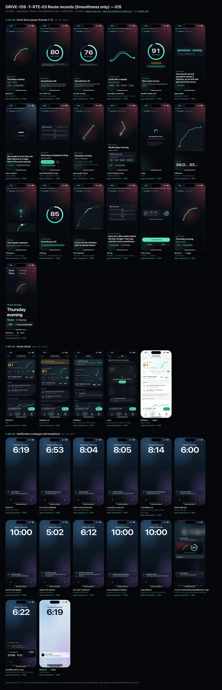
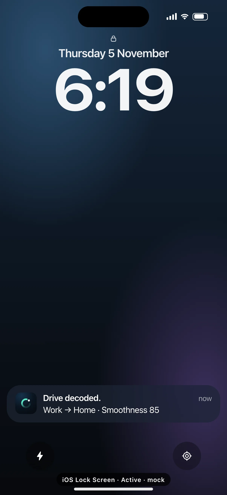
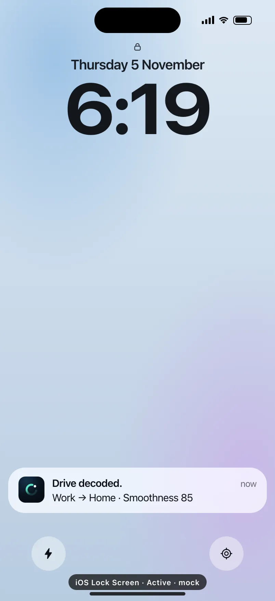

# DRIVE-159 · F-RTE-03 Route records (Smoothness only) — iOS design spec

> Generated by `prototypes/tools/export.mjs` on 2026-11-07 from the shared prototype engine. **Do not edit by hand:** change the screen's `spec` in `prototypes/app/screens/wp-*.js` (see `prototypes/app/AUTHORING.md`) and re-export.

- **Jira story:** [DRIVE-159](https://thekeval.atlassian.net/browse/DRIVE-159) · F-RTE-03 · P0
- **Platform:** iOS 26/27 · Liquid Glass · iPhone 17 Pro (402×874 pt @3x = 1206×2622)
- **Interactive prototype:** [../../../../prototypes/ios/index.html#S-STY-01](../../../../prototypes/ios/index.html#S-STY-01) (catalog panel: every screen and state; deep links `#S-ID/state?trip=…&ent=…&theme=light&text=xl&rm=1`)
- **Contact sheet:** [mockup.html](mockup.html) · 
- **Design system (source of truth for values):** [brand](../../system/brand.md) · [components](../../system/components.md) · [motion](../../system/motion.md) · [accessibility](../../system/accessibility.md) · [screen map](../../system/screen-map.md) · [fixtures](../../system/fixtures.md) · tokens `prototypes/shared/tokens.css`

## Screens in this story

| Screen | Name | Presentation | Priority | States | Status |
|---|---|---|---|---|---|
| `S-STY-01` | Drive Story player (frames 1–7) | Full (player) | P0 | 17 | Prototyped |
| `S-RTE-02` | Route detail | Push | P0 | 4 | Prototyped |
| `S-NTF-01` | Notification catalogue (all templates) | Live (notification catalogue) | P0 | 13 | Prototyped |

## Tokens used on this platform

Values resolved from `prototypes/shared/tokens.css` inside the iOS device (`[data-platform="ios"]`). Use the token names in code; the hex values are for reference.

| Token | Dark | Light |
|---|---|---|
| `--app-bg` | `#080B10` | `#F2F3F6` |
| `--card-bg` | `#131822` | `#FFFFFF` |
| `--dp-bg-grouped` | `#080B10` | `#F2F3F6` |
| `--dp-surface` | `#131822` | `#FFFFFF` |
| `--dp-surface-2` | `#1B222D` | `#F2F3F6` |
| `--dp-surface-3` | `#262E3B` | `#E4E7EC` |
| `--dp-fill` | `#7880961F` | `#7880961F` |
| `--dp-fill-strong` | `#7880963D` | `#78809633` |
| `--dp-text` | `#F2F4F7` | `#0B0E13` |
| `--dp-text-2` | `#A3AAB6` | `#5A6271` |
| `--dp-text-3` | `#6E7787` | `#8A919D` |
| `--dp-separator` | `#96A0B429` | `#3C435024` |
| `--dp-accent` | `#5BE7C4` | `#079777` |
| `--dp-accent-text` | `#5BE7C4` | `#06775E` |
| `--dp-on-accent` | `#04241D` | `#FFFFFF` |
| `--dp-accent-container` | `#0A4439` | `#C6F8EA` |
| `--dp-record` | `#FFC24B` | `#9A6300` |
| `--dp-positive` | `#5BE7C4` | `#06775E` |
| `--dp-change-down` | `#A3AAB6` | `#5A6271` |
| `--dp-warning` | `#F5B648` | `#9A5F00` |
| `--dp-critical` | `#FF6B6B` | `#C62828` |
| `--dp-glass-fill` | `#1C222C6B` | `#FFFFFF8C` |
| `--dp-glass-fill-strong` | `#1C222CB8` | `#FFFFFFD1` |
| `--dp-glass-stroke` | `#FFFFFF24` | `#FFFFFF99` |
| `--dp-data-route` | `#5BE7C4` | `#079777` |
| `--dp-data-event-brake` | `#FF7A66` | `#A21F16` |
| `--dp-data-event-accel` | `#E58BD0` | `#A33A8C` |
| `--dp-data-event-corner` | `#EAD54E` | `#9A8A00` |
| `--dp-data-quality-good` | `#5FDB9C` | `#1E9E62` |
| `--dp-data-speed` | `#D6DCE4` | `#404A58` |
| `--dp-data-long-g` | `#5AB8F5` | `#0A6AB8` |
| `--dp-data-lat-g` | `#F5A142` | `#B25A00` |

| Type / layout token | Value |
|---|---|
| `--dp-font-screen-title` | `700 34px / 41px -apple-system, BlinkMacSystemFont, "SF Pro Display", system-ui, sans-serif` |
| `--dp-font-sheet-title` | `700 22px / 28px -apple-system, BlinkMacSystemFont, "SF Pro Display", system-ui, sans-serif` |
| `--dp-font-section-title` | `600 20px / 25px -apple-system, BlinkMacSystemFont, "SF Pro Display", system-ui, sans-serif` |
| `--dp-font-card-title` | `600 17px / 22px -apple-system, BlinkMacSystemFont, "SF Pro Text", system-ui, sans-serif` |
| `--dp-font-body` | `400 17px / 22px -apple-system, BlinkMacSystemFont, "SF Pro Text", system-ui, sans-serif` |
| `--dp-font-body-secondary` | `400 15px / 20px -apple-system, BlinkMacSystemFont, "SF Pro Text", system-ui, sans-serif` |
| `--dp-font-meta` | `400 13px / 18px -apple-system, BlinkMacSystemFont, "SF Pro Text", system-ui, sans-serif` |
| `--dp-font-caption` | `400 12px / 16px -apple-system, BlinkMacSystemFont, "SF Pro Text", system-ui, sans-serif` |
| `--dp-font-button` | `600 17px / 22px -apple-system, BlinkMacSystemFont, "SF Pro Text", system-ui, sans-serif` |
| `--dp-num-hero` | `600 72px / 72px -apple-system, BlinkMacSystemFont, "SF Pro Display", system-ui, sans-serif` |
| `--dp-num-xl` | `600 48px / 52px -apple-system, BlinkMacSystemFont, "SF Pro Display", system-ui, sans-serif` |
| `--dp-num-l` | `600 34px / 38px -apple-system, BlinkMacSystemFont, "SF Pro Display", system-ui, sans-serif` |
| `--dp-num-m` | `600 24px / 28px -apple-system, BlinkMacSystemFont, "SF Pro Display", system-ui, sans-serif` |
| `--dp-num-s` | `600 17px / 22px -apple-system, BlinkMacSystemFont, "SF Pro Display", system-ui, sans-serif` |
| `--dp-num-xs` | `600 13px / 16px -apple-system, BlinkMacSystemFont, "SF Pro Display", system-ui, sans-serif` |
| `--dp-screen-margin` | `16px` |
| `--dp-radius-card` | `24px` |
| `--dp-radius-card-hero` | `32px` |
| `--dp-radius-sheet` | `38px` |
| `--dp-radius-chip` | `999px` |
| `--dp-radius-button` | `999px` |
| `--dp-layout-list-row-min` | `52px` |
| `--dp-layout-touch-min` | `44px` |
| `--safe-top` | `62px` |
| `--safe-bottom` | `34px` |

Text sizes scale with `--dp-text-scale` (XL = 2.0×) and numerals with `--dp-num-scale` (XL = 1.3×). DP Numerals: SF Pro Expanded Semibold, tabular.

---

## S-STY-01 · Drive Story player (frames 1–7)

- **Presentation:** full · tab: drives — screen map: “Full (player)”
- **Entry points:** S-NTF-01 "Drive decoded" · S-HOME-01 card · S-DRV-04 · S-TRP-01 "Story" · S-LIVE-04/08
- **Leads to:** f7: S-RPL-01 (Explore) · S-SHR-01 (Share) · Done → caller · chips: S-RTE-03, S-SCO-03, S-TRP-02 (passenger/car), S-DQ-01
- **PRD features:** F-STY-01, F-STY-03, F-STY-04, F-STY-06, F-SCO-01, F-SCO-02, F-SCO-05, F-SCO-06, F-RTE-01, F-RTE-03, F-HIS-02, F-GAR-02, F-CAP-04, F-DQ-02, F-DQ-04, F-SHR-01, F-DQ-01 · **Priority:** P0 · **WP:** C
- **Interactive:** [S-STY-01](../../../../prototypes/ios/index.html#S-STY-01)

**Purpose.** The “wow” after every drive (F-STY-01): a ~15 s full-screen Story that leads with what went well, scores the drive against the user’s own baseline, then gives exactly one tip. No speed or max speed appears in any frame (F-STY-01.3).

### States

| State | PRD label | Fixture params | Screenshot |
|---|---|---|---|
| `default` | Def (frame 1) | `trip=t20261105-1745` | — · [open](../../../../prototypes/ios/index.html#S-STY-01) |
| `firstDrive` | First drive (baseline) | `trip=t20260928-1842` | — · [open](../../../../prototypes/ios/index.html#S-STY-01/firstDrive) |
| `calibrating` | Calibrating (2 of 3) | `trip=t20260929-0738` | — · [open](../../../../prototypes/ios/index.html#S-STY-01/calibrating) |
| `routeDiscovered` | Route discovered (merge + name) | `trip=t20261002-0745` | — · [open](../../../../prototypes/ios/index.html#S-STY-01/routeDiscovered) |
| `newRouteRecord` | New route record | `trip=t20261105-0742` | — · [open](../../../../prototypes/ios/index.html#S-STY-01/newRouteRecord) |
| `degraded` | Degraded (Part) | `trip=t20261027-1728` | — · [open](../../../../prototypes/ios/index.html#S-STY-01/degraded) |
| `unscorable` | Unscorable | `trip=t20261106-1210` | — · [open](../../../../prototypes/ios/index.html#S-STY-01/unscorable) |
| `wasItNeededInline` | “Was it needed?” inline | `trip=t20261020-0740` | — · [open](../../../../prototypes/ios/index.html#S-STY-01/wasItNeededInline) |
| `passengerChip` | Passenger chip | `trip=t20261031-1905` | — · [open](../../../../prototypes/ios/index.html#S-STY-01/passengerChip) |
| `transitQuestion` | Transit question | `trip=t20261104-0650` | — · [open](../../../../prototypes/ios/index.html#S-STY-01/transitQuestion) |
| `Load` | Load | `trip=t20261105-1745` | — · [open](../../../../prototypes/ios/index.html#S-STY-01/Load) |
| `f2Route` | Frame 2 · route draw-on | `trip=t20261105-1745` | — · [open](../../../../prototypes/ios/index.html#S-STY-01/f2Route) |
| `f3Inputs` | Frame 3 · G-dot replay | `trip=t20261105-1745` | — · [open](../../../../prototypes/ios/index.html#S-STY-01/f3Inputs) |
| `f4Ring` | Frame 4 · Smoothness ring | `trip=t20261105-1745` | — · [open](../../../../prototypes/ios/index.html#S-STY-01/f4Ring) |
| `f5Cleanest` | Frame 5 · cleanest stretch | `trip=t20261105-1745` | — · [open](../../../../prototypes/ios/index.html#S-STY-01/f5Cleanest) |
| `f6Tip` | Frame 6 · one thing for next time | `trip=t20261105-1745` | — · [open](../../../../prototypes/ios/index.html#S-STY-01/f6Tip) |
| `f7Actions` | Frame 7 · actions | `trip=t20261105-1745` | — · [open](../../../../prototypes/ios/index.html#S-STY-01/f7Actions) |

Every state also renders in light/dark (`theme=light`), XL text (`text=xl`) and reduced motion (`rm=1`).

### Layout

- Full-screen player, always on the night stage (`--dp-gradient-night-sky`) with a car-colour wash (radial 30% of `--dp-car-{colour}` top-trailing, 14% Glide bottom-leading). Status bar light. Dark tokens are forced inside the player in both themes.
- Top (safe-top + 4): progress segments (3 px, gap 4, white 26% track, white fill) · header row: Loop mark 22 + “Drive Story” (14/600) + part of day (meta, text2) + glass close button (44).
- Frame stage: art region (flex, centred) above a bottom-left copy block: kicker (13/600, accent-text) · `storyHeadline` (28/34 iOS bold, 28/36 Android) · `storyBody` (20/25, text2) · chip row. Bottom padding safe-bottom + 24.
- f1 title: route glyph 250 (share-safe trip.glyph, Glide 5 px) · kicker “● Drive decoded” · part of day (headline) · route label (body) · car chip + “I was a passenger” chip (glass).
- f2 route: plain-canvas map, full width − 40, ≤ 380 tall, radius 28, estimated start dashed, “© OpenStreetMap contributors” · two DP Numerals 48 (“39.0 km” “33 min”) counting up.
- f3 inputs: friction circle 260 (±0.6 g, rings at 0.1 g, 0.3/0.5 labelled) with the G-dot and a 1.2 s trail; under it a 112-tall mini map with the tracking tick (marker).
- f4 ring: Smoothness ring 224 (stroke 15, baseline notch, gold record notch) · comparison chip (and gold “New route record” chip) · “Score based on 31 of 34 min” with the quality glyph for Limited trips. Tap the ring → S-SCO-01.
- f5 cleanest stretch: the map with the route dimmed to 45% and the cleanest span drawn in Glide 200 with a 14 px glow · kicker “✦ Cleanest stretch”.
- f6 tip: glass trace card (event pin 22 + type + place, the −10…+10 s evidence trace, legend) · kicker “One thing for next time” · tip as headline · chips “See the moment” → S-RPL-02, “More on this tip” → S-SCO-04.
- Variant frames: fDegraded (coverage strip with the hatched excluded span) · fUnscorable (dashed ring “—”, Why not? → S-DQ-01) · fRoute (two Glide lines merging + chips Commute/Gym/School run/Custom… → S-RTE-03) · fNeeded (evidence trace + “Yes, it was needed” / “No”, inline confirmation).
- f7 end: glass summary card (glyph 52 · label · part of day · car · km · min · ring 64) · full quality badge (“Good data · phone mounted”) · first-drive loop card · actions: Explore the drive (filled large, block) · Share + Done (glass large, side by side). Passenger trips drop Share.
- Load: Loop loader 64 (iOS) / M3E shape loader (Android) + “Decoding your drive…” + skeleton lines; segments empty.

### Components & tokens

| Component | Tokens / spec |
|---|---|
| `ring` | track --dp-fill-strong · arc --dp-gradient-ring (glide-400 → accent → glide-100) · baseline notch --dp-text-2 · record notch --dp-record · Android container Cookie9Sided --md-sys-color-primary-container 42% · components.md §3 |
| `deltaChip` | better: --dp-accent-text on --dp-accent 18% · lower: --dp-text-2 on --dp-fill (never red) · record: --dp-record on --dp-record 18% · components.md §4 |
| `chip` | --dp-radius-chip (iOS capsule · Android 8) · height 28 · --dp-font-caption |
| `carChip` | see components.md |
| `glyph` | see components.md |
| `map` | --dp-data-map-land/road/grid · route --dp-data-route 3.8 + casing --dp-data-route-casing 7.5 · estimated dashed 4/4 at 60% · gap --dp-data-gap-stroke dotted 1/6 · pins DP_ICONS.pin 26 · attribution “© OpenStreetMap contributors” |
| `evidenceTrace` | see components.md |
| `qualityBadge` | --dp-data-quality-{good\|usable\|limited\|unscorable} · components.md §10 |
| `button` | --dp-accent / --dp-on-accent (filled) · --dp-fill-strong · --md-sys-color-secondary-container (tonal) · --dp-radius-button · height iOS 50/44/34 · Android 56/40/32 · --dp-font-button · components.md §0 |
| `iconButton` | see components.md |
| `loader` | see components.md |
| `skeleton` | --dp-fill-strong, breathe 1.2 s (dp-skeleton) |
| `gg (local ggSvg)` | see components.md |
| `coverageStrip (local)` | see components.md |

### Interactions & navigation

- Tap the right 68% → next frame; tap the left 32% → previous; press and hold → pause (segment freezes); swipe down → exit (content scales to 0.9 and rounds its corners with the drag, commits past 120 pt with haptic gestureEnd); close button → back to the caller.
- f1: car chip → S-TRP-02/carPicker · “I was a passenger” → S-TRP-02/typePicker (≤ 2 taps, F-HIS-02.4) · transit question chips Bus/Train/Streetcar → moved to Not drives (toast + Undo, back) · “No, I drove” → dismisses the question.
- f4: ring → S-SCO-01 · “New route record” chip → S-RTE-02 · f6: “See the moment” → S-RPL-02/thisDrivesTip · “More on this tip” → S-SCO-04 · f5/fDegraded/fUnscorable badges → S-DQ-01 · placement chip → S-DQ-02.
- fRoute chips → S-RTE-03 (preset name) or S-RTE-03/custom · fNeeded “Yes, it was needed” → marks it inline, the score recomputes ≤ 1 s and the Story continues (F-STY-04.3); “No” → next frame; “Not sure?” → S-SCO-03.
- f7: Explore the drive → S-RPL-01 · Share → S-SHR-01 · Done → back. Quality badge → S-DQ-01. No paywall, share prompt or rating prompt ever follows a Story (D12, F-SUB-08).
- D1 gate: opened while moving or during a driver trip → S-DRV-05 (“Your Story will be ready when you’ve parked.”), which opens the Story once stationary for 60 s.
- Deep link a frame: `#S-STY-01?trip=…&frame=f4`.

### Motion

- Segments fill linearly over the frame duration (3 s; 3.5 s for f2/f3; 6 s for question frames; ×1.5 at XL); f7 waits.
- Frame change: outgoing frame fades (220 ms); incoming copy rises 12 px line by line (60 ms stagger, spring.default) while the frame’s hero runs.
- Heroes: f1 glyph draw-on 1100 ms · f2 route draw-on 1800 ms (ease.drawOn) + numbers count up 1200 ms (ease.countUp) · f3 G-dot replay 3000 ms (shared.gMeter ζ 0.55 k 120, 1.2 s tapering trail, cloud fades in and the envelope draws on at the end) · f4 ring reveal 1400 ms with baseline notch, record notch flip + doubleSuccess haptic, chip pop at 1600 ms · f5 cleanest-stretch draw-on · f6 trace draw-on · fRoute lines slide 14 px together (spring.default) then chips pop (spring.fast, 40 ms stagger).
- RM: 220 ms cross-fades; route, ring and numbers appear complete; f3 shows the static G-G plot with the trail (F-STY-06.2); auto-advance continues (tap and hold still pause). Haptics kept except ring ticks.

### Accessibility

- Each frame is one focusable element whose label is the full frame copy, e.g. “Frame 4 of 7. Smoothness 85. 2 above your usual on The Commute home.” Focus pauses auto-advance (F-STY-06.1); actions Next frame / Previous frame / Close.
- f3 summary: “Your inputs, replayed. Mostly gentle, with 2 firm stops.” (derived from the trip’s events).
- Focus is trapped inside the player until closed. Tap zones are buttons “Previous frame” / “Next frame”.
- XL: the copy block grows upward and the art shrinks (zoom 0.62); frames run 1.5× longer; nothing truncates.
- Never colour alone: ▲/▼/● on chips, rosette on records, hatched + dashed spans in the coverage strip, glyphs on quality badges.

### Platform notes

- **iOS (this spec):** fullScreenCover; glass chips and glass close button (`.glassEffect(.clear)` over art with a 35% dim); SF Pro Display Bold story headline; Loop loader for Load; buttons glassProminent (Explore) and glass (Share/Done).
- *Android (for reference):* Full-screen dialog destination with fade-rise; tonal surface-container-high chips (no blur); Google Sans Flex story styles (28/36 600, body 22/28); ring sits on the Cookie9Sided primaryContainer shape that rotates during the count; M3E loading indicator for Load; Explore = filled button with shape morph, Share/Done = tonal.

### Analytics

- `story_opened {source}`
- `story_frame_viewed {frame}`
- `story_completed`
- `story_action {action: explore|share|done}`
- `story_variant {degraded|unscorable}`
- `event_marked_needed {type, source: story}`
- `trip_flagged_transit`
- `trip_corrected {to: transit|passenger}`
- `a11y_story_mode {screen_reader, reduce_motion}`

### Copy

| Key | Text |
|---|---|
| f1 | {partOfDay} · {label} (trip.story.frames.f1.title) · kicker “Drive decoded” · chips “{car}” · “I was a passenger” |
| f2 | {distance} km · {duration} min (frames.f2.line) |
| f3 | Your inputs, replayed. / Every brake and turn in 3 seconds. |
| f4 | Smoothness {n} · {compareText} · record: “New route record.” + “{n} on {route}, beating {m} from {date}.” · first drive: “Your baseline. Every drive from here is compared to you, not to anyone else.” · calibrating: “Calibrating your baseline · k of 3” |
| f5 | Cleanest stretch: {km} km on {road} with no abrupt inputs. |
| f6 | One thing for next time: {tip} |
| fDegraded | Your phone moved around for about 3 minutes, so we left that part out of the score. |
| fUnscorable | We couldn’t score this one fairly (phone in a bag). Here’s the route anyway. |
| fRoute | Looks like a regular. Name this route? · Commute · Gym · School run · Custom… |
| fNeeded | Hard stop at Spadina & King. Was it needed? · Yes, it was needed · No · done: “Marked as needed. It doesn’t count. Your Smoothness is 83 without it.” |
| Transit | Was this a bus or train? It stopped and started like transit. If it was, we’ll leave it out of your scores. · Bus · Train · Streetcar · No, I drove |
| Passenger | Passenger · not scored · Change — Not scored, and it doesn’t count toward your baseline, routes or recaps. |
| f7 | Explore the drive · Share · Done · {badge} data · phone {state} · first drive: “That’s the loop. Every drive gets a Story. Explore it in Replay, and repeat trips become Routes.” |
| Load | Decoding your drive… Building the replay |

### Free / Pro

Free on every trip, forever (F-STY-01). Explore the drive opens S-RPL-01; on Free for a trip older than 30 days the replay shows its own lock (S-SUB-03 replayAnalysis30Days), never the Story. No paywall after any Story, and never after a worse-than-usual one (F-SUB-08).

### Data & fixtures

Copy: trip.story.frames (exact). States → trips: default t20261105-1745 · firstDrive t20260928-1842 · calibrating t20260929-0738 (2 of 3) · routeDiscovered t20261002-0745 (fRoute) · newRouteRecord t20261105-0742 · degraded t20261027-1728 (fDegraded) · unscorable t20261106-1210 · wasItNeededInline t20261020-0740 (fNeeded, e3) · passengerChip t20261031-1905 · transitQuestion t20261104-0650 (no fixture trip is flagged as transit; the question is simulated on a stop-start trip). Frame order follows the fixture keys, except Unscorable (f1, f2, fUnscorable, f7 per F-STY-04.2; the fixture’s f3 is dropped) and passenger (f1, f2, f7: the G-dot replay would show someone else’s inputs). The f3 accessibility sentence and the G-dot path are derived from trip.track (lonG/latG) and trip.events.

### Assets

[icon-story.svg](assets/icon-story.svg) · [icon-close.svg](assets/icon-close.svg) · [icon-passenger.svg](assets/icon-passenger.svg) · [icon-replay.svg](assets/icon-replay.svg) · [icon-share.svg](assets/icon-share.svg) · [icon-routes.svg](assets/icon-routes.svg) · [icon-rosette.svg](assets/icon-rosette.svg) · [icon-info.svg](assets/icon-info.svg) · [icon-phone.svg](assets/icon-phone.svg) · [icon-check.svg](assets/icon-check.svg) · [icon-sparkle.svg](assets/icon-sparkle.svg) · [icon-pinStop.svg](assets/icon-pinStop.svg) · [logo-a-loop.svg](assets/logo-a-loop.svg)

UI glyphs may be swapped for SF Symbols / Material Symbols Rounded equivalents; event-pin, quality and provenance glyphs must not be (components.md global rules).

### Checklist (accessibility.md §9)

- [ ] Light and dark both render, and contrast passes.
- [ ] The XL text state reflows with no truncation.
- [ ] The RM state is defined.
- [ ] Every control has a label; every chart and map has a summary sentence.
- [ ] Every target ≥ 44 pt / 48 dp (≥ 64 in-drive).
- [ ] No meaning by colour alone.
- [ ] Speed is neutral wherever it appears and absent from social or live surfaces.
- [ ] No streak, leaderboard, speed or “beat your time” language.
- [ ] Behaviour is defined while a trip is active (D1 gate).
- [ ] Haptics come from motion.md §6 only.

---

## S-RTE-02 · Route detail

- **Presentation:** push · tab: routes — screen map: “Push”
- **Entry points:** S-RTE-01 · S-STY-01 record chip · S-NTF-01 record
- **Leads to:** S-RTE-04 (Compare) · S-TRP-01 (run) · S-RTE-05 · S-SUB-03
- **PRD features:** F-RTE-02, F-RTE-03 · **Priority:** P0 · **WP:** D
- **Interactive:** [S-RTE-02](../../../../prototypes/ios/index.html#S-RTE-02)

**Purpose.** A page per route: every run on a dot strip with the record highlighted, the Smoothness trend for the route, each run’s duration shown neutrally, and the way into the ghost comparison (F-RTE-02, F-RTE-03). Records are Smoothness only — never duration, speed or time.

### States

| State | PRD label | Fixture params | Screenshot |
|---|---|---|---|
| `default` | Def | `route=r_commute` | — · [open](../../../../prototypes/ios/index.html#S-RTE-02) |
| `newRecord` | new record | `route=r_commute` | — · [open](../../../../prototypes/ios/index.html#S-RTE-02/newRecord) |
| `fewRuns` | few runs (2, no record yet) | `route=r_cand_gym_home` | — · [open](../../../../prototypes/ios/index.html#S-RTE-02/fewRuns) |
| `Lock` | Lock (inactive route on Free) | `route=r_gym` `ent=free` | — · [open](../../../../prototypes/ios/index.html#S-RTE-02/Lock) |

Every state also renders in light/dark (`theme=light`), XL text (`text=xl`) and reduced motion (`rm=1`).

### Layout

- Top bar: route name + “Home → Work · 10 drives” (⇄ when linked); trailing “…” Menu: Rename · Merge with another route · Link directions · Remove route (destructive) → S-RTE-05.
- New record state: gold banner (record container, rosette 26) “New route record · 91 on The Commute, beating 89 from 14 Oct.” with one shimmer.
- Hero card (radius 32 / 28): record block (rosette + “Route record”, DP Numerals 48 in --dp-record, date · part of day) + route glyph 118 · interactive dot strip (record gold, latest outlined, selected Glide ring) with axis labels · selected-run line (date · part of day, duration · quality, score, “Open”).
- “Compare” list (ghost glyph rows): “Your record vs the previous record” and “Your latest run vs your record” → S-RTE-04. Free: lock + PRO, footer “Keep comparing every run of The Commute with Pro.”
- “Smoothness trend” card: runs as a Glide line + dots (records gold), the record progression as a gold step line, legend.
- “Runs · 10” table: Drive (date + weekday, quality when not Good) · Duration (neutral text-2, no deltas, never sortable) · Smoothness (record gold with rosette) · chevron; footer = route.recordRule.
- Linked direction row → the other route. Few runs: “2 runs so far · The trend and the record start with the third drive” with 3-dot progress; candidate banner “Looks like a regular… Name it”.
- Lock (inactive on Free): explanation “Gym isn’t one of your 2 active routes. Its 2 drives are still recorded and matched. Nothing is lost.” · the hero and runs table blurred 14 px in a lock panel “Track every route you drive with Pro.” · “Choose active routes” row.

### Components & tokens

| Component | Tokens / spec |
|---|---|
| `page` | --dp-bg-grouped (iOS) / --md-sys-color-surface (Android) · --dp-screen-margin 16 |
| `navBar` | --dp-font-card-title · --dp-font-meta · glass: --dp-glass-fill + --dp-glass-blur · components.md §2 |
| `menu` | iOS glass Menu: --dp-glass-fill-strong, radius 26 · Android DropdownMenu: --md-sys-color-surface-container, radius 16 |
| `card` | --dp-surface / --md-sys-color-surface-container · --dp-radius-card (24 iOS · 16 Android) · hero: --dp-radius-card-hero (32 · 28) · light iOS: --dp-elev-1 |
| `glyph` | see components.md |
| `chip` | --dp-radius-chip (iOS capsule · Android 8) · height 28 · --dp-font-caption |
| `button` | --dp-accent / --dp-on-accent (filled) · --dp-fill-strong · --md-sys-color-secondary-container (tonal) · --dp-radius-button · height iOS 50/44/34 · Android 56/40/32 · --dp-font-button · components.md §0 |
| `list` | iOS inset grouped radius --dp-radius-card, rows 52 pt, separators --dp-separator inset 16 · Android ListItem 56/72 dp in --md-sys-color-surface-container |
| `row` | --dp-font-body · --dp-font-meta (supporting) · --dp-layout-list-row-min |
| `section` | --dp-font-section-title · --dp-layout-section-gap 28 |
| `banner` | radius 12 (--dp-radius-sm+) · info --dp-fill · attention --dp-warning-container · critical --dp-critical-container · components.md §22 |
| `lockPanel` | blur --dp-opacity-locked-blur 14px · dim --dp-opacity-locked-dim 35% · components.md §15.2 |

### Interactions & navigation

- Dot tap → selects that run (selection haptic) and updates the run line; “Open” / runs table row → S-TRP-01.
- Compare rows → S-RTE-04 (cmp=record → default; cmp=latest → whereYouGainedLost). Free → S-SUB-03 (compare variant, own overlay blurred).
- “…” items → S-RTE-05 states. Linked row → S-RTE-02 for the other direction. Candidate “Name it” → S-RTE-03. Lock → S-SUB-03 s3rdRoute; “Choose active routes” → S-RTE-05/chooseActiveRoutes.
- Entry points: S-RTE-01 card (zoom), Story record chip, “New route record” notification (S-NTF-01).

### Motion

- Hero motion: run dots pop in date order (shared.pinPop, 45 ms stagger); trend lines draw on (1200 ms). New record: the banner shimmers once and the rosette springs in (spring.bouncy) with the doubleSuccess haptic — no confetti (F-RTE-03.1). RM: no shimmer, rosette static, haptic kept.

### Accessibility

- Dot strip is one adjustable element natively: “10 drives on The Commute. Record 91 on 5 November. Latest 91 on 5 November.” Swipe up/down moves between runs (“3 November, Tuesday morning. Smoothness 86.”).
- Runs table rows: “3 November, Tuesday morning. 32 min. Smoothness 86.” — duration is read as a plain fact, never compared.
- Record = rosette + “record” text; gold never carries meaning alone.
- XL: the record block stacks above the glyph; table columns reflow to two lines per run.

### Platform notes

- **iOS (this spec):** Inline title + subtitle, glass back and “…” Menu; zoom transition from the route card; inset-grouped lists.
- *Android (for reference):* MediumFlexibleTopAppBar + overflow DropdownMenu; container transform; hero card surface-container-high (28 dp); segmented ListItems; tonal “Open”.

### Analytics

- `route_detail_opened {source: list|story|notification, runs_bucket}`
- `route_run_selected`
- `ghost_compare_opened {source: route_detail, cmp: record|latest, locked}`

### Copy

| Key | Text |
|---|---|
| New record | New route record · {n} on {route}, beating {m} from {date}. |
| No record | One more drive to set a record. |
| Few runs | {n} runs so far · The trend and the record start with the third drive on this route. |
| Record rule | Smoothness only. Never duration. Runs outside your typical pace band cannot set a record. |
| Compare footer | Where you gained and lost smoothness, segment by segment. Durations are shown side by side, never as a difference. |
| Lock | {route} isn’t one of your 2 active routes. Its {n} drives are still recorded and matched. Nothing is lost. · Track every route you drive with Pro. |

### Free / Pro

Free: active routes are fully visible; Compare rows show lock + PRO → S-SUB-03 (compare). Inactive routes (Gym on Free) render the Lock state with their own data blurred. Pro/Preview: everything open.

### Data & fixtures

default / newRecord: r_commute (10 runs, record 91 t20261105-0742 beating 89 from 14 Oct; trend + recordHistory). fewRuns: r_cand_gym_home (2 runs, record null). Lock: r_gym with ent free. Compare uses DP_DATA.ghost (record vs previous) and ghostLatest (3 Nov vs record).

### Assets

[icon-rosette.svg](assets/icon-rosette.svg) · [icon-ghost.svg](assets/icon-ghost.svg) · [icon-more.svg](assets/icon-more.svg) · [icon-edit.svg](assets/icon-edit.svg) · [icon-layers.svg](assets/icon-layers.svg) · [icon-routes.svg](assets/icon-routes.svg) · [icon-trash.svg](assets/icon-trash.svg) · [icon-lock.svg](assets/icon-lock.svg) · [icon-check.svg](assets/icon-check.svg) · [icon-chevronRight.svg](assets/icon-chevronRight.svg)

UI glyphs may be swapped for SF Symbols / Material Symbols Rounded equivalents; event-pin, quality and provenance glyphs must not be (components.md global rules).

### Checklist (accessibility.md §9)

- [ ] Light and dark both render, and contrast passes.
- [ ] The XL text state reflows with no truncation.
- [ ] The RM state is defined.
- [ ] Every control has a label; every chart and map has a summary sentence.
- [ ] Every target ≥ 44 pt / 48 dp (≥ 64 in-drive).
- [ ] No meaning by colour alone.
- [ ] Speed is neutral wherever it appears and absent from social or live surfaces.
- [ ] No streak, leaderboard, speed or “beat your time” language.
- [ ] Behaviour is defined while a trip is active (D1 gate).
- [ ] Haptics come from motion.md §6 only.

---

## S-NTF-01 · Notification catalogue (all templates)

 

- **Presentation:** live — screen map: “Live (notification catalogue)”
- **Entry points:** OS notification centre
- **Leads to:** Drive decoded → S-STY-01 · route → S-RTE-03/S-RTE-02 · recap → S-RCP-01 · Wrapped → S-WRP-01 · capture → S-SET-05 · missed trip → S-NTF-02 · preview → S-SUB-01 (all via the D1 gate)
- **PRD features:** F-NTF-01, F-NTF-02, F-NTF-03, F-NTF-04, F-NTF-06, F-STY-02, F-RTE-01, F-RTE-03 · **Priority:** P0 · **WP:** F
- **Interactive:** [S-NTF-01](../../../../prototypes/ios/index.html#S-NTF-01)

**Purpose.** Every local notification DrivePerf sends, rendered on the real OS surface (iOS Lock Screen, Android notification shade / Lock Screen) with fixture copy, so native developers can match title, body, category/channel, actions and tap targets. All are local (no push server) and none arrives while a driver trip records (F-NTF-01).

### States

| State | PRD label | Fixture params | Screenshot |
|---|---|---|---|
| `default` | Drive decoded | — | [S-NTF-01.png](../../screens/ios/S-NTF-01.webp) · [open](../../../../prototypes/ios/index.html#S-NTF-01) |
| `firstStoryReady` | First Story ready | — | [S-NTF-01--firstStoryReady.png](../../screens/ios/S-NTF-01--firstStoryReady.webp) · [open](../../../../prototypes/ios/index.html#S-NTF-01/firstStoryReady) |
| `s2DrivesCoalesced` | 2 drives coalesced | — | [S-NTF-01--s2DrivesCoalesced.png](../../screens/ios/S-NTF-01--s2DrivesCoalesced.webp) · [open](../../../../prototypes/ios/index.html#S-NTF-01/s2DrivesCoalesced) |
| `routeDiscovered` | Route discovered | — | [S-NTF-01--routeDiscovered.png](../../screens/ios/S-NTF-01--routeDiscovered.webp) · [open](../../../../prototypes/ios/index.html#S-NTF-01/routeDiscovered) |
| `routeRecord` | Route record (replaces Drive decoded) | — | [S-NTF-01--routeRecord.png](../../screens/ios/S-NTF-01--routeRecord.webp) · [open](../../../../prototypes/ios/index.html#S-NTF-01/routeRecord) |
| `weeklyRecap` | Weekly recap | — | [S-NTF-01--weeklyRecap.png](../../screens/ios/S-NTF-01--weeklyRecap.webp) · [open](../../../../prototypes/ios/index.html#S-NTF-01/weeklyRecap) |
| `monthlyWrapped` | Monthly Wrapped | — | [S-NTF-01--monthlyWrapped.png](../../screens/ios/S-NTF-01--monthlyWrapped.webp) · [open](../../../../prototypes/ios/index.html#S-NTF-01/monthlyWrapped) |
| `captureProblem` | Capture problem | — | [S-NTF-01--captureProblem.png](../../screens/ios/S-NTF-01--captureProblem.webp) · [open](../../../../prototypes/ios/index.html#S-NTF-01/captureProblem) |
| `missedTripCheck` | Missed-trip check | — | [S-NTF-01--missedTripCheck.png](../../screens/ios/S-NTF-01--missedTripCheck.webp) · [open](../../../../prototypes/ios/index.html#S-NTF-01/missedTripCheck) |
| `previewEndsIn2Days` | Preview ends in 2 days | — | [S-NTF-01--previewEndsIn2Days.png](../../screens/ios/S-NTF-01--previewEndsIn2Days.webp) · [open](../../../../prototypes/ios/index.html#S-NTF-01/previewEndsIn2Days) |
| `lapsedOnce` | Lapsed once (sent once ever) | — | [S-NTF-01--lapsedOnce.png](../../screens/ios/S-NTF-01--lapsedOnce.webp) · [open](../../../../prototypes/ios/index.html#S-NTF-01/lapsedOnce) |
| `lockScreenAndExpandedRenderings` | Lock Screen and expanded renderings | — | [S-NTF-01--lockScreenAndExpandedRenderings.png](../../screens/ios/S-NTF-01--lockScreenAndExpandedRenderings.webp) · [open](../../../../prototypes/ios/index.html#S-NTF-01/lockScreenAndExpandedRenderings) |
| `heldWhileDriving` | Held while a drive records (extra) | — | [S-NTF-01--heldWhileDriving.png](../../screens/ios/S-NTF-01--heldWhileDriving.webp) · [open](../../../../prototypes/ios/index.html#S-NTF-01/heldWhileDriving) |
| default · light | Light theme | `theme=light` | [S-NTF-01--light.png](../../screens/ios/S-NTF-01--light.webp) |

Every state also renders in light/dark (`theme=light`), XL text (`text=xl`) and reduced motion (`rm=1`).

### Layout

- iOS: Lock Screen mock (wallpaper, date, 104 pt clock, flashlight/camera). The notification sits at the bottom of the stack: 38 pt app icon (The Loop on night), bold title (sentence case, full stop), body, relative time. Long-press expanded rendering = dimmed, blurred Lock Screen + the expanded platter with a rich preview (share-safe route glyph + Smoothness ring, part of day · car) and action buttons.
- Android: notification shade mock (clock + date, Quick Settings tiles, “Notifications” header, Manage / Clear all). Each notification: small mono Loop icon · “DrivePerf · {channel} · now” · expand chevron, title (Title Medium), body (Body Medium), action buttons as tonal pills when expanded.
- Android Lock Screen rendering: the expanded Drive decoded card on top, then collapsed Route record and Weekly recap cards.
- Held while driving (extra state): the recording surface (iOS Live Activity · Android ongoing “Recording your drive” notification with the minutes chip and the QS tile in “Recording”) plus a ghosted card “Held until you’ve parked” showing what will be delivered after the trip.
- A small black “· mock” tag marks every frame as a non-interactive OS surface (only the notification itself and its actions are tappable in the prototype).

### Components & tokens

| Component | Tokens / spec |
|---|---|
| `lockScreen` | see components.md |
| `notification` | components.md §20.6 |
| `shade` | see components.md |
| `qsTile` | see components.md |
| `liveActivity` | background black 55% · Glide accent · components.md §20 |
| `ring` | track --dp-fill-strong · arc --dp-gradient-ring (glide-400 → accent → glide-100) · baseline notch --dp-text-2 · record notch --dp-record · Android container Cookie9Sided --md-sys-color-primary-container 42% · components.md §3 |
| `glyph` | see components.md |

### Interactions & navigation

- Every tap goes through the D1 gate (screen-map §2.2): with a driver trip active it lands on S-DRV-01; with moving=1, Story/Recap/Wrapped/Paywall targets wait on S-DRV-05.
- Drive decoded → S-STY-01 (trip). First Story ready → S-STY-01/firstDrive. 2 drives decoded → S-HOME-01 (both new Story cards). Looks like a regular → S-RTE-03 (route candidate) · action “Not now” dismisses. New route record → S-STY-01/newRouteRecord · action “See route” → S-RTE-02.
- Your week, decoded. → S-RCP-01 (recap w2026-10-26). October, wrapped. → S-WRP-01. Recording is paused. → S-SET-05/red (Always lost). Did you drive around 5 pm? → S-NTF-02 (actions: Yes, I drove · I was a passenger → S-NTF-02/iWasAPassenger). Pro Preview ends in 2 days → S-SUB-01/day13. Recording is still on. → opens the app (S-HOME-01).
- iOS: tap = open, long-press = expanded with actions, swipe left = Options/Clear. Android: tap = open, chevron = expand, swipe = dismiss; channel settings from long-press.

### Motion

- Arrival: iOS platter drops 14 pt and scales 0.96 → 1 (spring.default); Android card slides down 10 dp and fades in (spring.default). The expanded preview scales 0.92 → 1 from the stack. The ring in the rich preview runs the ring reveal without haptics.
- No haptics are ever attached to notifications (motion.md §6). RM: notifications appear in place (220 ms cross-fade).

### Accessibility

- Each notification is one element read as “DrivePerf notification. Drive decoded. Work → Home · Smoothness 85.”; actions are separate buttons.
- Rich preview ring: “Smoothness 85”. Glyph is decorative (aria-hidden).
- Copy never relies on colour; titles are short and complete sentences so they survive truncation at the largest text sizes (the OS truncates the body, never the title).
- Held notifications are never announced during a trip.

### Platform notes

- **iOS (this spec):** UNNotificationCategory per type with UNNotificationAction buttons; interruption level: Drive decoded / First Story / Route record = active, Capture problem = timeSensitive (only if the user lets capture problems through quiet hours), the rest passive; threadIdentifier groups DrivePerf notifications; a Notification Content Extension draws the rich preview (glyph + ring, never a map).
- *Android (for reference):* One NotificationChannel per type: Drive decoded · Routes and records · Weekly recap and Wrapped · Capture problems · Account and plan (default importance) · Recording (low, ongoing, Live Update). Actions via NotificationCompat.Action; expanded rich preview via a custom BigPicture-style layout; capture problems use CATEGORY_ERROR, recording CATEGORY_PROGRESS.

### Analytics

- `notification_sent {type}`
- `notification_held {type, reason: trip_active|quiet_hours}`
- `notification_opened {type, action}`
- `notification_dismissed {type}`

### Copy

| Key | Text |
|---|---|
| Drive decoded | Drive decoded. · {route label} · Smoothness {n}  (e.g. “Work → Home · Smoothness 85”) |
| First Story | Your first Drive Story is ready. · Two minutes well spent. |
| Coalesced | 2 drives decoded. · Home → Gym · Gym → Home |
| Route discovered | Looks like a regular. · Name the route you’ve now driven 3 times? |
| Route record | New route record on The Commute. · 91, beating 89 from 14 Oct. |
| Weekly recap | Your week, decoded. · 5 drives · Smoothness 87 (+2) |
| Monthly Wrapped | October, wrapped. · You’re The Metronome this month. |
| Capture problem | Recording is paused. · Location access changed to “While Using” (Android: “While using the app”). Two taps to fix it. |
| Missed trip | Did you drive around 5 pm? · We may have missed it. Tell us and we’ll tune detection. |
| Preview ending | Your Pro Preview ends in 2 days. · Your trips stay yours either way. |
| Lapsed | Recording is still on. · We’ll tell you when the next drive is decoded. |
| Held | Held until you’ve parked |
| Actions | Watch Story · See drives · Name it · Not now · See route · Play recap · Open Wrapped · Fix it · Yes, I drove · I was a passenger · See what Pro keeps |

### Free / Pro

All notifications are Free. The Preview-ending notice is the only one that mentions the plan, and it never shows a price. No notification links to a paywall except Preview ending → S-SUB-01 (status sheet, not a paywall).

### Data & fixtures

Copy from DP_DATA.notifications (n_first, n_coalesced, n_route, n_record, n_week, n_wrapped, n_capture, n_missed, n_preview, n_lapsed, n_recording). Default Drive decoded is filled from t20261105-1745 with the F-STY-02 template, because t20261105-0742 set a record and its decoded notice is replaced by the record notice (F-NTF-06.2). Scene times are derived from trip end times (5 Nov 18:18 → 6:19; 28 Sep 18:52 → 6:53; 4 Nov 08:03 → 8:04; 5 Nov 08:13 → 8:14), recap deliveredAt (Sun 18:00), Preview day 13 (10 Oct). Monthly Wrapped is shown at 10:00 per F-NTF-04 (fixture wrapped.monthly.deliveredAt says 09:00). The lapsed date (27 Nov) is illustrative: 21 days without opening. Held state uses liveTrip.states.auto (21 min · 17.2 km · GTI).

### Assets

[icon-pause.svg](assets/icon-pause.svg) · [icon-stop.svg](assets/icon-stop.svg) · [icon-up.svg](assets/icon-up.svg) · [icon-down.svg](assets/icon-down.svg) · [logo-a-loop.svg](assets/logo-a-loop.svg)

UI glyphs may be swapped for SF Symbols / Material Symbols Rounded equivalents; event-pin, quality and provenance glyphs must not be (components.md global rules).

### Checklist (accessibility.md §9)

- [ ] Light and dark both render, and contrast passes.
- [ ] The XL text state reflows with no truncation.
- [ ] The RM state is defined.
- [ ] Every control has a label; every chart and map has a summary sentence.
- [ ] Every target ≥ 44 pt / 48 dp (≥ 64 in-drive).
- [ ] No meaning by colour alone.
- [ ] Speed is neutral wherever it appears and absent from social or live surfaces.
- [ ] No streak, leaderboard, speed or “beat your time” language.
- [ ] Behaviour is defined while a trip is active (D1 gate).
- [ ] Haptics come from motion.md §6 only.

---

Map geometry in the prototype: © OpenStreetMap contributors (ODbL). Speed and G are simulated fixtures (fixtures.md).
