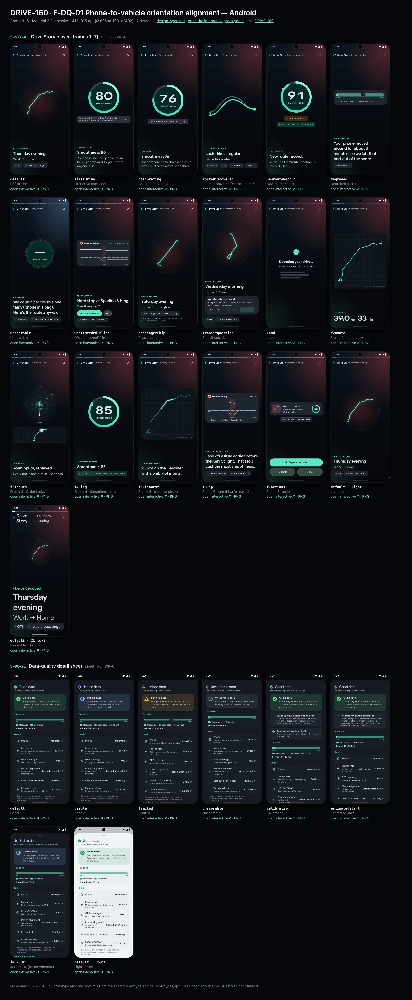
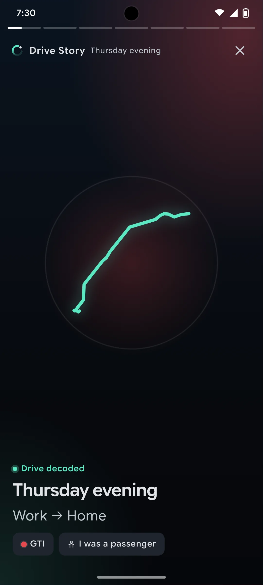
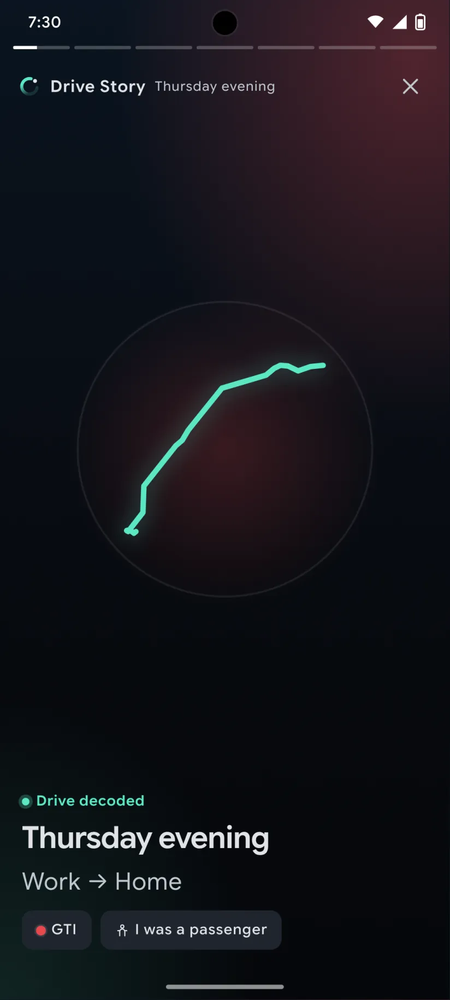
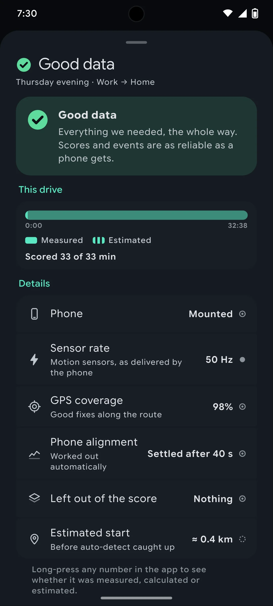
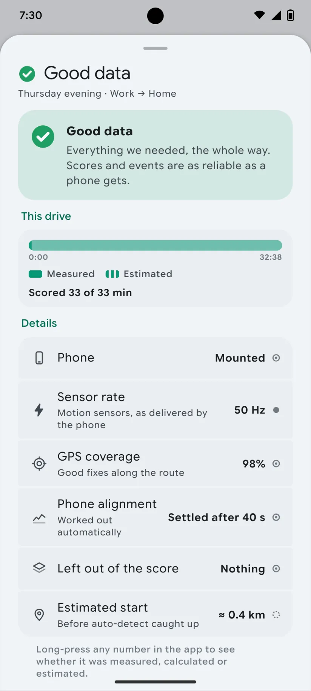

# DRIVE-160 · F-DQ-01 Phone-to-vehicle orientation alignment — Android design spec

> Generated by `prototypes/tools/export.mjs` on 2026-11-06 from the shared prototype engine. **Do not edit by hand:** change the screen's `spec` in `prototypes/app/screens/wp-*.js` (see `prototypes/app/AUTHORING.md`) and re-export.

- **Jira story:** [DRIVE-160](https://thekeval.atlassian.net/browse/DRIVE-160) · F-DQ-01 · P0
- **Platform:** Android 16 · Material 3 Expressive · 412×915 dp @2.625 (≈ 1081×2402)
- **Interactive prototype:** [../../../../prototypes/android/index.html#S-STY-01](../../../../prototypes/android/index.html#S-STY-01) (catalog panel: every screen and state; deep links `#S-ID/state?trip=…&ent=…&theme=light&text=xl&rm=1`)
- **Contact sheet:** [mockup.html](mockup.html) · 
- **Design system (source of truth for values):** [brand](../../system/brand.md) · [components](../../system/components.md) · [motion](../../system/motion.md) · [accessibility](../../system/accessibility.md) · [screen map](../../system/screen-map.md) · [fixtures](../../system/fixtures.md) · tokens `prototypes/shared/tokens.css`

## Screens in this story

| Screen | Name | Presentation | Priority | States | Status |
|---|---|---|---|---|---|
| `S-STY-01` | Drive Story player (frames 1–7) | Full (player) | P0 | 17 | Prototyped |
| `S-DQ-01` | Data-quality detail sheet | Sheet (large) | P0 | 7 | Prototyped |

## Tokens used on this platform

Values resolved from `prototypes/shared/tokens.css` inside the Android device (`[data-platform="android"]`). Use the token names in code; the hex values are for reference.

| Token | Dark | Light |
|---|---|---|
| `--app-bg` | `#0D1117` | `#F7F9FC` |
| `--card-bg` | `#191E25` | `#EBEEF2` |
| `--dp-bg-grouped` | `#0D1117` | `#F7F9FC` |
| `--dp-surface` | `#191E25` | `#EBEEF2` |
| `--dp-surface-2` | `#1F252D` | `#E5E8EC` |
| `--dp-surface-3` | `#2A3038` | `#DFE2E6` |
| `--dp-fill` | `#2A3038` | `#DFE2E6` |
| `--dp-fill-strong` | `#353B44` | `#D3D7DC` |
| `--dp-text` | `#E1E3E8` | `#181C20` |
| `--dp-text-2` | `#C0C7CF` | `#40474F` |
| `--dp-text-3` | `#8A929B` | `#707881` |
| `--dp-separator` | `#40474F` | `#C0C7CF` |
| `--dp-accent` | `#5BE7C4` | `#006B53` |
| `--dp-accent-text` | `#5BE7C4` | `#006B53` |
| `--dp-on-accent` | `#00382B` | `#FFFFFF` |
| `--dp-accent-container` | `#00513F` | `#91F1D8` |
| `--dp-record` | `#FFC24B` | `#7A5900` |
| `--dp-positive` | `#5BE7C4` | `#006B53` |
| `--dp-change-down` | `#C0C7CF` | `#40474F` |
| `--dp-warning` | `#F5B648` | `#7A5900` |
| `--dp-critical` | `#FFB4AB` | `#BA1A1A` |
| `--dp-glass-fill` | `#1F252DF2` | `#E5E8ECF2` |
| `--dp-glass-fill-strong` | `#2A3038` | `#DFE2E6` |
| `--dp-glass-stroke` | `#FFFFFF0F` | `#0000000A` |
| `--md-sys-color-primary` | `#5BE7C4` | `#006B53` |
| `--md-sys-color-on-primary` | `#00382B` | `#FFFFFF` |
| `--md-sys-color-primary-container` | `#00513F` | `#91F1D8` |
| `--md-sys-color-on-primary-container` | `#91F1D8` | `#002118` |
| `--md-sys-color-secondary-container` | `#344C44` | `#CEE9DF` |
| `--md-sys-color-surface` | `#0D1117` | `#F7F9FC` |
| `--md-sys-color-surface-container` | `#191E25` | `#EBEEF2` |
| `--md-sys-color-surface-container-high` | `#1F252D` | `#E5E8EC` |
| `--md-sys-color-on-surface-variant` | `#C0C7CF` | `#40474F` |
| `--dp-data-route` | `#5BE7C4` | `#079777` |
| `--dp-data-event-brake` | `#FF7A66` | `#A21F16` |
| `--dp-data-event-accel` | `#E58BD0` | `#A33A8C` |
| `--dp-data-event-corner` | `#EAD54E` | `#9A8A00` |
| `--dp-data-quality-good` | `#5FDB9C` | `#1E9E62` |
| `--dp-data-speed` | `#D6DCE4` | `#404A58` |
| `--dp-data-long-g` | `#5AB8F5` | `#0A6AB8` |
| `--dp-data-lat-g` | `#F5A142` | `#B25A00` |

| Type / layout token | Value |
|---|---|
| `--dp-font-screen-title` | `600 32px / 40px "Google Sans Flex", "Google Sans Display", "Roboto Flex", Roboto, system-ui, sans-serif` |
| `--dp-font-sheet-title` | `400 24px / 32px "Google Sans Flex", "Google Sans Display", "Roboto Flex", Roboto, system-ui, sans-serif` |
| `--dp-font-section-title` | `600 22px / 28px "Google Sans Flex", "Google Sans Display", "Roboto Flex", Roboto, system-ui, sans-serif` |
| `--dp-font-card-title` | `700 16px / 24px "Google Sans Flex", "Google Sans Text", "Roboto Flex", Roboto, system-ui, sans-serif` |
| `--dp-font-body` | `400 16px / 24px "Google Sans Flex", "Google Sans Text", "Roboto Flex", Roboto, system-ui, sans-serif` |
| `--dp-font-body-secondary` | `400 14px / 20px "Google Sans Flex", "Google Sans Text", "Roboto Flex", Roboto, system-ui, sans-serif` |
| `--dp-font-meta` | `400 12px / 16px "Google Sans Flex", "Google Sans Text", "Roboto Flex", Roboto, system-ui, sans-serif` |
| `--dp-font-caption` | `500 12px / 16px "Google Sans Flex", "Google Sans Text", "Roboto Flex", Roboto, system-ui, sans-serif` |
| `--dp-font-button` | `700 14px / 20px "Google Sans Flex", "Google Sans Text", "Roboto Flex", Roboto, system-ui, sans-serif` |
| `--dp-num-hero` | `600 72px / 72px "Google Sans Flex", "Roboto Flex", Roboto, system-ui, sans-serif` |
| `--dp-num-xl` | `600 48px / 52px "Google Sans Flex", "Roboto Flex", Roboto, system-ui, sans-serif` |
| `--dp-num-l` | `600 34px / 38px "Google Sans Flex", "Roboto Flex", Roboto, system-ui, sans-serif` |
| `--dp-num-m` | `600 24px / 28px "Google Sans Flex", "Roboto Flex", Roboto, system-ui, sans-serif` |
| `--dp-num-s` | `600 17px / 22px "Google Sans Flex", "Roboto Flex", Roboto, system-ui, sans-serif` |
| `--dp-num-xs` | `600 13px / 16px "Google Sans Flex", "Roboto Flex", Roboto, system-ui, sans-serif` |
| `--dp-screen-margin` | `16px` |
| `--dp-radius-card` | `16px` |
| `--dp-radius-card-hero` | `28px` |
| `--dp-radius-sheet` | `28px` |
| `--dp-radius-chip` | `8px` |
| `--dp-radius-button` | `999px` |
| `--dp-layout-list-row-min` | `56px` |
| `--dp-layout-touch-min` | `48px` |
| `--safe-top` | `40px` |
| `--safe-bottom` | `24px` |

Text sizes scale with `--dp-text-scale` (XL = 2.0×) and numerals with `--dp-num-scale` (XL = 1.3×). DP Numerals: Google Sans Flex wdth 120 wght 600, tabular.

---

## S-STY-01 · Drive Story player (frames 1–7)

 

- **Presentation:** full · tab: drives — screen map: “Full (player)”
- **Entry points:** S-NTF-01 "Drive decoded" · S-HOME-01 card · S-DRV-04 · S-TRP-01 "Story" · S-LIVE-04/08
- **Leads to:** f7: S-RPL-01 (Explore) · S-SHR-01 (Share) · Done → caller · chips: S-RTE-03, S-SCO-03, S-TRP-02 (passenger/car), S-DQ-01
- **PRD features:** F-STY-01, F-STY-03, F-STY-04, F-STY-06, F-SCO-01, F-SCO-02, F-SCO-05, F-SCO-06, F-RTE-01, F-RTE-03, F-HIS-02, F-GAR-02, F-CAP-04, F-DQ-02, F-DQ-04, F-SHR-01, F-DQ-01 · **Priority:** P0 · **WP:** C
- **Interactive:** [S-STY-01](../../../../prototypes/android/index.html#S-STY-01)

**Purpose.** The “wow” after every drive (F-STY-01): a ~15 s full-screen Story that leads with what went well, scores the drive against the user’s own baseline, then gives exactly one tip. No speed or max speed appears in any frame (F-STY-01.3).

### States

| State | PRD label | Fixture params | Screenshot |
|---|---|---|---|
| `default` | Def (frame 1) | `trip=t20261105-1745` | [S-STY-01.png](../../screens/android/S-STY-01.webp) · [open](../../../../prototypes/android/index.html#S-STY-01) |
| `firstDrive` | First drive (baseline) | `trip=t20260928-1842` | [S-STY-01--firstDrive.png](../../screens/android/S-STY-01--firstDrive.webp) · [open](../../../../prototypes/android/index.html#S-STY-01/firstDrive) |
| `calibrating` | Calibrating (2 of 3) | `trip=t20260929-0738` | [S-STY-01--calibrating.png](../../screens/android/S-STY-01--calibrating.webp) · [open](../../../../prototypes/android/index.html#S-STY-01/calibrating) |
| `routeDiscovered` | Route discovered (merge + name) | `trip=t20261002-0745` | [S-STY-01--routeDiscovered.png](../../screens/android/S-STY-01--routeDiscovered.webp) · [open](../../../../prototypes/android/index.html#S-STY-01/routeDiscovered) |
| `newRouteRecord` | New route record | `trip=t20261105-0742` | [S-STY-01--newRouteRecord.png](../../screens/android/S-STY-01--newRouteRecord.webp) · [open](../../../../prototypes/android/index.html#S-STY-01/newRouteRecord) |
| `degraded` | Degraded (Part) | `trip=t20261027-1728` | [S-STY-01--degraded.png](../../screens/android/S-STY-01--degraded.webp) · [open](../../../../prototypes/android/index.html#S-STY-01/degraded) |
| `unscorable` | Unscorable | `trip=t20261106-1210` | [S-STY-01--unscorable.png](../../screens/android/S-STY-01--unscorable.webp) · [open](../../../../prototypes/android/index.html#S-STY-01/unscorable) |
| `wasItNeededInline` | “Was it needed?” inline | `trip=t20261020-0740` | [S-STY-01--wasItNeededInline.png](../../screens/android/S-STY-01--wasItNeededInline.webp) · [open](../../../../prototypes/android/index.html#S-STY-01/wasItNeededInline) |
| `passengerChip` | Passenger chip | `trip=t20261031-1905` | [S-STY-01--passengerChip.png](../../screens/android/S-STY-01--passengerChip.webp) · [open](../../../../prototypes/android/index.html#S-STY-01/passengerChip) |
| `transitQuestion` | Transit question | `trip=t20261104-0650` | [S-STY-01--transitQuestion.png](../../screens/android/S-STY-01--transitQuestion.webp) · [open](../../../../prototypes/android/index.html#S-STY-01/transitQuestion) |
| `Load` | Load | `trip=t20261105-1745` | [S-STY-01--Load.png](../../screens/android/S-STY-01--Load.webp) · [open](../../../../prototypes/android/index.html#S-STY-01/Load) |
| `f2Route` | Frame 2 · route draw-on | `trip=t20261105-1745` | [S-STY-01--f2Route.png](../../screens/android/S-STY-01--f2Route.webp) · [open](../../../../prototypes/android/index.html#S-STY-01/f2Route) |
| `f3Inputs` | Frame 3 · G-dot replay | `trip=t20261105-1745` | [S-STY-01--f3Inputs.png](../../screens/android/S-STY-01--f3Inputs.webp) · [open](../../../../prototypes/android/index.html#S-STY-01/f3Inputs) |
| `f4Ring` | Frame 4 · Smoothness ring | `trip=t20261105-1745` | [S-STY-01--f4Ring.png](../../screens/android/S-STY-01--f4Ring.webp) · [open](../../../../prototypes/android/index.html#S-STY-01/f4Ring) |
| `f5Cleanest` | Frame 5 · cleanest stretch | `trip=t20261105-1745` | [S-STY-01--f5Cleanest.png](../../screens/android/S-STY-01--f5Cleanest.webp) · [open](../../../../prototypes/android/index.html#S-STY-01/f5Cleanest) |
| `f6Tip` | Frame 6 · one thing for next time | `trip=t20261105-1745` | [S-STY-01--f6Tip.png](../../screens/android/S-STY-01--f6Tip.webp) · [open](../../../../prototypes/android/index.html#S-STY-01/f6Tip) |
| `f7Actions` | Frame 7 · actions | `trip=t20261105-1745` | [S-STY-01--f7Actions.png](../../screens/android/S-STY-01--f7Actions.webp) · [open](../../../../prototypes/android/index.html#S-STY-01/f7Actions) |
| default · light | Light theme | `theme=light` | [S-STY-01--light.png](../../screens/android/S-STY-01--light.webp) |
| default · XL | Largest text | `text=xl` | [S-STY-01--xl.png](../../screens/android/S-STY-01--xl.webp) |

Every state also renders in light/dark (`theme=light`), XL text (`text=xl`) and reduced motion (`rm=1`).

### Layout

- Full-screen player, always on the night stage (`--dp-gradient-night-sky`) with a car-colour wash (radial 30% of `--dp-car-{colour}` top-trailing, 14% Glide bottom-leading). Status bar light. Dark tokens are forced inside the player in both themes.
- Top (safe-top + 4): progress segments (3 px, gap 4, white 26% track, white fill) · header row: Loop mark 22 + “Drive Story” (14/600) + part of day (meta, text2) + glass close button (44).
- Frame stage: art region (flex, centred) above a bottom-left copy block: kicker (13/600, accent-text) · `storyHeadline` (28/34 iOS bold, 28/36 Android) · `storyBody` (20/25, text2) · chip row. Bottom padding safe-bottom + 24.
- f1 title: route glyph 250 (share-safe trip.glyph, Glide 5 px) · kicker “● Drive decoded” · part of day (headline) · route label (body) · car chip + “I was a passenger” chip (glass).
- f2 route: plain-canvas map, full width − 40, ≤ 380 tall, radius 28, estimated start dashed, “© OpenStreetMap contributors” · two DP Numerals 48 (“39.0 km” “33 min”) counting up.
- f3 inputs: friction circle 260 (±0.6 g, rings at 0.1 g, 0.3/0.5 labelled) with the G-dot and a 1.2 s trail; under it a 112-tall mini map with the tracking tick (marker).
- f4 ring: Smoothness ring 224 (stroke 15, baseline notch, gold record notch) · comparison chip (and gold “New route record” chip) · “Score based on 31 of 34 min” with the quality glyph for Limited trips. Tap the ring → S-SCO-01.
- f5 cleanest stretch: the map with the route dimmed to 45% and the cleanest span drawn in Glide 200 with a 14 px glow · kicker “✦ Cleanest stretch”.
- f6 tip: glass trace card (event pin 22 + type + place, the −10…+10 s evidence trace, legend) · kicker “One thing for next time” · tip as headline · chips “See the moment” → S-RPL-02, “More on this tip” → S-SCO-04.
- Variant frames: fDegraded (coverage strip with the hatched excluded span) · fUnscorable (dashed ring “—”, Why not? → S-DQ-01) · fRoute (two Glide lines merging + chips Commute/Gym/School run/Custom… → S-RTE-03) · fNeeded (evidence trace + “Yes, it was needed” / “No”, inline confirmation).
- f7 end: glass summary card (glyph 52 · label · part of day · car · km · min · ring 64) · full quality badge (“Good data · phone mounted”) · first-drive loop card · actions: Explore the drive (filled large, block) · Share + Done (glass large, side by side). Passenger trips drop Share.
- Load: Loop loader 64 (iOS) / M3E shape loader (Android) + “Decoding your drive…” + skeleton lines; segments empty.

### Components & tokens

| Component | Tokens / spec |
|---|---|
| `ring` | track --dp-fill-strong · arc --dp-gradient-ring (glide-400 → accent → glide-100) · baseline notch --dp-text-2 · record notch --dp-record · Android container Cookie9Sided --md-sys-color-primary-container 42% · components.md §3 |
| `deltaChip` | better: --dp-accent-text on --dp-accent 18% · lower: --dp-text-2 on --dp-fill (never red) · record: --dp-record on --dp-record 18% · components.md §4 |
| `chip` | --dp-radius-chip (iOS capsule · Android 8) · height 28 · --dp-font-caption |
| `carChip` | see components.md |
| `glyph` | see components.md |
| `map` | --dp-data-map-land/road/grid · route --dp-data-route 3.8 + casing --dp-data-route-casing 7.5 · estimated dashed 4/4 at 60% · gap --dp-data-gap-stroke dotted 1/6 · pins DP_ICONS.pin 26 · attribution “© OpenStreetMap contributors” |
| `evidenceTrace` | see components.md |
| `qualityBadge` | --dp-data-quality-{good\|usable\|limited\|unscorable} · components.md §10 |
| `button` | --dp-accent / --dp-on-accent (filled) · --dp-fill-strong · --md-sys-color-secondary-container (tonal) · --dp-radius-button · height iOS 50/44/34 · Android 56/40/32 · --dp-font-button · components.md §0 |
| `iconButton` | see components.md |
| `loader` | see components.md |
| `skeleton` | --dp-fill-strong, breathe 1.2 s (dp-skeleton) |
| `gg (local ggSvg)` | see components.md |
| `coverageStrip (local)` | see components.md |

### Interactions & navigation

- Tap the right 68% → next frame; tap the left 32% → previous; press and hold → pause (segment freezes); swipe down → exit (content scales to 0.9 and rounds its corners with the drag, commits past 120 pt with haptic gestureEnd); close button → back to the caller.
- f1: car chip → S-TRP-02/carPicker · “I was a passenger” → S-TRP-02/typePicker (≤ 2 taps, F-HIS-02.4) · transit question chips Bus/Train/Streetcar → moved to Not drives (toast + Undo, back) · “No, I drove” → dismisses the question.
- f4: ring → S-SCO-01 · “New route record” chip → S-RTE-02 · f6: “See the moment” → S-RPL-02/thisDrivesTip · “More on this tip” → S-SCO-04 · f5/fDegraded/fUnscorable badges → S-DQ-01 · placement chip → S-DQ-02.
- fRoute chips → S-RTE-03 (preset name) or S-RTE-03/custom · fNeeded “Yes, it was needed” → marks it inline, the score recomputes ≤ 1 s and the Story continues (F-STY-04.3); “No” → next frame; “Not sure?” → S-SCO-03.
- f7: Explore the drive → S-RPL-01 · Share → S-SHR-01 · Done → back. Quality badge → S-DQ-01. No paywall, share prompt or rating prompt ever follows a Story (D12, F-SUB-08).
- D1 gate: opened while moving or during a driver trip → S-DRV-05 (“Your Story will be ready when you’ve parked.”), which opens the Story once stationary for 60 s.
- Deep link a frame: `#S-STY-01?trip=…&frame=f4`.

### Motion

- Segments fill linearly over the frame duration (3 s; 3.5 s for f2/f3; 6 s for question frames; ×1.5 at XL); f7 waits.
- Frame change: outgoing frame fades (220 ms); incoming copy rises 12 px line by line (60 ms stagger, spring.default) while the frame’s hero runs.
- Heroes: f1 glyph draw-on 1100 ms · f2 route draw-on 1800 ms (ease.drawOn) + numbers count up 1200 ms (ease.countUp) · f3 G-dot replay 3000 ms (shared.gMeter ζ 0.55 k 120, 1.2 s tapering trail, cloud fades in and the envelope draws on at the end) · f4 ring reveal 1400 ms with baseline notch, record notch flip + doubleSuccess haptic, chip pop at 1600 ms · f5 cleanest-stretch draw-on · f6 trace draw-on · fRoute lines slide 14 px together (spring.default) then chips pop (spring.fast, 40 ms stagger).
- RM: 220 ms cross-fades; route, ring and numbers appear complete; f3 shows the static G-G plot with the trail (F-STY-06.2); auto-advance continues (tap and hold still pause). Haptics kept except ring ticks.

### Accessibility

- Each frame is one focusable element whose label is the full frame copy, e.g. “Frame 4 of 7. Smoothness 85. 2 above your usual on The Commute home.” Focus pauses auto-advance (F-STY-06.1); actions Next frame / Previous frame / Close.
- f3 summary: “Your inputs, replayed. Mostly gentle, with 2 firm stops.” (derived from the trip’s events).
- Focus is trapped inside the player until closed. Tap zones are buttons “Previous frame” / “Next frame”.
- XL: the copy block grows upward and the art shrinks (zoom 0.62); frames run 1.5× longer; nothing truncates.
- Never colour alone: ▲/▼/● on chips, rosette on records, hatched + dashed spans in the coverage strip, glyphs on quality badges.

### Platform notes

- **Android (this spec):** Full-screen dialog destination with fade-rise; tonal surface-container-high chips (no blur); Google Sans Flex story styles (28/36 600, body 22/28); ring sits on the Cookie9Sided primaryContainer shape that rotates during the count; M3E loading indicator for Load; Explore = filled button with shape morph, Share/Done = tonal.
- *iOS (for reference):* fullScreenCover; glass chips and glass close button (`.glassEffect(.clear)` over art with a 35% dim); SF Pro Display Bold story headline; Loop loader for Load; buttons glassProminent (Explore) and glass (Share/Done).

### Analytics

- `story_opened {source}`
- `story_frame_viewed {frame}`
- `story_completed`
- `story_action {action: explore|share|done}`
- `story_variant {degraded|unscorable}`
- `event_marked_needed {type, source: story}`
- `trip_flagged_transit`
- `trip_corrected {to: transit|passenger}`
- `a11y_story_mode {screen_reader, reduce_motion}`

### Copy

| Key | Text |
|---|---|
| f1 | {partOfDay} · {label} (trip.story.frames.f1.title) · kicker “Drive decoded” · chips “{car}” · “I was a passenger” |
| f2 | {distance} km · {duration} min (frames.f2.line) |
| f3 | Your inputs, replayed. / Every brake and turn in 3 seconds. |
| f4 | Smoothness {n} · {compareText} · record: “New route record.” + “{n} on {route}, beating {m} from {date}.” · first drive: “Your baseline. Every drive from here is compared to you, not to anyone else.” · calibrating: “Calibrating your baseline · k of 3” |
| f5 | Cleanest stretch: {km} km on {road} with no abrupt inputs. |
| f6 | One thing for next time: {tip} |
| fDegraded | Your phone moved around for about 3 minutes, so we left that part out of the score. |
| fUnscorable | We couldn’t score this one fairly (phone in a bag). Here’s the route anyway. |
| fRoute | Looks like a regular. Name this route? · Commute · Gym · School run · Custom… |
| fNeeded | Hard stop at Spadina & King. Was it needed? · Yes, it was needed · No · done: “Marked as needed. It doesn’t count. Your Smoothness is 83 without it.” |
| Transit | Was this a bus or train? It stopped and started like transit. If it was, we’ll leave it out of your scores. · Bus · Train · Streetcar · No, I drove |
| Passenger | Passenger · not scored · Change — Not scored, and it doesn’t count toward your baseline, routes or recaps. |
| f7 | Explore the drive · Share · Done · {badge} data · phone {state} · first drive: “That’s the loop. Every drive gets a Story. Explore it in Replay, and repeat trips become Routes.” |
| Load | Decoding your drive… Building the replay |

### Free / Pro

Free on every trip, forever (F-STY-01). Explore the drive opens S-RPL-01; on Free for a trip older than 30 days the replay shows its own lock (S-SUB-03 replayAnalysis30Days), never the Story. No paywall after any Story, and never after a worse-than-usual one (F-SUB-08).

### Data & fixtures

Copy: trip.story.frames (exact). States → trips: default t20261105-1745 · firstDrive t20260928-1842 · calibrating t20260929-0738 (2 of 3) · routeDiscovered t20261002-0745 (fRoute) · newRouteRecord t20261105-0742 · degraded t20261027-1728 (fDegraded) · unscorable t20261106-1210 · wasItNeededInline t20261020-0740 (fNeeded, e3) · passengerChip t20261031-1905 · transitQuestion t20261104-0650 (no fixture trip is flagged as transit; the question is simulated on a stop-start trip). Frame order follows the fixture keys, except Unscorable (f1, f2, fUnscorable, f7 per F-STY-04.2; the fixture’s f3 is dropped) and passenger (f1, f2, f7: the G-dot replay would show someone else’s inputs). The f3 accessibility sentence and the G-dot path are derived from trip.track (lonG/latG) and trip.events.

### Assets

[icon-story.svg](assets/icon-story.svg) · [icon-close.svg](assets/icon-close.svg) · [icon-passenger.svg](assets/icon-passenger.svg) · [icon-replay.svg](assets/icon-replay.svg) · [icon-share.svg](assets/icon-share.svg) · [icon-routes.svg](assets/icon-routes.svg) · [icon-rosette.svg](assets/icon-rosette.svg) · [icon-info.svg](assets/icon-info.svg) · [icon-phone.svg](assets/icon-phone.svg) · [icon-check.svg](assets/icon-check.svg) · [icon-sparkle.svg](assets/icon-sparkle.svg) · [icon-pinStop.svg](assets/icon-pinStop.svg) · [logo-a-loop.svg](assets/logo-a-loop.svg)

UI glyphs may be swapped for SF Symbols / Material Symbols Rounded equivalents; event-pin, quality and provenance glyphs must not be (components.md global rules).

### Checklist (accessibility.md §9)

- [ ] Light and dark both render, and contrast passes.
- [ ] The XL text state reflows with no truncation.
- [ ] The RM state is defined.
- [ ] Every control has a label; every chart and map has a summary sentence.
- [ ] Every target ≥ 44 pt / 48 dp (≥ 64 in-drive).
- [ ] No meaning by colour alone.
- [ ] Speed is neutral wherever it appears and absent from social or live surfaces.
- [ ] No streak, leaderboard, speed or “beat your time” language.
- [ ] Behaviour is defined while a trip is active (D1 gate).
- [ ] Haptics come from motion.md §6 only.

---

## S-DQ-01 · Data-quality detail sheet

 

- **Presentation:** sheet · tab: drives · detent: large — screen map: “Sheet (large)”
- **Entry points:** Quality badge anywhere (S-STY-01, S-TRP-01, S-RPL-01, S-ANL-01)
- **Leads to:** S-DQ-02 · S-SCO-02
- **PRD features:** F-DQ-01, F-DQ-02, F-DQ-03, F-DQ-04, F-DQ-05, F-CAP-05, F-RPL-08 · **Priority:** P0 · **WP:** C
- **Interactive:** [S-DQ-01](../../../../prototypes/android/index.html#S-DQ-01)

**Purpose.** Explain how much to trust a drive’s numbers (F-DQ-04.2): phone state, sensor rate, GPS coverage, alignment, what was left out and why, the estimated start, and the provenance legend (F-DQ-05).

### States

| State | PRD label | Fixture params | Screenshot |
|---|---|---|---|
| `default` | Good | `trip=t20261105-1745` | [S-DQ-01.png](../../screens/android/S-DQ-01.webp) · [open](../../../../prototypes/android/index.html#S-DQ-01) |
| `usable` | Usable | `trip=t20261020-0740` | [S-DQ-01--usable.png](../../screens/android/S-DQ-01--usable.webp) · [open](../../../../prototypes/android/index.html#S-DQ-01/usable) |
| `limited` | Limited | `trip=t20261027-1728` | [S-DQ-01--limited.png](../../screens/android/S-DQ-01--limited.webp) · [open](../../../../prototypes/android/index.html#S-DQ-01/limited) |
| `unscorable` | Unscorable | `trip=t20261106-1210` | [S-DQ-01--unscorable.png](../../screens/android/S-DQ-01--unscorable.webp) · [open](../../../../prototypes/android/index.html#S-DQ-01/unscorable) |
| `calibrating` | Calibrating | `trip=t20260928-1842` | [S-DQ-01--calibrating.png](../../screens/android/S-DQ-01--calibrating.webp) · [open](../../../../prototypes/android/index.html#S-DQ-01/calibrating) |
| `estimatedStart` | Estimated start | `trip=t20261105-0742` | [S-DQ-01--estimatedStart.png](../../screens/android/S-DQ-01--estimatedStart.webp) · [open](../../../../prototypes/android/index.html#S-DQ-01/estimatedStart) |
| `imu25Hz` | IMU 25 Hz (battery/thermal) | `trip=t20261024-0930` | [S-DQ-01--imu25Hz.png](../../screens/android/S-DQ-01--imu25Hz.webp) · [open](../../../../prototypes/android/index.html#S-DQ-01/imu25Hz) |
| default · light | Light theme | `theme=light` | [S-DQ-01--light.png](../../screens/android/S-DQ-01--light.webp) |

Every state also renders in light/dark (`theme=light`), XL text (`text=xl`) and reduced motion (`rm=1`).

### Layout

- Large sheet (iOS `.large` detent, Android full-height ModalBottomSheet) over trip detail, Story, Replay or Analysis.
- Header: quality glyph 24 + “{Badge} data” + part of day · label.
- Hero card: glyph 34 in its quality colour on a 14% wash + one honest sentence per badge (Good / Usable / Limited / Unscorable, IMU-note and gap variants).
- State banners: calibrating (alignment “Lining up your phone with the car” + baseline k of 3) · estimated start explanation.
- “This drive”: coverage strip (14 tall, radius 7) across the whole drive — measured solid, estimated dashed, no GPS outlined gap, left out 45° hatch, lining up ticks — with 0:00 / end labels, legend and “Scored 31 of 34 min”.
- “Details” list: Phone · Sensor rate · GPS coverage · Phone alignment · Left out of the score · Estimated start; each value carries its provenance glyph + word; warn tone when it lowered the badge.
- “What the labels mean”: Observed / Derived / Estimated with DP_DATA.provenance.legend.
- Links: Where to put your phone → S-DQ-02 · How scores work → S-SCO-02.

### Components & tokens

| Component | Tokens / spec |
|---|---|
| `sheetHeader` | see components.md |
| `banner` | radius 12 (--dp-radius-sm+) · info --dp-fill · attention --dp-warning-container · critical --dp-critical-container · components.md §22 |
| `section` | --dp-font-section-title · --dp-layout-section-gap 28 |
| `list` | iOS inset grouped radius --dp-radius-card, rows 52 pt, separators --dp-separator inset 16 · Android ListItem 56/72 dp in --md-sys-color-surface-container |
| `row` | --dp-font-body · --dp-font-meta (supporting) · --dp-layout-list-row-min |
| `qualityBadge` | --dp-data-quality-{good\|usable\|limited\|unscorable} · components.md §10 |
| `provenance` | see components.md |
| `coverageStrip (local)` | see components.md |

### Interactions & navigation

- Where to put your phone → S-DQ-02 (fromLimitedTrip for Limited/Unscorable/loose-phone drives) · How scores work → S-SCO-02 · drag down / close → back.

### Motion

- Hero: the coverage strip reveals left to right (700 ms ease.glide) and its spans rise in (spring.default, 60 ms stagger). RM: static.

### Accessibility

- Strip label: “Drive coverage, 33 minutes. Start estimated. 41 seconds without GPS.” Rows: “GPS coverage, 97 percent. Derived.”
- Quality is never colour alone: glyph shape + the badge word everywhere. XL: rows wrap, values move under titles.

### Platform notes

- **Android (this spec):** Full-height ModalBottomSheet (surface-container-low); M3E segmented ListItems; no close button.
- *iOS (for reference):* Large sheet with `--dp-bg-elevated`; inset-grouped lists; glass close.

### Analytics

- `quality_badge_viewed {badge}`
- `placement_guide_viewed {source: dq}`
- `scores_explainer_viewed {source: dq}`

### Copy

| Key | Text |
|---|---|
| Good | Everything we needed, the whole way. Scores and events are as reliable as a phone gets. |
| Usable | Mostly solid, with {n} s without GPS downtown. The score is fair; that stretch is drawn dotted. |
| IMU 25 Hz | Battery saver: sensors at 25 Hz. The score is fair, with a little less detail in short events. |
| Limited | Your phone moved around for about 3 minutes, so we left that part out of the score. |
| Unscorable | We couldn’t score this one fairly. {quality.reason}. |
| Calibrating | Lining up your phone with the car. The first 40 s are used to work out which way your phone faces, with no setup from you. Events aren’t detected until it settles. |
| Estimated start | The first ≈ {km} km is estimated. Automatic trips start a moment after you set off. We fill in the start from your phone’s location history and draw it dashed. It’s never scored and never gets event pins. |

### Free / Pro

Free on every trip.

### Data & fixtures

trip.quality (badge, phone, imuHz, imuNote, gnssCoveragePct, alignment, estimatedStartM, spans, excludedMin, scoredMin, totalMin) + DP_DATA.provenance. States: Good t20261105-1745 · usable t20261020-0740 · limited t20261027-1728 · unscorable t20261106-1210 · calibrating t20260928-1842 (alignment span derived from quality.alignment) · estimatedStart t20261105-0742 · imu25Hz t20261024-0930.

### Assets

[icon-phone.svg](assets/icon-phone.svg) · [icon-bolt.svg](assets/icon-bolt.svg) · [icon-gps.svg](assets/icon-gps.svg) · [icon-analysis.svg](assets/icon-analysis.svg) · [icon-layers.svg](assets/icon-layers.svg) · [icon-pin.svg](assets/icon-pin.svg) · [icon-info.svg](assets/icon-info.svg)

UI glyphs may be swapped for SF Symbols / Material Symbols Rounded equivalents; event-pin, quality and provenance glyphs must not be (components.md global rules).

### Checklist (accessibility.md §9)

- [ ] Light and dark both render, and contrast passes.
- [ ] The XL text state reflows with no truncation.
- [ ] The RM state is defined.
- [ ] Every control has a label; every chart and map has a summary sentence.
- [ ] Every target ≥ 44 pt / 48 dp (≥ 64 in-drive).
- [ ] No meaning by colour alone.
- [ ] Speed is neutral wherever it appears and absent from social or live surfaces.
- [ ] No streak, leaderboard, speed or “beat your time” language.
- [ ] Behaviour is defined while a trip is active (D1 gate).
- [ ] Haptics come from motion.md §6 only.

---

Map geometry in the prototype: © OpenStreetMap contributors (ODbL). Speed and G are simulated fixtures (fixtures.md).
