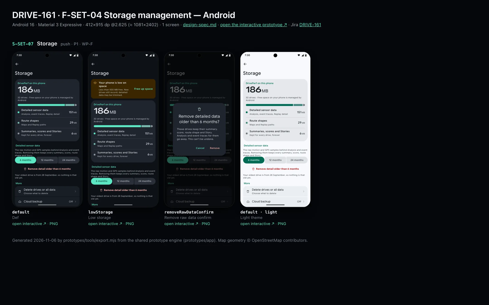
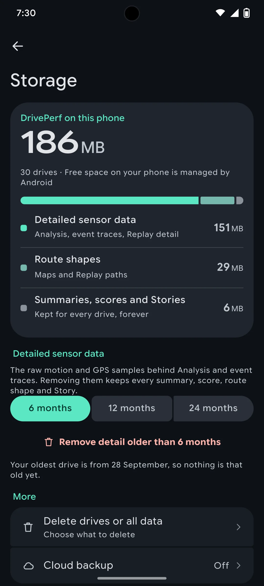
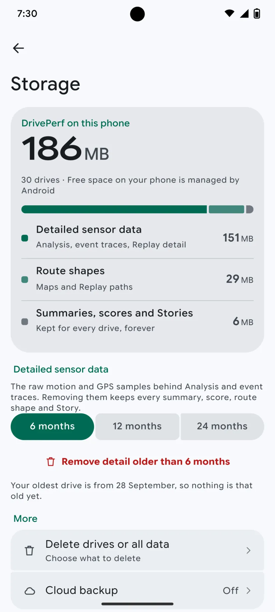

# DRIVE-161 · F-SET-04 Storage management — Android design spec

> Generated by `prototypes/tools/export.mjs` on 2026-11-07 from the shared prototype engine. **Do not edit by hand:** change the screen's `spec` in `prototypes/app/screens/wp-*.js` (see `prototypes/app/AUTHORING.md`) and re-export.

- **Jira story:** [DRIVE-161](https://thekeval.atlassian.net/browse/DRIVE-161) · F-SET-04 · P1
- **Platform:** Android 16 · Material 3 Expressive · 412×915 dp @2.625 (≈ 1081×2402)
- **Interactive prototype:** [../../../../prototypes/android/index.html#S-SET-07](../../../../prototypes/android/index.html#S-SET-07) (catalog panel: every screen and state; deep links `#S-ID/state?trip=…&ent=…&theme=light&text=xl&rm=1`)
- **Contact sheet:** [mockup.html](mockup.html) · 
- **Design system (source of truth for values):** [brand](../../system/brand.md) · [components](../../system/components.md) · [motion](../../system/motion.md) · [accessibility](../../system/accessibility.md) · [screen map](../../system/screen-map.md) · [fixtures](../../system/fixtures.md) · tokens `prototypes/shared/tokens.css`

## Screens in this story

| Screen | Name | Presentation | Priority | States | Status |
|---|---|---|---|---|---|
| `S-SET-07` | Storage | Push | P1 | 3 | Prototyped |

## Tokens used on this platform

Values resolved from `prototypes/shared/tokens.css` inside the Android device (`[data-platform="android"]`). Use the token names in code; the hex values are for reference.

| Token | Dark | Light |
|---|---|---|
| `--app-bg` | `#0D1117` | `#F7F9FC` |
| `--card-bg` | `#191E25` | `#EBEEF2` |
| `--dp-bg-grouped` | `#0D1117` | `#F7F9FC` |
| `--dp-surface` | `#191E25` | `#EBEEF2` |
| `--dp-surface-2` | `#1F252D` | `#E5E8EC` |
| `--dp-surface-3` | `#2A3038` | `#DFE2E6` |
| `--dp-fill` | `#2A3038` | `#DFE2E6` |
| `--dp-fill-strong` | `#353B44` | `#D3D7DC` |
| `--dp-text` | `#E1E3E8` | `#181C20` |
| `--dp-text-2` | `#C0C7CF` | `#40474F` |
| `--dp-text-3` | `#8A929B` | `#707881` |
| `--dp-separator` | `#40474F` | `#C0C7CF` |
| `--dp-accent` | `#5BE7C4` | `#006B53` |
| `--dp-accent-text` | `#5BE7C4` | `#006B53` |
| `--dp-on-accent` | `#00382B` | `#FFFFFF` |
| `--dp-accent-container` | `#00513F` | `#91F1D8` |
| `--dp-record` | `#FFC24B` | `#7A5900` |
| `--dp-positive` | `#5BE7C4` | `#006B53` |
| `--dp-change-down` | `#C0C7CF` | `#40474F` |
| `--dp-warning` | `#F5B648` | `#7A5900` |
| `--dp-critical` | `#FFB4AB` | `#BA1A1A` |
| `--dp-glass-fill` | `#1F252DF2` | `#E5E8ECF2` |
| `--dp-glass-fill-strong` | `#2A3038` | `#DFE2E6` |
| `--dp-glass-stroke` | `#FFFFFF0F` | `#0000000A` |
| `--md-sys-color-primary` | `#5BE7C4` | `#006B53` |
| `--md-sys-color-on-primary` | `#00382B` | `#FFFFFF` |
| `--md-sys-color-primary-container` | `#00513F` | `#91F1D8` |
| `--md-sys-color-on-primary-container` | `#91F1D8` | `#002118` |
| `--md-sys-color-secondary-container` | `#344C44` | `#CEE9DF` |
| `--md-sys-color-surface` | `#0D1117` | `#F7F9FC` |
| `--md-sys-color-surface-container` | `#191E25` | `#EBEEF2` |
| `--md-sys-color-surface-container-high` | `#1F252D` | `#E5E8EC` |
| `--md-sys-color-on-surface-variant` | `#C0C7CF` | `#40474F` |
| `--dp-data-route` | `#5BE7C4` | `#079777` |
| `--dp-data-event-brake` | `#FF7A66` | `#A21F16` |
| `--dp-data-event-accel` | `#E58BD0` | `#A33A8C` |
| `--dp-data-event-corner` | `#EAD54E` | `#9A8A00` |
| `--dp-data-quality-good` | `#5FDB9C` | `#1E9E62` |
| `--dp-data-speed` | `#D6DCE4` | `#404A58` |
| `--dp-data-long-g` | `#5AB8F5` | `#0A6AB8` |
| `--dp-data-lat-g` | `#F5A142` | `#B25A00` |

| Type / layout token | Value |
|---|---|
| `--dp-font-screen-title` | `600 32px / 40px "Google Sans Flex", "Google Sans Display", "Roboto Flex", Roboto, system-ui, sans-serif` |
| `--dp-font-sheet-title` | `400 24px / 32px "Google Sans Flex", "Google Sans Display", "Roboto Flex", Roboto, system-ui, sans-serif` |
| `--dp-font-section-title` | `600 22px / 28px "Google Sans Flex", "Google Sans Display", "Roboto Flex", Roboto, system-ui, sans-serif` |
| `--dp-font-card-title` | `700 16px / 24px "Google Sans Flex", "Google Sans Text", "Roboto Flex", Roboto, system-ui, sans-serif` |
| `--dp-font-body` | `400 16px / 24px "Google Sans Flex", "Google Sans Text", "Roboto Flex", Roboto, system-ui, sans-serif` |
| `--dp-font-body-secondary` | `400 14px / 20px "Google Sans Flex", "Google Sans Text", "Roboto Flex", Roboto, system-ui, sans-serif` |
| `--dp-font-meta` | `400 12px / 16px "Google Sans Flex", "Google Sans Text", "Roboto Flex", Roboto, system-ui, sans-serif` |
| `--dp-font-caption` | `500 12px / 16px "Google Sans Flex", "Google Sans Text", "Roboto Flex", Roboto, system-ui, sans-serif` |
| `--dp-font-button` | `700 14px / 20px "Google Sans Flex", "Google Sans Text", "Roboto Flex", Roboto, system-ui, sans-serif` |
| `--dp-num-hero` | `600 72px / 72px "Google Sans Flex", "Roboto Flex", Roboto, system-ui, sans-serif` |
| `--dp-num-xl` | `600 48px / 52px "Google Sans Flex", "Roboto Flex", Roboto, system-ui, sans-serif` |
| `--dp-num-l` | `600 34px / 38px "Google Sans Flex", "Roboto Flex", Roboto, system-ui, sans-serif` |
| `--dp-num-m` | `600 24px / 28px "Google Sans Flex", "Roboto Flex", Roboto, system-ui, sans-serif` |
| `--dp-num-s` | `600 17px / 22px "Google Sans Flex", "Roboto Flex", Roboto, system-ui, sans-serif` |
| `--dp-num-xs` | `600 13px / 16px "Google Sans Flex", "Roboto Flex", Roboto, system-ui, sans-serif` |
| `--dp-screen-margin` | `16px` |
| `--dp-radius-card` | `16px` |
| `--dp-radius-card-hero` | `28px` |
| `--dp-radius-sheet` | `28px` |
| `--dp-radius-chip` | `8px` |
| `--dp-radius-button` | `999px` |
| `--dp-layout-list-row-min` | `56px` |
| `--dp-layout-touch-min` | `48px` |
| `--safe-top` | `40px` |
| `--safe-bottom` | `24px` |

Text sizes scale with `--dp-text-scale` (XL = 2.0×) and numerals with `--dp-num-scale` (XL = 1.3×). DP Numerals: Google Sans Flex wdth 120 wght 600, tabular.

---

## S-SET-07 · Storage

 

- **Presentation:** push · tab: profile — screen map: “Push”
- **Entry points:** S-SET-01 · S-SET-05 storage row
- **Leads to:** S-PRV-05 · remove raw data confirm
- **PRD features:** F-SET-04 · **Priority:** P1 · **WP:** F
- **Interactive:** [S-SET-07](../../../../prototypes/android/index.html#S-SET-07)

**Purpose.** Show and control how much space DrivePerf uses without losing history: summaries, route shapes and raw sensor data, with “remove detail older than 6/12/24 months” (F-SET-04).

### States

| State | PRD label | Fixture params | Screenshot |
|---|---|---|---|
| `default` | Def | — | [S-SET-07.png](../../screens/android/S-SET-07.webp) · [open](../../../../prototypes/android/index.html#S-SET-07) |
| `lowStorage` | Low storage | — | [S-SET-07--lowStorage.png](../../screens/android/S-SET-07--lowStorage.webp) · [open](../../../../prototypes/android/index.html#S-SET-07/lowStorage) |
| `removeRawDataConfirm` | Remove raw data confirm | — | [S-SET-07--removeRawDataConfirm.png](../../screens/android/S-SET-07--removeRawDataConfirm.webp) · [open](../../../../prototypes/android/index.html#S-SET-07/removeRawDataConfirm) |
| default · light | Light theme | `theme=light` | [S-SET-07--light.png](../../screens/android/S-SET-07--light.webp) |

Every state also renders in light/dark (`theme=light`), XL text (`text=xl`) and reduced motion (`rm=1`).

### Layout

- Low-storage banner (attention): “Your iPhone is low on space” + “Less than 500 MB free. New drives still record; detailed data may be trimmed.” + Free up space.
- Hero card: caption “DrivePerf on this phone”, total in DP Numerals 48 (“186 MB”), “30 drives”, a 12 px stacked bar (raw = Glide, route shapes = data-route 60%, summaries = text-3) and a 3-row legend with MB values.
- “Detailed sensor data”: one-paragraph explanation, a 6 | 12 | 24 months segmented control, destructive full-width button “Remove detail older than 6 months”, and an honest note (“Your oldest drive is from 28 September, so nothing is that old yet.”).
- More: Delete drives or all data → S-PRV-05 · Cloud backup (Off) → S-PRV-01. Footer: ≈ 5 MB per hour of driving.
- Confirm: iOS alert / M3 dialog (with trash icon on Android) “Remove detailed data older than 6 months?” · body · Cancel | Remove (destructive).

### Components & tokens

| Component | Tokens / spec |
|---|---|
| `navBar` | --dp-font-card-title · --dp-font-meta · glass: --dp-glass-fill + --dp-glass-blur · components.md §2 |
| `banner` | radius 12 (--dp-radius-sm+) · info --dp-fill · attention --dp-warning-container · critical --dp-critical-container · components.md §22 |
| `card` | --dp-surface / --md-sys-color-surface-container · --dp-radius-card (24 iOS · 16 Android) · hero: --dp-radius-card-hero (32 · 28) · light iOS: --dp-elev-1 |
| `num` | see components.md |
| `segmented` | see components.md |
| `button` | --dp-accent / --dp-on-accent (filled) · --dp-fill-strong · --md-sys-color-secondary-container (tonal) · --dp-radius-button · height iOS 50/44/34 · Android 56/40/32 · --dp-font-button · components.md §0 |
| `dialog` | iOS alert 270 glass · Android M3 dialog radius 28 --md-sys-color-surface-container-high |
| `list` | iOS inset grouped radius --dp-radius-card, rows 52 pt, separators --dp-separator inset 16 · Android ListItem 56/72 dp in --md-sys-color-surface-container |
| `row` | --dp-font-body · --dp-font-meta (supporting) · --dp-layout-list-row-min |
| `section` | --dp-font-section-title · --dp-layout-section-gap 28 |

### Interactions & navigation

- Months segmented → updates the button label (selection haptic).
- Remove … / Free up space → confirm dialog (warning haptic) · Cancel or scrim → closes · Remove → raw data deleted, bar animates to the new size, toast “Detailed data removed. Summaries and Stories stay.”; affected trips show S-TRP-01/detailedDataRemoved.
- Delete drives → S-PRV-05 · Backup → S-PRV-01.

### Motion

- Bar segments grow from the left (scaleX 0 → 1, spring.slow, 90 ms stagger). Dialog scales 1.08 → 1 (spring.fast). RM: no growth.

### Accessibility

- Bar is an image with a summary: “DrivePerf uses 186 MB: Detailed sensor data 151 MB, Route shapes 29 MB, Summaries, scores and Stories 6 MB.”
- The destructive button and dialog use the destructive role; focus moves to Cancel first.
- XL text: rows grow to two or more lines and trailing values move under the title; nothing truncates. Every row is ≥ 52 pt (iOS) / 56 dp (Android).

### Platform notes

- **Android (this spec):** M3 AlertDialog with icon, TextButtons (Remove in error colour); connected ButtonGroup for months.
- *iOS (for reference):* UIAlertController-style alert (Cancel left, Remove red right). Glass segmented control.

### Analytics

- `storage_viewed {size_bucket}`
- `raw_data_removed {months}`

### Copy

| Key | Text |
|---|---|
| Explanation | The raw motion and GPS samples behind Analysis and event traces. Removing them keeps every summary, score, route shape and Story. |
| Nothing old | Your oldest drive is from 28 September, so nothing is that old yet. |
| Confirm | Remove detailed data older than {6} months? · Those drives keep their summary, score, route shape and Story. Analysis and event traces for them go away. This can’t be undone. |
| Toast | Detailed data removed. Summaries and Stories stay. |

### Free / Pro

Free. Backup row shows the backup state (Pro feature, opens the Privacy Centre).

### Data & fixtures

privacy.dataSize {trips 30, mb 186, rawMb 151}. The 35 MB that is not raw is split 29 MB route shapes / 6 MB summaries for illustration (no fixture split). Low-storage copy from health.presets.storageLow.detail.storage. Oldest drive 28 Sep (trips[]).

### Assets

[icon-layers.svg](assets/icon-layers.svg) · [icon-trash.svg](assets/icon-trash.svg) · [icon-cloud.svg](assets/icon-cloud.svg)

UI glyphs may be swapped for SF Symbols / Material Symbols Rounded equivalents; event-pin, quality and provenance glyphs must not be (components.md global rules).

### Checklist (accessibility.md §9)

- [ ] Light and dark both render, and contrast passes.
- [ ] The XL text state reflows with no truncation.
- [ ] The RM state is defined.
- [ ] Every control has a label; every chart and map has a summary sentence.
- [ ] Every target ≥ 44 pt / 48 dp (≥ 64 in-drive).
- [ ] No meaning by colour alone.
- [ ] Speed is neutral wherever it appears and absent from social or live surfaces.
- [ ] No streak, leaderboard, speed or “beat your time” language.
- [ ] Behaviour is defined while a trip is active (D1 gate).
- [ ] Haptics come from motion.md §6 only.

---

Map geometry in the prototype: © OpenStreetMap contributors (ODbL). Speed and G are simulated fixtures (fixtures.md).
