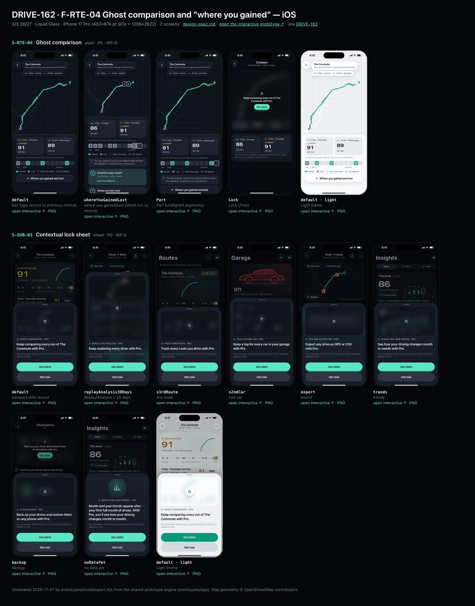
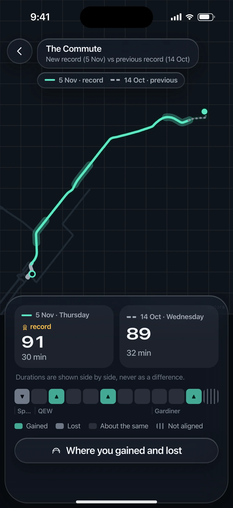
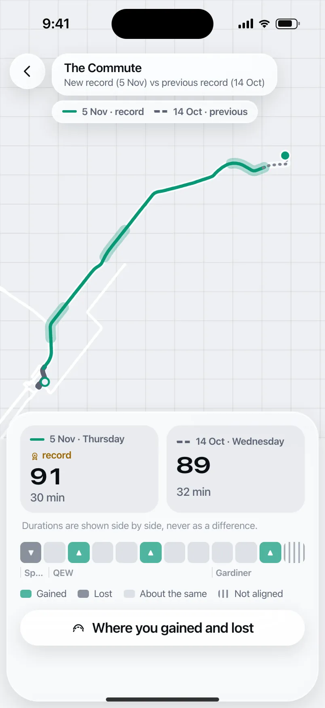
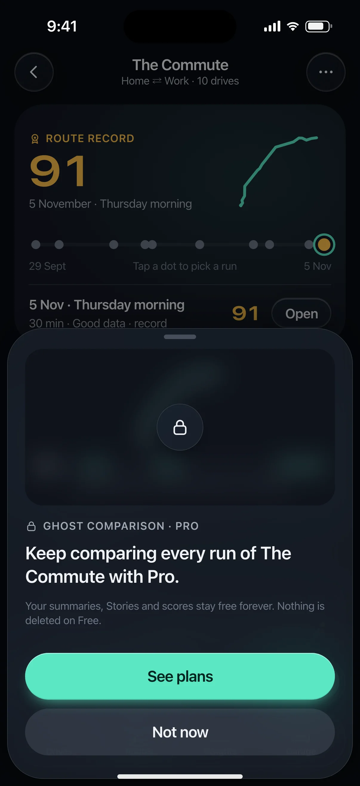
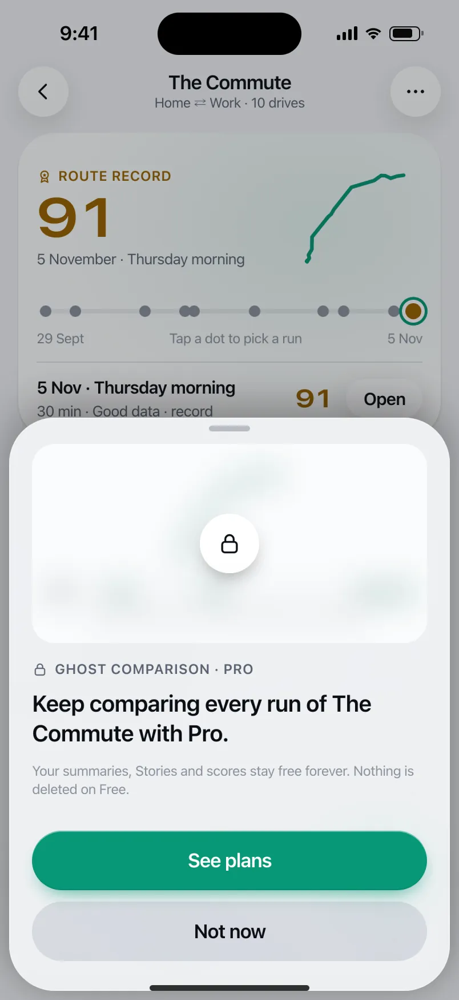

# DRIVE-162 · F-RTE-04 Ghost comparison and "where you gained" — iOS design spec

> Generated by `prototypes/tools/export.mjs` on 2026-11-06 from the shared prototype engine. **Do not edit by hand:** change the screen's `spec` in `prototypes/app/screens/wp-*.js` (see `prototypes/app/AUTHORING.md`) and re-export.

- **Jira story:** [DRIVE-162](https://thekeval.atlassian.net/browse/DRIVE-162) · F-RTE-04 · P0
- **Platform:** iOS 26/27 · Liquid Glass · iPhone 17 Pro (402×874 pt @3x = 1206×2622)
- **Interactive prototype:** [../../../../prototypes/ios/index.html#S-RTE-04](../../../../prototypes/ios/index.html#S-RTE-04) (catalog panel: every screen and state; deep links `#S-ID/state?trip=…&ent=…&theme=light&text=xl&rm=1`)
- **Contact sheet:** [mockup.html](mockup.html) · 
- **Design system (source of truth for values):** [brand](../../system/brand.md) · [components](../../system/components.md) · [motion](../../system/motion.md) · [accessibility](../../system/accessibility.md) · [screen map](../../system/screen-map.md) · [fixtures](../../system/fixtures.md) · tokens `prototypes/shared/tokens.css`

## Screens in this story

| Screen | Name | Presentation | Priority | States | Status |
|---|---|---|---|---|---|
| `S-RTE-04` | Ghost comparison | Push (immersive) | P0 | 4 | Prototyped |
| `S-SUB-03` | Contextual lock sheet | Sheet (medium) | P0 | 8 | Prototyped |

## Tokens used on this platform

Values resolved from `prototypes/shared/tokens.css` inside the iOS device (`[data-platform="ios"]`). Use the token names in code; the hex values are for reference.

| Token | Dark | Light |
|---|---|---|
| `--app-bg` | `#080B10` | `#F2F3F6` |
| `--card-bg` | `#131822` | `#FFFFFF` |
| `--dp-bg-grouped` | `#080B10` | `#F2F3F6` |
| `--dp-surface` | `#131822` | `#FFFFFF` |
| `--dp-surface-2` | `#1B222D` | `#F2F3F6` |
| `--dp-surface-3` | `#262E3B` | `#E4E7EC` |
| `--dp-fill` | `#7880961F` | `#7880961F` |
| `--dp-fill-strong` | `#7880963D` | `#78809633` |
| `--dp-text` | `#F2F4F7` | `#0B0E13` |
| `--dp-text-2` | `#A3AAB6` | `#5A6271` |
| `--dp-text-3` | `#6E7787` | `#8A919D` |
| `--dp-separator` | `#96A0B429` | `#3C435024` |
| `--dp-accent` | `#5BE7C4` | `#079777` |
| `--dp-accent-text` | `#5BE7C4` | `#06775E` |
| `--dp-on-accent` | `#04241D` | `#FFFFFF` |
| `--dp-accent-container` | `#0A4439` | `#C6F8EA` |
| `--dp-record` | `#FFC24B` | `#9A6300` |
| `--dp-positive` | `#5BE7C4` | `#06775E` |
| `--dp-change-down` | `#A3AAB6` | `#5A6271` |
| `--dp-warning` | `#F5B648` | `#9A5F00` |
| `--dp-critical` | `#FF6B6B` | `#C62828` |
| `--dp-glass-fill` | `#1C222C6B` | `#FFFFFF8C` |
| `--dp-glass-fill-strong` | `#1C222CB8` | `#FFFFFFD1` |
| `--dp-glass-stroke` | `#FFFFFF24` | `#FFFFFF99` |
| `--dp-data-route` | `#5BE7C4` | `#079777` |
| `--dp-data-event-brake` | `#FF7A66` | `#A21F16` |
| `--dp-data-event-accel` | `#E58BD0` | `#A33A8C` |
| `--dp-data-event-corner` | `#EAD54E` | `#9A8A00` |
| `--dp-data-quality-good` | `#5FDB9C` | `#1E9E62` |
| `--dp-data-speed` | `#D6DCE4` | `#404A58` |
| `--dp-data-long-g` | `#5AB8F5` | `#0A6AB8` |
| `--dp-data-lat-g` | `#F5A142` | `#B25A00` |

| Type / layout token | Value |
|---|---|
| `--dp-font-screen-title` | `700 34px / 41px -apple-system, BlinkMacSystemFont, "SF Pro Display", system-ui, sans-serif` |
| `--dp-font-sheet-title` | `700 22px / 28px -apple-system, BlinkMacSystemFont, "SF Pro Display", system-ui, sans-serif` |
| `--dp-font-section-title` | `600 20px / 25px -apple-system, BlinkMacSystemFont, "SF Pro Display", system-ui, sans-serif` |
| `--dp-font-card-title` | `600 17px / 22px -apple-system, BlinkMacSystemFont, "SF Pro Text", system-ui, sans-serif` |
| `--dp-font-body` | `400 17px / 22px -apple-system, BlinkMacSystemFont, "SF Pro Text", system-ui, sans-serif` |
| `--dp-font-body-secondary` | `400 15px / 20px -apple-system, BlinkMacSystemFont, "SF Pro Text", system-ui, sans-serif` |
| `--dp-font-meta` | `400 13px / 18px -apple-system, BlinkMacSystemFont, "SF Pro Text", system-ui, sans-serif` |
| `--dp-font-caption` | `400 12px / 16px -apple-system, BlinkMacSystemFont, "SF Pro Text", system-ui, sans-serif` |
| `--dp-font-button` | `600 17px / 22px -apple-system, BlinkMacSystemFont, "SF Pro Text", system-ui, sans-serif` |
| `--dp-num-hero` | `600 72px / 72px -apple-system, BlinkMacSystemFont, "SF Pro Display", system-ui, sans-serif` |
| `--dp-num-xl` | `600 48px / 52px -apple-system, BlinkMacSystemFont, "SF Pro Display", system-ui, sans-serif` |
| `--dp-num-l` | `600 34px / 38px -apple-system, BlinkMacSystemFont, "SF Pro Display", system-ui, sans-serif` |
| `--dp-num-m` | `600 24px / 28px -apple-system, BlinkMacSystemFont, "SF Pro Display", system-ui, sans-serif` |
| `--dp-num-s` | `600 17px / 22px -apple-system, BlinkMacSystemFont, "SF Pro Display", system-ui, sans-serif` |
| `--dp-num-xs` | `600 13px / 16px -apple-system, BlinkMacSystemFont, "SF Pro Display", system-ui, sans-serif` |
| `--dp-screen-margin` | `16px` |
| `--dp-radius-card` | `24px` |
| `--dp-radius-card-hero` | `32px` |
| `--dp-radius-sheet` | `38px` |
| `--dp-radius-chip` | `999px` |
| `--dp-radius-button` | `999px` |
| `--dp-layout-list-row-min` | `52px` |
| `--dp-layout-touch-min` | `44px` |
| `--safe-top` | `62px` |
| `--safe-bottom` | `34px` |

Text sizes scale with `--dp-text-scale` (XL = 2.0×) and numerals with `--dp-num-scale` (XL = 1.3×). DP Numerals: SF Pro Expanded Semibold, tabular.

---

## S-RTE-04 · Ghost comparison

 

- **Presentation:** push · tab: routes — screen map: “Push (immersive)”
- **Entry points:** S-RTE-02 Compare
- **Leads to:** S-RPL-02 evidence · S-SUB-03 (Free)
- **PRD features:** F-RTE-04 · **Priority:** P0 · **WP:** D
- **Interactive:** [S-RTE-04](../../../../prototypes/ios/index.html#S-RTE-04)

**Purpose.** Overlay a run with another run of the same route (the record, or the previous record) and show, segment by segment, where smoothness was gained or lost, with evidence links — never a time delta (F-RTE-04). Pro.

### States

| State | PRD label | Fixture params | Screenshot |
|---|---|---|---|
| `default` | Def (new record vs previous record) | `route=r_commute` `cmp=record` | [S-RTE-04.png](../../screens/ios/S-RTE-04.webp) · [open](../../../../prototypes/ios/index.html#S-RTE-04) |
| `whereYouGainedLost` | where you gained/lost (latest run vs record) | `route=r_commute` `cmp=latest` | [S-RTE-04--whereYouGainedLost.png](../../screens/ios/S-RTE-04--whereYouGainedLost.webp) · [open](../../../../prototypes/ios/index.html#S-RTE-04/whereYouGainedLost) |
| `Part` | Part (unaligned segments) | `route=r_commute` `cmp=record` | [S-RTE-04--Part.png](../../screens/ios/S-RTE-04--Part.webp) · [open](../../../../prototypes/ios/index.html#S-RTE-04/Part) |
| `Lock` | Lock (Free) | `route=r_commute` `cmp=latest` `ent=free` | [S-RTE-04--Lock.png](../../screens/ios/S-RTE-04--Lock.webp) · [open](../../../../prototypes/ios/index.html#S-RTE-04/Lock) |
| default · light | Light theme | `theme=light` | [S-RTE-04--light.png](../../screens/ios/S-RTE-04--light.webp) |

Every state also renders in light/dark (`theme=light`), XL text (`text=xl`) and reduced motion (`rm=1`).

### Layout

- Immersive push (no tab bar, no accessory): the map fills the top 62% (50% when the callouts are open), plain canvas with © OpenStreetMap contributors. Floating glass back button + glass title capsule (“The Commute” / “New record (5 Nov) vs previous record (14 Oct)”) and a glass legend capsule (solid = this run, dashed = ghost).
- Map: the ghost run in --dp-data-ghost 3 px dashed 2/4; this run distance-aligned into 12 segments: gained = Glide 4 px over a Glide glow 12 px at 35%, lost = neutral text-2 6 px, same = Glide 4 px, not aligned = grey dotted 1/6. Gained-most / lost-most markers (▲ / ▼ in 30 px circles) when open.
- Bottom panel (iOS glass card inset 8, radius 32 · Android standard bottom sheet surface-container-high, top radius 28): two run columns (line swatch, date · weekday, record tag, Smoothness DP Numerals 28, duration in neutral text) + “Durations are shown side by side, never as a difference.” · 12-cell segment strip with ▲/▼ glyphs and road labels (Speers Rd · QEW · Gardiner) · key (Gained · Lost · About the same · Not aligned).
- Closed: “Where you gained and lost” button (glass / tonal). Open (whereYouGainedLost): two callouts “Where you gained most / Closest to your record” and “Where you lost most”, each with an evidence link; the unaligned note.
- Part: the unaligned segment is highlighted in the strip and the note “The last segment could not be aligned (different lane into Spadina). It’s left out of the comparison.” appears.
- Lock (Free): standard top bar “Compare”; the user’s own overlay and strip blurred 14 px in a lock panel “Keep comparing every run of The Commute with Pro.” + See plans; below, both runs’ scores and durations stay free.

### Components & tokens

| Component | Tokens / spec |
|---|---|
| `map` | --dp-data-map-land/road/grid · route --dp-data-route 3.8 + casing --dp-data-route-casing 7.5 · estimated dashed 4/4 at 60% · gap --dp-data-gap-stroke dotted 1/6 · pins DP_ICONS.pin 26 · attribution “© OpenStreetMap contributors” |
| `backButton` | see components.md |
| `button` | --dp-accent / --dp-on-accent (filled) · --dp-fill-strong · --md-sys-color-secondary-container (tonal) · --dp-radius-button · height iOS 50/44/34 · Android 56/40/32 · --dp-font-button · components.md §0 |
| `lockPanel` | blur --dp-opacity-locked-blur 14px · dim --dp-opacity-locked-dim 35% · components.md §15.2 |
| `card` | --dp-surface / --md-sys-color-surface-container · --dp-radius-card (24 iOS · 16 Android) · hero: --dp-radius-card-hero (32 · 28) · light iOS: --dp-elev-1 |

### Interactions & navigation

- Back → S-RTE-02. “Where you gained and lost” → expands (state whereYouGainedLost).
- “See the evidence” → S-RPL-02 with the event in that segment (ghostLatest: Gardiner braking e1); with no event there → “Replay this stretch” → S-RPL-01 (both pass the D1 gate).
- Lock → S-SUB-03 (compare variant; the user’s own overlay blurred).

### Motion

- Hero motion: the ghost fades in (500 ms), then this run’s segments draw on start → end (260 ms each, 70 ms apart, ease.drawOn), segment cells pop in sync, callout markers pop last (shared.pinPop). RM: everything appears complete (220 ms fade).
- Expand: panel grows (spring.default), map height eases from 62% to 50%.

### Accessibility

- Map summary: “Map comparing your run on 5 Nov (solid line) with the run on 14 Oct (dashed ghost line). 4 segments gained smoothness, 1 lost, 1 could not be aligned.”
- Segment strip is one element listing each segment (“Speers Rd lost, QEW about the same, … Gardiner not aligned”).
- Run pair: “This run: Smoothness 91, 30 min. Other run: Smoothness 89, 32 min.” — no difference is computed or read out.
- Gained/lost use ▲/▼ glyphs, line weight and dash, not colour alone. XL: panel scrolls; run columns stack.

### Platform notes

- **iOS (this spec):** Full-bleed MapKit with glass back, title and legend capsules (.glassEffect(.clear) over the map); bottom panel = glass card; buttons .glass.
- *Android (for reference):* Full-bleed map with tonal floating icon button (48 dp) and chips; bottom panel = standard BottomSheetScaffold sheet (peek = run pair + strip), tonal button.

### Analytics

- `ghost_compare_opened {source, cmp: record|latest, locked}`
- `ghost_callouts_opened`
- `ghost_evidence_tapped {kind: event|replay}`

### Copy

| Key | Text |
|---|---|
| Duration note | Durations are shown side by side, never as a difference. |
| Gained (ghost) | Where you gained most: the Gardiner. You braked earlier and lighter than on the other run. |
| Lost (ghost) | Where you lost most: Speers Rd. More small corrections than on the other run. |
| Gained (latest) | Closest to your record: the Gardiner, within 1 point. |
| Lost (latest) | Where you lost most: the Gardiner. 1 abrupt input there that the other run didn’t have. |
| Unaligned | The last segment could not be aligned (different lane into Spadina). It’s left out of the comparison. |
| Lock | Keep comparing every run of The Commute with Pro. (lockSheets.compare) · Your scores and durations for both runs are free. The overlay and “where you gained” are part of Pro. |
| Key | Gained · Lost · About the same · Not aligned |

### Free / Pro

Pro (and Preview / Ride-along). Free after the Preview: Lock state — the overlay is blurred, the two scores and durations stay visible; See plans → S-SUB-03.

### Data & fixtures

default / Part: DP_DATA.ghost (run t20261105-0742 91 · 30 min vs t20261014-0744 89 · 32 min; 12 segments, #11 unaligned). whereYouGainedLost / Lock: DP_DATA.ghostLatest (t20261103-0737 86 vs record t20261105-0742). Segment geometry: fractions of distance mapped onto the run track by cumulative haversine distance (derived).

### Assets

[icon-ghost.svg](assets/icon-ghost.svg) · [icon-rosette.svg](assets/icon-rosette.svg) · [icon-info.svg](assets/icon-info.svg) · [icon-chevronRight.svg](assets/icon-chevronRight.svg) · [icon-chevronLeft.svg](assets/icon-chevronLeft.svg)

UI glyphs may be swapped for SF Symbols / Material Symbols Rounded equivalents; event-pin, quality and provenance glyphs must not be (components.md global rules).

### Checklist (accessibility.md §9)

- [ ] Light and dark both render, and contrast passes.
- [ ] The XL text state reflows with no truncation.
- [ ] The RM state is defined.
- [ ] Every control has a label; every chart and map has a summary sentence.
- [ ] Every target ≥ 44 pt / 48 dp (≥ 64 in-drive).
- [ ] No meaning by colour alone.
- [ ] Speed is neutral wherever it appears and absent from social or live surfaces.
- [ ] No streak, leaderboard, speed or “beat your time” language.
- [ ] Behaviour is defined while a trip is active (D1 gate).
- [ ] Haptics come from motion.md §6 only.

---

## S-SUB-03 · Contextual lock sheet

 

- **Presentation:** sheet · tab: profile · detent: auto — screen map: “Sheet (medium)”
- **Entry points:** Any Pro gate (compare, > 30-day Replay/Analysis, 3rd route, 2nd car, export, trends, backup)
- **Leads to:** S-SUB-04 · "Not now" → exactly where the user was
- **PRD features:** F-SUB-04, F-HIS-03, F-RTE-04, F-RTE-05, F-ACC-03, F-RPL-01, F-SUB-08 · **Priority:** P0 · **WP:** E
- **Interactive:** [S-SUB-03](../../../../prototypes/ios/index.html#S-SUB-03)

**Purpose.** When a Free user taps a Pro feature, show what Pro would show on their own data — blurred, never a stock screenshot — with one sentence of value, “See plans” and “Not now” (F-SUB-04, F-HIS-03 “locked, not lost”). Not now returns exactly where they were.

### States

| State | PRD label | Fixture params | Screenshot |
|---|---|---|---|
| `default` | compare with record | `ent=free` | [S-SUB-03.png](../../screens/ios/S-SUB-03.webp) · [open](../../../../prototypes/ios/index.html#S-SUB-03) |
| `replayAnalysis30Days` | Replay/Analysis > 30 days | `ent=free` | [S-SUB-03--replayAnalysis30Days.png](../../screens/ios/S-SUB-03--replayAnalysis30Days.webp) · [open](../../../../prototypes/ios/index.html#S-SUB-03/replayAnalysis30Days) |
| `s3rdRoute` | 3rd route | `ent=free` | [S-SUB-03--s3rdRoute.png](../../screens/ios/S-SUB-03--s3rdRoute.webp) · [open](../../../../prototypes/ios/index.html#S-SUB-03/s3rdRoute) |
| `s2ndCar` | 2nd car | `ent=free` | [S-SUB-03--s2ndCar.png](../../screens/ios/S-SUB-03--s2ndCar.webp) · [open](../../../../prototypes/ios/index.html#S-SUB-03/s2ndCar) |
| `export` | export | `ent=free` | [S-SUB-03--export.png](../../screens/ios/S-SUB-03--export.webp) · [open](../../../../prototypes/ios/index.html#S-SUB-03/export) |
| `trends` | trends | `ent=free` | [S-SUB-03--trends.png](../../screens/ios/S-SUB-03--trends.webp) · [open](../../../../prototypes/ios/index.html#S-SUB-03/trends) |
| `backup` | backup | `ent=free` | [S-SUB-03--backup.png](../../screens/ios/S-SUB-03--backup.webp) · [open](../../../../prototypes/ios/index.html#S-SUB-03/backup) |
| `noDataYet` | no data yet | `ent=free` | [S-SUB-03--noDataYet.png](../../screens/ios/S-SUB-03--noDataYet.webp) · [open](../../../../prototypes/ios/index.html#S-SUB-03/noDataYet) |
| default · light | Light theme | `theme=light` | [S-SUB-03--light.png](../../screens/ios/S-SUB-03--light.webp) |

Every state also renders in light/dark (`theme=light`), XL text (`text=xl`) and reduced motion (`rm=1`).

### Layout

- Sheet fitted to content (spec: medium). Top: the user’s own content for that feature, blurred 14 px + 35% dim, radius 20, with a 52 lock disc centred (iOS glass, Android tonal).
- Variants (own data): compare = The Commute ghost vs record + 12 gained/lost segments · Replay/Analysis > 30 days = that trip’s map + synced timeline · 3rd route = Gym card (glyph, 2 drives, record 84, run dots) · 2nd car = Ioniq silhouette + drives/average/km tiles · export = that drive’s CSV rows · trends = October trend sparkline + Month/Year/Per car/Per route tabs · backup = backup status · no data yet = illustration instead of a blur.
- Kicker “🔒 Ghost comparison · Pro”, then the value sentence (sheetTitle-size, 20/26 semibold): entitlement.lockSheets.*, footnote “Your summaries, Stories and scores stay free forever. Nothing is deleted on Free.”
- Stacked large buttons: “See plans” (filled) · “Not now” (tonal).

### Components & tokens

| Component | Tokens / spec |
|---|---|
| `sheet` | iOS glass --dp-glass-fill-strong + --dp-glass-prominent-blur, radius --dp-radius-sheet 38 · Android ModalBottomSheet --md-sys-color-surface-container-low, top radius 28, drag handle 32×4 · motion spring.sheet |
| `lockPanel` | blur --dp-opacity-locked-blur 14px · dim --dp-opacity-locked-dim 35% · components.md §15.2 |
| `map` | --dp-data-map-land/road/grid · route --dp-data-route 3.8 + casing --dp-data-route-casing 7.5 · estimated dashed 4/4 at 60% · gap --dp-data-gap-stroke dotted 1/6 · pins DP_ICONS.pin 26 · attribution “© OpenStreetMap contributors” |
| `timeline` | --dp-data-speed · --dp-data-long-g · --dp-data-lat-g (dashed 6/3) · cursor --dp-data-cursor · components.md §7 |
| `glyph` | see components.md |
| `stats` | --dp-surface-2 / --md-sys-color-surface-container-high · radius 14 iOS / 12 Android · value --dp-num-m (DP Numerals) · components.md §5 |
| `sparkline` | see components.md |
| `scoreBadge` | iOS mini ring 46 · Android Cookie9Sided 46 · --dp-num-s |
| `button` | --dp-accent / --dp-on-accent (filled) · --dp-fill-strong · --md-sys-color-secondary-container (tonal) · --dp-radius-button · height iOS 50/44/34 · Android 56/40/32 · --dp-font-button · components.md §0 |

### Interactions & navigation

- See plans → S-SUB-04 (from = feature). Not now / drag / scrim → back to exactly where the user was (scroll position kept).
- Gate: never during a trip or on a worse-than-usual Story’s end card (F-SUB-08.3); the D1 gate holds it while moving.

### Motion

- The user’s content blurs from 0 → 14 px over 320 ms (spring.effects) while the sheet rises at the medium detent; the lock disc pops at 360 ms. RM: shown already blurred, fade.

### Accessibility

- The blurred preview is hidden from screen readers; the sheet reads “Ghost comparison, Pro. Keep comparing every run of The Commute with Pro.” then the buttons. XL: opens large; the preview keeps its height.

### Platform notes

- **iOS (this spec):** Glass sheet at a partial detent; lock disc in glass.
- *Android (for reference):* ModalBottomSheet; lock disc on surfaceContainerHigh; RenderEffect blur (API 31+) or a pre-blurred bitmap.

### Analytics

- `lock_viewed {feature}`
- `lock_cta {see_plans|not_now}`

### Copy

| Key | Text |
|---|---|
| compare | Keep comparing every run of The Commute with Pro. |
| oldAnalysis | Keep exploring every drive with Pro. |
| thirdRoute | Track every route you drive with Pro. |
| secondCar | Keep a log for every car in your garage with Pro. |
| export | Export any drive as GPX or CSV with Pro. |
| trends | See how your driving changes month to month with Pro. |
| backup | Back up your drives and restore them on any phone with Pro. |
| noDataYet | Month and year trends appear after your first full month of drives. With Pro, you’ll see how your driving changes month to month. |
| Footnote | Your summaries, Stories and scores stay free forever. Nothing is deleted on Free. |

### Free / Pro

Free users only (ent = free). Preview/Ride-along/Pro never see it.

### Data & fixtures

compare: route r_commute + ghost (91 vs 89) · replay: t20261002-0745 · 3rd route: r_gym · 2nd car: Ioniq (derived: its scored trips, average and km) · export: t20261105-1745 · trends: wrapped.monthly trend weeks [81, 85, 85, 87] · backup: privacy.dataSize. Parent screens rendered underneath on a deep link follow the variant (S-RTE-02, S-TRP-01 Lock, S-RTE-01, S-GAR-01, S-STA-01, S-ACC-04 Lock).

### Assets

[icon-lock.svg](assets/icon-lock.svg) · [icon-insights.svg](assets/icon-insights.svg) · [icon-cloud.svg](assets/icon-cloud.svg)

UI glyphs may be swapped for SF Symbols / Material Symbols Rounded equivalents; event-pin, quality and provenance glyphs must not be (components.md global rules).

### Checklist (accessibility.md §9)

- [ ] Light and dark both render, and contrast passes.
- [ ] The XL text state reflows with no truncation.
- [ ] The RM state is defined.
- [ ] Every control has a label; every chart and map has a summary sentence.
- [ ] Every target ≥ 44 pt / 48 dp (≥ 64 in-drive).
- [ ] No meaning by colour alone.
- [ ] Speed is neutral wherever it appears and absent from social or live surfaces.
- [ ] No streak, leaderboard, speed or “beat your time” language.
- [ ] Behaviour is defined while a trip is active (D1 gate).
- [ ] Haptics come from motion.md §6 only.

---

Map geometry in the prototype: © OpenStreetMap contributors (ODbL). Speed and G are simulated fixtures (fixtures.md).
