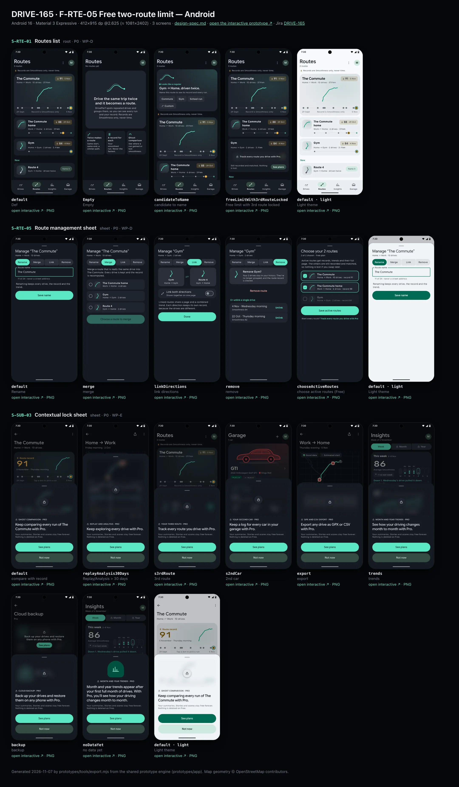
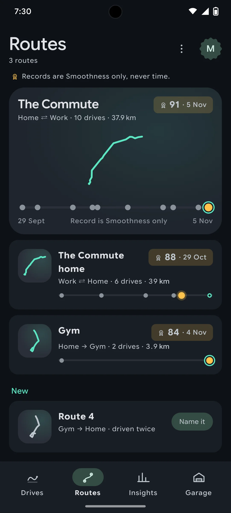
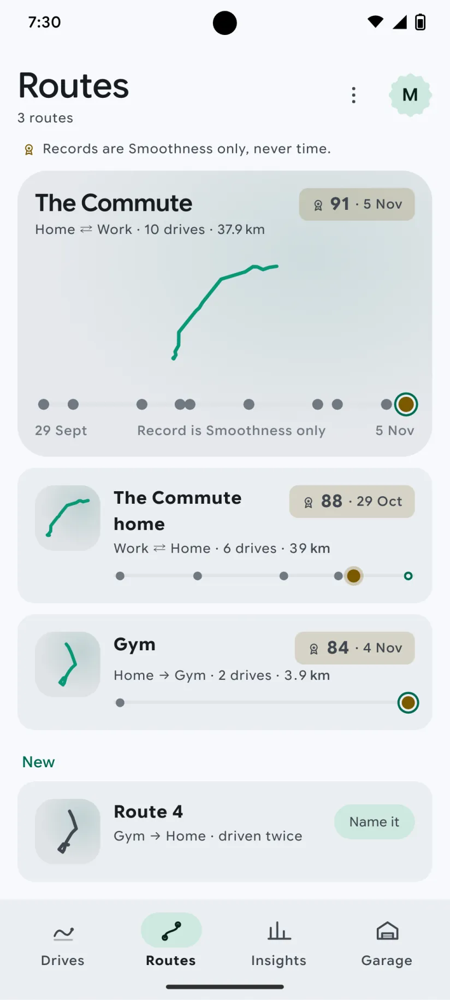
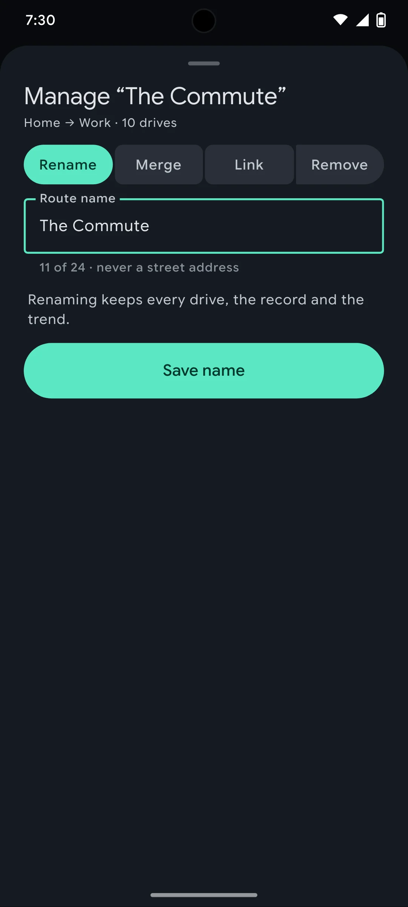
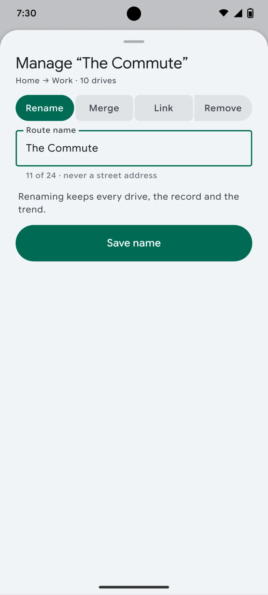
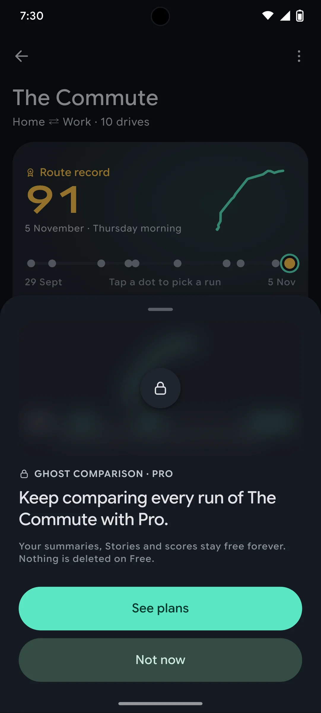
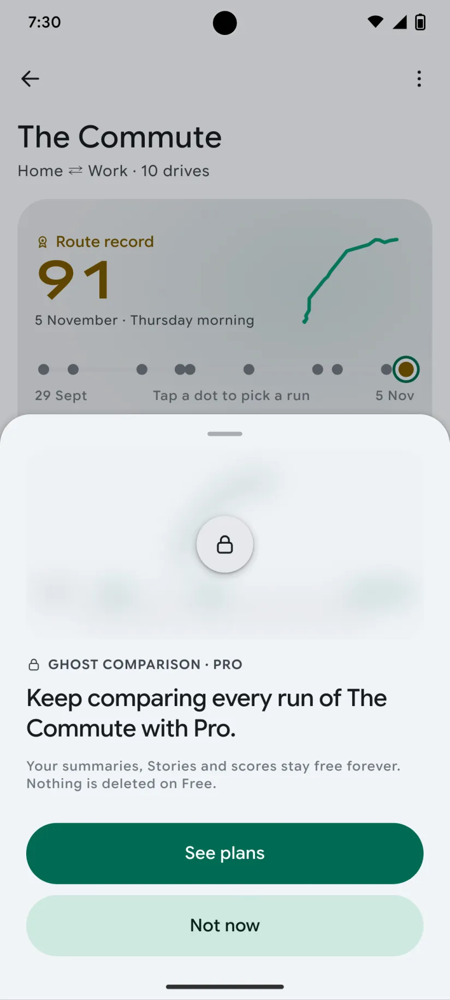

# DRIVE-165 · F-RTE-05 Free two-route limit — Android design spec

> Generated by `prototypes/tools/export.mjs` on 2026-11-06 from the shared prototype engine. **Do not edit by hand:** change the screen's `spec` in `prototypes/app/screens/wp-*.js` (see `prototypes/app/AUTHORING.md`) and re-export.

- **Jira story:** [DRIVE-165](https://thekeval.atlassian.net/browse/DRIVE-165) · F-RTE-05 · P0
- **Platform:** Android 16 · Material 3 Expressive · 412×915 dp @2.625 (≈ 1081×2402)
- **Interactive prototype:** [../../../../prototypes/android/index.html#S-RTE-01](../../../../prototypes/android/index.html#S-RTE-01) (catalog panel: every screen and state; deep links `#S-ID/state?trip=…&ent=…&theme=light&text=xl&rm=1`)
- **Contact sheet:** [mockup.html](mockup.html) · 
- **Design system (source of truth for values):** [brand](../../system/brand.md) · [components](../../system/components.md) · [motion](../../system/motion.md) · [accessibility](../../system/accessibility.md) · [screen map](../../system/screen-map.md) · [fixtures](../../system/fixtures.md) · tokens `prototypes/shared/tokens.css`

## Screens in this story

| Screen | Name | Presentation | Priority | States | Status |
|---|---|---|---|---|---|
| `S-RTE-01` | Routes list | Root (Routes tab) | P0 | 4 | Prototyped |
| `S-RTE-05` | Route management sheet | Sheet (large) | P0 | 5 | Prototyped |
| `S-SUB-03` | Contextual lock sheet | Sheet (medium) | P0 | 8 | Prototyped |

## Tokens used on this platform

Values resolved from `prototypes/shared/tokens.css` inside the Android device (`[data-platform="android"]`). Use the token names in code; the hex values are for reference.

| Token | Dark | Light |
|---|---|---|
| `--app-bg` | `#0D1117` | `#F7F9FC` |
| `--card-bg` | `#191E25` | `#EBEEF2` |
| `--dp-bg-grouped` | `#0D1117` | `#F7F9FC` |
| `--dp-surface` | `#191E25` | `#EBEEF2` |
| `--dp-surface-2` | `#1F252D` | `#E5E8EC` |
| `--dp-surface-3` | `#2A3038` | `#DFE2E6` |
| `--dp-fill` | `#2A3038` | `#DFE2E6` |
| `--dp-fill-strong` | `#353B44` | `#D3D7DC` |
| `--dp-text` | `#E1E3E8` | `#181C20` |
| `--dp-text-2` | `#C0C7CF` | `#40474F` |
| `--dp-text-3` | `#8A929B` | `#707881` |
| `--dp-separator` | `#40474F` | `#C0C7CF` |
| `--dp-accent` | `#5BE7C4` | `#006B53` |
| `--dp-accent-text` | `#5BE7C4` | `#006B53` |
| `--dp-on-accent` | `#00382B` | `#FFFFFF` |
| `--dp-accent-container` | `#00513F` | `#91F1D8` |
| `--dp-record` | `#FFC24B` | `#7A5900` |
| `--dp-positive` | `#5BE7C4` | `#006B53` |
| `--dp-change-down` | `#C0C7CF` | `#40474F` |
| `--dp-warning` | `#F5B648` | `#7A5900` |
| `--dp-critical` | `#FFB4AB` | `#BA1A1A` |
| `--dp-glass-fill` | `#1F252DF2` | `#E5E8ECF2` |
| `--dp-glass-fill-strong` | `#2A3038` | `#DFE2E6` |
| `--dp-glass-stroke` | `#FFFFFF0F` | `#0000000A` |
| `--md-sys-color-primary` | `#5BE7C4` | `#006B53` |
| `--md-sys-color-on-primary` | `#00382B` | `#FFFFFF` |
| `--md-sys-color-primary-container` | `#00513F` | `#91F1D8` |
| `--md-sys-color-on-primary-container` | `#91F1D8` | `#002118` |
| `--md-sys-color-secondary-container` | `#344C44` | `#CEE9DF` |
| `--md-sys-color-surface` | `#0D1117` | `#F7F9FC` |
| `--md-sys-color-surface-container` | `#191E25` | `#EBEEF2` |
| `--md-sys-color-surface-container-high` | `#1F252D` | `#E5E8EC` |
| `--md-sys-color-on-surface-variant` | `#C0C7CF` | `#40474F` |
| `--dp-data-route` | `#5BE7C4` | `#079777` |
| `--dp-data-event-brake` | `#FF7A66` | `#A21F16` |
| `--dp-data-event-accel` | `#E58BD0` | `#A33A8C` |
| `--dp-data-event-corner` | `#EAD54E` | `#9A8A00` |
| `--dp-data-quality-good` | `#5FDB9C` | `#1E9E62` |
| `--dp-data-speed` | `#D6DCE4` | `#404A58` |
| `--dp-data-long-g` | `#5AB8F5` | `#0A6AB8` |
| `--dp-data-lat-g` | `#F5A142` | `#B25A00` |

| Type / layout token | Value |
|---|---|
| `--dp-font-screen-title` | `600 32px / 40px "Google Sans Flex", "Google Sans Display", "Roboto Flex", Roboto, system-ui, sans-serif` |
| `--dp-font-sheet-title` | `400 24px / 32px "Google Sans Flex", "Google Sans Display", "Roboto Flex", Roboto, system-ui, sans-serif` |
| `--dp-font-section-title` | `600 22px / 28px "Google Sans Flex", "Google Sans Display", "Roboto Flex", Roboto, system-ui, sans-serif` |
| `--dp-font-card-title` | `700 16px / 24px "Google Sans Flex", "Google Sans Text", "Roboto Flex", Roboto, system-ui, sans-serif` |
| `--dp-font-body` | `400 16px / 24px "Google Sans Flex", "Google Sans Text", "Roboto Flex", Roboto, system-ui, sans-serif` |
| `--dp-font-body-secondary` | `400 14px / 20px "Google Sans Flex", "Google Sans Text", "Roboto Flex", Roboto, system-ui, sans-serif` |
| `--dp-font-meta` | `400 12px / 16px "Google Sans Flex", "Google Sans Text", "Roboto Flex", Roboto, system-ui, sans-serif` |
| `--dp-font-caption` | `500 12px / 16px "Google Sans Flex", "Google Sans Text", "Roboto Flex", Roboto, system-ui, sans-serif` |
| `--dp-font-button` | `700 14px / 20px "Google Sans Flex", "Google Sans Text", "Roboto Flex", Roboto, system-ui, sans-serif` |
| `--dp-num-hero` | `600 72px / 72px "Google Sans Flex", "Roboto Flex", Roboto, system-ui, sans-serif` |
| `--dp-num-xl` | `600 48px / 52px "Google Sans Flex", "Roboto Flex", Roboto, system-ui, sans-serif` |
| `--dp-num-l` | `600 34px / 38px "Google Sans Flex", "Roboto Flex", Roboto, system-ui, sans-serif` |
| `--dp-num-m` | `600 24px / 28px "Google Sans Flex", "Roboto Flex", Roboto, system-ui, sans-serif` |
| `--dp-num-s` | `600 17px / 22px "Google Sans Flex", "Roboto Flex", Roboto, system-ui, sans-serif` |
| `--dp-num-xs` | `600 13px / 16px "Google Sans Flex", "Roboto Flex", Roboto, system-ui, sans-serif` |
| `--dp-screen-margin` | `16px` |
| `--dp-radius-card` | `16px` |
| `--dp-radius-card-hero` | `28px` |
| `--dp-radius-sheet` | `28px` |
| `--dp-radius-chip` | `8px` |
| `--dp-radius-button` | `999px` |
| `--dp-layout-list-row-min` | `56px` |
| `--dp-layout-touch-min` | `48px` |
| `--safe-top` | `40px` |
| `--safe-bottom` | `24px` |

Text sizes scale with `--dp-text-scale` (XL = 2.0×) and numerals with `--dp-num-scale` (XL = 1.3×). DP Numerals: Google Sans Flex wdth 120 wght 600, tabular.

---

## S-RTE-01 · Routes list

 

- **Presentation:** root · tab: routes — screen map: “Root (Routes tab)”
- **Entry points:** Tab
- **Leads to:** S-RTE-02 · S-RTE-03 (candidate) · S-SUB-03 (3rd route) · S-RTE-05
- **PRD features:** F-RTE-02, F-RTE-05 · **Priority:** P0 · **WP:** D
- **Interactive:** [S-RTE-01](../../../../prototypes/android/index.html#S-RTE-01)

**Purpose.** The Routes tab: every route DrivePerf has grouped from repeated drives, with its record and runs at a glance, new candidates to name, and the Free two-route limit shown “locked, not lost” (F-RTE-02, F-RTE-05).

### States

| State | PRD label | Fixture params | Screenshot |
|---|---|---|---|
| `default` | Def | — | [S-RTE-01.png](../../screens/android/S-RTE-01.webp) · [open](../../../../prototypes/android/index.html#S-RTE-01) |
| `Empty` | Empty | — | [S-RTE-01--Empty.png](../../screens/android/S-RTE-01--Empty.webp) · [open](../../../../prototypes/android/index.html#S-RTE-01/Empty) |
| `candidateToName` | candidate to name | — | [S-RTE-01--candidateToName.png](../../screens/android/S-RTE-01--candidateToName.webp) · [open](../../../../prototypes/android/index.html#S-RTE-01/candidateToName) |
| `freeLimitWith3rdRouteLocked` | Free limit with 3rd route locked | `ent=free` | [S-RTE-01--freeLimitWith3rdRouteLocked.png](../../screens/android/S-RTE-01--freeLimitWith3rdRouteLocked.webp) · [open](../../../../prototypes/android/index.html#S-RTE-01/freeLimitWith3rdRouteLocked) |
| default · light | Light theme | `theme=light` | [S-RTE-01--light.png](../../screens/android/S-RTE-01--light.webp) |

Every state also renders in light/dark (`theme=light`), XL text (`text=xl`) and reduced motion (`rm=1`).

### Layout

- Large title “Routes”; trailing “…” menu (Choose active routes on Free · Rename · Merge · Link directions → S-RTE-05) + Preview badge + avatar. Android subtitle “3 routes”.
- Rule line under the title: gold rosette + “Records are Smoothness only, never time.” (meta, text-2).
- Hero route card (most-driven route, radius 32 / 28, Glide radial wash): name (section title) · “Home ⇄ Work · 10 drives · 37.9 km” · record chip (rosette, “91 · 5 Nov”, --dp-record on 18%) · route glyph 132 in Glide (share-safe trimmed shape) · dot strip (10 px dots on a 4 px track, x = date; record gold 14 px, latest outlined Glide) · axis “29 Sep · Record is Smoothness only · 5 Nov”.
- Route cards (radius 24 / 16): glyph thumbnail 52 on surface-2 · name · direction (⇄ when linked) · drives · km · record chip · mini dot strip.
- Candidate: “New” section with “Route 4 · Gym → Home · driven twice” + tonal “Name it”. Candidate state: hero prompt card with the merge illustration, kicker “● Looks like a regular”, “Gym → Home, driven twice.”, chips Commute · Gym · School run · Custom.
- Free limit: the third route keeps its name, meta and record visible; its glyph and dot strip are blurred 14 px with a lock and “Track every route you drive with Pro.”; footer “Still recorded and matched. Nothing is lost.” + See plans; a “2 of 2 routes active on Free” row → S-RTE-05 chooseActiveRoutes.
- Empty: hero card with the two-lines-merging illustration (artMerge 120), “Drive the same trip twice and it becomes a route.” + 3 how-it-works tiles (Twice makes a route · A record for each · Ghost comparison).

### Components & tokens

| Component | Tokens / spec |
|---|---|
| `largeTitle` | --dp-font-screen-title (iOS 34/41 bold · Android 32/40) · components.md §2 |
| `menu` | iOS glass Menu: --dp-glass-fill-strong, radius 26 · Android DropdownMenu: --md-sys-color-surface-container, radius 16 |
| `iconButton` | see components.md |
| `avatar` | see components.md |
| `card` | --dp-surface / --md-sys-color-surface-container · --dp-radius-card (24 iOS · 16 Android) · hero: --dp-radius-card-hero (32 · 28) · light iOS: --dp-elev-1 |
| `glyph` | see components.md |
| `chip` | --dp-radius-chip (iOS capsule · Android 8) · height 28 · --dp-font-caption |
| `button` | --dp-accent / --dp-on-accent (filled) · --dp-fill-strong · --md-sys-color-secondary-container (tonal) · --dp-radius-button · height iOS 50/44/34 · Android 56/40/32 · --dp-font-button · components.md §0 |
| `lockPanel` | blur --dp-opacity-locked-blur 14px · dim --dp-opacity-locked-dim 35% · components.md §15.2 |
| `list` | iOS inset grouped radius --dp-radius-card, rows 52 pt, separators --dp-separator inset 16 · Android ListItem 56/72 dp in --md-sys-color-surface-container |
| `row` | --dp-font-body · --dp-font-meta (supporting) · --dp-layout-list-row-min |
| `section` | --dp-font-section-title · --dp-layout-section-gap 28 |
| `empty` | illustration 120 in --dp-accent · --dp-font-section-title · components.md §21 |
| `artMerge` | see components.md |

### Interactions & navigation

- Route card → S-RTE-02 (iOS zoom / Android container transform from the card). A locked route’s card opens S-SUB-03 s3rdRoute via the lock; its page is S-RTE-02/Lock.
- “Name it” / prompt chips → S-RTE-03 (preset chip pre-selected; Custom → S-RTE-03/custom).
- “…” menu and the Free row → S-RTE-05 (rename / merge / link / choose active routes).

### Motion

- Hero motion: the hero route glyph draws on (1600 ms, ease.drawOn), then its run dots pop in date order (shared.pinPop, 40 ms stagger); cards rise 8 px, 40 ms stagger. RM: glyph and dots appear complete (220 ms fade).
- Card → detail: zoom / container transform (spring.slow).

### Accessibility

- Route card is one button: “The Commute, Home to Work. 10 drives. Route record 91, 5 November. Linked with The Commute home.”
- Dot strip summary: “10 drives on The Commute. Record 91 on 5 November. Latest 91 on 5 November.” The glyph is decorative inside the labelled card.
- Record meaning: rosette + “record” text, never gold alone. Lock: “Part of Pro on the Free plan.”
- XL: record chips move under the name; dot strips keep full width; how-it-works tiles stack.

### Platform notes

- **Android (this spec):** LargeFlexibleTopAppBar with subtitle and overflow DropdownMenu; cards surface-container (hero surface-container-high, 28 dp); tonal “Name it” button; NavigationBar.
- *iOS (for reference):* Large title + glass toolbar “…” Menu and avatar; hero card --dp-surface with Glide wash; cards with continuous corners; floating tab bar + capture accessory.

### Analytics

- `routes_opened {route_count_bucket}`
- `route_candidate_prompt_tapped {preset|custom}`
- `route_limit_hit`
- `locked_content_viewed {type: route}`

### Copy

| Key | Text |
|---|---|
| Title | Routes |
| Rule | Records are Smoothness only, never time. |
| Candidate | Looks like a regular · {from} → {to}, driven twice. Name this route to see its record and every run. |
| Lock | Track every route you drive with Pro. (lockSheets.thirdRoute) · Still recorded and matched. Nothing is lost. |
| Free row | 2 of 2 routes active on Free · Choose which two get records and comparisons |
| Empty | Drive the same trip twice and it becomes a route. DrivePerf spots repeated drives and groups them, so you can see every run and your record. Records are Smoothness only, never time. |

### Free / Pro

Free: 2 active routes (entitlement.states.free.activeRouteIds = The Commute, The Commute home); Gym is the locked 3rd route — still recorded and matched, its depth blurred → S-SUB-03 s3rdRoute; the candidate can still be named. Pro/Preview: unlimited routes, no locks.

### Data & fixtures

DP_DATA.routes: r_commute (10 runs, record 91 · 5 Nov, linked) · r_commute_home (6, 88 · 29 Oct, linked) · r_gym (2, 84 · 4 Nov; freeLocked) · r_cand_gym_home (candidate “Route 4”, 2 runs). Empty simulates routes: [].

### Assets

[icon-routes.svg](assets/icon-routes.svg) · [icon-rosette.svg](assets/icon-rosette.svg) · [icon-more.svg](assets/icon-more.svg) · [icon-edit.svg](assets/icon-edit.svg) · [icon-layers.svg](assets/icon-layers.svg) · [icon-check.svg](assets/icon-check.svg) · [icon-lock.svg](assets/icon-lock.svg) · [icon-ghost.svg](assets/icon-ghost.svg)

UI glyphs may be swapped for SF Symbols / Material Symbols Rounded equivalents; event-pin, quality and provenance glyphs must not be (components.md global rules).

### Checklist (accessibility.md §9)

- [ ] Light and dark both render, and contrast passes.
- [ ] The XL text state reflows with no truncation.
- [ ] The RM state is defined.
- [ ] Every control has a label; every chart and map has a summary sentence.
- [ ] Every target ≥ 44 pt / 48 dp (≥ 64 in-drive).
- [ ] No meaning by colour alone.
- [ ] Speed is neutral wherever it appears and absent from social or live surfaces.
- [ ] No streak, leaderboard, speed or “beat your time” language.
- [ ] Behaviour is defined while a trip is active (D1 gate).
- [ ] Haptics come from motion.md §6 only.

---

## S-RTE-05 · Route management sheet

 

- **Presentation:** sheet · tab: routes · detent: large — screen map: “Sheet (large)”
- **Entry points:** S-RTE-01/02 manage · S-SUB-07 choose routes
- **Leads to:** Back
- **PRD features:** F-RTE-05, F-RTE-06 · **Priority:** P0 · **WP:** D
- **Interactive:** [S-RTE-05](../../../../prototypes/android/index.html#S-RTE-05)

**Purpose.** Manage a route — rename, merge, link directions, remove it or unlink a single drive — and, on Free, choose which 2 routes are active (F-RTE-05, F-RTE-06). Records and trends recompute within 2 s; no trip is ever deleted.

### States

| State | PRD label | Fixture params | Screenshot |
|---|---|---|---|
| `default` | Rename | `route=r_commute` | [S-RTE-05.png](../../screens/android/S-RTE-05.webp) · [open](../../../../prototypes/android/index.html#S-RTE-05) |
| `merge` | merge | `route=r_commute` | [S-RTE-05--merge.png](../../screens/android/S-RTE-05--merge.webp) · [open](../../../../prototypes/android/index.html#S-RTE-05/merge) |
| `linkDirections` | link directions | `route=r_gym` | [S-RTE-05--linkDirections.png](../../screens/android/S-RTE-05--linkDirections.webp) · [open](../../../../prototypes/android/index.html#S-RTE-05/linkDirections) |
| `remove` | remove | `route=r_gym` | [S-RTE-05--remove.png](../../screens/android/S-RTE-05--remove.webp) · [open](../../../../prototypes/android/index.html#S-RTE-05/remove) |
| `chooseActiveRoutes` | choose active routes (Free) | `ent=free` | [S-RTE-05--chooseActiveRoutes.png](../../screens/android/S-RTE-05--chooseActiveRoutes.webp) · [open](../../../../prototypes/android/index.html#S-RTE-05/chooseActiveRoutes) |
| default · light | Light theme | `theme=light` | [S-RTE-05--light.png](../../screens/android/S-RTE-05--light.webp) |

Every state also renders in light/dark (`theme=light`), XL text (`text=xl`) and reduced motion (`rm=1`).

### Layout

- Large sheet. Header “Manage “The Commute”” + “Home → Work · 10 drives”. Mode selector: Rename · Merge · Link · Remove (iOS glass segmented · Android connected button group).
- Rename: text field (focused, helper “11 of 24 · never a street address”) · note · “Save name” (filled, large).
- Merge: note · radio cards (glyph 40, name, direction · drives) · preview line (“The Commute · 12 drives after merging” or the “runs the other way… Linking may be what you want.” hint) · “Merge into The Commute”.
- Link: two glyph tiles with ⇄ between · “Link both directions” switch row · note “Each direction keeps its own record” · Done.
- Remove: glyph + “Remove Gym?” + “Your 2 drives stay in your history…” · destructive “Remove route” · “Or unlink a single drive” list with Unlink text buttons.
- Choose active routes (Free, from S-SUB-07 or the Routes tab): header “Choose your 2 routes · 2 of 2 chosen · Free plan”, explanation, check cards sorted by runs (a third card dims once 2 are chosen), “Save active routes”, footer link “Track every route you drive with Pro”.

### Components & tokens

| Component | Tokens / spec |
|---|---|
| `sheetHeader` | see components.md |
| `segmented` | see components.md |
| `textField` | see components.md |
| `glyph` | see components.md |
| `list` | iOS inset grouped radius --dp-radius-card, rows 52 pt, separators --dp-separator inset 16 · Android ListItem 56/72 dp in --md-sys-color-surface-container |
| `row` | --dp-font-body · --dp-font-meta (supporting) · --dp-layout-list-row-min |
| `toggle` | iOS 51×31 tint --dp-accent · Android M3 Switch 52×32 --md-sys-color-primary |
| `button` | --dp-accent / --dp-on-accent (filled) · --dp-fill-strong · --md-sys-color-secondary-container (tonal) · --dp-radius-button · height iOS 50/44/34 · Android 56/40/32 · --dp-font-button · components.md §0 |
| `section` | --dp-font-section-title · --dp-layout-section-gap 28 |

### Interactions & navigation

- Mode segments switch state in place (selection haptic). Save / Merge / Done / Remove → toast + dismiss to S-RTE-02 (or S-RTE-01).
- Unlink → toast “Drive unlinked · record recomputed”.
- Choose: tapping a card toggles it; a third tap is ignored while 2 are chosen (the dimmed card says why). Save → “Active routes updated · no drives lost”. The Pro link → S-SUB-03 s3rdRoute.

### Motion

- Sheet spring.sheet (large detent recedes the parent on iOS). Hero motion: content rises 8 px, 30 ms stagger; check/radio fill spring.fast. RM: cross-fades.

### Accessibility

- Check cards are checkboxes: “The Commute, 10 drives, active”. Radio cards in a radio group.
- Destructive button reads “Remove route”; the consequence text precedes it.
- XL: segmented labels shorten to icons + labels on two lines; cards wrap text; buttons stay full width.

### Platform notes

- **Android (this spec):** ModalBottomSheet full height; connected ButtonGroup; OutlinedTextField; Switch; error-coloured FilledTonalButton for Remove; Checkbox cards.
- *iOS (for reference):* Sheet with large detent; glass segmented Picker; TextField; Toggle; destructive role button.

### Analytics

- `route_managed {action: rename|merge|link|unlink|remove}`
- `route_active_swapped`

### Copy

| Key | Text |
|---|---|
| Rename | Renaming keeps every drive, the record and the trend. |
| Merge | Merge a route that is really the same drive into {route}. Every drive is kept and the record is recomputed. |
| Link | Linked routes share a page and a combined trend. Each direction keeps its own record, because the drives are different. |
| Remove | Remove {route}? Your {n} drives stay in your history. They’re no longer grouped, and the route record is cleared. |
| Choose | Active routes get records, trends and their full page. The others are still recorded and matched, so nothing is lost if you swap later. |
| Choose CTA | Save active routes / Choose {n} more |
| Pro link | Want every route? Track every route you drive with Pro |

### Free / Pro

Rename / merge / link / remove are Free. chooseActiveRoutes is the Free-only chooser (entitlement.states.free.activeRouteIds); default = the 2 routes with the most runs (F-RTE-05.3).

### Data & fixtures

Rename/merge: r_commute. Link/remove: r_gym (reverse = r_cand_gym_home, Gym → Home). Choose: The Commute (10), The Commute home (6), Gym (2) with ent free.

### Assets

[icon-check.svg](assets/icon-check.svg) · [icon-layers.svg](assets/icon-layers.svg) · [icon-routes.svg](assets/icon-routes.svg) · [icon-trash.svg](assets/icon-trash.svg) · [icon-close.svg](assets/icon-close.svg)

UI glyphs may be swapped for SF Symbols / Material Symbols Rounded equivalents; event-pin, quality and provenance glyphs must not be (components.md global rules).

### Checklist (accessibility.md §9)

- [ ] Light and dark both render, and contrast passes.
- [ ] The XL text state reflows with no truncation.
- [ ] The RM state is defined.
- [ ] Every control has a label; every chart and map has a summary sentence.
- [ ] Every target ≥ 44 pt / 48 dp (≥ 64 in-drive).
- [ ] No meaning by colour alone.
- [ ] Speed is neutral wherever it appears and absent from social or live surfaces.
- [ ] No streak, leaderboard, speed or “beat your time” language.
- [ ] Behaviour is defined while a trip is active (D1 gate).
- [ ] Haptics come from motion.md §6 only.

---

## S-SUB-03 · Contextual lock sheet

 

- **Presentation:** sheet · tab: profile · detent: auto — screen map: “Sheet (medium)”
- **Entry points:** Any Pro gate (compare, > 30-day Replay/Analysis, 3rd route, 2nd car, export, trends, backup)
- **Leads to:** S-SUB-04 · "Not now" → exactly where the user was
- **PRD features:** F-SUB-04, F-HIS-03, F-RTE-04, F-RTE-05, F-ACC-03, F-RPL-01, F-SUB-08 · **Priority:** P0 · **WP:** E
- **Interactive:** [S-SUB-03](../../../../prototypes/android/index.html#S-SUB-03)

**Purpose.** When a Free user taps a Pro feature, show what Pro would show on their own data — blurred, never a stock screenshot — with one sentence of value, “See plans” and “Not now” (F-SUB-04, F-HIS-03 “locked, not lost”). Not now returns exactly where they were.

### States

| State | PRD label | Fixture params | Screenshot |
|---|---|---|---|
| `default` | compare with record | `ent=free` | [S-SUB-03.png](../../screens/android/S-SUB-03.webp) · [open](../../../../prototypes/android/index.html#S-SUB-03) |
| `replayAnalysis30Days` | Replay/Analysis > 30 days | `ent=free` | [S-SUB-03--replayAnalysis30Days.png](../../screens/android/S-SUB-03--replayAnalysis30Days.webp) · [open](../../../../prototypes/android/index.html#S-SUB-03/replayAnalysis30Days) |
| `s3rdRoute` | 3rd route | `ent=free` | [S-SUB-03--s3rdRoute.png](../../screens/android/S-SUB-03--s3rdRoute.webp) · [open](../../../../prototypes/android/index.html#S-SUB-03/s3rdRoute) |
| `s2ndCar` | 2nd car | `ent=free` | [S-SUB-03--s2ndCar.png](../../screens/android/S-SUB-03--s2ndCar.webp) · [open](../../../../prototypes/android/index.html#S-SUB-03/s2ndCar) |
| `export` | export | `ent=free` | [S-SUB-03--export.png](../../screens/android/S-SUB-03--export.webp) · [open](../../../../prototypes/android/index.html#S-SUB-03/export) |
| `trends` | trends | `ent=free` | [S-SUB-03--trends.png](../../screens/android/S-SUB-03--trends.webp) · [open](../../../../prototypes/android/index.html#S-SUB-03/trends) |
| `backup` | backup | `ent=free` | [S-SUB-03--backup.png](../../screens/android/S-SUB-03--backup.webp) · [open](../../../../prototypes/android/index.html#S-SUB-03/backup) |
| `noDataYet` | no data yet | `ent=free` | [S-SUB-03--noDataYet.png](../../screens/android/S-SUB-03--noDataYet.webp) · [open](../../../../prototypes/android/index.html#S-SUB-03/noDataYet) |
| default · light | Light theme | `theme=light` | [S-SUB-03--light.png](../../screens/android/S-SUB-03--light.webp) |

Every state also renders in light/dark (`theme=light`), XL text (`text=xl`) and reduced motion (`rm=1`).

### Layout

- Sheet fitted to content (spec: medium). Top: the user’s own content for that feature, blurred 14 px + 35% dim, radius 20, with a 52 lock disc centred (iOS glass, Android tonal).
- Variants (own data): compare = The Commute ghost vs record + 12 gained/lost segments · Replay/Analysis > 30 days = that trip’s map + synced timeline · 3rd route = Gym card (glyph, 2 drives, record 84, run dots) · 2nd car = Ioniq silhouette + drives/average/km tiles · export = that drive’s CSV rows · trends = October trend sparkline + Month/Year/Per car/Per route tabs · backup = backup status · no data yet = illustration instead of a blur.
- Kicker “🔒 Ghost comparison · Pro”, then the value sentence (sheetTitle-size, 20/26 semibold): entitlement.lockSheets.*, footnote “Your summaries, Stories and scores stay free forever. Nothing is deleted on Free.”
- Stacked large buttons: “See plans” (filled) · “Not now” (tonal).

### Components & tokens

| Component | Tokens / spec |
|---|---|
| `sheet` | iOS glass --dp-glass-fill-strong + --dp-glass-prominent-blur, radius --dp-radius-sheet 38 · Android ModalBottomSheet --md-sys-color-surface-container-low, top radius 28, drag handle 32×4 · motion spring.sheet |
| `lockPanel` | blur --dp-opacity-locked-blur 14px · dim --dp-opacity-locked-dim 35% · components.md §15.2 |
| `map` | --dp-data-map-land/road/grid · route --dp-data-route 3.8 + casing --dp-data-route-casing 7.5 · estimated dashed 4/4 at 60% · gap --dp-data-gap-stroke dotted 1/6 · pins DP_ICONS.pin 26 · attribution “© OpenStreetMap contributors” |
| `timeline` | --dp-data-speed · --dp-data-long-g · --dp-data-lat-g (dashed 6/3) · cursor --dp-data-cursor · components.md §7 |
| `glyph` | see components.md |
| `stats` | --dp-surface-2 / --md-sys-color-surface-container-high · radius 14 iOS / 12 Android · value --dp-num-m (DP Numerals) · components.md §5 |
| `sparkline` | see components.md |
| `scoreBadge` | iOS mini ring 46 · Android Cookie9Sided 46 · --dp-num-s |
| `button` | --dp-accent / --dp-on-accent (filled) · --dp-fill-strong · --md-sys-color-secondary-container (tonal) · --dp-radius-button · height iOS 50/44/34 · Android 56/40/32 · --dp-font-button · components.md §0 |

### Interactions & navigation

- See plans → S-SUB-04 (from = feature). Not now / drag / scrim → back to exactly where the user was (scroll position kept).
- Gate: never during a trip or on a worse-than-usual Story’s end card (F-SUB-08.3); the D1 gate holds it while moving.

### Motion

- The user’s content blurs from 0 → 14 px over 320 ms (spring.effects) while the sheet rises at the medium detent; the lock disc pops at 360 ms. RM: shown already blurred, fade.

### Accessibility

- The blurred preview is hidden from screen readers; the sheet reads “Ghost comparison, Pro. Keep comparing every run of The Commute with Pro.” then the buttons. XL: opens large; the preview keeps its height.

### Platform notes

- **Android (this spec):** ModalBottomSheet; lock disc on surfaceContainerHigh; RenderEffect blur (API 31+) or a pre-blurred bitmap.
- *iOS (for reference):* Glass sheet at a partial detent; lock disc in glass.

### Analytics

- `lock_viewed {feature}`
- `lock_cta {see_plans|not_now}`

### Copy

| Key | Text |
|---|---|
| compare | Keep comparing every run of The Commute with Pro. |
| oldAnalysis | Keep exploring every drive with Pro. |
| thirdRoute | Track every route you drive with Pro. |
| secondCar | Keep a log for every car in your garage with Pro. |
| export | Export any drive as GPX or CSV with Pro. |
| trends | See how your driving changes month to month with Pro. |
| backup | Back up your drives and restore them on any phone with Pro. |
| noDataYet | Month and year trends appear after your first full month of drives. With Pro, you’ll see how your driving changes month to month. |
| Footnote | Your summaries, Stories and scores stay free forever. Nothing is deleted on Free. |

### Free / Pro

Free users only (ent = free). Preview/Ride-along/Pro never see it.

### Data & fixtures

compare: route r_commute + ghost (91 vs 89) · replay: t20261002-0745 · 3rd route: r_gym · 2nd car: Ioniq (derived: its scored trips, average and km) · export: t20261105-1745 · trends: wrapped.monthly trend weeks [81, 85, 85, 87] · backup: privacy.dataSize. Parent screens rendered underneath on a deep link follow the variant (S-RTE-02, S-TRP-01 Lock, S-RTE-01, S-GAR-01, S-STA-01, S-ACC-04 Lock).

### Assets

[icon-lock.svg](assets/icon-lock.svg) · [icon-insights.svg](assets/icon-insights.svg) · [icon-cloud.svg](assets/icon-cloud.svg)

UI glyphs may be swapped for SF Symbols / Material Symbols Rounded equivalents; event-pin, quality and provenance glyphs must not be (components.md global rules).

### Checklist (accessibility.md §9)

- [ ] Light and dark both render, and contrast passes.
- [ ] The XL text state reflows with no truncation.
- [ ] The RM state is defined.
- [ ] Every control has a label; every chart and map has a summary sentence.
- [ ] Every target ≥ 44 pt / 48 dp (≥ 64 in-drive).
- [ ] No meaning by colour alone.
- [ ] Speed is neutral wherever it appears and absent from social or live surfaces.
- [ ] No streak, leaderboard, speed or “beat your time” language.
- [ ] Behaviour is defined while a trip is active (D1 gate).
- [ ] Haptics come from motion.md §6 only.

---

Map geometry in the prototype: © OpenStreetMap contributors (ODbL). Speed and G are simulated fixtures (fixtures.md).
