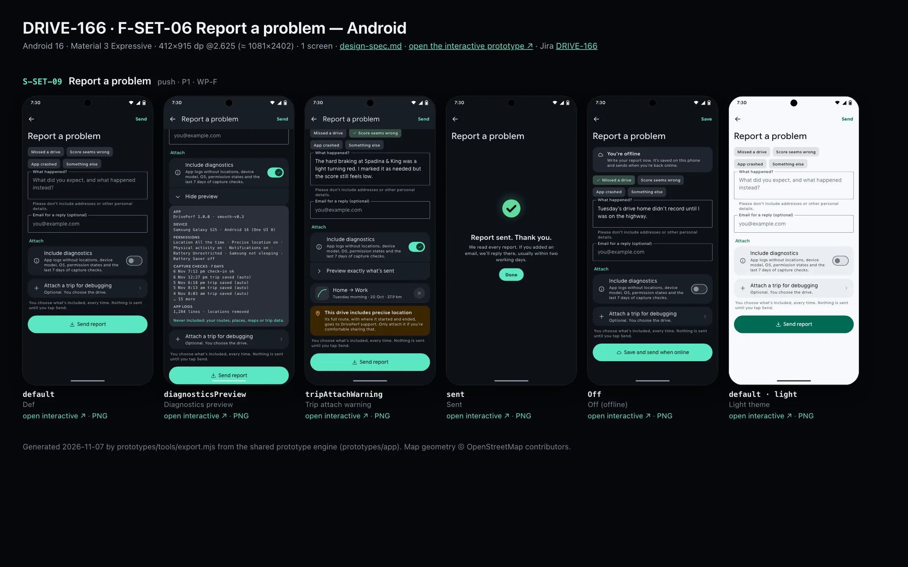
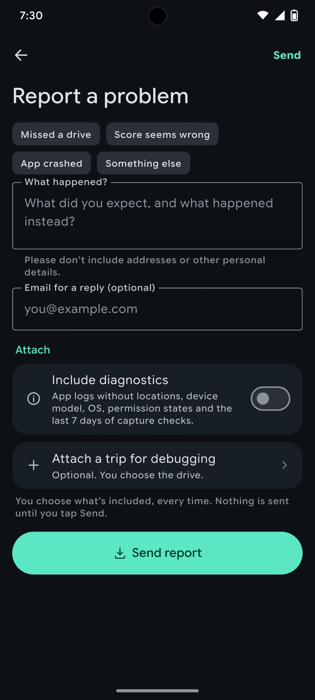
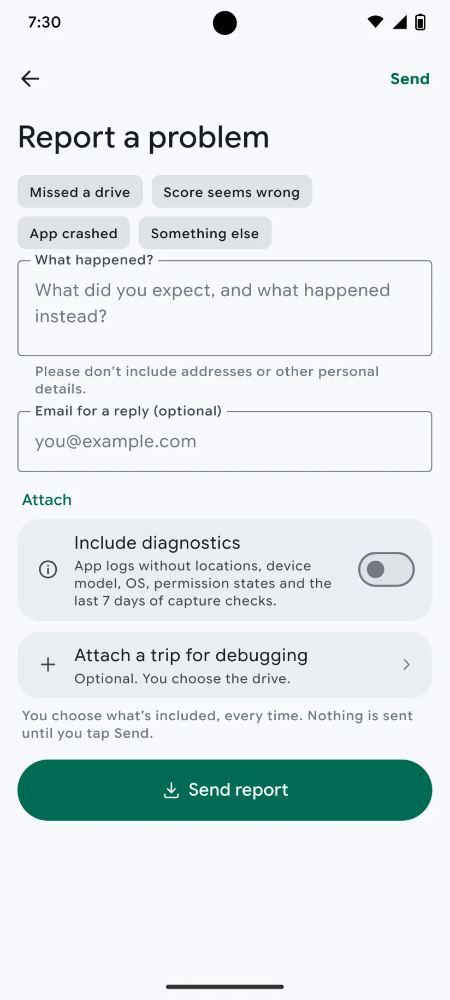

# DRIVE-166 · F-SET-06 Report a problem — Android design spec

> Generated by `prototypes/tools/export.mjs` on 2026-11-07 from the shared prototype engine. **Do not edit by hand:** change the screen's `spec` in `prototypes/app/screens/wp-*.js` (see `prototypes/app/AUTHORING.md`) and re-export.

- **Jira story:** [DRIVE-166](https://thekeval.atlassian.net/browse/DRIVE-166) · F-SET-06 · P1
- **Platform:** Android 16 · Material 3 Expressive · 412×915 dp @2.625 (≈ 1081×2402)
- **Interactive prototype:** [../../../../prototypes/android/index.html#S-SET-09](../../../../prototypes/android/index.html#S-SET-09) (catalog panel: every screen and state; deep links `#S-ID/state?trip=…&ent=…&theme=light&text=xl&rm=1`)
- **Contact sheet:** [mockup.html](mockup.html) · 
- **Design system (source of truth for values):** [brand](../../system/brand.md) · [components](../../system/components.md) · [motion](../../system/motion.md) · [accessibility](../../system/accessibility.md) · [screen map](../../system/screen-map.md) · [fixtures](../../system/fixtures.md) · tokens `prototypes/shared/tokens.css`

## Screens in this story

| Screen | Name | Presentation | Priority | States | Status |
|---|---|---|---|---|---|
| `S-SET-09` | Report a problem | Push | P1 | 5 | Prototyped |

## Tokens used on this platform

Values resolved from `prototypes/shared/tokens.css` inside the Android device (`[data-platform="android"]`). Use the token names in code; the hex values are for reference.

| Token | Dark | Light |
|---|---|---|
| `--app-bg` | `#0D1117` | `#F7F9FC` |
| `--card-bg` | `#191E25` | `#EBEEF2` |
| `--dp-bg-grouped` | `#0D1117` | `#F7F9FC` |
| `--dp-surface` | `#191E25` | `#EBEEF2` |
| `--dp-surface-2` | `#1F252D` | `#E5E8EC` |
| `--dp-surface-3` | `#2A3038` | `#DFE2E6` |
| `--dp-fill` | `#2A3038` | `#DFE2E6` |
| `--dp-fill-strong` | `#353B44` | `#D3D7DC` |
| `--dp-text` | `#E1E3E8` | `#181C20` |
| `--dp-text-2` | `#C0C7CF` | `#40474F` |
| `--dp-text-3` | `#8A929B` | `#707881` |
| `--dp-separator` | `#40474F` | `#C0C7CF` |
| `--dp-accent` | `#5BE7C4` | `#006B53` |
| `--dp-accent-text` | `#5BE7C4` | `#006B53` |
| `--dp-on-accent` | `#00382B` | `#FFFFFF` |
| `--dp-accent-container` | `#00513F` | `#91F1D8` |
| `--dp-record` | `#FFC24B` | `#7A5900` |
| `--dp-positive` | `#5BE7C4` | `#006B53` |
| `--dp-change-down` | `#C0C7CF` | `#40474F` |
| `--dp-warning` | `#F5B648` | `#7A5900` |
| `--dp-critical` | `#FFB4AB` | `#BA1A1A` |
| `--dp-glass-fill` | `#1F252DF2` | `#E5E8ECF2` |
| `--dp-glass-fill-strong` | `#2A3038` | `#DFE2E6` |
| `--dp-glass-stroke` | `#FFFFFF0F` | `#0000000A` |
| `--md-sys-color-primary` | `#5BE7C4` | `#006B53` |
| `--md-sys-color-on-primary` | `#00382B` | `#FFFFFF` |
| `--md-sys-color-primary-container` | `#00513F` | `#91F1D8` |
| `--md-sys-color-on-primary-container` | `#91F1D8` | `#002118` |
| `--md-sys-color-secondary-container` | `#344C44` | `#CEE9DF` |
| `--md-sys-color-surface` | `#0D1117` | `#F7F9FC` |
| `--md-sys-color-surface-container` | `#191E25` | `#EBEEF2` |
| `--md-sys-color-surface-container-high` | `#1F252D` | `#E5E8EC` |
| `--md-sys-color-on-surface-variant` | `#C0C7CF` | `#40474F` |
| `--dp-data-route` | `#5BE7C4` | `#079777` |
| `--dp-data-event-brake` | `#FF7A66` | `#A21F16` |
| `--dp-data-event-accel` | `#E58BD0` | `#A33A8C` |
| `--dp-data-event-corner` | `#EAD54E` | `#9A8A00` |
| `--dp-data-quality-good` | `#5FDB9C` | `#1E9E62` |
| `--dp-data-speed` | `#D6DCE4` | `#404A58` |
| `--dp-data-long-g` | `#5AB8F5` | `#0A6AB8` |
| `--dp-data-lat-g` | `#F5A142` | `#B25A00` |

| Type / layout token | Value |
|---|---|
| `--dp-font-screen-title` | `600 32px / 40px "Google Sans Flex", "Google Sans Display", "Roboto Flex", Roboto, system-ui, sans-serif` |
| `--dp-font-sheet-title` | `400 24px / 32px "Google Sans Flex", "Google Sans Display", "Roboto Flex", Roboto, system-ui, sans-serif` |
| `--dp-font-section-title` | `600 22px / 28px "Google Sans Flex", "Google Sans Display", "Roboto Flex", Roboto, system-ui, sans-serif` |
| `--dp-font-card-title` | `700 16px / 24px "Google Sans Flex", "Google Sans Text", "Roboto Flex", Roboto, system-ui, sans-serif` |
| `--dp-font-body` | `400 16px / 24px "Google Sans Flex", "Google Sans Text", "Roboto Flex", Roboto, system-ui, sans-serif` |
| `--dp-font-body-secondary` | `400 14px / 20px "Google Sans Flex", "Google Sans Text", "Roboto Flex", Roboto, system-ui, sans-serif` |
| `--dp-font-meta` | `400 12px / 16px "Google Sans Flex", "Google Sans Text", "Roboto Flex", Roboto, system-ui, sans-serif` |
| `--dp-font-caption` | `500 12px / 16px "Google Sans Flex", "Google Sans Text", "Roboto Flex", Roboto, system-ui, sans-serif` |
| `--dp-font-button` | `700 14px / 20px "Google Sans Flex", "Google Sans Text", "Roboto Flex", Roboto, system-ui, sans-serif` |
| `--dp-num-hero` | `600 72px / 72px "Google Sans Flex", "Roboto Flex", Roboto, system-ui, sans-serif` |
| `--dp-num-xl` | `600 48px / 52px "Google Sans Flex", "Roboto Flex", Roboto, system-ui, sans-serif` |
| `--dp-num-l` | `600 34px / 38px "Google Sans Flex", "Roboto Flex", Roboto, system-ui, sans-serif` |
| `--dp-num-m` | `600 24px / 28px "Google Sans Flex", "Roboto Flex", Roboto, system-ui, sans-serif` |
| `--dp-num-s` | `600 17px / 22px "Google Sans Flex", "Roboto Flex", Roboto, system-ui, sans-serif` |
| `--dp-num-xs` | `600 13px / 16px "Google Sans Flex", "Roboto Flex", Roboto, system-ui, sans-serif` |
| `--dp-screen-margin` | `16px` |
| `--dp-radius-card` | `16px` |
| `--dp-radius-card-hero` | `28px` |
| `--dp-radius-sheet` | `28px` |
| `--dp-radius-chip` | `8px` |
| `--dp-radius-button` | `999px` |
| `--dp-layout-list-row-min` | `56px` |
| `--dp-layout-touch-min` | `48px` |
| `--safe-top` | `40px` |
| `--safe-bottom` | `24px` |

Text sizes scale with `--dp-text-scale` (XL = 2.0×) and numerals with `--dp-num-scale` (XL = 1.3×). DP Numerals: Google Sans Flex wdth 120 wght 600, tabular.

---

## S-SET-09 · Report a problem

 

- **Presentation:** push · tab: profile — screen map: “Push”
- **Entry points:** S-SET-01 · S-SET-08
- **Leads to:** Sent → back
- **PRD features:** F-SET-06 · **Priority:** P1 · **WP:** F
- **Interactive:** [S-SET-09](../../../../prototypes/android/index.html#S-SET-09)

**Purpose.** Report a bug with only the diagnostics the user chooses, previewed exactly, and an explicit choice (with a precise-location warning) to attach a trip (F-SET-06).

### States

| State | PRD label | Fixture params | Screenshot |
|---|---|---|---|
| `default` | Def | — | [S-SET-09.png](../../screens/android/S-SET-09.webp) · [open](../../../../prototypes/android/index.html#S-SET-09) |
| `diagnosticsPreview` | Diagnostics preview | — | [S-SET-09--diagnosticsPreview.png](../../screens/android/S-SET-09--diagnosticsPreview.webp) · [open](../../../../prototypes/android/index.html#S-SET-09/diagnosticsPreview) |
| `tripAttachWarning` | Trip attach warning | — | [S-SET-09--tripAttachWarning.png](../../screens/android/S-SET-09--tripAttachWarning.webp) · [open](../../../../prototypes/android/index.html#S-SET-09/tripAttachWarning) |
| `sent` | Sent | — | [S-SET-09--sent.png](../../screens/android/S-SET-09--sent.webp) · [open](../../../../prototypes/android/index.html#S-SET-09/sent) |
| `Off` | Off (offline) | — | [S-SET-09--Off.png](../../screens/android/S-SET-09--Off.webp) · [open](../../../../prototypes/android/index.html#S-SET-09/Off) |
| default · light | Light theme | `theme=light` | [S-SET-09--light.png](../../screens/android/S-SET-09--light.webp) |

Every state also renders in light/dark (`theme=light`), XL text (`text=xl`) and reduced motion (`rm=1`).

### Layout

- Offline banner (Off): “You’re offline. Write your report now. It’s saved on this phone and sends when you’re back online.”
- Topic filter chips (single choice): Missed a drive · Score seems wrong · App crashed · Something else.
- Text field “What happened?” (iOS rounded field / Android OutlinedTextField, multi-line) with helper “Please don’t include addresses or other personal details.” · optional reply email field.
- Attach: “Include diagnostics” switch with exactly what it contains · “Preview exactly what’s sent” disclosure → monospace preview card (App, Device, Permissions, Capture checks · 7 days, App logs — locations removed; “Never included: your routes, places, maps or trip data.”).
- “Attach a trip for debugging” row → trip picker; once chosen: trip row (glyph, label, part of day · date · km, remove ×) + attention banner “This drive includes precise location…”.
- Footer: per-report consent line. Full-width filled “Send report” (offline: “Save and send when online”); also a Send button in the top bar.
- Sent: centred empty state — large check disc · “Report sent. Thank you.” · reply promise · Done.

### Components & tokens

| Component | Tokens / spec |
|---|---|
| `navBar` | --dp-font-card-title · --dp-font-meta · glass: --dp-glass-fill + --dp-glass-blur · components.md §2 |
| `banner` | radius 12 (--dp-radius-sm+) · info --dp-fill · attention --dp-warning-container · critical --dp-critical-container · components.md §22 |
| `chip` | --dp-radius-chip (iOS capsule · Android 8) · height 28 · --dp-font-caption |
| `textField` | see components.md |
| `list` | iOS inset grouped radius --dp-radius-card, rows 52 pt, separators --dp-separator inset 16 · Android ListItem 56/72 dp in --md-sys-color-surface-container |
| `row` | --dp-font-body · --dp-font-meta (supporting) · --dp-layout-list-row-min |
| `toggle` | iOS 51×31 tint --dp-accent · Android M3 Switch 52×32 --md-sys-color-primary |
| `glyph` | see components.md |
| `button` | --dp-accent / --dp-on-accent (filled) · --dp-fill-strong · --md-sys-color-secondary-container (tonal) · --dp-radius-button · height iOS 50/44/34 · Android 56/40/32 · --dp-font-button · components.md §0 |
| `empty` | illustration 120 in --dp-accent · --dp-font-section-title · components.md §21 |
| `section` | --dp-font-section-title · --dp-layout-section-gap 28 |

### Interactions & navigation

- Chip → single select (selection haptic). Diagnostics switch → shows/hides the preview row. Preview → expands the exact payload.
- Attach a trip → native trip picker (prototype: attaches t20261020-0740 + toast) → warning banner; × removes it.
- Send / Save → sent state (success haptic); offline queues it. Done → back to S-SET-01 or S-SET-08.

### Motion

- Groups rise. Sent: check disc springs in (scale 0.5 → 1, spring.bouncy) + success haptic. RM: static.

### Accessibility

- Chips are a radio group “What is it about?”. The text field label stays visible above the field.
- Preview is a labelled region read line by line. The trip warning banner is announced when the trip is attached.
- XL text: rows grow to two or more lines and trailing values move under the title; nothing truncates. Every row is ≥ 52 pt (iOS) / 56 dp (Android).

### Platform notes

- **Android (this spec):** Top-app-bar Send TextButton; FilterChips; OutlinedTextField; WorkManager queues offline reports.
- *iOS (for reference):* Top-bar Send as a glass text button; MFMailComposeViewController or the support endpoint (A10).

### Analytics

- `problem_reported {has_diagnostics, has_trip, topic, offline}`

### Copy

| Key | Text |
|---|---|
| Helper | Please don’t include addresses or other personal details. |
| Diagnostics | App logs without locations, device model, OS, permission states and the last 7 days of capture checks. |
| Never included | Never included: your routes, places, maps or trip data. |
| Trip warning | This drive includes precise location. Its full route, with where it started and ended, goes to DrivePerf support. Only attach it if you’re comfortable sharing that. |
| Consent | You choose what’s included, every time. Nothing is sent until you tap Send. |
| Sent | Report sent. Thank you. We read every report. If you added an email, we’ll reply there, usually within two working days. |
| Offline | You’re offline. Write your report now. It’s saved on this phone and sends when you’re back online. |

### Free / Pro

Free.

### Data & fixtures

Permissions from health.{platform}.items (allGood); capture checks derived from trips in the last 7 days (end time + source); device model is a placeholder; attached trip t20261020-0740 (GPS gap + needed brake at Spadina & King).

### Assets

[icon-info.svg](assets/icon-info.svg) · [icon-chevronRight.svg](assets/icon-chevronRight.svg) · [icon-chevronDown.svg](assets/icon-chevronDown.svg) · [icon-plus.svg](assets/icon-plus.svg) · [icon-close.svg](assets/icon-close.svg) · [icon-pin.svg](assets/icon-pin.svg) · [icon-cloud.svg](assets/icon-cloud.svg) · [icon-export.svg](assets/icon-export.svg)

UI glyphs may be swapped for SF Symbols / Material Symbols Rounded equivalents; event-pin, quality and provenance glyphs must not be (components.md global rules).

### Checklist (accessibility.md §9)

- [ ] Light and dark both render, and contrast passes.
- [ ] The XL text state reflows with no truncation.
- [ ] The RM state is defined.
- [ ] Every control has a label; every chart and map has a summary sentence.
- [ ] Every target ≥ 44 pt / 48 dp (≥ 64 in-drive).
- [ ] No meaning by colour alone.
- [ ] Speed is neutral wherever it appears and absent from social or live surfaces.
- [ ] No streak, leaderboard, speed or “beat your time” language.
- [ ] Behaviour is defined while a trip is active (D1 gate).
- [ ] Haptics come from motion.md §6 only.

---

Map geometry in the prototype: © OpenStreetMap contributors (ODbL). Speed and G are simulated fixtures (fixtures.md).
