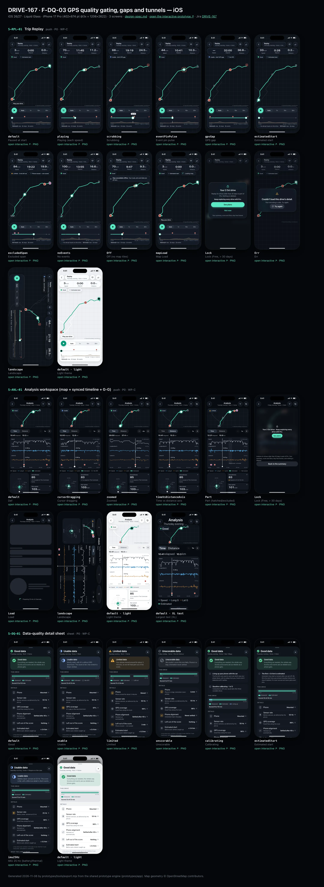
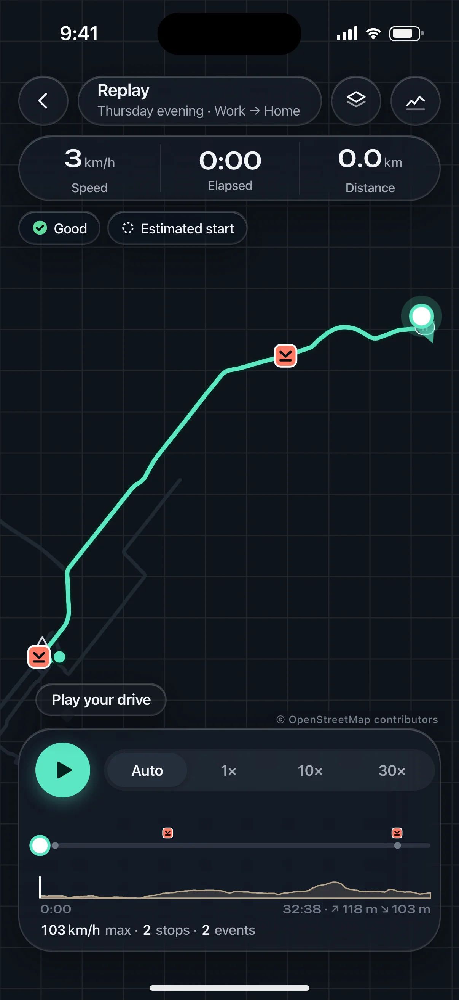
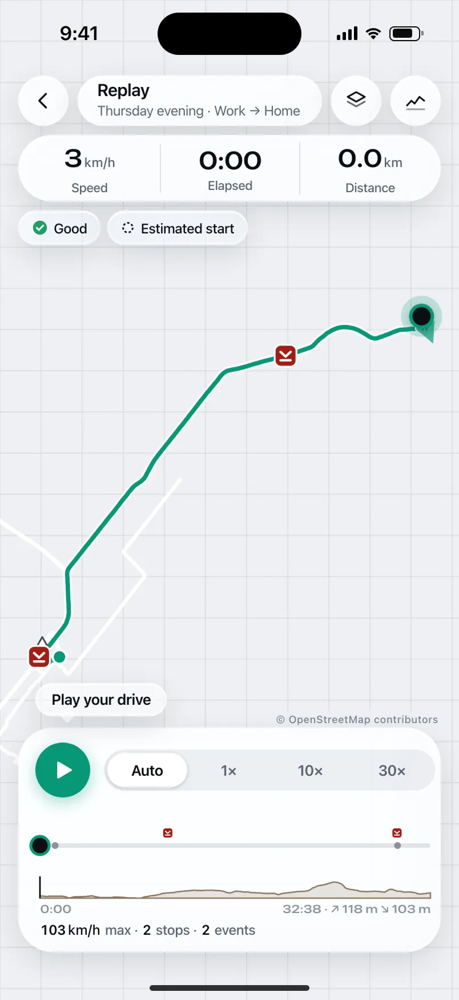
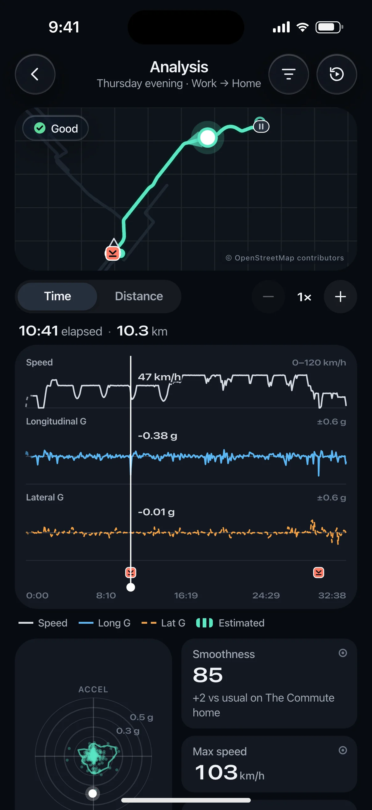
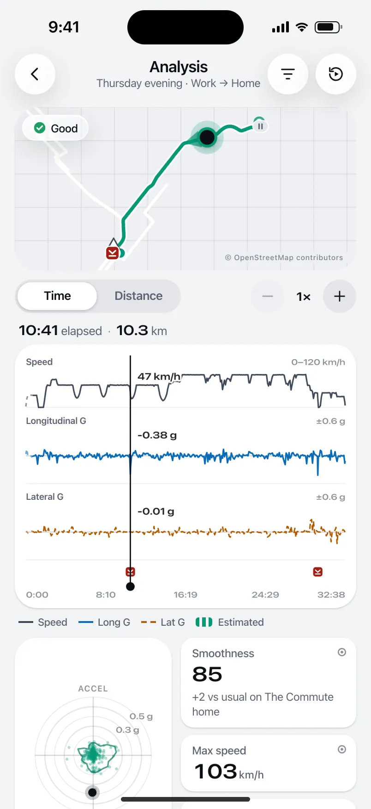
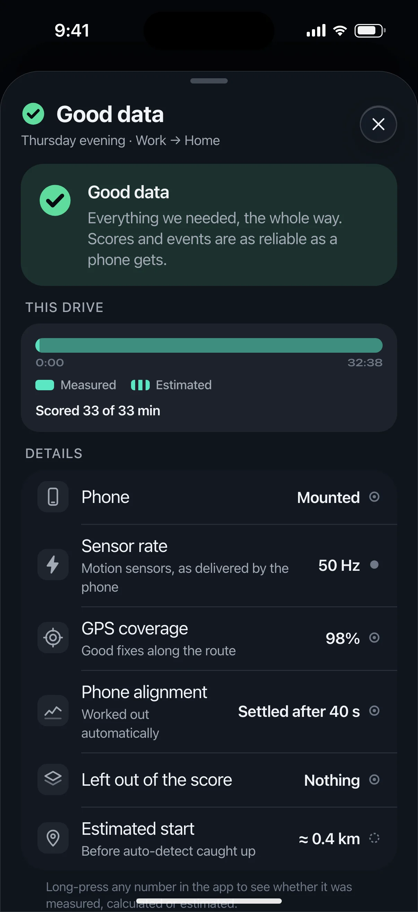
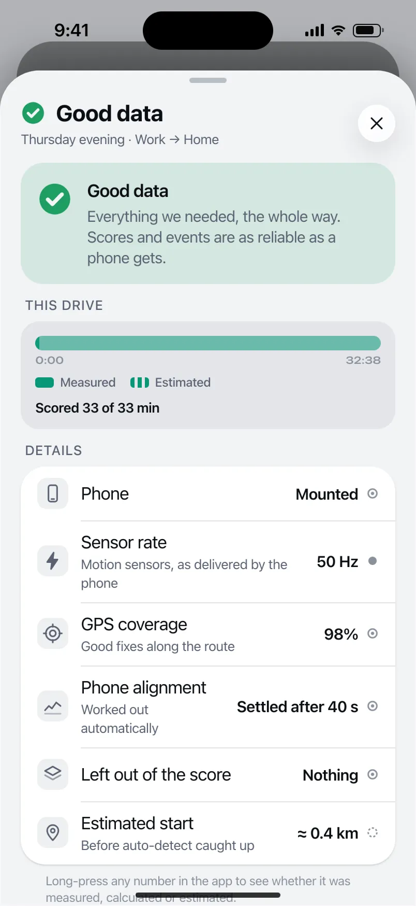

# DRIVE-167 · F-DQ-03 GPS quality gating, gaps and tunnels — iOS design spec

> Generated by `prototypes/tools/export.mjs` on 2026-11-06 from the shared prototype engine. **Do not edit by hand:** change the screen's `spec` in `prototypes/app/screens/wp-*.js` (see `prototypes/app/AUTHORING.md`) and re-export.

- **Jira story:** [DRIVE-167](https://thekeval.atlassian.net/browse/DRIVE-167) · F-DQ-03 · P0
- **Platform:** iOS 26/27 · Liquid Glass · iPhone 17 Pro (402×874 pt @3x = 1206×2622)
- **Interactive prototype:** [../../../../prototypes/ios/index.html#S-RPL-01](../../../../prototypes/ios/index.html#S-RPL-01) (catalog panel: every screen and state; deep links `#S-ID/state?trip=…&ent=…&theme=light&text=xl&rm=1`)
- **Contact sheet:** [mockup.html](mockup.html) · 
- **Design system (source of truth for values):** [brand](../../system/brand.md) · [components](../../system/components.md) · [motion](../../system/motion.md) · [accessibility](../../system/accessibility.md) · [screen map](../../system/screen-map.md) · [fixtures](../../system/fixtures.md) · tokens `prototypes/shared/tokens.css`

## Screens in this story

| Screen | Name | Presentation | Priority | States | Status |
|---|---|---|---|---|---|
| `S-RPL-01` | Trip Replay | Push (immersive) | P0 | 13 | Prototyped |
| `S-ANL-01` | Analysis workspace (map + synced timeline + G-G) | Push (immersive) | P0 | 8 | Prototyped |
| `S-DQ-01` | Data-quality detail sheet | Sheet (large) | P0 | 7 | Prototyped |

## Tokens used on this platform

Values resolved from `prototypes/shared/tokens.css` inside the iOS device (`[data-platform="ios"]`). Use the token names in code; the hex values are for reference.

| Token | Dark | Light |
|---|---|---|
| `--app-bg` | `#080B10` | `#F2F3F6` |
| `--card-bg` | `#131822` | `#FFFFFF` |
| `--dp-bg-grouped` | `#080B10` | `#F2F3F6` |
| `--dp-surface` | `#131822` | `#FFFFFF` |
| `--dp-surface-2` | `#1B222D` | `#F2F3F6` |
| `--dp-surface-3` | `#262E3B` | `#E4E7EC` |
| `--dp-fill` | `#7880961F` | `#7880961F` |
| `--dp-fill-strong` | `#7880963D` | `#78809633` |
| `--dp-text` | `#F2F4F7` | `#0B0E13` |
| `--dp-text-2` | `#A3AAB6` | `#5A6271` |
| `--dp-text-3` | `#6E7787` | `#8A919D` |
| `--dp-separator` | `#96A0B429` | `#3C435024` |
| `--dp-accent` | `#5BE7C4` | `#079777` |
| `--dp-accent-text` | `#5BE7C4` | `#06775E` |
| `--dp-on-accent` | `#04241D` | `#FFFFFF` |
| `--dp-accent-container` | `#0A4439` | `#C6F8EA` |
| `--dp-record` | `#FFC24B` | `#9A6300` |
| `--dp-positive` | `#5BE7C4` | `#06775E` |
| `--dp-change-down` | `#A3AAB6` | `#5A6271` |
| `--dp-warning` | `#F5B648` | `#9A5F00` |
| `--dp-critical` | `#FF6B6B` | `#C62828` |
| `--dp-glass-fill` | `#1C222C6B` | `#FFFFFF8C` |
| `--dp-glass-fill-strong` | `#1C222CB8` | `#FFFFFFD1` |
| `--dp-glass-stroke` | `#FFFFFF24` | `#FFFFFF99` |
| `--dp-data-route` | `#5BE7C4` | `#079777` |
| `--dp-data-event-brake` | `#FF7A66` | `#A21F16` |
| `--dp-data-event-accel` | `#E58BD0` | `#A33A8C` |
| `--dp-data-event-corner` | `#EAD54E` | `#9A8A00` |
| `--dp-data-quality-good` | `#5FDB9C` | `#1E9E62` |
| `--dp-data-speed` | `#D6DCE4` | `#404A58` |
| `--dp-data-long-g` | `#5AB8F5` | `#0A6AB8` |
| `--dp-data-lat-g` | `#F5A142` | `#B25A00` |

| Type / layout token | Value |
|---|---|
| `--dp-font-screen-title` | `700 34px / 41px -apple-system, BlinkMacSystemFont, "SF Pro Display", system-ui, sans-serif` |
| `--dp-font-sheet-title` | `700 22px / 28px -apple-system, BlinkMacSystemFont, "SF Pro Display", system-ui, sans-serif` |
| `--dp-font-section-title` | `600 20px / 25px -apple-system, BlinkMacSystemFont, "SF Pro Display", system-ui, sans-serif` |
| `--dp-font-card-title` | `600 17px / 22px -apple-system, BlinkMacSystemFont, "SF Pro Text", system-ui, sans-serif` |
| `--dp-font-body` | `400 17px / 22px -apple-system, BlinkMacSystemFont, "SF Pro Text", system-ui, sans-serif` |
| `--dp-font-body-secondary` | `400 15px / 20px -apple-system, BlinkMacSystemFont, "SF Pro Text", system-ui, sans-serif` |
| `--dp-font-meta` | `400 13px / 18px -apple-system, BlinkMacSystemFont, "SF Pro Text", system-ui, sans-serif` |
| `--dp-font-caption` | `400 12px / 16px -apple-system, BlinkMacSystemFont, "SF Pro Text", system-ui, sans-serif` |
| `--dp-font-button` | `600 17px / 22px -apple-system, BlinkMacSystemFont, "SF Pro Text", system-ui, sans-serif` |
| `--dp-num-hero` | `600 72px / 72px -apple-system, BlinkMacSystemFont, "SF Pro Display", system-ui, sans-serif` |
| `--dp-num-xl` | `600 48px / 52px -apple-system, BlinkMacSystemFont, "SF Pro Display", system-ui, sans-serif` |
| `--dp-num-l` | `600 34px / 38px -apple-system, BlinkMacSystemFont, "SF Pro Display", system-ui, sans-serif` |
| `--dp-num-m` | `600 24px / 28px -apple-system, BlinkMacSystemFont, "SF Pro Display", system-ui, sans-serif` |
| `--dp-num-s` | `600 17px / 22px -apple-system, BlinkMacSystemFont, "SF Pro Display", system-ui, sans-serif` |
| `--dp-num-xs` | `600 13px / 16px -apple-system, BlinkMacSystemFont, "SF Pro Display", system-ui, sans-serif` |
| `--dp-screen-margin` | `16px` |
| `--dp-radius-card` | `24px` |
| `--dp-radius-card-hero` | `32px` |
| `--dp-radius-sheet` | `38px` |
| `--dp-radius-chip` | `999px` |
| `--dp-radius-button` | `999px` |
| `--dp-layout-list-row-min` | `52px` |
| `--dp-layout-touch-min` | `44px` |
| `--safe-top` | `62px` |
| `--safe-bottom` | `34px` |

Text sizes scale with `--dp-text-scale` (XL = 2.0×) and numerals with `--dp-num-scale` (XL = 1.3×). DP Numerals: SF Pro Expanded Semibold, tabular.

---

## S-RPL-01 · Trip Replay

 

- **Presentation:** push · tab: drives — screen map: “Push (immersive)”
- **Entry points:** S-STY-01 f7 · S-TRP-01 · S-SCO-03 evidence links
- **Leads to:** S-RPL-02 (pin) · S-RPL-03 (stop/max pin) · S-RPL-04 (layers) · S-ANL-01 · S-DQ-01 · S-SUB-03 (Lock)
- **PRD features:** F-RPL-01, F-RPL-02, F-RPL-03, F-RPL-08, F-CAP-05, F-DQ-02, F-DQ-03, F-DQ-04, F-SCO-04 · **Priority:** P0 · **WP:** C
- **Interactive:** [S-RPL-01](../../../../prototypes/ios/index.html#S-RPL-01)

**Purpose.** Watch the drive replay on a map with a moving marker, so the user can relive and understand it (F-RPL-01), with speed-neutral readouts, max speed, stops and elevation (F-RPL-02), tappable event pins by shape (F-RPL-03) and honest quality overlays (F-RPL-08). Benchmark: Mileon replay; DrivePerf adds evidence pins.

### States

| State | PRD label | Fixture params | Screenshot |
|---|---|---|---|
| `default` | Paused at start | `trip=t20261105-1745` | [S-RPL-01.png](../../screens/ios/S-RPL-01.webp) · [open](../../../../prototypes/ios/index.html#S-RPL-01) |
| `playing` | Playing (each speed) | `trip=t20261105-1745` | [S-RPL-01--playing.png](../../screens/ios/S-RPL-01--playing.webp) · [open](../../../../prototypes/ios/index.html#S-RPL-01/playing) |
| `scrubbing` | Scrubbing | `trip=t20261020-0740` | [S-RPL-01--scrubbing.png](../../screens/ios/S-RPL-01--scrubbing.webp) · [open](../../../../prototypes/ios/index.html#S-RPL-01/scrubbing) |
| `eventPinPulse` | Event pin pulse | `trip=t20261105-1745` | [S-RPL-01--eventPinPulse.png](../../screens/ios/S-RPL-01--eventPinPulse.webp) · [open](../../../../prototypes/ios/index.html#S-RPL-01/eventPinPulse) |
| `gpsGap` | GPS gap | `trip=t20261020-0740` | [S-RPL-01--gpsGap.png](../../screens/ios/S-RPL-01--gpsGap.webp) · [open](../../../../prototypes/ios/index.html#S-RPL-01/gpsGap) |
| `estimatedStart` | Estimated start | `trip=t20261105-0742` | [S-RPL-01--estimatedStart.png](../../screens/ios/S-RPL-01--estimatedStart.webp) · [open](../../../../prototypes/ios/index.html#S-RPL-01/estimatedStart) |
| `excludedSpan` | Excluded span | `trip=t20261027-1728` | [S-RPL-01--excludedSpan.png](../../screens/ios/S-RPL-01--excludedSpan.webp) · [open](../../../../prototypes/ios/index.html#S-RPL-01/excludedSpan) |
| `noEvents` | No events | `trip=t20261105-0742` | [S-RPL-01--noEvents.png](../../screens/ios/S-RPL-01--noEvents.webp) · [open](../../../../prototypes/ios/index.html#S-RPL-01/noEvents) |
| `Off` | Off (no map tiles) | `trip=t20261105-1745` | [S-RPL-01--Off.png](../../screens/ios/S-RPL-01--Off.webp) · [open](../../../../prototypes/ios/index.html#S-RPL-01/Off) |
| `mapLoad` | Map Load | `trip=t20261105-1745` | [S-RPL-01--mapLoad.png](../../screens/ios/S-RPL-01--mapLoad.webp) · [open](../../../../prototypes/ios/index.html#S-RPL-01/mapLoad) |
| `Lock` | Lock (Free, > 30 days) | `trip=t20261002-0745` `ent=free` | [S-RPL-01--Lock.png](../../screens/ios/S-RPL-01--Lock.webp) · [open](../../../../prototypes/ios/index.html#S-RPL-01/Lock) |
| `Err` | Err | `trip=t20261105-1745` | [S-RPL-01--Err.png](../../screens/ios/S-RPL-01--Err.webp) · [open](../../../../prototypes/ios/index.html#S-RPL-01/Err) |
| `landscape` | Landscape | `trip=t20261020-0740` | [S-RPL-01--landscape.png](../../screens/ios/S-RPL-01--landscape.webp) · [open](../../../../prototypes/ios/index.html#S-RPL-01/landscape) |
| default · light | Light theme | `theme=light` | [S-RPL-01--light.png](../../screens/ios/S-RPL-01--light.webp) |

Every state also renders in light/dark (`theme=light`), XL text (`text=xl`) and reduced motion (`rm=1`).

### Layout

- Immersive push (no tab bar, no accessory). Full-bleed map (MapKit / Google Maps or MapLibre; prototype: plain canvas from trip.track) fitted to the route between the top cluster and the playback bar; “© OpenStreetMap contributors” bottom-right above the playback bar.
- Route: Glide 3.8 px on a 7.5 px casing · estimated start dashed 4/4 at 60% · GPS gap dotted (`--dp-data-gap-stroke` 1/6) · excluded span dotted grey · start ring and end dot · stop capsules · neutral outline max-speed triangle (no animation) · event pins 26 by shape (braking rounded square, acceleration circle, cornering diamond; needed = hollow).
- Marker: 16 px white dot with a 3 px Glide ring, 36 px halo at 20%, 18 px heading wedge (40°). Position = interpolated track sample at time t (display-only).
- Top cluster (safe-top + 4, 16 margins): bar = glass back (44) · glass title capsule “Replay” + part of day · label · glass Layers (→ S-RPL-04) · glass Analysis (→ S-ANL-01). Readouts capsule 56 tall: Speed · Elapsed · Distance (DP Numerals 24, units 50%, labels caption text2, 0.5 px separators) — speed is neutral text, never coloured. Chip row: quality badge (glass) + contextual span chip (“Estimated start” / “No GPS” / “Phone moved — not scored”).
- Playback bar (16 inset, above the home indicator; iOS glass radius 30 · Android floating toolbar radius 28): play/pause 48 (iOS glass prominent circle · Android FAB-style primaryContainer radius 16) + speed selector Auto · 1× · 10× · 30× (iOS glass segmented · Android connected button group) · scrubber (4 px track, played Glide, event ticks 12 px above, stop ticks, gap and estimated overlays, 16 px thumb → 22 while dragging, time bubble) · elevation mini-profile 24 px with a synced cursor + “↗ 118 m ↘ 103 m” · summary line “103 km/h max · 2 stops · 2 events” (neutral).
- Lock (Free, > 30 days): the trip’s own map blurred 14 px + centred glass card: lock · “Your 2 Oct drive” · “Replay for drives older than 30 days is part of Pro. Nothing is deleted.” · “Keep exploring every drive with Pro.” · See plans (filled) · Not now (text) · “Your summary, score and Story stay free forever.”
- Off: plain canvas (no road layer) + glass note “Map unavailable offline. Your route, pins and data are all here.” · map Load: route drawn over a breathing skeleton land + “Loading map…” · Err: centred glass error card with Try again.
- Landscape: map full-bleed, title/readouts in one top row, playback bar one row (play · speed · scrubber), 60 pt side insets for the island.

### Components & tokens

| Component | Tokens / spec |
|---|---|
| `map` | --dp-data-map-land/road/grid · route --dp-data-route 3.8 + casing --dp-data-route-casing 7.5 · estimated dashed 4/4 at 60% · gap --dp-data-gap-stroke dotted 1/6 · pins DP_ICONS.pin 26 · attribution “© OpenStreetMap contributors” |
| `scrubber` | see components.md |
| `segmented` | see components.md |
| `qualityBadge` | --dp-data-quality-{good\|usable\|limited\|unscorable} · components.md §10 |
| `chip` | --dp-radius-chip (iOS capsule · Android 8) · height 28 · --dp-font-caption |
| `iconButton` | see components.md |
| `backButton` | see components.md |
| `button` | --dp-accent / --dp-on-accent (filled) · --dp-fill-strong · --md-sys-color-secondary-container (tonal) · --dp-radius-button · height iOS 50/44/34 · Android 56/40/32 · --dp-font-button · components.md §0 |
| `error` | see components.md |
| `loader` | see components.md |
| `markerHtml (local)` | see components.md |
| `rplReadouts (local)` | see components.md |

### Interactions & navigation

- Play/Pause toggles playback; t += dt × rate (Auto = whole trip in ~60 s, 1×, 10×, 30×); reaching the end pauses; Play at the end restarts.
- Speed selector changes rate immediately (haptic selection). XL: a single “Speed: Auto” button cycles speeds.
- Scrubber: drag (or tap) moves the marker and every readout in the same frame (≤ 100 ms, F-RPL-01.3); within 8 px of an event tick it snaps (haptic selection); release resumes the previous play state. Keyboard / VoiceOver adjustable: ±30 s.
- Event pin tap → pauses, selects the pin (1.18×, others dim to 50%), haptic tap, opens S-RPL-02 (medium detent) with trip + event. Stop pin → S-RPL-03 (stop) · max-speed pin → S-RPL-03/maxSpeed.
- Quality badge → S-DQ-01 · Layers → S-RPL-04 (changes apply immediately and persist) · Analysis → S-ANL-01 (Lock → S-SUB-03 replayAnalysis30Days) · Back → S-TRP-01 (or the Story).
- D1 gate: requested during a driver trip or while moving → S-DRV-05.

### Motion

- Hero: the marker. It moves continuously from the display clock (rAF dt, 120 Hz capable); the heading wedge follows the path.
- On load: route draw-on 1800 ms, then event pins pop in time order (shared.pinPop, 40 ms stagger); the max-speed pin appears with the route, never animated.
- Pin pulse when the marker passes an event: ring scale 1 → 2.4, opacity 0.75 → 0, 600 ms ease.glide, once; no sound, no haptic (F-RPL-03.2).
- GPS gap: the marker hides at the gap and reappears after it; the “No GPS” chip appears and the speed readout shows “—”.
- Scrubbing: thumb grows to 22 (spring.fast); the time bubble rides above it.
- RM: no draw-on or pin pop (fade in); the pulse becomes a 600 ms outline highlight with no scale; the marker still moves because playback is user-initiated.

### Accessibility

- Map container: “Map of your drive, 39 kilometres from Work to Home. 2 events, 2 stops.” Pins are buttons in time order, then stops, then max speed: “Hard braking at the Gardiner, 5:56 pm. Peak 0.40 g.”
- Scrubber: “Replay position, 12 min of 33 min. Speed 92 kilometres per hour.” Adjustable ±30 s; custom actions Next event / Previous event / Next stop (native).
- Play/Pause: “Play replay” / “Pause replay”; speed segmented is a tab list (“Auto, selected”). Readouts are not a live region.
- Every pin hit area ≥ 44 pt / 48 dp; colliding pins cluster natively.
- Speed is plain text in `--dp-text`; max speed is an outline triangle with no emphasis (D5/D6).

### Platform notes

- **iOS (this spec):** MapKit with `.mapStyle(.standard(emphasis: .muted))`; glass title capsule, readouts and playback bar (`.glassEffect(.regular)`), glass segmented speed control, glass prominent play button; marker as a MapKit annotation driven by CADisplayLink.
- *Android (for reference):* Google Maps SDK / MapLibre; top bar items as tonal icon buttons, readouts in a tonal toolbar (surface-container-high, radius 20); M3E floating toolbar for playback with an attached FAB-style play (primaryContainer, radius 16) and a connected button group for speed (selected segment morphs to a pill).

### Analytics

- `replay_opened {source}`
- `replay_played {speed}`
- `replay_scrubbed`
- `replay_completed`
- `event_pin_tapped {type, confidence}`
- `replay_pin_tapped {type: max_speed|stop}`
- `quality_overlay_legend_opened`
- `locked_content_viewed {type: replay, age_bucket}`

### Copy

| Key | Text |
|---|---|
| Title | Replay · {partOfDay} · {label} |
| Readouts | Speed · Elapsed · Distance |
| Hint | Play your drive |
| Spans | Estimated start · No GPS · Phone moved — not scored |
| No events | No abrupt inputs on this drive. |
| Offline | Map unavailable offline. Your route, pins and data are all here. |
| Loading | Loading map… |
| Error | Couldn’t load this drive’s detail. Your recording is safe. Try again. |
| Lock | Your {date} drive · Replay for drives older than 30 days is part of Pro. Nothing is deleted. · Keep exploring every drive with Pro. · See plans · Not now · Your summary, score and Story stay free forever. |

### Free / Pro

Free for drives in the last 30 days; older drives are Pro (Gate 2 OQ-06): the Lock state blurs this trip’s own map and links to S-SUB-03 replayAnalysis30Days. Pro, Preview and Ride-along: no lock.

### Data & fixtures

States → trips: default/playing/eventPinPulse/Off/mapLoad/Err t20261105-1745 · scrubbing/gpsGap/landscape t20261020-0740 (gap 1899–1940 s, needed brake at Spadina & King) · estimatedStart/noEvents t20261105-0742 · excludedSpan t20261027-1728 · Lock t20261002-0745 (ent=free). Marker, readouts and elevation cursor are derived from trip.track via util.sampleAt; distance-so-far is derived by integrating track positions, scaled to trip.distanceKm.

### Assets

[icon-play.svg](assets/icon-play.svg) · [icon-pause.svg](assets/icon-pause.svg) · [icon-layers.svg](assets/icon-layers.svg) · [icon-analysis.svg](assets/icon-analysis.svg) · [icon-lock.svg](assets/icon-lock.svg) · [icon-gps.svg](assets/icon-gps.svg) · [icon-check.svg](assets/icon-check.svg) · [icon-chevronLeft.svg](assets/icon-chevronLeft.svg)

UI glyphs may be swapped for SF Symbols / Material Symbols Rounded equivalents; event-pin, quality and provenance glyphs must not be (components.md global rules).

### Checklist (accessibility.md §9)

- [ ] Light and dark both render, and contrast passes.
- [ ] The XL text state reflows with no truncation.
- [ ] The RM state is defined.
- [ ] Every control has a label; every chart and map has a summary sentence.
- [ ] Every target ≥ 44 pt / 48 dp (≥ 64 in-drive).
- [ ] No meaning by colour alone.
- [ ] Speed is neutral wherever it appears and absent from social or live surfaces.
- [ ] No streak, leaderboard, speed or “beat your time” language.
- [ ] Behaviour is defined while a trip is active (D1 gate).
- [ ] Haptics come from motion.md §6 only.

---

## S-ANL-01 · Analysis workspace (map + synced timeline + G-G)

 

- **Presentation:** push · tab: drives — screen map: “Push (immersive)”
- **Entry points:** S-TRP-01 · S-RPL-01
- **Leads to:** S-ANL-02 · S-ANL-03 · S-ANL-04 · S-RPL-02 · S-SUB-03 (Lock)
- **PRD features:** F-RPL-05, F-RPL-06, F-RPL-03, F-RPL-08, F-DQ-03, F-DQ-04, F-DQ-05 · **Priority:** P0 · **WP:** C
- **Interactive:** [S-ANL-01](../../../../prototypes/ios/index.html#S-ANL-01)

**Purpose.** Study the drive: speed, longitudinal G and lateral G on one timeline synced with the map and the G-G circle (F-RPL-05/06), with honest quality overlays (F-RPL-08). Free for the last 30 days; older drives are Pro (Gate 1 #6).

### States

| State | PRD label | Fixture params | Screenshot |
|---|---|---|---|
| `default` | Def | `trip=t20261105-1745` | [S-ANL-01.png](../../screens/ios/S-ANL-01.webp) · [open](../../../../prototypes/ios/index.html#S-ANL-01) |
| `cursorDragging` | Cursor dragging | `trip=t20261020-0740` | [S-ANL-01--cursorDragging.png](../../screens/ios/S-ANL-01--cursorDragging.webp) · [open](../../../../prototypes/ios/index.html#S-ANL-01/cursorDragging) |
| `zoomed` | Zoomed | `trip=t20261105-1745` | [S-ANL-01--zoomed.png](../../screens/ios/S-ANL-01--zoomed.webp) · [open](../../../../prototypes/ios/index.html#S-ANL-01/zoomed) |
| `timeVsDistanceAxis` | Time vs distance axis | `trip=t20261105-1745` | [S-ANL-01--timeVsDistanceAxis.png](../../screens/ios/S-ANL-01--timeVsDistanceAxis.webp) · [open](../../../../prototypes/ios/index.html#S-ANL-01/timeVsDistanceAxis) |
| `Part` | Part (hatched/excluded) | `trip=t20261027-1728` | [S-ANL-01--Part.png](../../screens/ios/S-ANL-01--Part.webp) · [open](../../../../prototypes/ios/index.html#S-ANL-01/Part) |
| `Lock` | Lock (Free, > 30 days) | `trip=t20261002-0745` `ent=free` | [S-ANL-01--Lock.png](../../screens/ios/S-ANL-01--Lock.webp) · [open](../../../../prototypes/ios/index.html#S-ANL-01/Lock) |
| `Load` | Load | `trip=t20261105-1745` | [S-ANL-01--Load.png](../../screens/ios/S-ANL-01--Load.webp) · [open](../../../../prototypes/ios/index.html#S-ANL-01/Load) |
| `landscape` | Landscape | `trip=t20261027-1728` | [S-ANL-01--landscape.png](../../screens/ios/S-ANL-01--landscape.webp) · [open](../../../../prototypes/ios/index.html#S-ANL-01/landscape) |
| default · light | Light theme | `theme=light` | [S-ANL-01--light.png](../../screens/ios/S-ANL-01--light.webp) |
| default · XL | Largest text | `text=xl` | [S-ANL-01--xl.png](../../screens/ios/S-ANL-01--xl.webp) |

Every state also renders in light/dark (`theme=light`), XL text (`text=xl`) and reduced motion (`rm=1`).

### Layout

- Immersive push (no tab bar). iOS inline title “Analysis” + part of day · label, glass Channels (→ S-ANL-03) and Replay buttons · Android MediumFlexibleTopAppBar.
- Map card (full width − 32, 176 tall, radius card) with the cursor marker; quality badge (glass) top-left → S-DQ-01. Tap the map to snap the cursor.
- Toolbar: Time / Distance segmented (iOS glass segmented · Android connected button group) + zoom stepper (− 1× +, tonal 36).
- Cursor readout row: “12:04 elapsed · 9.8 km” + the span chip when the cursor is in an estimated, gap or excluded span.
- Timeline card: lanes share one x-axis — Speed 44 (neutral `--dp-data-speed`, 0–120 km/h), Longitudinal G 64 (±0.6, zero line, sky solid), Lateral G 64 (±0.6, amber dashed 6/3), optional Elevation 34 (area), Pro Jerk 40 and Sample quality 14 — each with a label (10.5/600 text2) and range (9.5 numerals text3); event lane (pins 16) aligned to the map pins; 5 x-axis ticks (time or km); cursor 1.5 px `--dp-data-cursor` with a value bubble per lane (numerals 11 with a card-colour halo).
- Quality overlay: estimated start dashed at 60% · GPS gap = line break + filled band + “No GPS” · excluded = 45° hatch band + “Phone moved — not scored”.
- Legend row (swatch + pattern): Speed · Long G · Lat G · (Elevation, Jerk) · Estimated · No GPS · Not scored.
- Bottom: G-G card 158 (cloud, envelope, cursor dot; tap → S-ANL-02 zoom) beside three stat tiles: Smoothness (with “Based on 31 of 34 min”), Max speed (neutral), Events (count by pin).
- “Select a range” card (Pro) → S-ANL-04; ⓘ footnote for long-press provenance and gestures.
- Lock: this trip’s own map + lanes blurred 14 px with lock + “Your 2 Oct drive · Keep exploring every drive with Pro.” + See plans, then “Back to the summary”. Load: skeletons that mirror the lanes + loader line. Landscape: timeline full width, map shrinks to a 30% inset with the G-G under it.

### Components & tokens

| Component | Tokens / spec |
|---|---|
| `navBar` | --dp-font-card-title · --dp-font-meta · glass: --dp-glass-fill + --dp-glass-blur · components.md §2 |
| `map` | --dp-data-map-land/road/grid · route --dp-data-route 3.8 + casing --dp-data-route-casing 7.5 · estimated dashed 4/4 at 60% · gap --dp-data-gap-stroke dotted 1/6 · pins DP_ICONS.pin 26 · attribution “© OpenStreetMap contributors” |
| `qualityBadge` | --dp-data-quality-{good\|usable\|limited\|unscorable} · components.md §10 |
| `segmented` | see components.md |
| `iconButton` | see components.md |
| `card` | --dp-surface / --md-sys-color-surface-container · --dp-radius-card (24 iOS · 16 Android) · hero: --dp-radius-card-hero (32 · 28) · light iOS: --dp-elev-1 |
| `stats` | --dp-surface-2 / --md-sys-color-surface-container-high · radius 14 iOS / 12 Android · value --dp-num-m (DP Numerals) · components.md §5 |
| `lockPanel` | blur --dp-opacity-locked-blur 14px · dim --dp-opacity-locked-dim 35% · components.md §15.2 |
| `skeleton` | --dp-fill-strong, breathe 1.2 s (dp-skeleton) |
| `loader` | see components.md |
| `proBadge` | see components.md |
| `anlLanes (local timeline)` | see components.md |
| `gg (local ggSvg)` | see components.md |

### Interactions & navigation

- Drag on the timeline: the cursor follows the finger and the map marker, lane bubbles, readout row and G-dot update in the same frame (≤ 100 ms, F-RPL-05.2); within 8 px of an event tick it snaps (haptic selection).
- Tap the map → snaps the cursor to the nearest track point (haptic selection).
- Pinch (native) or − / + → zoom 1× … 16× around the cursor; event ticks stay aligned; double-tap resets.
- Time / Distance toggles the x-axis (persisted per user).
- Long-press 450 ms then drag → range band; release → S-ANL-04 with t0/t1 (Pro; Free sees the lock there).
- Event tick → S-RPL-02 · G-G card → S-ANL-02 (zoom / container transform) · Channels → S-ANL-03 (choice persists) · Replay → S-RPL-01 · quality badge → S-DQ-01 · Lock → S-SUB-03 replayAnalysis30Days.

### Motion

- Hero: the cursor. It tracks the finger with no easing (data must not lag); the G-dot uses shared.scrubber (ζ 1, k 900) natively so it never overshoots a value the car didn’t reach.
- Enter: lanes fade in 420 ms; sections rise 8 px (30 ms stagger).
- Zoom / axis change: lanes cross-fade (spring.effects). RM: instant, no fades.

### Accessibility

- Timeline summary: “Timeline, 33 minutes. Speed peaked at 103 kilometres per hour. 2 events, the largest 0.44 g at Kerr St.” iOS Audio Graph (`accessibilityChartDescriptor`, one series per channel); Android “View as table” action (time, speed, long-G, lat-G at 30 s steps + every event).
- Event ticks are buttons: “Hard braking at the Gardiner, 10:41 into the drive. Opens the evidence.” (44/48 hit area).
- G-G card: “Friction circle. 86% of your inputs stayed within 0.2 g. Peaks: braking 0.44 g at Kerr St.” Speed tiles are neutral and never first.
- XL: lanes grow 1.5×, the legend wraps, readouts stay in the row above the chart; tiles stack under the G-G.
- Patterns, not colour: dashed lat-G, hatched excluded, broken gap, dashed estimated; legend shows swatch + pattern.

### Platform notes

- **iOS (this spec):** Swift Charts (LineMark / AreaMark / RuleMark cursor with `chartXSelection`), glass segmented and toolbar buttons, Audio Graph descriptor.
- *Android (for reference):* Compose Canvas (or Vico) with the same marks; connected ButtonGroup for Time/Distance; tonal icon buttons; MediumFlexibleTopAppBar; “View as table” custom accessibility action.

### Analytics

- `analysis_opened {source}`
- `analysis_axis {time|distance}`
- `analysis_range_selected`
- `gg_expanded`
- `locked_content_viewed {type: analysis, age_bucket}`
- `provenance_viewed {metric}`

### Copy

| Key | Text |
|---|---|
| Title | Analysis · {partOfDay} · {label} |
| Readout | {clock} elapsed · {km} km |
| Lanes | Speed 0–120 km/h · Longitudinal G ±0.6 g · Lateral G ±0.6 g · Elevation · Jerk ±0.3 g/s · Sample quality |
| Overlays | No GPS · Phone moved — not scored |
| Range | Select a range · Long-press and drag on the timeline |
| Footnote | Long-press any number to see how it was measured. Drag the timeline to move the cursor; pinch or use − / + to zoom. |
| Lock | Your {date} drive · Keep exploring every drive with Pro. · Analysis for drives older than 30 days is part of Pro. Your summary, score and Story stay free forever, and nothing is deleted. |
| Load | Preparing {duration} of channels… |

### Free / Pro

Free: Analysis for drives in the last 30 days with Speed, Long G, Lat G and Elevation. Pro: every drive, plus Jerk and Sample quality channels and range statistics (F-RPL-09). Locked drives show their own blurred lanes (F-HIS-03).

### Data & fixtures

States → trips: default/zoomed/timeVsDistanceAxis/Load t20261105-1745 · cursorDragging t20261020-0740 (cursor at 36%) · Part/landscape t20261027-1728 (excluded 1070–1254 s) · Lock t20261002-0745 (ent=free). Lane values are trip.track rows; jerk is derived (ΔlonG/Δt between rows); distance axis and the km readout are derived by integrating track positions (scaled to trip.distanceKm); G-G from trip.gg.

### Assets

[icon-filter.svg](assets/icon-filter.svg) · [icon-replay.svg](assets/icon-replay.svg) · [icon-analysis.svg](assets/icon-analysis.svg) · [icon-minus.svg](assets/icon-minus.svg) · [icon-plus.svg](assets/icon-plus.svg) · [icon-chevronRight.svg](assets/icon-chevronRight.svg) · [icon-info.svg](assets/icon-info.svg) · [icon-lock.svg](assets/icon-lock.svg)

UI glyphs may be swapped for SF Symbols / Material Symbols Rounded equivalents; event-pin, quality and provenance glyphs must not be (components.md global rules).

### Checklist (accessibility.md §9)

- [ ] Light and dark both render, and contrast passes.
- [ ] The XL text state reflows with no truncation.
- [ ] The RM state is defined.
- [ ] Every control has a label; every chart and map has a summary sentence.
- [ ] Every target ≥ 44 pt / 48 dp (≥ 64 in-drive).
- [ ] No meaning by colour alone.
- [ ] Speed is neutral wherever it appears and absent from social or live surfaces.
- [ ] No streak, leaderboard, speed or “beat your time” language.
- [ ] Behaviour is defined while a trip is active (D1 gate).
- [ ] Haptics come from motion.md §6 only.

---

## S-DQ-01 · Data-quality detail sheet

 

- **Presentation:** sheet · tab: drives · detent: large — screen map: “Sheet (large)”
- **Entry points:** Quality badge anywhere (S-STY-01, S-TRP-01, S-RPL-01, S-ANL-01)
- **Leads to:** S-DQ-02 · S-SCO-02
- **PRD features:** F-DQ-01, F-DQ-02, F-DQ-03, F-DQ-04, F-DQ-05, F-CAP-05, F-RPL-08 · **Priority:** P0 · **WP:** C
- **Interactive:** [S-DQ-01](../../../../prototypes/ios/index.html#S-DQ-01)

**Purpose.** Explain how much to trust a drive’s numbers (F-DQ-04.2): phone state, sensor rate, GPS coverage, alignment, what was left out and why, the estimated start, and the provenance legend (F-DQ-05).

### States

| State | PRD label | Fixture params | Screenshot |
|---|---|---|---|
| `default` | Good | `trip=t20261105-1745` | [S-DQ-01.png](../../screens/ios/S-DQ-01.webp) · [open](../../../../prototypes/ios/index.html#S-DQ-01) |
| `usable` | Usable | `trip=t20261020-0740` | [S-DQ-01--usable.png](../../screens/ios/S-DQ-01--usable.webp) · [open](../../../../prototypes/ios/index.html#S-DQ-01/usable) |
| `limited` | Limited | `trip=t20261027-1728` | [S-DQ-01--limited.png](../../screens/ios/S-DQ-01--limited.webp) · [open](../../../../prototypes/ios/index.html#S-DQ-01/limited) |
| `unscorable` | Unscorable | `trip=t20261106-1210` | [S-DQ-01--unscorable.png](../../screens/ios/S-DQ-01--unscorable.webp) · [open](../../../../prototypes/ios/index.html#S-DQ-01/unscorable) |
| `calibrating` | Calibrating | `trip=t20260928-1842` | [S-DQ-01--calibrating.png](../../screens/ios/S-DQ-01--calibrating.webp) · [open](../../../../prototypes/ios/index.html#S-DQ-01/calibrating) |
| `estimatedStart` | Estimated start | `trip=t20261105-0742` | [S-DQ-01--estimatedStart.png](../../screens/ios/S-DQ-01--estimatedStart.webp) · [open](../../../../prototypes/ios/index.html#S-DQ-01/estimatedStart) |
| `imu25Hz` | IMU 25 Hz (battery/thermal) | `trip=t20261024-0930` | [S-DQ-01--imu25Hz.png](../../screens/ios/S-DQ-01--imu25Hz.webp) · [open](../../../../prototypes/ios/index.html#S-DQ-01/imu25Hz) |
| default · light | Light theme | `theme=light` | [S-DQ-01--light.png](../../screens/ios/S-DQ-01--light.webp) |

Every state also renders in light/dark (`theme=light`), XL text (`text=xl`) and reduced motion (`rm=1`).

### Layout

- Large sheet (iOS `.large` detent, Android full-height ModalBottomSheet) over trip detail, Story, Replay or Analysis.
- Header: quality glyph 24 + “{Badge} data” + part of day · label.
- Hero card: glyph 34 in its quality colour on a 14% wash + one honest sentence per badge (Good / Usable / Limited / Unscorable, IMU-note and gap variants).
- State banners: calibrating (alignment “Lining up your phone with the car” + baseline k of 3) · estimated start explanation.
- “This drive”: coverage strip (14 tall, radius 7) across the whole drive — measured solid, estimated dashed, no GPS outlined gap, left out 45° hatch, lining up ticks — with 0:00 / end labels, legend and “Scored 31 of 34 min”.
- “Details” list: Phone · Sensor rate · GPS coverage · Phone alignment · Left out of the score · Estimated start; each value carries its provenance glyph + word; warn tone when it lowered the badge.
- “What the labels mean”: Observed / Derived / Estimated with DP_DATA.provenance.legend.
- Links: Where to put your phone → S-DQ-02 · How scores work → S-SCO-02.

### Components & tokens

| Component | Tokens / spec |
|---|---|
| `sheetHeader` | see components.md |
| `banner` | radius 12 (--dp-radius-sm+) · info --dp-fill · attention --dp-warning-container · critical --dp-critical-container · components.md §22 |
| `section` | --dp-font-section-title · --dp-layout-section-gap 28 |
| `list` | iOS inset grouped radius --dp-radius-card, rows 52 pt, separators --dp-separator inset 16 · Android ListItem 56/72 dp in --md-sys-color-surface-container |
| `row` | --dp-font-body · --dp-font-meta (supporting) · --dp-layout-list-row-min |
| `qualityBadge` | --dp-data-quality-{good\|usable\|limited\|unscorable} · components.md §10 |
| `provenance` | see components.md |
| `coverageStrip (local)` | see components.md |

### Interactions & navigation

- Where to put your phone → S-DQ-02 (fromLimitedTrip for Limited/Unscorable/loose-phone drives) · How scores work → S-SCO-02 · drag down / close → back.

### Motion

- Hero: the coverage strip reveals left to right (700 ms ease.glide) and its spans rise in (spring.default, 60 ms stagger). RM: static.

### Accessibility

- Strip label: “Drive coverage, 33 minutes. Start estimated. 41 seconds without GPS.” Rows: “GPS coverage, 97 percent. Derived.”
- Quality is never colour alone: glyph shape + the badge word everywhere. XL: rows wrap, values move under titles.

### Platform notes

- **iOS (this spec):** Large sheet with `--dp-bg-elevated`; inset-grouped lists; glass close.
- *Android (for reference):* Full-height ModalBottomSheet (surface-container-low); M3E segmented ListItems; no close button.

### Analytics

- `quality_badge_viewed {badge}`
- `placement_guide_viewed {source: dq}`
- `scores_explainer_viewed {source: dq}`

### Copy

| Key | Text |
|---|---|
| Good | Everything we needed, the whole way. Scores and events are as reliable as a phone gets. |
| Usable | Mostly solid, with {n} s without GPS downtown. The score is fair; that stretch is drawn dotted. |
| IMU 25 Hz | Battery saver: sensors at 25 Hz. The score is fair, with a little less detail in short events. |
| Limited | Your phone moved around for about 3 minutes, so we left that part out of the score. |
| Unscorable | We couldn’t score this one fairly. {quality.reason}. |
| Calibrating | Lining up your phone with the car. The first 40 s are used to work out which way your phone faces, with no setup from you. Events aren’t detected until it settles. |
| Estimated start | The first ≈ {km} km is estimated. Automatic trips start a moment after you set off. We fill in the start from your phone’s location history and draw it dashed. It’s never scored and never gets event pins. |

### Free / Pro

Free on every trip.

### Data & fixtures

trip.quality (badge, phone, imuHz, imuNote, gnssCoveragePct, alignment, estimatedStartM, spans, excludedMin, scoredMin, totalMin) + DP_DATA.provenance. States: Good t20261105-1745 · usable t20261020-0740 · limited t20261027-1728 · unscorable t20261106-1210 · calibrating t20260928-1842 (alignment span derived from quality.alignment) · estimatedStart t20261105-0742 · imu25Hz t20261024-0930.

### Assets

[icon-phone.svg](assets/icon-phone.svg) · [icon-bolt.svg](assets/icon-bolt.svg) · [icon-gps.svg](assets/icon-gps.svg) · [icon-analysis.svg](assets/icon-analysis.svg) · [icon-layers.svg](assets/icon-layers.svg) · [icon-pin.svg](assets/icon-pin.svg) · [icon-info.svg](assets/icon-info.svg)

UI glyphs may be swapped for SF Symbols / Material Symbols Rounded equivalents; event-pin, quality and provenance glyphs must not be (components.md global rules).

### Checklist (accessibility.md §9)

- [ ] Light and dark both render, and contrast passes.
- [ ] The XL text state reflows with no truncation.
- [ ] The RM state is defined.
- [ ] Every control has a label; every chart and map has a summary sentence.
- [ ] Every target ≥ 44 pt / 48 dp (≥ 64 in-drive).
- [ ] No meaning by colour alone.
- [ ] Speed is neutral wherever it appears and absent from social or live surfaces.
- [ ] No streak, leaderboard, speed or “beat your time” language.
- [ ] Behaviour is defined while a trip is active (D1 gate).
- [ ] Haptics come from motion.md §6 only.

---

Map geometry in the prototype: © OpenStreetMap contributors (ODbL). Speed and G are simulated fixtures (fixtures.md).
