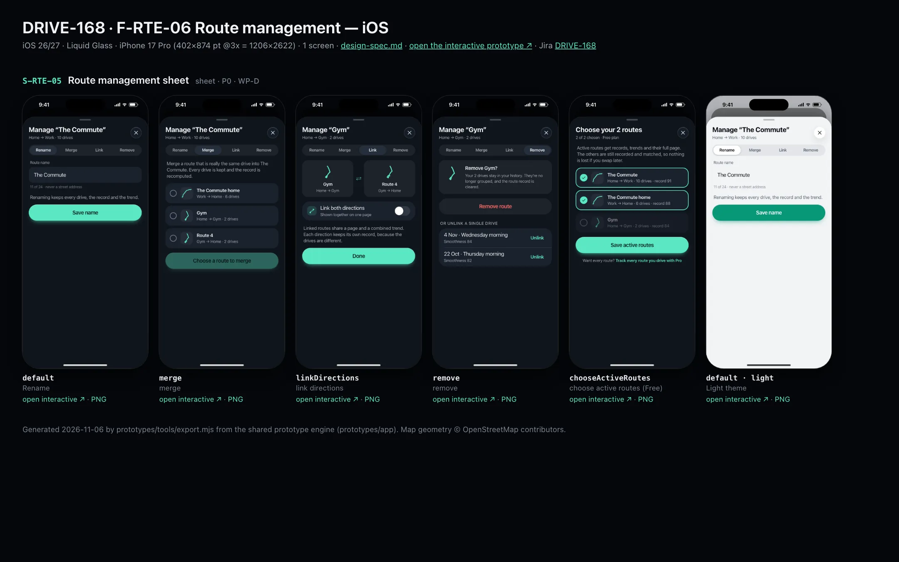
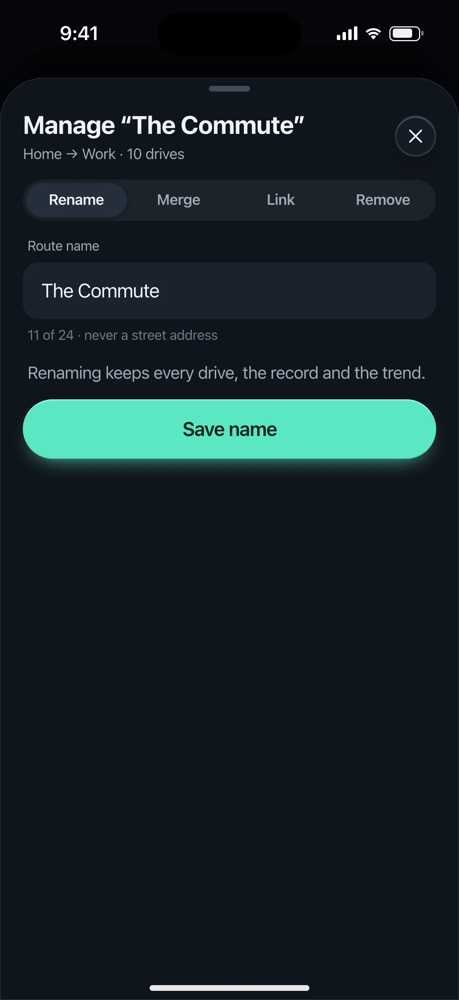
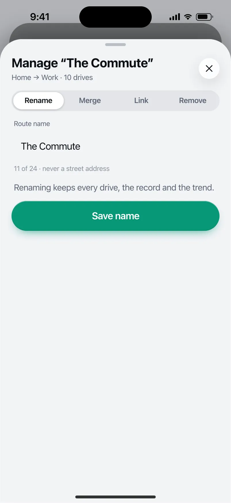

# DRIVE-168 · F-RTE-06 Route management — iOS design spec

> Generated by `prototypes/tools/export.mjs` on 2026-11-06 from the shared prototype engine. **Do not edit by hand:** change the screen's `spec` in `prototypes/app/screens/wp-*.js` (see `prototypes/app/AUTHORING.md`) and re-export.

- **Jira story:** [DRIVE-168](https://thekeval.atlassian.net/browse/DRIVE-168) · F-RTE-06 · P1
- **Platform:** iOS 26/27 · Liquid Glass · iPhone 17 Pro (402×874 pt @3x = 1206×2622)
- **Interactive prototype:** [../../../../prototypes/ios/index.html#S-RTE-05](../../../../prototypes/ios/index.html#S-RTE-05) (catalog panel: every screen and state; deep links `#S-ID/state?trip=…&ent=…&theme=light&text=xl&rm=1`)
- **Contact sheet:** [mockup.html](mockup.html) · 
- **Design system (source of truth for values):** [brand](../../system/brand.md) · [components](../../system/components.md) · [motion](../../system/motion.md) · [accessibility](../../system/accessibility.md) · [screen map](../../system/screen-map.md) · [fixtures](../../system/fixtures.md) · tokens `prototypes/shared/tokens.css`

## Screens in this story

| Screen | Name | Presentation | Priority | States | Status |
|---|---|---|---|---|---|
| `S-RTE-05` | Route management sheet | Sheet (large) | P0 | 5 | Prototyped |

## Tokens used on this platform

Values resolved from `prototypes/shared/tokens.css` inside the iOS device (`[data-platform="ios"]`). Use the token names in code; the hex values are for reference.

| Token | Dark | Light |
|---|---|---|
| `--app-bg` | `#080B10` | `#F2F3F6` |
| `--card-bg` | `#131822` | `#FFFFFF` |
| `--dp-bg-grouped` | `#080B10` | `#F2F3F6` |
| `--dp-surface` | `#131822` | `#FFFFFF` |
| `--dp-surface-2` | `#1B222D` | `#F2F3F6` |
| `--dp-surface-3` | `#262E3B` | `#E4E7EC` |
| `--dp-fill` | `#7880961F` | `#7880961F` |
| `--dp-fill-strong` | `#7880963D` | `#78809633` |
| `--dp-text` | `#F2F4F7` | `#0B0E13` |
| `--dp-text-2` | `#A3AAB6` | `#5A6271` |
| `--dp-text-3` | `#6E7787` | `#8A919D` |
| `--dp-separator` | `#96A0B429` | `#3C435024` |
| `--dp-accent` | `#5BE7C4` | `#079777` |
| `--dp-accent-text` | `#5BE7C4` | `#06775E` |
| `--dp-on-accent` | `#04241D` | `#FFFFFF` |
| `--dp-accent-container` | `#0A4439` | `#C6F8EA` |
| `--dp-record` | `#FFC24B` | `#9A6300` |
| `--dp-positive` | `#5BE7C4` | `#06775E` |
| `--dp-change-down` | `#A3AAB6` | `#5A6271` |
| `--dp-warning` | `#F5B648` | `#9A5F00` |
| `--dp-critical` | `#FF6B6B` | `#C62828` |
| `--dp-glass-fill` | `#1C222C6B` | `#FFFFFF8C` |
| `--dp-glass-fill-strong` | `#1C222CB8` | `#FFFFFFD1` |
| `--dp-glass-stroke` | `#FFFFFF24` | `#FFFFFF99` |
| `--dp-data-route` | `#5BE7C4` | `#079777` |
| `--dp-data-event-brake` | `#FF7A66` | `#A21F16` |
| `--dp-data-event-accel` | `#E58BD0` | `#A33A8C` |
| `--dp-data-event-corner` | `#EAD54E` | `#9A8A00` |
| `--dp-data-quality-good` | `#5FDB9C` | `#1E9E62` |
| `--dp-data-speed` | `#D6DCE4` | `#404A58` |
| `--dp-data-long-g` | `#5AB8F5` | `#0A6AB8` |
| `--dp-data-lat-g` | `#F5A142` | `#B25A00` |

| Type / layout token | Value |
|---|---|
| `--dp-font-screen-title` | `700 34px / 41px -apple-system, BlinkMacSystemFont, "SF Pro Display", system-ui, sans-serif` |
| `--dp-font-sheet-title` | `700 22px / 28px -apple-system, BlinkMacSystemFont, "SF Pro Display", system-ui, sans-serif` |
| `--dp-font-section-title` | `600 20px / 25px -apple-system, BlinkMacSystemFont, "SF Pro Display", system-ui, sans-serif` |
| `--dp-font-card-title` | `600 17px / 22px -apple-system, BlinkMacSystemFont, "SF Pro Text", system-ui, sans-serif` |
| `--dp-font-body` | `400 17px / 22px -apple-system, BlinkMacSystemFont, "SF Pro Text", system-ui, sans-serif` |
| `--dp-font-body-secondary` | `400 15px / 20px -apple-system, BlinkMacSystemFont, "SF Pro Text", system-ui, sans-serif` |
| `--dp-font-meta` | `400 13px / 18px -apple-system, BlinkMacSystemFont, "SF Pro Text", system-ui, sans-serif` |
| `--dp-font-caption` | `400 12px / 16px -apple-system, BlinkMacSystemFont, "SF Pro Text", system-ui, sans-serif` |
| `--dp-font-button` | `600 17px / 22px -apple-system, BlinkMacSystemFont, "SF Pro Text", system-ui, sans-serif` |
| `--dp-num-hero` | `600 72px / 72px -apple-system, BlinkMacSystemFont, "SF Pro Display", system-ui, sans-serif` |
| `--dp-num-xl` | `600 48px / 52px -apple-system, BlinkMacSystemFont, "SF Pro Display", system-ui, sans-serif` |
| `--dp-num-l` | `600 34px / 38px -apple-system, BlinkMacSystemFont, "SF Pro Display", system-ui, sans-serif` |
| `--dp-num-m` | `600 24px / 28px -apple-system, BlinkMacSystemFont, "SF Pro Display", system-ui, sans-serif` |
| `--dp-num-s` | `600 17px / 22px -apple-system, BlinkMacSystemFont, "SF Pro Display", system-ui, sans-serif` |
| `--dp-num-xs` | `600 13px / 16px -apple-system, BlinkMacSystemFont, "SF Pro Display", system-ui, sans-serif` |
| `--dp-screen-margin` | `16px` |
| `--dp-radius-card` | `24px` |
| `--dp-radius-card-hero` | `32px` |
| `--dp-radius-sheet` | `38px` |
| `--dp-radius-chip` | `999px` |
| `--dp-radius-button` | `999px` |
| `--dp-layout-list-row-min` | `52px` |
| `--dp-layout-touch-min` | `44px` |
| `--safe-top` | `62px` |
| `--safe-bottom` | `34px` |

Text sizes scale with `--dp-text-scale` (XL = 2.0×) and numerals with `--dp-num-scale` (XL = 1.3×). DP Numerals: SF Pro Expanded Semibold, tabular.

---

## S-RTE-05 · Route management sheet

 

- **Presentation:** sheet · tab: routes · detent: large — screen map: “Sheet (large)”
- **Entry points:** S-RTE-01/02 manage · S-SUB-07 choose routes
- **Leads to:** Back
- **PRD features:** F-RTE-05, F-RTE-06 · **Priority:** P0 · **WP:** D
- **Interactive:** [S-RTE-05](../../../../prototypes/ios/index.html#S-RTE-05)

**Purpose.** Manage a route — rename, merge, link directions, remove it or unlink a single drive — and, on Free, choose which 2 routes are active (F-RTE-05, F-RTE-06). Records and trends recompute within 2 s; no trip is ever deleted.

### States

| State | PRD label | Fixture params | Screenshot |
|---|---|---|---|
| `default` | Rename | `route=r_commute` | [S-RTE-05.png](../../screens/ios/S-RTE-05.webp) · [open](../../../../prototypes/ios/index.html#S-RTE-05) |
| `merge` | merge | `route=r_commute` | [S-RTE-05--merge.png](../../screens/ios/S-RTE-05--merge.webp) · [open](../../../../prototypes/ios/index.html#S-RTE-05/merge) |
| `linkDirections` | link directions | `route=r_gym` | [S-RTE-05--linkDirections.png](../../screens/ios/S-RTE-05--linkDirections.webp) · [open](../../../../prototypes/ios/index.html#S-RTE-05/linkDirections) |
| `remove` | remove | `route=r_gym` | [S-RTE-05--remove.png](../../screens/ios/S-RTE-05--remove.webp) · [open](../../../../prototypes/ios/index.html#S-RTE-05/remove) |
| `chooseActiveRoutes` | choose active routes (Free) | `ent=free` | [S-RTE-05--chooseActiveRoutes.png](../../screens/ios/S-RTE-05--chooseActiveRoutes.webp) · [open](../../../../prototypes/ios/index.html#S-RTE-05/chooseActiveRoutes) |
| default · light | Light theme | `theme=light` | [S-RTE-05--light.png](../../screens/ios/S-RTE-05--light.webp) |

Every state also renders in light/dark (`theme=light`), XL text (`text=xl`) and reduced motion (`rm=1`).

### Layout

- Large sheet. Header “Manage “The Commute”” + “Home → Work · 10 drives”. Mode selector: Rename · Merge · Link · Remove (iOS glass segmented · Android connected button group).
- Rename: text field (focused, helper “11 of 24 · never a street address”) · note · “Save name” (filled, large).
- Merge: note · radio cards (glyph 40, name, direction · drives) · preview line (“The Commute · 12 drives after merging” or the “runs the other way… Linking may be what you want.” hint) · “Merge into The Commute”.
- Link: two glyph tiles with ⇄ between · “Link both directions” switch row · note “Each direction keeps its own record” · Done.
- Remove: glyph + “Remove Gym?” + “Your 2 drives stay in your history…” · destructive “Remove route” · “Or unlink a single drive” list with Unlink text buttons.
- Choose active routes (Free, from S-SUB-07 or the Routes tab): header “Choose your 2 routes · 2 of 2 chosen · Free plan”, explanation, check cards sorted by runs (a third card dims once 2 are chosen), “Save active routes”, footer link “Track every route you drive with Pro”.

### Components & tokens

| Component | Tokens / spec |
|---|---|
| `sheetHeader` | see components.md |
| `segmented` | see components.md |
| `textField` | see components.md |
| `glyph` | see components.md |
| `list` | iOS inset grouped radius --dp-radius-card, rows 52 pt, separators --dp-separator inset 16 · Android ListItem 56/72 dp in --md-sys-color-surface-container |
| `row` | --dp-font-body · --dp-font-meta (supporting) · --dp-layout-list-row-min |
| `toggle` | iOS 51×31 tint --dp-accent · Android M3 Switch 52×32 --md-sys-color-primary |
| `button` | --dp-accent / --dp-on-accent (filled) · --dp-fill-strong · --md-sys-color-secondary-container (tonal) · --dp-radius-button · height iOS 50/44/34 · Android 56/40/32 · --dp-font-button · components.md §0 |
| `section` | --dp-font-section-title · --dp-layout-section-gap 28 |

### Interactions & navigation

- Mode segments switch state in place (selection haptic). Save / Merge / Done / Remove → toast + dismiss to S-RTE-02 (or S-RTE-01).
- Unlink → toast “Drive unlinked · record recomputed”.
- Choose: tapping a card toggles it; a third tap is ignored while 2 are chosen (the dimmed card says why). Save → “Active routes updated · no drives lost”. The Pro link → S-SUB-03 s3rdRoute.

### Motion

- Sheet spring.sheet (large detent recedes the parent on iOS). Hero motion: content rises 8 px, 30 ms stagger; check/radio fill spring.fast. RM: cross-fades.

### Accessibility

- Check cards are checkboxes: “The Commute, 10 drives, active”. Radio cards in a radio group.
- Destructive button reads “Remove route”; the consequence text precedes it.
- XL: segmented labels shorten to icons + labels on two lines; cards wrap text; buttons stay full width.

### Platform notes

- **iOS (this spec):** Sheet with large detent; glass segmented Picker; TextField; Toggle; destructive role button.
- *Android (for reference):* ModalBottomSheet full height; connected ButtonGroup; OutlinedTextField; Switch; error-coloured FilledTonalButton for Remove; Checkbox cards.

### Analytics

- `route_managed {action: rename|merge|link|unlink|remove}`
- `route_active_swapped`

### Copy

| Key | Text |
|---|---|
| Rename | Renaming keeps every drive, the record and the trend. |
| Merge | Merge a route that is really the same drive into {route}. Every drive is kept and the record is recomputed. |
| Link | Linked routes share a page and a combined trend. Each direction keeps its own record, because the drives are different. |
| Remove | Remove {route}? Your {n} drives stay in your history. They’re no longer grouped, and the route record is cleared. |
| Choose | Active routes get records, trends and their full page. The others are still recorded and matched, so nothing is lost if you swap later. |
| Choose CTA | Save active routes / Choose {n} more |
| Pro link | Want every route? Track every route you drive with Pro |

### Free / Pro

Rename / merge / link / remove are Free. chooseActiveRoutes is the Free-only chooser (entitlement.states.free.activeRouteIds); default = the 2 routes with the most runs (F-RTE-05.3).

### Data & fixtures

Rename/merge: r_commute. Link/remove: r_gym (reverse = r_cand_gym_home, Gym → Home). Choose: The Commute (10), The Commute home (6), Gym (2) with ent free.

### Assets

[icon-check.svg](assets/icon-check.svg) · [icon-layers.svg](assets/icon-layers.svg) · [icon-routes.svg](assets/icon-routes.svg) · [icon-trash.svg](assets/icon-trash.svg) · [icon-close.svg](assets/icon-close.svg)

UI glyphs may be swapped for SF Symbols / Material Symbols Rounded equivalents; event-pin, quality and provenance glyphs must not be (components.md global rules).

### Checklist (accessibility.md §9)

- [ ] Light and dark both render, and contrast passes.
- [ ] The XL text state reflows with no truncation.
- [ ] The RM state is defined.
- [ ] Every control has a label; every chart and map has a summary sentence.
- [ ] Every target ≥ 44 pt / 48 dp (≥ 64 in-drive).
- [ ] No meaning by colour alone.
- [ ] Speed is neutral wherever it appears and absent from social or live surfaces.
- [ ] No streak, leaderboard, speed or “beat your time” language.
- [ ] Behaviour is defined while a trip is active (D1 gate).
- [ ] Haptics come from motion.md §6 only.

---

Map geometry in the prototype: © OpenStreetMap contributors (ODbL). Speed and G are simulated fixtures (fixtures.md).
