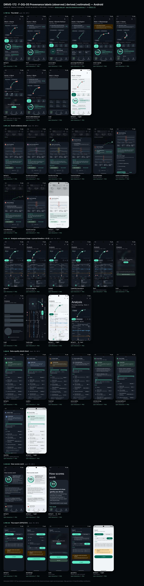
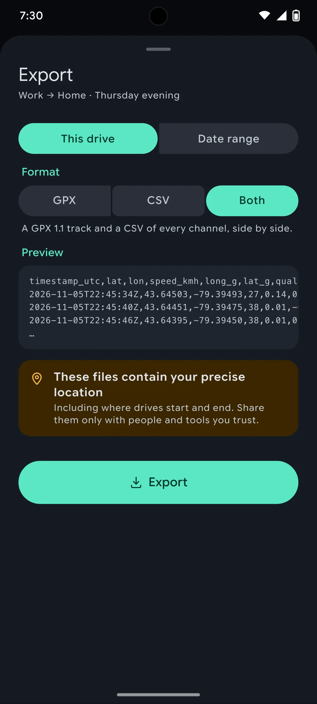
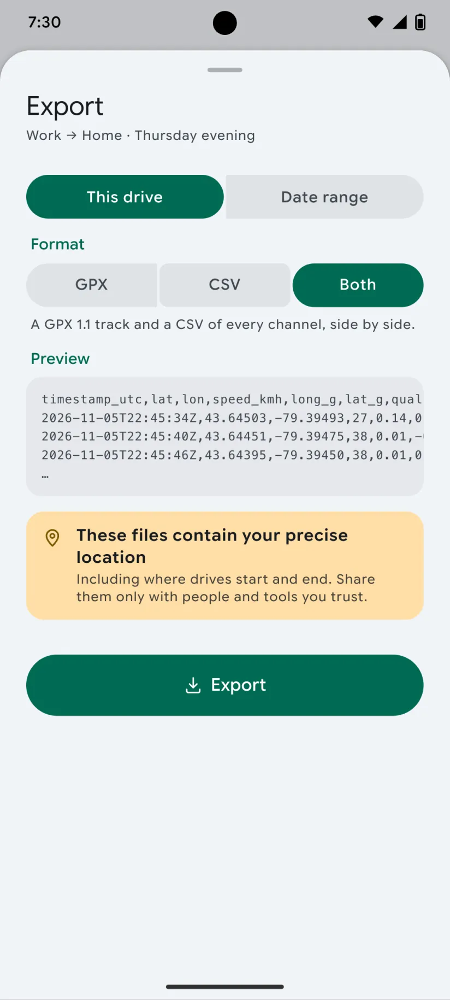

# DRIVE-172 · F-DQ-05 Provenance labels (observed / derived / estimated) — Android design spec

> Generated by `prototypes/tools/export.mjs` on 2026-11-07 from the shared prototype engine. **Do not edit by hand:** change the screen's `spec` in `prototypes/app/screens/wp-*.js` (see `prototypes/app/AUTHORING.md`) and re-export.

- **Jira story:** [DRIVE-172](https://thekeval.atlassian.net/browse/DRIVE-172) · F-DQ-05 · P0
- **Platform:** Android 16 · Material 3 Expressive · 412×915 dp @2.625 (≈ 1081×2402)
- **Interactive prototype:** [../../../../prototypes/android/index.html#S-TRP-01](../../../../prototypes/android/index.html#S-TRP-01) (catalog panel: every screen and state; deep links `#S-ID/state?trip=…&ent=…&theme=light&text=xl&rm=1`)
- **Contact sheet:** [mockup.html](mockup.html) · 
- **Design system (source of truth for values):** [brand](../../system/brand.md) · [components](../../system/components.md) · [motion](../../system/motion.md) · [accessibility](../../system/accessibility.md) · [screen map](../../system/screen-map.md) · [fixtures](../../system/fixtures.md) · tokens `prototypes/shared/tokens.css`

## Screens in this story

| Screen | Name | Presentation | Priority | States | Status |
|---|---|---|---|---|---|
| `S-TRP-01` | Trip detail | Push | P0 | 9 | Prototyped |
| `S-RPL-02` | Event evidence sheet | Sheet (medium → large) | P0 | 8 | Prototyped |
| `S-ANL-01` | Analysis workspace (map + synced timeline + G-G) | Push (immersive) | P0 | 8 | Prototyped |
| `S-DQ-01` | Data-quality detail sheet | Sheet (large) | P0 | 7 | Prototyped |
| `S-SCO-02` | How scores work | Push | P0 | 1 | Prototyped |
| `S-PRV-04` | Trip export (GPX/CSV) | Sheet (large) | P0 | 4 | Prototyped |

## Tokens used on this platform

Values resolved from `prototypes/shared/tokens.css` inside the Android device (`[data-platform="android"]`). Use the token names in code; the hex values are for reference.

| Token | Dark | Light |
|---|---|---|
| `--app-bg` | `#0D1117` | `#F7F9FC` |
| `--card-bg` | `#191E25` | `#EBEEF2` |
| `--dp-bg-grouped` | `#0D1117` | `#F7F9FC` |
| `--dp-surface` | `#191E25` | `#EBEEF2` |
| `--dp-surface-2` | `#1F252D` | `#E5E8EC` |
| `--dp-surface-3` | `#2A3038` | `#DFE2E6` |
| `--dp-fill` | `#2A3038` | `#DFE2E6` |
| `--dp-fill-strong` | `#353B44` | `#D3D7DC` |
| `--dp-text` | `#E1E3E8` | `#181C20` |
| `--dp-text-2` | `#C0C7CF` | `#40474F` |
| `--dp-text-3` | `#8A929B` | `#707881` |
| `--dp-separator` | `#40474F` | `#C0C7CF` |
| `--dp-accent` | `#5BE7C4` | `#006B53` |
| `--dp-accent-text` | `#5BE7C4` | `#006B53` |
| `--dp-on-accent` | `#00382B` | `#FFFFFF` |
| `--dp-accent-container` | `#00513F` | `#91F1D8` |
| `--dp-record` | `#FFC24B` | `#7A5900` |
| `--dp-positive` | `#5BE7C4` | `#006B53` |
| `--dp-change-down` | `#C0C7CF` | `#40474F` |
| `--dp-warning` | `#F5B648` | `#7A5900` |
| `--dp-critical` | `#FFB4AB` | `#BA1A1A` |
| `--dp-glass-fill` | `#1F252DF2` | `#E5E8ECF2` |
| `--dp-glass-fill-strong` | `#2A3038` | `#DFE2E6` |
| `--dp-glass-stroke` | `#FFFFFF0F` | `#0000000A` |
| `--md-sys-color-primary` | `#5BE7C4` | `#006B53` |
| `--md-sys-color-on-primary` | `#00382B` | `#FFFFFF` |
| `--md-sys-color-primary-container` | `#00513F` | `#91F1D8` |
| `--md-sys-color-on-primary-container` | `#91F1D8` | `#002118` |
| `--md-sys-color-secondary-container` | `#344C44` | `#CEE9DF` |
| `--md-sys-color-surface` | `#0D1117` | `#F7F9FC` |
| `--md-sys-color-surface-container` | `#191E25` | `#EBEEF2` |
| `--md-sys-color-surface-container-high` | `#1F252D` | `#E5E8EC` |
| `--md-sys-color-on-surface-variant` | `#C0C7CF` | `#40474F` |
| `--dp-data-route` | `#5BE7C4` | `#079777` |
| `--dp-data-event-brake` | `#FF7A66` | `#A21F16` |
| `--dp-data-event-accel` | `#E58BD0` | `#A33A8C` |
| `--dp-data-event-corner` | `#EAD54E` | `#9A8A00` |
| `--dp-data-quality-good` | `#5FDB9C` | `#1E9E62` |
| `--dp-data-speed` | `#D6DCE4` | `#404A58` |
| `--dp-data-long-g` | `#5AB8F5` | `#0A6AB8` |
| `--dp-data-lat-g` | `#F5A142` | `#B25A00` |

| Type / layout token | Value |
|---|---|
| `--dp-font-screen-title` | `600 32px / 40px "Google Sans Flex", "Google Sans Display", "Roboto Flex", Roboto, system-ui, sans-serif` |
| `--dp-font-sheet-title` | `400 24px / 32px "Google Sans Flex", "Google Sans Display", "Roboto Flex", Roboto, system-ui, sans-serif` |
| `--dp-font-section-title` | `600 22px / 28px "Google Sans Flex", "Google Sans Display", "Roboto Flex", Roboto, system-ui, sans-serif` |
| `--dp-font-card-title` | `700 16px / 24px "Google Sans Flex", "Google Sans Text", "Roboto Flex", Roboto, system-ui, sans-serif` |
| `--dp-font-body` | `400 16px / 24px "Google Sans Flex", "Google Sans Text", "Roboto Flex", Roboto, system-ui, sans-serif` |
| `--dp-font-body-secondary` | `400 14px / 20px "Google Sans Flex", "Google Sans Text", "Roboto Flex", Roboto, system-ui, sans-serif` |
| `--dp-font-meta` | `400 12px / 16px "Google Sans Flex", "Google Sans Text", "Roboto Flex", Roboto, system-ui, sans-serif` |
| `--dp-font-caption` | `500 12px / 16px "Google Sans Flex", "Google Sans Text", "Roboto Flex", Roboto, system-ui, sans-serif` |
| `--dp-font-button` | `700 14px / 20px "Google Sans Flex", "Google Sans Text", "Roboto Flex", Roboto, system-ui, sans-serif` |
| `--dp-num-hero` | `600 72px / 72px "Google Sans Flex", "Roboto Flex", Roboto, system-ui, sans-serif` |
| `--dp-num-xl` | `600 48px / 52px "Google Sans Flex", "Roboto Flex", Roboto, system-ui, sans-serif` |
| `--dp-num-l` | `600 34px / 38px "Google Sans Flex", "Roboto Flex", Roboto, system-ui, sans-serif` |
| `--dp-num-m` | `600 24px / 28px "Google Sans Flex", "Roboto Flex", Roboto, system-ui, sans-serif` |
| `--dp-num-s` | `600 17px / 22px "Google Sans Flex", "Roboto Flex", Roboto, system-ui, sans-serif` |
| `--dp-num-xs` | `600 13px / 16px "Google Sans Flex", "Roboto Flex", Roboto, system-ui, sans-serif` |
| `--dp-screen-margin` | `16px` |
| `--dp-radius-card` | `16px` |
| `--dp-radius-card-hero` | `28px` |
| `--dp-radius-sheet` | `28px` |
| `--dp-radius-chip` | `8px` |
| `--dp-radius-button` | `999px` |
| `--dp-layout-list-row-min` | `56px` |
| `--dp-layout-touch-min` | `48px` |
| `--safe-top` | `40px` |
| `--safe-bottom` | `24px` |

Text sizes scale with `--dp-text-scale` (XL = 2.0×) and numerals with `--dp-num-scale` (XL = 1.3×). DP Numerals: Google Sans Flex wdth 120 wght 600, tabular.

---

## S-TRP-01 · Trip detail

- **Presentation:** push · tab: drives — screen map: “Push”
- **Entry points:** S-HOME-01 · S-HIS-01 · S-RTE-02 runs · S-GAR-02 · S-RCP-01 drive of week
- **Leads to:** S-RPL-01 · S-ANL-01 · S-STY-01 · S-SHR-01 · S-PRV-04 (Export, Pro) · S-TRP-02 · S-DQ-01 · S-SCO-01 · S-SCO-04 · S-SUB-03 (Lock)
- **PRD features:** F-RPL-07, F-CAP-04, F-CAP-05, F-CAP-06, F-CAP-17, F-DQ-04, F-DQ-05, F-HIS-03, F-SCO-01, F-SCO-04, F-SCO-06, F-SCO-09, F-SHR-01, F-PRV-03, F-RPL-01 · **Priority:** P0 · **WP:** C
- **Interactive:** [S-TRP-01](../../../../prototypes/android/index.html#S-TRP-01)

**Purpose.** One place with a drive’s summary, scores, events and actions, so the user can decide where to dig in (F-RPL-07). The summary is Free forever; Replay/Analysis older than 30 days are Pro and shown locked with this trip’s own data blurred (F-HIS-03).

### States

| State | PRD label | Fixture params | Screenshot |
|---|---|---|---|
| `default` | Def | `trip=t20261105-1745` | — · [open](../../../../prototypes/android/index.html#S-TRP-01) |
| `Part` | Part (estimated start, gaps) | `trip=t20261020-0740` | — · [open](../../../../prototypes/android/index.html#S-TRP-01/Part) |
| `unscorable` | Unscorable | `trip=t20261106-1210` | — · [open](../../../../prototypes/android/index.html#S-TRP-01/unscorable) |
| `passengerNotADrive` | Passenger / not a drive | `trip=t20261031-1905` | — · [open](../../../../prototypes/android/index.html#S-TRP-01/passengerNotADrive) |
| `interrupted` | Interrupted | `trip=t20261013-1742` | — · [open](../../../../prototypes/android/index.html#S-TRP-01/interrupted) |
| `shortTrip` | Short trip | `trip=t20261104-0755` | — · [open](../../../../prototypes/android/index.html#S-TRP-01/shortTrip) |
| `Lock` | Lock (older than 30 days, Free) | `trip=t20261002-0745` `ent=free` | — · [open](../../../../prototypes/android/index.html#S-TRP-01/Lock) |
| `detailedDataRemoved` | Detailed data removed | `trip=t20261002-0745` | — · [open](../../../../prototypes/android/index.html#S-TRP-01/detailedDataRemoved) |
| `Load` | Load | `trip=t20261105-1745` | — · [open](../../../../prototypes/android/index.html#S-TRP-01/Load) |

Every state also renders in light/dark (`theme=light`), XL text (`text=xl`) and reduced motion (`rm=1`).

### Layout

- Top bar: iOS inline title (route label) + subtitle (part of day · date) with glass back, Share and “…” menu (Edit trip, Export GPX/CSV, Data quality, Delete) · Android MediumFlexibleTopAppBar (back, Share, overflow) with the title block in content that collapses into the bar on scroll.
- State banners (passenger, interrupted, unscorable, short trip, Part data, detailed data removed) directly under the bar.
- Map hero, full width minus 16 margins, 232 tall, radius = card (24 iOS / 16 Android): route in Glide over the plain-canvas map, estimated start dashed, GPS gap dotted, stop capsules, neutral max-speed triangle, event pins by shape; quality badge and “Estimated start” chips top-left (glass on iOS); “Replay” glass capsule bottom-left (“Replay in Pro” + lock when locked); “© OpenStreetMap contributors” bottom-right.
- Meta row: car chip (tap → car picker) · source (Auto-detected / Started from Widget, Control Center) · start–end time.
- Smoothness card: ring 124 (baseline notch, record notch) + comparison chip, record line (rosette, gold), “Score based on n of m min” when excluded, “How scores work”; four contributor rows (label · band chip ▲/●/▼ · reason); “Smoothness breakdown ›” → S-SCO-01.
- Action row directly under the meta row (4 equal buttons, 68 tall): Replay (primary) · Analysis · Story · Share. Locked: lock badges, both open S-SUB-03. Passenger: Replay · Analysis · Edit.
- Locked (Free > 30 days): “Replay & Analysis” lock panel — this trip’s synced timeline blurred 14 px + “Keep exploring every drive with Pro.” + See plans.
- Stats 3×3 tiles in PRD order: distance, duration, moving time, stopped, stops, avg moving speed, max speed (neutral, never first), climb, descent — each with its provenance glyph.
- Events · n: count chips by type (pin glyph + count) and event rows (pin 28 · “Hard braking” · place · time of day · 0.42 g · 1.4 s); “No abrupt inputs on this drive.” when there are none.
- Highlights: positive card first (“Cleanest stretch: …”), then the tip card (“One thing for next time”, long-G sparkline, “See the moment ›”).
- Details list: data quality (badge + detail) → S-DQ-01 · efficiency habits (≈ estimated) → S-SCO-06 · route (runs, record) → S-RTE-02. Manage list: Edit trip · Export GPX/CSV (Pro) · Delete drive (destructive).

### Components & tokens

| Component | Tokens / spec |
|---|---|
| `navBar` | --dp-font-card-title · --dp-font-meta · glass: --dp-glass-fill + --dp-glass-blur · components.md §2 |
| `menu` | iOS glass Menu: --dp-glass-fill-strong, radius 26 · Android DropdownMenu: --md-sys-color-surface-container, radius 16 |
| `banner` | radius 12 (--dp-radius-sm+) · info --dp-fill · attention --dp-warning-container · critical --dp-critical-container · components.md §22 |
| `map` | --dp-data-map-land/road/grid · route --dp-data-route 3.8 + casing --dp-data-route-casing 7.5 · estimated dashed 4/4 at 60% · gap --dp-data-gap-stroke dotted 1/6 · pins DP_ICONS.pin 26 · attribution “© OpenStreetMap contributors” |
| `qualityBadge` | --dp-data-quality-{good\|usable\|limited\|unscorable} · components.md §10 |
| `chip` | --dp-radius-chip (iOS capsule · Android 8) · height 28 · --dp-font-caption |
| `card` | --dp-surface / --md-sys-color-surface-container · --dp-radius-card (24 iOS · 16 Android) · hero: --dp-radius-card-hero (32 · 28) · light iOS: --dp-elev-1 |
| `ring` | track --dp-fill-strong · arc --dp-gradient-ring (glide-400 → accent → glide-100) · baseline notch --dp-text-2 · record notch --dp-record · Android container Cookie9Sided --md-sys-color-primary-container 42% · components.md §3 |
| `deltaChip` | better: --dp-accent-text on --dp-accent 18% · lower: --dp-text-2 on --dp-fill (never red) · record: --dp-record on --dp-record 18% · components.md §4 |
| `actionButton` | --dp-surface-2 · --md-sys-color-surface-container-high · --dp-radius-lg · min 44 pt / 48 dp |
| `lockPanel` | blur --dp-opacity-locked-blur 14px · dim --dp-opacity-locked-dim 35% · components.md §15.2 |
| `timeline` | --dp-data-speed · --dp-data-long-g · --dp-data-lat-g (dashed 6/3) · cursor --dp-data-cursor · components.md §7 |
| `stats` | --dp-surface-2 / --md-sys-color-surface-container-high · radius 14 iOS / 12 Android · value --dp-num-m (DP Numerals) · components.md §5 |
| `eventRow` | pin 28 (shape = meaning) · meta --dp-num-xs · min height 44 · components.md §9.2 |
| `tipCard` | --dp-accent 10% over --dp-surface · sparkline --dp-data-long-g · components.md §18 |
| `sparkline` | see components.md |
| `list` | iOS inset grouped radius --dp-radius-card, rows 52 pt, separators --dp-separator inset 16 · Android ListItem 56/72 dp in --md-sys-color-surface-container |
| `row` | --dp-font-body · --dp-font-meta (supporting) · --dp-layout-list-row-min |
| `section` | --dp-font-section-title · --dp-layout-section-gap 28 |
| `skeleton` | --dp-fill-strong, breathe 1.2 s (dp-skeleton) |

### Interactions & navigation

- Map / Replay → S-RPL-01 (Lock → S-SUB-03 replayAnalysis30Days). Analysis → S-ANL-01. Story → S-STY-01. Share (button or bar) → S-SHR-01. (Story/Replay/Analysis/Share pass the D1 gate → S-DRV-05 while moving.)
- Quality badge / Data quality row → S-DQ-01 · Smoothness card → S-SCO-01 · “How scores work” → S-SCO-02 · Event row → S-RPL-02 (event param) · Tip “See the moment” → S-RPL-02.
- Car chip → S-TRP-02/carPicker · Passenger “Change” → S-TRP-02/typePicker · Edit → S-TRP-02 · Export → S-PRV-04 (Pro) or S-SUB-03/export (Free) · Delete → S-TRP-03 dialog · Route row → S-RTE-02 · Efficiency → S-SCO-06.
- “…” opens a glass Menu (iOS) / DropdownMenu (Android). Long-press any stat tile → provenance popover (prototype: toast) with the glyph meaning, haptic longPress.

### Motion

- Enter from a trip card: iOS zoom transition from the card, Android container transform (spring.slow).
- Map: route draw-on 1800 ms ease.drawOn; estimated/gap overlays, stops and max pin fade in at 1500 ms; event pins pop in time order from 1600 ms, 40 ms stagger, shared.pinPop. RM: the complete route fades in (220 ms), pins appear in place.
- Smoothness ring reveal (motion.md §3.4): 1400 ms count-up locked to the arc, baseline notch scales in, landing tap haptic; Android Cookie9Sided container rotates as the count runs. RM: final ring, static number.
- Sections rise 8 px, 30 ms stagger, spring.default. Menu scales in from the top-trailing corner (spring.fast).

### Accessibility

- Score card is one element: “Smoothness 85. 2 above your usual on The Commute home.” (+ “New route record, beating 89 from 14 October.”).
- Map label: “Map of your drive, 39 kilometres from Work to Home. 2 events, 2 stops.” Event pins are a time-ordered list; each event row reads “Hard braking at the Gardiner. Peak 0.4 g.”
- Stat tiles: “Distance, 39.0 kilometres. Derived.” with the long-press action “Show how this was measured”; ⓘ footer explains long-press.
- Speed tiles use the same neutral component (no colour, no emphasis, never first). Deltas use ▲/▼/● and “above/below your usual”, never red.
- XL: tiles go to 2 columns, the action row to 2×2, contributor reasons wrap; nothing truncates.

### Platform notes

- **Android (this spec):** MediumFlexibleTopAppBar (title in content, collapses on scroll), overflow DropdownMenu; quality badge as AssistChip; ring on a Cookie9Sided primaryContainer shape; actions: filled primary (radius 28) + tonal surfaceContainerHigh buttons; list sections as M3E segmented ListItems; container transform from the card.
- *iOS (for reference):* Inline title + .navigationSubtitle, glass back/Share/“…” toolbar buttons, Menu for overflow; map chips and Replay capsule are glass; ring on content; zoom transition from the source card.

### Analytics

- `trip_detail_opened {source, age_bucket}`
- `locked_content_viewed {type: replay|analysis, age_bucket}`
- `trip_action_tapped {action: replay|analysis|story|share|export|edit|delete}`
- `provenance_viewed {metric}`

### Copy

| Key | Text |
|---|---|
| Passenger | Marked as passenger. It isn’t scored and doesn’t count toward your baseline, routes or recaps. · Change |
| Interrupted | Interrupted at {time}. {iOS ended DrivePerf in the background \| Android stopped DrivePerf in the background}. Everything before then is saved. The missing part is shown as a gap, never scored. |
| Unscorable | We couldn’t score this one fairly. {quality.reason}. Here’s the route and the stats anyway. |
| Part | {badge} data. {41} s without GPS downtown (dotted on the map) · the first ≈ 0.4 km is estimated (dashed). |
| Short trip | Short drive · {km} km. Short drives give the score less to work with, so expect it to move more from drive to drive. |
| Detailed data removed | You removed the raw sensor data to save space. The summary, route and score stay; Analysis and event traces are no longer available. |
| Lock | Keep exploring every drive with Pro. (entitlement.lockSheets.oldAnalysis) · Your summary, score and Story stay free forever. Nothing is deleted because of your plan. |
| No events | No abrupt inputs on this drive. Nothing crossed the braking, acceleration or cornering thresholds. |

### Free / Pro

Free: everything on this screen is visible for every trip of any age. For trips older than 30 days Replay and Analysis show lock badges and open S-SUB-03 (replayAnalysis30Days) over a blurred render of this trip; Export shows a PRO badge and opens S-SUB-03/export. Pro/Preview/Ride-along: no locks.

### Data & fixtures

Fixtures: default t20261105-1745 · Part t20261020-0740 (41 s gap, needed brake at Spadina & King) · unscorable t20261106-1210 · passenger t20261031-1905 · interrupted t20261013-1742 · short trip t20261104-0755 · Lock / detailed data removed t20261002-0745. Event time of day = trip.start + event.t (derived).

### Assets

[icon-replay.svg](assets/icon-replay.svg) · [icon-analysis.svg](assets/icon-analysis.svg) · [icon-story.svg](assets/icon-story.svg) · [icon-share.svg](assets/icon-share.svg) · [icon-more.svg](assets/icon-more.svg) · [icon-edit.svg](assets/icon-edit.svg) · [icon-export.svg](assets/icon-export.svg) · [icon-trash.svg](assets/icon-trash.svg) · [icon-lock.svg](assets/icon-lock.svg) · [icon-info.svg](assets/icon-info.svg) · [icon-routes.svg](assets/icon-routes.svg) · [icon-car.svg](assets/icon-car.svg) · [icon-bolt.svg](assets/icon-bolt.svg) · [icon-sparkle.svg](assets/icon-sparkle.svg) · [icon-passenger.svg](assets/icon-passenger.svg) · [icon-shield.svg](assets/icon-shield.svg) · [icon-check.svg](assets/icon-check.svg) · [icon-chevronRight.svg](assets/icon-chevronRight.svg) · [icon-rosette.svg](assets/icon-rosette.svg)

UI glyphs may be swapped for SF Symbols / Material Symbols Rounded equivalents; event-pin, quality and provenance glyphs must not be (components.md global rules).

### Checklist (accessibility.md §9)

- [ ] Light and dark both render, and contrast passes.
- [ ] The XL text state reflows with no truncation.
- [ ] The RM state is defined.
- [ ] Every control has a label; every chart and map has a summary sentence.
- [ ] Every target ≥ 44 pt / 48 dp (≥ 64 in-drive).
- [ ] No meaning by colour alone.
- [ ] Speed is neutral wherever it appears and absent from social or live surfaces.
- [ ] No streak, leaderboard, speed or “beat your time” language.
- [ ] Behaviour is defined while a trip is active (D1 gate).
- [ ] Haptics come from motion.md §6 only.

---

## S-RPL-02 · Event evidence sheet

- **Presentation:** sheet · tab: drives · detent: auto — screen map: “Sheet (medium → large)”
- **Entry points:** S-RPL-01 pin · S-ANL-01 tick · S-SCO-01 contributor · S-TRP-01 event list
- **Leads to:** S-SCO-03 · S-SCO-04 · "Not accurate?" list
- **PRD features:** F-RPL-04, F-SCO-04, F-SCO-05, F-SCO-06, F-DQ-05 · **Priority:** P0 · **WP:** C
- **Interactive:** [S-RPL-02](../../../../prototypes/android/index.html#S-RPL-02)

**Purpose.** After tapping a pin or tick, show the evidence (speed and G from 10 s before to 10 s after, with start/peak/end) and the related tip, so the user understands the event and what to try next time (F-RPL-04). It is also where “Was it needed?” and “Not accurate?” start (F-SCO-05).

### States

| State | PRD label | Fixture params | Screenshot |
|---|---|---|---|
| `default` | Hard braking | `trip=t20261105-1745` `event=e1` | — · [open](../../../../prototypes/android/index.html#S-RPL-02) |
| `hardAcceleration` | Hard acceleration | `trip=t20261027-1728` `event=e2` | — · [open](../../../../prototypes/android/index.html#S-RPL-02/hardAcceleration) |
| `hardCornering` | Hard cornering | `trip=t20261010-1015` `event=e4` | — · [open](../../../../prototypes/android/index.html#S-RPL-02/hardCornering) |
| `lowConfidence` | Low confidence | `trip=t20261022-0805` `event=e2` | — · [open](../../../../prototypes/android/index.html#S-RPL-02/lowConfidence) |
| `markedNeeded` | Marked needed | `trip=t20261020-0740` `event=e3` | — · [open](../../../../prototypes/android/index.html#S-RPL-02/markedNeeded) |
| `notAccurateReasons` | “Not accurate?” reasons | `trip=t20261105-1745` `event=e1` | — · [open](../../../../prototypes/android/index.html#S-RPL-02/notAccurateReasons) |
| `traceRemoved` | Trace removed (Part) | `trip=t20261002-0745` `event=e1` | — · [open](../../../../prototypes/android/index.html#S-RPL-02/traceRemoved) |
| `thisDrivesTip` | “This drive’s tip” | `trip=t20261105-1745` `event=e2` | — · [open](../../../../prototypes/android/index.html#S-RPL-02/thisDrivesTip) |

Every state also renders in light/dark (`theme=light`), XL text (`text=xl`) and reduced motion (`rm=1`).

### Layout

- iOS sheet at the medium detent (glass), expandable to large; Android ModalBottomSheet half → full with drag handle. Playback pauses and the map centres on the event underneath.
- Header: event pin 28 (hollow when needed) + “Hard braking” (`sheetTitle`) · “{Place} · {time of day}” (meta) · iOS glass close.
- Banners as needed: low confidence (info, dashed-ring glyph) · marked needed (positive, hollow pin, “Count it again”) · trace removed.
- Trace card (surface-2 / surface-container-high, radius 18, 12 padding): speed (neutral, top) and longitudinal + lateral G (one lane, sky solid and amber dashed), start/peak/end guides, −10 s … +10 s labels, legend row with swatch + pattern.
- Facts grid 4 columns (2 at XL): Peak 0.40 g · Duration 1.7 s · Speed 67 → 28 km/h (neutral) · Confidence High; each label carries its provenance glyph (derived/observed/estimated). Peak is struck through when needed.
- Tip card: “This drive’s tip” when trip.tip.eventId is this event, else “Next time” with the library tip for this event type and place; “Why this tip ›” → S-SCO-04.
- Actions: Was it needed? (tonal, block) → S-SCO-03 · Not accurate? (text) → inline reasons (radios: Phone moved · Pothole or speed bump · Not me driving · Other) + Send / Cancel.
- Event stepper: ‹ Event 1 of 2 › (gesture-free alternative to the scrubber’s next/previous event, accessibility.md §6).

### Components & tokens

| Component | Tokens / spec |
|---|---|
| `sheetHeader` | see components.md |
| `banner` | radius 12 (--dp-radius-sm+) · info --dp-fill · attention --dp-warning-container · critical --dp-critical-container · components.md §22 |
| `evidenceTrace` | see components.md |
| `tipCard` | --dp-accent 10% over --dp-surface · sparkline --dp-data-long-g · components.md §18 |
| `button` | --dp-accent / --dp-on-accent (filled) · --dp-fill-strong · --md-sys-color-secondary-container (tonal) · --dp-radius-button · height iOS 50/44/34 · Android 56/40/32 · --dp-font-button · components.md §0 |
| `radios` | see components.md |
| `iconButton` | see components.md |
| `provenance` | see components.md |

### Interactions & navigation

- Was it needed? → S-SCO-03 (small sheet over this one) · Count it again → S-SCO-03/countItAgain.
- Not accurate? → reasons list; Send → feedback stored locally, the event is excluded, toast, sheet closes. Cancel returns.
- Why this tip → S-SCO-04.
- ‹ / › → previous/next event (replaces this sheet, moves the replay marker and selection underneath).
- Drag down / scrim tap / close → back to Replay, selection clears.

### Motion

- Sheet rises with spring.sheet; the trace lines draw on in 700 ms after the sheet settles; detent snaps use the system spring + haptic selection.
- RM: the trace appears complete; the sheet cross-fades.

### Accessibility

- Sheet label: “Hard braking at Spadina and Front, 8:14 am. Peak 0.42 g over 1.4 seconds, from 48 to 0 kilometres per hour. Confidence high.” Focus moves to the title on open and returns to the pin on close.
- Trace summary: “Speed and G from 10 seconds before to 10 seconds after. Speed went from 67 to 28 kilometres per hour. Peak 0.40 g.”
- Each fact reads label, value, units spelled out and provenance. Needed state is announced in words, not only by the hollow pin.
- XL: facts go to 2 columns; the trace stays 118 tall; the sheet opens large.

### Platform notes

- **Android (this spec):** ModalBottomSheet (surface-container-low, radius 28, 32×4 handle); FilledTonalButton + TextButton; tonal icon buttons; no close button (drag or back).
- *iOS (for reference):* Glass sheet at the medium detent; tonal-glass “Was it needed?” button; glass stepper buttons; close button in the header.

### Analytics

- `evidence_opened {type}`
- `event_reported_inaccurate {type, reason}`
- `tip_viewed {tip_id}`

### Copy

| Key | Text |
|---|---|
| Low confidence | Your phone’s signal was weaker here, so treat this one lightly. |
| Needed | You marked this as needed. It doesn’t count toward your score. · Count it again |
| Trace removed | Detailed trace not kept. The raw sensor data for this drive was removed to save space. The summary values below stay. |
| Tip | This drive’s tip \| Next time |
| Actions | Was it needed? · Not accurate? |
| Reasons | What went wrong? We’ll leave this event out and use your answer to tune detection on this phone. · Phone moved · Pothole or speed bump · Not me driving · Other · Send · Cancel |
| Thanks | Thanks. This event won’t count. Your answer stays on this phone. |

### Free / Pro

Same window as Replay: Free for drives in the last 30 days, Pro for older ones (the sheet is only reachable from an unlocked replay).

### Data & fixtures

States → events: default t20261105-1745/e1 (the Gardiner) · thisDrivesTip t20261105-1745/e2 (Kerr St, trip.tip.eventId) · hardAcceleration t20261027-1728/e2 · hardCornering t20261010-1015/e4 · lowConfidence t20261022-0805/e2 (Low) · markedNeeded t20261020-0740/e3 · notAccurateReasons t20261105-1745/e1 · traceRemoved t20261002-0745/e1 (evidence withheld to simulate storage trimming). “Next time” tips are filled from DP_DATA.tips templates with the event’s place/road (derived); time of day = trip.start + event.t.

### Assets

[icon-info.svg](assets/icon-info.svg) · [icon-layers.svg](assets/icon-layers.svg) · [icon-chevronLeft.svg](assets/icon-chevronLeft.svg) · [icon-chevronRight.svg](assets/icon-chevronRight.svg) · [icon-check.svg](assets/icon-check.svg) · [icon-close.svg](assets/icon-close.svg)

UI glyphs may be swapped for SF Symbols / Material Symbols Rounded equivalents; event-pin, quality and provenance glyphs must not be (components.md global rules).

### Checklist (accessibility.md §9)

- [ ] Light and dark both render, and contrast passes.
- [ ] The XL text state reflows with no truncation.
- [ ] The RM state is defined.
- [ ] Every control has a label; every chart and map has a summary sentence.
- [ ] Every target ≥ 44 pt / 48 dp (≥ 64 in-drive).
- [ ] No meaning by colour alone.
- [ ] Speed is neutral wherever it appears and absent from social or live surfaces.
- [ ] No streak, leaderboard, speed or “beat your time” language.
- [ ] Behaviour is defined while a trip is active (D1 gate).
- [ ] Haptics come from motion.md §6 only.

---

## S-ANL-01 · Analysis workspace (map + synced timeline + G-G)

- **Presentation:** push · tab: drives — screen map: “Push (immersive)”
- **Entry points:** S-TRP-01 · S-RPL-01
- **Leads to:** S-ANL-02 · S-ANL-03 · S-ANL-04 · S-RPL-02 · S-SUB-03 (Lock)
- **PRD features:** F-RPL-05, F-RPL-06, F-RPL-03, F-RPL-08, F-DQ-03, F-DQ-04, F-DQ-05 · **Priority:** P0 · **WP:** C
- **Interactive:** [S-ANL-01](../../../../prototypes/android/index.html#S-ANL-01)

**Purpose.** Study the drive: speed, longitudinal G and lateral G on one timeline synced with the map and the G-G circle (F-RPL-05/06), with honest quality overlays (F-RPL-08). Free for the last 30 days; older drives are Pro (Gate 1 #6).

### States

| State | PRD label | Fixture params | Screenshot |
|---|---|---|---|
| `default` | Def | `trip=t20261105-1745` | — · [open](../../../../prototypes/android/index.html#S-ANL-01) |
| `cursorDragging` | Cursor dragging | `trip=t20261020-0740` | — · [open](../../../../prototypes/android/index.html#S-ANL-01/cursorDragging) |
| `zoomed` | Zoomed | `trip=t20261105-1745` | — · [open](../../../../prototypes/android/index.html#S-ANL-01/zoomed) |
| `timeVsDistanceAxis` | Time vs distance axis | `trip=t20261105-1745` | — · [open](../../../../prototypes/android/index.html#S-ANL-01/timeVsDistanceAxis) |
| `Part` | Part (hatched/excluded) | `trip=t20261027-1728` | — · [open](../../../../prototypes/android/index.html#S-ANL-01/Part) |
| `Lock` | Lock (Free, > 30 days) | `trip=t20261002-0745` `ent=free` | — · [open](../../../../prototypes/android/index.html#S-ANL-01/Lock) |
| `Load` | Load | `trip=t20261105-1745` | — · [open](../../../../prototypes/android/index.html#S-ANL-01/Load) |
| `landscape` | Landscape | `trip=t20261027-1728` | — · [open](../../../../prototypes/android/index.html#S-ANL-01/landscape) |

Every state also renders in light/dark (`theme=light`), XL text (`text=xl`) and reduced motion (`rm=1`).

### Layout

- Immersive push (no tab bar). iOS inline title “Analysis” + part of day · label, glass Channels (→ S-ANL-03) and Replay buttons · Android MediumFlexibleTopAppBar.
- Map card (full width − 32, 176 tall, radius card) with the cursor marker; quality badge (glass) top-left → S-DQ-01. Tap the map to snap the cursor.
- Toolbar: Time / Distance segmented (iOS glass segmented · Android connected button group) + zoom stepper (− 1× +, tonal 36).
- Cursor readout row: “12:04 elapsed · 9.8 km” + the span chip when the cursor is in an estimated, gap or excluded span.
- Timeline card: lanes share one x-axis — Speed 44 (neutral `--dp-data-speed`, 0–120 km/h), Longitudinal G 64 (±0.6, zero line, sky solid), Lateral G 64 (±0.6, amber dashed 6/3), optional Elevation 34 (area), Pro Jerk 40 and Sample quality 14 — each with a label (10.5/600 text2) and range (9.5 numerals text3); event lane (pins 16) aligned to the map pins; 5 x-axis ticks (time or km); cursor 1.5 px `--dp-data-cursor` with a value bubble per lane (numerals 11 with a card-colour halo).
- Quality overlay: estimated start dashed at 60% · GPS gap = line break + filled band + “No GPS” · excluded = 45° hatch band + “Phone moved — not scored”.
- Legend row (swatch + pattern): Speed · Long G · Lat G · (Elevation, Jerk) · Estimated · No GPS · Not scored.
- Bottom: G-G card 158 (cloud, envelope, cursor dot; tap → S-ANL-02 zoom) beside three stat tiles: Smoothness (with “Based on 31 of 34 min”), Max speed (neutral), Events (count by pin).
- “Select a range” card (Pro) → S-ANL-04; ⓘ footnote for long-press provenance and gestures.
- Lock: this trip’s own map + lanes blurred 14 px with lock + “Your 2 Oct drive · Keep exploring every drive with Pro.” + See plans, then “Back to the summary”. Load: skeletons that mirror the lanes + loader line. Landscape: timeline full width, map shrinks to a 30% inset with the G-G under it.

### Components & tokens

| Component | Tokens / spec |
|---|---|
| `navBar` | --dp-font-card-title · --dp-font-meta · glass: --dp-glass-fill + --dp-glass-blur · components.md §2 |
| `map` | --dp-data-map-land/road/grid · route --dp-data-route 3.8 + casing --dp-data-route-casing 7.5 · estimated dashed 4/4 at 60% · gap --dp-data-gap-stroke dotted 1/6 · pins DP_ICONS.pin 26 · attribution “© OpenStreetMap contributors” |
| `qualityBadge` | --dp-data-quality-{good\|usable\|limited\|unscorable} · components.md §10 |
| `segmented` | see components.md |
| `iconButton` | see components.md |
| `card` | --dp-surface / --md-sys-color-surface-container · --dp-radius-card (24 iOS · 16 Android) · hero: --dp-radius-card-hero (32 · 28) · light iOS: --dp-elev-1 |
| `stats` | --dp-surface-2 / --md-sys-color-surface-container-high · radius 14 iOS / 12 Android · value --dp-num-m (DP Numerals) · components.md §5 |
| `lockPanel` | blur --dp-opacity-locked-blur 14px · dim --dp-opacity-locked-dim 35% · components.md §15.2 |
| `skeleton` | --dp-fill-strong, breathe 1.2 s (dp-skeleton) |
| `loader` | see components.md |
| `proBadge` | see components.md |
| `anlLanes (local timeline)` | see components.md |
| `gg (local ggSvg)` | see components.md |

### Interactions & navigation

- Drag on the timeline: the cursor follows the finger and the map marker, lane bubbles, readout row and G-dot update in the same frame (≤ 100 ms, F-RPL-05.2); within 8 px of an event tick it snaps (haptic selection).
- Tap the map → snaps the cursor to the nearest track point (haptic selection).
- Pinch (native) or − / + → zoom 1× … 16× around the cursor; event ticks stay aligned; double-tap resets.
- Time / Distance toggles the x-axis (persisted per user).
- Long-press 450 ms then drag → range band; release → S-ANL-04 with t0/t1 (Pro; Free sees the lock there).
- Event tick → S-RPL-02 · G-G card → S-ANL-02 (zoom / container transform) · Channels → S-ANL-03 (choice persists) · Replay → S-RPL-01 · quality badge → S-DQ-01 · Lock → S-SUB-03 replayAnalysis30Days.

### Motion

- Hero: the cursor. It tracks the finger with no easing (data must not lag); the G-dot uses shared.scrubber (ζ 1, k 900) natively so it never overshoots a value the car didn’t reach.
- Enter: lanes fade in 420 ms; sections rise 8 px (30 ms stagger).
- Zoom / axis change: lanes cross-fade (spring.effects). RM: instant, no fades.

### Accessibility

- Timeline summary: “Timeline, 33 minutes. Speed peaked at 103 kilometres per hour. 2 events, the largest 0.44 g at Kerr St.” iOS Audio Graph (`accessibilityChartDescriptor`, one series per channel); Android “View as table” action (time, speed, long-G, lat-G at 30 s steps + every event).
- Event ticks are buttons: “Hard braking at the Gardiner, 10:41 into the drive. Opens the evidence.” (44/48 hit area).
- G-G card: “Friction circle. 86% of your inputs stayed within 0.2 g. Peaks: braking 0.44 g at Kerr St.” Speed tiles are neutral and never first.
- XL: lanes grow 1.5×, the legend wraps, readouts stay in the row above the chart; tiles stack under the G-G.
- Patterns, not colour: dashed lat-G, hatched excluded, broken gap, dashed estimated; legend shows swatch + pattern.

### Platform notes

- **Android (this spec):** Compose Canvas (or Vico) with the same marks; connected ButtonGroup for Time/Distance; tonal icon buttons; MediumFlexibleTopAppBar; “View as table” custom accessibility action.
- *iOS (for reference):* Swift Charts (LineMark / AreaMark / RuleMark cursor with `chartXSelection`), glass segmented and toolbar buttons, Audio Graph descriptor.

### Analytics

- `analysis_opened {source}`
- `analysis_axis {time|distance}`
- `analysis_range_selected`
- `gg_expanded`
- `locked_content_viewed {type: analysis, age_bucket}`
- `provenance_viewed {metric}`

### Copy

| Key | Text |
|---|---|
| Title | Analysis · {partOfDay} · {label} |
| Readout | {clock} elapsed · {km} km |
| Lanes | Speed 0–120 km/h · Longitudinal G ±0.6 g · Lateral G ±0.6 g · Elevation · Jerk ±0.3 g/s · Sample quality |
| Overlays | No GPS · Phone moved — not scored |
| Range | Select a range · Long-press and drag on the timeline |
| Footnote | Long-press any number to see how it was measured. Drag the timeline to move the cursor; pinch or use − / + to zoom. |
| Lock | Your {date} drive · Keep exploring every drive with Pro. · Analysis for drives older than 30 days is part of Pro. Your summary, score and Story stay free forever, and nothing is deleted. |
| Load | Preparing {duration} of channels… |

### Free / Pro

Free: Analysis for drives in the last 30 days with Speed, Long G, Lat G and Elevation. Pro: every drive, plus Jerk and Sample quality channels and range statistics (F-RPL-09). Locked drives show their own blurred lanes (F-HIS-03).

### Data & fixtures

States → trips: default/zoomed/timeVsDistanceAxis/Load t20261105-1745 · cursorDragging t20261020-0740 (cursor at 36%) · Part/landscape t20261027-1728 (excluded 1070–1254 s) · Lock t20261002-0745 (ent=free). Lane values are trip.track rows; jerk is derived (ΔlonG/Δt between rows); distance axis and the km readout are derived by integrating track positions (scaled to trip.distanceKm); G-G from trip.gg.

### Assets

[icon-filter.svg](assets/icon-filter.svg) · [icon-replay.svg](assets/icon-replay.svg) · [icon-analysis.svg](assets/icon-analysis.svg) · [icon-minus.svg](assets/icon-minus.svg) · [icon-plus.svg](assets/icon-plus.svg) · [icon-chevronRight.svg](assets/icon-chevronRight.svg) · [icon-info.svg](assets/icon-info.svg) · [icon-lock.svg](assets/icon-lock.svg)

UI glyphs may be swapped for SF Symbols / Material Symbols Rounded equivalents; event-pin, quality and provenance glyphs must not be (components.md global rules).

### Checklist (accessibility.md §9)

- [ ] Light and dark both render, and contrast passes.
- [ ] The XL text state reflows with no truncation.
- [ ] The RM state is defined.
- [ ] Every control has a label; every chart and map has a summary sentence.
- [ ] Every target ≥ 44 pt / 48 dp (≥ 64 in-drive).
- [ ] No meaning by colour alone.
- [ ] Speed is neutral wherever it appears and absent from social or live surfaces.
- [ ] No streak, leaderboard, speed or “beat your time” language.
- [ ] Behaviour is defined while a trip is active (D1 gate).
- [ ] Haptics come from motion.md §6 only.

---

## S-DQ-01 · Data-quality detail sheet

- **Presentation:** sheet · tab: drives · detent: large — screen map: “Sheet (large)”
- **Entry points:** Quality badge anywhere (S-STY-01, S-TRP-01, S-RPL-01, S-ANL-01)
- **Leads to:** S-DQ-02 · S-SCO-02
- **PRD features:** F-DQ-01, F-DQ-02, F-DQ-03, F-DQ-04, F-DQ-05, F-CAP-05, F-RPL-08 · **Priority:** P0 · **WP:** C
- **Interactive:** [S-DQ-01](../../../../prototypes/android/index.html#S-DQ-01)

**Purpose.** Explain how much to trust a drive’s numbers (F-DQ-04.2): phone state, sensor rate, GPS coverage, alignment, what was left out and why, the estimated start, and the provenance legend (F-DQ-05).

### States

| State | PRD label | Fixture params | Screenshot |
|---|---|---|---|
| `default` | Good | `trip=t20261105-1745` | — · [open](../../../../prototypes/android/index.html#S-DQ-01) |
| `usable` | Usable | `trip=t20261020-0740` | — · [open](../../../../prototypes/android/index.html#S-DQ-01/usable) |
| `limited` | Limited | `trip=t20261027-1728` | — · [open](../../../../prototypes/android/index.html#S-DQ-01/limited) |
| `unscorable` | Unscorable | `trip=t20261106-1210` | — · [open](../../../../prototypes/android/index.html#S-DQ-01/unscorable) |
| `calibrating` | Calibrating | `trip=t20260928-1842` | — · [open](../../../../prototypes/android/index.html#S-DQ-01/calibrating) |
| `estimatedStart` | Estimated start | `trip=t20261105-0742` | — · [open](../../../../prototypes/android/index.html#S-DQ-01/estimatedStart) |
| `imu25Hz` | IMU 25 Hz (battery/thermal) | `trip=t20261024-0930` | — · [open](../../../../prototypes/android/index.html#S-DQ-01/imu25Hz) |

Every state also renders in light/dark (`theme=light`), XL text (`text=xl`) and reduced motion (`rm=1`).

### Layout

- Large sheet (iOS `.large` detent, Android full-height ModalBottomSheet) over trip detail, Story, Replay or Analysis.
- Header: quality glyph 24 + “{Badge} data” + part of day · label.
- Hero card: glyph 34 in its quality colour on a 14% wash + one honest sentence per badge (Good / Usable / Limited / Unscorable, IMU-note and gap variants).
- State banners: calibrating (alignment “Lining up your phone with the car” + baseline k of 3) · estimated start explanation.
- “This drive”: coverage strip (14 tall, radius 7) across the whole drive — measured solid, estimated dashed, no GPS outlined gap, left out 45° hatch, lining up ticks — with 0:00 / end labels, legend and “Scored 31 of 34 min”.
- “Details” list: Phone · Sensor rate · GPS coverage · Phone alignment · Left out of the score · Estimated start; each value carries its provenance glyph + word; warn tone when it lowered the badge.
- “What the labels mean”: Observed / Derived / Estimated with DP_DATA.provenance.legend.
- Links: Where to put your phone → S-DQ-02 · How scores work → S-SCO-02.

### Components & tokens

| Component | Tokens / spec |
|---|---|
| `sheetHeader` | see components.md |
| `banner` | radius 12 (--dp-radius-sm+) · info --dp-fill · attention --dp-warning-container · critical --dp-critical-container · components.md §22 |
| `section` | --dp-font-section-title · --dp-layout-section-gap 28 |
| `list` | iOS inset grouped radius --dp-radius-card, rows 52 pt, separators --dp-separator inset 16 · Android ListItem 56/72 dp in --md-sys-color-surface-container |
| `row` | --dp-font-body · --dp-font-meta (supporting) · --dp-layout-list-row-min |
| `qualityBadge` | --dp-data-quality-{good\|usable\|limited\|unscorable} · components.md §10 |
| `provenance` | see components.md |
| `coverageStrip (local)` | see components.md |

### Interactions & navigation

- Where to put your phone → S-DQ-02 (fromLimitedTrip for Limited/Unscorable/loose-phone drives) · How scores work → S-SCO-02 · drag down / close → back.

### Motion

- Hero: the coverage strip reveals left to right (700 ms ease.glide) and its spans rise in (spring.default, 60 ms stagger). RM: static.

### Accessibility

- Strip label: “Drive coverage, 33 minutes. Start estimated. 41 seconds without GPS.” Rows: “GPS coverage, 97 percent. Derived.”
- Quality is never colour alone: glyph shape + the badge word everywhere. XL: rows wrap, values move under titles.

### Platform notes

- **Android (this spec):** Full-height ModalBottomSheet (surface-container-low); M3E segmented ListItems; no close button.
- *iOS (for reference):* Large sheet with `--dp-bg-elevated`; inset-grouped lists; glass close.

### Analytics

- `quality_badge_viewed {badge}`
- `placement_guide_viewed {source: dq}`
- `scores_explainer_viewed {source: dq}`

### Copy

| Key | Text |
|---|---|
| Good | Everything we needed, the whole way. Scores and events are as reliable as a phone gets. |
| Usable | Mostly solid, with {n} s without GPS downtown. The score is fair; that stretch is drawn dotted. |
| IMU 25 Hz | Battery saver: sensors at 25 Hz. The score is fair, with a little less detail in short events. |
| Limited | Your phone moved around for about 3 minutes, so we left that part out of the score. |
| Unscorable | We couldn’t score this one fairly. {quality.reason}. |
| Calibrating | Lining up your phone with the car. The first 40 s are used to work out which way your phone faces, with no setup from you. Events aren’t detected until it settles. |
| Estimated start | The first ≈ {km} km is estimated. Automatic trips start a moment after you set off. We fill in the start from your phone’s location history and draw it dashed. It’s never scored and never gets event pins. |

### Free / Pro

Free on every trip.

### Data & fixtures

trip.quality (badge, phone, imuHz, imuNote, gnssCoveragePct, alignment, estimatedStartM, spans, excludedMin, scoredMin, totalMin) + DP_DATA.provenance. States: Good t20261105-1745 · usable t20261020-0740 · limited t20261027-1728 · unscorable t20261106-1210 · calibrating t20260928-1842 (alignment span derived from quality.alignment) · estimatedStart t20261105-0742 · imu25Hz t20261024-0930.

### Assets

[icon-phone.svg](assets/icon-phone.svg) · [icon-bolt.svg](assets/icon-bolt.svg) · [icon-gps.svg](assets/icon-gps.svg) · [icon-analysis.svg](assets/icon-analysis.svg) · [icon-layers.svg](assets/icon-layers.svg) · [icon-pin.svg](assets/icon-pin.svg) · [icon-info.svg](assets/icon-info.svg)

UI glyphs may be swapped for SF Symbols / Material Symbols Rounded equivalents; event-pin, quality and provenance glyphs must not be (components.md global rules).

### Checklist (accessibility.md §9)

- [ ] Light and dark both render, and contrast passes.
- [ ] The XL text state reflows with no truncation.
- [ ] The RM state is defined.
- [ ] Every control has a label; every chart and map has a summary sentence.
- [ ] Every target ≥ 44 pt / 48 dp (≥ 64 in-drive).
- [ ] No meaning by colour alone.
- [ ] Speed is neutral wherever it appears and absent from social or live surfaces.
- [ ] No streak, leaderboard, speed or “beat your time” language.
- [ ] Behaviour is defined while a trip is active (D1 gate).
- [ ] Haptics come from motion.md §6 only.

---

## S-SCO-02 · How scores work

- **Presentation:** push · tab: drives — screen map: “Push”
- **Entry points:** ⓘ on any score · S-DQ-01
- **Leads to:** Back
- **PRD features:** F-SCO-08, F-SCO-07, F-DQ-05 · **Priority:** P0 · **WP:** C
- **Interactive:** [S-SCO-02](../../../../prototypes/android/index.html#S-SCO-02)

**Purpose.** A plain explanation of Smoothness, the baseline, contributors, events and thresholds, provenance, data quality, efficiency as a proxy, and that a smooth score isn’t a safety certificate (F-SCO-08, F-SCO-07, F-DQ-05).

### States

| State | PRD label | Fixture params | Screenshot |
|---|---|---|---|
| `default` | Def | — | — · [open](../../../../prototypes/android/index.html#S-SCO-02) |

Every state also renders in light/dark (`theme=light`), XL text (`text=xl`) and reduced motion (`rm=1`).

### Layout

- Push, title “How scores work”.
- Hero card: example ring 132 (85 with the usual notch at 83) + “Smoothness is how gently you drove” + one paragraph + notch key.
- Caption sections, each one short card: Your usual · What moves it · Events (three pins by shape with thresholds from meta.thresholdsG) · Was it needed? · Fair by design · Data quality (four glyph chips) · Where numbers come from (provenance list) · Efficiency habits · What it isn’t.
- Footer: “Scoring version smooth-v0.3 · updated 6 November 2026”.

### Components & tokens

| Component | Tokens / spec |
|---|---|
| `navBar` | --dp-font-card-title · --dp-font-meta · glass: --dp-glass-fill + --dp-glass-blur · components.md §2 |
| `card` | --dp-surface / --md-sys-color-surface-container · --dp-radius-card (24 iOS · 16 Android) · hero: --dp-radius-card-hero (32 · 28) · light iOS: --dp-elev-1 |
| `ring` | track --dp-fill-strong · arc --dp-gradient-ring (glide-400 → accent → glide-100) · baseline notch --dp-text-2 · record notch --dp-record · Android container Cookie9Sided --md-sys-color-primary-container 42% · components.md §3 |
| `section` | --dp-font-section-title · --dp-layout-section-gap 28 |
| `list` | iOS inset grouped radius --dp-radius-card, rows 52 pt, separators --dp-separator inset 16 · Android ListItem 56/72 dp in --md-sys-color-surface-container |
| `row` | --dp-font-body · --dp-font-meta (supporting) · --dp-layout-list-row-min |
| `qualityBadge` | --dp-data-quality-{good\|usable\|limited\|unscorable} · components.md §10 |
| `provenance` | see components.md |

### Interactions & navigation

- Back only. (Linked from every ⓘ next to a score and from S-DQ-01.)

### Motion

- Hero ring reveal (no ticks); sections rise 8 px. RM: static.

### Accessibility

- Headings for each section (rotor / headings navigation). XL: the hero stacks ring above text; nothing truncates.
- First mention glosses G: “G is how hard the car pushed you.”

### Platform notes

- **Android (this spec):** MediumFlexibleTopAppBar; cards on surface-container.
- *iOS (for reference):* Inline title, inset cards.

### Analytics

- `scores_explainer_viewed {source}`

### Copy

| Key | Text |
|---|---|
| Hero | Smoothness is how gently you drove. A score from 0 to 100 for how smoothly you braked, accelerated and turned. It compares you with you, never with anyone else. |
| Usual | Your first three scorable drives set your baseline. After that, each drive is compared with your recent usual on the same route, or with similar city, highway or mixed drives. Passenger rides and unscored drives never count toward it. |
| Fair | A full, gentle stop always scores at least as well as a rolling one. Speed never adds points; only how abruptly you changed it. Drives at an unusual pace can’t set route records. |
| Isnt | A smooth score is not a safety certificate. DrivePerf can’t see the road, the weather or other drivers. |
| Version | Scoring version {version} · updated {date} |

### Free / Pro

Free.

### Data & fixtures

Thresholds from DP_DATA.meta.thresholdsG (placeholders, A12). Version from smoothness.algorithm; “updated” uses meta.generated (fixture date, derived).

### Assets

[icon-info.svg](assets/icon-info.svg)

UI glyphs may be swapped for SF Symbols / Material Symbols Rounded equivalents; event-pin, quality and provenance glyphs must not be (components.md global rules).

### Checklist (accessibility.md §9)

- [ ] Light and dark both render, and contrast passes.
- [ ] The XL text state reflows with no truncation.
- [ ] The RM state is defined.
- [ ] Every control has a label; every chart and map has a summary sentence.
- [ ] Every target ≥ 44 pt / 48 dp (≥ 64 in-drive).
- [ ] No meaning by colour alone.
- [ ] Speed is neutral wherever it appears and absent from social or live surfaces.
- [ ] No streak, leaderboard, speed or “beat your time” language.
- [ ] Behaviour is defined while a trip is active (D1 gate).
- [ ] Haptics come from motion.md §6 only.

---

## S-PRV-04 · Trip export (GPX/CSV)

 

- **Presentation:** sheet · tab: profile · detent: large — screen map: “Sheet (large)”
- **Entry points:** S-TRP-01 Export · S-PRV-01
- **Leads to:** Share sheet / SAF · S-SUB-03 (Free)
- **PRD features:** F-PRV-03, F-DQ-05 · **Priority:** P0 · **WP:** E
- **Interactive:** [S-PRV-04](../../../../prototypes/android/index.html#S-PRV-04)

**Purpose.** Export one drive, or a date range, as GPX and/or CSV with every channel and its provenance, for the data tinkerer’s own tools (F-PRV-03, F-DQ-05). Pro. The sheet says plainly that the files contain precise location.

### States

| State | PRD label | Fixture params | Screenshot |
|---|---|---|---|
| `default` | Single trip | `trip=t20261105-1745` | [S-PRV-04.png](../../screens/android/S-PRV-04.webp) · [open](../../../../prototypes/android/index.html#S-PRV-04) |
| `dateRange` | date range | — | [S-PRV-04--dateRange.png](../../screens/android/S-PRV-04--dateRange.webp) · [open](../../../../prototypes/android/index.html#S-PRV-04/dateRange) |
| `Lock` | Lock (Free) | `ent=free` `trip=t20261105-1745` | [S-PRV-04--Lock.png](../../screens/android/S-PRV-04--Lock.webp) · [open](../../../../prototypes/android/index.html#S-PRV-04/Lock) |
| `gnssOnly` | GNSS-only (raw removed) | `trip=t20261002-0745` | [S-PRV-04--gnssOnly.png](../../screens/android/S-PRV-04--gnssOnly.webp) · [open](../../../../prototypes/android/index.html#S-PRV-04/gnssOnly) |
| default · light | Light theme | `theme=light` | [S-PRV-04--light.png](../../screens/android/S-PRV-04--light.webp) |

Every state also renders in light/dark (`theme=light`), XL text (`text=xl`) and reduced motion (`rm=1`).

### Layout

- Large-detent sheet over the trip. Header “Export” + sub “Work → Home · Thursday evening” (range: “Several drives, one ZIP”).
- Scope segmented control: This drive · Date range. Range: From / To rows (date pickers) + “26 drives · one file per drive in a single ZIP”.
- GNSS-only: info banner “GPS only for this drive … flagged gnss_only”.
- Format: segmented GPX · CSV · Both + one line describing the file.
- Preview: the first CSV rows in mono (12/16, surface-2, radius 14, horizontally scrollable): timestamp_utc, lat, lon, speed_kmh, long_g, lat_g, quality, provenance (GNSS-only drops the G columns).
- Attention banner “These files contain your precise location”. Filled “Export” / “Export 26 drives”.
- Lock (Free): the user’s own CSV preview blurred in a lock panel + “Export any drive as GPX or CSV with Pro.” + footnote pointing to the free full download + See plans / Not now.

### Components & tokens

| Component | Tokens / spec |
|---|---|
| `sheetHeader` | see components.md |
| `segmented` | see components.md |
| `list` | iOS inset grouped radius --dp-radius-card, rows 52 pt, separators --dp-separator inset 16 · Android ListItem 56/72 dp in --md-sys-color-surface-container |
| `row` | --dp-font-body · --dp-font-meta (supporting) · --dp-layout-list-row-min |
| `banner` | radius 12 (--dp-radius-sm+) · info --dp-fill · attention --dp-warning-container · critical --dp-critical-container · components.md §22 |
| `lockPanel` | blur --dp-opacity-locked-blur 14px · dim --dp-opacity-locked-dim 35% · components.md §15.2 |
| `button` | --dp-accent / --dp-on-accent (filled) · --dp-fill-strong · --md-sys-color-secondary-container (tonal) · --dp-radius-button · height iOS 50/44/34 · Android 56/40/32 · --dp-font-button · components.md §0 |
| `sheet` | iOS glass --dp-glass-fill-strong + --dp-glass-prominent-blur, radius --dp-radius-sheet 38 · Android ModalBottomSheet --md-sys-color-surface-container-low, top radius 28, drag handle 32×4 · motion spring.sheet |
| `section` | --dp-font-section-title · --dp-layout-section-gap 28 |

### Interactions & navigation

- Scope → switches single / range. Format → GPX / CSV / Both. Export → iOS share sheet / Files; Android SAF (one file, or a ZIP for a range).
- Lock: See plans → S-SUB-03 export (then S-SUB-04); Not now → back to the trip. “Download all my data” → S-PRV-03.

### Motion

- Sections rise 8 px, 30 ms stagger; spring.sheet. RM: fade.

### Accessibility

- Preview is labelled “Preview of the first rows of the CSV file”; screen readers get the column list rather than raw rows.
- XL: the preview scrolls horizontally inside its box only; the rest reflows.

### Platform notes

- **Android (this spec):** ModalBottomSheet expanded; ACTION_CREATE_DOCUMENT (single file) or a ZIP.
- *iOS (for reference):* Sheet .large; Transferable files through ShareLink / fileExporter.

### Analytics

- `trip_exported {format, batch}`
- `lock_viewed {feature: export}`

### Copy

| Key | Text |
|---|---|
| Location | These files contain your precise location. Including where drives start and end. Share them only with people and tools you trust. |
| GNSS | GPS only for this drive. You removed its raw sensor data, so the export has position and speed but no G columns. The file is flagged gnss_only. |
| Lock | Export any drive as GPX or CSV with Pro. (entitlement.lockSheets.export) |
| Lock footnote | Your summary, Story and score stay free forever. To take all of your data with you for free, use Download all my data. |

### Free / Pro

Pro (Gate 1 #6). Free → Lock state; the full data download stays free.

### Data & fixtures

Single trip t20261105-1745 · GNSS-only t20261002-0745 (detailed data removed) · range = 26 drives from 9 Oct to today (fixtures.md §1). CSV preview rows are real track rows (timestamp = start + t, UTC). GNSS accuracy isn’t in the fixtures, so the preview omits that column.

### Assets

[icon-export.svg](assets/icon-export.svg) · [icon-clock.svg](assets/icon-clock.svg) · [icon-layers.svg](assets/icon-layers.svg) · [icon-pin.svg](assets/icon-pin.svg) · [icon-lock.svg](assets/icon-lock.svg)

UI glyphs may be swapped for SF Symbols / Material Symbols Rounded equivalents; event-pin, quality and provenance glyphs must not be (components.md global rules).

### Checklist (accessibility.md §9)

- [ ] Light and dark both render, and contrast passes.
- [ ] The XL text state reflows with no truncation.
- [ ] The RM state is defined.
- [ ] Every control has a label; every chart and map has a summary sentence.
- [ ] Every target ≥ 44 pt / 48 dp (≥ 64 in-drive).
- [ ] No meaning by colour alone.
- [ ] Speed is neutral wherever it appears and absent from social or live surfaces.
- [ ] No streak, leaderboard, speed or “beat your time” language.
- [ ] Behaviour is defined while a trip is active (D1 gate).
- [ ] Haptics come from motion.md §6 only.

---

Map geometry in the prototype: © OpenStreetMap contributors (ODbL). Speed and G are simulated fixtures (fixtures.md).
