# DRIVE-173 · F-GAR-01 Garage and car profiles — iOS design spec

> Generated by `prototypes/tools/export.mjs` on 2026-11-06 from the shared prototype engine. **Do not edit by hand:** change the screen's `spec` in `prototypes/app/screens/wp-*.js` (see `prototypes/app/AUTHORING.md`) and re-export.

- **Jira story:** [DRIVE-173](https://thekeval.atlassian.net/browse/DRIVE-173) · F-GAR-01 · P0
- **Platform:** iOS 26/27 · Liquid Glass · iPhone 17 Pro (402×874 pt @3x = 1206×2622)
- **Interactive prototype:** [../../../../prototypes/ios/index.html#S-NAV-01](../../../../prototypes/ios/index.html#S-NAV-01) (catalog panel: every screen and state; deep links `#S-ID/state?trip=…&ent=…&theme=light&text=xl&rm=1`)
- **Contact sheet:** [mockup.html](mockup.html) · 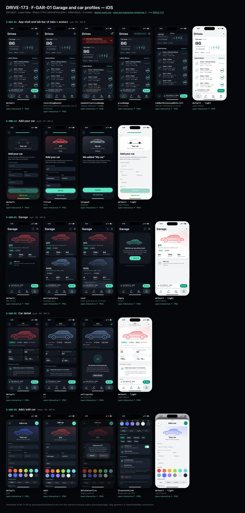
- **Design system (source of truth for values):** [brand](../../system/brand.md) · [components](../../system/components.md) · [motion](../../system/motion.md) · [accessibility](../../system/accessibility.md) · [screen map](../../system/screen-map.md) · [fixtures](../../system/fixtures.md) · tokens `prototypes/shared/tokens.css`

## Screens in this story

| Screen | Name | Presentation | Priority | States | Status |
|---|---|---|---|---|---|
| `S-NAV-01` | App shell and tab bar (4 tabs + avatar) | Shell | P0 | 5 | Prototyped |
| `S-ONB-14` | Add your car | Full | P1 | 3 | Prototyped |
| `S-GAR-01` | Garage | Root (Garage tab) | P0 | 4 | Prototyped |
| `S-GAR-02` | Car detail | Push | P0 | 3 | Prototyped |
| `S-GAR-03` | Add / edit car | Sheet (large) | P0 | 4 | Prototyped |

## Tokens used on this platform

Values resolved from `prototypes/shared/tokens.css` inside the iOS device (`[data-platform="ios"]`). Use the token names in code; the hex values are for reference.

| Token | Dark | Light |
|---|---|---|
| `--app-bg` | `#080B10` | `#F2F3F6` |
| `--card-bg` | `#131822` | `#FFFFFF` |
| `--dp-bg-grouped` | `#080B10` | `#F2F3F6` |
| `--dp-surface` | `#131822` | `#FFFFFF` |
| `--dp-surface-2` | `#1B222D` | `#F2F3F6` |
| `--dp-surface-3` | `#262E3B` | `#E4E7EC` |
| `--dp-fill` | `#7880961F` | `#7880961F` |
| `--dp-fill-strong` | `#7880963D` | `#78809633` |
| `--dp-text` | `#F2F4F7` | `#0B0E13` |
| `--dp-text-2` | `#A3AAB6` | `#5A6271` |
| `--dp-text-3` | `#6E7787` | `#8A919D` |
| `--dp-separator` | `#96A0B429` | `#3C435024` |
| `--dp-accent` | `#5BE7C4` | `#079777` |
| `--dp-accent-text` | `#5BE7C4` | `#06775E` |
| `--dp-on-accent` | `#04241D` | `#FFFFFF` |
| `--dp-accent-container` | `#0A4439` | `#C6F8EA` |
| `--dp-record` | `#FFC24B` | `#9A6300` |
| `--dp-positive` | `#5BE7C4` | `#06775E` |
| `--dp-change-down` | `#A3AAB6` | `#5A6271` |
| `--dp-warning` | `#F5B648` | `#9A5F00` |
| `--dp-critical` | `#FF6B6B` | `#C62828` |
| `--dp-glass-fill` | `#1C222C6B` | `#FFFFFF8C` |
| `--dp-glass-fill-strong` | `#1C222CB8` | `#FFFFFFD1` |
| `--dp-glass-stroke` | `#FFFFFF24` | `#FFFFFF99` |
| `--dp-data-route` | `#5BE7C4` | `#079777` |
| `--dp-data-event-brake` | `#FF7A66` | `#A21F16` |
| `--dp-data-event-accel` | `#E58BD0` | `#A33A8C` |
| `--dp-data-event-corner` | `#EAD54E` | `#9A8A00` |
| `--dp-data-quality-good` | `#5FDB9C` | `#1E9E62` |
| `--dp-data-speed` | `#D6DCE4` | `#404A58` |
| `--dp-data-long-g` | `#5AB8F5` | `#0A6AB8` |
| `--dp-data-lat-g` | `#F5A142` | `#B25A00` |

| Type / layout token | Value |
|---|---|
| `--dp-font-screen-title` | `700 34px / 41px -apple-system, BlinkMacSystemFont, "SF Pro Display", system-ui, sans-serif` |
| `--dp-font-sheet-title` | `700 22px / 28px -apple-system, BlinkMacSystemFont, "SF Pro Display", system-ui, sans-serif` |
| `--dp-font-section-title` | `600 20px / 25px -apple-system, BlinkMacSystemFont, "SF Pro Display", system-ui, sans-serif` |
| `--dp-font-card-title` | `600 17px / 22px -apple-system, BlinkMacSystemFont, "SF Pro Text", system-ui, sans-serif` |
| `--dp-font-body` | `400 17px / 22px -apple-system, BlinkMacSystemFont, "SF Pro Text", system-ui, sans-serif` |
| `--dp-font-body-secondary` | `400 15px / 20px -apple-system, BlinkMacSystemFont, "SF Pro Text", system-ui, sans-serif` |
| `--dp-font-meta` | `400 13px / 18px -apple-system, BlinkMacSystemFont, "SF Pro Text", system-ui, sans-serif` |
| `--dp-font-caption` | `400 12px / 16px -apple-system, BlinkMacSystemFont, "SF Pro Text", system-ui, sans-serif` |
| `--dp-font-button` | `600 17px / 22px -apple-system, BlinkMacSystemFont, "SF Pro Text", system-ui, sans-serif` |
| `--dp-num-hero` | `600 72px / 72px -apple-system, BlinkMacSystemFont, "SF Pro Display", system-ui, sans-serif` |
| `--dp-num-xl` | `600 48px / 52px -apple-system, BlinkMacSystemFont, "SF Pro Display", system-ui, sans-serif` |
| `--dp-num-l` | `600 34px / 38px -apple-system, BlinkMacSystemFont, "SF Pro Display", system-ui, sans-serif` |
| `--dp-num-m` | `600 24px / 28px -apple-system, BlinkMacSystemFont, "SF Pro Display", system-ui, sans-serif` |
| `--dp-num-s` | `600 17px / 22px -apple-system, BlinkMacSystemFont, "SF Pro Display", system-ui, sans-serif` |
| `--dp-num-xs` | `600 13px / 16px -apple-system, BlinkMacSystemFont, "SF Pro Display", system-ui, sans-serif` |
| `--dp-screen-margin` | `16px` |
| `--dp-radius-card` | `24px` |
| `--dp-radius-card-hero` | `32px` |
| `--dp-radius-sheet` | `38px` |
| `--dp-radius-chip` | `999px` |
| `--dp-radius-button` | `999px` |
| `--dp-layout-list-row-min` | `52px` |
| `--dp-layout-touch-min` | `44px` |
| `--safe-top` | `62px` |
| `--safe-bottom` | `34px` |

Text sizes scale with `--dp-text-scale` (XL = 2.0×) and numerals with `--dp-num-scale` (XL = 1.3×). DP Numerals: SF Pro Expanded Semibold, tabular.

---

## S-NAV-01 · App shell and tab bar (4 tabs + avatar)

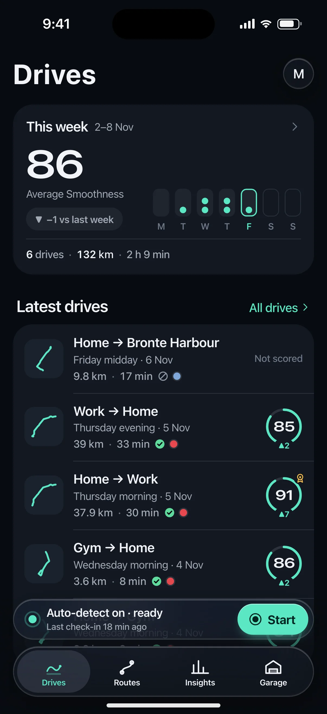 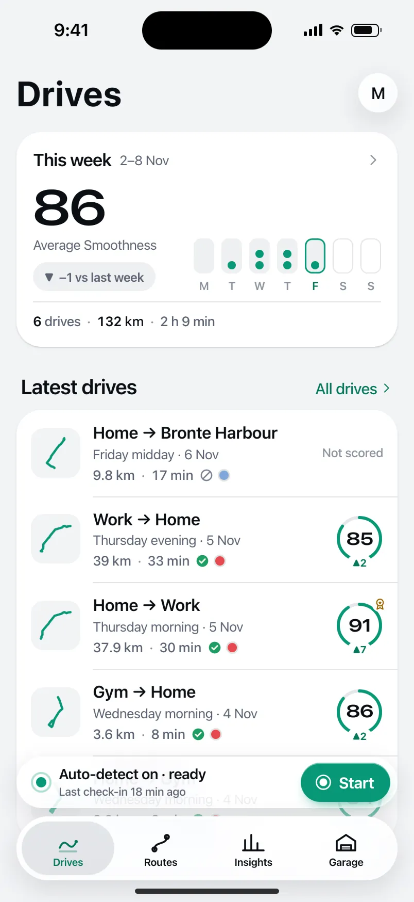

- **Presentation:** root · tab: drives — screen map: “Shell”
- **Entry points:** App launch (after onboarding)
- **Leads to:** Tab roots S-HOME-01 · S-RTE-01 · S-STA-01 · S-GAR-01; avatar → S-ACC-01; accessory/toolbar → S-DRV-01 (recording) or S-HOME-02
- **PRD features:** F-HIS-01, F-RTE-02, F-GAR-01, F-ACC-01, F-HIS-04 · **Priority:** P0 · **WP:** B
- **Interactive:** [S-NAV-01](../../../../prototypes/ios/index.html#S-NAV-01)

**Purpose.** The app shell (screen-map.md §1, validated): four tabs — Drives · Routes · Insights · Garage — with Profile moved to an avatar in the top-trailing corner of every tab root, and capture status always one glance away. Every other screen mounts inside it.

### States

| State | PRD label | Fixture params | Screenshot |
|---|---|---|---|
| `default` | Def | — | [S-NAV-01.png](../../screens/ios/S-NAV-01.webp) · [open](../../../../prototypes/ios/index.html#S-NAV-01) |
| `recordingBanner` | Recording banner (passenger trip or finalising) | — | [S-NAV-01--recordingBanner.png](../../screens/ios/S-NAV-01--recordingBanner.webp) · [open](../../../../prototypes/ios/index.html#S-NAV-01/recordingBanner) |
| `needsAttentionBadge` | “Needs attention” badge | `health=alwaysLost` | [S-NAV-01--needsAttentionBadge.png](../../screens/ios/S-NAV-01--needsAttentionBadge.webp) · [open](../../../../prototypes/ios/index.html#S-NAV-01/needsAttentionBadge) |
| `prevBadge` | Prev badge | `ent=preview` | [S-NAV-01--prevBadge.png](../../screens/ios/S-NAV-01--prevBadge.webp) · [open](../../../../prototypes/ios/index.html#S-NAV-01/prevBadge) |
| `tabBarMinimisedOnScroll` | Tab bar minimised on scroll | — | [S-NAV-01--tabBarMinimisedOnScroll.png](../../screens/ios/S-NAV-01--tabBarMinimisedOnScroll.webp) · [open](../../../../prototypes/ios/index.html#S-NAV-01/tabBarMinimisedOnScroll) |
| default · light | Light theme | `theme=light` | [S-NAV-01--light.png](../../screens/ios/S-NAV-01--light.webp) |

Every state also renders in light/dark (`theme=light`), XL text (`text=xl`) and reduced motion (`rm=1`).

### Layout

- Tab roots: Drives S-HOME-01 · Routes S-RTE-01 · Insights S-STA-01 · Garage S-GAR-01 (icons DP_ICONS drives/routes/insights/garage).
- iOS: floating Liquid Glass tab bar (inset 16, bottom 21, height 62, selected = Glide icon + label inside a glass lens) + tabViewBottomAccessory capture capsule (50 pt, 8 above the bar) on all tabs.
- Android: NavigationBar (64 dp + 24 dp gesture area, surfaceContainer, indicator 56×32 secondaryContainer, labels always visible) + M3E floating toolbar (64 dp, primaryContainer) docked 16 dp above it on the Drives tab only.
- Avatar top-trailing on every tab root: iOS 38 pt glass circle (initial) · Android 40 dp Cookie12Sided secondaryContainer. Badge dot = needs attention; Preview badge beside it.
- Minimised on scroll (iOS): the bar shrinks to a 54 pt capsule showing only the selected icon; the accessory folds inline to its right. Android: the toolbar slides out on scroll down and back on scroll up; the navigation bar stays.

### Components & tokens

| Component | Tokens / spec |
|---|---|
| `tabBar` | iOS floating glass: inset 16, bottom 21, height 62, lens --dp-fill-strong · Android NavigationBar 64 dp + indicator 56×32 --md-sys-color-secondary-container · components.md §1 |
| `accessory` | iOS tabViewBottomAccessory glass 48 pt, 8 above tab bar · Android floating toolbar 64 dp --md-sys-color-primary-container, 16 above nav bar · Start: --dp-accent |
| `avatar` | see components.md |
| `previewBadge` | see components.md |
| `largeTitle` | --dp-font-screen-title (iOS 34/41 bold · Android 32/40) · components.md §2 |

### Interactions & navigation

- Tab tap → that tab root (iOS cross-fade + lens spring · Android fade-through). Re-tapping the current tab scrolls to top.
- Avatar → S-ACC-01 (iOS sheet, large detent, own NavigationStack · Android full-screen, shared axis X, predictive back).
- Accessory / toolbar → S-HOME-02 (ready), S-DRV-01 (recording), S-SET-05 (attention); Start → S-DRV-01 (trip start).
- Every navigation passes the D1 gate (router → DP.gate): while a driver trip is active only S-DRV-01/02/03 are reachable; content opened while moving waits on S-DRV-05.

### Motion

- Tab lens: spring.default slide between tabs · selection haptic.
- Minimise on scroll: spring.default (iOS) · toolbar 150 ms emphasizedAccelerate out / spring.fast in (Android).
- Recording banner: livePulse 2400 ms breathe on the dot; RM static.
- Trip start: accessory/toolbar expands into S-DRV-01 (container transform, spring.slow).

### Accessibility

- Tabs are a tablist: “Drives, tab, 1 of 4, selected”. Labels always visible on both platforms; iOS large-content viewer on long-press at AX sizes.
- Avatar: “Profile, needs attention” when badged. Preview badge: “Pro Preview, day 9 of 14”.
- The accessory never announces timer updates (no live region).

### Platform notes

- **iOS (this spec):** TabView + Tab, .tabBarMinimizeBehavior(.onScrollDown), .tabViewBottomAccessory { CaptureStatusAccessory() }; Profile is a glass toolbar item → sheet.
- *Android (for reference):* NavigationBar (short) always visible; HorizontalFloatingToolbar on Drives; avatar in the top app bar trailing slot → full-screen destination.

### Analytics

- `tab_selected {tab}`
- `profile_opened {source: avatar}`
- `capture_status_opened {source: accessory|toolbar}`

### Copy

| Key | Text |
|---|---|
| Tabs | Drives · Routes · Insights · Garage |
| Recording banner | Recording · {min} min · {km} km |
| Needs attention | Auto-detect needs attention |

### Free / Pro

Same shell for every plan. Preview: “PRO PREVIEW · DAY n” badge beside the avatar.

### Assets

[icon-drives.svg](assets/icon-drives.svg) · [icon-routes.svg](assets/icon-routes.svg) · [icon-insights.svg](assets/icon-insights.svg) · [icon-garage.svg](assets/icon-garage.svg) · [icon-record.svg](assets/icon-record.svg) · [icon-profile.svg](assets/icon-profile.svg) · [logo-a-loop.svg](assets/logo-a-loop.svg)

UI glyphs may be swapped for SF Symbols / Material Symbols Rounded equivalents; event-pin, quality and provenance glyphs must not be (components.md global rules).

### Checklist (accessibility.md §9)

- [ ] Light and dark both render, and contrast passes.
- [ ] The XL text state reflows with no truncation.
- [ ] The RM state is defined.
- [ ] Every control has a label; every chart and map has a summary sentence.
- [ ] Every target ≥ 44 pt / 48 dp (≥ 64 in-drive).
- [ ] No meaning by colour alone.
- [ ] Speed is neutral wherever it appears and absent from social or live surfaces.
- [ ] No streak, leaderboard, speed or “beat your time” language.
- [ ] Behaviour is defined while a trip is active (D1 gate).
- [ ] Haptics come from motion.md §6 only.

---

## S-ONB-14 · Add your car

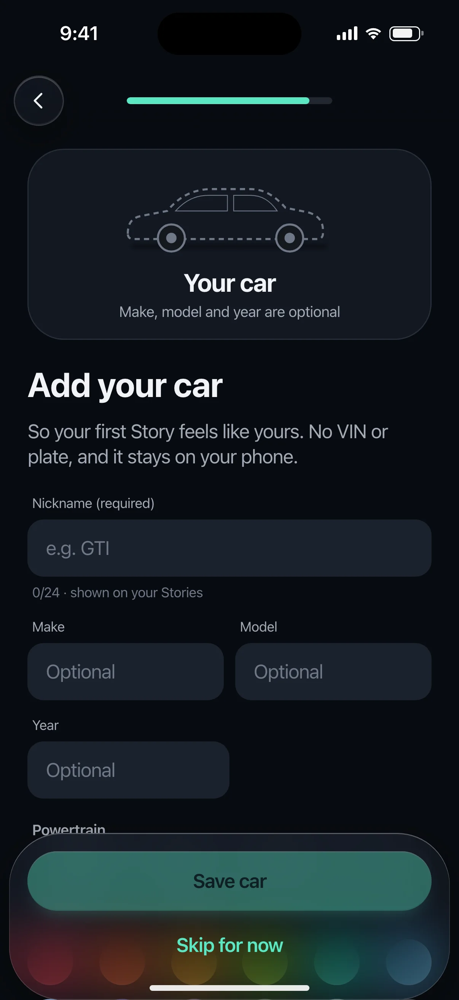 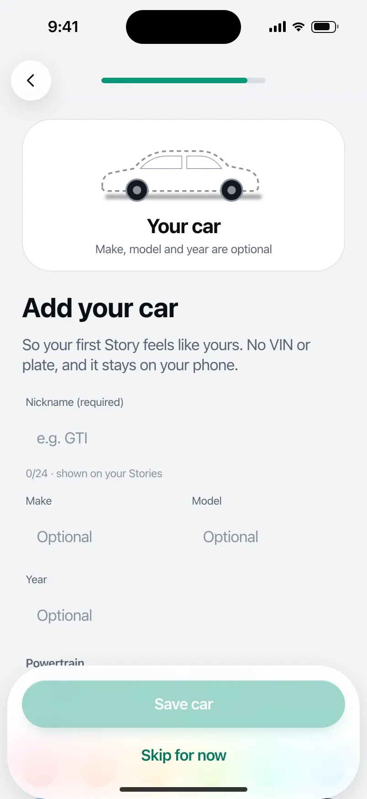

- **Presentation:** push — screen map: “Full”
- **Entry points:** S-ONB-13
- **Leads to:** S-ONB-15 (filled or skipped)
- **PRD features:** F-ONB-09, F-GAR-01 · **Priority:** P1 · **WP:** A
- **Interactive:** [S-ONB-14](../../../../prototypes/ios/index.html#S-ONB-14)

**Purpose.** Add the first car during setup so the first Story feels personal (F-ONB-09, F-GAR-01): nickname required, the rest optional, a colour that tints Stories; Skip silently creates “My car”.

### States

| State | PRD label | Fixture params | Screenshot |
|---|---|---|---|
| `default` | Def | — | [S-ONB-14.png](../../screens/ios/S-ONB-14.webp) · [open](../../../../prototypes/ios/index.html#S-ONB-14) |
| `filled` | filled | — | [S-ONB-14--filled.png](../../screens/ios/S-ONB-14--filled.webp) · [open](../../../../prototypes/ios/index.html#S-ONB-14/filled) |
| `skipped` | skipped | — | [S-ONB-14--skipped.png](../../screens/ios/S-ONB-14--skipped.webp) · [open](../../../../prototypes/ios/index.html#S-ONB-14/skipped) |
| default · light | Light theme | `theme=light` | [S-ONB-14--light.png](../../screens/ios/S-ONB-14--light.webp) |

Every state also renders in light/dark (`theme=light`), XL text (`text=xl`) and reduced motion (`rm=1`).

### Layout

- Top bar: Back · step progress (8 of 9 / 10 of 11). Start-aligned.
- Live preview card (hero, radius 32/28): generic hatch silhouette 200 wide filled with the chosen car colour (gradient 85% → 55%, glass windows, neutral wheels), nickname (title3 600) + “year make model” line, and the car chip as it will appear on Stories. Empty state: outline silhouette in --dp-text-3, “Your car”.
- Title “Add your car”, lead (privacy: no VIN or plate, stays on the phone).
- Form: Nickname (required, ≤ 24, counter helper “n/24 · shown on your Stories”) · Make | Model (two columns, one column at XL) · Year · “Powertrain” segmented (Petrol · Diesel · Hybrid · EV: iOS glass segmented / Android connected button group) · “Colour” 12 swatches (36 round, 6 per row; selected = 2 pt ring + check).
- Dock: “Save car” (disabled until a nickname exists) · tertiary “Skip for now”.
- skipped: preview shows “My car” in graphite, title “We added “My car”” + rename hint; “Continue”, tertiary “Add details now”.

### Components & tokens

| Component | Tokens / spec |
|---|---|
| `page` | --dp-bg-grouped (iOS) / --md-sys-color-surface (Android) · --dp-screen-margin 16 |
| `textField` | see components.md |
| `segmented` | see components.md |
| `carChip` | see components.md |
| `button` | --dp-accent / --dp-on-accent (filled) · --dp-fill-strong · --md-sys-color-secondary-container (tonal) · --dp-radius-button · height iOS 50/44/34 · Android 56/40/32 · --dp-font-button · components.md §0 |

### Interactions & navigation

- Typing the nickname updates the preview and enables Save live (no re-render).
- Powertrain segment → selection haptic · colour swatch → preview recolours (selection haptic).
- “Save car” → S-ONB-15 (or S-ONB-15/manualOnly when automatic trips are off), the car becomes the default (car_added {source: onboarding, powertrain}).
- “Skip for now” → creates “My car” silently and goes to S-ONB-15 (toast in the prototype). skipped → Continue → S-ONB-15.

### Motion

- Hero motion: the car silhouette drives in from the left (translateX −28 → 0, spring.slow). Colour changes cross-fade the fill (spring.effects).
- RM: static car; 220 ms cross-fade.

### Accessibility

- Preview card label: “Car preview: GTI, Carmine”. Swatches are a radiogroup labelled “Colour”, each “Carmine, radio button, selected”.
- Nickname field label “Nickname (required)” with the counter as hint. Disabled Save: “Save car, unavailable until you add a nickname”.
- XL: make/model stack, swatches wrap to 4 per row, segmented labels wrap to two lines.

### Platform notes

- **iOS (this spec):** Rounded fields (--dp-surface-2, radius 14), glass segmented Picker, swatches as a LazyVGrid; keyboard toolbar “Done”.
- *Android (for reference):* OutlinedTextField (shape extraSmall), SingleChoiceSegmentedButtonRow / connected ButtonGroup, swatches in a FlowRow; IME action Next → Done.

### Analytics

- `onboarding_step_viewed {step: car}`
- `car_added {source: onboarding, powertrain}`

### Copy

| Key | Text |
|---|---|
| Title | Add your car |
| Lead | So your first Story feels like yours. No VIN or plate, and it stays on your phone. |
| Nickname | Nickname (required) · e.g. GTI · n/24 · shown on your Stories |
| Save | Save car |
| Skip | Skip for now |
| Skipped title | We added “My car” |
| Skipped lead | So your drives have a home. Rename it, pick a colour or add details anytime in Garage. |

### Free / Pro

Free includes 1 car (entitlement.freeLimits.vehicles); during the Preview more can be added later in Garage.

### Data & fixtures

filled = DP_DATA.vehicles gti (GTI · Volkswagen Golf GTI · 2022 · petrol · carmine “Kings Red”). Colour tokens: --dp-car-* (brand.md §5.3).

### Assets

[icon-check.svg](assets/icon-check.svg) · [icon-garage.svg](assets/icon-garage.svg)

UI glyphs may be swapped for SF Symbols / Material Symbols Rounded equivalents; event-pin, quality and provenance glyphs must not be (components.md global rules).

### Checklist (accessibility.md §9)

- [ ] Light and dark both render, and contrast passes.
- [ ] The XL text state reflows with no truncation.
- [ ] The RM state is defined.
- [ ] Every control has a label; every chart and map has a summary sentence.
- [ ] Every target ≥ 44 pt / 48 dp (≥ 64 in-drive).
- [ ] No meaning by colour alone.
- [ ] Speed is neutral wherever it appears and absent from social or live surfaces.
- [ ] No streak, leaderboard, speed or “beat your time” language.
- [ ] Behaviour is defined while a trip is active (D1 gate).
- [ ] Haptics come from motion.md §6 only.

---

## S-GAR-01 · Garage

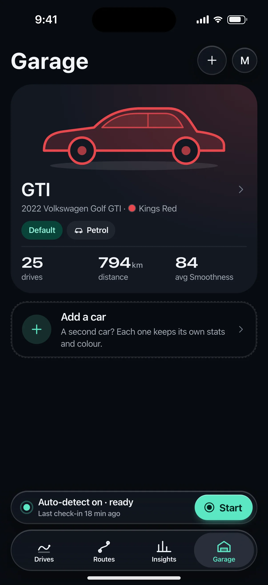 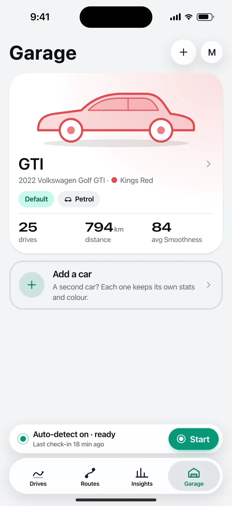

- **Presentation:** root · tab: garage — screen map: “Root (Garage tab)”
- **Entry points:** Tab
- **Leads to:** S-GAR-02 · S-GAR-03 (add) · S-SUB-03 (2nd car on Free)
- **PRD features:** F-GAR-01, F-GAR-02 · **Priority:** P0 · **WP:** D
- **Interactive:** [S-GAR-01](../../../../prototypes/ios/index.html#S-GAR-01)

**Purpose.** The Garage tab: the user’s cars as identity — nickname, colour and silhouette tint their Stories and share cards — with per-car stats one tap away (F-GAR-01, F-GAR-02). Free has 1 active car; Pro is unlimited.

### States

| State | PRD label | Fixture params | Screenshot |
|---|---|---|---|
| `default` | Def (1 car) | — | [S-GAR-01.png](../../screens/ios/S-GAR-01.webp) · [open](../../../../prototypes/ios/index.html#S-GAR-01) |
| `multipleCars` | multiple cars | — | [S-GAR-01--multipleCars.png](../../screens/ios/S-GAR-01--multipleCars.webp) · [open](../../../../prototypes/ios/index.html#S-GAR-01/multipleCars) |
| `Lock` | Lock (add 2nd car on Free) | `ent=free` | [S-GAR-01--Lock.png](../../screens/ios/S-GAR-01--Lock.webp) · [open](../../../../prototypes/ios/index.html#S-GAR-01/Lock) |
| `Empty` | Empty | — | [S-GAR-01--Empty.png](../../screens/ios/S-GAR-01--Empty.webp) · [open](../../../../prototypes/ios/index.html#S-GAR-01/Empty) |
| default · light | Light theme | `theme=light` | [S-GAR-01--light.png](../../screens/ios/S-GAR-01--light.webp) |

Every state also renders in light/dark (`theme=light`), XL text (`text=xl`) and reduced motion (`rm=1`).

### Layout

- Large title “Garage”; trailing “+” (Add a car; Free with a car → S-SUB-03 s2ndCar) + Preview badge + avatar. Android subtitle “2 cars”.
- Car card per car (hero radius 32 / 28, tinted 18% with the car colour): generic body-style silhouette (hatch/crossover, outline in the car colour at 20% fill, 230–300 wide) · nickname (DP display 28) · “2022 Volkswagen Golf GTI · ● Kings Red” · tags Default (accent container) / Inactive on Free / powertrain · three numbers: drives · km · avg Smoothness (DP Numerals).
- “Add a car” dashed card (+ glyph, “A second car? Each one keeps its own stats and colour.”). Free: lock + PRO badge + “Keep a log for every car in your garage with Pro.”
- Multiple cars: a “Default car” row (value GTI) → S-GAR-03/edit.
- Lock (Free after the Preview): the Ioniq card shows “Inactive on Free” with “Added during your Pro Preview. Its 4 drives stay here. On Free, one car is active at a time.” + “Make active”.
- Empty: hero card with an outline silhouette, “Add the car you drive most.” + filled “Add a car”; note “Until then, drives are saved under “My car”.”

### Components & tokens

| Component | Tokens / spec |
|---|---|
| `largeTitle` | --dp-font-screen-title (iOS 34/41 bold · Android 32/40) · components.md §2 |
| `iconButton` | see components.md |
| `avatar` | see components.md |
| `card` | --dp-surface / --md-sys-color-surface-container · --dp-radius-card (24 iOS · 16 Android) · hero: --dp-radius-card-hero (32 · 28) · light iOS: --dp-elev-1 |
| `chip` | --dp-radius-chip (iOS capsule · Android 8) · height 28 · --dp-font-caption |
| `button` | --dp-accent / --dp-on-accent (filled) · --dp-fill-strong · --md-sys-color-secondary-container (tonal) · --dp-radius-button · height iOS 50/44/34 · Android 56/40/32 · --dp-font-button · components.md §0 |
| `proBadge` | see components.md |
| `list` | iOS inset grouped radius --dp-radius-card, rows 52 pt, separators --dp-separator inset 16 · Android ListItem 56/72 dp in --md-sys-color-surface-container |
| `row` | --dp-font-body · --dp-font-meta (supporting) · --dp-layout-list-row-min |
| `empty` | illustration 120 in --dp-accent · --dp-font-section-title · components.md §21 |

### Interactions & navigation

- Car card → S-GAR-02 (iOS zoom / Android container transform). “+” / Add card → S-GAR-03 (add) or S-SUB-03 s2ndCar (Free).
- “Make active” → swaps the active car on Free (toast); no trips move or disappear.
- Default car row → S-GAR-03/edit.

### Motion

- Hero motion: each car silhouette draws its outline (1300 ms ease.drawOn, 180 ms stagger) as the cards rise 8 px (50 ms stagger). RM: silhouettes appear complete.
- Card → detail: zoom / container transform (spring.slow).

### Accessibility

- Car card is one button: “GTI, 2022 Volkswagen Golf GTI, Kings Red. 25 drives, 794 kilometres, average Smoothness 84. Default car.”
- The silhouette is decorative (its colour is also named in text). Lock card: “Add a car. Keep a log for every car in your garage with Pro.”
- XL: numbers wrap to two rows; tags wrap; silhouette scales to the card width.

### Platform notes

- **iOS (this spec):** Large title + glass “+” toolbar button and avatar; car cards opaque surface with the car-colour wash; floating tab bar + accessory.
- *Android (for reference):* LargeFlexibleTopAppBar with subtitle; car cards surface-container-high (28 dp) with wash; tonal “Make active”; NavigationBar.

### Analytics

- `garage_opened {car_count}`
- `car_detail_opened {source: garage}`
- `car_add_tapped {locked}`
- `car_active_swapped`

### Copy

| Key | Text |
|---|---|
| Title | Garage |
| Add | Add a car · A second car? Each one keeps its own stats and colour. |
| Add (Free) | Add a car PRO · Keep a log for every car in your garage with Pro. |
| Inactive | Added during your Pro Preview. Its {n} drives stay here. On Free, one car is active at a time. · Make active |
| Empty | Add the car you drive most. Its colour tints your Stories and share cards, and it keeps its own stats. No VIN or plate, and it stays on your phone. |
| Empty note | Until then, drives are saved under “My car”. |

### Free / Pro

Free: 1 active car (entitlement.states.free.activeVehicleId = gti); cars added during the Preview stay visible with their trips and the user picks the active one; Add → S-SUB-03 s2ndCar. Pro/Preview: unlimited cars.

### Data & fixtures

Default simulates a one-car garage with vehicles[0] (GTI). multipleCars/Lock: both vehicles. Per-car numbers derived with carStats (driver trips only): GTI 25 drives · 794 km · 84; Ioniq 4 · 197 km · 87.

### Assets

[icon-plus.svg](assets/icon-plus.svg) · [icon-lock.svg](assets/icon-lock.svg) · [icon-car.svg](assets/icon-car.svg) · [icon-bolt.svg](assets/icon-bolt.svg) · [icon-chevronRight.svg](assets/icon-chevronRight.svg)

UI glyphs may be swapped for SF Symbols / Material Symbols Rounded equivalents; event-pin, quality and provenance glyphs must not be (components.md global rules).

### Checklist (accessibility.md §9)

- [ ] Light and dark both render, and contrast passes.
- [ ] The XL text state reflows with no truncation.
- [ ] The RM state is defined.
- [ ] Every control has a label; every chart and map has a summary sentence.
- [ ] Every target ≥ 44 pt / 48 dp (≥ 64 in-drive).
- [ ] No meaning by colour alone.
- [ ] Speed is neutral wherever it appears and absent from social or live surfaces.
- [ ] No streak, leaderboard, speed or “beat your time” language.
- [ ] Behaviour is defined while a trip is active (D1 gate).
- [ ] Haptics come from motion.md §6 only.

---

## S-GAR-02 · Car detail

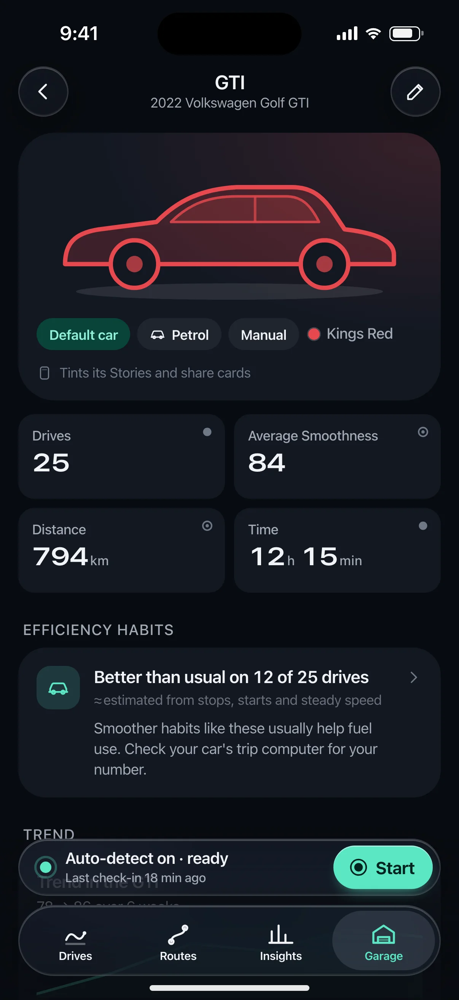 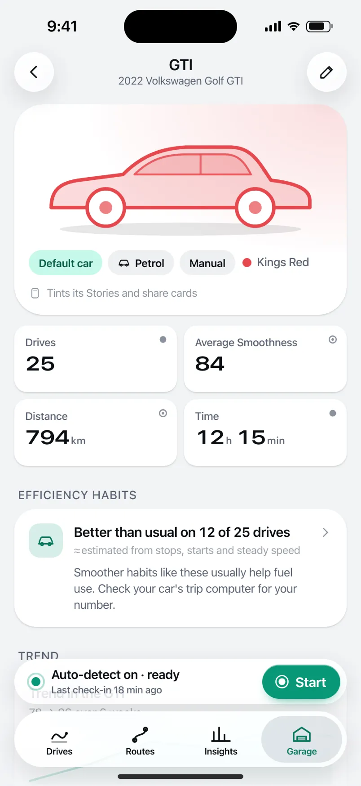

- **Presentation:** push · tab: garage — screen map: “Push”
- **Entry points:** S-GAR-01
- **Leads to:** S-GAR-03 (edit) · S-TRP-01 · S-STA-02 (per-car, Pro) · S-SCO-06
- **PRD features:** F-GAR-01, F-GAR-03 · **Priority:** P0 · **WP:** D
- **Interactive:** [S-GAR-02](../../../../prototypes/ios/index.html#S-GAR-02)

**Purpose.** One car’s identity and stats: drives, distance, time, average Smoothness and efficiency habits for that car, recent drives in it, and the way into per-car Pro trends (F-GAR-01, F-GAR-03).

### States

| State | PRD label | Fixture params | Screenshot |
|---|---|---|---|
| `default` | Def | `car=gti` | [S-GAR-02.png](../../screens/ios/S-GAR-02.webp) · [open](../../../../prototypes/ios/index.html#S-GAR-02) |
| `ev` | EV | `car=ioniq` | [S-GAR-02--ev.png](../../screens/ios/S-GAR-02--ev.webp) · [open](../../../../prototypes/ios/index.html#S-GAR-02/ev) |
| `noTripsYet` | no trips yet | `car=ioniq` | [S-GAR-02--noTripsYet.png](../../screens/ios/S-GAR-02--noTripsYet.webp) · [open](../../../../prototypes/ios/index.html#S-GAR-02/noTripsYet) |
| default · light | Light theme | `theme=light` | [S-GAR-02--light.png](../../screens/ios/S-GAR-02--light.webp) |

Every state also renders in light/dark (`theme=light`), XL text (`text=xl`) and reduced motion (`rm=1`).

### Layout

- Top bar: nickname + “2022 Volkswagen Golf GTI”, glass back, trailing Edit (pencil) → S-GAR-03/edit.
- Hero card (radius 32 / 28, car-colour wash 18%): silhouette 320 wide drawn in the car colour · tags: Default car / Make default · powertrain (bolt for EV) · transmission · colour swatch + colour name · “Tints its Stories and share cards”.
- Stat tiles 2×2: Drives · Average Smoothness · Distance · Time (provenance glyphs).
- “Efficiency habits” card → S-SCO-06: “Better than usual on 12 of 25 drives”, “≈ estimated from stops, starts and steady speed” (dashed underline, 60%), the fixture copy (petrol: “…help fuel use. Check your car’s trip computer…”; EV: “…help range. Check your car’s display…”). Never energy, litres or kWh.
- “Trend” card: weekly sparkline (Glide area) “84 → 86 over 6 weeks” + “Compare your cars” (Pro → S-STA-02/perCar) · Free: the same card blurred in a lock panel.
- “Recent drives in the GTI” (4 trip cards) + “All ›” → S-HIS-01 filtered by car. “Details” list (make and model, year, powertrain, added) + “Edit car”; footer “No VIN or plate. Car details stay on this phone.”
- No trips yet: empty card “No drives in the Ioniq yet.” with the default-car explanation and “Make default”.

### Components & tokens

| Component | Tokens / spec |
|---|---|
| `page` | --dp-bg-grouped (iOS) / --md-sys-color-surface (Android) · --dp-screen-margin 16 |
| `navBar` | --dp-font-card-title · --dp-font-meta · glass: --dp-glass-fill + --dp-glass-blur · components.md §2 |
| `iconButton` | see components.md |
| `card` | --dp-surface / --md-sys-color-surface-container · --dp-radius-card (24 iOS · 16 Android) · hero: --dp-radius-card-hero (32 · 28) · light iOS: --dp-elev-1 |
| `chip` | --dp-radius-chip (iOS capsule · Android 8) · height 28 · --dp-font-caption |
| `stats` | --dp-surface-2 / --md-sys-color-surface-container-high · radius 14 iOS / 12 Android · value --dp-num-m (DP Numerals) · components.md §5 |
| `section` | --dp-font-section-title · --dp-layout-section-gap 28 |
| `list` | iOS inset grouped radius --dp-radius-card, rows 52 pt, separators --dp-separator inset 16 · Android ListItem 56/72 dp in --md-sys-color-surface-container |
| `row` | --dp-font-body · --dp-font-meta (supporting) · --dp-layout-list-row-min |
| `tripRow` | glyph 40 on --dp-surface-2 · --dp-font-card-title · --dp-font-meta · components.md §12 |
| `sparkline` | see components.md |
| `lockPanel` | blur --dp-opacity-locked-blur 14px · dim --dp-opacity-locked-dim 35% · components.md §15.2 |
| `empty` | illustration 120 in --dp-accent · --dp-font-section-title · components.md §21 |

### Interactions & navigation

- Edit / “Edit car” → S-GAR-03/edit (sheet). Efficiency card → S-SCO-06 (EV: evCarVsPetrolCarCopy). Trend → S-STA-02/perCar (Pro) / S-SUB-03 trends (Free). Trip card → S-TRP-01. “All” → S-HIS-01 with car filter.
- “Make default” → toast; new drives go to this car.

### Motion

- Enter: zoom / container transform from the Garage card. Hero motion: the silhouette outline draws on (1300 ms ease.drawOn); blocks rise 8 px, 35 ms stagger. RM: static silhouette, cross-fade.

### Accessibility

- Stat tiles: “Average Smoothness, 84. Derived.” Efficiency card: “Efficiency habits: better than usual on 12 of 25 drives, estimated.”
- Sparkline summary: “GTI weekly average Smoothness: 78, 81, 85, 85, 87, 86.”
- Colour swatch is paired with the colour name; the silhouette is decorative.
- XL: tiles go to 1 column at AX5; tags wrap; the silhouette shrinks to the card width.

### Platform notes

- **iOS (this spec):** Inline title + subtitle, glass back and Edit; zoom transition; inset-grouped Details list.
- *Android (for reference):* MediumFlexibleTopAppBar with Edit action; container transform; segmented ListItems; tonal chips.

### Analytics

- `car_detail_opened {powertrain, trips_bucket}`
- `efficiency_viewed {source: car}`
- `trend_viewed {dimension: car, locked}`

### Copy

| Key | Text |
|---|---|
| Efficiency (petrol) | Smoother habits like these usually help fuel use. Check your car’s trip computer for your number. |
| Efficiency (EV) | Smoother habits like these usually help range. Check your car’s display to see your number. |
| Efficiency line | Better than usual on {n} of {m} drives · ≈ estimated from stops, starts and steady speed |
| No trips | No drives in the {car} yet. New drives go to your default car ({default}). Make the {car} the default before you set off, or switch the car on a drive afterwards. |
| Footer | No VIN or plate. Car details stay on this phone. |
| Tint | Tints its Stories and share cards |

### Free / Pro

Free: everything except the per-car trend, which shows the user’s own sparkline blurred → S-SUB-03 trends. Pro: trend card → S-STA-02/perCar.

### Data & fixtures

default: gti (carStats: 25 drives · 794 km · 12 h 15 min · 84 · 12 of 25 better). ev: ioniq (4 drives · 197 km · 87 · 2 of 3; copy from t20261024-1610.efficiency). noTripsYet: the Ioniq as it was 4–16 Oct (added 4 Oct, first drive 17 Oct). Weekly sparkline derived per recap week.

### Assets

[icon-edit.svg](assets/icon-edit.svg) · [icon-bolt.svg](assets/icon-bolt.svg) · [icon-car.svg](assets/icon-car.svg) · [icon-story.svg](assets/icon-story.svg) · [icon-insights.svg](assets/icon-insights.svg) · [icon-check.svg](assets/icon-check.svg) · [icon-chevronRight.svg](assets/icon-chevronRight.svg) · [icon-drives.svg](assets/icon-drives.svg)

UI glyphs may be swapped for SF Symbols / Material Symbols Rounded equivalents; event-pin, quality and provenance glyphs must not be (components.md global rules).

### Checklist (accessibility.md §9)

- [ ] Light and dark both render, and contrast passes.
- [ ] The XL text state reflows with no truncation.
- [ ] The RM state is defined.
- [ ] Every control has a label; every chart and map has a summary sentence.
- [ ] Every target ≥ 44 pt / 48 dp (≥ 64 in-drive).
- [ ] No meaning by colour alone.
- [ ] Speed is neutral wherever it appears and absent from social or live surfaces.
- [ ] No streak, leaderboard, speed or “beat your time” language.
- [ ] Behaviour is defined while a trip is active (D1 gate).
- [ ] Haptics come from motion.md §6 only.

---

## S-GAR-03 · Add / edit car

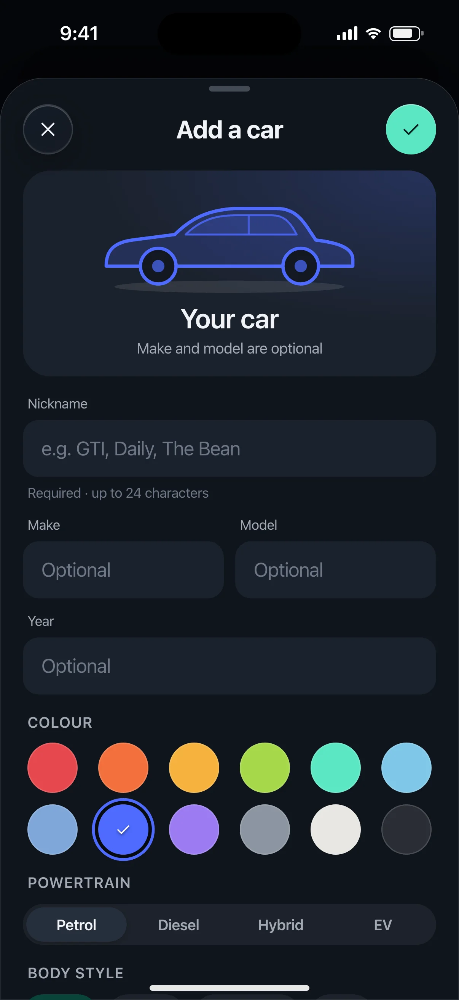 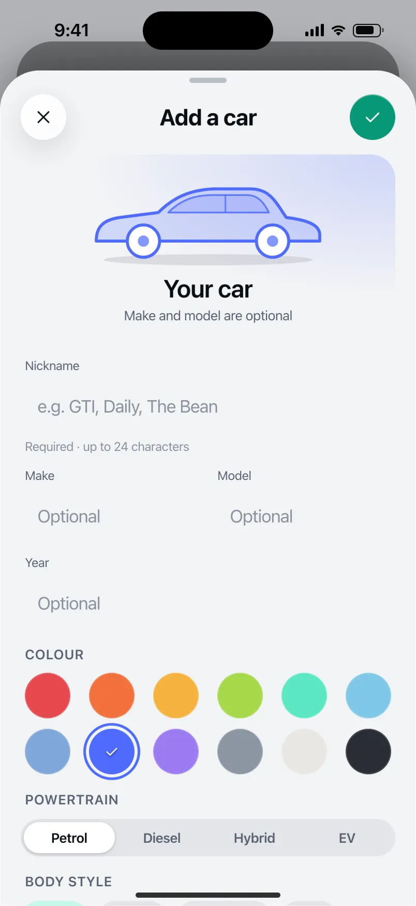

- **Presentation:** sheet · tab: garage · detent: large — screen map: “Sheet (large)”
- **Entry points:** S-GAR-01/02 · S-ONB-14 reuse
- **Leads to:** Back · delete confirm dialog
- **PRD features:** F-GAR-01, F-ONB-09, F-GAR-04 · **Priority:** P0 · **WP:** D
- **Interactive:** [S-GAR-03](../../../../prototypes/ios/index.html#S-GAR-03)

**Purpose.** Add a car or edit one: nickname (required), optional make, model and year, powertrain, body style and colour — the colour and silhouette become the car’s identity across Stories and cards (F-GAR-01, F-ONB-09). Also delete a car (trips kept as “Unknown car”) and, P2, link its Bluetooth (F-GAR-04).

### States

| State | PRD label | Fixture params | Screenshot |
|---|---|---|---|
| `default` | Add | — | [S-GAR-03.png](../../screens/ios/S-GAR-03.webp) · [open](../../../../prototypes/ios/index.html#S-GAR-03) |
| `edit` | edit | `car=gti` | [S-GAR-03--edit.png](../../screens/ios/S-GAR-03--edit.webp) · [open](../../../../prototypes/ios/index.html#S-GAR-03/edit) |
| `deleteConfirm` | delete confirm | `car=gti` | [S-GAR-03--deleteConfirm.png](../../screens/ios/S-GAR-03--deleteConfirm.webp) · [open](../../../../prototypes/ios/index.html#S-GAR-03/deleteConfirm) |
| `bluetoothLink` | Bluetooth link (P2) | `car=gti` | [S-GAR-03--bluetoothLink.png](../../screens/ios/S-GAR-03--bluetoothLink.webp) · [open](../../../../prototypes/ios/index.html#S-GAR-03/bluetoothLink) |
| default · light | Light theme | `theme=light` | [S-GAR-03--light.png](../../screens/ios/S-GAR-03--light.webp) |

Every state also renders in light/dark (`theme=light`), XL text (`text=xl`) and reduced motion (`rm=1`).

### Layout

- Large sheet with its own toolbar: × (Cancel) · “Add a car” / “Edit car” + sub · ✓ (iOS glass prominent) / “Add”/“Save” text button (Android).
- Live preview card (radius 24, the chosen car colour wash): silhouette 240 for the chosen body style in the chosen colour · nickname (“Your car” until typed) · “2022 Volkswagen Golf GTI” / “Make and model are optional”.
- Fields: Nickname (focused on Add; helper “Required · up to 24 characters” → “3 of 24”) · Make + Model side by side (stack at XL) · Year. iOS rounded fields (surface-2, radius 14) / Android OutlinedTextField.
- Colour: 12 car-colour swatches (36, ring + check when selected). Powertrain: Petrol · Diesel · Hybrid · EV segmented. Body style chips: Hatch · Sedan · Crossover · SUV · Coupe · Wagon · Pickup.
- List: Default car (switch) · Add a photo (optional, stays on this phone). Bluetooth row “Link the car’s Bluetooth” (P2). Edit only: destructive “Delete GTI”. Footer “No VIN or plate. Car details stay on this phone and in your Pro backup.”
- Delete confirm: alert / M3 dialog over the sheet — “Delete the GTI?” “Its 25 drives stay in your history as “Unknown car”. Its per-car stats are removed. This can’t be undone.” Cancel · Delete car.
- Bluetooth link (P2): paired devices as radio rows (Car Multimedia · connected now ✓, Headphones); Android adds “Start a drive when it connects” (switch); platform footnote (iOS assigns only, from car audio connections).

### Components & tokens

| Component | Tokens / spec |
|---|---|
| `sheetHeader` | see components.md |
| `iconButton` | see components.md |
| `button` | --dp-accent / --dp-on-accent (filled) · --dp-fill-strong · --md-sys-color-secondary-container (tonal) · --dp-radius-button · height iOS 50/44/34 · Android 56/40/32 · --dp-font-button · components.md §0 |
| `textField` | see components.md |
| `segmented` | see components.md |
| `chip` | --dp-radius-chip (iOS capsule · Android 8) · height 28 · --dp-font-caption |
| `list` | iOS inset grouped radius --dp-radius-card, rows 52 pt, separators --dp-separator inset 16 · Android ListItem 56/72 dp in --md-sys-color-surface-container |
| `row` | --dp-font-body · --dp-font-meta (supporting) · --dp-layout-list-row-min |
| `toggle` | iOS 51×31 tint --dp-accent · Android M3 Switch 52×32 --md-sys-color-primary |
| `dialog` | iOS alert 270 glass · Android M3 dialog radius 28 --md-sys-color-surface-container-high |

### Interactions & navigation

- Swatch / powertrain / body style → updates the preview live (selection haptic). Nickname typing updates the preview name.
- ✓ / Save: empty nickname → toast “Add a nickname first” (warning haptic); otherwise toast “GTI saved” / “Daily added to your garage” (success haptic) and dismiss to S-GAR-01/02.
- Delete → dialog; Delete car → toast “GTI deleted · drives kept as Unknown car” → S-GAR-01. Cancel / scrim → back to the edit form.
- Bluetooth row → bluetoothLink state (edit only). Photo → system photo picker (mock toast).

### Motion

- Sheet spring.sheet (iOS large detent recedes the parent). Hero motion: the preview silhouette draws on when the sheet opens (1100 ms), and its colour wash cross-fades on each swatch change (spring.default via CSS transition). RM: instant colour change.
- Delete dialog scales in (spring.fast).

### Accessibility

- Swatches are a radio group with colour names (“Carmine, selected”); the chosen colour also shows a check.
- Nickname field announces “Nickname, required, up to 24 characters”.
- Dialog: focus to title, Cancel first. Delete car is destructive.
- XL: Make/Model stack; swatches wrap to 3 rows; segmented labels stay legible (two lines allowed).

### Platform notes

- **iOS (this spec):** Sheet (large) with NavigationStack toolbar (✕ / ✓ glassProminent); Form-style sections; ColorPicker-like swatch grid; .alert for delete.
- *Android (for reference):* ModalBottomSheet full height with top row (close, title, TextButton Save); OutlinedTextFields; connected ButtonGroup; FilterChips; AlertDialog for delete; BLUETOOTH_CONNECT permission requested on first link.

### Analytics

- `car_added {source: garage|onboarding|trip_edit, powertrain}`
- `car_edited`
- `car_deleted {trips_bucket}`
- `bt_car_linked`

### Copy

| Key | Text |
|---|---|
| Title | Add a car / Edit car |
| Nickname helper | Required · up to 24 characters |
| Placeholder | e.g. GTI, Daily, The Bean |
| Empty nickname | Add a nickname first |
| Footer | No VIN or plate. Car details stay on this phone (and in your Pro backup). |
| Delete title | Delete the {car}? |
| Delete text | Its {n} drives stay in your history as “Unknown car”. Its per-car stats are removed. This can’t be undone. |
| BT iOS | When your iPhone connects to {device}, drives are assigned to the {car}. iPhone only shares car audio connections, so this assigns drives but can’t start them. |
| BT Android | When your phone connects to {device}, drives are assigned to the {car}. DrivePerf stores only the device name, on this phone. |

### Free / Pro

Editing is free. Adding a second car on Free is gated before this sheet (S-SUB-03 s2ndCar from S-GAR-01); S-ONB-14 reuses this form for the first car.

### Data & fixtures

Add: empty form, colour cobalt, petrol, hatch (defaults). Edit / delete / Bluetooth: vehicles gti (Kings Red → carmine, hatch, petrol, manual). Delete count from carStats (25 drives). Bluetooth device names are prototype examples.

### Assets

[icon-close.svg](assets/icon-close.svg) · [icon-check.svg](assets/icon-check.svg) · [icon-trash.svg](assets/icon-trash.svg) · [icon-gear.svg](assets/icon-gear.svg) · [icon-story.svg](assets/icon-story.svg) · [icon-record.svg](assets/icon-record.svg)

UI glyphs may be swapped for SF Symbols / Material Symbols Rounded equivalents; event-pin, quality and provenance glyphs must not be (components.md global rules).

### Checklist (accessibility.md §9)

- [ ] Light and dark both render, and contrast passes.
- [ ] The XL text state reflows with no truncation.
- [ ] The RM state is defined.
- [ ] Every control has a label; every chart and map has a summary sentence.
- [ ] Every target ≥ 44 pt / 48 dp (≥ 64 in-drive).
- [ ] No meaning by colour alone.
- [ ] Speed is neutral wherever it appears and absent from social or live surfaces.
- [ ] No streak, leaderboard, speed or “beat your time” language.
- [ ] Behaviour is defined while a trip is active (D1 gate).
- [ ] Haptics come from motion.md §6 only.

---

Map geometry in the prototype: © OpenStreetMap contributors (ODbL). Speed and G are simulated fixtures (fixtures.md).
