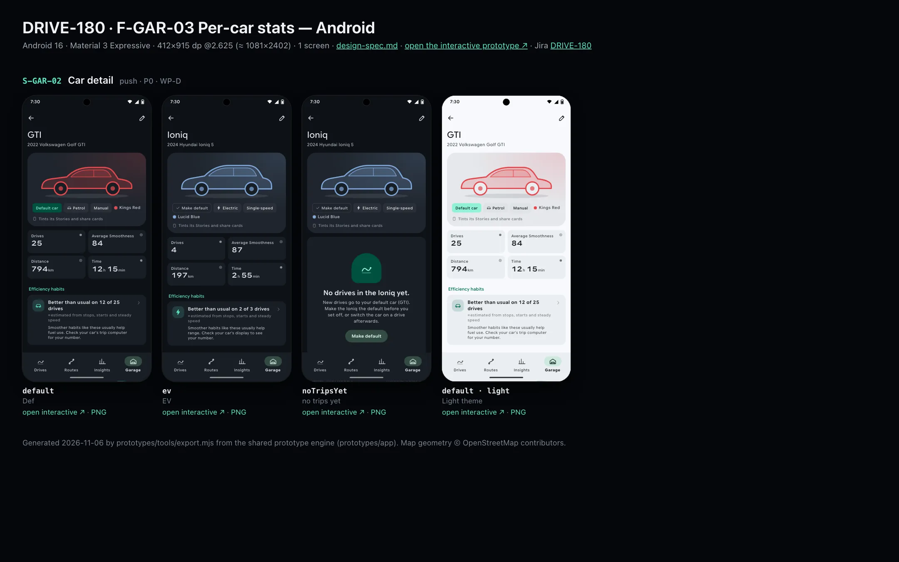
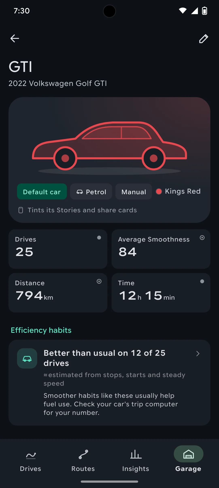
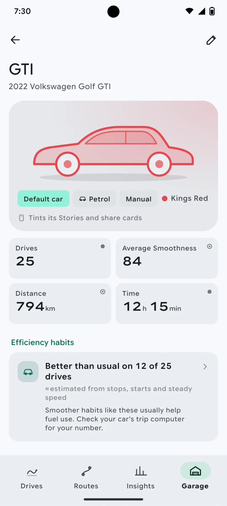

# DRIVE-180 · F-GAR-03 Per-car stats — Android design spec

> Generated by `prototypes/tools/export.mjs` on 2026-11-06 from the shared prototype engine. **Do not edit by hand:** change the screen's `spec` in `prototypes/app/screens/wp-*.js` (see `prototypes/app/AUTHORING.md`) and re-export.

- **Jira story:** [DRIVE-180](https://thekeval.atlassian.net/browse/DRIVE-180) · F-GAR-03 · P1
- **Platform:** Android 16 · Material 3 Expressive · 412×915 dp @2.625 (≈ 1081×2402)
- **Interactive prototype:** [../../../../prototypes/android/index.html#S-GAR-02](../../../../prototypes/android/index.html#S-GAR-02) (catalog panel: every screen and state; deep links `#S-ID/state?trip=…&ent=…&theme=light&text=xl&rm=1`)
- **Contact sheet:** [mockup.html](mockup.html) · 
- **Design system (source of truth for values):** [brand](../../system/brand.md) · [components](../../system/components.md) · [motion](../../system/motion.md) · [accessibility](../../system/accessibility.md) · [screen map](../../system/screen-map.md) · [fixtures](../../system/fixtures.md) · tokens `prototypes/shared/tokens.css`

## Screens in this story

| Screen | Name | Presentation | Priority | States | Status |
|---|---|---|---|---|---|
| `S-GAR-02` | Car detail | Push | P0 | 3 | Prototyped |

## Tokens used on this platform

Values resolved from `prototypes/shared/tokens.css` inside the Android device (`[data-platform="android"]`). Use the token names in code; the hex values are for reference.

| Token | Dark | Light |
|---|---|---|
| `--app-bg` | `#0D1117` | `#F7F9FC` |
| `--card-bg` | `#191E25` | `#EBEEF2` |
| `--dp-bg-grouped` | `#0D1117` | `#F7F9FC` |
| `--dp-surface` | `#191E25` | `#EBEEF2` |
| `--dp-surface-2` | `#1F252D` | `#E5E8EC` |
| `--dp-surface-3` | `#2A3038` | `#DFE2E6` |
| `--dp-fill` | `#2A3038` | `#DFE2E6` |
| `--dp-fill-strong` | `#353B44` | `#D3D7DC` |
| `--dp-text` | `#E1E3E8` | `#181C20` |
| `--dp-text-2` | `#C0C7CF` | `#40474F` |
| `--dp-text-3` | `#8A929B` | `#707881` |
| `--dp-separator` | `#40474F` | `#C0C7CF` |
| `--dp-accent` | `#5BE7C4` | `#006B53` |
| `--dp-accent-text` | `#5BE7C4` | `#006B53` |
| `--dp-on-accent` | `#00382B` | `#FFFFFF` |
| `--dp-accent-container` | `#00513F` | `#91F1D8` |
| `--dp-record` | `#FFC24B` | `#7A5900` |
| `--dp-positive` | `#5BE7C4` | `#006B53` |
| `--dp-change-down` | `#C0C7CF` | `#40474F` |
| `--dp-warning` | `#F5B648` | `#7A5900` |
| `--dp-critical` | `#FFB4AB` | `#BA1A1A` |
| `--dp-glass-fill` | `#1F252DF2` | `#E5E8ECF2` |
| `--dp-glass-fill-strong` | `#2A3038` | `#DFE2E6` |
| `--dp-glass-stroke` | `#FFFFFF0F` | `#0000000A` |
| `--md-sys-color-primary` | `#5BE7C4` | `#006B53` |
| `--md-sys-color-on-primary` | `#00382B` | `#FFFFFF` |
| `--md-sys-color-primary-container` | `#00513F` | `#91F1D8` |
| `--md-sys-color-on-primary-container` | `#91F1D8` | `#002118` |
| `--md-sys-color-secondary-container` | `#344C44` | `#CEE9DF` |
| `--md-sys-color-surface` | `#0D1117` | `#F7F9FC` |
| `--md-sys-color-surface-container` | `#191E25` | `#EBEEF2` |
| `--md-sys-color-surface-container-high` | `#1F252D` | `#E5E8EC` |
| `--md-sys-color-on-surface-variant` | `#C0C7CF` | `#40474F` |
| `--dp-data-route` | `#5BE7C4` | `#079777` |
| `--dp-data-event-brake` | `#FF7A66` | `#A21F16` |
| `--dp-data-event-accel` | `#E58BD0` | `#A33A8C` |
| `--dp-data-event-corner` | `#EAD54E` | `#9A8A00` |
| `--dp-data-quality-good` | `#5FDB9C` | `#1E9E62` |
| `--dp-data-speed` | `#D6DCE4` | `#404A58` |
| `--dp-data-long-g` | `#5AB8F5` | `#0A6AB8` |
| `--dp-data-lat-g` | `#F5A142` | `#B25A00` |

| Type / layout token | Value |
|---|---|
| `--dp-font-screen-title` | `600 32px / 40px "Google Sans Flex", "Google Sans Display", "Roboto Flex", Roboto, system-ui, sans-serif` |
| `--dp-font-sheet-title` | `400 24px / 32px "Google Sans Flex", "Google Sans Display", "Roboto Flex", Roboto, system-ui, sans-serif` |
| `--dp-font-section-title` | `600 22px / 28px "Google Sans Flex", "Google Sans Display", "Roboto Flex", Roboto, system-ui, sans-serif` |
| `--dp-font-card-title` | `700 16px / 24px "Google Sans Flex", "Google Sans Text", "Roboto Flex", Roboto, system-ui, sans-serif` |
| `--dp-font-body` | `400 16px / 24px "Google Sans Flex", "Google Sans Text", "Roboto Flex", Roboto, system-ui, sans-serif` |
| `--dp-font-body-secondary` | `400 14px / 20px "Google Sans Flex", "Google Sans Text", "Roboto Flex", Roboto, system-ui, sans-serif` |
| `--dp-font-meta` | `400 12px / 16px "Google Sans Flex", "Google Sans Text", "Roboto Flex", Roboto, system-ui, sans-serif` |
| `--dp-font-caption` | `500 12px / 16px "Google Sans Flex", "Google Sans Text", "Roboto Flex", Roboto, system-ui, sans-serif` |
| `--dp-font-button` | `700 14px / 20px "Google Sans Flex", "Google Sans Text", "Roboto Flex", Roboto, system-ui, sans-serif` |
| `--dp-num-hero` | `600 72px / 72px "Google Sans Flex", "Roboto Flex", Roboto, system-ui, sans-serif` |
| `--dp-num-xl` | `600 48px / 52px "Google Sans Flex", "Roboto Flex", Roboto, system-ui, sans-serif` |
| `--dp-num-l` | `600 34px / 38px "Google Sans Flex", "Roboto Flex", Roboto, system-ui, sans-serif` |
| `--dp-num-m` | `600 24px / 28px "Google Sans Flex", "Roboto Flex", Roboto, system-ui, sans-serif` |
| `--dp-num-s` | `600 17px / 22px "Google Sans Flex", "Roboto Flex", Roboto, system-ui, sans-serif` |
| `--dp-num-xs` | `600 13px / 16px "Google Sans Flex", "Roboto Flex", Roboto, system-ui, sans-serif` |
| `--dp-screen-margin` | `16px` |
| `--dp-radius-card` | `16px` |
| `--dp-radius-card-hero` | `28px` |
| `--dp-radius-sheet` | `28px` |
| `--dp-radius-chip` | `8px` |
| `--dp-radius-button` | `999px` |
| `--dp-layout-list-row-min` | `56px` |
| `--dp-layout-touch-min` | `48px` |
| `--safe-top` | `40px` |
| `--safe-bottom` | `24px` |

Text sizes scale with `--dp-text-scale` (XL = 2.0×) and numerals with `--dp-num-scale` (XL = 1.3×). DP Numerals: Google Sans Flex wdth 120 wght 600, tabular.

---

## S-GAR-02 · Car detail

 

- **Presentation:** push · tab: garage — screen map: “Push”
- **Entry points:** S-GAR-01
- **Leads to:** S-GAR-03 (edit) · S-TRP-01 · S-STA-02 (per-car, Pro) · S-SCO-06
- **PRD features:** F-GAR-01, F-GAR-03 · **Priority:** P0 · **WP:** D
- **Interactive:** [S-GAR-02](../../../../prototypes/android/index.html#S-GAR-02)

**Purpose.** One car’s identity and stats: drives, distance, time, average Smoothness and efficiency habits for that car, recent drives in it, and the way into per-car Pro trends (F-GAR-01, F-GAR-03).

### States

| State | PRD label | Fixture params | Screenshot |
|---|---|---|---|
| `default` | Def | `car=gti` | [S-GAR-02.png](../../screens/android/S-GAR-02.webp) · [open](../../../../prototypes/android/index.html#S-GAR-02) |
| `ev` | EV | `car=ioniq` | [S-GAR-02--ev.png](../../screens/android/S-GAR-02--ev.webp) · [open](../../../../prototypes/android/index.html#S-GAR-02/ev) |
| `noTripsYet` | no trips yet | `car=ioniq` | [S-GAR-02--noTripsYet.png](../../screens/android/S-GAR-02--noTripsYet.webp) · [open](../../../../prototypes/android/index.html#S-GAR-02/noTripsYet) |
| default · light | Light theme | `theme=light` | [S-GAR-02--light.png](../../screens/android/S-GAR-02--light.webp) |

Every state also renders in light/dark (`theme=light`), XL text (`text=xl`) and reduced motion (`rm=1`).

### Layout

- Top bar: nickname + “2022 Volkswagen Golf GTI”, glass back, trailing Edit (pencil) → S-GAR-03/edit.
- Hero card (radius 32 / 28, car-colour wash 18%): silhouette 320 wide drawn in the car colour · tags: Default car / Make default · powertrain (bolt for EV) · transmission · colour swatch + colour name · “Tints its Stories and share cards”.
- Stat tiles 2×2: Drives · Average Smoothness · Distance · Time (provenance glyphs).
- “Efficiency habits” card → S-SCO-06: “Better than usual on 12 of 25 drives”, “≈ estimated from stops, starts and steady speed” (dashed underline, 60%), the fixture copy (petrol: “…help fuel use. Check your car’s trip computer…”; EV: “…help range. Check your car’s display…”). Never energy, litres or kWh.
- “Trend” card: weekly sparkline (Glide area) “84 → 86 over 6 weeks” + “Compare your cars” (Pro → S-STA-02/perCar) · Free: the same card blurred in a lock panel.
- “Recent drives in the GTI” (4 trip cards) + “All ›” → S-HIS-01 filtered by car. “Details” list (make and model, year, powertrain, added) + “Edit car”; footer “No VIN or plate. Car details stay on this phone.”
- No trips yet: empty card “No drives in the Ioniq yet.” with the default-car explanation and “Make default”.

### Components & tokens

| Component | Tokens / spec |
|---|---|
| `page` | --dp-bg-grouped (iOS) / --md-sys-color-surface (Android) · --dp-screen-margin 16 |
| `navBar` | --dp-font-card-title · --dp-font-meta · glass: --dp-glass-fill + --dp-glass-blur · components.md §2 |
| `iconButton` | see components.md |
| `card` | --dp-surface / --md-sys-color-surface-container · --dp-radius-card (24 iOS · 16 Android) · hero: --dp-radius-card-hero (32 · 28) · light iOS: --dp-elev-1 |
| `chip` | --dp-radius-chip (iOS capsule · Android 8) · height 28 · --dp-font-caption |
| `stats` | --dp-surface-2 / --md-sys-color-surface-container-high · radius 14 iOS / 12 Android · value --dp-num-m (DP Numerals) · components.md §5 |
| `section` | --dp-font-section-title · --dp-layout-section-gap 28 |
| `list` | iOS inset grouped radius --dp-radius-card, rows 52 pt, separators --dp-separator inset 16 · Android ListItem 56/72 dp in --md-sys-color-surface-container |
| `row` | --dp-font-body · --dp-font-meta (supporting) · --dp-layout-list-row-min |
| `tripRow` | glyph 40 on --dp-surface-2 · --dp-font-card-title · --dp-font-meta · components.md §12 |
| `sparkline` | see components.md |
| `lockPanel` | blur --dp-opacity-locked-blur 14px · dim --dp-opacity-locked-dim 35% · components.md §15.2 |
| `empty` | illustration 120 in --dp-accent · --dp-font-section-title · components.md §21 |

### Interactions & navigation

- Edit / “Edit car” → S-GAR-03/edit (sheet). Efficiency card → S-SCO-06 (EV: evCarVsPetrolCarCopy). Trend → S-STA-02/perCar (Pro) / S-SUB-03 trends (Free). Trip card → S-TRP-01. “All” → S-HIS-01 with car filter.
- “Make default” → toast; new drives go to this car.

### Motion

- Enter: zoom / container transform from the Garage card. Hero motion: the silhouette outline draws on (1300 ms ease.drawOn); blocks rise 8 px, 35 ms stagger. RM: static silhouette, cross-fade.

### Accessibility

- Stat tiles: “Average Smoothness, 84. Derived.” Efficiency card: “Efficiency habits: better than usual on 12 of 25 drives, estimated.”
- Sparkline summary: “GTI weekly average Smoothness: 78, 81, 85, 85, 87, 86.”
- Colour swatch is paired with the colour name; the silhouette is decorative.
- XL: tiles go to 1 column at AX5; tags wrap; the silhouette shrinks to the card width.

### Platform notes

- **Android (this spec):** MediumFlexibleTopAppBar with Edit action; container transform; segmented ListItems; tonal chips.
- *iOS (for reference):* Inline title + subtitle, glass back and Edit; zoom transition; inset-grouped Details list.

### Analytics

- `car_detail_opened {powertrain, trips_bucket}`
- `efficiency_viewed {source: car}`
- `trend_viewed {dimension: car, locked}`

### Copy

| Key | Text |
|---|---|
| Efficiency (petrol) | Smoother habits like these usually help fuel use. Check your car’s trip computer for your number. |
| Efficiency (EV) | Smoother habits like these usually help range. Check your car’s display to see your number. |
| Efficiency line | Better than usual on {n} of {m} drives · ≈ estimated from stops, starts and steady speed |
| No trips | No drives in the {car} yet. New drives go to your default car ({default}). Make the {car} the default before you set off, or switch the car on a drive afterwards. |
| Footer | No VIN or plate. Car details stay on this phone. |
| Tint | Tints its Stories and share cards |

### Free / Pro

Free: everything except the per-car trend, which shows the user’s own sparkline blurred → S-SUB-03 trends. Pro: trend card → S-STA-02/perCar.

### Data & fixtures

default: gti (carStats: 25 drives · 794 km · 12 h 15 min · 84 · 12 of 25 better). ev: ioniq (4 drives · 197 km · 87 · 2 of 3; copy from t20261024-1610.efficiency). noTripsYet: the Ioniq as it was 4–16 Oct (added 4 Oct, first drive 17 Oct). Weekly sparkline derived per recap week.

### Assets

[icon-edit.svg](assets/icon-edit.svg) · [icon-bolt.svg](assets/icon-bolt.svg) · [icon-car.svg](assets/icon-car.svg) · [icon-story.svg](assets/icon-story.svg) · [icon-insights.svg](assets/icon-insights.svg) · [icon-check.svg](assets/icon-check.svg) · [icon-chevronRight.svg](assets/icon-chevronRight.svg) · [icon-drives.svg](assets/icon-drives.svg)

UI glyphs may be swapped for SF Symbols / Material Symbols Rounded equivalents; event-pin, quality and provenance glyphs must not be (components.md global rules).

### Checklist (accessibility.md §9)

- [ ] Light and dark both render, and contrast passes.
- [ ] The XL text state reflows with no truncation.
- [ ] The RM state is defined.
- [ ] Every control has a label; every chart and map has a summary sentence.
- [ ] Every target ≥ 44 pt / 48 dp (≥ 64 in-drive).
- [ ] No meaning by colour alone.
- [ ] Speed is neutral wherever it appears and absent from social or live surfaces.
- [ ] No streak, leaderboard, speed or “beat your time” language.
- [ ] Behaviour is defined while a trip is active (D1 gate).
- [ ] Haptics come from motion.md §6 only.

---

Map geometry in the prototype: © OpenStreetMap contributors (ODbL). Speed and G are simulated fixtures (fixtures.md).
