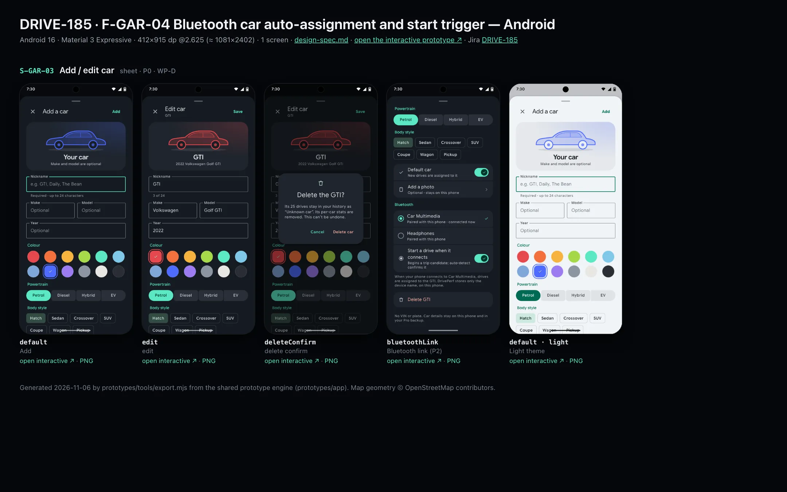
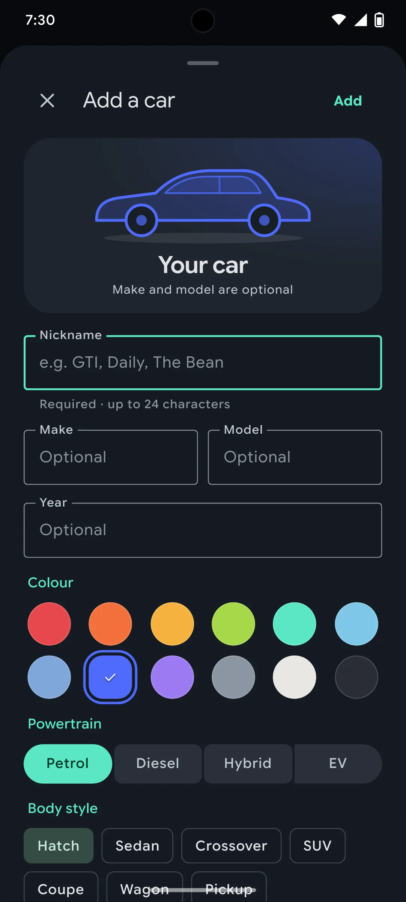
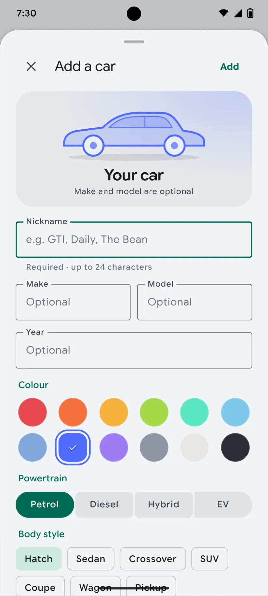

# DRIVE-185 · F-GAR-04 Bluetooth car auto-assignment and start trigger — Android design spec

> Generated by `prototypes/tools/export.mjs` on 2026-11-06 from the shared prototype engine. **Do not edit by hand:** change the screen's `spec` in `prototypes/app/screens/wp-*.js` (see `prototypes/app/AUTHORING.md`) and re-export.

- **Jira story:** [DRIVE-185](https://thekeval.atlassian.net/browse/DRIVE-185) · F-GAR-04 · P2
- **Platform:** Android 16 · Material 3 Expressive · 412×915 dp @2.625 (≈ 1081×2402)
- **Interactive prototype:** [../../../../prototypes/android/index.html#S-GAR-03](../../../../prototypes/android/index.html#S-GAR-03) (catalog panel: every screen and state; deep links `#S-ID/state?trip=…&ent=…&theme=light&text=xl&rm=1`)
- **Contact sheet:** [mockup.html](mockup.html) · 
- **Design system (source of truth for values):** [brand](../../system/brand.md) · [components](../../system/components.md) · [motion](../../system/motion.md) · [accessibility](../../system/accessibility.md) · [screen map](../../system/screen-map.md) · [fixtures](../../system/fixtures.md) · tokens `prototypes/shared/tokens.css`

## Screens in this story

| Screen | Name | Presentation | Priority | States | Status |
|---|---|---|---|---|---|
| `S-GAR-03` | Add / edit car | Sheet (large) | P0 | 4 | Prototyped |

## Tokens used on this platform

Values resolved from `prototypes/shared/tokens.css` inside the Android device (`[data-platform="android"]`). Use the token names in code; the hex values are for reference.

| Token | Dark | Light |
|---|---|---|
| `--app-bg` | `#0D1117` | `#F7F9FC` |
| `--card-bg` | `#191E25` | `#EBEEF2` |
| `--dp-bg-grouped` | `#0D1117` | `#F7F9FC` |
| `--dp-surface` | `#191E25` | `#EBEEF2` |
| `--dp-surface-2` | `#1F252D` | `#E5E8EC` |
| `--dp-surface-3` | `#2A3038` | `#DFE2E6` |
| `--dp-fill` | `#2A3038` | `#DFE2E6` |
| `--dp-fill-strong` | `#353B44` | `#D3D7DC` |
| `--dp-text` | `#E1E3E8` | `#181C20` |
| `--dp-text-2` | `#C0C7CF` | `#40474F` |
| `--dp-text-3` | `#8A929B` | `#707881` |
| `--dp-separator` | `#40474F` | `#C0C7CF` |
| `--dp-accent` | `#5BE7C4` | `#006B53` |
| `--dp-accent-text` | `#5BE7C4` | `#006B53` |
| `--dp-on-accent` | `#00382B` | `#FFFFFF` |
| `--dp-accent-container` | `#00513F` | `#91F1D8` |
| `--dp-record` | `#FFC24B` | `#7A5900` |
| `--dp-positive` | `#5BE7C4` | `#006B53` |
| `--dp-change-down` | `#C0C7CF` | `#40474F` |
| `--dp-warning` | `#F5B648` | `#7A5900` |
| `--dp-critical` | `#FFB4AB` | `#BA1A1A` |
| `--dp-glass-fill` | `#1F252DF2` | `#E5E8ECF2` |
| `--dp-glass-fill-strong` | `#2A3038` | `#DFE2E6` |
| `--dp-glass-stroke` | `#FFFFFF0F` | `#0000000A` |
| `--md-sys-color-primary` | `#5BE7C4` | `#006B53` |
| `--md-sys-color-on-primary` | `#00382B` | `#FFFFFF` |
| `--md-sys-color-primary-container` | `#00513F` | `#91F1D8` |
| `--md-sys-color-on-primary-container` | `#91F1D8` | `#002118` |
| `--md-sys-color-secondary-container` | `#344C44` | `#CEE9DF` |
| `--md-sys-color-surface` | `#0D1117` | `#F7F9FC` |
| `--md-sys-color-surface-container` | `#191E25` | `#EBEEF2` |
| `--md-sys-color-surface-container-high` | `#1F252D` | `#E5E8EC` |
| `--md-sys-color-on-surface-variant` | `#C0C7CF` | `#40474F` |
| `--dp-data-route` | `#5BE7C4` | `#079777` |
| `--dp-data-event-brake` | `#FF7A66` | `#A21F16` |
| `--dp-data-event-accel` | `#E58BD0` | `#A33A8C` |
| `--dp-data-event-corner` | `#EAD54E` | `#9A8A00` |
| `--dp-data-quality-good` | `#5FDB9C` | `#1E9E62` |
| `--dp-data-speed` | `#D6DCE4` | `#404A58` |
| `--dp-data-long-g` | `#5AB8F5` | `#0A6AB8` |
| `--dp-data-lat-g` | `#F5A142` | `#B25A00` |

| Type / layout token | Value |
|---|---|
| `--dp-font-screen-title` | `600 32px / 40px "Google Sans Flex", "Google Sans Display", "Roboto Flex", Roboto, system-ui, sans-serif` |
| `--dp-font-sheet-title` | `400 24px / 32px "Google Sans Flex", "Google Sans Display", "Roboto Flex", Roboto, system-ui, sans-serif` |
| `--dp-font-section-title` | `600 22px / 28px "Google Sans Flex", "Google Sans Display", "Roboto Flex", Roboto, system-ui, sans-serif` |
| `--dp-font-card-title` | `700 16px / 24px "Google Sans Flex", "Google Sans Text", "Roboto Flex", Roboto, system-ui, sans-serif` |
| `--dp-font-body` | `400 16px / 24px "Google Sans Flex", "Google Sans Text", "Roboto Flex", Roboto, system-ui, sans-serif` |
| `--dp-font-body-secondary` | `400 14px / 20px "Google Sans Flex", "Google Sans Text", "Roboto Flex", Roboto, system-ui, sans-serif` |
| `--dp-font-meta` | `400 12px / 16px "Google Sans Flex", "Google Sans Text", "Roboto Flex", Roboto, system-ui, sans-serif` |
| `--dp-font-caption` | `500 12px / 16px "Google Sans Flex", "Google Sans Text", "Roboto Flex", Roboto, system-ui, sans-serif` |
| `--dp-font-button` | `700 14px / 20px "Google Sans Flex", "Google Sans Text", "Roboto Flex", Roboto, system-ui, sans-serif` |
| `--dp-num-hero` | `600 72px / 72px "Google Sans Flex", "Roboto Flex", Roboto, system-ui, sans-serif` |
| `--dp-num-xl` | `600 48px / 52px "Google Sans Flex", "Roboto Flex", Roboto, system-ui, sans-serif` |
| `--dp-num-l` | `600 34px / 38px "Google Sans Flex", "Roboto Flex", Roboto, system-ui, sans-serif` |
| `--dp-num-m` | `600 24px / 28px "Google Sans Flex", "Roboto Flex", Roboto, system-ui, sans-serif` |
| `--dp-num-s` | `600 17px / 22px "Google Sans Flex", "Roboto Flex", Roboto, system-ui, sans-serif` |
| `--dp-num-xs` | `600 13px / 16px "Google Sans Flex", "Roboto Flex", Roboto, system-ui, sans-serif` |
| `--dp-screen-margin` | `16px` |
| `--dp-radius-card` | `16px` |
| `--dp-radius-card-hero` | `28px` |
| `--dp-radius-sheet` | `28px` |
| `--dp-radius-chip` | `8px` |
| `--dp-radius-button` | `999px` |
| `--dp-layout-list-row-min` | `56px` |
| `--dp-layout-touch-min` | `48px` |
| `--safe-top` | `40px` |
| `--safe-bottom` | `24px` |

Text sizes scale with `--dp-text-scale` (XL = 2.0×) and numerals with `--dp-num-scale` (XL = 1.3×). DP Numerals: Google Sans Flex wdth 120 wght 600, tabular.

---

## S-GAR-03 · Add / edit car

 

- **Presentation:** sheet · tab: garage · detent: large — screen map: “Sheet (large)”
- **Entry points:** S-GAR-01/02 · S-ONB-14 reuse
- **Leads to:** Back · delete confirm dialog
- **PRD features:** F-GAR-01, F-ONB-09, F-GAR-04 · **Priority:** P0 · **WP:** D
- **Interactive:** [S-GAR-03](../../../../prototypes/android/index.html#S-GAR-03)

**Purpose.** Add a car or edit one: nickname (required), optional make, model and year, powertrain, body style and colour — the colour and silhouette become the car’s identity across Stories and cards (F-GAR-01, F-ONB-09). Also delete a car (trips kept as “Unknown car”) and, P2, link its Bluetooth (F-GAR-04).

### States

| State | PRD label | Fixture params | Screenshot |
|---|---|---|---|
| `default` | Add | — | [S-GAR-03.png](../../screens/android/S-GAR-03.webp) · [open](../../../../prototypes/android/index.html#S-GAR-03) |
| `edit` | edit | `car=gti` | [S-GAR-03--edit.png](../../screens/android/S-GAR-03--edit.webp) · [open](../../../../prototypes/android/index.html#S-GAR-03/edit) |
| `deleteConfirm` | delete confirm | `car=gti` | [S-GAR-03--deleteConfirm.png](../../screens/android/S-GAR-03--deleteConfirm.webp) · [open](../../../../prototypes/android/index.html#S-GAR-03/deleteConfirm) |
| `bluetoothLink` | Bluetooth link (P2) | `car=gti` | [S-GAR-03--bluetoothLink.png](../../screens/android/S-GAR-03--bluetoothLink.webp) · [open](../../../../prototypes/android/index.html#S-GAR-03/bluetoothLink) |
| default · light | Light theme | `theme=light` | [S-GAR-03--light.png](../../screens/android/S-GAR-03--light.webp) |

Every state also renders in light/dark (`theme=light`), XL text (`text=xl`) and reduced motion (`rm=1`).

### Layout

- Large sheet with its own toolbar: × (Cancel) · “Add a car” / “Edit car” + sub · ✓ (iOS glass prominent) / “Add”/“Save” text button (Android).
- Live preview card (radius 24, the chosen car colour wash): silhouette 240 for the chosen body style in the chosen colour · nickname (“Your car” until typed) · “2022 Volkswagen Golf GTI” / “Make and model are optional”.
- Fields: Nickname (focused on Add; helper “Required · up to 24 characters” → “3 of 24”) · Make + Model side by side (stack at XL) · Year. iOS rounded fields (surface-2, radius 14) / Android OutlinedTextField.
- Colour: 12 car-colour swatches (36, ring + check when selected). Powertrain: Petrol · Diesel · Hybrid · EV segmented. Body style chips: Hatch · Sedan · Crossover · SUV · Coupe · Wagon · Pickup.
- List: Default car (switch) · Add a photo (optional, stays on this phone). Bluetooth row “Link the car’s Bluetooth” (P2). Edit only: destructive “Delete GTI”. Footer “No VIN or plate. Car details stay on this phone and in your Pro backup.”
- Delete confirm: alert / M3 dialog over the sheet — “Delete the GTI?” “Its 25 drives stay in your history as “Unknown car”. Its per-car stats are removed. This can’t be undone.” Cancel · Delete car.
- Bluetooth link (P2): paired devices as radio rows (Car Multimedia · connected now ✓, Headphones); Android adds “Start a drive when it connects” (switch); platform footnote (iOS assigns only, from car audio connections).

### Components & tokens

| Component | Tokens / spec |
|---|---|
| `sheetHeader` | see components.md |
| `iconButton` | see components.md |
| `button` | --dp-accent / --dp-on-accent (filled) · --dp-fill-strong · --md-sys-color-secondary-container (tonal) · --dp-radius-button · height iOS 50/44/34 · Android 56/40/32 · --dp-font-button · components.md §0 |
| `textField` | see components.md |
| `segmented` | see components.md |
| `chip` | --dp-radius-chip (iOS capsule · Android 8) · height 28 · --dp-font-caption |
| `list` | iOS inset grouped radius --dp-radius-card, rows 52 pt, separators --dp-separator inset 16 · Android ListItem 56/72 dp in --md-sys-color-surface-container |
| `row` | --dp-font-body · --dp-font-meta (supporting) · --dp-layout-list-row-min |
| `toggle` | iOS 51×31 tint --dp-accent · Android M3 Switch 52×32 --md-sys-color-primary |
| `dialog` | iOS alert 270 glass · Android M3 dialog radius 28 --md-sys-color-surface-container-high |

### Interactions & navigation

- Swatch / powertrain / body style → updates the preview live (selection haptic). Nickname typing updates the preview name.
- ✓ / Save: empty nickname → toast “Add a nickname first” (warning haptic); otherwise toast “GTI saved” / “Daily added to your garage” (success haptic) and dismiss to S-GAR-01/02.
- Delete → dialog; Delete car → toast “GTI deleted · drives kept as Unknown car” → S-GAR-01. Cancel / scrim → back to the edit form.
- Bluetooth row → bluetoothLink state (edit only). Photo → system photo picker (mock toast).

### Motion

- Sheet spring.sheet (iOS large detent recedes the parent). Hero motion: the preview silhouette draws on when the sheet opens (1100 ms), and its colour wash cross-fades on each swatch change (spring.default via CSS transition). RM: instant colour change.
- Delete dialog scales in (spring.fast).

### Accessibility

- Swatches are a radio group with colour names (“Carmine, selected”); the chosen colour also shows a check.
- Nickname field announces “Nickname, required, up to 24 characters”.
- Dialog: focus to title, Cancel first. Delete car is destructive.
- XL: Make/Model stack; swatches wrap to 3 rows; segmented labels stay legible (two lines allowed).

### Platform notes

- **Android (this spec):** ModalBottomSheet full height with top row (close, title, TextButton Save); OutlinedTextFields; connected ButtonGroup; FilterChips; AlertDialog for delete; BLUETOOTH_CONNECT permission requested on first link.
- *iOS (for reference):* Sheet (large) with NavigationStack toolbar (✕ / ✓ glassProminent); Form-style sections; ColorPicker-like swatch grid; .alert for delete.

### Analytics

- `car_added {source: garage|onboarding|trip_edit, powertrain}`
- `car_edited`
- `car_deleted {trips_bucket}`
- `bt_car_linked`

### Copy

| Key | Text |
|---|---|
| Title | Add a car / Edit car |
| Nickname helper | Required · up to 24 characters |
| Placeholder | e.g. GTI, Daily, The Bean |
| Empty nickname | Add a nickname first |
| Footer | No VIN or plate. Car details stay on this phone (and in your Pro backup). |
| Delete title | Delete the {car}? |
| Delete text | Its {n} drives stay in your history as “Unknown car”. Its per-car stats are removed. This can’t be undone. |
| BT iOS | When your iPhone connects to {device}, drives are assigned to the {car}. iPhone only shares car audio connections, so this assigns drives but can’t start them. |
| BT Android | When your phone connects to {device}, drives are assigned to the {car}. DrivePerf stores only the device name, on this phone. |

### Free / Pro

Editing is free. Adding a second car on Free is gated before this sheet (S-SUB-03 s2ndCar from S-GAR-01); S-ONB-14 reuses this form for the first car.

### Data & fixtures

Add: empty form, colour cobalt, petrol, hatch (defaults). Edit / delete / Bluetooth: vehicles gti (Kings Red → carmine, hatch, petrol, manual). Delete count from carStats (25 drives). Bluetooth device names are prototype examples.

### Assets

[icon-close.svg](assets/icon-close.svg) · [icon-check.svg](assets/icon-check.svg) · [icon-trash.svg](assets/icon-trash.svg) · [icon-gear.svg](assets/icon-gear.svg) · [icon-story.svg](assets/icon-story.svg) · [icon-record.svg](assets/icon-record.svg)

UI glyphs may be swapped for SF Symbols / Material Symbols Rounded equivalents; event-pin, quality and provenance glyphs must not be (components.md global rules).

### Checklist (accessibility.md §9)

- [ ] Light and dark both render, and contrast passes.
- [ ] The XL text state reflows with no truncation.
- [ ] The RM state is defined.
- [ ] Every control has a label; every chart and map has a summary sentence.
- [ ] Every target ≥ 44 pt / 48 dp (≥ 64 in-drive).
- [ ] No meaning by colour alone.
- [ ] Speed is neutral wherever it appears and absent from social or live surfaces.
- [ ] No streak, leaderboard, speed or “beat your time” language.
- [ ] Behaviour is defined while a trip is active (D1 gate).
- [ ] Haptics come from motion.md §6 only.

---

Map geometry in the prototype: © OpenStreetMap contributors (ODbL). Speed and G are simulated fixtures (fixtures.md).
