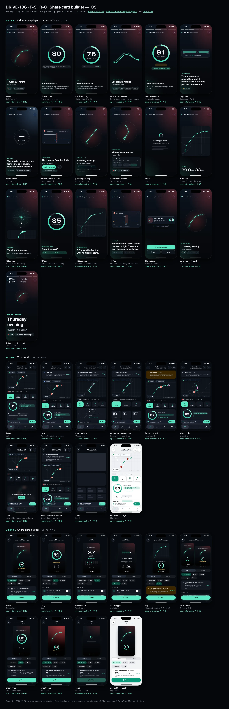
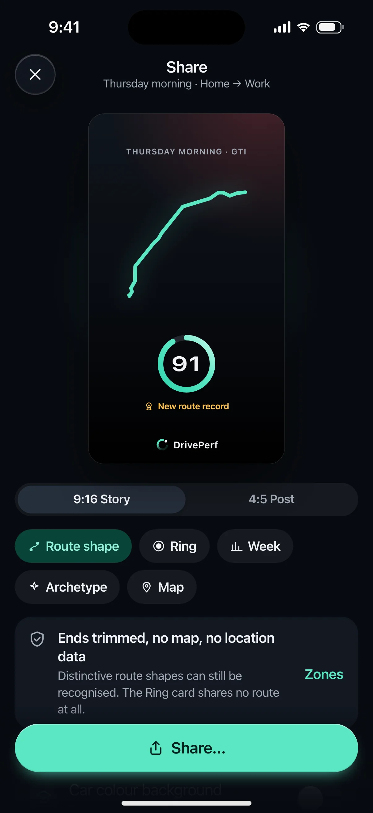
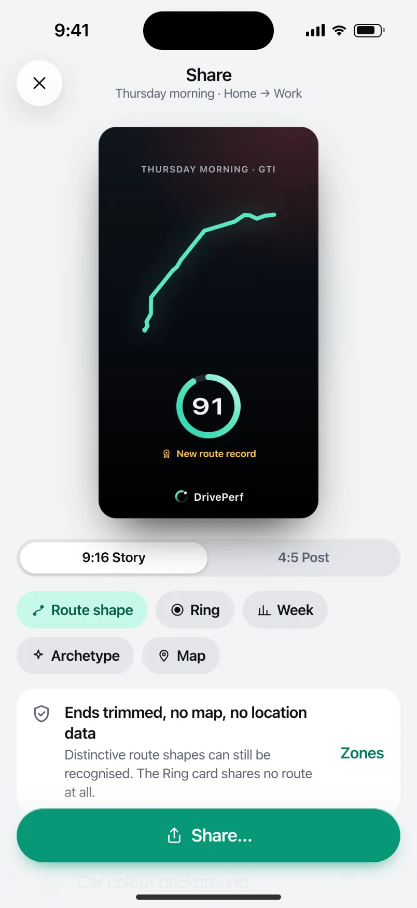

# DRIVE-186 · F-SHR-01 Share card builder — iOS design spec

> Generated by `prototypes/tools/export.mjs` on 2026-11-07 from the shared prototype engine. **Do not edit by hand:** change the screen's `spec` in `prototypes/app/screens/wp-*.js` (see `prototypes/app/AUTHORING.md`) and re-export.

- **Jira story:** [DRIVE-186](https://thekeval.atlassian.net/browse/DRIVE-186) · F-SHR-01 · P0
- **Platform:** iOS 26/27 · Liquid Glass · iPhone 17 Pro (402×874 pt @3x = 1206×2622)
- **Interactive prototype:** [../../../../prototypes/ios/index.html#S-STY-01](../../../../prototypes/ios/index.html#S-STY-01) (catalog panel: every screen and state; deep links `#S-ID/state?trip=…&ent=…&theme=light&text=xl&rm=1`)
- **Contact sheet:** [mockup.html](mockup.html) · 
- **Design system (source of truth for values):** [brand](../../system/brand.md) · [components](../../system/components.md) · [motion](../../system/motion.md) · [accessibility](../../system/accessibility.md) · [screen map](../../system/screen-map.md) · [fixtures](../../system/fixtures.md) · tokens `prototypes/shared/tokens.css`

## Screens in this story

| Screen | Name | Presentation | Priority | States | Status |
|---|---|---|---|---|---|
| `S-STY-01` | Drive Story player (frames 1–7) | Full (player) | P0 | 17 | Prototyped |
| `S-TRP-01` | Trip detail | Push | P0 | 9 | Prototyped |
| `S-SHR-01` | Share card builder | Full (builder) → system share sheet | P0 | 9 | Prototyped |

## Tokens used on this platform

Values resolved from `prototypes/shared/tokens.css` inside the iOS device (`[data-platform="ios"]`). Use the token names in code; the hex values are for reference.

| Token | Dark | Light |
|---|---|---|
| `--app-bg` | `#080B10` | `#F2F3F6` |
| `--card-bg` | `#131822` | `#FFFFFF` |
| `--dp-bg-grouped` | `#080B10` | `#F2F3F6` |
| `--dp-surface` | `#131822` | `#FFFFFF` |
| `--dp-surface-2` | `#1B222D` | `#F2F3F6` |
| `--dp-surface-3` | `#262E3B` | `#E4E7EC` |
| `--dp-fill` | `#7880961F` | `#7880961F` |
| `--dp-fill-strong` | `#7880963D` | `#78809633` |
| `--dp-text` | `#F2F4F7` | `#0B0E13` |
| `--dp-text-2` | `#A3AAB6` | `#5A6271` |
| `--dp-text-3` | `#6E7787` | `#8A919D` |
| `--dp-separator` | `#96A0B429` | `#3C435024` |
| `--dp-accent` | `#5BE7C4` | `#079777` |
| `--dp-accent-text` | `#5BE7C4` | `#06775E` |
| `--dp-on-accent` | `#04241D` | `#FFFFFF` |
| `--dp-accent-container` | `#0A4439` | `#C6F8EA` |
| `--dp-record` | `#FFC24B` | `#9A6300` |
| `--dp-positive` | `#5BE7C4` | `#06775E` |
| `--dp-change-down` | `#A3AAB6` | `#5A6271` |
| `--dp-warning` | `#F5B648` | `#9A5F00` |
| `--dp-critical` | `#FF6B6B` | `#C62828` |
| `--dp-glass-fill` | `#1C222C6B` | `#FFFFFF8C` |
| `--dp-glass-fill-strong` | `#1C222CB8` | `#FFFFFFD1` |
| `--dp-glass-stroke` | `#FFFFFF24` | `#FFFFFF99` |
| `--dp-data-route` | `#5BE7C4` | `#079777` |
| `--dp-data-event-brake` | `#FF7A66` | `#A21F16` |
| `--dp-data-event-accel` | `#E58BD0` | `#A33A8C` |
| `--dp-data-event-corner` | `#EAD54E` | `#9A8A00` |
| `--dp-data-quality-good` | `#5FDB9C` | `#1E9E62` |
| `--dp-data-speed` | `#D6DCE4` | `#404A58` |
| `--dp-data-long-g` | `#5AB8F5` | `#0A6AB8` |
| `--dp-data-lat-g` | `#F5A142` | `#B25A00` |

| Type / layout token | Value |
|---|---|
| `--dp-font-screen-title` | `700 34px / 41px -apple-system, BlinkMacSystemFont, "SF Pro Display", system-ui, sans-serif` |
| `--dp-font-sheet-title` | `700 22px / 28px -apple-system, BlinkMacSystemFont, "SF Pro Display", system-ui, sans-serif` |
| `--dp-font-section-title` | `600 20px / 25px -apple-system, BlinkMacSystemFont, "SF Pro Display", system-ui, sans-serif` |
| `--dp-font-card-title` | `600 17px / 22px -apple-system, BlinkMacSystemFont, "SF Pro Text", system-ui, sans-serif` |
| `--dp-font-body` | `400 17px / 22px -apple-system, BlinkMacSystemFont, "SF Pro Text", system-ui, sans-serif` |
| `--dp-font-body-secondary` | `400 15px / 20px -apple-system, BlinkMacSystemFont, "SF Pro Text", system-ui, sans-serif` |
| `--dp-font-meta` | `400 13px / 18px -apple-system, BlinkMacSystemFont, "SF Pro Text", system-ui, sans-serif` |
| `--dp-font-caption` | `400 12px / 16px -apple-system, BlinkMacSystemFont, "SF Pro Text", system-ui, sans-serif` |
| `--dp-font-button` | `600 17px / 22px -apple-system, BlinkMacSystemFont, "SF Pro Text", system-ui, sans-serif` |
| `--dp-num-hero` | `600 72px / 72px -apple-system, BlinkMacSystemFont, "SF Pro Display", system-ui, sans-serif` |
| `--dp-num-xl` | `600 48px / 52px -apple-system, BlinkMacSystemFont, "SF Pro Display", system-ui, sans-serif` |
| `--dp-num-l` | `600 34px / 38px -apple-system, BlinkMacSystemFont, "SF Pro Display", system-ui, sans-serif` |
| `--dp-num-m` | `600 24px / 28px -apple-system, BlinkMacSystemFont, "SF Pro Display", system-ui, sans-serif` |
| `--dp-num-s` | `600 17px / 22px -apple-system, BlinkMacSystemFont, "SF Pro Display", system-ui, sans-serif` |
| `--dp-num-xs` | `600 13px / 16px -apple-system, BlinkMacSystemFont, "SF Pro Display", system-ui, sans-serif` |
| `--dp-screen-margin` | `16px` |
| `--dp-radius-card` | `24px` |
| `--dp-radius-card-hero` | `32px` |
| `--dp-radius-sheet` | `38px` |
| `--dp-radius-chip` | `999px` |
| `--dp-radius-button` | `999px` |
| `--dp-layout-list-row-min` | `52px` |
| `--dp-layout-touch-min` | `44px` |
| `--safe-top` | `62px` |
| `--safe-bottom` | `34px` |

Text sizes scale with `--dp-text-scale` (XL = 2.0×) and numerals with `--dp-num-scale` (XL = 1.3×). DP Numerals: SF Pro Expanded Semibold, tabular.

---

## S-STY-01 · Drive Story player (frames 1–7)

- **Presentation:** full · tab: drives — screen map: “Full (player)”
- **Entry points:** S-NTF-01 "Drive decoded" · S-HOME-01 card · S-DRV-04 · S-TRP-01 "Story" · S-LIVE-04/08
- **Leads to:** f7: S-RPL-01 (Explore) · S-SHR-01 (Share) · Done → caller · chips: S-RTE-03, S-SCO-03, S-TRP-02 (passenger/car), S-DQ-01
- **PRD features:** F-STY-01, F-STY-03, F-STY-04, F-STY-06, F-SCO-01, F-SCO-02, F-SCO-05, F-SCO-06, F-RTE-01, F-RTE-03, F-HIS-02, F-GAR-02, F-CAP-04, F-DQ-02, F-DQ-04, F-SHR-01, F-DQ-01 · **Priority:** P0 · **WP:** C
- **Interactive:** [S-STY-01](../../../../prototypes/ios/index.html#S-STY-01)

**Purpose.** The “wow” after every drive (F-STY-01): a ~15 s full-screen Story that leads with what went well, scores the drive against the user’s own baseline, then gives exactly one tip. No speed or max speed appears in any frame (F-STY-01.3).

### States

| State | PRD label | Fixture params | Screenshot |
|---|---|---|---|
| `default` | Def (frame 1) | `trip=t20261105-1745` | — · [open](../../../../prototypes/ios/index.html#S-STY-01) |
| `firstDrive` | First drive (baseline) | `trip=t20260928-1842` | — · [open](../../../../prototypes/ios/index.html#S-STY-01/firstDrive) |
| `calibrating` | Calibrating (2 of 3) | `trip=t20260929-0738` | — · [open](../../../../prototypes/ios/index.html#S-STY-01/calibrating) |
| `routeDiscovered` | Route discovered (merge + name) | `trip=t20261002-0745` | — · [open](../../../../prototypes/ios/index.html#S-STY-01/routeDiscovered) |
| `newRouteRecord` | New route record | `trip=t20261105-0742` | — · [open](../../../../prototypes/ios/index.html#S-STY-01/newRouteRecord) |
| `degraded` | Degraded (Part) | `trip=t20261027-1728` | — · [open](../../../../prototypes/ios/index.html#S-STY-01/degraded) |
| `unscorable` | Unscorable | `trip=t20261106-1210` | — · [open](../../../../prototypes/ios/index.html#S-STY-01/unscorable) |
| `wasItNeededInline` | “Was it needed?” inline | `trip=t20261020-0740` | — · [open](../../../../prototypes/ios/index.html#S-STY-01/wasItNeededInline) |
| `passengerChip` | Passenger chip | `trip=t20261031-1905` | — · [open](../../../../prototypes/ios/index.html#S-STY-01/passengerChip) |
| `transitQuestion` | Transit question | `trip=t20261104-0650` | — · [open](../../../../prototypes/ios/index.html#S-STY-01/transitQuestion) |
| `Load` | Load | `trip=t20261105-1745` | — · [open](../../../../prototypes/ios/index.html#S-STY-01/Load) |
| `f2Route` | Frame 2 · route draw-on | `trip=t20261105-1745` | — · [open](../../../../prototypes/ios/index.html#S-STY-01/f2Route) |
| `f3Inputs` | Frame 3 · G-dot replay | `trip=t20261105-1745` | — · [open](../../../../prototypes/ios/index.html#S-STY-01/f3Inputs) |
| `f4Ring` | Frame 4 · Smoothness ring | `trip=t20261105-1745` | — · [open](../../../../prototypes/ios/index.html#S-STY-01/f4Ring) |
| `f5Cleanest` | Frame 5 · cleanest stretch | `trip=t20261105-1745` | — · [open](../../../../prototypes/ios/index.html#S-STY-01/f5Cleanest) |
| `f6Tip` | Frame 6 · one thing for next time | `trip=t20261105-1745` | — · [open](../../../../prototypes/ios/index.html#S-STY-01/f6Tip) |
| `f7Actions` | Frame 7 · actions | `trip=t20261105-1745` | — · [open](../../../../prototypes/ios/index.html#S-STY-01/f7Actions) |

Every state also renders in light/dark (`theme=light`), XL text (`text=xl`) and reduced motion (`rm=1`).

### Layout

- Full-screen player, always on the night stage (`--dp-gradient-night-sky`) with a car-colour wash (radial 30% of `--dp-car-{colour}` top-trailing, 14% Glide bottom-leading). Status bar light. Dark tokens are forced inside the player in both themes.
- Top (safe-top + 4): progress segments (3 px, gap 4, white 26% track, white fill) · header row: Loop mark 22 + “Drive Story” (14/600) + part of day (meta, text2) + glass close button (44).
- Frame stage: art region (flex, centred) above a bottom-left copy block: kicker (13/600, accent-text) · `storyHeadline` (28/34 iOS bold, 28/36 Android) · `storyBody` (20/25, text2) · chip row. Bottom padding safe-bottom + 24.
- f1 title: route glyph 250 (share-safe trip.glyph, Glide 5 px) · kicker “● Drive decoded” · part of day (headline) · route label (body) · car chip + “I was a passenger” chip (glass).
- f2 route: plain-canvas map, full width − 40, ≤ 380 tall, radius 28, estimated start dashed, “© OpenStreetMap contributors” · two DP Numerals 48 (“39.0 km” “33 min”) counting up.
- f3 inputs: friction circle 260 (±0.6 g, rings at 0.1 g, 0.3/0.5 labelled) with the G-dot and a 1.2 s trail; under it a 112-tall mini map with the tracking tick (marker).
- f4 ring: Smoothness ring 224 (stroke 15, baseline notch, gold record notch) · comparison chip (and gold “New route record” chip) · “Score based on 31 of 34 min” with the quality glyph for Limited trips. Tap the ring → S-SCO-01.
- f5 cleanest stretch: the map with the route dimmed to 45% and the cleanest span drawn in Glide 200 with a 14 px glow · kicker “✦ Cleanest stretch”.
- f6 tip: glass trace card (event pin 22 + type + place, the −10…+10 s evidence trace, legend) · kicker “One thing for next time” · tip as headline · chips “See the moment” → S-RPL-02, “More on this tip” → S-SCO-04.
- Variant frames: fDegraded (coverage strip with the hatched excluded span) · fUnscorable (dashed ring “—”, Why not? → S-DQ-01) · fRoute (two Glide lines merging + chips Commute/Gym/School run/Custom… → S-RTE-03) · fNeeded (evidence trace + “Yes, it was needed” / “No”, inline confirmation).
- f7 end: glass summary card (glyph 52 · label · part of day · car · km · min · ring 64) · full quality badge (“Good data · phone mounted”) · first-drive loop card · actions: Explore the drive (filled large, block) · Share + Done (glass large, side by side). Passenger trips drop Share.
- Load: Loop loader 64 (iOS) / M3E shape loader (Android) + “Decoding your drive…” + skeleton lines; segments empty.

### Components & tokens

| Component | Tokens / spec |
|---|---|
| `ring` | track --dp-fill-strong · arc --dp-gradient-ring (glide-400 → accent → glide-100) · baseline notch --dp-text-2 · record notch --dp-record · Android container Cookie9Sided --md-sys-color-primary-container 42% · components.md §3 |
| `deltaChip` | better: --dp-accent-text on --dp-accent 18% · lower: --dp-text-2 on --dp-fill (never red) · record: --dp-record on --dp-record 18% · components.md §4 |
| `chip` | --dp-radius-chip (iOS capsule · Android 8) · height 28 · --dp-font-caption |
| `carChip` | see components.md |
| `glyph` | see components.md |
| `map` | --dp-data-map-land/road/grid · route --dp-data-route 3.8 + casing --dp-data-route-casing 7.5 · estimated dashed 4/4 at 60% · gap --dp-data-gap-stroke dotted 1/6 · pins DP_ICONS.pin 26 · attribution “© OpenStreetMap contributors” |
| `evidenceTrace` | see components.md |
| `qualityBadge` | --dp-data-quality-{good\|usable\|limited\|unscorable} · components.md §10 |
| `button` | --dp-accent / --dp-on-accent (filled) · --dp-fill-strong · --md-sys-color-secondary-container (tonal) · --dp-radius-button · height iOS 50/44/34 · Android 56/40/32 · --dp-font-button · components.md §0 |
| `iconButton` | see components.md |
| `loader` | see components.md |
| `skeleton` | --dp-fill-strong, breathe 1.2 s (dp-skeleton) |
| `gg (local ggSvg)` | see components.md |
| `coverageStrip (local)` | see components.md |

### Interactions & navigation

- Tap the right 68% → next frame; tap the left 32% → previous; press and hold → pause (segment freezes); swipe down → exit (content scales to 0.9 and rounds its corners with the drag, commits past 120 pt with haptic gestureEnd); close button → back to the caller.
- f1: car chip → S-TRP-02/carPicker · “I was a passenger” → S-TRP-02/typePicker (≤ 2 taps, F-HIS-02.4) · transit question chips Bus/Train/Streetcar → moved to Not drives (toast + Undo, back) · “No, I drove” → dismisses the question.
- f4: ring → S-SCO-01 · “New route record” chip → S-RTE-02 · f6: “See the moment” → S-RPL-02/thisDrivesTip · “More on this tip” → S-SCO-04 · f5/fDegraded/fUnscorable badges → S-DQ-01 · placement chip → S-DQ-02.
- fRoute chips → S-RTE-03 (preset name) or S-RTE-03/custom · fNeeded “Yes, it was needed” → marks it inline, the score recomputes ≤ 1 s and the Story continues (F-STY-04.3); “No” → next frame; “Not sure?” → S-SCO-03.
- f7: Explore the drive → S-RPL-01 · Share → S-SHR-01 · Done → back. Quality badge → S-DQ-01. No paywall, share prompt or rating prompt ever follows a Story (D12, F-SUB-08).
- D1 gate: opened while moving or during a driver trip → S-DRV-05 (“Your Story will be ready when you’ve parked.”), which opens the Story once stationary for 60 s.
- Deep link a frame: `#S-STY-01?trip=…&frame=f4`.

### Motion

- Segments fill linearly over the frame duration (3 s; 3.5 s for f2/f3; 6 s for question frames; ×1.5 at XL); f7 waits.
- Frame change: outgoing frame fades (220 ms); incoming copy rises 12 px line by line (60 ms stagger, spring.default) while the frame’s hero runs.
- Heroes: f1 glyph draw-on 1100 ms · f2 route draw-on 1800 ms (ease.drawOn) + numbers count up 1200 ms (ease.countUp) · f3 G-dot replay 3000 ms (shared.gMeter ζ 0.55 k 120, 1.2 s tapering trail, cloud fades in and the envelope draws on at the end) · f4 ring reveal 1400 ms with baseline notch, record notch flip + doubleSuccess haptic, chip pop at 1600 ms · f5 cleanest-stretch draw-on · f6 trace draw-on · fRoute lines slide 14 px together (spring.default) then chips pop (spring.fast, 40 ms stagger).
- RM: 220 ms cross-fades; route, ring and numbers appear complete; f3 shows the static G-G plot with the trail (F-STY-06.2); auto-advance continues (tap and hold still pause). Haptics kept except ring ticks.

### Accessibility

- Each frame is one focusable element whose label is the full frame copy, e.g. “Frame 4 of 7. Smoothness 85. 2 above your usual on The Commute home.” Focus pauses auto-advance (F-STY-06.1); actions Next frame / Previous frame / Close.
- f3 summary: “Your inputs, replayed. Mostly gentle, with 2 firm stops.” (derived from the trip’s events).
- Focus is trapped inside the player until closed. Tap zones are buttons “Previous frame” / “Next frame”.
- XL: the copy block grows upward and the art shrinks (zoom 0.62); frames run 1.5× longer; nothing truncates.
- Never colour alone: ▲/▼/● on chips, rosette on records, hatched + dashed spans in the coverage strip, glyphs on quality badges.

### Platform notes

- **iOS (this spec):** fullScreenCover; glass chips and glass close button (`.glassEffect(.clear)` over art with a 35% dim); SF Pro Display Bold story headline; Loop loader for Load; buttons glassProminent (Explore) and glass (Share/Done).
- *Android (for reference):* Full-screen dialog destination with fade-rise; tonal surface-container-high chips (no blur); Google Sans Flex story styles (28/36 600, body 22/28); ring sits on the Cookie9Sided primaryContainer shape that rotates during the count; M3E loading indicator for Load; Explore = filled button with shape morph, Share/Done = tonal.

### Analytics

- `story_opened {source}`
- `story_frame_viewed {frame}`
- `story_completed`
- `story_action {action: explore|share|done}`
- `story_variant {degraded|unscorable}`
- `event_marked_needed {type, source: story}`
- `trip_flagged_transit`
- `trip_corrected {to: transit|passenger}`
- `a11y_story_mode {screen_reader, reduce_motion}`

### Copy

| Key | Text |
|---|---|
| f1 | {partOfDay} · {label} (trip.story.frames.f1.title) · kicker “Drive decoded” · chips “{car}” · “I was a passenger” |
| f2 | {distance} km · {duration} min (frames.f2.line) |
| f3 | Your inputs, replayed. / Every brake and turn in 3 seconds. |
| f4 | Smoothness {n} · {compareText} · record: “New route record.” + “{n} on {route}, beating {m} from {date}.” · first drive: “Your baseline. Every drive from here is compared to you, not to anyone else.” · calibrating: “Calibrating your baseline · k of 3” |
| f5 | Cleanest stretch: {km} km on {road} with no abrupt inputs. |
| f6 | One thing for next time: {tip} |
| fDegraded | Your phone moved around for about 3 minutes, so we left that part out of the score. |
| fUnscorable | We couldn’t score this one fairly (phone in a bag). Here’s the route anyway. |
| fRoute | Looks like a regular. Name this route? · Commute · Gym · School run · Custom… |
| fNeeded | Hard stop at Spadina & King. Was it needed? · Yes, it was needed · No · done: “Marked as needed. It doesn’t count. Your Smoothness is 83 without it.” |
| Transit | Was this a bus or train? It stopped and started like transit. If it was, we’ll leave it out of your scores. · Bus · Train · Streetcar · No, I drove |
| Passenger | Passenger · not scored · Change — Not scored, and it doesn’t count toward your baseline, routes or recaps. |
| f7 | Explore the drive · Share · Done · {badge} data · phone {state} · first drive: “That’s the loop. Every drive gets a Story. Explore it in Replay, and repeat trips become Routes.” |
| Load | Decoding your drive… Building the replay |

### Free / Pro

Free on every trip, forever (F-STY-01). Explore the drive opens S-RPL-01; on Free for a trip older than 30 days the replay shows its own lock (S-SUB-03 replayAnalysis30Days), never the Story. No paywall after any Story, and never after a worse-than-usual one (F-SUB-08).

### Data & fixtures

Copy: trip.story.frames (exact). States → trips: default t20261105-1745 · firstDrive t20260928-1842 · calibrating t20260929-0738 (2 of 3) · routeDiscovered t20261002-0745 (fRoute) · newRouteRecord t20261105-0742 · degraded t20261027-1728 (fDegraded) · unscorable t20261106-1210 · wasItNeededInline t20261020-0740 (fNeeded, e3) · passengerChip t20261031-1905 · transitQuestion t20261104-0650 (no fixture trip is flagged as transit; the question is simulated on a stop-start trip). Frame order follows the fixture keys, except Unscorable (f1, f2, fUnscorable, f7 per F-STY-04.2; the fixture’s f3 is dropped) and passenger (f1, f2, f7: the G-dot replay would show someone else’s inputs). The f3 accessibility sentence and the G-dot path are derived from trip.track (lonG/latG) and trip.events.

### Assets

[icon-story.svg](assets/icon-story.svg) · [icon-close.svg](assets/icon-close.svg) · [icon-passenger.svg](assets/icon-passenger.svg) · [icon-replay.svg](assets/icon-replay.svg) · [icon-share.svg](assets/icon-share.svg) · [icon-routes.svg](assets/icon-routes.svg) · [icon-rosette.svg](assets/icon-rosette.svg) · [icon-info.svg](assets/icon-info.svg) · [icon-phone.svg](assets/icon-phone.svg) · [icon-check.svg](assets/icon-check.svg) · [icon-sparkle.svg](assets/icon-sparkle.svg) · [icon-pinStop.svg](assets/icon-pinStop.svg) · [logo-a-loop.svg](assets/logo-a-loop.svg)

UI glyphs may be swapped for SF Symbols / Material Symbols Rounded equivalents; event-pin, quality and provenance glyphs must not be (components.md global rules).

### Checklist (accessibility.md §9)

- [ ] Light and dark both render, and contrast passes.
- [ ] The XL text state reflows with no truncation.
- [ ] The RM state is defined.
- [ ] Every control has a label; every chart and map has a summary sentence.
- [ ] Every target ≥ 44 pt / 48 dp (≥ 64 in-drive).
- [ ] No meaning by colour alone.
- [ ] Speed is neutral wherever it appears and absent from social or live surfaces.
- [ ] No streak, leaderboard, speed or “beat your time” language.
- [ ] Behaviour is defined while a trip is active (D1 gate).
- [ ] Haptics come from motion.md §6 only.

---

## S-TRP-01 · Trip detail

- **Presentation:** push · tab: drives — screen map: “Push”
- **Entry points:** S-HOME-01 · S-HIS-01 · S-RTE-02 runs · S-GAR-02 · S-RCP-01 drive of week
- **Leads to:** S-RPL-01 · S-ANL-01 · S-STY-01 · S-SHR-01 · S-PRV-04 (Export, Pro) · S-TRP-02 · S-DQ-01 · S-SCO-01 · S-SCO-04 · S-SUB-03 (Lock)
- **PRD features:** F-RPL-07, F-CAP-04, F-CAP-05, F-CAP-06, F-CAP-17, F-DQ-04, F-DQ-05, F-HIS-03, F-SCO-01, F-SCO-04, F-SCO-06, F-SCO-09, F-SHR-01, F-PRV-03, F-RPL-01 · **Priority:** P0 · **WP:** C
- **Interactive:** [S-TRP-01](../../../../prototypes/ios/index.html#S-TRP-01)

**Purpose.** One place with a drive’s summary, scores, events and actions, so the user can decide where to dig in (F-RPL-07). The summary is Free forever; Replay/Analysis older than 30 days are Pro and shown locked with this trip’s own data blurred (F-HIS-03).

### States

| State | PRD label | Fixture params | Screenshot |
|---|---|---|---|
| `default` | Def | `trip=t20261105-1745` | — · [open](../../../../prototypes/ios/index.html#S-TRP-01) |
| `Part` | Part (estimated start, gaps) | `trip=t20261020-0740` | — · [open](../../../../prototypes/ios/index.html#S-TRP-01/Part) |
| `unscorable` | Unscorable | `trip=t20261106-1210` | — · [open](../../../../prototypes/ios/index.html#S-TRP-01/unscorable) |
| `passengerNotADrive` | Passenger / not a drive | `trip=t20261031-1905` | — · [open](../../../../prototypes/ios/index.html#S-TRP-01/passengerNotADrive) |
| `interrupted` | Interrupted | `trip=t20261013-1742` | — · [open](../../../../prototypes/ios/index.html#S-TRP-01/interrupted) |
| `shortTrip` | Short trip | `trip=t20261104-0755` | — · [open](../../../../prototypes/ios/index.html#S-TRP-01/shortTrip) |
| `Lock` | Lock (older than 30 days, Free) | `trip=t20261002-0745` `ent=free` | — · [open](../../../../prototypes/ios/index.html#S-TRP-01/Lock) |
| `detailedDataRemoved` | Detailed data removed | `trip=t20261002-0745` | — · [open](../../../../prototypes/ios/index.html#S-TRP-01/detailedDataRemoved) |
| `Load` | Load | `trip=t20261105-1745` | — · [open](../../../../prototypes/ios/index.html#S-TRP-01/Load) |

Every state also renders in light/dark (`theme=light`), XL text (`text=xl`) and reduced motion (`rm=1`).

### Layout

- Top bar: iOS inline title (route label) + subtitle (part of day · date) with glass back, Share and “…” menu (Edit trip, Export GPX/CSV, Data quality, Delete) · Android MediumFlexibleTopAppBar (back, Share, overflow) with the title block in content that collapses into the bar on scroll.
- State banners (passenger, interrupted, unscorable, short trip, Part data, detailed data removed) directly under the bar.
- Map hero, full width minus 16 margins, 232 tall, radius = card (24 iOS / 16 Android): route in Glide over the plain-canvas map, estimated start dashed, GPS gap dotted, stop capsules, neutral max-speed triangle, event pins by shape; quality badge and “Estimated start” chips top-left (glass on iOS); “Replay” glass capsule bottom-left (“Replay in Pro” + lock when locked); “© OpenStreetMap contributors” bottom-right.
- Meta row: car chip (tap → car picker) · source (Auto-detected / Started from Widget, Control Center) · start–end time.
- Smoothness card: ring 124 (baseline notch, record notch) + comparison chip, record line (rosette, gold), “Score based on n of m min” when excluded, “How scores work”; four contributor rows (label · band chip ▲/●/▼ · reason); “Smoothness breakdown ›” → S-SCO-01.
- Action row directly under the meta row (4 equal buttons, 68 tall): Replay (primary) · Analysis · Story · Share. Locked: lock badges, both open S-SUB-03. Passenger: Replay · Analysis · Edit.
- Locked (Free > 30 days): “Replay & Analysis” lock panel — this trip’s synced timeline blurred 14 px + “Keep exploring every drive with Pro.” + See plans.
- Stats 3×3 tiles in PRD order: distance, duration, moving time, stopped, stops, avg moving speed, max speed (neutral, never first), climb, descent — each with its provenance glyph.
- Events · n: count chips by type (pin glyph + count) and event rows (pin 28 · “Hard braking” · place · time of day · 0.42 g · 1.4 s); “No abrupt inputs on this drive.” when there are none.
- Highlights: positive card first (“Cleanest stretch: …”), then the tip card (“One thing for next time”, long-G sparkline, “See the moment ›”).
- Details list: data quality (badge + detail) → S-DQ-01 · efficiency habits (≈ estimated) → S-SCO-06 · route (runs, record) → S-RTE-02. Manage list: Edit trip · Export GPX/CSV (Pro) · Delete drive (destructive).

### Components & tokens

| Component | Tokens / spec |
|---|---|
| `navBar` | --dp-font-card-title · --dp-font-meta · glass: --dp-glass-fill + --dp-glass-blur · components.md §2 |
| `menu` | iOS glass Menu: --dp-glass-fill-strong, radius 26 · Android DropdownMenu: --md-sys-color-surface-container, radius 16 |
| `banner` | radius 12 (--dp-radius-sm+) · info --dp-fill · attention --dp-warning-container · critical --dp-critical-container · components.md §22 |
| `map` | --dp-data-map-land/road/grid · route --dp-data-route 3.8 + casing --dp-data-route-casing 7.5 · estimated dashed 4/4 at 60% · gap --dp-data-gap-stroke dotted 1/6 · pins DP_ICONS.pin 26 · attribution “© OpenStreetMap contributors” |
| `qualityBadge` | --dp-data-quality-{good\|usable\|limited\|unscorable} · components.md §10 |
| `chip` | --dp-radius-chip (iOS capsule · Android 8) · height 28 · --dp-font-caption |
| `card` | --dp-surface / --md-sys-color-surface-container · --dp-radius-card (24 iOS · 16 Android) · hero: --dp-radius-card-hero (32 · 28) · light iOS: --dp-elev-1 |
| `ring` | track --dp-fill-strong · arc --dp-gradient-ring (glide-400 → accent → glide-100) · baseline notch --dp-text-2 · record notch --dp-record · Android container Cookie9Sided --md-sys-color-primary-container 42% · components.md §3 |
| `deltaChip` | better: --dp-accent-text on --dp-accent 18% · lower: --dp-text-2 on --dp-fill (never red) · record: --dp-record on --dp-record 18% · components.md §4 |
| `actionButton` | --dp-surface-2 · --md-sys-color-surface-container-high · --dp-radius-lg · min 44 pt / 48 dp |
| `lockPanel` | blur --dp-opacity-locked-blur 14px · dim --dp-opacity-locked-dim 35% · components.md §15.2 |
| `timeline` | --dp-data-speed · --dp-data-long-g · --dp-data-lat-g (dashed 6/3) · cursor --dp-data-cursor · components.md §7 |
| `stats` | --dp-surface-2 / --md-sys-color-surface-container-high · radius 14 iOS / 12 Android · value --dp-num-m (DP Numerals) · components.md §5 |
| `eventRow` | pin 28 (shape = meaning) · meta --dp-num-xs · min height 44 · components.md §9.2 |
| `tipCard` | --dp-accent 10% over --dp-surface · sparkline --dp-data-long-g · components.md §18 |
| `sparkline` | see components.md |
| `list` | iOS inset grouped radius --dp-radius-card, rows 52 pt, separators --dp-separator inset 16 · Android ListItem 56/72 dp in --md-sys-color-surface-container |
| `row` | --dp-font-body · --dp-font-meta (supporting) · --dp-layout-list-row-min |
| `section` | --dp-font-section-title · --dp-layout-section-gap 28 |
| `skeleton` | --dp-fill-strong, breathe 1.2 s (dp-skeleton) |

### Interactions & navigation

- Map / Replay → S-RPL-01 (Lock → S-SUB-03 replayAnalysis30Days). Analysis → S-ANL-01. Story → S-STY-01. Share (button or bar) → S-SHR-01. (Story/Replay/Analysis/Share pass the D1 gate → S-DRV-05 while moving.)
- Quality badge / Data quality row → S-DQ-01 · Smoothness card → S-SCO-01 · “How scores work” → S-SCO-02 · Event row → S-RPL-02 (event param) · Tip “See the moment” → S-RPL-02.
- Car chip → S-TRP-02/carPicker · Passenger “Change” → S-TRP-02/typePicker · Edit → S-TRP-02 · Export → S-PRV-04 (Pro) or S-SUB-03/export (Free) · Delete → S-TRP-03 dialog · Route row → S-RTE-02 · Efficiency → S-SCO-06.
- “…” opens a glass Menu (iOS) / DropdownMenu (Android). Long-press any stat tile → provenance popover (prototype: toast) with the glyph meaning, haptic longPress.

### Motion

- Enter from a trip card: iOS zoom transition from the card, Android container transform (spring.slow).
- Map: route draw-on 1800 ms ease.drawOn; estimated/gap overlays, stops and max pin fade in at 1500 ms; event pins pop in time order from 1600 ms, 40 ms stagger, shared.pinPop. RM: the complete route fades in (220 ms), pins appear in place.
- Smoothness ring reveal (motion.md §3.4): 1400 ms count-up locked to the arc, baseline notch scales in, landing tap haptic; Android Cookie9Sided container rotates as the count runs. RM: final ring, static number.
- Sections rise 8 px, 30 ms stagger, spring.default. Menu scales in from the top-trailing corner (spring.fast).

### Accessibility

- Score card is one element: “Smoothness 85. 2 above your usual on The Commute home.” (+ “New route record, beating 89 from 14 October.”).
- Map label: “Map of your drive, 39 kilometres from Work to Home. 2 events, 2 stops.” Event pins are a time-ordered list; each event row reads “Hard braking at the Gardiner. Peak 0.4 g.”
- Stat tiles: “Distance, 39.0 kilometres. Derived.” with the long-press action “Show how this was measured”; ⓘ footer explains long-press.
- Speed tiles use the same neutral component (no colour, no emphasis, never first). Deltas use ▲/▼/● and “above/below your usual”, never red.
- XL: tiles go to 2 columns, the action row to 2×2, contributor reasons wrap; nothing truncates.

### Platform notes

- **iOS (this spec):** Inline title + .navigationSubtitle, glass back/Share/“…” toolbar buttons, Menu for overflow; map chips and Replay capsule are glass; ring on content; zoom transition from the source card.
- *Android (for reference):* MediumFlexibleTopAppBar (title in content, collapses on scroll), overflow DropdownMenu; quality badge as AssistChip; ring on a Cookie9Sided primaryContainer shape; actions: filled primary (radius 28) + tonal surfaceContainerHigh buttons; list sections as M3E segmented ListItems; container transform from the card.

### Analytics

- `trip_detail_opened {source, age_bucket}`
- `locked_content_viewed {type: replay|analysis, age_bucket}`
- `trip_action_tapped {action: replay|analysis|story|share|export|edit|delete}`
- `provenance_viewed {metric}`

### Copy

| Key | Text |
|---|---|
| Passenger | Marked as passenger. It isn’t scored and doesn’t count toward your baseline, routes or recaps. · Change |
| Interrupted | Interrupted at {time}. {iOS ended DrivePerf in the background \| Android stopped DrivePerf in the background}. Everything before then is saved. The missing part is shown as a gap, never scored. |
| Unscorable | We couldn’t score this one fairly. {quality.reason}. Here’s the route and the stats anyway. |
| Part | {badge} data. {41} s without GPS downtown (dotted on the map) · the first ≈ 0.4 km is estimated (dashed). |
| Short trip | Short drive · {km} km. Short drives give the score less to work with, so expect it to move more from drive to drive. |
| Detailed data removed | You removed the raw sensor data to save space. The summary, route and score stay; Analysis and event traces are no longer available. |
| Lock | Keep exploring every drive with Pro. (entitlement.lockSheets.oldAnalysis) · Your summary, score and Story stay free forever. Nothing is deleted because of your plan. |
| No events | No abrupt inputs on this drive. Nothing crossed the braking, acceleration or cornering thresholds. |

### Free / Pro

Free: everything on this screen is visible for every trip of any age. For trips older than 30 days Replay and Analysis show lock badges and open S-SUB-03 (replayAnalysis30Days) over a blurred render of this trip; Export shows a PRO badge and opens S-SUB-03/export. Pro/Preview/Ride-along: no locks.

### Data & fixtures

Fixtures: default t20261105-1745 · Part t20261020-0740 (41 s gap, needed brake at Spadina & King) · unscorable t20261106-1210 · passenger t20261031-1905 · interrupted t20261013-1742 · short trip t20261104-0755 · Lock / detailed data removed t20261002-0745. Event time of day = trip.start + event.t (derived).

### Assets

[icon-replay.svg](assets/icon-replay.svg) · [icon-analysis.svg](assets/icon-analysis.svg) · [icon-story.svg](assets/icon-story.svg) · [icon-share.svg](assets/icon-share.svg) · [icon-more.svg](assets/icon-more.svg) · [icon-edit.svg](assets/icon-edit.svg) · [icon-export.svg](assets/icon-export.svg) · [icon-trash.svg](assets/icon-trash.svg) · [icon-lock.svg](assets/icon-lock.svg) · [icon-info.svg](assets/icon-info.svg) · [icon-routes.svg](assets/icon-routes.svg) · [icon-car.svg](assets/icon-car.svg) · [icon-bolt.svg](assets/icon-bolt.svg) · [icon-sparkle.svg](assets/icon-sparkle.svg) · [icon-passenger.svg](assets/icon-passenger.svg) · [icon-shield.svg](assets/icon-shield.svg) · [icon-check.svg](assets/icon-check.svg) · [icon-chevronRight.svg](assets/icon-chevronRight.svg) · [icon-rosette.svg](assets/icon-rosette.svg)

UI glyphs may be swapped for SF Symbols / Material Symbols Rounded equivalents; event-pin, quality and provenance glyphs must not be (components.md global rules).

### Checklist (accessibility.md §9)

- [ ] Light and dark both render, and contrast passes.
- [ ] The XL text state reflows with no truncation.
- [ ] The RM state is defined.
- [ ] Every control has a label; every chart and map has a summary sentence.
- [ ] Every target ≥ 44 pt / 48 dp (≥ 64 in-drive).
- [ ] No meaning by colour alone.
- [ ] Speed is neutral wherever it appears and absent from social or live surfaces.
- [ ] No streak, leaderboard, speed or “beat your time” language.
- [ ] Behaviour is defined while a trip is active (D1 gate).
- [ ] Haptics come from motion.md §6 only.

---

## S-SHR-01 · Share card builder

 

- **Presentation:** full · tab: profile — screen map: “Full (builder) → system share sheet”
- **Entry points:** S-STY-01 f7 · S-TRP-01 · S-RCP-01 W5 · S-WRP-* last frame
- **Leads to:** S-SHR-02 (Map style) · system share sheet · S-SHR-03 (from card footer)
- **PRD features:** F-SHR-01, F-SHR-02, F-SHR-03, F-SHR-04, F-PRV-07, F-NTF-04, F-NTF-05 · **Priority:** P0 · **WP:** E
- **Interactive:** [S-SHR-01](../../../../prototypes/ios/index.html#S-SHR-01)

**Purpose.** Make a beautiful, privacy-safe image of a drive, a week or a month to post anywhere, without exposing where the user lives (F-SHR-01…04, F-PRV-07). The card is generated on the device and shows only the route shape (ends trimmed 400–800 m, privacy zones removed), the Smoothness ring and the car. Never speed, G, duration, times, dates finer than part of day, start/end points or place names.

### States

| State | PRD label | Fixture params | Screenshot |
|---|---|---|---|
| `default` | Route glyph | `trip=t20261105-0742` | [S-SHR-01.png](../../screens/ios/S-SHR-01.webp) · [open](../../../../prototypes/ios/index.html#S-SHR-01) |
| `ring` | Ring | `trip=t20261105-0742` | [S-SHR-01--ring.png](../../screens/ios/S-SHR-01--ring.webp) · [open](../../../../prototypes/ios/index.html#S-SHR-01/ring) |
| `weekStrip` | Week strip | — | [S-SHR-01--weekStrip.png](../../screens/ios/S-SHR-01--weekStrip.webp) · [open](../../../../prototypes/ios/index.html#S-SHR-01/weekStrip) |
| `archetype` | Archetype | — | [S-SHR-01--archetype.png](../../screens/ios/S-SHR-01--archetype.webp) · [open](../../../../prototypes/ios/index.html#S-SHR-01/archetype) |
| `map` | Map (opt-in, after S-SHR-02) | `trip=t20261105-0742` | [S-SHR-01--map.png](../../screens/ios/S-SHR-01--map.webp) · [open](../../../../prototypes/ios/index.html#S-SHR-01/map) |
| `s916And45` | 9:16 and 4:5 | — | [S-SHR-01--s916And45.png](../../screens/ios/S-SHR-01--s916And45.webp) · [open](../../../../prototypes/ios/index.html#S-SHR-01/s916And45) |
| `shortTrip` | short trip (Ring only) | `trip=t20261104-0755` | [S-SHR-01--shortTrip.png](../../screens/ios/S-SHR-01--shortTrip.webp) · [open](../../../../prototypes/ios/index.html#S-SHR-01/shortTrip) |
| `proStyles` | Pro styles | `trip=t20261105-0742` | [S-SHR-01--proStyles.png](../../screens/ios/S-SHR-01--proStyles.webp) · [open](../../../../prototypes/ios/index.html#S-SHR-01/proStyles) |
| `Load` | Load (building) | — | [S-SHR-01--Load.png](../../screens/ios/S-SHR-01--Load.webp) · [open](../../../../prototypes/ios/index.html#S-SHR-01/Load) |
| default · light | Light theme | `theme=light` | [S-SHR-01--light.png](../../screens/ios/S-SHR-01--light.webp) |

Every state also renders in light/dark (`theme=light`), XL text (`text=xl`) and reduced motion (`rm=1`).

### Layout

- Full-screen builder. Top bar: close (X) + “Share” + subtitle (part of day · route label, or “Your week” / “October, wrapped”). iOS inline glass bar; Android full-screen dialog bar (close leading).
- Stage: the card preview scaled to fit, centred on a soft Glide halo (9:16 → 212 × 377 pt; 4:5 → 250 × 313 pt). 9:16 and 4:5 state shows both side by side with captions “9:16 · Stories” / “4:5 · Feed posts”.
- Card art (export 1080 × 1920 / 1080 × 1350, always the dark night theme): night gradient + car-colour wash 12% (Pro “Car colour background”: 30%); kicker “THURSDAY MORNING · GTI”; style body; bottom-centre mark: Loop + “DrivePerf” wordmark (Pro minimal: Loop only, smaller; never none). All card type is fixed to the card size (it is an image, it does not follow Dynamic Type).
- Style bodies: Route shape = trimmed glyph (74% width) + ring 32% + gold rosette “New route record” · Ring = ring 62% + rosette + generic car silhouette (hatch/crossover, no logos) · Week = average Smoothness (DP Numerals), “▲ +2 vs last week”, 7-day dot strip M–S, “5 drives · 171 km” · Archetype = line-study art, “The Metronome”, its line, two stats (drives, avg Smoothness) · Map = label-free stylised basemap (56% height) with the trimmed route, “© OpenStreetMap contributors”, ring 36%.
- Controls under the stage: format segmented control (iOS glass segmented / Android connected button group) “9:16 Story · 4:5 Post”; style chips (filter chips, wrap): Route shape · Ring · Week · Archetype · Map; context banner (privacy note / map warning / short-trip note); “Pro styles” list (Car colour background, Minimal mark: toggles for Pro, PRO + lock for Free); Alt text card with Copy; Ride-along row (→ S-SHR-03).
- Bottom dock (fixed, 16 margins, 12 above the home indicator): large filled “Share…” (iOS ShareLink) / “Share” (Android share intent) button, full width.
- Load: the card shows the Loop loader + “Building your card…” + two skeleton lines; Share is disabled (“Building…”).

### Components & tokens

| Component | Tokens / spec |
|---|---|
| `page` | --dp-bg-grouped (iOS) / --md-sys-color-surface (Android) · --dp-screen-margin 16 |
| `navBar` | --dp-font-card-title · --dp-font-meta · glass: --dp-glass-fill + --dp-glass-blur · components.md §2 |
| `segmented` | see components.md |
| `chip` | --dp-radius-chip (iOS capsule · Android 8) · height 28 · --dp-font-caption |
| `banner` | radius 12 (--dp-radius-sm+) · info --dp-fill · attention --dp-warning-container · critical --dp-critical-container · components.md §22 |
| `list` | iOS inset grouped radius --dp-radius-card, rows 52 pt, separators --dp-separator inset 16 · Android ListItem 56/72 dp in --md-sys-color-surface-container |
| `row` | --dp-font-body · --dp-font-meta (supporting) · --dp-layout-list-row-min |
| `toggle` | iOS 51×31 tint --dp-accent · Android M3 Switch 52×32 --md-sys-color-primary |
| `section` | --dp-font-section-title · --dp-layout-section-gap 28 |
| `ring` | track --dp-fill-strong · arc --dp-gradient-ring (glide-400 → accent → glide-100) · baseline notch --dp-text-2 · record notch --dp-record · Android container Cookie9Sided --md-sys-color-primary-container 42% · components.md §3 |
| `glyph` | see components.md |
| `button` | --dp-accent / --dp-on-accent (filled) · --dp-fill-strong · --md-sys-color-secondary-container (tonal) · --dp-radius-button · height iOS 50/44/34 · Android 56/40/32 · --dp-font-button · components.md §0 |
| `loader` | see components.md |
| `empty` | illustration 120 in --dp-accent · --dp-font-section-title · components.md §21 |

### Interactions & navigation

- Style chip → that style (cross-fade + ±6° tilt, haptic selection). Map chip → S-SHR-02 warning sheet **every time**; “Use map card” there → map state. Banner “Change” on the map state → Route shape.
- Format control → re-lays out the card inside a morphing container (spring.default). On the “9:16 and 4:5” state, choosing a format returns to a single preview.
- Pro styles toggles (Pro/Preview/Ride-along) update the card live. Free: the rows show PRO + lock and open S-SUB-04 (from = share). Not a paywall moment after a worse-than-usual Story: the builder never opens a paywall by itself.
- Alt text card → copies the generated alt text (toast “Alt text copied”).
- Share → system share sheet (iOS ShareLink with the PNG + alt text; Android ACTION_SEND image/png with EXTRA_TEXT alt text). The PNG has no EXIF/XMP/GPS metadata (F-SHR-02.3). Destination is not collected. Prototype: tap the mocked sheet to close (toast).
- Ride-along row → S-SHR-03. Close (X) → back to the source (Story f7, trip detail, recap W5, Wrapped last frame).
- Gate: S-SHR-* is “content” for the D1 gate. During a driver trip the app shows S-DRV-01; while still moving after a trip the request waits on S-DRV-05 (F-SHR-01.4).

### Motion

- Card build (motion.md §3.7, total ≈ 900 ms “shareBuild”): 0 ms surface scales 0.94 → 1 + fade (spring.default) · 90 ms glyph/route draws on (600 ms ease.drawOn) or the ring sweeps · 180 ms kicker, record and car rise 8 px (40 ms stagger) · 270 ms score counts up · 360 ms the mark fades in (spring.effects) · haptic success when ready.
- Controls rise 8 px, 30 ms stagger. Style switch: cross-dissolve + ±6° rotateY; format switch: container aspect morph (spring.default).
- RM: cross-fades only; the card renders complete. Load: the Loop loader spins (static in RM).

### Accessibility

- Card preview is one image with the generated alt text, e.g. “Route shape of a thursday morning drive in my GTI. Smoothness 91. New route record.” (the same text is offered for copy).
- Style chips: “Route shape style, selected” / “Map style, unavailable for this drive”. Format control is a tablist: “9:16 Story, tab, 1 of 2, selected”.
- Focus order: close → title → card → format → styles → note → Pro styles → alt text → Ride-along → Share.
- XL: controls reflow; the card keeps its size (it is an image); chips wrap; the dock button grows in height.
- No meaning by colour: the record uses the rosette + text, deltas on the week card use ▲/▼/● + signed numbers.

### Platform notes

- **iOS (this spec):** Full-screen cover; inline glass top bar; glass segmented control; filter chips as glass-tinted capsules; ShareLink presents the system share sheet with the image preview and alt text; the dock sits on a glass gradient.
- *Android (for reference):* Full-screen dialog (close leading, title in the bar); connected button group for the format; M3 FilterChips with secondaryContainer selection; Sharesheet (ACTION_SEND, image/png, ClipData preview); the dock is a surface bar with the filled button (radius full → morph on press).

### Analytics

- `share_opened {source: story|trip|recap|wrapped}`
- `share_style_selected {style: glyph|ring|week|archetype|map}`
- `share_map_confirmed`
- `share_completed {style, format} (destination not collected)`

### Copy

| Key | Text |
|---|---|
| Title | Share |
| Privacy note | Ends trimmed, no map, no location data. Distinctive route shapes can still be recognised. The Ring card shares no route at all. |
| Map warning | This card shows where you drove. Place labels are off and both ends are trimmed. People who know the area may still recognise the roads. |
| Short trip | This drive shares as a Ring. It’s too short to share its shape: trimming the ends would leave almost nothing. The Ring card shares no route at all. |
| Pro styles | Car colour background · Minimal mark (Just the Loop, smaller. Never no mark.) |
| Alt text | Route shape of a {part of day} drive in my {car}. Smoothness {n}. [New route record.] |
| Load | Building your card… |
| Passenger | Passenger trips aren’t shared. This drive is marked as passenger, so it has no score and no card. |
| Ride-along | Give a friend 30 days of Pro · Send a Ride-along pass with your card |

### Free / Pro

All privacy-safe styles (Route shape, Ring, Week, Archetype, Map) are Free. Pro (and Preview / Ride-along) adds the extra card styles (car-colour background) and the minimal mark. Free users see the Pro rows with PRO + lock → S-SUB-04.

### Data & fixtures

Fixtures: default/ring/map/proStyles t20261105-0742 (GTI, Thursday morning, 91, new route record) · shortTrip t20261104-0755 · week = latest complete recap w2026-10-26 (5 drives, 171 km, 87, +2) · archetype = wrapped.monthly (The Metronome, 19 drives, average 84). Card fields are limited to fixtures.md §8 (glyph, score, record flag, car nickname/colour/silhouette, part of day). Map card trims are deterministic per trip for the prototype (400–800 m, the app re-rolls per share) and the Home privacy zone (400 m) is removed. No fixture trip is under 2 km, so the shortTrip state forces the short-trip rule on the shortest trip (3.6 km) for illustration.

### Assets

[icon-routes.svg](assets/icon-routes.svg) · [icon-record.svg](assets/icon-record.svg) · [icon-insights.svg](assets/icon-insights.svg) · [icon-sparkle.svg](assets/icon-sparkle.svg) · [icon-pin.svg](assets/icon-pin.svg) · [icon-layers.svg](assets/icon-layers.svg) · [icon-share.svg](assets/icon-share.svg) · [icon-shield.svg](assets/icon-shield.svg) · [icon-heart.svg](assets/icon-heart.svg) · [icon-rosette.svg](assets/icon-rosette.svg) · [icon-lock.svg](assets/icon-lock.svg) · [icon-close.svg](assets/icon-close.svg) · [icon-passenger.svg](assets/icon-passenger.svg) · [logo-a-loop.svg](assets/logo-a-loop.svg) · [wordmark.svg](assets/wordmark.svg)

UI glyphs may be swapped for SF Symbols / Material Symbols Rounded equivalents; event-pin, quality and provenance glyphs must not be (components.md global rules).

### Checklist (accessibility.md §9)

- [ ] Light and dark both render, and contrast passes.
- [ ] The XL text state reflows with no truncation.
- [ ] The RM state is defined.
- [ ] Every control has a label; every chart and map has a summary sentence.
- [ ] Every target ≥ 44 pt / 48 dp (≥ 64 in-drive).
- [ ] No meaning by colour alone.
- [ ] Speed is neutral wherever it appears and absent from social or live surfaces.
- [ ] No streak, leaderboard, speed or “beat your time” language.
- [ ] Behaviour is defined while a trip is active (D1 gate).
- [ ] Haptics come from motion.md §6 only.

---

Map geometry in the prototype: © OpenStreetMap contributors (ODbL). Speed and G are simulated fixtures (fixtures.md).
