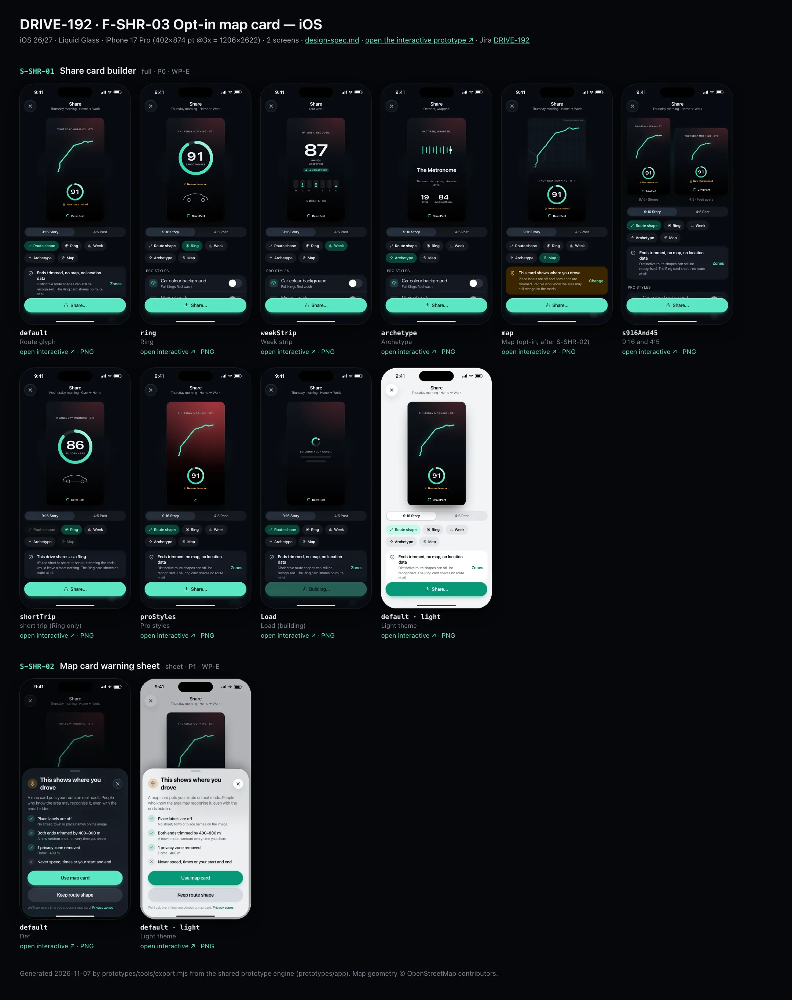
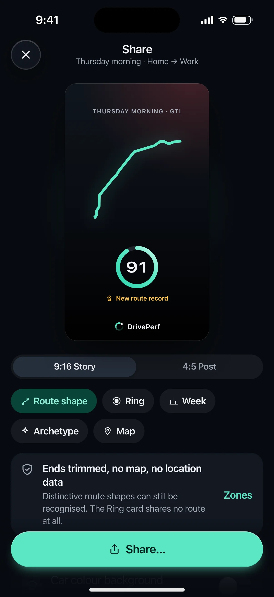
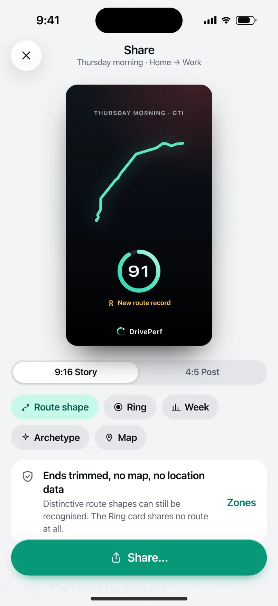
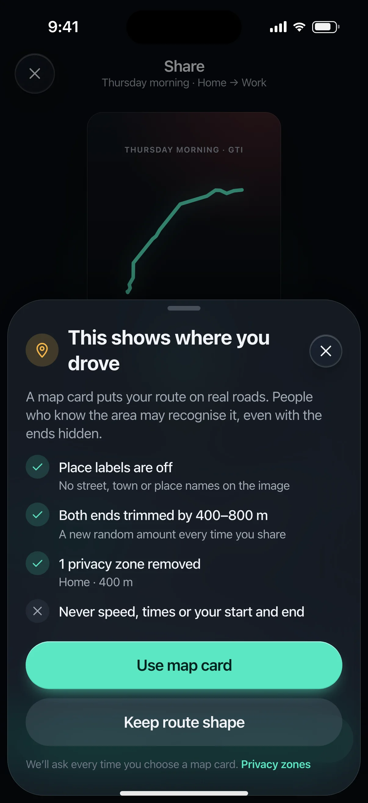
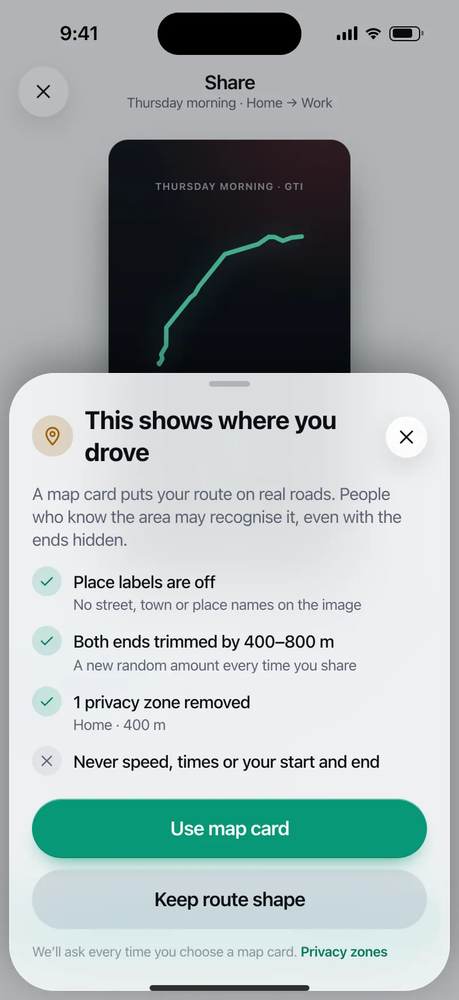

# DRIVE-192 · F-SHR-03 Opt-in map card — iOS design spec

> Generated by `prototypes/tools/export.mjs` on 2026-11-07 from the shared prototype engine. **Do not edit by hand:** change the screen's `spec` in `prototypes/app/screens/wp-*.js` (see `prototypes/app/AUTHORING.md`) and re-export.

- **Jira story:** [DRIVE-192](https://thekeval.atlassian.net/browse/DRIVE-192) · F-SHR-03 · P1
- **Platform:** iOS 26/27 · Liquid Glass · iPhone 17 Pro (402×874 pt @3x = 1206×2622)
- **Interactive prototype:** [../../../../prototypes/ios/index.html#S-SHR-01](../../../../prototypes/ios/index.html#S-SHR-01) (catalog panel: every screen and state; deep links `#S-ID/state?trip=…&ent=…&theme=light&text=xl&rm=1`)
- **Contact sheet:** [mockup.html](mockup.html) · 
- **Design system (source of truth for values):** [brand](../../system/brand.md) · [components](../../system/components.md) · [motion](../../system/motion.md) · [accessibility](../../system/accessibility.md) · [screen map](../../system/screen-map.md) · [fixtures](../../system/fixtures.md) · tokens `prototypes/shared/tokens.css`

## Screens in this story

| Screen | Name | Presentation | Priority | States | Status |
|---|---|---|---|---|---|
| `S-SHR-01` | Share card builder | Full (builder) → system share sheet | P0 | 9 | Prototyped |
| `S-SHR-02` | Map card warning sheet | Sheet (small) | P1 | 1 | Prototyped |

## Tokens used on this platform

Values resolved from `prototypes/shared/tokens.css` inside the iOS device (`[data-platform="ios"]`). Use the token names in code; the hex values are for reference.

| Token | Dark | Light |
|---|---|---|
| `--app-bg` | `#080B10` | `#F2F3F6` |
| `--card-bg` | `#131822` | `#FFFFFF` |
| `--dp-bg-grouped` | `#080B10` | `#F2F3F6` |
| `--dp-surface` | `#131822` | `#FFFFFF` |
| `--dp-surface-2` | `#1B222D` | `#F2F3F6` |
| `--dp-surface-3` | `#262E3B` | `#E4E7EC` |
| `--dp-fill` | `#7880961F` | `#7880961F` |
| `--dp-fill-strong` | `#7880963D` | `#78809633` |
| `--dp-text` | `#F2F4F7` | `#0B0E13` |
| `--dp-text-2` | `#A3AAB6` | `#5A6271` |
| `--dp-text-3` | `#6E7787` | `#8A919D` |
| `--dp-separator` | `#96A0B429` | `#3C435024` |
| `--dp-accent` | `#5BE7C4` | `#079777` |
| `--dp-accent-text` | `#5BE7C4` | `#06775E` |
| `--dp-on-accent` | `#04241D` | `#FFFFFF` |
| `--dp-accent-container` | `#0A4439` | `#C6F8EA` |
| `--dp-record` | `#FFC24B` | `#9A6300` |
| `--dp-positive` | `#5BE7C4` | `#06775E` |
| `--dp-change-down` | `#A3AAB6` | `#5A6271` |
| `--dp-warning` | `#F5B648` | `#9A5F00` |
| `--dp-critical` | `#FF6B6B` | `#C62828` |
| `--dp-glass-fill` | `#1C222C6B` | `#FFFFFF8C` |
| `--dp-glass-fill-strong` | `#1C222CB8` | `#FFFFFFD1` |
| `--dp-glass-stroke` | `#FFFFFF24` | `#FFFFFF99` |
| `--dp-data-route` | `#5BE7C4` | `#079777` |
| `--dp-data-event-brake` | `#FF7A66` | `#A21F16` |
| `--dp-data-event-accel` | `#E58BD0` | `#A33A8C` |
| `--dp-data-event-corner` | `#EAD54E` | `#9A8A00` |
| `--dp-data-quality-good` | `#5FDB9C` | `#1E9E62` |
| `--dp-data-speed` | `#D6DCE4` | `#404A58` |
| `--dp-data-long-g` | `#5AB8F5` | `#0A6AB8` |
| `--dp-data-lat-g` | `#F5A142` | `#B25A00` |

| Type / layout token | Value |
|---|---|
| `--dp-font-screen-title` | `700 34px / 41px -apple-system, BlinkMacSystemFont, "SF Pro Display", system-ui, sans-serif` |
| `--dp-font-sheet-title` | `700 22px / 28px -apple-system, BlinkMacSystemFont, "SF Pro Display", system-ui, sans-serif` |
| `--dp-font-section-title` | `600 20px / 25px -apple-system, BlinkMacSystemFont, "SF Pro Display", system-ui, sans-serif` |
| `--dp-font-card-title` | `600 17px / 22px -apple-system, BlinkMacSystemFont, "SF Pro Text", system-ui, sans-serif` |
| `--dp-font-body` | `400 17px / 22px -apple-system, BlinkMacSystemFont, "SF Pro Text", system-ui, sans-serif` |
| `--dp-font-body-secondary` | `400 15px / 20px -apple-system, BlinkMacSystemFont, "SF Pro Text", system-ui, sans-serif` |
| `--dp-font-meta` | `400 13px / 18px -apple-system, BlinkMacSystemFont, "SF Pro Text", system-ui, sans-serif` |
| `--dp-font-caption` | `400 12px / 16px -apple-system, BlinkMacSystemFont, "SF Pro Text", system-ui, sans-serif` |
| `--dp-font-button` | `600 17px / 22px -apple-system, BlinkMacSystemFont, "SF Pro Text", system-ui, sans-serif` |
| `--dp-num-hero` | `600 72px / 72px -apple-system, BlinkMacSystemFont, "SF Pro Display", system-ui, sans-serif` |
| `--dp-num-xl` | `600 48px / 52px -apple-system, BlinkMacSystemFont, "SF Pro Display", system-ui, sans-serif` |
| `--dp-num-l` | `600 34px / 38px -apple-system, BlinkMacSystemFont, "SF Pro Display", system-ui, sans-serif` |
| `--dp-num-m` | `600 24px / 28px -apple-system, BlinkMacSystemFont, "SF Pro Display", system-ui, sans-serif` |
| `--dp-num-s` | `600 17px / 22px -apple-system, BlinkMacSystemFont, "SF Pro Display", system-ui, sans-serif` |
| `--dp-num-xs` | `600 13px / 16px -apple-system, BlinkMacSystemFont, "SF Pro Display", system-ui, sans-serif` |
| `--dp-screen-margin` | `16px` |
| `--dp-radius-card` | `24px` |
| `--dp-radius-card-hero` | `32px` |
| `--dp-radius-sheet` | `38px` |
| `--dp-radius-chip` | `999px` |
| `--dp-radius-button` | `999px` |
| `--dp-layout-list-row-min` | `52px` |
| `--dp-layout-touch-min` | `44px` |
| `--safe-top` | `62px` |
| `--safe-bottom` | `34px` |

Text sizes scale with `--dp-text-scale` (XL = 2.0×) and numerals with `--dp-num-scale` (XL = 1.3×). DP Numerals: SF Pro Expanded Semibold, tabular.

---

## S-SHR-01 · Share card builder

 

- **Presentation:** full · tab: profile — screen map: “Full (builder) → system share sheet”
- **Entry points:** S-STY-01 f7 · S-TRP-01 · S-RCP-01 W5 · S-WRP-* last frame
- **Leads to:** S-SHR-02 (Map style) · system share sheet · S-SHR-03 (from card footer)
- **PRD features:** F-SHR-01, F-SHR-02, F-SHR-03, F-SHR-04, F-PRV-07, F-NTF-04, F-NTF-05 · **Priority:** P0 · **WP:** E
- **Interactive:** [S-SHR-01](../../../../prototypes/ios/index.html#S-SHR-01)

**Purpose.** Make a beautiful, privacy-safe image of a drive, a week or a month to post anywhere, without exposing where the user lives (F-SHR-01…04, F-PRV-07). The card is generated on the device and shows only the route shape (ends trimmed 400–800 m, privacy zones removed), the Smoothness ring and the car. Never speed, G, duration, times, dates finer than part of day, start/end points or place names.

### States

| State | PRD label | Fixture params | Screenshot |
|---|---|---|---|
| `default` | Route glyph | `trip=t20261105-0742` | [S-SHR-01.png](../../screens/ios/S-SHR-01.webp) · [open](../../../../prototypes/ios/index.html#S-SHR-01) |
| `ring` | Ring | `trip=t20261105-0742` | [S-SHR-01--ring.png](../../screens/ios/S-SHR-01--ring.webp) · [open](../../../../prototypes/ios/index.html#S-SHR-01/ring) |
| `weekStrip` | Week strip | — | [S-SHR-01--weekStrip.png](../../screens/ios/S-SHR-01--weekStrip.webp) · [open](../../../../prototypes/ios/index.html#S-SHR-01/weekStrip) |
| `archetype` | Archetype | — | [S-SHR-01--archetype.png](../../screens/ios/S-SHR-01--archetype.webp) · [open](../../../../prototypes/ios/index.html#S-SHR-01/archetype) |
| `map` | Map (opt-in, after S-SHR-02) | `trip=t20261105-0742` | [S-SHR-01--map.png](../../screens/ios/S-SHR-01--map.webp) · [open](../../../../prototypes/ios/index.html#S-SHR-01/map) |
| `s916And45` | 9:16 and 4:5 | — | [S-SHR-01--s916And45.png](../../screens/ios/S-SHR-01--s916And45.webp) · [open](../../../../prototypes/ios/index.html#S-SHR-01/s916And45) |
| `shortTrip` | short trip (Ring only) | `trip=t20261104-0755` | [S-SHR-01--shortTrip.png](../../screens/ios/S-SHR-01--shortTrip.webp) · [open](../../../../prototypes/ios/index.html#S-SHR-01/shortTrip) |
| `proStyles` | Pro styles | `trip=t20261105-0742` | [S-SHR-01--proStyles.png](../../screens/ios/S-SHR-01--proStyles.webp) · [open](../../../../prototypes/ios/index.html#S-SHR-01/proStyles) |
| `Load` | Load (building) | — | [S-SHR-01--Load.png](../../screens/ios/S-SHR-01--Load.webp) · [open](../../../../prototypes/ios/index.html#S-SHR-01/Load) |
| default · light | Light theme | `theme=light` | [S-SHR-01--light.png](../../screens/ios/S-SHR-01--light.webp) |

Every state also renders in light/dark (`theme=light`), XL text (`text=xl`) and reduced motion (`rm=1`).

### Layout

- Full-screen builder. Top bar: close (X) + “Share” + subtitle (part of day · route label, or “Your week” / “October, wrapped”). iOS inline glass bar; Android full-screen dialog bar (close leading).
- Stage: the card preview scaled to fit, centred on a soft Glide halo (9:16 → 212 × 377 pt; 4:5 → 250 × 313 pt). 9:16 and 4:5 state shows both side by side with captions “9:16 · Stories” / “4:5 · Feed posts”.
- Card art (export 1080 × 1920 / 1080 × 1350, always the dark night theme): night gradient + car-colour wash 12% (Pro “Car colour background”: 30%); kicker “THURSDAY MORNING · GTI”; style body; bottom-centre mark: Loop + “DrivePerf” wordmark (Pro minimal: Loop only, smaller; never none). All card type is fixed to the card size (it is an image, it does not follow Dynamic Type).
- Style bodies: Route shape = trimmed glyph (74% width) + ring 32% + gold rosette “New route record” · Ring = ring 62% + rosette + generic car silhouette (hatch/crossover, no logos) · Week = average Smoothness (DP Numerals), “▲ +2 vs last week”, 7-day dot strip M–S, “5 drives · 171 km” · Archetype = line-study art, “The Metronome”, its line, two stats (drives, avg Smoothness) · Map = label-free stylised basemap (56% height) with the trimmed route, “© OpenStreetMap contributors”, ring 36%.
- Controls under the stage: format segmented control (iOS glass segmented / Android connected button group) “9:16 Story · 4:5 Post”; style chips (filter chips, wrap): Route shape · Ring · Week · Archetype · Map; context banner (privacy note / map warning / short-trip note); “Pro styles” list (Car colour background, Minimal mark: toggles for Pro, PRO + lock for Free); Alt text card with Copy; Ride-along row (→ S-SHR-03).
- Bottom dock (fixed, 16 margins, 12 above the home indicator): large filled “Share…” (iOS ShareLink) / “Share” (Android share intent) button, full width.
- Load: the card shows the Loop loader + “Building your card…” + two skeleton lines; Share is disabled (“Building…”).

### Components & tokens

| Component | Tokens / spec |
|---|---|
| `page` | --dp-bg-grouped (iOS) / --md-sys-color-surface (Android) · --dp-screen-margin 16 |
| `navBar` | --dp-font-card-title · --dp-font-meta · glass: --dp-glass-fill + --dp-glass-blur · components.md §2 |
| `segmented` | see components.md |
| `chip` | --dp-radius-chip (iOS capsule · Android 8) · height 28 · --dp-font-caption |
| `banner` | radius 12 (--dp-radius-sm+) · info --dp-fill · attention --dp-warning-container · critical --dp-critical-container · components.md §22 |
| `list` | iOS inset grouped radius --dp-radius-card, rows 52 pt, separators --dp-separator inset 16 · Android ListItem 56/72 dp in --md-sys-color-surface-container |
| `row` | --dp-font-body · --dp-font-meta (supporting) · --dp-layout-list-row-min |
| `toggle` | iOS 51×31 tint --dp-accent · Android M3 Switch 52×32 --md-sys-color-primary |
| `section` | --dp-font-section-title · --dp-layout-section-gap 28 |
| `ring` | track --dp-fill-strong · arc --dp-gradient-ring (glide-400 → accent → glide-100) · baseline notch --dp-text-2 · record notch --dp-record · Android container Cookie9Sided --md-sys-color-primary-container 42% · components.md §3 |
| `glyph` | see components.md |
| `button` | --dp-accent / --dp-on-accent (filled) · --dp-fill-strong · --md-sys-color-secondary-container (tonal) · --dp-radius-button · height iOS 50/44/34 · Android 56/40/32 · --dp-font-button · components.md §0 |
| `loader` | see components.md |
| `empty` | illustration 120 in --dp-accent · --dp-font-section-title · components.md §21 |

### Interactions & navigation

- Style chip → that style (cross-fade + ±6° tilt, haptic selection). Map chip → S-SHR-02 warning sheet **every time**; “Use map card” there → map state. Banner “Change” on the map state → Route shape.
- Format control → re-lays out the card inside a morphing container (spring.default). On the “9:16 and 4:5” state, choosing a format returns to a single preview.
- Pro styles toggles (Pro/Preview/Ride-along) update the card live. Free: the rows show PRO + lock and open S-SUB-04 (from = share). Not a paywall moment after a worse-than-usual Story: the builder never opens a paywall by itself.
- Alt text card → copies the generated alt text (toast “Alt text copied”).
- Share → system share sheet (iOS ShareLink with the PNG + alt text; Android ACTION_SEND image/png with EXTRA_TEXT alt text). The PNG has no EXIF/XMP/GPS metadata (F-SHR-02.3). Destination is not collected. Prototype: tap the mocked sheet to close (toast).
- Ride-along row → S-SHR-03. Close (X) → back to the source (Story f7, trip detail, recap W5, Wrapped last frame).
- Gate: S-SHR-* is “content” for the D1 gate. During a driver trip the app shows S-DRV-01; while still moving after a trip the request waits on S-DRV-05 (F-SHR-01.4).

### Motion

- Card build (motion.md §3.7, total ≈ 900 ms “shareBuild”): 0 ms surface scales 0.94 → 1 + fade (spring.default) · 90 ms glyph/route draws on (600 ms ease.drawOn) or the ring sweeps · 180 ms kicker, record and car rise 8 px (40 ms stagger) · 270 ms score counts up · 360 ms the mark fades in (spring.effects) · haptic success when ready.
- Controls rise 8 px, 30 ms stagger. Style switch: cross-dissolve + ±6° rotateY; format switch: container aspect morph (spring.default).
- RM: cross-fades only; the card renders complete. Load: the Loop loader spins (static in RM).

### Accessibility

- Card preview is one image with the generated alt text, e.g. “Route shape of a thursday morning drive in my GTI. Smoothness 91. New route record.” (the same text is offered for copy).
- Style chips: “Route shape style, selected” / “Map style, unavailable for this drive”. Format control is a tablist: “9:16 Story, tab, 1 of 2, selected”.
- Focus order: close → title → card → format → styles → note → Pro styles → alt text → Ride-along → Share.
- XL: controls reflow; the card keeps its size (it is an image); chips wrap; the dock button grows in height.
- No meaning by colour: the record uses the rosette + text, deltas on the week card use ▲/▼/● + signed numbers.

### Platform notes

- **iOS (this spec):** Full-screen cover; inline glass top bar; glass segmented control; filter chips as glass-tinted capsules; ShareLink presents the system share sheet with the image preview and alt text; the dock sits on a glass gradient.
- *Android (for reference):* Full-screen dialog (close leading, title in the bar); connected button group for the format; M3 FilterChips with secondaryContainer selection; Sharesheet (ACTION_SEND, image/png, ClipData preview); the dock is a surface bar with the filled button (radius full → morph on press).

### Analytics

- `share_opened {source: story|trip|recap|wrapped}`
- `share_style_selected {style: glyph|ring|week|archetype|map}`
- `share_map_confirmed`
- `share_completed {style, format} (destination not collected)`

### Copy

| Key | Text |
|---|---|
| Title | Share |
| Privacy note | Ends trimmed, no map, no location data. Distinctive route shapes can still be recognised. The Ring card shares no route at all. |
| Map warning | This card shows where you drove. Place labels are off and both ends are trimmed. People who know the area may still recognise the roads. |
| Short trip | This drive shares as a Ring. It’s too short to share its shape: trimming the ends would leave almost nothing. The Ring card shares no route at all. |
| Pro styles | Car colour background · Minimal mark (Just the Loop, smaller. Never no mark.) |
| Alt text | Route shape of a {part of day} drive in my {car}. Smoothness {n}. [New route record.] |
| Load | Building your card… |
| Passenger | Passenger trips aren’t shared. This drive is marked as passenger, so it has no score and no card. |
| Ride-along | Give a friend 30 days of Pro · Send a Ride-along pass with your card |

### Free / Pro

All privacy-safe styles (Route shape, Ring, Week, Archetype, Map) are Free. Pro (and Preview / Ride-along) adds the extra card styles (car-colour background) and the minimal mark. Free users see the Pro rows with PRO + lock → S-SUB-04.

### Data & fixtures

Fixtures: default/ring/map/proStyles t20261105-0742 (GTI, Thursday morning, 91, new route record) · shortTrip t20261104-0755 · week = latest complete recap w2026-10-26 (5 drives, 171 km, 87, +2) · archetype = wrapped.monthly (The Metronome, 19 drives, average 84). Card fields are limited to fixtures.md §8 (glyph, score, record flag, car nickname/colour/silhouette, part of day). Map card trims are deterministic per trip for the prototype (400–800 m, the app re-rolls per share) and the Home privacy zone (400 m) is removed. No fixture trip is under 2 km, so the shortTrip state forces the short-trip rule on the shortest trip (3.6 km) for illustration.

### Assets

[icon-routes.svg](assets/icon-routes.svg) · [icon-record.svg](assets/icon-record.svg) · [icon-insights.svg](assets/icon-insights.svg) · [icon-sparkle.svg](assets/icon-sparkle.svg) · [icon-pin.svg](assets/icon-pin.svg) · [icon-layers.svg](assets/icon-layers.svg) · [icon-share.svg](assets/icon-share.svg) · [icon-shield.svg](assets/icon-shield.svg) · [icon-heart.svg](assets/icon-heart.svg) · [icon-rosette.svg](assets/icon-rosette.svg) · [icon-lock.svg](assets/icon-lock.svg) · [icon-close.svg](assets/icon-close.svg) · [icon-passenger.svg](assets/icon-passenger.svg) · [logo-a-loop.svg](assets/logo-a-loop.svg) · [wordmark.svg](assets/wordmark.svg)

UI glyphs may be swapped for SF Symbols / Material Symbols Rounded equivalents; event-pin, quality and provenance glyphs must not be (components.md global rules).

### Checklist (accessibility.md §9)

- [ ] Light and dark both render, and contrast passes.
- [ ] The XL text state reflows with no truncation.
- [ ] The RM state is defined.
- [ ] Every control has a label; every chart and map has a summary sentence.
- [ ] Every target ≥ 44 pt / 48 dp (≥ 64 in-drive).
- [ ] No meaning by colour alone.
- [ ] Speed is neutral wherever it appears and absent from social or live surfaces.
- [ ] No streak, leaderboard, speed or “beat your time” language.
- [ ] Behaviour is defined while a trip is active (D1 gate).
- [ ] Haptics come from motion.md §6 only.

---

## S-SHR-02 · Map card warning sheet

 

- **Presentation:** sheet · tab: profile · detent: auto — screen map: “Sheet (small)”
- **Entry points:** S-SHR-01 Map style toggle
- **Leads to:** Back
- **PRD features:** F-SHR-03 · **Priority:** P1 · **WP:** E
- **Interactive:** [S-SHR-02](../../../../prototypes/ios/index.html#S-SHR-02)

**Purpose.** An explicit, per-share confirmation before a map card is made (F-SHR-03.1): it explains that a map shows real roads, what is still protected, and has no “don’t ask again”.

### States

| State | PRD label | Fixture params | Screenshot |
|---|---|---|---|
| `default` | Def | — | [S-SHR-02.png](../../screens/ios/S-SHR-02.webp) · [open](../../../../prototypes/ios/index.html#S-SHR-02) |
| default · light | Light theme | `theme=light` | [S-SHR-02--light.png](../../screens/ios/S-SHR-02--light.webp) |

Every state also renders in light/dark (`theme=light`), XL text (`text=xl`) and reduced motion (`rm=1`).

### Layout

- Sheet fitted to content (iOS glass sheet at a partial detent, radius 40, 8 inset · Android ModalBottomSheet, top radius 28, drag handle).
- Header: pin glyph in a warning-tinted 36 circle + title “This shows where you drove” (sheetTitle) + close (iOS only).
- Lead (body-secondary, text-2), then a 4-item checklist: ✓ labels off · ✓ ends trimmed 400–800 m · ✓ privacy zones removed (names + radii) · ✕ never speed, times or start/end.
- Stacked large buttons, equal width: “Use map card” (filled) and “Keep route shape” (tonal). Footnote with a “Privacy zones” link.

### Components & tokens

| Component | Tokens / spec |
|---|---|
| `sheetHeader` | see components.md |
| `button` | --dp-accent / --dp-on-accent (filled) · --dp-fill-strong · --md-sys-color-secondary-container (tonal) · --dp-radius-button · height iOS 50/44/34 · Android 56/40/32 · --dp-font-button · components.md §0 |
| `sheet` | iOS glass --dp-glass-fill-strong + --dp-glass-prominent-blur, radius --dp-radius-sheet 38 · Android ModalBottomSheet --md-sys-color-surface-container-low, top radius 28, drag handle 32×4 · motion spring.sheet |

### Interactions & navigation

- Use map card → dismiss, S-SHR-01 switches to the Map style (haptic confirm, analytics share_map_confirmed).
- Keep route shape / drag down / scrim / X → dismiss, the style stays as it was.
- Privacy zones → S-PRV-02 (with zones).
- Offline (EC-NET): S-SHR-01 disables the Map chip with “Map cards need a connection.”

### Motion

- Sheet rises with spring.sheet; checklist items rise 8 px, 40 ms stagger. RM: fade.

### Accessibility

- Focus moves to the title on open; “Use map card” is the first button. The list reads as “Place labels are off. No street, town or place names on the image.” etc.
- XL: the sheet opens at the large detent; buttons stay full width and grow in height.

### Platform notes

- **iOS (this spec):** Glass sheet, partial detent, X in the header, buttons glassProminent / glass.
- *Android (for reference):* ModalBottomSheet with drag handle (no X), filled + tonal buttons.

### Analytics

- `share_map_confirmed`
- `share_map_declined`

### Copy

| Key | Text |
|---|---|
| Title | This shows where you drove |
| Lead | A map card puts your route on real roads. People who know the area may recognise it, even with the ends hidden. |
| Confirm | Use map card |
| Decline | Keep route shape |
| Footnote | We’ll ask every time you choose a map card. |

### Free / Pro

Free (map cards are a Free style).

### Data & fixtures

Privacy zones from DP_DATA.user.privacyZones (Home · 400 m).

### Assets

[icon-pin.svg](assets/icon-pin.svg) · [icon-check.svg](assets/icon-check.svg) · [icon-close.svg](assets/icon-close.svg)

UI glyphs may be swapped for SF Symbols / Material Symbols Rounded equivalents; event-pin, quality and provenance glyphs must not be (components.md global rules).

### Checklist (accessibility.md §9)

- [ ] Light and dark both render, and contrast passes.
- [ ] The XL text state reflows with no truncation.
- [ ] The RM state is defined.
- [ ] Every control has a label; every chart and map has a summary sentence.
- [ ] Every target ≥ 44 pt / 48 dp (≥ 64 in-drive).
- [ ] No meaning by colour alone.
- [ ] Speed is neutral wherever it appears and absent from social or live surfaces.
- [ ] No streak, leaderboard, speed or “beat your time” language.
- [ ] Behaviour is defined while a trip is active (D1 gate).
- [ ] Haptics come from motion.md §6 only.

---

Map geometry in the prototype: © OpenStreetMap contributors (ODbL). Speed and G are simulated fixtures (fixtures.md).
