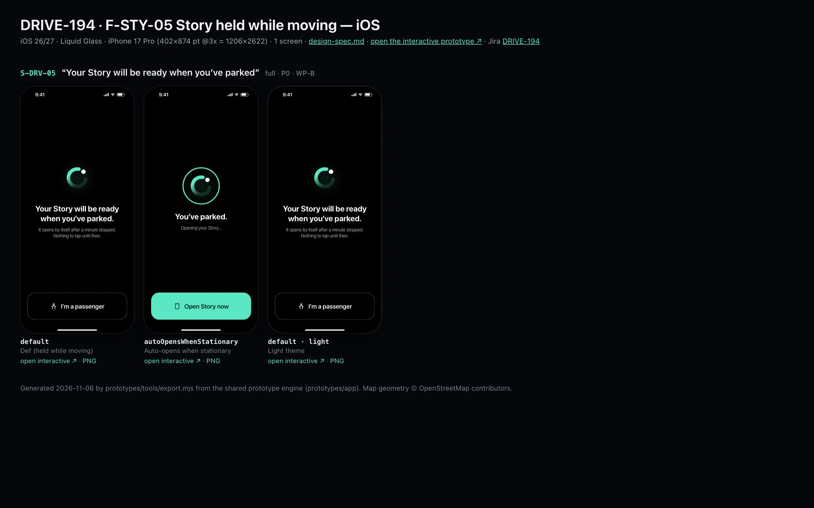
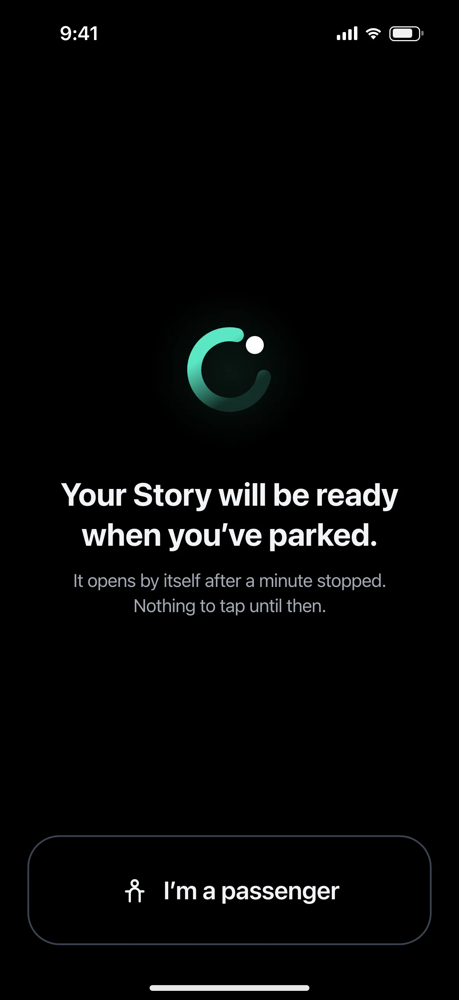
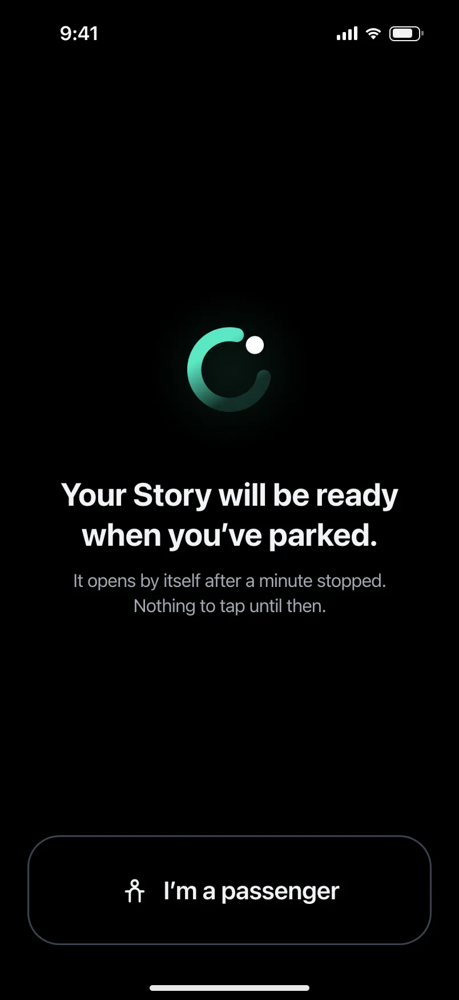

# DRIVE-194 · F-STY-05 Story held while moving — iOS design spec

> Generated by `prototypes/tools/export.mjs` on 2026-11-06 from the shared prototype engine. **Do not edit by hand:** change the screen's `spec` in `prototypes/app/screens/wp-*.js` (see `prototypes/app/AUTHORING.md`) and re-export.

- **Jira story:** [DRIVE-194](https://thekeval.atlassian.net/browse/DRIVE-194) · F-STY-05 · P0
- **Platform:** iOS 26/27 · Liquid Glass · iPhone 17 Pro (402×874 pt @3x = 1206×2622)
- **Interactive prototype:** [../../../../prototypes/ios/index.html#S-DRV-05](../../../../prototypes/ios/index.html#S-DRV-05) (catalog panel: every screen and state; deep links `#S-ID/state?trip=…&ent=…&theme=light&text=xl&rm=1`)
- **Contact sheet:** [mockup.html](mockup.html) · 
- **Design system (source of truth for values):** [brand](../../system/brand.md) · [components](../../system/components.md) · [motion](../../system/motion.md) · [accessibility](../../system/accessibility.md) · [screen map](../../system/screen-map.md) · [fixtures](../../system/fixtures.md) · tokens `prototypes/shared/tokens.css`

## Screens in this story

| Screen | Name | Presentation | Priority | States | Status |
|---|---|---|---|---|---|
| `S-DRV-05` | “Your Story will be ready when you’ve parked” | Full (locked) | P0 | 2 | Prototyped |

## Tokens used on this platform

Values resolved from `prototypes/shared/tokens.css` inside the iOS device (`[data-platform="ios"]`). Use the token names in code; the hex values are for reference.

| Token | Dark | Light |
|---|---|---|
| `--app-bg` | `#080B10` | `#F2F3F6` |
| `--card-bg` | `#131822` | `#FFFFFF` |
| `--dp-bg-grouped` | `#080B10` | `#F2F3F6` |
| `--dp-surface` | `#131822` | `#FFFFFF` |
| `--dp-surface-2` | `#1B222D` | `#F2F3F6` |
| `--dp-surface-3` | `#262E3B` | `#E4E7EC` |
| `--dp-fill` | `#7880961F` | `#7880961F` |
| `--dp-fill-strong` | `#7880963D` | `#78809633` |
| `--dp-text` | `#F2F4F7` | `#0B0E13` |
| `--dp-text-2` | `#A3AAB6` | `#5A6271` |
| `--dp-text-3` | `#6E7787` | `#8A919D` |
| `--dp-separator` | `#96A0B429` | `#3C435024` |
| `--dp-accent` | `#5BE7C4` | `#079777` |
| `--dp-accent-text` | `#5BE7C4` | `#06775E` |
| `--dp-on-accent` | `#04241D` | `#FFFFFF` |
| `--dp-accent-container` | `#0A4439` | `#C6F8EA` |
| `--dp-record` | `#FFC24B` | `#9A6300` |
| `--dp-positive` | `#5BE7C4` | `#06775E` |
| `--dp-change-down` | `#A3AAB6` | `#5A6271` |
| `--dp-warning` | `#F5B648` | `#9A5F00` |
| `--dp-critical` | `#FF6B6B` | `#C62828` |
| `--dp-glass-fill` | `#1C222C6B` | `#FFFFFF8C` |
| `--dp-glass-fill-strong` | `#1C222CB8` | `#FFFFFFD1` |
| `--dp-glass-stroke` | `#FFFFFF24` | `#FFFFFF99` |
| `--dp-data-route` | `#5BE7C4` | `#079777` |
| `--dp-data-event-brake` | `#FF7A66` | `#A21F16` |
| `--dp-data-event-accel` | `#E58BD0` | `#A33A8C` |
| `--dp-data-event-corner` | `#EAD54E` | `#9A8A00` |
| `--dp-data-quality-good` | `#5FDB9C` | `#1E9E62` |
| `--dp-data-speed` | `#D6DCE4` | `#404A58` |
| `--dp-data-long-g` | `#5AB8F5` | `#0A6AB8` |
| `--dp-data-lat-g` | `#F5A142` | `#B25A00` |

| Type / layout token | Value |
|---|---|
| `--dp-font-screen-title` | `700 34px / 41px -apple-system, BlinkMacSystemFont, "SF Pro Display", system-ui, sans-serif` |
| `--dp-font-sheet-title` | `700 22px / 28px -apple-system, BlinkMacSystemFont, "SF Pro Display", system-ui, sans-serif` |
| `--dp-font-section-title` | `600 20px / 25px -apple-system, BlinkMacSystemFont, "SF Pro Display", system-ui, sans-serif` |
| `--dp-font-card-title` | `600 17px / 22px -apple-system, BlinkMacSystemFont, "SF Pro Text", system-ui, sans-serif` |
| `--dp-font-body` | `400 17px / 22px -apple-system, BlinkMacSystemFont, "SF Pro Text", system-ui, sans-serif` |
| `--dp-font-body-secondary` | `400 15px / 20px -apple-system, BlinkMacSystemFont, "SF Pro Text", system-ui, sans-serif` |
| `--dp-font-meta` | `400 13px / 18px -apple-system, BlinkMacSystemFont, "SF Pro Text", system-ui, sans-serif` |
| `--dp-font-caption` | `400 12px / 16px -apple-system, BlinkMacSystemFont, "SF Pro Text", system-ui, sans-serif` |
| `--dp-font-button` | `600 17px / 22px -apple-system, BlinkMacSystemFont, "SF Pro Text", system-ui, sans-serif` |
| `--dp-num-hero` | `600 72px / 72px -apple-system, BlinkMacSystemFont, "SF Pro Display", system-ui, sans-serif` |
| `--dp-num-xl` | `600 48px / 52px -apple-system, BlinkMacSystemFont, "SF Pro Display", system-ui, sans-serif` |
| `--dp-num-l` | `600 34px / 38px -apple-system, BlinkMacSystemFont, "SF Pro Display", system-ui, sans-serif` |
| `--dp-num-m` | `600 24px / 28px -apple-system, BlinkMacSystemFont, "SF Pro Display", system-ui, sans-serif` |
| `--dp-num-s` | `600 17px / 22px -apple-system, BlinkMacSystemFont, "SF Pro Display", system-ui, sans-serif` |
| `--dp-num-xs` | `600 13px / 16px -apple-system, BlinkMacSystemFont, "SF Pro Display", system-ui, sans-serif` |
| `--dp-screen-margin` | `16px` |
| `--dp-radius-card` | `24px` |
| `--dp-radius-card-hero` | `32px` |
| `--dp-radius-sheet` | `38px` |
| `--dp-radius-chip` | `999px` |
| `--dp-radius-button` | `999px` |
| `--dp-layout-list-row-min` | `52px` |
| `--dp-layout-touch-min` | `44px` |
| `--safe-top` | `62px` |
| `--safe-bottom` | `34px` |

Text sizes scale with `--dp-text-scale` (XL = 2.0×) and numerals with `--dp-num-scale` (XL = 1.3×). DP Numerals: SF Pro Expanded Semibold, tabular.

---

## S-DRV-05 · “Your Story will be ready when you’ve parked”

 

- **Presentation:** full — screen map: “Full (locked)”
- **Entry points:** Any Story/Replay/Analysis/share/paywall request while moving or in a driver trip
- **Leads to:** Auto-opens requested content after 60 s stationary · S-DRV-03
- **PRD features:** F-CAP-07, F-STY-05 · **Priority:** P0 · **WP:** B
- **Interactive:** [S-DRV-05](../../../../prototypes/ios/index.html#S-DRV-05)

**Purpose.** What anyone sees when they ask for a Story, Replay, Analysis, recap, Wrapped, share card or paywall while the phone is moving or a driver trip is active (F-CAP-07, F-STY-05, D1/D12). It refuses calmly and opens the content by itself once parked for 60 s.

### States

| State | PRD label | Fixture params | Screenshot |
|---|---|---|---|
| `default` | Def (held while moving) | — | [S-DRV-05.png](../../screens/ios/S-DRV-05.webp) · [open](../../../../prototypes/ios/index.html#S-DRV-05) |
| `autoOpensWhenStationary` | Auto-opens when stationary | — | [S-DRV-05--autoOpensWhenStationary.png](../../screens/ios/S-DRV-05--autoOpensWhenStationary.webp) · [open](../../../../prototypes/ios/index.html#S-DRV-05/autoOpensWhenStationary) |
| default · light | Light theme | `theme=light` | [S-DRV-05--light.png](../../screens/ios/S-DRV-05--light.webp) |

Every state also renders in light/dark (`theme=light`), XL text (`text=xl`) and reduced motion (`rm=1`).

### Layout

- Full-screen cover, #000 on both themes, status bar light, no navigation. Content centred in the free space; bottom button stack like S-DRV-01.
- The Loop mark 96 (static, Glide) above the title “Your Story will be ready when you’ve parked.” (story headline 28/34, #F2F4F7, max 300 wide) and “It opens by itself after a minute stopped. Nothing to tap until then.” (body, #A3AAB6). When something other than a Story was held, the title names it (“Your Replay will be ready when you’ve parked.”); a held paywall or share prompt is never named — it shows the Story copy.
- Bottom: “I’m a passenger” 96 tall, outlined (D14).
- autoOpensWhenStationary: the Loop inside a 140 Glide progress ring that completes, “You’ve parked.” + “Opening your Story…”, and a 96 “Open Story now” filled button for an immediate open.

### Components & tokens

| Component | Tokens / spec |
|---|---|
| `page` | --dp-bg-grouped (iOS) / --md-sys-color-surface (Android) · --dp-screen-margin 16 |
| `drvButton (local)` | see components.md |
| `loop` | see components.md |

### Interactions & navigation

- Reached only via the D1 gate (DP.gate: moving=1 + content target, or any content during a driver trip); the held target waits in DP.session.pending.
- Stationary / not automotive for 60 s → autoOpensWhenStationary → the held target opens automatically (prototype: 9 s simulated, then 2.4 s), with moving cleared. Open … now opens it immediately.
- I’m a passenger → S-DRV-03; “Keep as passenger” unlocks content right away.
- Paywalls (S-SUB-02/03/04) and share prompts held here are dropped, not reopened: S-SUB-02 waits for the next parked foreground open (D12).

### Motion

- Nothing moves while held (in-drive rule). Stationary: the progress ring completes linearly (2.2 s), then the held content opens with its own transition. RM: no ring animation, instant open after the delay.
- Haptic: none on auto-open; tap on “Open now”.

### Accessibility

- Title is the first focus and reads in full. “I’m a passenger” button 96 tall.
- The opening state announces “You’ve parked. Opening your Story.” once (polite).
- XL: title wraps over 3–4 lines; the Loop shrinks to 72 before the text does.

### Platform notes

- **iOS (this spec):** .fullScreenCover with interactive dismiss disabled.
- *Android (for reference):* Full-screen destination; system back is consumed while held.

### Analytics

- `content_blocked_while_moving {target}`
- `held_content_opened {target, by: auto|tap, wait_s}`
- `passenger_marked {when: held}`

### Copy

| Key | Text |
|---|---|
| Title | Your Story will be ready when you’ve parked. / Your {Replay} will be ready when you’ve parked. |
| Line | It opens by itself after a minute stopped. Nothing to tap until then. |
| Opening | You’ve parked. · Opening your Story… · Open Story now |
| Button | I’m a passenger |

### Free / Pro

Same for every plan. A held paywall is never shown afterwards in this session (D12, F-SUB-08).

### Data & fixtures

Default held target when none is pending: S-STY-01 for t20261105-0742 (the newest Story). Reads DP.session.pending / gateReason set by the gate.

### Assets

[icon-passenger.svg](assets/icon-passenger.svg) · [icon-story.svg](assets/icon-story.svg) · [logo-a-loop.svg](assets/logo-a-loop.svg)

UI glyphs may be swapped for SF Symbols / Material Symbols Rounded equivalents; event-pin, quality and provenance glyphs must not be (components.md global rules).

### Checklist (accessibility.md §9)

- [ ] Light and dark both render, and contrast passes.
- [ ] The XL text state reflows with no truncation.
- [ ] The RM state is defined.
- [ ] Every control has a label; every chart and map has a summary sentence.
- [ ] Every target ≥ 44 pt / 48 dp (≥ 64 in-drive).
- [ ] No meaning by colour alone.
- [ ] Speed is neutral wherever it appears and absent from social or live surfaces.
- [ ] No streak, leaderboard, speed or “beat your time” language.
- [ ] Behaviour is defined while a trip is active (D1 gate).
- [ ] Haptics come from motion.md §6 only.

---

Map geometry in the prototype: © OpenStreetMap contributors (ODbL). Speed and G are simulated fixtures (fixtures.md).
