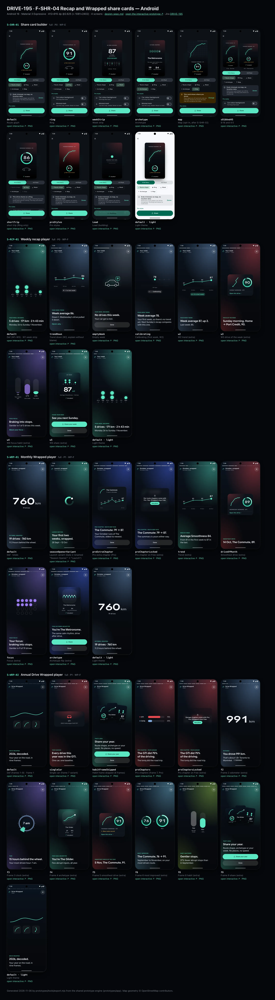
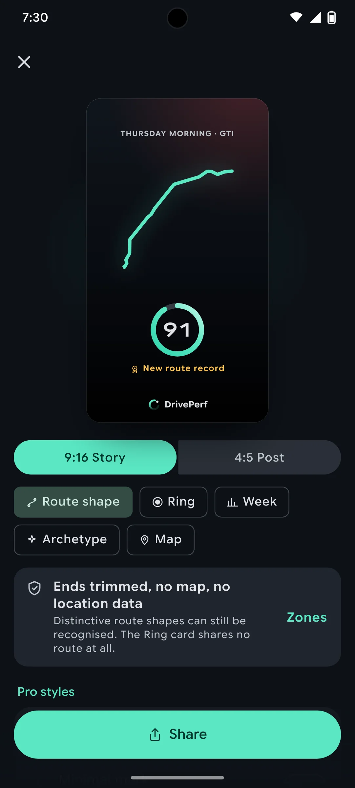
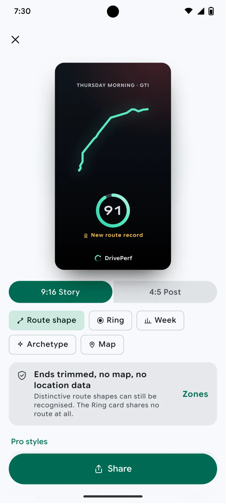
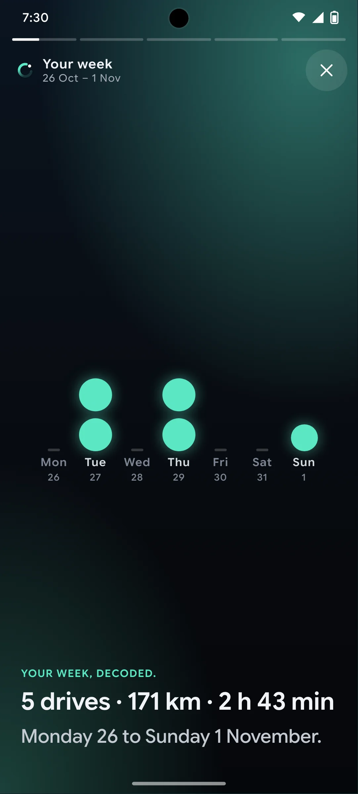
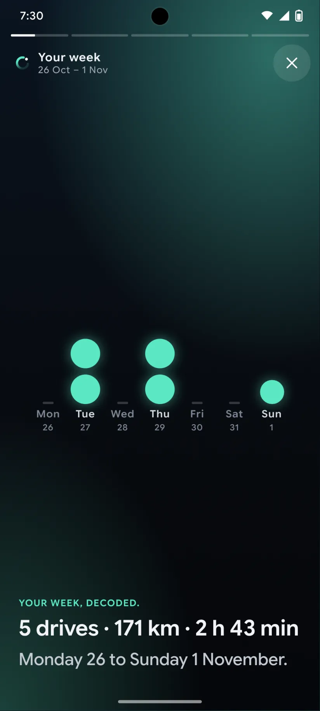
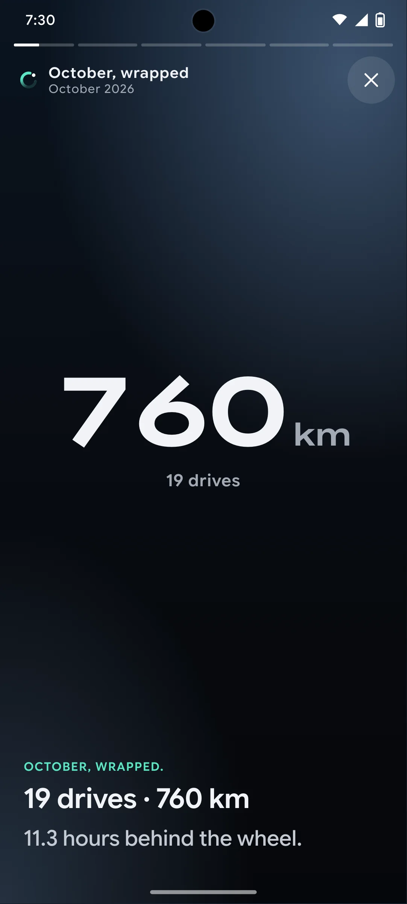
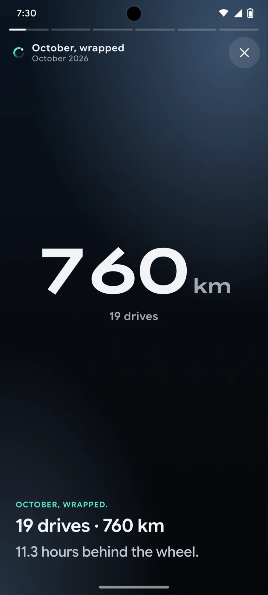
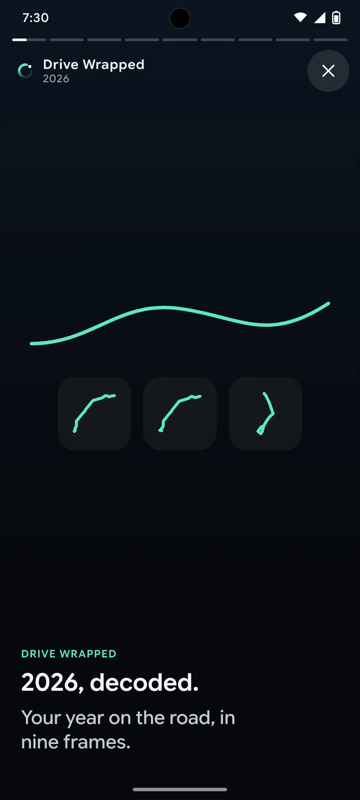
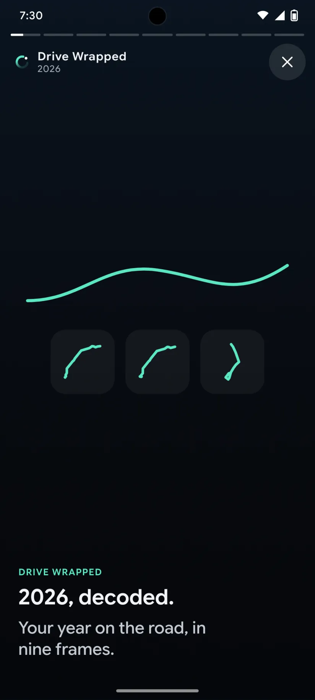

# DRIVE-195 · F-SHR-04 Recap and Wrapped share cards — Android design spec

> Generated by `prototypes/tools/export.mjs` on 2026-11-06 from the shared prototype engine. **Do not edit by hand:** change the screen's `spec` in `prototypes/app/screens/wp-*.js` (see `prototypes/app/AUTHORING.md`) and re-export.

- **Jira story:** [DRIVE-195](https://thekeval.atlassian.net/browse/DRIVE-195) · F-SHR-04 · P1
- **Platform:** Android 16 · Material 3 Expressive · 412×915 dp @2.625 (≈ 1081×2402)
- **Interactive prototype:** [../../../../prototypes/android/index.html#S-SHR-01](../../../../prototypes/android/index.html#S-SHR-01) (catalog panel: every screen and state; deep links `#S-ID/state?trip=…&ent=…&theme=light&text=xl&rm=1`)
- **Contact sheet:** [mockup.html](mockup.html) · 
- **Design system (source of truth for values):** [brand](../../system/brand.md) · [components](../../system/components.md) · [motion](../../system/motion.md) · [accessibility](../../system/accessibility.md) · [screen map](../../system/screen-map.md) · [fixtures](../../system/fixtures.md) · tokens `prototypes/shared/tokens.css`

## Screens in this story

| Screen | Name | Presentation | Priority | States | Status |
|---|---|---|---|---|---|
| `S-SHR-01` | Share card builder | Full (builder) → system share sheet | P0 | 9 | Prototyped |
| `S-RCP-01` | Weekly recap player | Full (player) | P0 | 8 | Prototyped |
| `S-WRP-01` | Monthly Wrapped player | Full (player) | P1 | 8 | Prototyped |
| `S-WRP-02` | Annual Drive Wrapped player | Full (player) | P1 | 12 | Prototyped |

## Tokens used on this platform

Values resolved from `prototypes/shared/tokens.css` inside the Android device (`[data-platform="android"]`). Use the token names in code; the hex values are for reference.

| Token | Dark | Light |
|---|---|---|
| `--app-bg` | `#0D1117` | `#F7F9FC` |
| `--card-bg` | `#191E25` | `#EBEEF2` |
| `--dp-bg-grouped` | `#0D1117` | `#F7F9FC` |
| `--dp-surface` | `#191E25` | `#EBEEF2` |
| `--dp-surface-2` | `#1F252D` | `#E5E8EC` |
| `--dp-surface-3` | `#2A3038` | `#DFE2E6` |
| `--dp-fill` | `#2A3038` | `#DFE2E6` |
| `--dp-fill-strong` | `#353B44` | `#D3D7DC` |
| `--dp-text` | `#E1E3E8` | `#181C20` |
| `--dp-text-2` | `#C0C7CF` | `#40474F` |
| `--dp-text-3` | `#8A929B` | `#707881` |
| `--dp-separator` | `#40474F` | `#C0C7CF` |
| `--dp-accent` | `#5BE7C4` | `#006B53` |
| `--dp-accent-text` | `#5BE7C4` | `#006B53` |
| `--dp-on-accent` | `#00382B` | `#FFFFFF` |
| `--dp-accent-container` | `#00513F` | `#91F1D8` |
| `--dp-record` | `#FFC24B` | `#7A5900` |
| `--dp-positive` | `#5BE7C4` | `#006B53` |
| `--dp-change-down` | `#C0C7CF` | `#40474F` |
| `--dp-warning` | `#F5B648` | `#7A5900` |
| `--dp-critical` | `#FFB4AB` | `#BA1A1A` |
| `--dp-glass-fill` | `#1F252DF2` | `#E5E8ECF2` |
| `--dp-glass-fill-strong` | `#2A3038` | `#DFE2E6` |
| `--dp-glass-stroke` | `#FFFFFF0F` | `#0000000A` |
| `--md-sys-color-primary` | `#5BE7C4` | `#006B53` |
| `--md-sys-color-on-primary` | `#00382B` | `#FFFFFF` |
| `--md-sys-color-primary-container` | `#00513F` | `#91F1D8` |
| `--md-sys-color-on-primary-container` | `#91F1D8` | `#002118` |
| `--md-sys-color-secondary-container` | `#344C44` | `#CEE9DF` |
| `--md-sys-color-surface` | `#0D1117` | `#F7F9FC` |
| `--md-sys-color-surface-container` | `#191E25` | `#EBEEF2` |
| `--md-sys-color-surface-container-high` | `#1F252D` | `#E5E8EC` |
| `--md-sys-color-on-surface-variant` | `#C0C7CF` | `#40474F` |
| `--dp-data-route` | `#5BE7C4` | `#079777` |
| `--dp-data-event-brake` | `#FF7A66` | `#A21F16` |
| `--dp-data-event-accel` | `#E58BD0` | `#A33A8C` |
| `--dp-data-event-corner` | `#EAD54E` | `#9A8A00` |
| `--dp-data-quality-good` | `#5FDB9C` | `#1E9E62` |
| `--dp-data-speed` | `#D6DCE4` | `#404A58` |
| `--dp-data-long-g` | `#5AB8F5` | `#0A6AB8` |
| `--dp-data-lat-g` | `#F5A142` | `#B25A00` |

| Type / layout token | Value |
|---|---|
| `--dp-font-screen-title` | `600 32px / 40px "Google Sans Flex", "Google Sans Display", "Roboto Flex", Roboto, system-ui, sans-serif` |
| `--dp-font-sheet-title` | `400 24px / 32px "Google Sans Flex", "Google Sans Display", "Roboto Flex", Roboto, system-ui, sans-serif` |
| `--dp-font-section-title` | `600 22px / 28px "Google Sans Flex", "Google Sans Display", "Roboto Flex", Roboto, system-ui, sans-serif` |
| `--dp-font-card-title` | `700 16px / 24px "Google Sans Flex", "Google Sans Text", "Roboto Flex", Roboto, system-ui, sans-serif` |
| `--dp-font-body` | `400 16px / 24px "Google Sans Flex", "Google Sans Text", "Roboto Flex", Roboto, system-ui, sans-serif` |
| `--dp-font-body-secondary` | `400 14px / 20px "Google Sans Flex", "Google Sans Text", "Roboto Flex", Roboto, system-ui, sans-serif` |
| `--dp-font-meta` | `400 12px / 16px "Google Sans Flex", "Google Sans Text", "Roboto Flex", Roboto, system-ui, sans-serif` |
| `--dp-font-caption` | `500 12px / 16px "Google Sans Flex", "Google Sans Text", "Roboto Flex", Roboto, system-ui, sans-serif` |
| `--dp-font-button` | `700 14px / 20px "Google Sans Flex", "Google Sans Text", "Roboto Flex", Roboto, system-ui, sans-serif` |
| `--dp-num-hero` | `600 72px / 72px "Google Sans Flex", "Roboto Flex", Roboto, system-ui, sans-serif` |
| `--dp-num-xl` | `600 48px / 52px "Google Sans Flex", "Roboto Flex", Roboto, system-ui, sans-serif` |
| `--dp-num-l` | `600 34px / 38px "Google Sans Flex", "Roboto Flex", Roboto, system-ui, sans-serif` |
| `--dp-num-m` | `600 24px / 28px "Google Sans Flex", "Roboto Flex", Roboto, system-ui, sans-serif` |
| `--dp-num-s` | `600 17px / 22px "Google Sans Flex", "Roboto Flex", Roboto, system-ui, sans-serif` |
| `--dp-num-xs` | `600 13px / 16px "Google Sans Flex", "Roboto Flex", Roboto, system-ui, sans-serif` |
| `--dp-screen-margin` | `16px` |
| `--dp-radius-card` | `16px` |
| `--dp-radius-card-hero` | `28px` |
| `--dp-radius-sheet` | `28px` |
| `--dp-radius-chip` | `8px` |
| `--dp-radius-button` | `999px` |
| `--dp-layout-list-row-min` | `56px` |
| `--dp-layout-touch-min` | `48px` |
| `--safe-top` | `40px` |
| `--safe-bottom` | `24px` |

Text sizes scale with `--dp-text-scale` (XL = 2.0×) and numerals with `--dp-num-scale` (XL = 1.3×). DP Numerals: Google Sans Flex wdth 120 wght 600, tabular.

---

## S-SHR-01 · Share card builder

 

- **Presentation:** full · tab: profile — screen map: “Full (builder) → system share sheet”
- **Entry points:** S-STY-01 f7 · S-TRP-01 · S-RCP-01 W5 · S-WRP-* last frame
- **Leads to:** S-SHR-02 (Map style) · system share sheet · S-SHR-03 (from card footer)
- **PRD features:** F-SHR-01, F-SHR-02, F-SHR-03, F-SHR-04, F-PRV-07, F-NTF-04, F-NTF-05 · **Priority:** P0 · **WP:** E
- **Interactive:** [S-SHR-01](../../../../prototypes/android/index.html#S-SHR-01)

**Purpose.** Make a beautiful, privacy-safe image of a drive, a week or a month to post anywhere, without exposing where the user lives (F-SHR-01…04, F-PRV-07). The card is generated on the device and shows only the route shape (ends trimmed 400–800 m, privacy zones removed), the Smoothness ring and the car. Never speed, G, duration, times, dates finer than part of day, start/end points or place names.

### States

| State | PRD label | Fixture params | Screenshot |
|---|---|---|---|
| `default` | Route glyph | `trip=t20261105-0742` | [S-SHR-01.png](../../screens/android/S-SHR-01.webp) · [open](../../../../prototypes/android/index.html#S-SHR-01) |
| `ring` | Ring | `trip=t20261105-0742` | [S-SHR-01--ring.png](../../screens/android/S-SHR-01--ring.webp) · [open](../../../../prototypes/android/index.html#S-SHR-01/ring) |
| `weekStrip` | Week strip | — | [S-SHR-01--weekStrip.png](../../screens/android/S-SHR-01--weekStrip.webp) · [open](../../../../prototypes/android/index.html#S-SHR-01/weekStrip) |
| `archetype` | Archetype | — | [S-SHR-01--archetype.png](../../screens/android/S-SHR-01--archetype.webp) · [open](../../../../prototypes/android/index.html#S-SHR-01/archetype) |
| `map` | Map (opt-in, after S-SHR-02) | `trip=t20261105-0742` | [S-SHR-01--map.png](../../screens/android/S-SHR-01--map.webp) · [open](../../../../prototypes/android/index.html#S-SHR-01/map) |
| `s916And45` | 9:16 and 4:5 | — | [S-SHR-01--s916And45.png](../../screens/android/S-SHR-01--s916And45.webp) · [open](../../../../prototypes/android/index.html#S-SHR-01/s916And45) |
| `shortTrip` | short trip (Ring only) | `trip=t20261104-0755` | [S-SHR-01--shortTrip.png](../../screens/android/S-SHR-01--shortTrip.webp) · [open](../../../../prototypes/android/index.html#S-SHR-01/shortTrip) |
| `proStyles` | Pro styles | `trip=t20261105-0742` | [S-SHR-01--proStyles.png](../../screens/android/S-SHR-01--proStyles.webp) · [open](../../../../prototypes/android/index.html#S-SHR-01/proStyles) |
| `Load` | Load (building) | — | [S-SHR-01--Load.png](../../screens/android/S-SHR-01--Load.webp) · [open](../../../../prototypes/android/index.html#S-SHR-01/Load) |
| default · light | Light theme | `theme=light` | [S-SHR-01--light.png](../../screens/android/S-SHR-01--light.webp) |

Every state also renders in light/dark (`theme=light`), XL text (`text=xl`) and reduced motion (`rm=1`).

### Layout

- Full-screen builder. Top bar: close (X) + “Share” + subtitle (part of day · route label, or “Your week” / “October, wrapped”). iOS inline glass bar; Android full-screen dialog bar (close leading).
- Stage: the card preview scaled to fit, centred on a soft Glide halo (9:16 → 212 × 377 pt; 4:5 → 250 × 313 pt). 9:16 and 4:5 state shows both side by side with captions “9:16 · Stories” / “4:5 · Feed posts”.
- Card art (export 1080 × 1920 / 1080 × 1350, always the dark night theme): night gradient + car-colour wash 12% (Pro “Car colour background”: 30%); kicker “THURSDAY MORNING · GTI”; style body; bottom-centre mark: Loop + “DrivePerf” wordmark (Pro minimal: Loop only, smaller; never none). All card type is fixed to the card size (it is an image, it does not follow Dynamic Type).
- Style bodies: Route shape = trimmed glyph (74% width) + ring 32% + gold rosette “New route record” · Ring = ring 62% + rosette + generic car silhouette (hatch/crossover, no logos) · Week = average Smoothness (DP Numerals), “▲ +2 vs last week”, 7-day dot strip M–S, “5 drives · 171 km” · Archetype = line-study art, “The Metronome”, its line, two stats (drives, avg Smoothness) · Map = label-free stylised basemap (56% height) with the trimmed route, “© OpenStreetMap contributors”, ring 36%.
- Controls under the stage: format segmented control (iOS glass segmented / Android connected button group) “9:16 Story · 4:5 Post”; style chips (filter chips, wrap): Route shape · Ring · Week · Archetype · Map; context banner (privacy note / map warning / short-trip note); “Pro styles” list (Car colour background, Minimal mark: toggles for Pro, PRO + lock for Free); Alt text card with Copy; Ride-along row (→ S-SHR-03).
- Bottom dock (fixed, 16 margins, 12 above the home indicator): large filled “Share…” (iOS ShareLink) / “Share” (Android share intent) button, full width.
- Load: the card shows the Loop loader + “Building your card…” + two skeleton lines; Share is disabled (“Building…”).

### Components & tokens

| Component | Tokens / spec |
|---|---|
| `page` | --dp-bg-grouped (iOS) / --md-sys-color-surface (Android) · --dp-screen-margin 16 |
| `navBar` | --dp-font-card-title · --dp-font-meta · glass: --dp-glass-fill + --dp-glass-blur · components.md §2 |
| `segmented` | see components.md |
| `chip` | --dp-radius-chip (iOS capsule · Android 8) · height 28 · --dp-font-caption |
| `banner` | radius 12 (--dp-radius-sm+) · info --dp-fill · attention --dp-warning-container · critical --dp-critical-container · components.md §22 |
| `list` | iOS inset grouped radius --dp-radius-card, rows 52 pt, separators --dp-separator inset 16 · Android ListItem 56/72 dp in --md-sys-color-surface-container |
| `row` | --dp-font-body · --dp-font-meta (supporting) · --dp-layout-list-row-min |
| `toggle` | iOS 51×31 tint --dp-accent · Android M3 Switch 52×32 --md-sys-color-primary |
| `section` | --dp-font-section-title · --dp-layout-section-gap 28 |
| `ring` | track --dp-fill-strong · arc --dp-gradient-ring (glide-400 → accent → glide-100) · baseline notch --dp-text-2 · record notch --dp-record · Android container Cookie9Sided --md-sys-color-primary-container 42% · components.md §3 |
| `glyph` | see components.md |
| `button` | --dp-accent / --dp-on-accent (filled) · --dp-fill-strong · --md-sys-color-secondary-container (tonal) · --dp-radius-button · height iOS 50/44/34 · Android 56/40/32 · --dp-font-button · components.md §0 |
| `loader` | see components.md |
| `empty` | illustration 120 in --dp-accent · --dp-font-section-title · components.md §21 |

### Interactions & navigation

- Style chip → that style (cross-fade + ±6° tilt, haptic selection). Map chip → S-SHR-02 warning sheet **every time**; “Use map card” there → map state. Banner “Change” on the map state → Route shape.
- Format control → re-lays out the card inside a morphing container (spring.default). On the “9:16 and 4:5” state, choosing a format returns to a single preview.
- Pro styles toggles (Pro/Preview/Ride-along) update the card live. Free: the rows show PRO + lock and open S-SUB-04 (from = share). Not a paywall moment after a worse-than-usual Story: the builder never opens a paywall by itself.
- Alt text card → copies the generated alt text (toast “Alt text copied”).
- Share → system share sheet (iOS ShareLink with the PNG + alt text; Android ACTION_SEND image/png with EXTRA_TEXT alt text). The PNG has no EXIF/XMP/GPS metadata (F-SHR-02.3). Destination is not collected. Prototype: tap the mocked sheet to close (toast).
- Ride-along row → S-SHR-03. Close (X) → back to the source (Story f7, trip detail, recap W5, Wrapped last frame).
- Gate: S-SHR-* is “content” for the D1 gate. During a driver trip the app shows S-DRV-01; while still moving after a trip the request waits on S-DRV-05 (F-SHR-01.4).

### Motion

- Card build (motion.md §3.7, total ≈ 900 ms “shareBuild”): 0 ms surface scales 0.94 → 1 + fade (spring.default) · 90 ms glyph/route draws on (600 ms ease.drawOn) or the ring sweeps · 180 ms kicker, record and car rise 8 px (40 ms stagger) · 270 ms score counts up · 360 ms the mark fades in (spring.effects) · haptic success when ready.
- Controls rise 8 px, 30 ms stagger. Style switch: cross-dissolve + ±6° rotateY; format switch: container aspect morph (spring.default).
- RM: cross-fades only; the card renders complete. Load: the Loop loader spins (static in RM).

### Accessibility

- Card preview is one image with the generated alt text, e.g. “Route shape of a thursday morning drive in my GTI. Smoothness 91. New route record.” (the same text is offered for copy).
- Style chips: “Route shape style, selected” / “Map style, unavailable for this drive”. Format control is a tablist: “9:16 Story, tab, 1 of 2, selected”.
- Focus order: close → title → card → format → styles → note → Pro styles → alt text → Ride-along → Share.
- XL: controls reflow; the card keeps its size (it is an image); chips wrap; the dock button grows in height.
- No meaning by colour: the record uses the rosette + text, deltas on the week card use ▲/▼/● + signed numbers.

### Platform notes

- **Android (this spec):** Full-screen dialog (close leading, title in the bar); connected button group for the format; M3 FilterChips with secondaryContainer selection; Sharesheet (ACTION_SEND, image/png, ClipData preview); the dock is a surface bar with the filled button (radius full → morph on press).
- *iOS (for reference):* Full-screen cover; inline glass top bar; glass segmented control; filter chips as glass-tinted capsules; ShareLink presents the system share sheet with the image preview and alt text; the dock sits on a glass gradient.

### Analytics

- `share_opened {source: story|trip|recap|wrapped}`
- `share_style_selected {style: glyph|ring|week|archetype|map}`
- `share_map_confirmed`
- `share_completed {style, format} (destination not collected)`

### Copy

| Key | Text |
|---|---|
| Title | Share |
| Privacy note | Ends trimmed, no map, no location data. Distinctive route shapes can still be recognised. The Ring card shares no route at all. |
| Map warning | This card shows where you drove. Place labels are off and both ends are trimmed. People who know the area may still recognise the roads. |
| Short trip | This drive shares as a Ring. It’s too short to share its shape: trimming the ends would leave almost nothing. The Ring card shares no route at all. |
| Pro styles | Car colour background · Minimal mark (Just the Loop, smaller. Never no mark.) |
| Alt text | Route shape of a {part of day} drive in my {car}. Smoothness {n}. [New route record.] |
| Load | Building your card… |
| Passenger | Passenger trips aren’t shared. This drive is marked as passenger, so it has no score and no card. |
| Ride-along | Give a friend 30 days of Pro · Send a Ride-along pass with your card |

### Free / Pro

All privacy-safe styles (Route shape, Ring, Week, Archetype, Map) are Free. Pro (and Preview / Ride-along) adds the extra card styles (car-colour background) and the minimal mark. Free users see the Pro rows with PRO + lock → S-SUB-04.

### Data & fixtures

Fixtures: default/ring/map/proStyles t20261105-0742 (GTI, Thursday morning, 91, new route record) · shortTrip t20261104-0755 · week = latest complete recap w2026-10-26 (5 drives, 171 km, 87, +2) · archetype = wrapped.monthly (The Metronome, 19 drives, average 84). Card fields are limited to fixtures.md §8 (glyph, score, record flag, car nickname/colour/silhouette, part of day). Map card trims are deterministic per trip for the prototype (400–800 m, the app re-rolls per share) and the Home privacy zone (400 m) is removed. No fixture trip is under 2 km, so the shortTrip state forces the short-trip rule on the shortest trip (3.6 km) for illustration.

### Assets

[icon-routes.svg](assets/icon-routes.svg) · [icon-record.svg](assets/icon-record.svg) · [icon-insights.svg](assets/icon-insights.svg) · [icon-sparkle.svg](assets/icon-sparkle.svg) · [icon-pin.svg](assets/icon-pin.svg) · [icon-layers.svg](assets/icon-layers.svg) · [icon-share.svg](assets/icon-share.svg) · [icon-shield.svg](assets/icon-shield.svg) · [icon-heart.svg](assets/icon-heart.svg) · [icon-rosette.svg](assets/icon-rosette.svg) · [icon-lock.svg](assets/icon-lock.svg) · [icon-close.svg](assets/icon-close.svg) · [icon-passenger.svg](assets/icon-passenger.svg) · [logo-a-loop.svg](assets/logo-a-loop.svg) · [wordmark.svg](assets/wordmark.svg)

UI glyphs may be swapped for SF Symbols / Material Symbols Rounded equivalents; event-pin, quality and provenance glyphs must not be (components.md global rules).

### Checklist (accessibility.md §9)

- [ ] Light and dark both render, and contrast passes.
- [ ] The XL text state reflows with no truncation.
- [ ] The RM state is defined.
- [ ] Every control has a label; every chart and map has a summary sentence.
- [ ] Every target ≥ 44 pt / 48 dp (≥ 64 in-drive).
- [ ] No meaning by colour alone.
- [ ] Speed is neutral wherever it appears and absent from social or live surfaces.
- [ ] No streak, leaderboard, speed or “beat your time” language.
- [ ] Behaviour is defined while a trip is active (D1 gate).
- [ ] Haptics come from motion.md §6 only.

---

## S-RCP-01 · Weekly recap player

 

- **Presentation:** full · tab: insights — screen map: “Full (player)”
- **Entry points:** Weekly recap notification · S-STA-01 card
- **Leads to:** S-SHR-01 (W5) · S-TRP-01 (drive of week) · S-SCO-05
- **PRD features:** F-NTF-03, F-SCO-10, F-SHR-04, F-STY-06 · **Priority:** P0 · **WP:** F
- **Interactive:** [S-RCP-01](../../../../prototypes/android/index.html#S-RCP-01)

**Purpose.** A short weekly recap every Sunday at 18:00 (≈ 20 s): week strip, 4-week trend, drive of the week, one focus habit and a share card, generated on the device (F-NTF-03, F-SCO-10, F-SHR-04, A2 §3.3).

### States

| State | PRD label | Fixture params | Screenshot |
|---|---|---|---|
| `default` | Def (W1–W5) · W1 week strip | — | [S-RCP-01.png](../../screens/android/S-RCP-01.webp) · [open](../../../../prototypes/android/index.html#S-RCP-01) |
| `trendDown` | Trend down (W2, explain without blame) | — | [S-RCP-01--trendDown.png](../../screens/android/S-RCP-01--trendDown.webp) · [open](../../../../prototypes/android/index.html#S-RCP-01/trendDown) |
| `emptyWeek` | Empty week | — | [S-RCP-01--emptyWeek.png](../../screens/android/S-RCP-01--emptyWeek.webp) · [open](../../../../prototypes/android/index.html#S-RCP-01/emptyWeek) |
| `calibrating` | Calibrating (first week, W2) | — | [S-RCP-01--calibrating.png](../../screens/android/S-RCP-01--calibrating.webp) · [open](../../../../prototypes/android/index.html#S-RCP-01/calibrating) |
| `w2` | W2 trend (extra) | — | [S-RCP-01--w2.png](../../screens/android/S-RCP-01--w2.webp) · [open](../../../../prototypes/android/index.html#S-RCP-01/w2) |
| `w3` | W3 drive of the week (extra) | — | [S-RCP-01--w3.png](../../screens/android/S-RCP-01--w3.webp) · [open](../../../../prototypes/android/index.html#S-RCP-01/w3) |
| `w4` | W4 focus habit (extra) | — | [S-RCP-01--w4.png](../../screens/android/S-RCP-01--w4.webp) · [open](../../../../prototypes/android/index.html#S-RCP-01/w4) |
| `w5` | W5 share (extra) | — | [S-RCP-01--w5.png](../../screens/android/S-RCP-01--w5.webp) · [open](../../../../prototypes/android/index.html#S-RCP-01/w5) |
| default · light | Light theme | `theme=light` | [S-RCP-01--light.png](../../screens/android/S-RCP-01--light.webp) |

Every state also renders in light/dark (`theme=light`), XL text (`text=xl`) and reduced motion (`rm=1`).

### Layout

- Full-screen player, always night (gradient night sky + a 30–40% wash per frame: Glide W1/W5, Lucid W2, the car colour W3, Violet W4). Status bar light.
- Top: segment progress (3 px bars, 4 gap, one per frame; done = white 90%, current fills linearly) · header row: Loop + “Your week” + range (“26 Oct – 1 Nov”) · close (glass circle iOS / icon button Android).
- Stage: hero art centred in the upper 55%, copy block bottom-left (kicker caption caps · storyHeadline 28/34 · storyBody 20/25, max 3 + 2 lines; XL: copy grows upward, art shrinks to 40%).
- W1: 7 day columns (Mon–Sun + date), one Glide dot per drive sized by distance; empty days show a dashed stub. Copy: “5 drives · 171.2 km · 2 h 43 min”.
- W2: 4-week line with values, this week’s point larger and Glide; delta capsule (▲ +2 vs last week · ▼ −1 neutral · ● Level · calibrating dots). Down: “Week average 86.” + “Down 1. Wednesday’s drive pulled it down.” + “Here’s why ›” → that drive.
- W3: drive card (share-safe glyph, ring, part of day · car, “Open this drive ›”) that flips in. Copy: “Sunday morning, Home → Port Credit, 90.”
- W4 (≥ 5 scorable drives only): 3-week meter (bars + %), “Your focus: braking into stops.” + “Gentler in 1 of 5 drives this week.” + “About your focus ›” → S-SCO-05. No streak language.
- W5: week share card (4:5, night): “My week”, mini strip, average + ▲/▼ delta, “Average Smoothness · 5 drives”, Loop mark. Buttons: Share your week (filled) → S-SHR-01/weekStrip · Done (glass).
- Empty week: parked-car line art, “No drives this week. Your car got a rest.”, Done. No notification is sent for an empty week.

### Components & tokens

| Component | Tokens / spec |
|---|---|
| `iconButton` | see components.md |
| `button` | --dp-accent / --dp-on-accent (filled) · --dp-fill-strong · --md-sys-color-secondary-container (tonal) · --dp-radius-button · height iOS 50/44/34 · Android 56/40/32 · --dp-font-button · components.md §0 |
| `ring` | track --dp-fill-strong · arc --dp-gradient-ring (glide-400 → accent → glide-100) · baseline notch --dp-text-2 · record notch --dp-record · Android container Cookie9Sided --md-sys-color-primary-container 42% · components.md §3 |
| `glyph` | see components.md |
| `num` | see components.md |

### Interactions & navigation

- Tap right two-thirds = next, left third = previous, press and hold = pause, arrow keys on hardware keyboards; close / Done = dismiss (back to S-STA-01 or the notification origin). Swipe down to exit natively (interactive scale 0.9 + corner radius; gestureEnd haptic).
- Auto-advance every 4.2 s; stops on the last frame; pauses on hold and whenever VoiceOver/TalkBack focuses the frame (F-STY-06.1).
- “Here’s why ›” → S-TRP-01 (the lowest-scoring drive on the named day). Drive card → S-TRP-01. “About your focus ›” → S-SCO-05. Share → S-SHR-01/weekStrip (recap param).
- D1 gate: opened from the notification while moving → S-DRV-05, which opens the recap once parked.

### Motion

- Frame change (motion.md §3.8): wash morphs (spring.effects), art rises 12 px (spring.slow), copy lines rise 12 px with a 60 ms stagger (spring.default).
- W1 dots land day by day (drop 28 px + scale, spring.bouncy, 110 ms per day). W2 line redraws (900 ms ease.drawOn) and this week’s point drops in last (spring.bouncy). W3 card flips in (rotateY 100° → 0, spring.bouncy) with the ring reveal. W4 bars fill upward (spring.slow, 160 ms stagger). W5 card pieces fly into their slots (spring.slow, 90 ms stagger; motion.md §3.7), success haptic when ready.
- RM: 220 ms cross-fades, final values, no flips. Haptics kept (no ring ticks).

### Accessibility

- Each frame is one focusable element whose label is the full copy, e.g. “Your week. Frame 2 of 5. Four-week trend. Week average 87, up 2. Last week: 85.”; focus pauses auto-advance.
- Hidden “Previous frame” / “Next frame” buttons for switch control and screen readers; charts have text summaries (“Drives by day, dot size by distance: Tue 2, Thu 2, Sun 1”).
- Delta uses ▲/▼/● glyph + words; down is neutral grey, never red.
- XL: copy reflows (no truncation), art scales down; the share buttons stack.

### Platform notes

- **Android (this spec):** Full-screen destination (edge-to-edge, light status icons); HorizontalPager; M3 icon button close; predictive back = dismiss.
- *iOS (for reference):* fullScreenCover with a TabView(.page) or custom pager; glass close button; Share uses the system share sheet via S-SHR-01.

### Analytics

- `recap_opened {source: notification|insights}`
- `recap_frame_viewed {frame}`
- `recap_completed`
- `recap_shared`

### Copy

| Key | Text |
|---|---|
| W1 | {n} drives · {km} km · {duration}  (5 drives · 171.2 km · 2 h 43 min) |
| W2 up | Week average 87, up 2. · Last week: 85. |
| W2 down | Week average 86. · Down 1. Wednesday’s drive pulled it down. · Here’s why |
| W2 level | Week average 85, level with last week. · Steady. |
| W2 calibrating | Week average 78. · Your first week, so there’s no trend yet. Next Sunday’s recap compares with this one. |
| W3 | Drive of the week · {part of day}, {route name or label}, {score}. |
| W4 | Your focus · Braking into stops. · Gentler in {x} of {y} drives this week. |
| W5 | Share your week · See you next Sunday. · Share your week · Done |
| Empty | No drives this week. · Your car got a rest. |

### Free / Pro

Free (the weekly recap and its share card are free forever). Pro adds card styles in S-SHR-01 only. No paywall in the recap.

### Data & fixtures

Default + W2–W5: recaps w2026-10-26 (latest complete, matches the n_week notification). trendDown: w2026-11-02 (the current week as it will be delivered on Sun 8 Nov; down 1, “Wednesday’s drive”; Here’s why → t20261104-0650, the lower of Wednesday’s two drives). calibrating: w2026-09-28 (no delta, no focus, so 4 frames). Empty: recapExamples.emptyWeek. Dot size = 11 + 2.6·√km px (cap 30).

### Assets

[icon-close.svg](assets/icon-close.svg) · [icon-share.svg](assets/icon-share.svg) · [icon-chevronRight.svg](assets/icon-chevronRight.svg) · [icon-rosette.svg](assets/icon-rosette.svg) · [logo-a-loop.svg](assets/logo-a-loop.svg)

UI glyphs may be swapped for SF Symbols / Material Symbols Rounded equivalents; event-pin, quality and provenance glyphs must not be (components.md global rules).

### Checklist (accessibility.md §9)

- [ ] Light and dark both render, and contrast passes.
- [ ] The XL text state reflows with no truncation.
- [ ] The RM state is defined.
- [ ] Every control has a label; every chart and map has a summary sentence.
- [ ] Every target ≥ 44 pt / 48 dp (≥ 64 in-drive).
- [ ] No meaning by colour alone.
- [ ] Speed is neutral wherever it appears and absent from social or live surfaces.
- [ ] No streak, leaderboard, speed or “beat your time” language.
- [ ] Behaviour is defined while a trip is active (D1 gate).
- [ ] Haptics come from motion.md §6 only.

---

## S-WRP-01 · Monthly Wrapped player

 

- **Presentation:** full · tab: insights — screen map: “Full (player)”
- **Entry points:** Monthly Wrapped notification (1st of month) · S-STA-01 card
- **Leads to:** S-SHR-01 · S-SUB-03 (Pro chapter on Free)
- **PRD features:** F-NTF-04, F-SHR-04, F-STY-06 · **Priority:** P1 · **WP:** F
- **Interactive:** [S-WRP-01](../../../../prototypes/android/index.html#S-WRP-01)

**Purpose.** A monthly mini-Wrapped on the 1st (10:00 local, ≥ 4 driver trips): totals, trend, best drive, focus and an archetype, a share moment before December (F-NTF-04, F-SHR-04). Core is Free; Pro adds a per-route chapter.

### States

| State | PRD label | Fixture params | Screenshot |
|---|---|---|---|
| `default` | Def · totals | — | [S-WRP-01.png](../../screens/android/S-WRP-01.webp) · [open](../../../../prototypes/android/index.html#S-WRP-01) |
| `seasonOpenerVariant` | Launch variant (Gate 2 renamed “Season Opener” → “Launch”) | — | [S-WRP-01--seasonOpenerVariant.png](../../screens/android/S-WRP-01--seasonOpenerVariant.webp) · [open](../../../../prototypes/android/index.html#S-WRP-01/seasonOpenerVariant) |
| `proExtraChapter` | Pro extra chapter (Pro) | — | [S-WRP-01--proExtraChapter.png](../../screens/android/S-WRP-01--proExtraChapter.webp) · [open](../../../../prototypes/android/index.html#S-WRP-01/proExtraChapter) |
| `proChapterLocked` | Pro chapter on Free (extra) | `ent=free` | [S-WRP-01--proChapterLocked.png](../../screens/android/S-WRP-01--proChapterLocked.webp) · [open](../../../../prototypes/android/index.html#S-WRP-01/proChapterLocked) |
| `trend` | Trend (extra) | — | [S-WRP-01--trend.png](../../screens/android/S-WRP-01--trend.webp) · [open](../../../../prototypes/android/index.html#S-WRP-01/trend) |
| `driveOfMonth` | Smoothest drive (extra) | — | [S-WRP-01--driveOfMonth.png](../../screens/android/S-WRP-01--driveOfMonth.webp) · [open](../../../../prototypes/android/index.html#S-WRP-01/driveOfMonth) |
| `focus` | Focus (extra) | — | [S-WRP-01--focus.png](../../screens/android/S-WRP-01--focus.webp) · [open](../../../../prototypes/android/index.html#S-WRP-01/focus) |
| `archetype` | Archetype flip (extra) | — | [S-WRP-01--archetype.png](../../screens/android/S-WRP-01--archetype.webp) · [open](../../../../prototypes/android/index.html#S-WRP-01/archetype) |
| default · light | Light theme | `theme=light` | [S-WRP-01--light.png](../../screens/android/S-WRP-01--light.webp) |

Every state also renders in light/dark (`theme=light`), XL text (`text=xl`) and reduced motion (`rm=1`).

### Layout

- Same player frame as the recap (components.md §23): segments, Loop + “October, wrapped” + “October 2026”, close; night stage with a per-chapter wash (Lucid · Glide · car colour · Violet · Cobalt).
- Totals: odometer “760 km” (DP Numerals 72, tabular columns) + “19 drives” · copy “19 drives · 760 km” / “11.3 hours behind the wheel.” (neutral about volume).
- Trend: 4 weekly points (81, 85, 85, 87) with week labels · “Average Smoothness 84.” / “From 81 in the first week to 87 in the last.”
- Smoothest drive: flip card (glyph, ring 89, part of day · car) · “14 Oct, The Commute, 89.” (user-named route only).
- Focus: 19 dots, 9 filled · “Your focus: braking into stops.” / “Gentler in 9 of 19 drives.”
- Archetype (share hero): card that flips in — archetype line art, “The Metronome”, two stats (19 drives · 84 avg Smoothness), Loop mark · copy “You’re The Metronome.” / “The same calm rhythm, drive after drive.” · Share (filled) → S-SHR-01/archetype · Done.
- Pro chapter: route deep dive (The Commute glyph + October runs line) · “The Commute: 79 → 87.” On Free: the same chapter blurred 14 px with lock + “Per-route chapters come with Pro. Your Wrapped stays free.” + See plans → S-SUB-03.
- Launch variant (once, 14 days after install in the launch month): “Your first two weeks, wrapped.” · 8 drives · 316.2 km · smoothest drive (Saturday midday, 84) · 2 routes found (The Commute and The Commute home) · “See you on the 1st.”

### Components & tokens

| Component | Tokens / spec |
|---|---|
| `iconButton` | see components.md |
| `button` | --dp-accent / --dp-on-accent (filled) · --dp-fill-strong · --md-sys-color-secondary-container (tonal) · --dp-radius-button · height iOS 50/44/34 · Android 56/40/32 · --dp-font-button · components.md §0 |
| `ring` | track --dp-fill-strong · arc --dp-gradient-ring (glide-400 → accent → glide-100) · baseline notch --dp-text-2 · record notch --dp-record · Android container Cookie9Sided --md-sys-color-primary-container 42% · components.md §3 |
| `glyph` | see components.md |
| `num` | see components.md |
| `lockPanel` | blur --dp-opacity-locked-blur 14px · dim --dp-opacity-locked-dim 35% · components.md §15.2 |

### Interactions & navigation

- Tap right/left, hold to pause, auto-advance 5.2 s (pauses on screen-reader focus), close/Done → back. Drive card → S-TRP-01. Share → S-SHR-01/archetype (Archetype card, no places). Pro chapter lock → S-SUB-03/trends (never during a trip: D1 gate).

### Motion

- Chapter change (650 ms, motion.md §3.8): incoming chapter rises 24 px → 0 (spring.slow) while the wash morphs (spring.effects); copy lines rise 12 px, 60 ms stagger.
- Odometer roll: each digit column rolls 0 → value, right to left, 40 ms stagger (spring.slow). Trend line redraws (900 ms). Smoothest drive: card flip + ring reveal. Focus dots pop in order (spring.bouncy, 55 ms). Archetype card flip (rotateY 100° → 0, spring.bouncy) + success haptic.
- RM: 220 ms cross-fades, final numbers, no flips or rolls.

### Accessibility

- Each chapter is one element: “October, wrapped. Frame 5 of 6. Your October archetype. You’re The Metronome. The same calm rhythm, drive after drive.”
- Odometer reads “760 kilometres”; focus dots read “9 of 19 drives had gentler stops”.
- XL: copy grows upward and art shrinks; nothing truncates.

### Platform notes

- **Android (this spec):** Full-screen destination; HorizontalPager; Google Sans Flex wdth 120 numerals; tonal Done.
- *iOS (for reference):* fullScreenCover pager; glass close and Done; numerals SF Pro Expanded.

### Analytics

- `wrapped_opened {type: monthly, variant: default|launch}`
- `wrapped_frame_viewed {frame}`
- `wrapped_completed`
- `wrapped_shared {card: archetype}`
- `locked_content_viewed {type: wrapped_pro_chapter}`

### Copy

| Key | Text |
|---|---|
| Notification | October, wrapped. · You’re The Metronome this month. |
| totals | 19 drives · 760 km · 11.3 hours behind the wheel |
| trend | Average Smoothness 84 |
| driveOfMonth | Smoothest drive: 14 Oct, The Commute, 89 |
| focus | Your focus: braking into stops. · Gentler in 9 of 19 drives. |
| archetype | You're The Metronome. · The same calm rhythm, drive after drive. |
| proRoutes | The Commute: 79 → 87 · Per-route deep dive (Pro chapter) |
| Free lock | Per-route chapters come with Pro. Your Wrapped stays free. |
| Launch | Your first two weeks, wrapped. · 8 drives · 316.2 km · 2 routes found. · See you on the 1st. Your first full month comes with an archetype. |

### Free / Pro

Free: chapters 1–5 and the Archetype share card. Pro/Preview: + the per-route chapter (and Pro card styles in S-SHR-01). Free sees the Pro chapter locked with its own data blurred (proChapterLocked).

### Data & fixtures

wrapped.monthly (October 2026: chapters totals, trend, driveOfMonth t20261014-0744, focus, archetype metronome, proRoutes). Week labels from recaps weekStart in October. Pro chapter line from routes r_commute.trend (October runs). Launch variant from previewRecap (8 drives, 316.2 km, smoothest t20261010-1340, routesFound 2) — Gate 2 renamed the “Season Opener” to “Launch”.

### Assets

[icon-close.svg](assets/icon-close.svg) · [icon-share.svg](assets/icon-share.svg) · [icon-lock.svg](assets/icon-lock.svg) · [icon-chevronRight.svg](assets/icon-chevronRight.svg) · [logo-a-loop.svg](assets/logo-a-loop.svg)

UI glyphs may be swapped for SF Symbols / Material Symbols Rounded equivalents; event-pin, quality and provenance glyphs must not be (components.md global rules).

### Checklist (accessibility.md §9)

- [ ] Light and dark both render, and contrast passes.
- [ ] The XL text state reflows with no truncation.
- [ ] The RM state is defined.
- [ ] Every control has a label; every chart and map has a summary sentence.
- [ ] Every target ≥ 44 pt / 48 dp (≥ 64 in-drive).
- [ ] No meaning by colour alone.
- [ ] Speed is neutral wherever it appears and absent from social or live surfaces.
- [ ] No streak, leaderboard, speed or “beat your time” language.
- [ ] Behaviour is defined while a trip is active (D1 gate).
- [ ] Haptics come from motion.md §6 only.

---

## S-WRP-02 · Annual Drive Wrapped player

 

- **Presentation:** full · tab: insights — screen map: “Full (player)”
- **Entry points:** Annual Wrapped (1 Dec) notification · S-STA-01 card
- **Leads to:** S-SHR-01 · S-SUB-03
- **PRD features:** F-NTF-05, F-SHR-04, F-STY-06 · **Priority:** P1 · **WP:** F
- **Interactive:** [S-WRP-02](../../../../prototypes/android/index.html#S-WRP-02)

**Purpose.** The driving year told as a celebratory story from 1 December (≥ 10 driver trips across ≥ 30 days): km, hours, archetype, smoothest drive, most improved route, garage split, habit mastered (only if statistically real) and share cards — never speed, max G, other users or praise for volume (F-NTF-05, F-SHR-04, A2 §3.4).

### States

| State | PRD label | Fixture params | Screenshot |
|---|---|---|---|
| `default` | Def (frames 1–9) · frame 1 | — | [S-WRP-02.png](../../screens/android/S-WRP-02.webp) · [open](../../../../prototypes/android/index.html#S-WRP-02) |
| `singleCar` | Single car (frame 7 variant) | — | [S-WRP-02--singleCar.png](../../screens/android/S-WRP-02--singleCar.webp) · [open](../../../../prototypes/android/index.html#S-WRP-02/singleCar) |
| `habitFrameSkipped` | Habit frame skipped (8 frames) | — | [S-WRP-02--habitFrameSkipped.png](../../screens/android/S-WRP-02--habitFrameSkipped.webp) · [open](../../../../prototypes/android/index.html#S-WRP-02/habitFrameSkipped) |
| `proChapters` | Pro chapters (frame 7, Pro) | — | [S-WRP-02--proChapters.png](../../screens/android/S-WRP-02--proChapters.webp) · [open](../../../../prototypes/android/index.html#S-WRP-02/proChapters) |
| `proChaptersLocked` | Pro chapter on Free (extra) | `ent=free` | [S-WRP-02--proChaptersLocked.png](../../screens/android/S-WRP-02--proChaptersLocked.webp) · [open](../../../../prototypes/android/index.html#S-WRP-02/proChaptersLocked) |
| `f2` | Frame 2 odometer (extra) | — | [S-WRP-02--f2.png](../../screens/android/S-WRP-02--f2.webp) · [open](../../../../prototypes/android/index.html#S-WRP-02/f2) |
| `f3` | Frame 3 clock (extra) | — | [S-WRP-02--f3.png](../../screens/android/S-WRP-02--f3.webp) · [open](../../../../prototypes/android/index.html#S-WRP-02/f3) |
| `f4` | Frame 4 archetype (extra) | — | [S-WRP-02--f4.png](../../screens/android/S-WRP-02--f4.webp) · [open](../../../../prototypes/android/index.html#S-WRP-02/f4) |
| `f5` | Frame 5 smoothest drive (extra) | — | [S-WRP-02--f5.png](../../screens/android/S-WRP-02--f5.webp) · [open](../../../../prototypes/android/index.html#S-WRP-02/f5) |
| `f6` | Frame 6 most improved (extra) | — | [S-WRP-02--f6.png](../../screens/android/S-WRP-02--f6.webp) · [open](../../../../prototypes/android/index.html#S-WRP-02/f6) |
| `f8` | Frame 8 habit (extra) | — | [S-WRP-02--f8.png](../../screens/android/S-WRP-02--f8.webp) · [open](../../../../prototypes/android/index.html#S-WRP-02/f8) |
| `f9` | Frame 9 share (extra) | — | [S-WRP-02--f9.png](../../screens/android/S-WRP-02--f9.webp) · [open](../../../../prototypes/android/index.html#S-WRP-02/f9) |
| default · light | Light theme | `theme=light` | [S-WRP-02--light.png](../../screens/android/S-WRP-02--light.webp) |

Every state also renders in light/dark (`theme=light`), XL text (`text=xl`) and reduced motion (`rm=1`).

### Layout

- Player frame as S-RCP-01: 9 segments (8 when the habit frame is skipped), Loop + “Drive Wrapped” + “2026”, close; night stage with chapter washes.
- F1 “2026, decoded.”: a Glide road line crosses the black screen, then the top route glyphs assemble.
- F2 odometer “991 km” + “That’s about 1.8× Toronto to Montréal.” with an “Estimated” provenance chip (vetted comparison list).
- F3 clock face: hour ring sweeps, the 7 am wedge lifts out · “15 hours behind the wheel.” / “Your most-driven hour: 7 am.”
- F4 archetype flip card (share hero): Glider line art, “The Glider”, drives + km · “You’re The Glider.” / “Few abrupt inputs, all year.”
- F5 smoothest drive card (glyph, ring 91 with the gold record notch, “Route record”) · “5 Nov, The Commute, 91.”
- F6 before/after rings 76 → 91 (Sep → Nov) · “The Commute, 76 → 91.”
- F7 garage bars (Pro): GTI 75% · Ioniq 25% · “The GTI did 75% of the driving.” / “The Ioniq did the road trip.” Free: blurred + lock + “Garage chapters come with Pro. Your Wrapped stays free.” Single car: car tile + “Every drive this year was in the GTI.” (free).
- F8 habit meter Sep 100% vs Nov 63% · “Gentler stops.” / “37% fewer abrupt stops than in September.” — shown only when the change is statistically significant, otherwise skipped.
- F9 three cards fan out (route glyph, archetype, week) · “Share your year.” · Share your year → S-SHR-01/archetype · Done.

### Components & tokens

| Component | Tokens / spec |
|---|---|
| `iconButton` | see components.md |
| `button` | --dp-accent / --dp-on-accent (filled) · --dp-fill-strong · --md-sys-color-secondary-container (tonal) · --dp-radius-button · height iOS 50/44/34 · Android 56/40/32 · --dp-font-button · components.md §0 |
| `ring` | track --dp-fill-strong · arc --dp-gradient-ring (glide-400 → accent → glide-100) · baseline notch --dp-text-2 · record notch --dp-record · Android container Cookie9Sided --md-sys-color-primary-container 42% · components.md §3 |
| `glyph` | see components.md |
| `num` | see components.md |
| `provenance` | see components.md |
| `carDot` | see components.md |
| `lockPanel` | blur --dp-opacity-locked-blur 14px · dim --dp-opacity-locked-dim 35% · components.md §15.2 |

### Interactions & navigation

- Tap right/left, hold to pause, auto-advance 5.2 s (stops on F9; pauses on screen-reader focus), close/Done → back. F5 card → S-TRP-01. F7 lock → S-SUB-03/s2ndCar. Share → S-SHR-01 (glyph default, archetype, week; no places).

### Motion

- Chapter change 650 ms (outgoing scale 0.92 + fade 250 ms ease.emphasizedAccelerate natively; incoming rise 24 px, spring.slow; wash morph spring.effects).
- F1 road draw-on 1400 ms then glyphs scale in (120 ms stagger). F2 odometer roll right-to-left (40 ms). F3 conic sweep 1200 ms (ease.countUp) then the 7 am wedge lifts (spring.fast). F4 card flip (spring.bouncy) + one success haptic. F5 glyph draw-on + ring reveal. F6 ring reveals. F7 bars grow (spring.slow). F8 bars fill. F9 cards fan to ±8° (spring.default, 70 ms stagger).
- RM: 220 ms cross-fades; final values; no flips, rolls or fans.

### Accessibility

- Each frame is one element with its full copy (“Drive Wrapped. Frame 2 of 9. Distance. You drove 991 km. That’s about 1.8× Toronto to Montréal. Estimated.”). Auto-advance pauses on focus.
- Clock: “Clock face: most-driven hour 7 am”. Garage: “GTI 75%, Ioniq 25%”.
- No colour-only meaning: record = rosette + words; Estimated = dashed provenance glyph + word.
- XL: copy reflows; art shrinks to 40%.

### Platform notes

- **Android (this spec):** Full-screen destination; HorizontalPager; Google Sans Flex wdth 120 numerals; predictive back dismisses.
- *iOS (for reference):* fullScreenCover pager; glass close/Done; SF Pro Expanded numerals in the odometer.

### Analytics

- `wrapped_opened {type: annual}`
- `wrapped_frame_viewed {frame}`
- `wrapped_completed`
- `wrapped_shared {card: glyph|archetype|week}`
- `locked_content_viewed {type: wrapped_garage}`

### Copy

| Key | Text |
|---|---|
| F1 | 2026, decoded. |
| F2 | You drove 991 km. · That's about 1.8× Toronto to Montréal. |
| F3 | 15 hours behind the wheel. · Your most-driven hour: 7 am. |
| F4 | You're The Glider. · Few abrupt inputs, all year. |
| F5 | Smoothest drive of the year: 5 Nov, The Commute, 91. |
| F6 | Most improved: The Commute, 76 → 91 (Sep → Nov). |
| F7 | The GTI did 75% of the driving. · The Ioniq did the road trip. |
| F8 | Habit mastered: gentler stops. 37% fewer abrupt stops than in September. |
| F9 | Share your year. |
| F7 single car | Every drive this year was in the GTI. · One car, one baseline. |
| F7 Free lock | Garage chapters come with Pro. Your Wrapped stays free. |
| F9 body | Route shape, archetype or your week. No places, no speed. |

### Free / Pro

Free: frames 1–6, 8, 9 and the single-car frame. Pro/Preview: + the garage split (F7) and per-route chapters; Pro card styles in S-SHR-01. Free sees F7 blurred with a lock.

### Data & fixtures

wrapped.annual (sample “2026, decoded.” computed from the fixture Sep 28 – Nov 6; real annual ships by 1 Dec 2027, F-NTF-05). F2 comparison provenance estimated. F5 trip t20261105-0742. F6 from routes r_commute.trend (76 on 29 Sep → 91 on 5 Nov). F7 split from wrapped.monthly.carSplit (75/25). F8 meter derived from “37% fewer” (Sep = 100%, Nov = 63%). Archetype card stats: driver trips count and annual km.

### Assets

[icon-close.svg](assets/icon-close.svg) · [icon-share.svg](assets/icon-share.svg) · [icon-car.svg](assets/icon-car.svg) · [icon-lock.svg](assets/icon-lock.svg) · [icon-chevronRight.svg](assets/icon-chevronRight.svg) · [icon-rosette.svg](assets/icon-rosette.svg) · [logo-a-loop.svg](assets/logo-a-loop.svg)

UI glyphs may be swapped for SF Symbols / Material Symbols Rounded equivalents; event-pin, quality and provenance glyphs must not be (components.md global rules).

### Checklist (accessibility.md §9)

- [ ] Light and dark both render, and contrast passes.
- [ ] The XL text state reflows with no truncation.
- [ ] The RM state is defined.
- [ ] Every control has a label; every chart and map has a summary sentence.
- [ ] Every target ≥ 44 pt / 48 dp (≥ 64 in-drive).
- [ ] No meaning by colour alone.
- [ ] Speed is neutral wherever it appears and absent from social or live surfaces.
- [ ] No streak, leaderboard, speed or “beat your time” language.
- [ ] Behaviour is defined while a trip is active (D1 gate).
- [ ] Haptics come from motion.md §6 only.

---

Map geometry in the prototype: © OpenStreetMap contributors (ODbL). Speed and G are simulated fixtures (fixtures.md).
