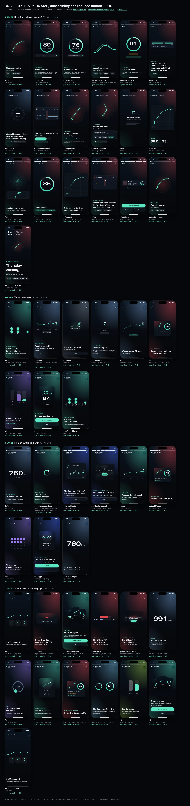
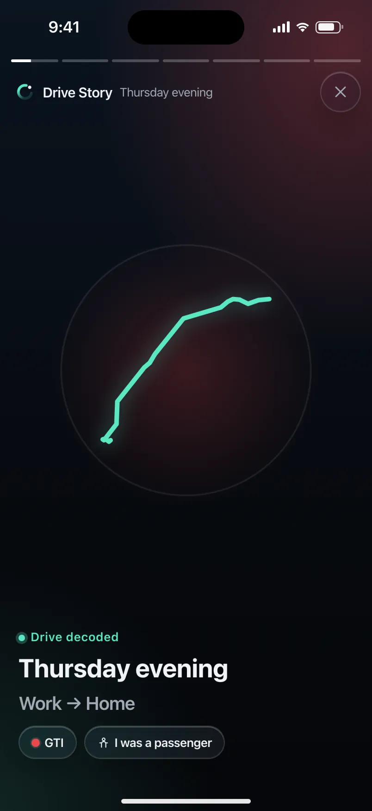
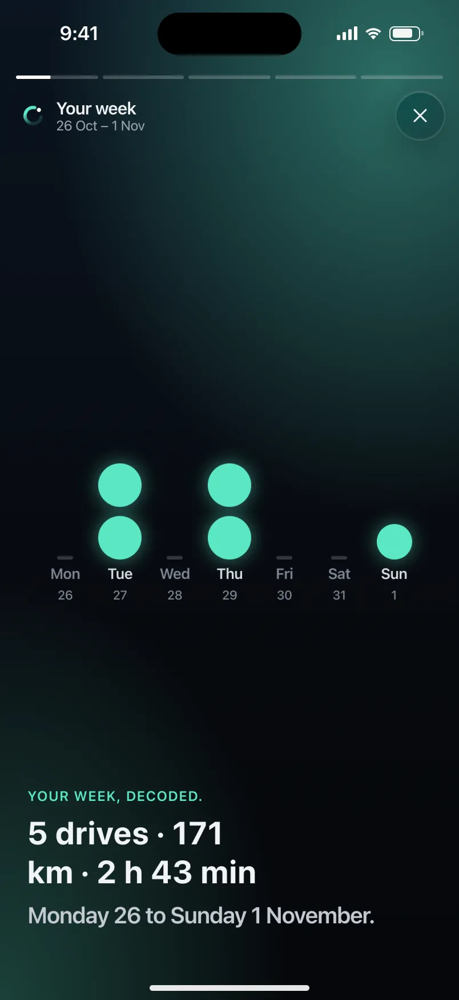
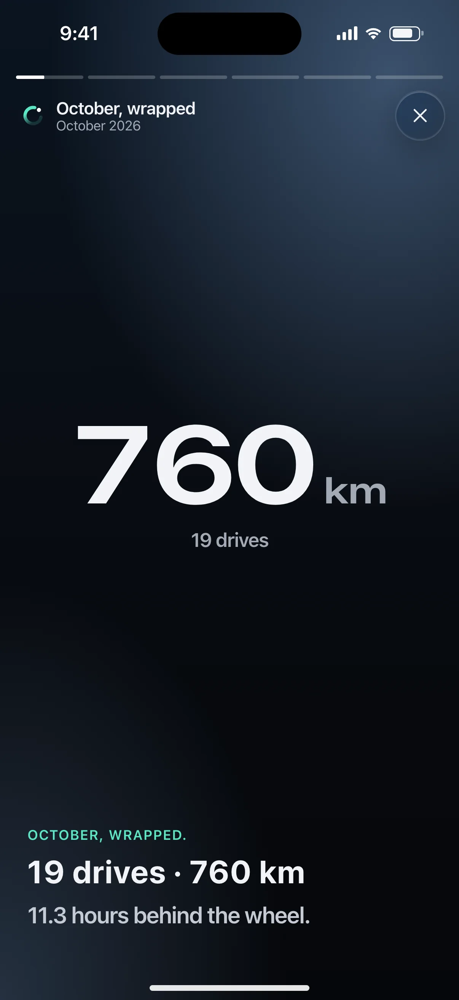
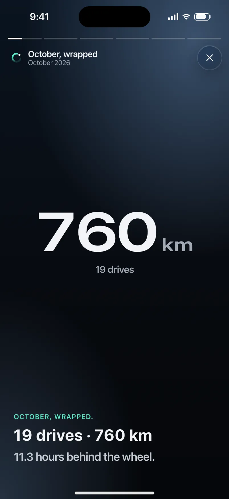
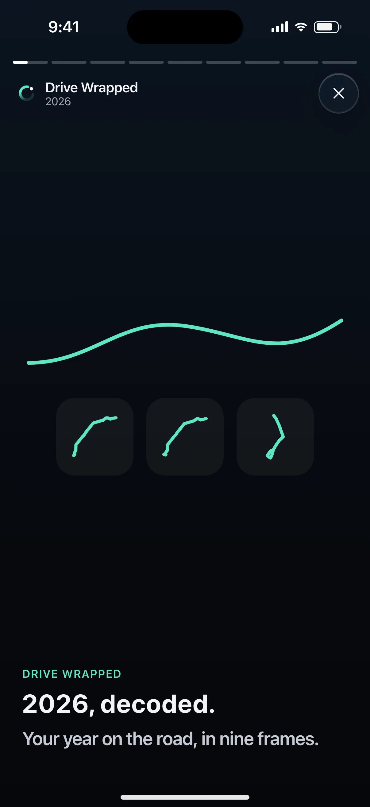
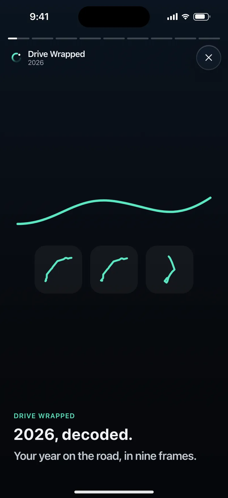

# DRIVE-197 · F-STY-06 Story accessibility and reduced motion — iOS design spec

> Generated by `prototypes/tools/export.mjs` on 2026-11-06 from the shared prototype engine. **Do not edit by hand:** change the screen's `spec` in `prototypes/app/screens/wp-*.js` (see `prototypes/app/AUTHORING.md`) and re-export.

- **Jira story:** [DRIVE-197](https://thekeval.atlassian.net/browse/DRIVE-197) · F-STY-06 · P0
- **Platform:** iOS 26/27 · Liquid Glass · iPhone 17 Pro (402×874 pt @3x = 1206×2622)
- **Interactive prototype:** [../../../../prototypes/ios/index.html#S-STY-01](../../../../prototypes/ios/index.html#S-STY-01) (catalog panel: every screen and state; deep links `#S-ID/state?trip=…&ent=…&theme=light&text=xl&rm=1`)
- **Contact sheet:** [mockup.html](mockup.html) · 
- **Design system (source of truth for values):** [brand](../../system/brand.md) · [components](../../system/components.md) · [motion](../../system/motion.md) · [accessibility](../../system/accessibility.md) · [screen map](../../system/screen-map.md) · [fixtures](../../system/fixtures.md) · tokens `prototypes/shared/tokens.css`

## Screens in this story

| Screen | Name | Presentation | Priority | States | Status |
|---|---|---|---|---|---|
| `S-STY-01` | Drive Story player (frames 1–7) | Full (player) | P0 | 17 | Prototyped |
| `S-RCP-01` | Weekly recap player | Full (player) | P0 | 8 | Prototyped |
| `S-WRP-01` | Monthly Wrapped player | Full (player) | P1 | 8 | Prototyped |
| `S-WRP-02` | Annual Drive Wrapped player | Full (player) | P1 | 12 | Prototyped |

## Tokens used on this platform

Values resolved from `prototypes/shared/tokens.css` inside the iOS device (`[data-platform="ios"]`). Use the token names in code; the hex values are for reference.

| Token | Dark | Light |
|---|---|---|
| `--app-bg` | `#080B10` | `#F2F3F6` |
| `--card-bg` | `#131822` | `#FFFFFF` |
| `--dp-bg-grouped` | `#080B10` | `#F2F3F6` |
| `--dp-surface` | `#131822` | `#FFFFFF` |
| `--dp-surface-2` | `#1B222D` | `#F2F3F6` |
| `--dp-surface-3` | `#262E3B` | `#E4E7EC` |
| `--dp-fill` | `#7880961F` | `#7880961F` |
| `--dp-fill-strong` | `#7880963D` | `#78809633` |
| `--dp-text` | `#F2F4F7` | `#0B0E13` |
| `--dp-text-2` | `#A3AAB6` | `#5A6271` |
| `--dp-text-3` | `#6E7787` | `#8A919D` |
| `--dp-separator` | `#96A0B429` | `#3C435024` |
| `--dp-accent` | `#5BE7C4` | `#079777` |
| `--dp-accent-text` | `#5BE7C4` | `#06775E` |
| `--dp-on-accent` | `#04241D` | `#FFFFFF` |
| `--dp-accent-container` | `#0A4439` | `#C6F8EA` |
| `--dp-record` | `#FFC24B` | `#9A6300` |
| `--dp-positive` | `#5BE7C4` | `#06775E` |
| `--dp-change-down` | `#A3AAB6` | `#5A6271` |
| `--dp-warning` | `#F5B648` | `#9A5F00` |
| `--dp-critical` | `#FF6B6B` | `#C62828` |
| `--dp-glass-fill` | `#1C222C6B` | `#FFFFFF8C` |
| `--dp-glass-fill-strong` | `#1C222CB8` | `#FFFFFFD1` |
| `--dp-glass-stroke` | `#FFFFFF24` | `#FFFFFF99` |
| `--dp-data-route` | `#5BE7C4` | `#079777` |
| `--dp-data-event-brake` | `#FF7A66` | `#A21F16` |
| `--dp-data-event-accel` | `#E58BD0` | `#A33A8C` |
| `--dp-data-event-corner` | `#EAD54E` | `#9A8A00` |
| `--dp-data-quality-good` | `#5FDB9C` | `#1E9E62` |
| `--dp-data-speed` | `#D6DCE4` | `#404A58` |
| `--dp-data-long-g` | `#5AB8F5` | `#0A6AB8` |
| `--dp-data-lat-g` | `#F5A142` | `#B25A00` |

| Type / layout token | Value |
|---|---|
| `--dp-font-screen-title` | `700 34px / 41px -apple-system, BlinkMacSystemFont, "SF Pro Display", system-ui, sans-serif` |
| `--dp-font-sheet-title` | `700 22px / 28px -apple-system, BlinkMacSystemFont, "SF Pro Display", system-ui, sans-serif` |
| `--dp-font-section-title` | `600 20px / 25px -apple-system, BlinkMacSystemFont, "SF Pro Display", system-ui, sans-serif` |
| `--dp-font-card-title` | `600 17px / 22px -apple-system, BlinkMacSystemFont, "SF Pro Text", system-ui, sans-serif` |
| `--dp-font-body` | `400 17px / 22px -apple-system, BlinkMacSystemFont, "SF Pro Text", system-ui, sans-serif` |
| `--dp-font-body-secondary` | `400 15px / 20px -apple-system, BlinkMacSystemFont, "SF Pro Text", system-ui, sans-serif` |
| `--dp-font-meta` | `400 13px / 18px -apple-system, BlinkMacSystemFont, "SF Pro Text", system-ui, sans-serif` |
| `--dp-font-caption` | `400 12px / 16px -apple-system, BlinkMacSystemFont, "SF Pro Text", system-ui, sans-serif` |
| `--dp-font-button` | `600 17px / 22px -apple-system, BlinkMacSystemFont, "SF Pro Text", system-ui, sans-serif` |
| `--dp-num-hero` | `600 72px / 72px -apple-system, BlinkMacSystemFont, "SF Pro Display", system-ui, sans-serif` |
| `--dp-num-xl` | `600 48px / 52px -apple-system, BlinkMacSystemFont, "SF Pro Display", system-ui, sans-serif` |
| `--dp-num-l` | `600 34px / 38px -apple-system, BlinkMacSystemFont, "SF Pro Display", system-ui, sans-serif` |
| `--dp-num-m` | `600 24px / 28px -apple-system, BlinkMacSystemFont, "SF Pro Display", system-ui, sans-serif` |
| `--dp-num-s` | `600 17px / 22px -apple-system, BlinkMacSystemFont, "SF Pro Display", system-ui, sans-serif` |
| `--dp-num-xs` | `600 13px / 16px -apple-system, BlinkMacSystemFont, "SF Pro Display", system-ui, sans-serif` |
| `--dp-screen-margin` | `16px` |
| `--dp-radius-card` | `24px` |
| `--dp-radius-card-hero` | `32px` |
| `--dp-radius-sheet` | `38px` |
| `--dp-radius-chip` | `999px` |
| `--dp-radius-button` | `999px` |
| `--dp-layout-list-row-min` | `52px` |
| `--dp-layout-touch-min` | `44px` |
| `--safe-top` | `62px` |
| `--safe-bottom` | `34px` |

Text sizes scale with `--dp-text-scale` (XL = 2.0×) and numerals with `--dp-num-scale` (XL = 1.3×). DP Numerals: SF Pro Expanded Semibold, tabular.

---

## S-STY-01 · Drive Story player (frames 1–7)

 

- **Presentation:** full · tab: drives — screen map: “Full (player)”
- **Entry points:** S-NTF-01 "Drive decoded" · S-HOME-01 card · S-DRV-04 · S-TRP-01 "Story" · S-LIVE-04/08
- **Leads to:** f7: S-RPL-01 (Explore) · S-SHR-01 (Share) · Done → caller · chips: S-RTE-03, S-SCO-03, S-TRP-02 (passenger/car), S-DQ-01
- **PRD features:** F-STY-01, F-STY-03, F-STY-04, F-STY-06, F-SCO-01, F-SCO-02, F-SCO-05, F-SCO-06, F-RTE-01, F-RTE-03, F-HIS-02, F-GAR-02, F-CAP-04, F-DQ-02, F-DQ-04, F-SHR-01, F-DQ-01 · **Priority:** P0 · **WP:** C
- **Interactive:** [S-STY-01](../../../../prototypes/ios/index.html#S-STY-01)

**Purpose.** The “wow” after every drive (F-STY-01): a ~15 s full-screen Story that leads with what went well, scores the drive against the user’s own baseline, then gives exactly one tip. No speed or max speed appears in any frame (F-STY-01.3).

### States

| State | PRD label | Fixture params | Screenshot |
|---|---|---|---|
| `default` | Def (frame 1) | `trip=t20261105-1745` | [S-STY-01.png](../../screens/ios/S-STY-01.webp) · [open](../../../../prototypes/ios/index.html#S-STY-01) |
| `firstDrive` | First drive (baseline) | `trip=t20260928-1842` | [S-STY-01--firstDrive.png](../../screens/ios/S-STY-01--firstDrive.webp) · [open](../../../../prototypes/ios/index.html#S-STY-01/firstDrive) |
| `calibrating` | Calibrating (2 of 3) | `trip=t20260929-0738` | [S-STY-01--calibrating.png](../../screens/ios/S-STY-01--calibrating.webp) · [open](../../../../prototypes/ios/index.html#S-STY-01/calibrating) |
| `routeDiscovered` | Route discovered (merge + name) | `trip=t20261002-0745` | [S-STY-01--routeDiscovered.png](../../screens/ios/S-STY-01--routeDiscovered.webp) · [open](../../../../prototypes/ios/index.html#S-STY-01/routeDiscovered) |
| `newRouteRecord` | New route record | `trip=t20261105-0742` | [S-STY-01--newRouteRecord.png](../../screens/ios/S-STY-01--newRouteRecord.webp) · [open](../../../../prototypes/ios/index.html#S-STY-01/newRouteRecord) |
| `degraded` | Degraded (Part) | `trip=t20261027-1728` | [S-STY-01--degraded.png](../../screens/ios/S-STY-01--degraded.webp) · [open](../../../../prototypes/ios/index.html#S-STY-01/degraded) |
| `unscorable` | Unscorable | `trip=t20261106-1210` | [S-STY-01--unscorable.png](../../screens/ios/S-STY-01--unscorable.webp) · [open](../../../../prototypes/ios/index.html#S-STY-01/unscorable) |
| `wasItNeededInline` | “Was it needed?” inline | `trip=t20261020-0740` | [S-STY-01--wasItNeededInline.png](../../screens/ios/S-STY-01--wasItNeededInline.webp) · [open](../../../../prototypes/ios/index.html#S-STY-01/wasItNeededInline) |
| `passengerChip` | Passenger chip | `trip=t20261031-1905` | [S-STY-01--passengerChip.png](../../screens/ios/S-STY-01--passengerChip.webp) · [open](../../../../prototypes/ios/index.html#S-STY-01/passengerChip) |
| `transitQuestion` | Transit question | `trip=t20261104-0650` | [S-STY-01--transitQuestion.png](../../screens/ios/S-STY-01--transitQuestion.webp) · [open](../../../../prototypes/ios/index.html#S-STY-01/transitQuestion) |
| `Load` | Load | `trip=t20261105-1745` | [S-STY-01--Load.png](../../screens/ios/S-STY-01--Load.webp) · [open](../../../../prototypes/ios/index.html#S-STY-01/Load) |
| `f2Route` | Frame 2 · route draw-on | `trip=t20261105-1745` | [S-STY-01--f2Route.png](../../screens/ios/S-STY-01--f2Route.webp) · [open](../../../../prototypes/ios/index.html#S-STY-01/f2Route) |
| `f3Inputs` | Frame 3 · G-dot replay | `trip=t20261105-1745` | [S-STY-01--f3Inputs.png](../../screens/ios/S-STY-01--f3Inputs.webp) · [open](../../../../prototypes/ios/index.html#S-STY-01/f3Inputs) |
| `f4Ring` | Frame 4 · Smoothness ring | `trip=t20261105-1745` | [S-STY-01--f4Ring.png](../../screens/ios/S-STY-01--f4Ring.webp) · [open](../../../../prototypes/ios/index.html#S-STY-01/f4Ring) |
| `f5Cleanest` | Frame 5 · cleanest stretch | `trip=t20261105-1745` | [S-STY-01--f5Cleanest.png](../../screens/ios/S-STY-01--f5Cleanest.webp) · [open](../../../../prototypes/ios/index.html#S-STY-01/f5Cleanest) |
| `f6Tip` | Frame 6 · one thing for next time | `trip=t20261105-1745` | [S-STY-01--f6Tip.png](../../screens/ios/S-STY-01--f6Tip.webp) · [open](../../../../prototypes/ios/index.html#S-STY-01/f6Tip) |
| `f7Actions` | Frame 7 · actions | `trip=t20261105-1745` | [S-STY-01--f7Actions.png](../../screens/ios/S-STY-01--f7Actions.webp) · [open](../../../../prototypes/ios/index.html#S-STY-01/f7Actions) |
| default · light | Light theme | `theme=light` | [S-STY-01--light.png](../../screens/ios/S-STY-01--light.webp) |
| default · XL | Largest text | `text=xl` | [S-STY-01--xl.png](../../screens/ios/S-STY-01--xl.webp) |

Every state also renders in light/dark (`theme=light`), XL text (`text=xl`) and reduced motion (`rm=1`).

### Layout

- Full-screen player, always on the night stage (`--dp-gradient-night-sky`) with a car-colour wash (radial 30% of `--dp-car-{colour}` top-trailing, 14% Glide bottom-leading). Status bar light. Dark tokens are forced inside the player in both themes.
- Top (safe-top + 4): progress segments (3 px, gap 4, white 26% track, white fill) · header row: Loop mark 22 + “Drive Story” (14/600) + part of day (meta, text2) + glass close button (44).
- Frame stage: art region (flex, centred) above a bottom-left copy block: kicker (13/600, accent-text) · `storyHeadline` (28/34 iOS bold, 28/36 Android) · `storyBody` (20/25, text2) · chip row. Bottom padding safe-bottom + 24.
- f1 title: route glyph 250 (share-safe trip.glyph, Glide 5 px) · kicker “● Drive decoded” · part of day (headline) · route label (body) · car chip + “I was a passenger” chip (glass).
- f2 route: plain-canvas map, full width − 40, ≤ 380 tall, radius 28, estimated start dashed, “© OpenStreetMap contributors” · two DP Numerals 48 (“39.0 km” “33 min”) counting up.
- f3 inputs: friction circle 260 (±0.6 g, rings at 0.1 g, 0.3/0.5 labelled) with the G-dot and a 1.2 s trail; under it a 112-tall mini map with the tracking tick (marker).
- f4 ring: Smoothness ring 224 (stroke 15, baseline notch, gold record notch) · comparison chip (and gold “New route record” chip) · “Score based on 31 of 34 min” with the quality glyph for Limited trips. Tap the ring → S-SCO-01.
- f5 cleanest stretch: the map with the route dimmed to 45% and the cleanest span drawn in Glide 200 with a 14 px glow · kicker “✦ Cleanest stretch”.
- f6 tip: glass trace card (event pin 22 + type + place, the −10…+10 s evidence trace, legend) · kicker “One thing for next time” · tip as headline · chips “See the moment” → S-RPL-02, “More on this tip” → S-SCO-04.
- Variant frames: fDegraded (coverage strip with the hatched excluded span) · fUnscorable (dashed ring “—”, Why not? → S-DQ-01) · fRoute (two Glide lines merging + chips Commute/Gym/School run/Custom… → S-RTE-03) · fNeeded (evidence trace + “Yes, it was needed” / “No”, inline confirmation).
- f7 end: glass summary card (glyph 52 · label · part of day · car · km · min · ring 64) · full quality badge (“Good data · phone mounted”) · first-drive loop card · actions: Explore the drive (filled large, block) · Share + Done (glass large, side by side). Passenger trips drop Share.
- Load: Loop loader 64 (iOS) / M3E shape loader (Android) + “Decoding your drive…” + skeleton lines; segments empty.

### Components & tokens

| Component | Tokens / spec |
|---|---|
| `ring` | track --dp-fill-strong · arc --dp-gradient-ring (glide-400 → accent → glide-100) · baseline notch --dp-text-2 · record notch --dp-record · Android container Cookie9Sided --md-sys-color-primary-container 42% · components.md §3 |
| `deltaChip` | better: --dp-accent-text on --dp-accent 18% · lower: --dp-text-2 on --dp-fill (never red) · record: --dp-record on --dp-record 18% · components.md §4 |
| `chip` | --dp-radius-chip (iOS capsule · Android 8) · height 28 · --dp-font-caption |
| `carChip` | see components.md |
| `glyph` | see components.md |
| `map` | --dp-data-map-land/road/grid · route --dp-data-route 3.8 + casing --dp-data-route-casing 7.5 · estimated dashed 4/4 at 60% · gap --dp-data-gap-stroke dotted 1/6 · pins DP_ICONS.pin 26 · attribution “© OpenStreetMap contributors” |
| `evidenceTrace` | see components.md |
| `qualityBadge` | --dp-data-quality-{good\|usable\|limited\|unscorable} · components.md §10 |
| `button` | --dp-accent / --dp-on-accent (filled) · --dp-fill-strong · --md-sys-color-secondary-container (tonal) · --dp-radius-button · height iOS 50/44/34 · Android 56/40/32 · --dp-font-button · components.md §0 |
| `iconButton` | see components.md |
| `loader` | see components.md |
| `skeleton` | --dp-fill-strong, breathe 1.2 s (dp-skeleton) |
| `gg (local ggSvg)` | see components.md |
| `coverageStrip (local)` | see components.md |

### Interactions & navigation

- Tap the right 68% → next frame; tap the left 32% → previous; press and hold → pause (segment freezes); swipe down → exit (content scales to 0.9 and rounds its corners with the drag, commits past 120 pt with haptic gestureEnd); close button → back to the caller.
- f1: car chip → S-TRP-02/carPicker · “I was a passenger” → S-TRP-02/typePicker (≤ 2 taps, F-HIS-02.4) · transit question chips Bus/Train/Streetcar → moved to Not drives (toast + Undo, back) · “No, I drove” → dismisses the question.
- f4: ring → S-SCO-01 · “New route record” chip → S-RTE-02 · f6: “See the moment” → S-RPL-02/thisDrivesTip · “More on this tip” → S-SCO-04 · f5/fDegraded/fUnscorable badges → S-DQ-01 · placement chip → S-DQ-02.
- fRoute chips → S-RTE-03 (preset name) or S-RTE-03/custom · fNeeded “Yes, it was needed” → marks it inline, the score recomputes ≤ 1 s and the Story continues (F-STY-04.3); “No” → next frame; “Not sure?” → S-SCO-03.
- f7: Explore the drive → S-RPL-01 · Share → S-SHR-01 · Done → back. Quality badge → S-DQ-01. No paywall, share prompt or rating prompt ever follows a Story (D12, F-SUB-08).
- D1 gate: opened while moving or during a driver trip → S-DRV-05 (“Your Story will be ready when you’ve parked.”), which opens the Story once stationary for 60 s.
- Deep link a frame: `#S-STY-01?trip=…&frame=f4`.

### Motion

- Segments fill linearly over the frame duration (3 s; 3.5 s for f2/f3; 6 s for question frames; ×1.5 at XL); f7 waits.
- Frame change: outgoing frame fades (220 ms); incoming copy rises 12 px line by line (60 ms stagger, spring.default) while the frame’s hero runs.
- Heroes: f1 glyph draw-on 1100 ms · f2 route draw-on 1800 ms (ease.drawOn) + numbers count up 1200 ms (ease.countUp) · f3 G-dot replay 3000 ms (shared.gMeter ζ 0.55 k 120, 1.2 s tapering trail, cloud fades in and the envelope draws on at the end) · f4 ring reveal 1400 ms with baseline notch, record notch flip + doubleSuccess haptic, chip pop at 1600 ms · f5 cleanest-stretch draw-on · f6 trace draw-on · fRoute lines slide 14 px together (spring.default) then chips pop (spring.fast, 40 ms stagger).
- RM: 220 ms cross-fades; route, ring and numbers appear complete; f3 shows the static G-G plot with the trail (F-STY-06.2); auto-advance continues (tap and hold still pause). Haptics kept except ring ticks.

### Accessibility

- Each frame is one focusable element whose label is the full frame copy, e.g. “Frame 4 of 7. Smoothness 85. 2 above your usual on The Commute home.” Focus pauses auto-advance (F-STY-06.1); actions Next frame / Previous frame / Close.
- f3 summary: “Your inputs, replayed. Mostly gentle, with 2 firm stops.” (derived from the trip’s events).
- Focus is trapped inside the player until closed. Tap zones are buttons “Previous frame” / “Next frame”.
- XL: the copy block grows upward and the art shrinks (zoom 0.62); frames run 1.5× longer; nothing truncates.
- Never colour alone: ▲/▼/● on chips, rosette on records, hatched + dashed spans in the coverage strip, glyphs on quality badges.

### Platform notes

- **iOS (this spec):** fullScreenCover; glass chips and glass close button (`.glassEffect(.clear)` over art with a 35% dim); SF Pro Display Bold story headline; Loop loader for Load; buttons glassProminent (Explore) and glass (Share/Done).
- *Android (for reference):* Full-screen dialog destination with fade-rise; tonal surface-container-high chips (no blur); Google Sans Flex story styles (28/36 600, body 22/28); ring sits on the Cookie9Sided primaryContainer shape that rotates during the count; M3E loading indicator for Load; Explore = filled button with shape morph, Share/Done = tonal.

### Analytics

- `story_opened {source}`
- `story_frame_viewed {frame}`
- `story_completed`
- `story_action {action: explore|share|done}`
- `story_variant {degraded|unscorable}`
- `event_marked_needed {type, source: story}`
- `trip_flagged_transit`
- `trip_corrected {to: transit|passenger}`
- `a11y_story_mode {screen_reader, reduce_motion}`

### Copy

| Key | Text |
|---|---|
| f1 | {partOfDay} · {label} (trip.story.frames.f1.title) · kicker “Drive decoded” · chips “{car}” · “I was a passenger” |
| f2 | {distance} km · {duration} min (frames.f2.line) |
| f3 | Your inputs, replayed. / Every brake and turn in 3 seconds. |
| f4 | Smoothness {n} · {compareText} · record: “New route record.” + “{n} on {route}, beating {m} from {date}.” · first drive: “Your baseline. Every drive from here is compared to you, not to anyone else.” · calibrating: “Calibrating your baseline · k of 3” |
| f5 | Cleanest stretch: {km} km on {road} with no abrupt inputs. |
| f6 | One thing for next time: {tip} |
| fDegraded | Your phone moved around for about 3 minutes, so we left that part out of the score. |
| fUnscorable | We couldn’t score this one fairly (phone in a bag). Here’s the route anyway. |
| fRoute | Looks like a regular. Name this route? · Commute · Gym · School run · Custom… |
| fNeeded | Hard stop at Spadina & King. Was it needed? · Yes, it was needed · No · done: “Marked as needed. It doesn’t count. Your Smoothness is 83 without it.” |
| Transit | Was this a bus or train? It stopped and started like transit. If it was, we’ll leave it out of your scores. · Bus · Train · Streetcar · No, I drove |
| Passenger | Passenger · not scored · Change — Not scored, and it doesn’t count toward your baseline, routes or recaps. |
| f7 | Explore the drive · Share · Done · {badge} data · phone {state} · first drive: “That’s the loop. Every drive gets a Story. Explore it in Replay, and repeat trips become Routes.” |
| Load | Decoding your drive… Building the replay |

### Free / Pro

Free on every trip, forever (F-STY-01). Explore the drive opens S-RPL-01; on Free for a trip older than 30 days the replay shows its own lock (S-SUB-03 replayAnalysis30Days), never the Story. No paywall after any Story, and never after a worse-than-usual one (F-SUB-08).

### Data & fixtures

Copy: trip.story.frames (exact). States → trips: default t20261105-1745 · firstDrive t20260928-1842 · calibrating t20260929-0738 (2 of 3) · routeDiscovered t20261002-0745 (fRoute) · newRouteRecord t20261105-0742 · degraded t20261027-1728 (fDegraded) · unscorable t20261106-1210 · wasItNeededInline t20261020-0740 (fNeeded, e3) · passengerChip t20261031-1905 · transitQuestion t20261104-0650 (no fixture trip is flagged as transit; the question is simulated on a stop-start trip). Frame order follows the fixture keys, except Unscorable (f1, f2, fUnscorable, f7 per F-STY-04.2; the fixture’s f3 is dropped) and passenger (f1, f2, f7: the G-dot replay would show someone else’s inputs). The f3 accessibility sentence and the G-dot path are derived from trip.track (lonG/latG) and trip.events.

### Assets

[icon-story.svg](assets/icon-story.svg) · [icon-close.svg](assets/icon-close.svg) · [icon-passenger.svg](assets/icon-passenger.svg) · [icon-replay.svg](assets/icon-replay.svg) · [icon-share.svg](assets/icon-share.svg) · [icon-routes.svg](assets/icon-routes.svg) · [icon-rosette.svg](assets/icon-rosette.svg) · [icon-info.svg](assets/icon-info.svg) · [icon-phone.svg](assets/icon-phone.svg) · [icon-check.svg](assets/icon-check.svg) · [icon-sparkle.svg](assets/icon-sparkle.svg) · [icon-pinStop.svg](assets/icon-pinStop.svg) · [logo-a-loop.svg](assets/logo-a-loop.svg)

UI glyphs may be swapped for SF Symbols / Material Symbols Rounded equivalents; event-pin, quality and provenance glyphs must not be (components.md global rules).

### Checklist (accessibility.md §9)

- [ ] Light and dark both render, and contrast passes.
- [ ] The XL text state reflows with no truncation.
- [ ] The RM state is defined.
- [ ] Every control has a label; every chart and map has a summary sentence.
- [ ] Every target ≥ 44 pt / 48 dp (≥ 64 in-drive).
- [ ] No meaning by colour alone.
- [ ] Speed is neutral wherever it appears and absent from social or live surfaces.
- [ ] No streak, leaderboard, speed or “beat your time” language.
- [ ] Behaviour is defined while a trip is active (D1 gate).
- [ ] Haptics come from motion.md §6 only.

---

## S-RCP-01 · Weekly recap player

 

- **Presentation:** full · tab: insights — screen map: “Full (player)”
- **Entry points:** Weekly recap notification · S-STA-01 card
- **Leads to:** S-SHR-01 (W5) · S-TRP-01 (drive of week) · S-SCO-05
- **PRD features:** F-NTF-03, F-SCO-10, F-SHR-04, F-STY-06 · **Priority:** P0 · **WP:** F
- **Interactive:** [S-RCP-01](../../../../prototypes/ios/index.html#S-RCP-01)

**Purpose.** A short weekly recap every Sunday at 18:00 (≈ 20 s): week strip, 4-week trend, drive of the week, one focus habit and a share card, generated on the device (F-NTF-03, F-SCO-10, F-SHR-04, A2 §3.3).

### States

| State | PRD label | Fixture params | Screenshot |
|---|---|---|---|
| `default` | Def (W1–W5) · W1 week strip | — | [S-RCP-01.png](../../screens/ios/S-RCP-01.webp) · [open](../../../../prototypes/ios/index.html#S-RCP-01) |
| `trendDown` | Trend down (W2, explain without blame) | — | [S-RCP-01--trendDown.png](../../screens/ios/S-RCP-01--trendDown.webp) · [open](../../../../prototypes/ios/index.html#S-RCP-01/trendDown) |
| `emptyWeek` | Empty week | — | [S-RCP-01--emptyWeek.png](../../screens/ios/S-RCP-01--emptyWeek.webp) · [open](../../../../prototypes/ios/index.html#S-RCP-01/emptyWeek) |
| `calibrating` | Calibrating (first week, W2) | — | [S-RCP-01--calibrating.png](../../screens/ios/S-RCP-01--calibrating.webp) · [open](../../../../prototypes/ios/index.html#S-RCP-01/calibrating) |
| `w2` | W2 trend (extra) | — | [S-RCP-01--w2.png](../../screens/ios/S-RCP-01--w2.webp) · [open](../../../../prototypes/ios/index.html#S-RCP-01/w2) |
| `w3` | W3 drive of the week (extra) | — | [S-RCP-01--w3.png](../../screens/ios/S-RCP-01--w3.webp) · [open](../../../../prototypes/ios/index.html#S-RCP-01/w3) |
| `w4` | W4 focus habit (extra) | — | [S-RCP-01--w4.png](../../screens/ios/S-RCP-01--w4.webp) · [open](../../../../prototypes/ios/index.html#S-RCP-01/w4) |
| `w5` | W5 share (extra) | — | [S-RCP-01--w5.png](../../screens/ios/S-RCP-01--w5.webp) · [open](../../../../prototypes/ios/index.html#S-RCP-01/w5) |
| default · light | Light theme | `theme=light` | [S-RCP-01--light.png](../../screens/ios/S-RCP-01--light.webp) |

Every state also renders in light/dark (`theme=light`), XL text (`text=xl`) and reduced motion (`rm=1`).

### Layout

- Full-screen player, always night (gradient night sky + a 30–40% wash per frame: Glide W1/W5, Lucid W2, the car colour W3, Violet W4). Status bar light.
- Top: segment progress (3 px bars, 4 gap, one per frame; done = white 90%, current fills linearly) · header row: Loop + “Your week” + range (“26 Oct – 1 Nov”) · close (glass circle iOS / icon button Android).
- Stage: hero art centred in the upper 55%, copy block bottom-left (kicker caption caps · storyHeadline 28/34 · storyBody 20/25, max 3 + 2 lines; XL: copy grows upward, art shrinks to 40%).
- W1: 7 day columns (Mon–Sun + date), one Glide dot per drive sized by distance; empty days show a dashed stub. Copy: “5 drives · 171.2 km · 2 h 43 min”.
- W2: 4-week line with values, this week’s point larger and Glide; delta capsule (▲ +2 vs last week · ▼ −1 neutral · ● Level · calibrating dots). Down: “Week average 86.” + “Down 1. Wednesday’s drive pulled it down.” + “Here’s why ›” → that drive.
- W3: drive card (share-safe glyph, ring, part of day · car, “Open this drive ›”) that flips in. Copy: “Sunday morning, Home → Port Credit, 90.”
- W4 (≥ 5 scorable drives only): 3-week meter (bars + %), “Your focus: braking into stops.” + “Gentler in 1 of 5 drives this week.” + “About your focus ›” → S-SCO-05. No streak language.
- W5: week share card (4:5, night): “My week”, mini strip, average + ▲/▼ delta, “Average Smoothness · 5 drives”, Loop mark. Buttons: Share your week (filled) → S-SHR-01/weekStrip · Done (glass).
- Empty week: parked-car line art, “No drives this week. Your car got a rest.”, Done. No notification is sent for an empty week.

### Components & tokens

| Component | Tokens / spec |
|---|---|
| `iconButton` | see components.md |
| `button` | --dp-accent / --dp-on-accent (filled) · --dp-fill-strong · --md-sys-color-secondary-container (tonal) · --dp-radius-button · height iOS 50/44/34 · Android 56/40/32 · --dp-font-button · components.md §0 |
| `ring` | track --dp-fill-strong · arc --dp-gradient-ring (glide-400 → accent → glide-100) · baseline notch --dp-text-2 · record notch --dp-record · Android container Cookie9Sided --md-sys-color-primary-container 42% · components.md §3 |
| `glyph` | see components.md |
| `num` | see components.md |

### Interactions & navigation

- Tap right two-thirds = next, left third = previous, press and hold = pause, arrow keys on hardware keyboards; close / Done = dismiss (back to S-STA-01 or the notification origin). Swipe down to exit natively (interactive scale 0.9 + corner radius; gestureEnd haptic).
- Auto-advance every 4.2 s; stops on the last frame; pauses on hold and whenever VoiceOver/TalkBack focuses the frame (F-STY-06.1).
- “Here’s why ›” → S-TRP-01 (the lowest-scoring drive on the named day). Drive card → S-TRP-01. “About your focus ›” → S-SCO-05. Share → S-SHR-01/weekStrip (recap param).
- D1 gate: opened from the notification while moving → S-DRV-05, which opens the recap once parked.

### Motion

- Frame change (motion.md §3.8): wash morphs (spring.effects), art rises 12 px (spring.slow), copy lines rise 12 px with a 60 ms stagger (spring.default).
- W1 dots land day by day (drop 28 px + scale, spring.bouncy, 110 ms per day). W2 line redraws (900 ms ease.drawOn) and this week’s point drops in last (spring.bouncy). W3 card flips in (rotateY 100° → 0, spring.bouncy) with the ring reveal. W4 bars fill upward (spring.slow, 160 ms stagger). W5 card pieces fly into their slots (spring.slow, 90 ms stagger; motion.md §3.7), success haptic when ready.
- RM: 220 ms cross-fades, final values, no flips. Haptics kept (no ring ticks).

### Accessibility

- Each frame is one focusable element whose label is the full copy, e.g. “Your week. Frame 2 of 5. Four-week trend. Week average 87, up 2. Last week: 85.”; focus pauses auto-advance.
- Hidden “Previous frame” / “Next frame” buttons for switch control and screen readers; charts have text summaries (“Drives by day, dot size by distance: Tue 2, Thu 2, Sun 1”).
- Delta uses ▲/▼/● glyph + words; down is neutral grey, never red.
- XL: copy reflows (no truncation), art scales down; the share buttons stack.

### Platform notes

- **iOS (this spec):** fullScreenCover with a TabView(.page) or custom pager; glass close button; Share uses the system share sheet via S-SHR-01.
- *Android (for reference):* Full-screen destination (edge-to-edge, light status icons); HorizontalPager; M3 icon button close; predictive back = dismiss.

### Analytics

- `recap_opened {source: notification|insights}`
- `recap_frame_viewed {frame}`
- `recap_completed`
- `recap_shared`

### Copy

| Key | Text |
|---|---|
| W1 | {n} drives · {km} km · {duration}  (5 drives · 171.2 km · 2 h 43 min) |
| W2 up | Week average 87, up 2. · Last week: 85. |
| W2 down | Week average 86. · Down 1. Wednesday’s drive pulled it down. · Here’s why |
| W2 level | Week average 85, level with last week. · Steady. |
| W2 calibrating | Week average 78. · Your first week, so there’s no trend yet. Next Sunday’s recap compares with this one. |
| W3 | Drive of the week · {part of day}, {route name or label}, {score}. |
| W4 | Your focus · Braking into stops. · Gentler in {x} of {y} drives this week. |
| W5 | Share your week · See you next Sunday. · Share your week · Done |
| Empty | No drives this week. · Your car got a rest. |

### Free / Pro

Free (the weekly recap and its share card are free forever). Pro adds card styles in S-SHR-01 only. No paywall in the recap.

### Data & fixtures

Default + W2–W5: recaps w2026-10-26 (latest complete, matches the n_week notification). trendDown: w2026-11-02 (the current week as it will be delivered on Sun 8 Nov; down 1, “Wednesday’s drive”; Here’s why → t20261104-0650, the lower of Wednesday’s two drives). calibrating: w2026-09-28 (no delta, no focus, so 4 frames). Empty: recapExamples.emptyWeek. Dot size = 11 + 2.6·√km px (cap 30).

### Assets

[icon-close.svg](assets/icon-close.svg) · [icon-share.svg](assets/icon-share.svg) · [icon-chevronRight.svg](assets/icon-chevronRight.svg) · [icon-rosette.svg](assets/icon-rosette.svg) · [logo-a-loop.svg](assets/logo-a-loop.svg)

UI glyphs may be swapped for SF Symbols / Material Symbols Rounded equivalents; event-pin, quality and provenance glyphs must not be (components.md global rules).

### Checklist (accessibility.md §9)

- [ ] Light and dark both render, and contrast passes.
- [ ] The XL text state reflows with no truncation.
- [ ] The RM state is defined.
- [ ] Every control has a label; every chart and map has a summary sentence.
- [ ] Every target ≥ 44 pt / 48 dp (≥ 64 in-drive).
- [ ] No meaning by colour alone.
- [ ] Speed is neutral wherever it appears and absent from social or live surfaces.
- [ ] No streak, leaderboard, speed or “beat your time” language.
- [ ] Behaviour is defined while a trip is active (D1 gate).
- [ ] Haptics come from motion.md §6 only.

---

## S-WRP-01 · Monthly Wrapped player

 

- **Presentation:** full · tab: insights — screen map: “Full (player)”
- **Entry points:** Monthly Wrapped notification (1st of month) · S-STA-01 card
- **Leads to:** S-SHR-01 · S-SUB-03 (Pro chapter on Free)
- **PRD features:** F-NTF-04, F-SHR-04, F-STY-06 · **Priority:** P1 · **WP:** F
- **Interactive:** [S-WRP-01](../../../../prototypes/ios/index.html#S-WRP-01)

**Purpose.** A monthly mini-Wrapped on the 1st (10:00 local, ≥ 4 driver trips): totals, trend, best drive, focus and an archetype, a share moment before December (F-NTF-04, F-SHR-04). Core is Free; Pro adds a per-route chapter.

### States

| State | PRD label | Fixture params | Screenshot |
|---|---|---|---|
| `default` | Def · totals | — | [S-WRP-01.png](../../screens/ios/S-WRP-01.webp) · [open](../../../../prototypes/ios/index.html#S-WRP-01) |
| `seasonOpenerVariant` | Launch variant (Gate 2 renamed “Season Opener” → “Launch”) | — | [S-WRP-01--seasonOpenerVariant.png](../../screens/ios/S-WRP-01--seasonOpenerVariant.webp) · [open](../../../../prototypes/ios/index.html#S-WRP-01/seasonOpenerVariant) |
| `proExtraChapter` | Pro extra chapter (Pro) | — | [S-WRP-01--proExtraChapter.png](../../screens/ios/S-WRP-01--proExtraChapter.webp) · [open](../../../../prototypes/ios/index.html#S-WRP-01/proExtraChapter) |
| `proChapterLocked` | Pro chapter on Free (extra) | `ent=free` | [S-WRP-01--proChapterLocked.png](../../screens/ios/S-WRP-01--proChapterLocked.webp) · [open](../../../../prototypes/ios/index.html#S-WRP-01/proChapterLocked) |
| `trend` | Trend (extra) | — | [S-WRP-01--trend.png](../../screens/ios/S-WRP-01--trend.webp) · [open](../../../../prototypes/ios/index.html#S-WRP-01/trend) |
| `driveOfMonth` | Smoothest drive (extra) | — | [S-WRP-01--driveOfMonth.png](../../screens/ios/S-WRP-01--driveOfMonth.webp) · [open](../../../../prototypes/ios/index.html#S-WRP-01/driveOfMonth) |
| `focus` | Focus (extra) | — | [S-WRP-01--focus.png](../../screens/ios/S-WRP-01--focus.webp) · [open](../../../../prototypes/ios/index.html#S-WRP-01/focus) |
| `archetype` | Archetype flip (extra) | — | [S-WRP-01--archetype.png](../../screens/ios/S-WRP-01--archetype.webp) · [open](../../../../prototypes/ios/index.html#S-WRP-01/archetype) |
| default · light | Light theme | `theme=light` | [S-WRP-01--light.png](../../screens/ios/S-WRP-01--light.webp) |

Every state also renders in light/dark (`theme=light`), XL text (`text=xl`) and reduced motion (`rm=1`).

### Layout

- Same player frame as the recap (components.md §23): segments, Loop + “October, wrapped” + “October 2026”, close; night stage with a per-chapter wash (Lucid · Glide · car colour · Violet · Cobalt).
- Totals: odometer “760 km” (DP Numerals 72, tabular columns) + “19 drives” · copy “19 drives · 760 km” / “11.3 hours behind the wheel.” (neutral about volume).
- Trend: 4 weekly points (81, 85, 85, 87) with week labels · “Average Smoothness 84.” / “From 81 in the first week to 87 in the last.”
- Smoothest drive: flip card (glyph, ring 89, part of day · car) · “14 Oct, The Commute, 89.” (user-named route only).
- Focus: 19 dots, 9 filled · “Your focus: braking into stops.” / “Gentler in 9 of 19 drives.”
- Archetype (share hero): card that flips in — archetype line art, “The Metronome”, two stats (19 drives · 84 avg Smoothness), Loop mark · copy “You’re The Metronome.” / “The same calm rhythm, drive after drive.” · Share (filled) → S-SHR-01/archetype · Done.
- Pro chapter: route deep dive (The Commute glyph + October runs line) · “The Commute: 79 → 87.” On Free: the same chapter blurred 14 px with lock + “Per-route chapters come with Pro. Your Wrapped stays free.” + See plans → S-SUB-03.
- Launch variant (once, 14 days after install in the launch month): “Your first two weeks, wrapped.” · 8 drives · 316.2 km · smoothest drive (Saturday midday, 84) · 2 routes found (The Commute and The Commute home) · “See you on the 1st.”

### Components & tokens

| Component | Tokens / spec |
|---|---|
| `iconButton` | see components.md |
| `button` | --dp-accent / --dp-on-accent (filled) · --dp-fill-strong · --md-sys-color-secondary-container (tonal) · --dp-radius-button · height iOS 50/44/34 · Android 56/40/32 · --dp-font-button · components.md §0 |
| `ring` | track --dp-fill-strong · arc --dp-gradient-ring (glide-400 → accent → glide-100) · baseline notch --dp-text-2 · record notch --dp-record · Android container Cookie9Sided --md-sys-color-primary-container 42% · components.md §3 |
| `glyph` | see components.md |
| `num` | see components.md |
| `lockPanel` | blur --dp-opacity-locked-blur 14px · dim --dp-opacity-locked-dim 35% · components.md §15.2 |

### Interactions & navigation

- Tap right/left, hold to pause, auto-advance 5.2 s (pauses on screen-reader focus), close/Done → back. Drive card → S-TRP-01. Share → S-SHR-01/archetype (Archetype card, no places). Pro chapter lock → S-SUB-03/trends (never during a trip: D1 gate).

### Motion

- Chapter change (650 ms, motion.md §3.8): incoming chapter rises 24 px → 0 (spring.slow) while the wash morphs (spring.effects); copy lines rise 12 px, 60 ms stagger.
- Odometer roll: each digit column rolls 0 → value, right to left, 40 ms stagger (spring.slow). Trend line redraws (900 ms). Smoothest drive: card flip + ring reveal. Focus dots pop in order (spring.bouncy, 55 ms). Archetype card flip (rotateY 100° → 0, spring.bouncy) + success haptic.
- RM: 220 ms cross-fades, final numbers, no flips or rolls.

### Accessibility

- Each chapter is one element: “October, wrapped. Frame 5 of 6. Your October archetype. You’re The Metronome. The same calm rhythm, drive after drive.”
- Odometer reads “760 kilometres”; focus dots read “9 of 19 drives had gentler stops”.
- XL: copy grows upward and art shrinks; nothing truncates.

### Platform notes

- **iOS (this spec):** fullScreenCover pager; glass close and Done; numerals SF Pro Expanded.
- *Android (for reference):* Full-screen destination; HorizontalPager; Google Sans Flex wdth 120 numerals; tonal Done.

### Analytics

- `wrapped_opened {type: monthly, variant: default|launch}`
- `wrapped_frame_viewed {frame}`
- `wrapped_completed`
- `wrapped_shared {card: archetype}`
- `locked_content_viewed {type: wrapped_pro_chapter}`

### Copy

| Key | Text |
|---|---|
| Notification | October, wrapped. · You’re The Metronome this month. |
| totals | 19 drives · 760 km · 11.3 hours behind the wheel |
| trend | Average Smoothness 84 |
| driveOfMonth | Smoothest drive: 14 Oct, The Commute, 89 |
| focus | Your focus: braking into stops. · Gentler in 9 of 19 drives. |
| archetype | You're The Metronome. · The same calm rhythm, drive after drive. |
| proRoutes | The Commute: 79 → 87 · Per-route deep dive (Pro chapter) |
| Free lock | Per-route chapters come with Pro. Your Wrapped stays free. |
| Launch | Your first two weeks, wrapped. · 8 drives · 316.2 km · 2 routes found. · See you on the 1st. Your first full month comes with an archetype. |

### Free / Pro

Free: chapters 1–5 and the Archetype share card. Pro/Preview: + the per-route chapter (and Pro card styles in S-SHR-01). Free sees the Pro chapter locked with its own data blurred (proChapterLocked).

### Data & fixtures

wrapped.monthly (October 2026: chapters totals, trend, driveOfMonth t20261014-0744, focus, archetype metronome, proRoutes). Week labels from recaps weekStart in October. Pro chapter line from routes r_commute.trend (October runs). Launch variant from previewRecap (8 drives, 316.2 km, smoothest t20261010-1340, routesFound 2) — Gate 2 renamed the “Season Opener” to “Launch”.

### Assets

[icon-close.svg](assets/icon-close.svg) · [icon-share.svg](assets/icon-share.svg) · [icon-lock.svg](assets/icon-lock.svg) · [icon-chevronRight.svg](assets/icon-chevronRight.svg) · [logo-a-loop.svg](assets/logo-a-loop.svg)

UI glyphs may be swapped for SF Symbols / Material Symbols Rounded equivalents; event-pin, quality and provenance glyphs must not be (components.md global rules).

### Checklist (accessibility.md §9)

- [ ] Light and dark both render, and contrast passes.
- [ ] The XL text state reflows with no truncation.
- [ ] The RM state is defined.
- [ ] Every control has a label; every chart and map has a summary sentence.
- [ ] Every target ≥ 44 pt / 48 dp (≥ 64 in-drive).
- [ ] No meaning by colour alone.
- [ ] Speed is neutral wherever it appears and absent from social or live surfaces.
- [ ] No streak, leaderboard, speed or “beat your time” language.
- [ ] Behaviour is defined while a trip is active (D1 gate).
- [ ] Haptics come from motion.md §6 only.

---

## S-WRP-02 · Annual Drive Wrapped player

 

- **Presentation:** full · tab: insights — screen map: “Full (player)”
- **Entry points:** Annual Wrapped (1 Dec) notification · S-STA-01 card
- **Leads to:** S-SHR-01 · S-SUB-03
- **PRD features:** F-NTF-05, F-SHR-04, F-STY-06 · **Priority:** P1 · **WP:** F
- **Interactive:** [S-WRP-02](../../../../prototypes/ios/index.html#S-WRP-02)

**Purpose.** The driving year told as a celebratory story from 1 December (≥ 10 driver trips across ≥ 30 days): km, hours, archetype, smoothest drive, most improved route, garage split, habit mastered (only if statistically real) and share cards — never speed, max G, other users or praise for volume (F-NTF-05, F-SHR-04, A2 §3.4).

### States

| State | PRD label | Fixture params | Screenshot |
|---|---|---|---|
| `default` | Def (frames 1–9) · frame 1 | — | [S-WRP-02.png](../../screens/ios/S-WRP-02.webp) · [open](../../../../prototypes/ios/index.html#S-WRP-02) |
| `singleCar` | Single car (frame 7 variant) | — | [S-WRP-02--singleCar.png](../../screens/ios/S-WRP-02--singleCar.webp) · [open](../../../../prototypes/ios/index.html#S-WRP-02/singleCar) |
| `habitFrameSkipped` | Habit frame skipped (8 frames) | — | [S-WRP-02--habitFrameSkipped.png](../../screens/ios/S-WRP-02--habitFrameSkipped.webp) · [open](../../../../prototypes/ios/index.html#S-WRP-02/habitFrameSkipped) |
| `proChapters` | Pro chapters (frame 7, Pro) | — | [S-WRP-02--proChapters.png](../../screens/ios/S-WRP-02--proChapters.webp) · [open](../../../../prototypes/ios/index.html#S-WRP-02/proChapters) |
| `proChaptersLocked` | Pro chapter on Free (extra) | `ent=free` | [S-WRP-02--proChaptersLocked.png](../../screens/ios/S-WRP-02--proChaptersLocked.webp) · [open](../../../../prototypes/ios/index.html#S-WRP-02/proChaptersLocked) |
| `f2` | Frame 2 odometer (extra) | — | [S-WRP-02--f2.png](../../screens/ios/S-WRP-02--f2.webp) · [open](../../../../prototypes/ios/index.html#S-WRP-02/f2) |
| `f3` | Frame 3 clock (extra) | — | [S-WRP-02--f3.png](../../screens/ios/S-WRP-02--f3.webp) · [open](../../../../prototypes/ios/index.html#S-WRP-02/f3) |
| `f4` | Frame 4 archetype (extra) | — | [S-WRP-02--f4.png](../../screens/ios/S-WRP-02--f4.webp) · [open](../../../../prototypes/ios/index.html#S-WRP-02/f4) |
| `f5` | Frame 5 smoothest drive (extra) | — | [S-WRP-02--f5.png](../../screens/ios/S-WRP-02--f5.webp) · [open](../../../../prototypes/ios/index.html#S-WRP-02/f5) |
| `f6` | Frame 6 most improved (extra) | — | [S-WRP-02--f6.png](../../screens/ios/S-WRP-02--f6.webp) · [open](../../../../prototypes/ios/index.html#S-WRP-02/f6) |
| `f8` | Frame 8 habit (extra) | — | [S-WRP-02--f8.png](../../screens/ios/S-WRP-02--f8.webp) · [open](../../../../prototypes/ios/index.html#S-WRP-02/f8) |
| `f9` | Frame 9 share (extra) | — | [S-WRP-02--f9.png](../../screens/ios/S-WRP-02--f9.webp) · [open](../../../../prototypes/ios/index.html#S-WRP-02/f9) |
| default · light | Light theme | `theme=light` | [S-WRP-02--light.png](../../screens/ios/S-WRP-02--light.webp) |

Every state also renders in light/dark (`theme=light`), XL text (`text=xl`) and reduced motion (`rm=1`).

### Layout

- Player frame as S-RCP-01: 9 segments (8 when the habit frame is skipped), Loop + “Drive Wrapped” + “2026”, close; night stage with chapter washes.
- F1 “2026, decoded.”: a Glide road line crosses the black screen, then the top route glyphs assemble.
- F2 odometer “991 km” + “That’s about 1.8× Toronto to Montréal.” with an “Estimated” provenance chip (vetted comparison list).
- F3 clock face: hour ring sweeps, the 7 am wedge lifts out · “15 hours behind the wheel.” / “Your most-driven hour: 7 am.”
- F4 archetype flip card (share hero): Glider line art, “The Glider”, drives + km · “You’re The Glider.” / “Few abrupt inputs, all year.”
- F5 smoothest drive card (glyph, ring 91 with the gold record notch, “Route record”) · “5 Nov, The Commute, 91.”
- F6 before/after rings 76 → 91 (Sep → Nov) · “The Commute, 76 → 91.”
- F7 garage bars (Pro): GTI 75% · Ioniq 25% · “The GTI did 75% of the driving.” / “The Ioniq did the road trip.” Free: blurred + lock + “Garage chapters come with Pro. Your Wrapped stays free.” Single car: car tile + “Every drive this year was in the GTI.” (free).
- F8 habit meter Sep 100% vs Nov 63% · “Gentler stops.” / “37% fewer abrupt stops than in September.” — shown only when the change is statistically significant, otherwise skipped.
- F9 three cards fan out (route glyph, archetype, week) · “Share your year.” · Share your year → S-SHR-01/archetype · Done.

### Components & tokens

| Component | Tokens / spec |
|---|---|
| `iconButton` | see components.md |
| `button` | --dp-accent / --dp-on-accent (filled) · --dp-fill-strong · --md-sys-color-secondary-container (tonal) · --dp-radius-button · height iOS 50/44/34 · Android 56/40/32 · --dp-font-button · components.md §0 |
| `ring` | track --dp-fill-strong · arc --dp-gradient-ring (glide-400 → accent → glide-100) · baseline notch --dp-text-2 · record notch --dp-record · Android container Cookie9Sided --md-sys-color-primary-container 42% · components.md §3 |
| `glyph` | see components.md |
| `num` | see components.md |
| `provenance` | see components.md |
| `carDot` | see components.md |
| `lockPanel` | blur --dp-opacity-locked-blur 14px · dim --dp-opacity-locked-dim 35% · components.md §15.2 |

### Interactions & navigation

- Tap right/left, hold to pause, auto-advance 5.2 s (stops on F9; pauses on screen-reader focus), close/Done → back. F5 card → S-TRP-01. F7 lock → S-SUB-03/s2ndCar. Share → S-SHR-01 (glyph default, archetype, week; no places).

### Motion

- Chapter change 650 ms (outgoing scale 0.92 + fade 250 ms ease.emphasizedAccelerate natively; incoming rise 24 px, spring.slow; wash morph spring.effects).
- F1 road draw-on 1400 ms then glyphs scale in (120 ms stagger). F2 odometer roll right-to-left (40 ms). F3 conic sweep 1200 ms (ease.countUp) then the 7 am wedge lifts (spring.fast). F4 card flip (spring.bouncy) + one success haptic. F5 glyph draw-on + ring reveal. F6 ring reveals. F7 bars grow (spring.slow). F8 bars fill. F9 cards fan to ±8° (spring.default, 70 ms stagger).
- RM: 220 ms cross-fades; final values; no flips, rolls or fans.

### Accessibility

- Each frame is one element with its full copy (“Drive Wrapped. Frame 2 of 9. Distance. You drove 991 km. That’s about 1.8× Toronto to Montréal. Estimated.”). Auto-advance pauses on focus.
- Clock: “Clock face: most-driven hour 7 am”. Garage: “GTI 75%, Ioniq 25%”.
- No colour-only meaning: record = rosette + words; Estimated = dashed provenance glyph + word.
- XL: copy reflows; art shrinks to 40%.

### Platform notes

- **iOS (this spec):** fullScreenCover pager; glass close/Done; SF Pro Expanded numerals in the odometer.
- *Android (for reference):* Full-screen destination; HorizontalPager; Google Sans Flex wdth 120 numerals; predictive back dismisses.

### Analytics

- `wrapped_opened {type: annual}`
- `wrapped_frame_viewed {frame}`
- `wrapped_completed`
- `wrapped_shared {card: glyph|archetype|week}`
- `locked_content_viewed {type: wrapped_garage}`

### Copy

| Key | Text |
|---|---|
| F1 | 2026, decoded. |
| F2 | You drove 991 km. · That's about 1.8× Toronto to Montréal. |
| F3 | 15 hours behind the wheel. · Your most-driven hour: 7 am. |
| F4 | You're The Glider. · Few abrupt inputs, all year. |
| F5 | Smoothest drive of the year: 5 Nov, The Commute, 91. |
| F6 | Most improved: The Commute, 76 → 91 (Sep → Nov). |
| F7 | The GTI did 75% of the driving. · The Ioniq did the road trip. |
| F8 | Habit mastered: gentler stops. 37% fewer abrupt stops than in September. |
| F9 | Share your year. |
| F7 single car | Every drive this year was in the GTI. · One car, one baseline. |
| F7 Free lock | Garage chapters come with Pro. Your Wrapped stays free. |
| F9 body | Route shape, archetype or your week. No places, no speed. |

### Free / Pro

Free: frames 1–6, 8, 9 and the single-car frame. Pro/Preview: + the garage split (F7) and per-route chapters; Pro card styles in S-SHR-01. Free sees F7 blurred with a lock.

### Data & fixtures

wrapped.annual (sample “2026, decoded.” computed from the fixture Sep 28 – Nov 6; real annual ships by 1 Dec 2027, F-NTF-05). F2 comparison provenance estimated. F5 trip t20261105-0742. F6 from routes r_commute.trend (76 on 29 Sep → 91 on 5 Nov). F7 split from wrapped.monthly.carSplit (75/25). F8 meter derived from “37% fewer” (Sep = 100%, Nov = 63%). Archetype card stats: driver trips count and annual km.

### Assets

[icon-close.svg](assets/icon-close.svg) · [icon-share.svg](assets/icon-share.svg) · [icon-car.svg](assets/icon-car.svg) · [icon-lock.svg](assets/icon-lock.svg) · [icon-chevronRight.svg](assets/icon-chevronRight.svg) · [icon-rosette.svg](assets/icon-rosette.svg) · [logo-a-loop.svg](assets/logo-a-loop.svg)

UI glyphs may be swapped for SF Symbols / Material Symbols Rounded equivalents; event-pin, quality and provenance glyphs must not be (components.md global rules).

### Checklist (accessibility.md §9)

- [ ] Light and dark both render, and contrast passes.
- [ ] The XL text state reflows with no truncation.
- [ ] The RM state is defined.
- [ ] Every control has a label; every chart and map has a summary sentence.
- [ ] Every target ≥ 44 pt / 48 dp (≥ 64 in-drive).
- [ ] No meaning by colour alone.
- [ ] Speed is neutral wherever it appears and absent from social or live surfaces.
- [ ] No streak, leaderboard, speed or “beat your time” language.
- [ ] Behaviour is defined while a trip is active (D1 gate).
- [ ] Haptics come from motion.md §6 only.

---

Map geometry in the prototype: © OpenStreetMap contributors (ODbL). Speed and G are simulated fixtures (fixtures.md).
