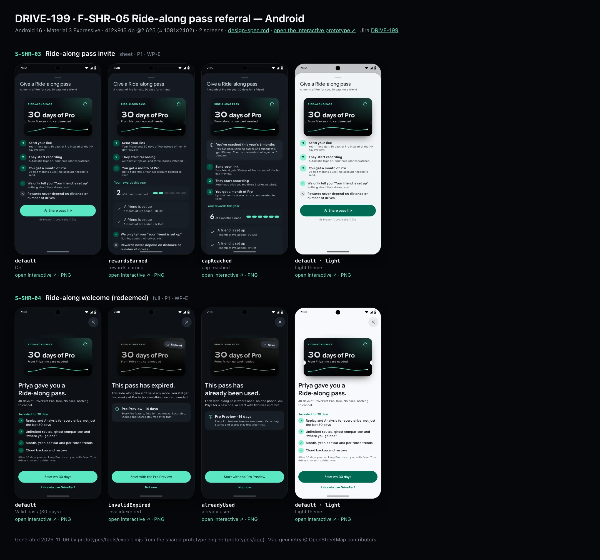
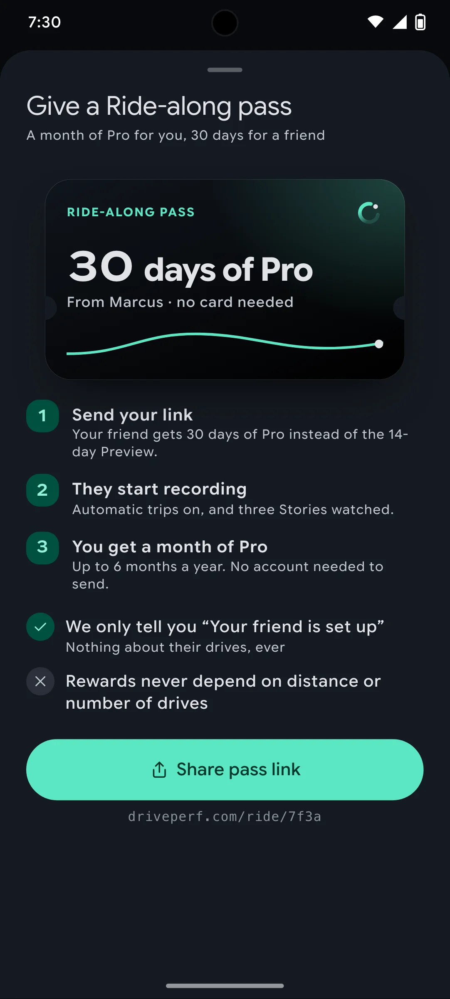
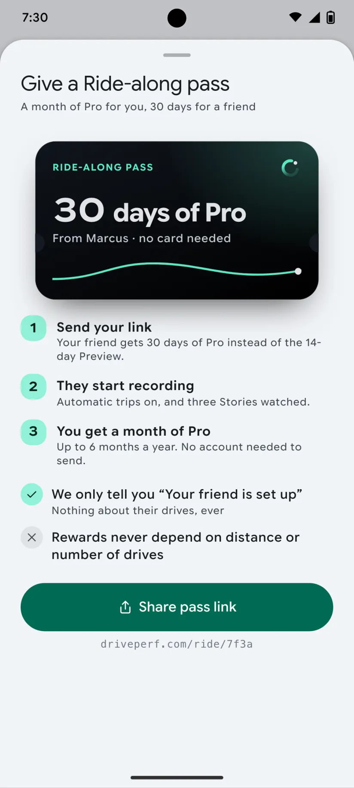
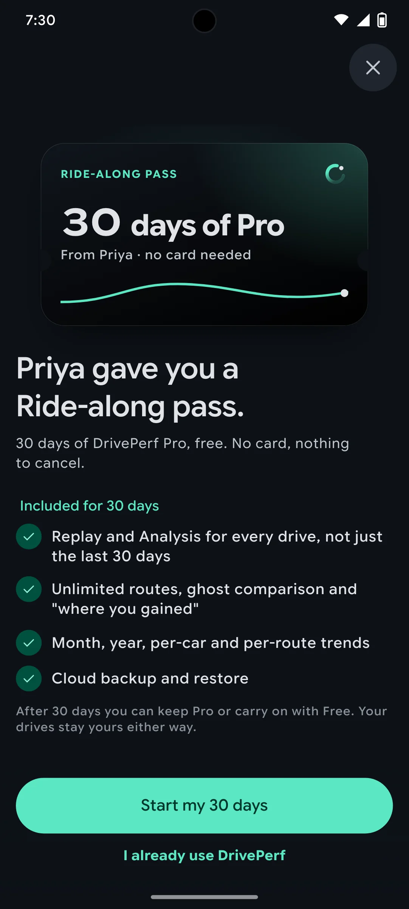
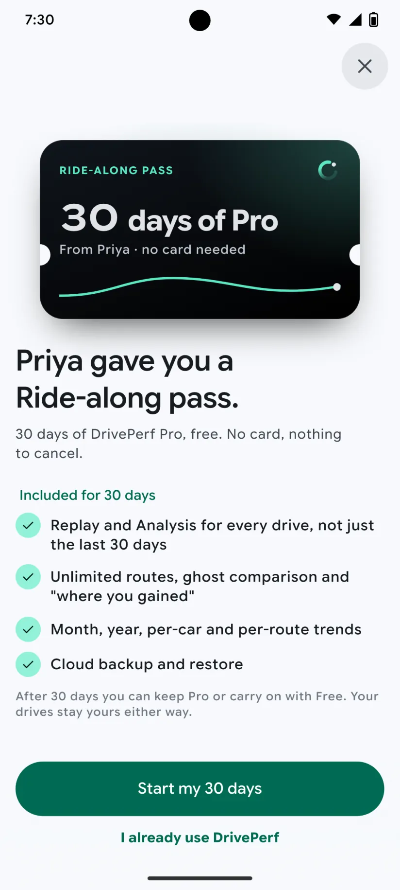

# DRIVE-199 · F-SHR-05 Ride-along pass referral — Android design spec

> Generated by `prototypes/tools/export.mjs` on 2026-11-07 from the shared prototype engine. **Do not edit by hand:** change the screen's `spec` in `prototypes/app/screens/wp-*.js` (see `prototypes/app/AUTHORING.md`) and re-export.

- **Jira story:** [DRIVE-199](https://thekeval.atlassian.net/browse/DRIVE-199) · F-SHR-05 · P1
- **Platform:** Android 16 · Material 3 Expressive · 412×915 dp @2.625 (≈ 1081×2402)
- **Interactive prototype:** [../../../../prototypes/android/index.html#S-SHR-03](../../../../prototypes/android/index.html#S-SHR-03) (catalog panel: every screen and state; deep links `#S-ID/state?trip=…&ent=…&theme=light&text=xl&rm=1`)
- **Contact sheet:** [mockup.html](mockup.html) · 
- **Design system (source of truth for values):** [brand](../../system/brand.md) · [components](../../system/components.md) · [motion](../../system/motion.md) · [accessibility](../../system/accessibility.md) · [screen map](../../system/screen-map.md) · [fixtures](../../system/fixtures.md) · tokens `prototypes/shared/tokens.css`

## Screens in this story

| Screen | Name | Presentation | Priority | States | Status |
|---|---|---|---|---|---|
| `S-SHR-03` | Ride-along pass invite | Sheet (large) | P1 | 3 | Prototyped |
| `S-SHR-04` | Ride-along welcome (redeemed) | Full | P1 | 3 | Prototyped |

## Tokens used on this platform

Values resolved from `prototypes/shared/tokens.css` inside the Android device (`[data-platform="android"]`). Use the token names in code; the hex values are for reference.

| Token | Dark | Light |
|---|---|---|
| `--app-bg` | `#0D1117` | `#F7F9FC` |
| `--card-bg` | `#191E25` | `#EBEEF2` |
| `--dp-bg-grouped` | `#0D1117` | `#F7F9FC` |
| `--dp-surface` | `#191E25` | `#EBEEF2` |
| `--dp-surface-2` | `#1F252D` | `#E5E8EC` |
| `--dp-surface-3` | `#2A3038` | `#DFE2E6` |
| `--dp-fill` | `#2A3038` | `#DFE2E6` |
| `--dp-fill-strong` | `#353B44` | `#D3D7DC` |
| `--dp-text` | `#E1E3E8` | `#181C20` |
| `--dp-text-2` | `#C0C7CF` | `#40474F` |
| `--dp-text-3` | `#8A929B` | `#707881` |
| `--dp-separator` | `#40474F` | `#C0C7CF` |
| `--dp-accent` | `#5BE7C4` | `#006B53` |
| `--dp-accent-text` | `#5BE7C4` | `#006B53` |
| `--dp-on-accent` | `#00382B` | `#FFFFFF` |
| `--dp-accent-container` | `#00513F` | `#91F1D8` |
| `--dp-record` | `#FFC24B` | `#7A5900` |
| `--dp-positive` | `#5BE7C4` | `#006B53` |
| `--dp-change-down` | `#C0C7CF` | `#40474F` |
| `--dp-warning` | `#F5B648` | `#7A5900` |
| `--dp-critical` | `#FFB4AB` | `#BA1A1A` |
| `--dp-glass-fill` | `#1F252DF2` | `#E5E8ECF2` |
| `--dp-glass-fill-strong` | `#2A3038` | `#DFE2E6` |
| `--dp-glass-stroke` | `#FFFFFF0F` | `#0000000A` |
| `--md-sys-color-primary` | `#5BE7C4` | `#006B53` |
| `--md-sys-color-on-primary` | `#00382B` | `#FFFFFF` |
| `--md-sys-color-primary-container` | `#00513F` | `#91F1D8` |
| `--md-sys-color-on-primary-container` | `#91F1D8` | `#002118` |
| `--md-sys-color-secondary-container` | `#344C44` | `#CEE9DF` |
| `--md-sys-color-surface` | `#0D1117` | `#F7F9FC` |
| `--md-sys-color-surface-container` | `#191E25` | `#EBEEF2` |
| `--md-sys-color-surface-container-high` | `#1F252D` | `#E5E8EC` |
| `--md-sys-color-on-surface-variant` | `#C0C7CF` | `#40474F` |
| `--dp-data-route` | `#5BE7C4` | `#079777` |
| `--dp-data-event-brake` | `#FF7A66` | `#A21F16` |
| `--dp-data-event-accel` | `#E58BD0` | `#A33A8C` |
| `--dp-data-event-corner` | `#EAD54E` | `#9A8A00` |
| `--dp-data-quality-good` | `#5FDB9C` | `#1E9E62` |
| `--dp-data-speed` | `#D6DCE4` | `#404A58` |
| `--dp-data-long-g` | `#5AB8F5` | `#0A6AB8` |
| `--dp-data-lat-g` | `#F5A142` | `#B25A00` |

| Type / layout token | Value |
|---|---|
| `--dp-font-screen-title` | `600 32px / 40px "Google Sans Flex", "Google Sans Display", "Roboto Flex", Roboto, system-ui, sans-serif` |
| `--dp-font-sheet-title` | `400 24px / 32px "Google Sans Flex", "Google Sans Display", "Roboto Flex", Roboto, system-ui, sans-serif` |
| `--dp-font-section-title` | `600 22px / 28px "Google Sans Flex", "Google Sans Display", "Roboto Flex", Roboto, system-ui, sans-serif` |
| `--dp-font-card-title` | `700 16px / 24px "Google Sans Flex", "Google Sans Text", "Roboto Flex", Roboto, system-ui, sans-serif` |
| `--dp-font-body` | `400 16px / 24px "Google Sans Flex", "Google Sans Text", "Roboto Flex", Roboto, system-ui, sans-serif` |
| `--dp-font-body-secondary` | `400 14px / 20px "Google Sans Flex", "Google Sans Text", "Roboto Flex", Roboto, system-ui, sans-serif` |
| `--dp-font-meta` | `400 12px / 16px "Google Sans Flex", "Google Sans Text", "Roboto Flex", Roboto, system-ui, sans-serif` |
| `--dp-font-caption` | `500 12px / 16px "Google Sans Flex", "Google Sans Text", "Roboto Flex", Roboto, system-ui, sans-serif` |
| `--dp-font-button` | `700 14px / 20px "Google Sans Flex", "Google Sans Text", "Roboto Flex", Roboto, system-ui, sans-serif` |
| `--dp-num-hero` | `600 72px / 72px "Google Sans Flex", "Roboto Flex", Roboto, system-ui, sans-serif` |
| `--dp-num-xl` | `600 48px / 52px "Google Sans Flex", "Roboto Flex", Roboto, system-ui, sans-serif` |
| `--dp-num-l` | `600 34px / 38px "Google Sans Flex", "Roboto Flex", Roboto, system-ui, sans-serif` |
| `--dp-num-m` | `600 24px / 28px "Google Sans Flex", "Roboto Flex", Roboto, system-ui, sans-serif` |
| `--dp-num-s` | `600 17px / 22px "Google Sans Flex", "Roboto Flex", Roboto, system-ui, sans-serif` |
| `--dp-num-xs` | `600 13px / 16px "Google Sans Flex", "Roboto Flex", Roboto, system-ui, sans-serif` |
| `--dp-screen-margin` | `16px` |
| `--dp-radius-card` | `16px` |
| `--dp-radius-card-hero` | `28px` |
| `--dp-radius-sheet` | `28px` |
| `--dp-radius-chip` | `8px` |
| `--dp-radius-button` | `999px` |
| `--dp-layout-list-row-min` | `56px` |
| `--dp-layout-touch-min` | `48px` |
| `--safe-top` | `40px` |
| `--safe-bottom` | `24px` |

Text sizes scale with `--dp-text-scale` (XL = 2.0×) and numerals with `--dp-num-scale` (XL = 1.3×). DP Numerals: Google Sans Flex wdth 120 wght 600, tabular.

---

## S-SHR-03 · Ride-along pass invite

 

- **Presentation:** sheet · tab: profile · detent: large — screen map: “Sheet (large)”
- **Entry points:** S-SHR-01 · S-ACC-01 "Give a Ride-along pass"
- **Leads to:** System share sheet
- **PRD features:** F-SHR-05 · **Priority:** P1 · **WP:** E
- **Interactive:** [S-SHR-03](../../../../prototypes/android/index.html#S-SHR-03)

**Purpose.** The referral (F-SHR-05): give a friend a 30-day Ride-along pass and earn a month of Pro when they are up and running, capped at 6 months a year. No friends list, no feed, nothing about the friend’s drives.

### States

| State | PRD label | Fixture params | Screenshot |
|---|---|---|---|
| `default` | Def | — | [S-SHR-03.png](../../screens/android/S-SHR-03.webp) · [open](../../../../prototypes/android/index.html#S-SHR-03) |
| `rewardsEarned` | rewards earned | — | [S-SHR-03--rewardsEarned.png](../../screens/android/S-SHR-03--rewardsEarned.webp) · [open](../../../../prototypes/android/index.html#S-SHR-03/rewardsEarned) |
| `capReached` | cap reached | — | [S-SHR-03--capReached.png](../../screens/android/S-SHR-03--capReached.webp) · [open](../../../../prototypes/android/index.html#S-SHR-03/capReached) |
| default · light | Light theme | `theme=light` | [S-SHR-03--light.png](../../screens/android/S-SHR-03--light.webp) |

Every state also renders in light/dark (`theme=light`), XL text (`text=xl`) and reduced motion (`rm=1`).

### Layout

- Large-detent sheet. Header: “Give a Ride-along pass” + sub “A month of Pro for you, 30 days for a friend”.
- Hero: the pass card (always dark, radius 24, ticket notches left/right, night gradient + Glide line study): kicker “RIDE-ALONG PASS”, Loop mark, “30 days of Pro” (DP Numerals), “From Marcus · no card needed”.
- cap reached: an info banner under the pass.
- How it works: 3 numbered steps (Glide numerals in 28 circles).
- rewards earned / cap reached: “Your rewards this year” card: big count + “of 6 months earned” + a 6-segment meter (not a streak: it counts rewards, not days), then a list of rewards (“A friend is set up · 1 month of Pro added · date”).
- Promises checklist: ✓ we only tell you “Your friend is set up” · ✕ rewards never depend on distance or number of drives.
- Bottom: large filled “Share pass link” + the link in caption mono.

### Components & tokens

| Component | Tokens / spec |
|---|---|
| `sheetHeader` | see components.md |
| `section` | --dp-font-section-title · --dp-layout-section-gap 28 |
| `card` | --dp-surface / --md-sys-color-surface-container · --dp-radius-card (24 iOS · 16 Android) · hero: --dp-radius-card-hero (32 · 28) · light iOS: --dp-elev-1 |
| `list` | iOS inset grouped radius --dp-radius-card, rows 52 pt, separators --dp-separator inset 16 · Android ListItem 56/72 dp in --md-sys-color-surface-container |
| `row` | --dp-font-body · --dp-font-meta (supporting) · --dp-layout-list-row-min |
| `banner` | radius 12 (--dp-radius-sm+) · info --dp-fill · attention --dp-warning-container · critical --dp-critical-container · components.md §22 |
| `button` | --dp-accent / --dp-on-accent (filled) · --dp-fill-strong · --md-sys-color-secondary-container (tonal) · --dp-radius-button · height iOS 50/44/34 · Android 56/40/32 · --dp-font-button · components.md §0 |
| `sheet` | iOS glass --dp-glass-fill-strong + --dp-glass-prominent-blur, radius --dp-radius-sheet 38 · Android ModalBottomSheet --md-sys-color-surface-container-low, top radius 28, drag handle 32×4 · motion spring.sheet |

### Interactions & navigation

- Share pass link → system share sheet with the link (no account needed; the sender is identified by the purchase/app user ID).
- Drag down / scrim / X → back (S-ACC-01 or S-SHR-01).
- Links open S-SHR-04 in the app, or S-WEB-08 when the app is not installed (deferred link).

### Motion

- Blocks rise 8 px, 40 ms stagger; the pass card’s line draws on (900 ms ease.drawOn). RM: static.

### Accessibility

- Pass card is one image: “Ride-along pass: 30 days of DrivePerf Pro”.
- Meter: “2 of 6 reward months earned this year”.
- XL: steps and rows wrap; the link wraps rather than truncating.

### Platform notes

- **Android (this spec):** ModalBottomSheet expanded; Sharesheet intent.
- *iOS (for reference):* Sheet at the large detent with its own NavigationStack; share via ShareLink.

### Analytics

- `ridealong_created`
- `ridealong_link_shared`

### Copy

| Key | Text |
|---|---|
| Title | Give a Ride-along pass |
| Sub | A month of Pro for you, 30 days for a friend |
| Steps | Send your link · They start recording (automatic trips on, and three Stories watched) · You get a month of Pro (up to 6 months a year) |
| Privacy | We only tell you “Your friend is set up”. Nothing about their drives, ever. |
| Cap | You’ve reached this year’s 6 months. You can keep sending passes and friends still get 30 days. Your own rewards start again on 1 January. |
| CTA | Share pass link |

### Free / Pro

Free to send for every plan. The reward is a RevenueCat promotional entitlement.

### Data & fixtures

No reward fixtures exist: rewards earned (2) and cap reached (6) use prototype values with plausible October dates. The link slug is derived from DP_DATA.user.id (u_local_7f3a → 7f3a).

### Assets

[icon-share.svg](assets/icon-share.svg) · [icon-check.svg](assets/icon-check.svg) · [icon-close.svg](assets/icon-close.svg) · [icon-info.svg](assets/icon-info.svg) · [icon-more.svg](assets/icon-more.svg) · [logo-a-loop.svg](assets/logo-a-loop.svg)

UI glyphs may be swapped for SF Symbols / Material Symbols Rounded equivalents; event-pin, quality and provenance glyphs must not be (components.md global rules).

### Checklist (accessibility.md §9)

- [ ] Light and dark both render, and contrast passes.
- [ ] The XL text state reflows with no truncation.
- [ ] The RM state is defined.
- [ ] Every control has a label; every chart and map has a summary sentence.
- [ ] Every target ≥ 44 pt / 48 dp (≥ 64 in-drive).
- [ ] No meaning by colour alone.
- [ ] Speed is neutral wherever it appears and absent from social or live surfaces.
- [ ] No streak, leaderboard, speed or “beat your time” language.
- [ ] Behaviour is defined while a trip is active (D1 gate).
- [ ] Haptics come from motion.md §6 only.

---

## S-SHR-04 · Ride-along welcome (redeemed)

 

- **Presentation:** full · tab: profile — screen map: “Full”
- **Entry points:** Ride-along link (app opened via link), first open
- **Leads to:** S-ONB-01 (new user) · S-HOME-01
- **PRD features:** F-SHR-05 · **Priority:** P1 · **WP:** E
- **Interactive:** [S-SHR-04](../../../../prototypes/android/index.html#S-SHR-04)

**Purpose.** First open from a Ride-along link (F-SHR-05.2): confirm 30 days of Pro instead of the 14-day Preview, or explain kindly why the pass can’t be used and fall back to the Preview.

### States

| State | PRD label | Fixture params | Screenshot |
|---|---|---|---|
| `default` | Valid pass (30 days) | — | [S-SHR-04.png](../../screens/android/S-SHR-04.webp) · [open](../../../../prototypes/android/index.html#S-SHR-04) |
| `invalidExpired` | invalid/expired | — | [S-SHR-04--invalidExpired.png](../../screens/android/S-SHR-04--invalidExpired.webp) · [open](../../../../prototypes/android/index.html#S-SHR-04/invalidExpired) |
| `alreadyUsed` | already used | — | [S-SHR-04--alreadyUsed.png](../../screens/android/S-SHR-04--alreadyUsed.webp) · [open](../../../../prototypes/android/index.html#S-SHR-04/alreadyUsed) |
| default · light | Light theme | `theme=light` | [S-SHR-04--light.png](../../screens/android/S-SHR-04--light.webp) |

Every state also renders in light/dark (`theme=light`), XL text (`text=xl`) and reduced motion (`rm=1`).

### Layout

- Full-screen cover, theme-following background. Floating close (glass 44 / tonal 48) top-trailing, visible immediately.
- Hero: the pass card (dark, 300 wide, radius 24, ticket notches) “30 days of Pro · From Priya · no card needed”; invalid/used: the card desaturated to 45% with a stamp chip “Expired” (clock) / “Used” (check).
- Title (sheetTitle-plus, 28/34 display) + lead (body, text-2).
- Valid: “Included for 30 days” checklist (4 Pro features) + footnote. Invalid/used: a card explaining the 14-day Pro Preview.
- Bottom dock: large filled primary + text secondary.

### Components & tokens

| Component | Tokens / spec |
|---|---|
| `page` | --dp-bg-grouped (iOS) / --md-sys-color-surface (Android) · --dp-screen-margin 16 |
| `iconButton` | see components.md |
| `section` | --dp-font-section-title · --dp-layout-section-gap 28 |
| `card` | --dp-surface / --md-sys-color-surface-container · --dp-radius-card (24 iOS · 16 Android) · hero: --dp-radius-card-hero (32 · 28) · light iOS: --dp-elev-1 |
| `button` | --dp-accent / --dp-on-accent (filled) · --dp-fill-strong · --md-sys-color-secondary-container (tonal) · --dp-radius-button · height iOS 50/44/34 · Android 56/40/32 · --dp-font-button · components.md §0 |

### Interactions & navigation

- Valid: “Start my 30 days” → S-ONB-01 (new user; entitlement rideAlong, 30 days) · “I already use DrivePerf” → S-HOME-01 (existing install: pass applied if never used on this device).
- Invalid / used: “Start with the Pro Preview” → S-ONB-01 (14-day Preview) · “Not now” / close → S-HOME-01.
- Abuse check: the same device redeeming twice is rejected → “already used”. Redemption retries on EC-NET.

### Motion

- Valid: the pass rises and un-tilts (rotateX 18° → 0, spring.bouncy, the rare celebration) and its line draws on; text rises 8 px, 40 ms stagger; haptic success. Invalid: spring.default, no haptic. RM: cross-fade, static pass.

### Accessibility

- Pass card label: “Ride-along pass from Priya: 30 days of DrivePerf Pro” / “Ride-along pass, not valid”. Stamp text is part of the title, not colour-only.
- Focus: close → title → lead → list → primary → secondary.
- XL: the pass scales to the margin width; text reflows; the dock grows.

### Platform notes

- **Android (this spec):** Full-screen dialog/activity; App Link entry; tonal close.
- *iOS (for reference):* fullScreenCover; glass close button; Universal Link entry.

### Analytics

- `ridealong_link_opened`
- `ridealong_redeemed`
- `ridealong_redeem_failed {reason: expired|used}`

### Copy

| Key | Text |
|---|---|
| Valid | {Priya} gave you a Ride-along pass. 30 days of DrivePerf Pro, free. No card, nothing to cancel. |
| Footnote | After 30 days you can keep Pro or carry on with Free. Your drives stay yours either way. |
| Expired | This pass has expired. This Ride-along link isn’t valid any more. You still get two weeks of Pro to try everything, no card needed. |
| Used | This pass has already been used. Each Ride-along pass works once, on one phone. Ask {Priya} for a new one, or start with two weeks of Pro. |
| CTA valid | Start my 30 days · I already use DrivePerf |
| CTA invalid | Start with the Pro Preview · Not now |

### Free / Pro

Ride-along = Pro for 30 days (entitlement.states.rideAlong), then Free unless the user subscribes. No price on this screen (first open is onboarding-adjacent, F-SUB-08.1).

### Data & fixtures

Sender name from entitlement.states.rideAlong.from (Priya). Included list = proFeatures[0, 1, 2, 4].

### Assets

[icon-close.svg](assets/icon-close.svg) · [icon-check.svg](assets/icon-check.svg) · [icon-clock.svg](assets/icon-clock.svg) · [icon-info.svg](assets/icon-info.svg) · [logo-a-loop.svg](assets/logo-a-loop.svg)

UI glyphs may be swapped for SF Symbols / Material Symbols Rounded equivalents; event-pin, quality and provenance glyphs must not be (components.md global rules).

### Checklist (accessibility.md §9)

- [ ] Light and dark both render, and contrast passes.
- [ ] The XL text state reflows with no truncation.
- [ ] The RM state is defined.
- [ ] Every control has a label; every chart and map has a summary sentence.
- [ ] Every target ≥ 44 pt / 48 dp (≥ 64 in-drive).
- [ ] No meaning by colour alone.
- [ ] Speed is neutral wherever it appears and absent from social or live surfaces.
- [ ] No streak, leaderboard, speed or “beat your time” language.
- [ ] Behaviour is defined while a trip is active (D1 gate).
- [ ] Haptics come from motion.md §6 only.

---

Map geometry in the prototype: © OpenStreetMap contributors (ODbL). Speed and G are simulated fixtures (fixtures.md).
