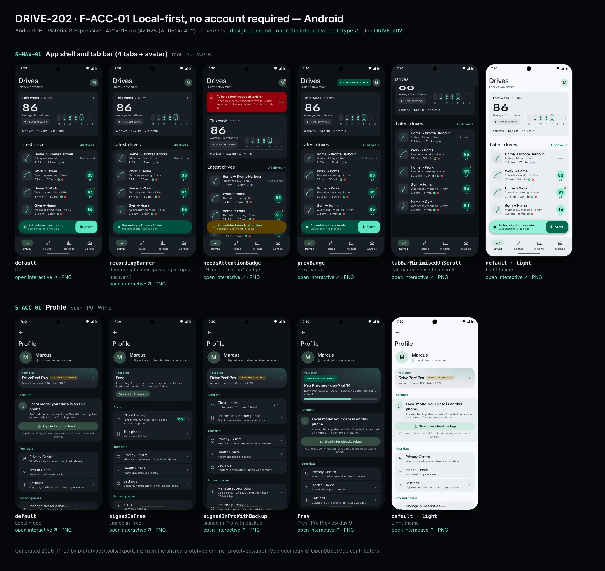
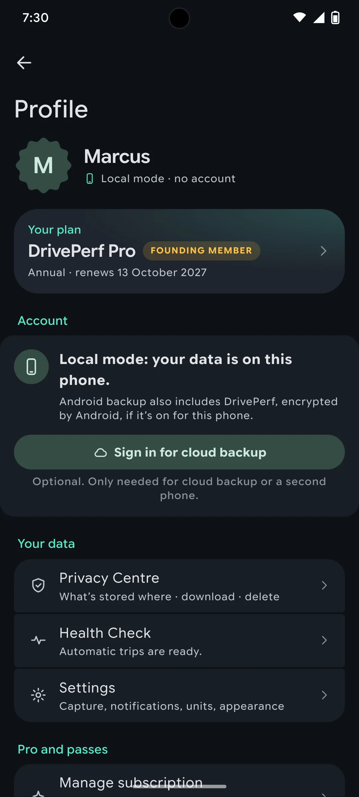
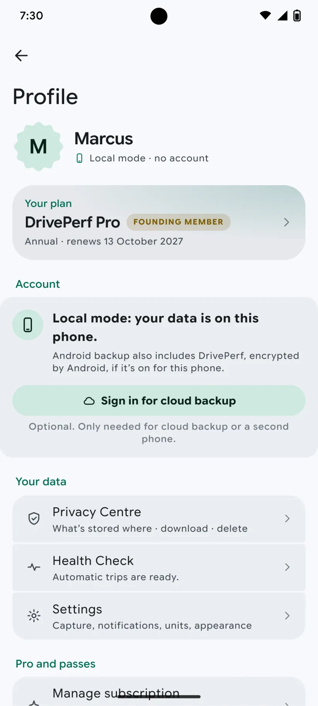

# DRIVE-202 · F-ACC-01 Local-first, no account required — Android design spec

> Generated by `prototypes/tools/export.mjs` on 2026-11-07 from the shared prototype engine. **Do not edit by hand:** change the screen's `spec` in `prototypes/app/screens/wp-*.js` (see `prototypes/app/AUTHORING.md`) and re-export.

- **Jira story:** [DRIVE-202](https://thekeval.atlassian.net/browse/DRIVE-202) · F-ACC-01 · P0
- **Platform:** Android 16 · Material 3 Expressive · 412×915 dp @2.625 (≈ 1081×2402)
- **Interactive prototype:** [../../../../prototypes/android/index.html#S-NAV-01](../../../../prototypes/android/index.html#S-NAV-01) (catalog panel: every screen and state; deep links `#S-ID/state?trip=…&ent=…&theme=light&text=xl&rm=1`)
- **Contact sheet:** [mockup.html](mockup.html) · 
- **Design system (source of truth for values):** [brand](../../system/brand.md) · [components](../../system/components.md) · [motion](../../system/motion.md) · [accessibility](../../system/accessibility.md) · [screen map](../../system/screen-map.md) · [fixtures](../../system/fixtures.md) · tokens `prototypes/shared/tokens.css`

## Screens in this story

| Screen | Name | Presentation | Priority | States | Status |
|---|---|---|---|---|---|
| `S-NAV-01` | App shell and tab bar (4 tabs + avatar) | Shell | P0 | 5 | Prototyped |
| `S-ACC-01` | Profile | Sheet (iOS, large) / Push (Android) from avatar | P0 | 4 | Prototyped |

## Tokens used on this platform

Values resolved from `prototypes/shared/tokens.css` inside the Android device (`[data-platform="android"]`). Use the token names in code; the hex values are for reference.

| Token | Dark | Light |
|---|---|---|
| `--app-bg` | `#0D1117` | `#F7F9FC` |
| `--card-bg` | `#191E25` | `#EBEEF2` |
| `--dp-bg-grouped` | `#0D1117` | `#F7F9FC` |
| `--dp-surface` | `#191E25` | `#EBEEF2` |
| `--dp-surface-2` | `#1F252D` | `#E5E8EC` |
| `--dp-surface-3` | `#2A3038` | `#DFE2E6` |
| `--dp-fill` | `#2A3038` | `#DFE2E6` |
| `--dp-fill-strong` | `#353B44` | `#D3D7DC` |
| `--dp-text` | `#E1E3E8` | `#181C20` |
| `--dp-text-2` | `#C0C7CF` | `#40474F` |
| `--dp-text-3` | `#8A929B` | `#707881` |
| `--dp-separator` | `#40474F` | `#C0C7CF` |
| `--dp-accent` | `#5BE7C4` | `#006B53` |
| `--dp-accent-text` | `#5BE7C4` | `#006B53` |
| `--dp-on-accent` | `#00382B` | `#FFFFFF` |
| `--dp-accent-container` | `#00513F` | `#91F1D8` |
| `--dp-record` | `#FFC24B` | `#7A5900` |
| `--dp-positive` | `#5BE7C4` | `#006B53` |
| `--dp-change-down` | `#C0C7CF` | `#40474F` |
| `--dp-warning` | `#F5B648` | `#7A5900` |
| `--dp-critical` | `#FFB4AB` | `#BA1A1A` |
| `--dp-glass-fill` | `#1F252DF2` | `#E5E8ECF2` |
| `--dp-glass-fill-strong` | `#2A3038` | `#DFE2E6` |
| `--dp-glass-stroke` | `#FFFFFF0F` | `#0000000A` |
| `--md-sys-color-primary` | `#5BE7C4` | `#006B53` |
| `--md-sys-color-on-primary` | `#00382B` | `#FFFFFF` |
| `--md-sys-color-primary-container` | `#00513F` | `#91F1D8` |
| `--md-sys-color-on-primary-container` | `#91F1D8` | `#002118` |
| `--md-sys-color-secondary-container` | `#344C44` | `#CEE9DF` |
| `--md-sys-color-surface` | `#0D1117` | `#F7F9FC` |
| `--md-sys-color-surface-container` | `#191E25` | `#EBEEF2` |
| `--md-sys-color-surface-container-high` | `#1F252D` | `#E5E8EC` |
| `--md-sys-color-on-surface-variant` | `#C0C7CF` | `#40474F` |
| `--dp-data-route` | `#5BE7C4` | `#079777` |
| `--dp-data-event-brake` | `#FF7A66` | `#A21F16` |
| `--dp-data-event-accel` | `#E58BD0` | `#A33A8C` |
| `--dp-data-event-corner` | `#EAD54E` | `#9A8A00` |
| `--dp-data-quality-good` | `#5FDB9C` | `#1E9E62` |
| `--dp-data-speed` | `#D6DCE4` | `#404A58` |
| `--dp-data-long-g` | `#5AB8F5` | `#0A6AB8` |
| `--dp-data-lat-g` | `#F5A142` | `#B25A00` |

| Type / layout token | Value |
|---|---|
| `--dp-font-screen-title` | `600 32px / 40px "Google Sans Flex", "Google Sans Display", "Roboto Flex", Roboto, system-ui, sans-serif` |
| `--dp-font-sheet-title` | `400 24px / 32px "Google Sans Flex", "Google Sans Display", "Roboto Flex", Roboto, system-ui, sans-serif` |
| `--dp-font-section-title` | `600 22px / 28px "Google Sans Flex", "Google Sans Display", "Roboto Flex", Roboto, system-ui, sans-serif` |
| `--dp-font-card-title` | `700 16px / 24px "Google Sans Flex", "Google Sans Text", "Roboto Flex", Roboto, system-ui, sans-serif` |
| `--dp-font-body` | `400 16px / 24px "Google Sans Flex", "Google Sans Text", "Roboto Flex", Roboto, system-ui, sans-serif` |
| `--dp-font-body-secondary` | `400 14px / 20px "Google Sans Flex", "Google Sans Text", "Roboto Flex", Roboto, system-ui, sans-serif` |
| `--dp-font-meta` | `400 12px / 16px "Google Sans Flex", "Google Sans Text", "Roboto Flex", Roboto, system-ui, sans-serif` |
| `--dp-font-caption` | `500 12px / 16px "Google Sans Flex", "Google Sans Text", "Roboto Flex", Roboto, system-ui, sans-serif` |
| `--dp-font-button` | `700 14px / 20px "Google Sans Flex", "Google Sans Text", "Roboto Flex", Roboto, system-ui, sans-serif` |
| `--dp-num-hero` | `600 72px / 72px "Google Sans Flex", "Roboto Flex", Roboto, system-ui, sans-serif` |
| `--dp-num-xl` | `600 48px / 52px "Google Sans Flex", "Roboto Flex", Roboto, system-ui, sans-serif` |
| `--dp-num-l` | `600 34px / 38px "Google Sans Flex", "Roboto Flex", Roboto, system-ui, sans-serif` |
| `--dp-num-m` | `600 24px / 28px "Google Sans Flex", "Roboto Flex", Roboto, system-ui, sans-serif` |
| `--dp-num-s` | `600 17px / 22px "Google Sans Flex", "Roboto Flex", Roboto, system-ui, sans-serif` |
| `--dp-num-xs` | `600 13px / 16px "Google Sans Flex", "Roboto Flex", Roboto, system-ui, sans-serif` |
| `--dp-screen-margin` | `16px` |
| `--dp-radius-card` | `16px` |
| `--dp-radius-card-hero` | `28px` |
| `--dp-radius-sheet` | `28px` |
| `--dp-radius-chip` | `8px` |
| `--dp-radius-button` | `999px` |
| `--dp-layout-list-row-min` | `56px` |
| `--dp-layout-touch-min` | `48px` |
| `--safe-top` | `40px` |
| `--safe-bottom` | `24px` |

Text sizes scale with `--dp-text-scale` (XL = 2.0×) and numerals with `--dp-num-scale` (XL = 1.3×). DP Numerals: Google Sans Flex wdth 120 wght 600, tabular.

---

## S-NAV-01 · App shell and tab bar (4 tabs + avatar)

- **Presentation:** root · tab: drives — screen map: “Shell”
- **Entry points:** App launch (after onboarding)
- **Leads to:** Tab roots S-HOME-01 · S-RTE-01 · S-STA-01 · S-GAR-01; avatar → S-ACC-01; accessory/toolbar → S-DRV-01 (recording) or S-HOME-02
- **PRD features:** F-HIS-01, F-RTE-02, F-GAR-01, F-ACC-01, F-HIS-04 · **Priority:** P0 · **WP:** B
- **Interactive:** [S-NAV-01](../../../../prototypes/android/index.html#S-NAV-01)

**Purpose.** The app shell (screen-map.md §1, validated): four tabs — Drives · Routes · Insights · Garage — with Profile moved to an avatar in the top-trailing corner of every tab root, and capture status always one glance away. Every other screen mounts inside it.

### States

| State | PRD label | Fixture params | Screenshot |
|---|---|---|---|
| `default` | Def | — | — · [open](../../../../prototypes/android/index.html#S-NAV-01) |
| `recordingBanner` | Recording banner (passenger trip or finalising) | — | — · [open](../../../../prototypes/android/index.html#S-NAV-01/recordingBanner) |
| `needsAttentionBadge` | “Needs attention” badge | `health=alwaysLost` | — · [open](../../../../prototypes/android/index.html#S-NAV-01/needsAttentionBadge) |
| `prevBadge` | Prev badge | `ent=preview` | — · [open](../../../../prototypes/android/index.html#S-NAV-01/prevBadge) |
| `tabBarMinimisedOnScroll` | Tab bar minimised on scroll | — | — · [open](../../../../prototypes/android/index.html#S-NAV-01/tabBarMinimisedOnScroll) |

Every state also renders in light/dark (`theme=light`), XL text (`text=xl`) and reduced motion (`rm=1`).

### Layout

- Tab roots: Drives S-HOME-01 · Routes S-RTE-01 · Insights S-STA-01 · Garage S-GAR-01 (icons DP_ICONS drives/routes/insights/garage).
- iOS: floating Liquid Glass tab bar (inset 16, bottom 21, height 62, selected = Glide icon + label inside a glass lens) + tabViewBottomAccessory capture capsule (50 pt, 8 above the bar) on all tabs.
- Android: NavigationBar (64 dp + 24 dp gesture area, surfaceContainer, indicator 56×32 secondaryContainer, labels always visible) + M3E floating toolbar (64 dp, primaryContainer) docked 16 dp above it on the Drives tab only.
- Avatar top-trailing on every tab root: iOS 38 pt glass circle (initial) · Android 40 dp Cookie12Sided secondaryContainer. Badge dot = needs attention; Preview badge beside it.
- Minimised on scroll (iOS): the bar shrinks to a 54 pt capsule showing only the selected icon; the accessory folds inline to its right. Android: the toolbar slides out on scroll down and back on scroll up; the navigation bar stays.

### Components & tokens

| Component | Tokens / spec |
|---|---|
| `tabBar` | iOS floating glass: inset 16, bottom 21, height 62, lens --dp-fill-strong · Android NavigationBar 64 dp + indicator 56×32 --md-sys-color-secondary-container · components.md §1 |
| `accessory` | iOS tabViewBottomAccessory glass 48 pt, 8 above tab bar · Android floating toolbar 64 dp --md-sys-color-primary-container, 16 above nav bar · Start: --dp-accent |
| `avatar` | see components.md |
| `previewBadge` | see components.md |
| `largeTitle` | --dp-font-screen-title (iOS 34/41 bold · Android 32/40) · components.md §2 |

### Interactions & navigation

- Tab tap → that tab root (iOS cross-fade + lens spring · Android fade-through). Re-tapping the current tab scrolls to top.
- Avatar → S-ACC-01 (iOS sheet, large detent, own NavigationStack · Android full-screen, shared axis X, predictive back).
- Accessory / toolbar → S-HOME-02 (ready), S-DRV-01 (recording), S-SET-05 (attention); Start → S-DRV-01 (trip start).
- Every navigation passes the D1 gate (router → DP.gate): while a driver trip is active only S-DRV-01/02/03 are reachable; content opened while moving waits on S-DRV-05.

### Motion

- Tab lens: spring.default slide between tabs · selection haptic.
- Minimise on scroll: spring.default (iOS) · toolbar 150 ms emphasizedAccelerate out / spring.fast in (Android).
- Recording banner: livePulse 2400 ms breathe on the dot; RM static.
- Trip start: accessory/toolbar expands into S-DRV-01 (container transform, spring.slow).

### Accessibility

- Tabs are a tablist: “Drives, tab, 1 of 4, selected”. Labels always visible on both platforms; iOS large-content viewer on long-press at AX sizes.
- Avatar: “Profile, needs attention” when badged. Preview badge: “Pro Preview, day 9 of 14”.
- The accessory never announces timer updates (no live region).

### Platform notes

- **Android (this spec):** NavigationBar (short) always visible; HorizontalFloatingToolbar on Drives; avatar in the top app bar trailing slot → full-screen destination.
- *iOS (for reference):* TabView + Tab, .tabBarMinimizeBehavior(.onScrollDown), .tabViewBottomAccessory { CaptureStatusAccessory() }; Profile is a glass toolbar item → sheet.

### Analytics

- `tab_selected {tab}`
- `profile_opened {source: avatar}`
- `capture_status_opened {source: accessory|toolbar}`

### Copy

| Key | Text |
|---|---|
| Tabs | Drives · Routes · Insights · Garage |
| Recording banner | Recording · {min} min · {km} km |
| Needs attention | Auto-detect needs attention |

### Free / Pro

Same shell for every plan. Preview: “PRO PREVIEW · DAY n” badge beside the avatar.

### Assets

[icon-drives.svg](assets/icon-drives.svg) · [icon-routes.svg](assets/icon-routes.svg) · [icon-insights.svg](assets/icon-insights.svg) · [icon-garage.svg](assets/icon-garage.svg) · [icon-record.svg](assets/icon-record.svg) · [icon-profile.svg](assets/icon-profile.svg) · [logo-a-loop.svg](assets/logo-a-loop.svg)

UI glyphs may be swapped for SF Symbols / Material Symbols Rounded equivalents; event-pin, quality and provenance glyphs must not be (components.md global rules).

### Checklist (accessibility.md §9)

- [ ] Light and dark both render, and contrast passes.
- [ ] The XL text state reflows with no truncation.
- [ ] The RM state is defined.
- [ ] Every control has a label; every chart and map has a summary sentence.
- [ ] Every target ≥ 44 pt / 48 dp (≥ 64 in-drive).
- [ ] No meaning by colour alone.
- [ ] Speed is neutral wherever it appears and absent from social or live surfaces.
- [ ] No streak, leaderboard, speed or “beat your time” language.
- [ ] Behaviour is defined while a trip is active (D1 gate).
- [ ] Haptics come from motion.md §6 only.

---

## S-ACC-01 · Profile

 

- **Presentation:** push (iOS sheet, Android push) · tab: profile — screen map: “Sheet (iOS, large) / Push (Android) from avatar”
- **Entry points:** Avatar on any tab root
- **Leads to:** S-ACC-02 · S-ACC-04 · S-PRV-01 · S-SET-01 · S-SUB-06 · S-SUB-01 · S-SHR-03 · S-SET-05
- **PRD features:** F-ACC-01 · **Priority:** P0 · **WP:** E
- **Interactive:** [S-ACC-01](../../../../prototypes/android/index.html#S-ACC-01)

**Purpose.** Account, plan and data controls in one calm place, opened from the avatar on every tab root (screen-map §1). Local mode is the default: every Free feature and the Pro Preview work without an account (F-ACC-01); sign-in is optional and only for cloud backup and a second phone.

### States

| State | PRD label | Fixture params | Screenshot |
|---|---|---|---|
| `default` | Local mode | — | [S-ACC-01.png](../../screens/android/S-ACC-01.webp) · [open](../../../../prototypes/android/index.html#S-ACC-01) |
| `signedInFree` | signed in Free | `ent=free` | [S-ACC-01--signedInFree.png](../../screens/android/S-ACC-01--signedInFree.webp) · [open](../../../../prototypes/android/index.html#S-ACC-01/signedInFree) |
| `signedInProWithBackup` | signed in Pro with backup | `ent=pro` | [S-ACC-01--signedInProWithBackup.png](../../screens/android/S-ACC-01--signedInProWithBackup.webp) · [open](../../../../prototypes/android/index.html#S-ACC-01/signedInProWithBackup) |
| `Prev` | Prev (Pro Preview day 9) | `ent=preview` | [S-ACC-01--Prev.png](../../screens/android/S-ACC-01--Prev.webp) · [open](../../../../prototypes/android/index.html#S-ACC-01/Prev) |
| default · light | Light theme | `theme=light` | [S-ACC-01--light.png](../../screens/android/S-ACC-01--light.webp) |

Every state also renders in light/dark (`theme=light`), XL text (`text=xl`) and reduced motion (`rm=1`).

### Layout

- iOS: sheet at the large detent with its own NavigationStack; header “Profile” + glass close. Android: full-screen destination (MediumFlexibleTopAppBar “Profile”, back arrow, predictive back).
- Identity row: 64 avatar (iOS circle on surface-3 · Android Cookie12Sided secondaryContainer) + name (cardTitle 20) + account line with glyph: “Local mode · no account” or “Signed in with Apple · Hide My Email address” (Android: Google).
- Plan card (hero, Glide tint 18%): kicker “YOUR PLAN”; Pro: “DrivePerf Pro” + gold “Founding member” capsule (Sodium is allowed for the founding badge) + “Annual · renews 13 October 2027” + chevron → S-SUB-06 · Free: “Free” + what’s free + tonal “See what Pro adds” → S-SUB-04 · Preview: Preview badge + “Pro Preview · day 9 of 14” + day progress bar → S-SUB-01.
- Account section: local = card “Local mode: your data is on this phone.” + the OS backup note (iCloud/computer backup on iOS, Android backup) + tonal “Sign in for cloud backup” + caption “Optional. Only needed for cloud backup or a second phone.” · signed in Free = Cloud backup row (PRO + lock, “On Free, no trip data leaves this phone.”) + This phone (30 drives · 186 MB) · signed in Pro = Cloud backup (On, up to date) + Restore on another phone.
- Your data: Privacy Centre · Health Check (summary; warning glyph when red) · Settings. Pro and passes: Manage subscription / Plans · Restore purchases · Give a Ride-along pass.
- Signed in only: Sign out · Delete account (destructive). Footer: Loop + “DrivePerf 1.0 · Never sold, never shared with insurers.”

### Components & tokens

| Component | Tokens / spec |
|---|---|
| `sheetHeader` | see components.md |
| `navBar` | --dp-font-card-title · --dp-font-meta · glass: --dp-glass-fill + --dp-glass-blur · components.md §2 |
| `card` | --dp-surface / --md-sys-color-surface-container · --dp-radius-card (24 iOS · 16 Android) · hero: --dp-radius-card-hero (32 · 28) · light iOS: --dp-elev-1 |
| `previewBadge` | see components.md |
| `button` | --dp-accent / --dp-on-accent (filled) · --dp-fill-strong · --md-sys-color-secondary-container (tonal) · --dp-radius-button · height iOS 50/44/34 · Android 56/40/32 · --dp-font-button · components.md §0 |
| `list` | iOS inset grouped radius --dp-radius-card, rows 52 pt, separators --dp-separator inset 16 · Android ListItem 56/72 dp in --md-sys-color-surface-container |
| `row` | --dp-font-body · --dp-font-meta (supporting) · --dp-layout-list-row-min |
| `section` | --dp-font-section-title · --dp-layout-section-gap 28 |

### Interactions & navigation

- Plan card → S-SUB-06 (Pro) · S-SUB-04 (Free) · S-SUB-01 (Preview / Ride-along).
- Sign in for cloud backup → S-ACC-02 · Cloud backup row → S-ACC-04 (Lock on Free) · Restore on another phone → S-ACC-06.
- Privacy Centre → S-PRV-01 · Health Check → S-SET-05 · Settings → S-SET-01 · Manage subscription → S-SUB-06 · Restore purchases → S-SUB-06 restore result · Give a Ride-along pass → S-SHR-03.
- Sign out → S-ACC-07 · Delete account → S-PRV-06. iOS: pushes happen inside the sheet’s NavigationStack (the prototype pushes full-screen). Drag down / close → back to the tab.
- Allowed for passengers; during a driver trip the avatar is unreachable (S-DRV-01 only).

### Motion

- Avatar pops in (scale .86 → 1, spring.default); blocks rise 8 px, 30 ms stagger. Sheet: spring.sheet (iOS large detent recedes the tab behind). Android: shared axis X. RM: cross-fade.

### Accessibility

- Sheet title “Profile” gets focus on open. Plan card is one button: “Your plan: DrivePerf Pro, founding member. Renews 13 October 2027. Manage subscription”.
- Health Check row reads its summary (“Automatic trips are ready.”); the warning state adds a triangle glyph and “needs attention” text.
- XL: rows wrap to two lines, the plan card button moves under the text, the avatar shrinks to 56.

### Platform notes

- **Android (this spec):** Avatar → full-screen destination (no tab bar), MediumFlexibleTopAppBar, M3E segmented ListItems on surfaceContainer, Cookie12Sided avatar.
- *iOS (for reference):* Avatar toolbar item → .sheet(.large) with NavigationStack; inset-grouped lists on the sheet’s elevated background; glass close.

### Analytics

- `profile_opened {signed_in, plan_state}`
- `sign_in_started {source: profile}`
- `ridealong_invite_opened {source: profile}`

### Copy

| Key | Text |
|---|---|
| Local mode | Local mode: your data is on this phone. |
| OS backup (iOS) | Your iPhone backup (iCloud or your computer) also includes DrivePerf, encrypted by iOS. |
| OS backup (Android) | Android backup also includes DrivePerf, encrypted by Android, if it’s on for this phone. |
| Sign-in note | Optional. Only needed for cloud backup or a second phone. |
| Free backup row | Cloud backup · Part of Pro. On Free, no trip data leaves this phone. |
| Footer | DrivePerf 1.0 · Never sold, never shared with insurers. |

### Free / Pro

Free: plan card “Free” + See what Pro adds; backup row locked. Pro: founding/annual or monthly details. Preview / Ride-along: badge + day progress (a countdown of the Preview, not a streak).

### Data & fixtures

User Marcus (DP_DATA.user, local mode). Default = entitlement.current pro (founding annual, renews 2027-10-13) bought without an account (F-ACC-01.3). Storage from privacy.dataSize (30 drives · 186 MB). Health summary from health.presets (allGood unless the health param is set). Signed-in provider/email are prototype values (Apple Hide My Email on iOS, Google on Android): DP_DATA.user.account has none.

### Assets

[icon-phone.svg](assets/icon-phone.svg) · [icon-cloud.svg](assets/icon-cloud.svg) · [icon-shield.svg](assets/icon-shield.svg) · [icon-health.svg](assets/icon-health.svg) · [icon-warn.svg](assets/icon-warn.svg) · [icon-gear.svg](assets/icon-gear.svg) · [icon-sparkle.svg](assets/icon-sparkle.svg) · [icon-refresh.svg](assets/icon-refresh.svg) · [icon-heart.svg](assets/icon-heart.svg) · [icon-export.svg](assets/icon-export.svg) · [icon-trash.svg](assets/icon-trash.svg) · [icon-check.svg](assets/icon-check.svg) · [icon-chevronRight.svg](assets/icon-chevronRight.svg) · [logo-a-loop.svg](assets/logo-a-loop.svg)

UI glyphs may be swapped for SF Symbols / Material Symbols Rounded equivalents; event-pin, quality and provenance glyphs must not be (components.md global rules).

### Checklist (accessibility.md §9)

- [ ] Light and dark both render, and contrast passes.
- [ ] The XL text state reflows with no truncation.
- [ ] The RM state is defined.
- [ ] Every control has a label; every chart and map has a summary sentence.
- [ ] Every target ≥ 44 pt / 48 dp (≥ 64 in-drive).
- [ ] No meaning by colour alone.
- [ ] Speed is neutral wherever it appears and absent from social or live surfaces.
- [ ] No streak, leaderboard, speed or “beat your time” language.
- [ ] Behaviour is defined while a trip is active (D1 gate).
- [ ] Haptics come from motion.md §6 only.

---

Map geometry in the prototype: © OpenStreetMap contributors (ODbL). Speed and G are simulated fixtures (fixtures.md).
