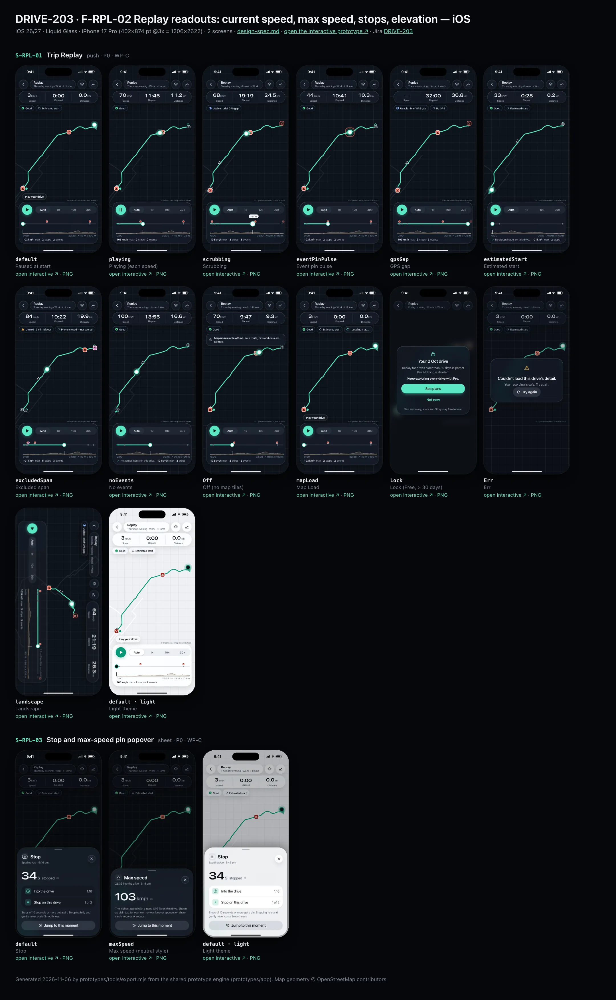
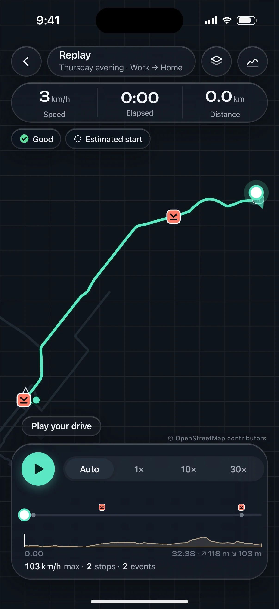
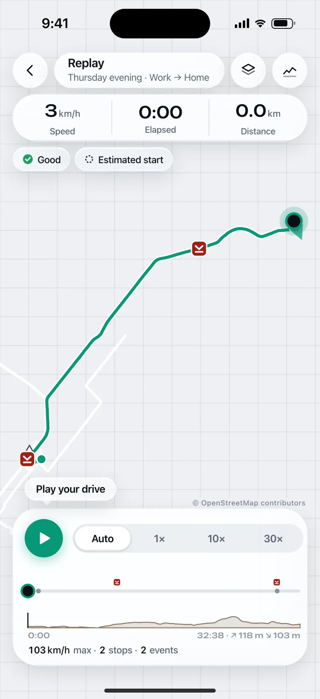
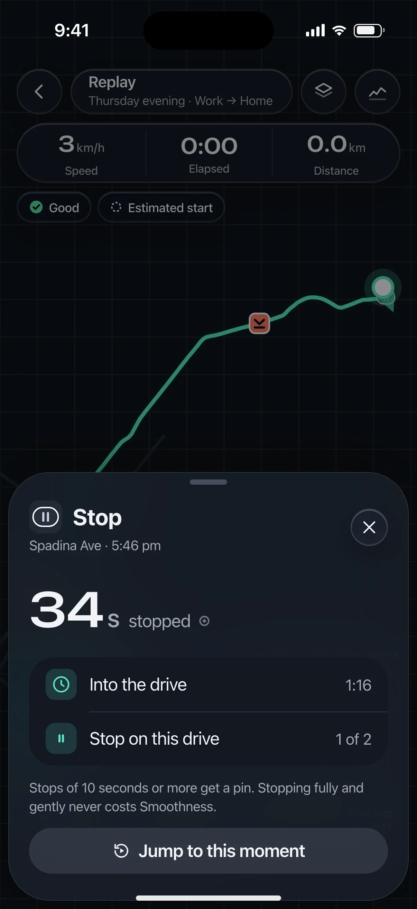
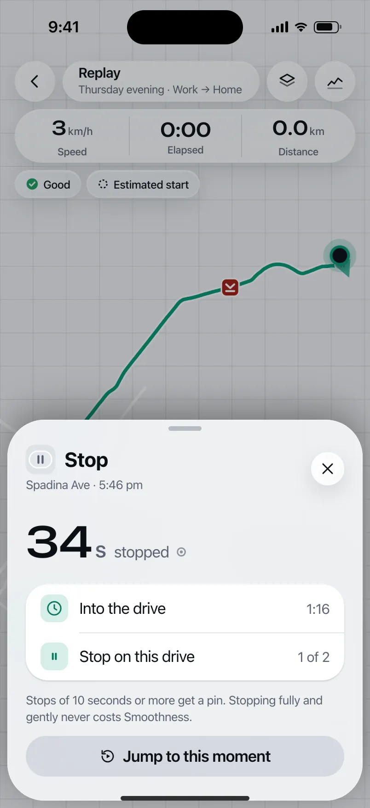

# DRIVE-203 · F-RPL-02 Replay readouts: current speed, max speed, stops, elevation — iOS design spec

> Generated by `prototypes/tools/export.mjs` on 2026-11-06 from the shared prototype engine. **Do not edit by hand:** change the screen's `spec` in `prototypes/app/screens/wp-*.js` (see `prototypes/app/AUTHORING.md`) and re-export.

- **Jira story:** [DRIVE-203](https://thekeval.atlassian.net/browse/DRIVE-203) · F-RPL-02 · P0
- **Platform:** iOS 26/27 · Liquid Glass · iPhone 17 Pro (402×874 pt @3x = 1206×2622)
- **Interactive prototype:** [../../../../prototypes/ios/index.html#S-RPL-01](../../../../prototypes/ios/index.html#S-RPL-01) (catalog panel: every screen and state; deep links `#S-ID/state?trip=…&ent=…&theme=light&text=xl&rm=1`)
- **Contact sheet:** [mockup.html](mockup.html) · 
- **Design system (source of truth for values):** [brand](../../system/brand.md) · [components](../../system/components.md) · [motion](../../system/motion.md) · [accessibility](../../system/accessibility.md) · [screen map](../../system/screen-map.md) · [fixtures](../../system/fixtures.md) · tokens `prototypes/shared/tokens.css`

## Screens in this story

| Screen | Name | Presentation | Priority | States | Status |
|---|---|---|---|---|---|
| `S-RPL-01` | Trip Replay | Push (immersive) | P0 | 13 | Prototyped |
| `S-RPL-03` | Stop and max-speed pin popover | Popover / small sheet | P0 | 2 | Prototyped |

## Tokens used on this platform

Values resolved from `prototypes/shared/tokens.css` inside the iOS device (`[data-platform="ios"]`). Use the token names in code; the hex values are for reference.

| Token | Dark | Light |
|---|---|---|
| `--app-bg` | `#080B10` | `#F2F3F6` |
| `--card-bg` | `#131822` | `#FFFFFF` |
| `--dp-bg-grouped` | `#080B10` | `#F2F3F6` |
| `--dp-surface` | `#131822` | `#FFFFFF` |
| `--dp-surface-2` | `#1B222D` | `#F2F3F6` |
| `--dp-surface-3` | `#262E3B` | `#E4E7EC` |
| `--dp-fill` | `#7880961F` | `#7880961F` |
| `--dp-fill-strong` | `#7880963D` | `#78809633` |
| `--dp-text` | `#F2F4F7` | `#0B0E13` |
| `--dp-text-2` | `#A3AAB6` | `#5A6271` |
| `--dp-text-3` | `#6E7787` | `#8A919D` |
| `--dp-separator` | `#96A0B429` | `#3C435024` |
| `--dp-accent` | `#5BE7C4` | `#079777` |
| `--dp-accent-text` | `#5BE7C4` | `#06775E` |
| `--dp-on-accent` | `#04241D` | `#FFFFFF` |
| `--dp-accent-container` | `#0A4439` | `#C6F8EA` |
| `--dp-record` | `#FFC24B` | `#9A6300` |
| `--dp-positive` | `#5BE7C4` | `#06775E` |
| `--dp-change-down` | `#A3AAB6` | `#5A6271` |
| `--dp-warning` | `#F5B648` | `#9A5F00` |
| `--dp-critical` | `#FF6B6B` | `#C62828` |
| `--dp-glass-fill` | `#1C222C6B` | `#FFFFFF8C` |
| `--dp-glass-fill-strong` | `#1C222CB8` | `#FFFFFFD1` |
| `--dp-glass-stroke` | `#FFFFFF24` | `#FFFFFF99` |
| `--dp-data-route` | `#5BE7C4` | `#079777` |
| `--dp-data-event-brake` | `#FF7A66` | `#A21F16` |
| `--dp-data-event-accel` | `#E58BD0` | `#A33A8C` |
| `--dp-data-event-corner` | `#EAD54E` | `#9A8A00` |
| `--dp-data-quality-good` | `#5FDB9C` | `#1E9E62` |
| `--dp-data-speed` | `#D6DCE4` | `#404A58` |
| `--dp-data-long-g` | `#5AB8F5` | `#0A6AB8` |
| `--dp-data-lat-g` | `#F5A142` | `#B25A00` |

| Type / layout token | Value |
|---|---|
| `--dp-font-screen-title` | `700 34px / 41px -apple-system, BlinkMacSystemFont, "SF Pro Display", system-ui, sans-serif` |
| `--dp-font-sheet-title` | `700 22px / 28px -apple-system, BlinkMacSystemFont, "SF Pro Display", system-ui, sans-serif` |
| `--dp-font-section-title` | `600 20px / 25px -apple-system, BlinkMacSystemFont, "SF Pro Display", system-ui, sans-serif` |
| `--dp-font-card-title` | `600 17px / 22px -apple-system, BlinkMacSystemFont, "SF Pro Text", system-ui, sans-serif` |
| `--dp-font-body` | `400 17px / 22px -apple-system, BlinkMacSystemFont, "SF Pro Text", system-ui, sans-serif` |
| `--dp-font-body-secondary` | `400 15px / 20px -apple-system, BlinkMacSystemFont, "SF Pro Text", system-ui, sans-serif` |
| `--dp-font-meta` | `400 13px / 18px -apple-system, BlinkMacSystemFont, "SF Pro Text", system-ui, sans-serif` |
| `--dp-font-caption` | `400 12px / 16px -apple-system, BlinkMacSystemFont, "SF Pro Text", system-ui, sans-serif` |
| `--dp-font-button` | `600 17px / 22px -apple-system, BlinkMacSystemFont, "SF Pro Text", system-ui, sans-serif` |
| `--dp-num-hero` | `600 72px / 72px -apple-system, BlinkMacSystemFont, "SF Pro Display", system-ui, sans-serif` |
| `--dp-num-xl` | `600 48px / 52px -apple-system, BlinkMacSystemFont, "SF Pro Display", system-ui, sans-serif` |
| `--dp-num-l` | `600 34px / 38px -apple-system, BlinkMacSystemFont, "SF Pro Display", system-ui, sans-serif` |
| `--dp-num-m` | `600 24px / 28px -apple-system, BlinkMacSystemFont, "SF Pro Display", system-ui, sans-serif` |
| `--dp-num-s` | `600 17px / 22px -apple-system, BlinkMacSystemFont, "SF Pro Display", system-ui, sans-serif` |
| `--dp-num-xs` | `600 13px / 16px -apple-system, BlinkMacSystemFont, "SF Pro Display", system-ui, sans-serif` |
| `--dp-screen-margin` | `16px` |
| `--dp-radius-card` | `24px` |
| `--dp-radius-card-hero` | `32px` |
| `--dp-radius-sheet` | `38px` |
| `--dp-radius-chip` | `999px` |
| `--dp-radius-button` | `999px` |
| `--dp-layout-list-row-min` | `52px` |
| `--dp-layout-touch-min` | `44px` |
| `--safe-top` | `62px` |
| `--safe-bottom` | `34px` |

Text sizes scale with `--dp-text-scale` (XL = 2.0×) and numerals with `--dp-num-scale` (XL = 1.3×). DP Numerals: SF Pro Expanded Semibold, tabular.

---

## S-RPL-01 · Trip Replay

 

- **Presentation:** push · tab: drives — screen map: “Push (immersive)”
- **Entry points:** S-STY-01 f7 · S-TRP-01 · S-SCO-03 evidence links
- **Leads to:** S-RPL-02 (pin) · S-RPL-03 (stop/max pin) · S-RPL-04 (layers) · S-ANL-01 · S-DQ-01 · S-SUB-03 (Lock)
- **PRD features:** F-RPL-01, F-RPL-02, F-RPL-03, F-RPL-08, F-CAP-05, F-DQ-02, F-DQ-03, F-DQ-04, F-SCO-04 · **Priority:** P0 · **WP:** C
- **Interactive:** [S-RPL-01](../../../../prototypes/ios/index.html#S-RPL-01)

**Purpose.** Watch the drive replay on a map with a moving marker, so the user can relive and understand it (F-RPL-01), with speed-neutral readouts, max speed, stops and elevation (F-RPL-02), tappable event pins by shape (F-RPL-03) and honest quality overlays (F-RPL-08). Benchmark: Mileon replay; DrivePerf adds evidence pins.

### States

| State | PRD label | Fixture params | Screenshot |
|---|---|---|---|
| `default` | Paused at start | `trip=t20261105-1745` | [S-RPL-01.png](../../screens/ios/S-RPL-01.webp) · [open](../../../../prototypes/ios/index.html#S-RPL-01) |
| `playing` | Playing (each speed) | `trip=t20261105-1745` | [S-RPL-01--playing.png](../../screens/ios/S-RPL-01--playing.webp) · [open](../../../../prototypes/ios/index.html#S-RPL-01/playing) |
| `scrubbing` | Scrubbing | `trip=t20261020-0740` | [S-RPL-01--scrubbing.png](../../screens/ios/S-RPL-01--scrubbing.webp) · [open](../../../../prototypes/ios/index.html#S-RPL-01/scrubbing) |
| `eventPinPulse` | Event pin pulse | `trip=t20261105-1745` | [S-RPL-01--eventPinPulse.png](../../screens/ios/S-RPL-01--eventPinPulse.webp) · [open](../../../../prototypes/ios/index.html#S-RPL-01/eventPinPulse) |
| `gpsGap` | GPS gap | `trip=t20261020-0740` | [S-RPL-01--gpsGap.png](../../screens/ios/S-RPL-01--gpsGap.webp) · [open](../../../../prototypes/ios/index.html#S-RPL-01/gpsGap) |
| `estimatedStart` | Estimated start | `trip=t20261105-0742` | [S-RPL-01--estimatedStart.png](../../screens/ios/S-RPL-01--estimatedStart.webp) · [open](../../../../prototypes/ios/index.html#S-RPL-01/estimatedStart) |
| `excludedSpan` | Excluded span | `trip=t20261027-1728` | [S-RPL-01--excludedSpan.png](../../screens/ios/S-RPL-01--excludedSpan.webp) · [open](../../../../prototypes/ios/index.html#S-RPL-01/excludedSpan) |
| `noEvents` | No events | `trip=t20261105-0742` | [S-RPL-01--noEvents.png](../../screens/ios/S-RPL-01--noEvents.webp) · [open](../../../../prototypes/ios/index.html#S-RPL-01/noEvents) |
| `Off` | Off (no map tiles) | `trip=t20261105-1745` | [S-RPL-01--Off.png](../../screens/ios/S-RPL-01--Off.webp) · [open](../../../../prototypes/ios/index.html#S-RPL-01/Off) |
| `mapLoad` | Map Load | `trip=t20261105-1745` | [S-RPL-01--mapLoad.png](../../screens/ios/S-RPL-01--mapLoad.webp) · [open](../../../../prototypes/ios/index.html#S-RPL-01/mapLoad) |
| `Lock` | Lock (Free, > 30 days) | `trip=t20261002-0745` `ent=free` | [S-RPL-01--Lock.png](../../screens/ios/S-RPL-01--Lock.webp) · [open](../../../../prototypes/ios/index.html#S-RPL-01/Lock) |
| `Err` | Err | `trip=t20261105-1745` | [S-RPL-01--Err.png](../../screens/ios/S-RPL-01--Err.webp) · [open](../../../../prototypes/ios/index.html#S-RPL-01/Err) |
| `landscape` | Landscape | `trip=t20261020-0740` | [S-RPL-01--landscape.png](../../screens/ios/S-RPL-01--landscape.webp) · [open](../../../../prototypes/ios/index.html#S-RPL-01/landscape) |
| default · light | Light theme | `theme=light` | [S-RPL-01--light.png](../../screens/ios/S-RPL-01--light.webp) |

Every state also renders in light/dark (`theme=light`), XL text (`text=xl`) and reduced motion (`rm=1`).

### Layout

- Immersive push (no tab bar, no accessory). Full-bleed map (MapKit / Google Maps or MapLibre; prototype: plain canvas from trip.track) fitted to the route between the top cluster and the playback bar; “© OpenStreetMap contributors” bottom-right above the playback bar.
- Route: Glide 3.8 px on a 7.5 px casing · estimated start dashed 4/4 at 60% · GPS gap dotted (`--dp-data-gap-stroke` 1/6) · excluded span dotted grey · start ring and end dot · stop capsules · neutral outline max-speed triangle (no animation) · event pins 26 by shape (braking rounded square, acceleration circle, cornering diamond; needed = hollow).
- Marker: 16 px white dot with a 3 px Glide ring, 36 px halo at 20%, 18 px heading wedge (40°). Position = interpolated track sample at time t (display-only).
- Top cluster (safe-top + 4, 16 margins): bar = glass back (44) · glass title capsule “Replay” + part of day · label · glass Layers (→ S-RPL-04) · glass Analysis (→ S-ANL-01). Readouts capsule 56 tall: Speed · Elapsed · Distance (DP Numerals 24, units 50%, labels caption text2, 0.5 px separators) — speed is neutral text, never coloured. Chip row: quality badge (glass) + contextual span chip (“Estimated start” / “No GPS” / “Phone moved — not scored”).
- Playback bar (16 inset, above the home indicator; iOS glass radius 30 · Android floating toolbar radius 28): play/pause 48 (iOS glass prominent circle · Android FAB-style primaryContainer radius 16) + speed selector Auto · 1× · 10× · 30× (iOS glass segmented · Android connected button group) · scrubber (4 px track, played Glide, event ticks 12 px above, stop ticks, gap and estimated overlays, 16 px thumb → 22 while dragging, time bubble) · elevation mini-profile 24 px with a synced cursor + “↗ 118 m ↘ 103 m” · summary line “103 km/h max · 2 stops · 2 events” (neutral).
- Lock (Free, > 30 days): the trip’s own map blurred 14 px + centred glass card: lock · “Your 2 Oct drive” · “Replay for drives older than 30 days is part of Pro. Nothing is deleted.” · “Keep exploring every drive with Pro.” · See plans (filled) · Not now (text) · “Your summary, score and Story stay free forever.”
- Off: plain canvas (no road layer) + glass note “Map unavailable offline. Your route, pins and data are all here.” · map Load: route drawn over a breathing skeleton land + “Loading map…” · Err: centred glass error card with Try again.
- Landscape: map full-bleed, title/readouts in one top row, playback bar one row (play · speed · scrubber), 60 pt side insets for the island.

### Components & tokens

| Component | Tokens / spec |
|---|---|
| `map` | --dp-data-map-land/road/grid · route --dp-data-route 3.8 + casing --dp-data-route-casing 7.5 · estimated dashed 4/4 at 60% · gap --dp-data-gap-stroke dotted 1/6 · pins DP_ICONS.pin 26 · attribution “© OpenStreetMap contributors” |
| `scrubber` | see components.md |
| `segmented` | see components.md |
| `qualityBadge` | --dp-data-quality-{good\|usable\|limited\|unscorable} · components.md §10 |
| `chip` | --dp-radius-chip (iOS capsule · Android 8) · height 28 · --dp-font-caption |
| `iconButton` | see components.md |
| `backButton` | see components.md |
| `button` | --dp-accent / --dp-on-accent (filled) · --dp-fill-strong · --md-sys-color-secondary-container (tonal) · --dp-radius-button · height iOS 50/44/34 · Android 56/40/32 · --dp-font-button · components.md §0 |
| `error` | see components.md |
| `loader` | see components.md |
| `markerHtml (local)` | see components.md |
| `rplReadouts (local)` | see components.md |

### Interactions & navigation

- Play/Pause toggles playback; t += dt × rate (Auto = whole trip in ~60 s, 1×, 10×, 30×); reaching the end pauses; Play at the end restarts.
- Speed selector changes rate immediately (haptic selection). XL: a single “Speed: Auto” button cycles speeds.
- Scrubber: drag (or tap) moves the marker and every readout in the same frame (≤ 100 ms, F-RPL-01.3); within 8 px of an event tick it snaps (haptic selection); release resumes the previous play state. Keyboard / VoiceOver adjustable: ±30 s.
- Event pin tap → pauses, selects the pin (1.18×, others dim to 50%), haptic tap, opens S-RPL-02 (medium detent) with trip + event. Stop pin → S-RPL-03 (stop) · max-speed pin → S-RPL-03/maxSpeed.
- Quality badge → S-DQ-01 · Layers → S-RPL-04 (changes apply immediately and persist) · Analysis → S-ANL-01 (Lock → S-SUB-03 replayAnalysis30Days) · Back → S-TRP-01 (or the Story).
- D1 gate: requested during a driver trip or while moving → S-DRV-05.

### Motion

- Hero: the marker. It moves continuously from the display clock (rAF dt, 120 Hz capable); the heading wedge follows the path.
- On load: route draw-on 1800 ms, then event pins pop in time order (shared.pinPop, 40 ms stagger); the max-speed pin appears with the route, never animated.
- Pin pulse when the marker passes an event: ring scale 1 → 2.4, opacity 0.75 → 0, 600 ms ease.glide, once; no sound, no haptic (F-RPL-03.2).
- GPS gap: the marker hides at the gap and reappears after it; the “No GPS” chip appears and the speed readout shows “—”.
- Scrubbing: thumb grows to 22 (spring.fast); the time bubble rides above it.
- RM: no draw-on or pin pop (fade in); the pulse becomes a 600 ms outline highlight with no scale; the marker still moves because playback is user-initiated.

### Accessibility

- Map container: “Map of your drive, 39 kilometres from Work to Home. 2 events, 2 stops.” Pins are buttons in time order, then stops, then max speed: “Hard braking at the Gardiner, 5:56 pm. Peak 0.40 g.”
- Scrubber: “Replay position, 12 min of 33 min. Speed 92 kilometres per hour.” Adjustable ±30 s; custom actions Next event / Previous event / Next stop (native).
- Play/Pause: “Play replay” / “Pause replay”; speed segmented is a tab list (“Auto, selected”). Readouts are not a live region.
- Every pin hit area ≥ 44 pt / 48 dp; colliding pins cluster natively.
- Speed is plain text in `--dp-text`; max speed is an outline triangle with no emphasis (D5/D6).

### Platform notes

- **iOS (this spec):** MapKit with `.mapStyle(.standard(emphasis: .muted))`; glass title capsule, readouts and playback bar (`.glassEffect(.regular)`), glass segmented speed control, glass prominent play button; marker as a MapKit annotation driven by CADisplayLink.
- *Android (for reference):* Google Maps SDK / MapLibre; top bar items as tonal icon buttons, readouts in a tonal toolbar (surface-container-high, radius 20); M3E floating toolbar for playback with an attached FAB-style play (primaryContainer, radius 16) and a connected button group for speed (selected segment morphs to a pill).

### Analytics

- `replay_opened {source}`
- `replay_played {speed}`
- `replay_scrubbed`
- `replay_completed`
- `event_pin_tapped {type, confidence}`
- `replay_pin_tapped {type: max_speed|stop}`
- `quality_overlay_legend_opened`
- `locked_content_viewed {type: replay, age_bucket}`

### Copy

| Key | Text |
|---|---|
| Title | Replay · {partOfDay} · {label} |
| Readouts | Speed · Elapsed · Distance |
| Hint | Play your drive |
| Spans | Estimated start · No GPS · Phone moved — not scored |
| No events | No abrupt inputs on this drive. |
| Offline | Map unavailable offline. Your route, pins and data are all here. |
| Loading | Loading map… |
| Error | Couldn’t load this drive’s detail. Your recording is safe. Try again. |
| Lock | Your {date} drive · Replay for drives older than 30 days is part of Pro. Nothing is deleted. · Keep exploring every drive with Pro. · See plans · Not now · Your summary, score and Story stay free forever. |

### Free / Pro

Free for drives in the last 30 days; older drives are Pro (Gate 2 OQ-06): the Lock state blurs this trip’s own map and links to S-SUB-03 replayAnalysis30Days. Pro, Preview and Ride-along: no lock.

### Data & fixtures

States → trips: default/playing/eventPinPulse/Off/mapLoad/Err t20261105-1745 · scrubbing/gpsGap/landscape t20261020-0740 (gap 1899–1940 s, needed brake at Spadina & King) · estimatedStart/noEvents t20261105-0742 · excludedSpan t20261027-1728 · Lock t20261002-0745 (ent=free). Marker, readouts and elevation cursor are derived from trip.track via util.sampleAt; distance-so-far is derived by integrating track positions, scaled to trip.distanceKm.

### Assets

[icon-play.svg](assets/icon-play.svg) · [icon-pause.svg](assets/icon-pause.svg) · [icon-layers.svg](assets/icon-layers.svg) · [icon-analysis.svg](assets/icon-analysis.svg) · [icon-lock.svg](assets/icon-lock.svg) · [icon-gps.svg](assets/icon-gps.svg) · [icon-check.svg](assets/icon-check.svg) · [icon-chevronLeft.svg](assets/icon-chevronLeft.svg)

UI glyphs may be swapped for SF Symbols / Material Symbols Rounded equivalents; event-pin, quality and provenance glyphs must not be (components.md global rules).

### Checklist (accessibility.md §9)

- [ ] Light and dark both render, and contrast passes.
- [ ] The XL text state reflows with no truncation.
- [ ] The RM state is defined.
- [ ] Every control has a label; every chart and map has a summary sentence.
- [ ] Every target ≥ 44 pt / 48 dp (≥ 64 in-drive).
- [ ] No meaning by colour alone.
- [ ] Speed is neutral wherever it appears and absent from social or live surfaces.
- [ ] No streak, leaderboard, speed or “beat your time” language.
- [ ] Behaviour is defined while a trip is active (D1 gate).
- [ ] Haptics come from motion.md §6 only.

---

## S-RPL-03 · Stop and max-speed pin popover

 

- **Presentation:** sheet · tab: drives · detent: auto — screen map: “Popover / small sheet”
- **Entry points:** S-RPL-01 stop or max-speed pin
- **Leads to:** Dismiss
- **PRD features:** F-RPL-02 · **Priority:** P0 · **WP:** C
- **Interactive:** [S-RPL-03](../../../../prototypes/ios/index.html#S-RPL-03)

**Purpose.** Show a stop’s duration and time of day, or the max speed reached, when its pin is tapped (F-RPL-02.2/.3). Max speed follows the speed-neutral rule.

### States

| State | PRD label | Fixture params | Screenshot |
|---|---|---|---|
| `default` | Stop | `trip=t20261105-1745` `stop=0` | [S-RPL-03.png](../../screens/ios/S-RPL-03.webp) · [open](../../../../prototypes/ios/index.html#S-RPL-03) |
| `maxSpeed` | Max speed (neutral style) | `trip=t20261105-1745` | [S-RPL-03--maxSpeed.png](../../screens/ios/S-RPL-03--maxSpeed.webp) · [open](../../../../prototypes/ios/index.html#S-RPL-03/maxSpeed) |
| default · light | Light theme | `theme=light` | [S-RPL-03--light.png](../../screens/ios/S-RPL-03--light.webp) |

Every state also renders in light/dark (`theme=light`), XL text (`text=xl`) and reduced motion (`rm=1`).

### Layout

- Small sheet (iOS `.presentationDetents([.fraction(0.32)])` with `.presentationCompactAdaptation(.popover)` on iPad; Android small ModalBottomSheet). Auto height.
- Header: pin glyph (stop capsule / outline triangle) + title “Stop” / “Max speed” + “{road} · {time}” / “{elapsed} into the drive · {time}”.
- Value: DP Numerals 48 in `--dp-text` (never accent, never coloured) + unit 50% + provenance glyph.
- Stop: list rows Into the drive · Stop n of m. Max speed: one explanatory line.
- Action: “Jump to this moment” (tonal, block) → moves the replay marker there and closes.

### Components & tokens

| Component | Tokens / spec |
|---|---|
| `sheetHeader` | see components.md |
| `list` | iOS inset grouped radius --dp-radius-card, rows 52 pt, separators --dp-separator inset 16 · Android ListItem 56/72 dp in --md-sys-color-surface-container |
| `row` | --dp-font-body · --dp-font-meta (supporting) · --dp-layout-list-row-min |
| `button` | --dp-accent / --dp-on-accent (filled) · --dp-fill-strong · --md-sys-color-secondary-container (tonal) · --dp-radius-button · height iOS 50/44/34 · Android 56/40/32 · --dp-font-button · components.md §0 |
| `provenance` | see components.md |

### Interactions & navigation

- Jump to this moment → back to S-RPL-01 with the marker at that time (paused).
- Drag down / scrim / close → dismiss.

### Motion

- spring.sheet in/out; no animation, glow or haptic on the max-speed value (motion.md §3.6). RM: cross-fade.

### Accessibility

- “Max speed 103 kilometres per hour. Derived.” · “Stopped for 34 seconds. Derived.”
- The value is static text, not a live region; no emphasis traits.

### Platform notes

- **iOS (this spec):** Small glass sheet (popover on iPad).
- *Android (for reference):* Small ModalBottomSheet; FilledTonalButton.

### Analytics

- `replay_pin_tapped {type: max_speed|stop}`

### Copy

| Key | Text |
|---|---|
| Stop | Stop · {road} · {time} · {n} s stopped · Stops of 10 seconds or more get a pin. Stopping fully and gently never costs Smoothness. |
| Max | Max speed · {elapsed} into the drive · {time} · The highest speed with a good GPS fix on this drive. Shown as plain text for your own review; it never appears on share cards, records or recaps. |
| Action | Jump to this moment |

### Free / Pro

Same window as Replay.

### Data & fixtures

Stop: trip.stops[stop] (t20261105-1745 stop 0, Spadina Ave, 34 s). Max: trip.maxKmh + trip.maxAt.t. Time of day = trip.start + t (derived).

### Assets

[icon-clock.svg](assets/icon-clock.svg) · [icon-pinStop.svg](assets/icon-pinStop.svg) · [icon-replay.svg](assets/icon-replay.svg)

UI glyphs may be swapped for SF Symbols / Material Symbols Rounded equivalents; event-pin, quality and provenance glyphs must not be (components.md global rules).

### Checklist (accessibility.md §9)

- [ ] Light and dark both render, and contrast passes.
- [ ] The XL text state reflows with no truncation.
- [ ] The RM state is defined.
- [ ] Every control has a label; every chart and map has a summary sentence.
- [ ] Every target ≥ 44 pt / 48 dp (≥ 64 in-drive).
- [ ] No meaning by colour alone.
- [ ] Speed is neutral wherever it appears and absent from social or live surfaces.
- [ ] No streak, leaderboard, speed or “beat your time” language.
- [ ] Behaviour is defined while a trip is active (D1 gate).
- [ ] Haptics come from motion.md §6 only.

---

Map geometry in the prototype: © OpenStreetMap contributors (ODbL). Speed and G are simulated fixtures (fixtures.md).
